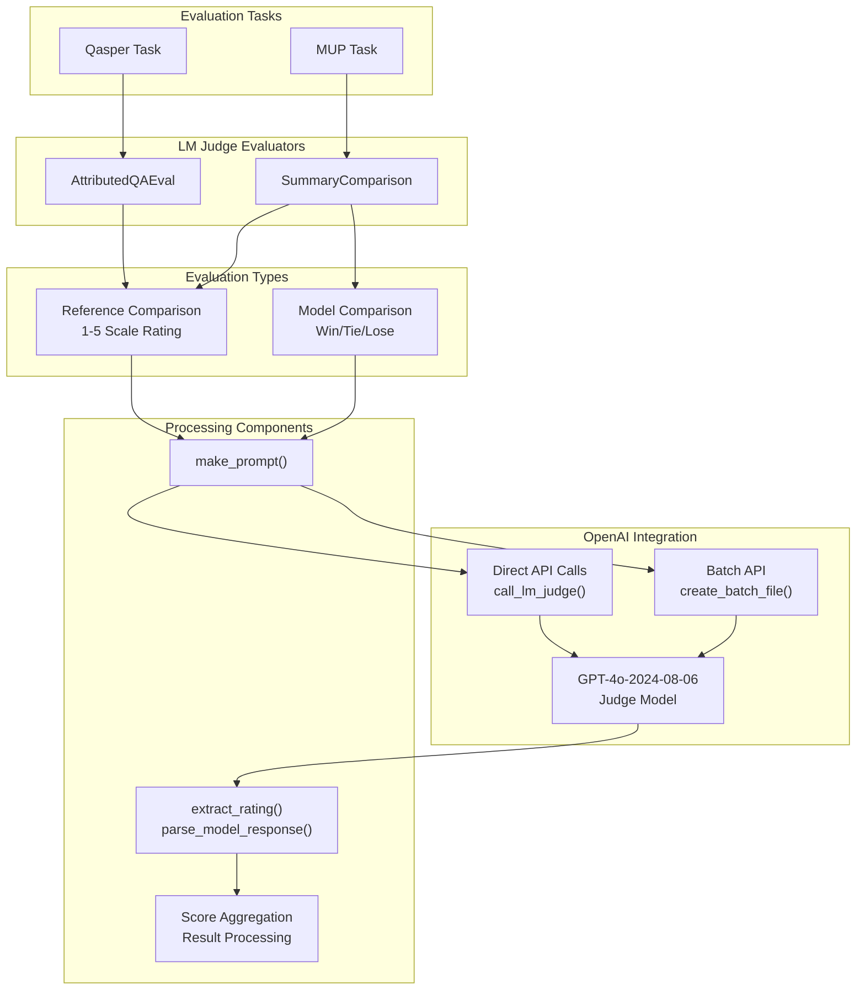
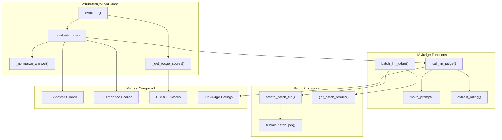
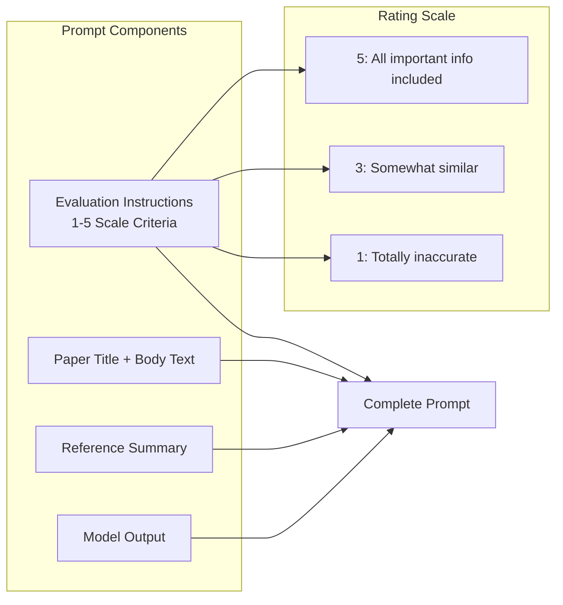
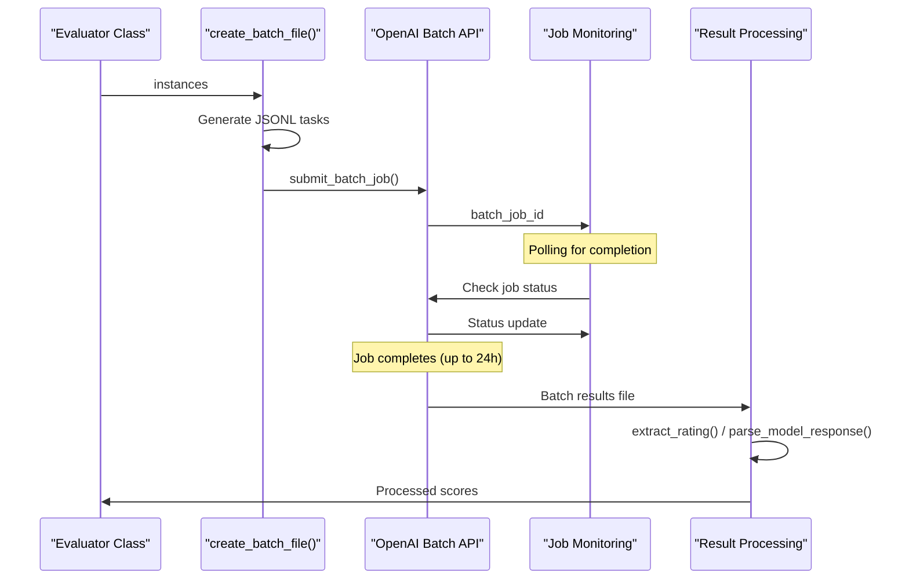
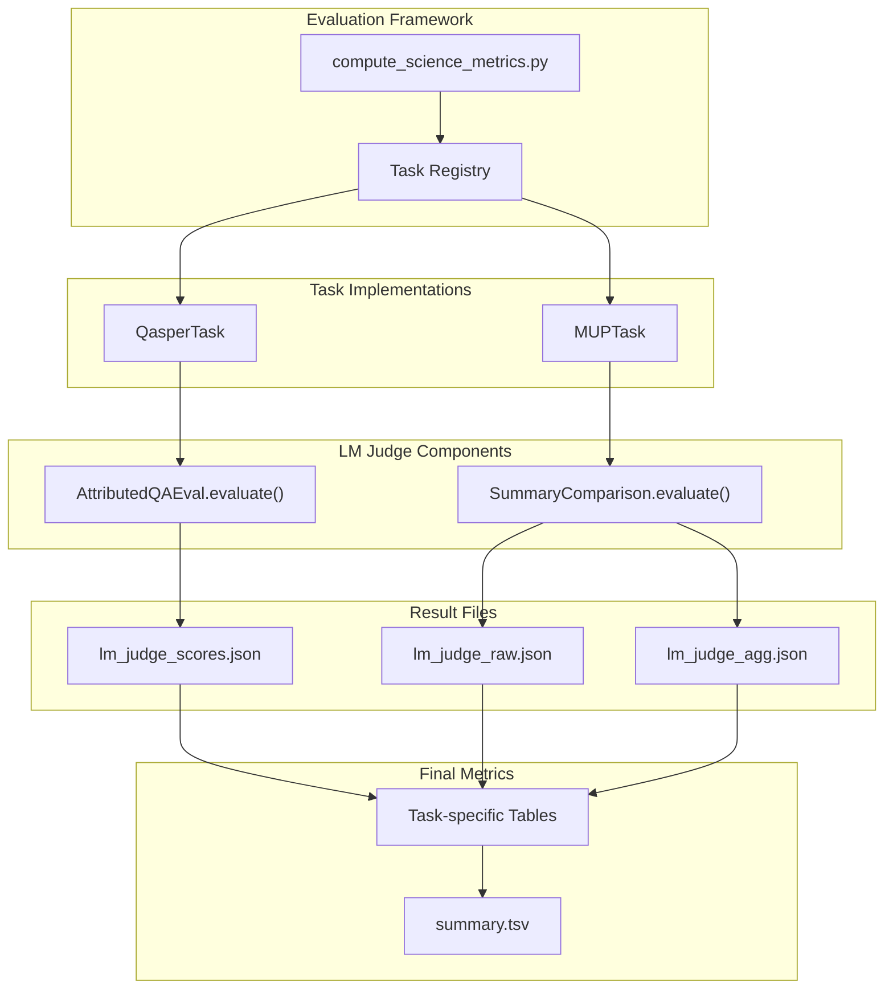

<!-- source: DeepWiki mcp.deepwiki.com · repo allenai/SciRIFF · page 3.4 LM Judge System · fetched 2026-10-26 -->

# LM Judge System

Relevant source files

The following files were used as context for generating this wiki page:

- [sciriff/eval/metrics/attributed_qa_eval.py](sciriff/eval/metrics/attributed_qa_eval.py)
- [sciriff/eval/metrics/summary_comparison.py](sciriff/eval/metrics/summary_comparison.py)

The LM Judge System provides advanced evaluation capabilities using Large Language Models as judges for nuanced assessment of model outputs in scientific tasks. It enables both reference-based comparison (rating model outputs against expert references on a 1-5 scale) and model-based comparison (determining winners between competing model outputs) for tasks where traditional metrics are insufficient.

For task-specific implementations using LM judges, see [Attributed QA Evaluation](#3.4.1) and [Summary Comparison](#3.4.2). For batch processing management, see [Batch Processing](#3.4.3).

## System Architecture

The LM Judge System operates as a specialized evaluation component within SciRIFF's evaluation pipeline, providing sophisticated assessment capabilities for complex scientific tasks that require human-like judgment.

**LM Judge System Architecture**

Sources: [sciriff/eval/metrics/attributed_qa_eval.py:1-334](), [sciriff/eval/metrics/summary_comparison.py:1-437]()

## Core Components

The system consists of two main evaluator classes that implement LM judge functionality for different types of scientific evaluation tasks.

### AttributedQAEval Class

The `AttributedQAEval` class handles evaluation of attributed question answering tasks, where models must provide both answers and supporting evidence.

**AttributedQAEval Component Structure**

Sources: [sciriff/eval/metrics/attributed_qa_eval.py:190-334]()

### SummaryComparison Class

The `SummaryComparison` class evaluates document summarization tasks through both reference comparison and model comparison approaches.

| Method | Purpose | Output Format |
|--------|---------|---------------|
| `_evaluate_reference_comparison()` | Compare model summary to expert reference | 1-5 scale rating |
| `_evaluate_model_comparison()` | Compare two model summaries | Win/Tie/Lose decision |
| `_extract_data_from_prompt()` | Extract paper title and body text | Structured data |

Sources: [sciriff/eval/metrics/summary_comparison.py:272-437]()

## Evaluation Types

The LM Judge System supports two primary evaluation paradigms, each optimized for different assessment scenarios.

### Reference Comparison

Reference comparison evaluates model outputs against expert-written references using a 1-5 scale rating system.

**Reference Comparison Prompt Structure**

Sources: [sciriff/eval/metrics/summary_comparison.py:102-131](), [sciriff/eval/metrics/attributed_qa_eval.py:96-138]()

### Model Comparison

Model comparison pits two model outputs against each other to determine the superior response for peer review assessment.

The evaluation considers factors such as:
- Usefulness for peer reviewers
- Adherence to target length requirements
- Overall quality and accuracy

Sources: [sciriff/eval/metrics/summary_comparison.py:70-100]()

## Batch Processing Integration

The system leverages OpenAI's Batch API for cost-effective large-scale evaluation, providing up to 50% cost savings compared to direct API calls.

**Batch Processing Workflow**

| Batch Function | File Location | Purpose |
|----------------|---------------|---------|
| `create_batch_file()` | [attributed_qa_eval.py:19-48]() | Generate JSONL batch request file |
| `submit_batch_job()` | [attributed_qa_eval.py:50-63]() | Submit batch job to OpenAI API |
| `get_batch_results()` | [attributed_qa_eval.py:65-80]() | Retrieve completed batch results |
| `batch_lm_judge()` | [attributed_qa_eval.py:156-174]() | Orchestrate batch evaluation process |

Sources: [sciriff/eval/metrics/attributed_qa_eval.py:19-80](), [sciriff/eval/metrics/summary_comparison.py:12-55]()

## Integration with Evaluation Pipeline

The LM Judge System integrates seamlessly with SciRIFF's broader evaluation framework through standardized interfaces and file-based result caching.

**Pipeline Integration Points**

The system uses file-based caching to avoid redundant API calls:
- Results are persisted to JSON files after computation
- Existing result files are loaded on subsequent runs
- Batch job mappings track pending evaluations

Sources: [sciriff/eval/metrics/attributed_qa_eval.py:269-333](), [sciriff/eval/metrics/summary_comparison.py:395-436]()

---

