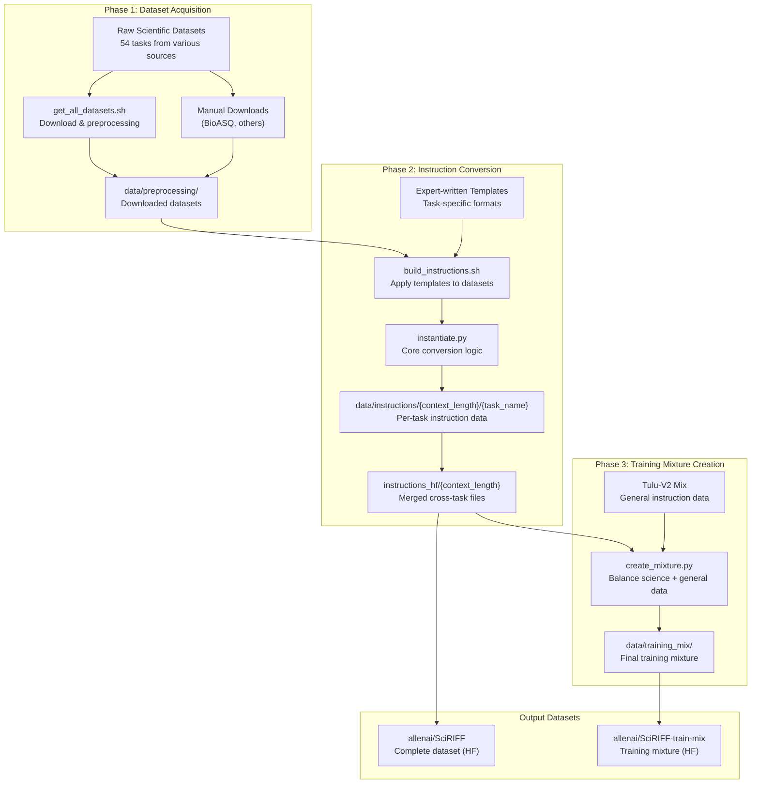
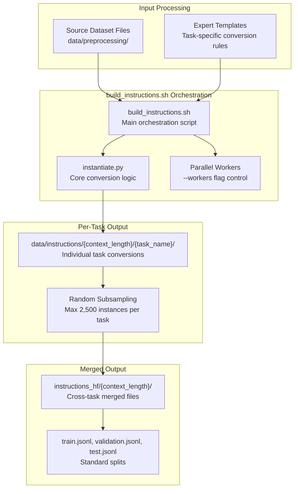
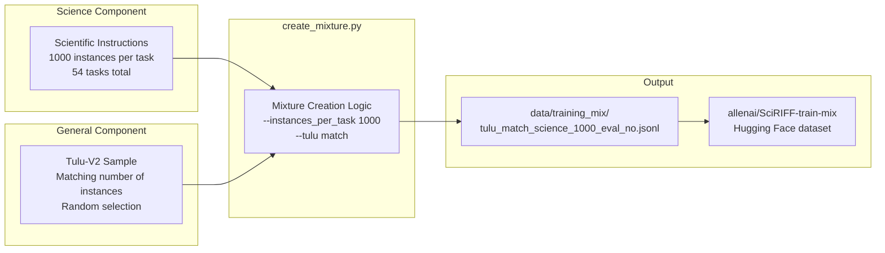
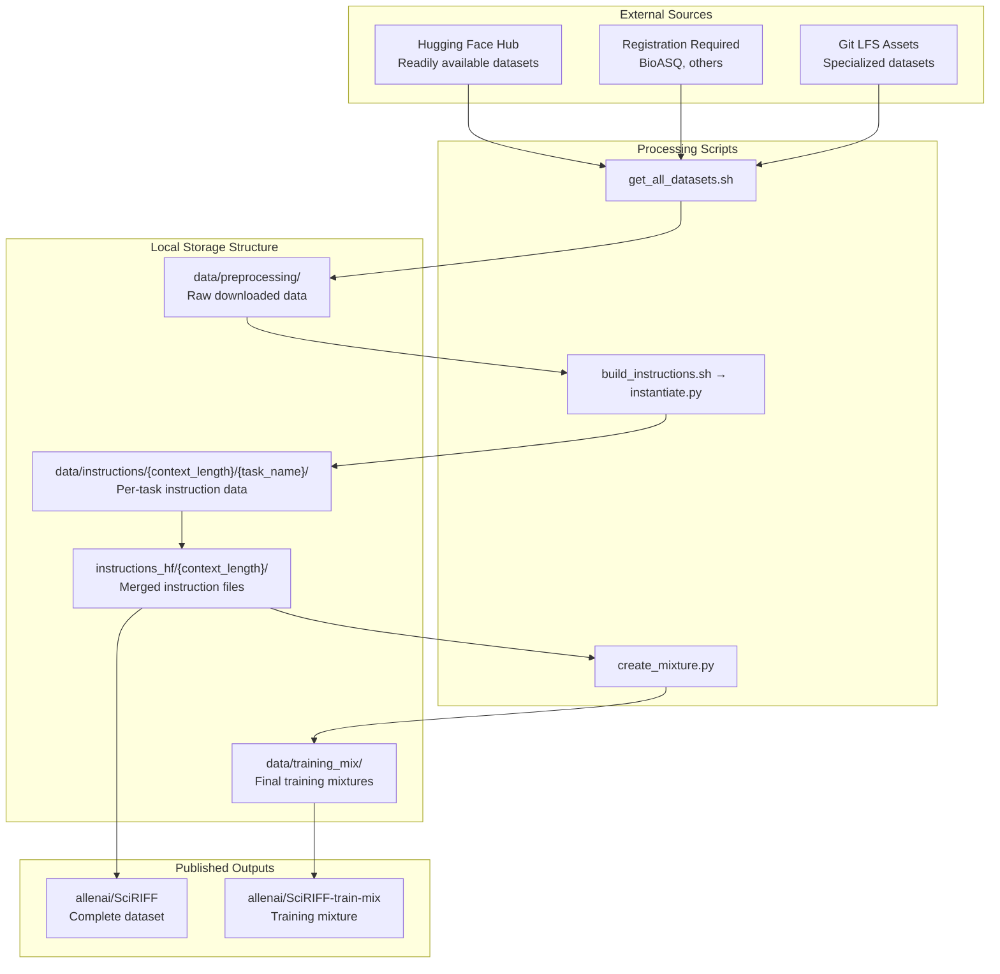

<!-- source: DeepWiki mcp.deepwiki.com · repo allenai/SciRIFF · page 4 Data Processing Pipeline · fetched 2026-10-26 -->

# Data Processing Pipeline

<details>
<summary>Relevant source files</summary>

The following files were used as context for generating this wiki page:

- [LICENSE](LICENSE)
- [README.md](README.md)

</details>


This document describes how raw scientific datasets are transformed into instruction-following format and assembled into training mixtures for the SciRIFF project. The pipeline consists of three main phases: dataset acquisition, instruction format conversion, and training mixture creation.

For information about model training using the processed data, see [Model Training](#5). For details about the evaluation system that uses held-out tasks, see [Evaluation System](#3).

## Overview

The data processing pipeline transforms 54 diverse scientific datasets into a unified instruction-following format suitable for training language models. The pipeline produces two main outputs: the complete SciRIFF dataset for research use and SciRIFF-train-mix for training the SciTulu models.



Sources: [README.md:165-182]()

## Phase 1: Dataset Acquisition

The first phase downloads and preprocesses raw scientific datasets that are not readily available on Hugging Face. This is handled by the `get_all_datasets.sh` script, which manages downloads for datasets requiring special handling.

### Automated Downloads

Most datasets are automatically downloaded and preprocessed using:

```bash
bash script/data/get_all_datasets.sh
```

This script downloads datasets to `data/preprocessing/` and handles format standardization for datasets not hosted on Hugging Face Hub.

### Manual Downloads

Some datasets require manual registration and download due to licensing restrictions:

| Dataset | Requirements | Location |
|---------|-------------|----------|
| BioASQ | Registration at participants-area.bioasq.org | `data/preprocessing/downloads/bioasq_task11b` |
| Others | See [lfs_datasets.md] for Git LFS datasets | Various subdirectories |

### Git LFS Assets

Several datasets that weren't easily downloadable are stored using Git LFS. These are documented in the project's LFS datasets documentation and require Git LFS to be installed for full dataset recreation.

Sources: [README.md:167-169](), [README.md:73]()

## Phase 2: Instruction Format Conversion

The core of the pipeline converts heterogeneous scientific datasets into a unified instruction-following format using expert-written templates. This phase is orchestrated by `build_instructions.sh`.

### Template System

Each of the 54 scientific tasks has expert-written templates that define how to convert the original dataset format into instruction-response pairs suitable for language model training.

### Conversion Process



The conversion process:

1. **Template Application**: `instantiate.py` applies task-specific templates to convert original dataset formats into instruction-response pairs
2. **Parallel Processing**: The script supports parallel processing across tasks using the `--workers` flag
3. **Context Length Handling**: Outputs are organized by context length (e.g., 4096 tokens)
4. **Subsampling**: Tasks with more than 2,500 instances are randomly subsampled to maintain balance
5. **Cross-Task Merging**: Individual task outputs are merged into unified files per split

### Key Commands

```bash
bash script/instructions/build_instructions.sh
```

The script must be run from the project root to ensure correct path resolution. Output structure:

- `data/instructions/{context_length}/{task_name}/` - Per-task instruction data
- `instructions_hf/{context_length}/` - Merged cross-task files
- `instructions_hf/4096/` - Corresponds to `allenai/SciRIFF` on Hugging Face

Sources: [README.md:169-171]()

## Phase 3: Training Mixture Creation

The final phase creates balanced training mixtures that combine scientific instruction data with general-domain instruction data from the Tulu-V2 mix. This is handled by `create_mixture.py`.

### Mixture Configuration

The training mixture balances scientific domain expertise with general instruction-following capabilities:



### Mixture Creation Command

```bash
python script/instructions/create_mixture.py \
  --instances_per_task 1000 \
  --instance_dir data/instructions/4096 \
  --tulu match \
  --out_dir data/training_mix
```

### Configuration Options

| Parameter | Purpose | Example Value |
|-----------|---------|---------------|
| `--instances_per_task` | Number of instances per science task | `1000` |
| `--instance_dir` | Source directory for instruction data | `data/instructions/4096` |
| `--tulu` | Tulu data integration strategy | `match` (equal amounts) |
| `--out_dir` | Output directory for mixture | `data/training_mix` |

The `match` strategy ensures the training mixture contains equal amounts of scientific and general instruction data, which was found to be optimal in the SciRIFF preprint.

Sources: [README.md:171-181]()

## Output Datasets

The pipeline produces two main datasets available on Hugging Face:

### SciRIFF Complete Dataset

- **Location**: `allenai/SciRIFF` on Hugging Face
- **Content**: Full instruction-following dataset with all 54 scientific tasks
- **Source**: `instructions_hf/4096/` directory output
- **Purpose**: Research and evaluation use

### SciRIFF Training Mix  

- **Location**: `allenai/SciRIFF-train-mix` on Hugging Face  
- **Content**: Balanced mixture of 1000 instances per science task + matching Tulu data
- **Source**: `data/training_mix/tulu_match_science_1000_eval_no.jsonl` output
- **Purpose**: Training SciTulu models and other scientific instruction-following models

Both datasets are formatted to support training frameworks like Open Instruct and follow standard instruction-following data conventions.

Sources: [README.md:22-28](), [README.md:129]()

## Data Flow Summary



This pipeline ensures scientific datasets are consistently formatted for instruction-following training while maintaining the diversity and quality needed for effective scientific language model development.

Sources: [README.md:165-182]()

---

