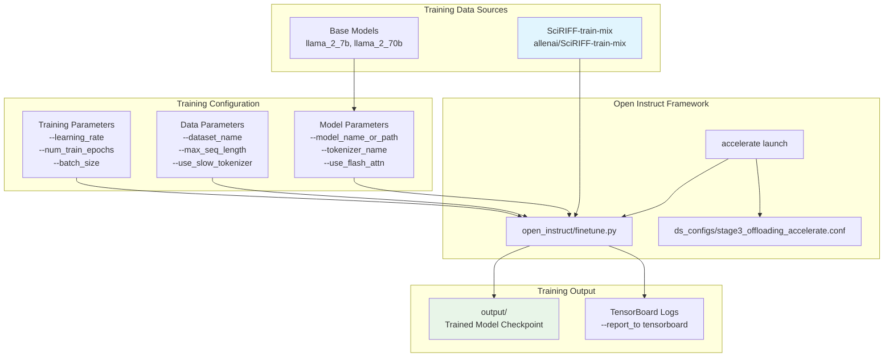
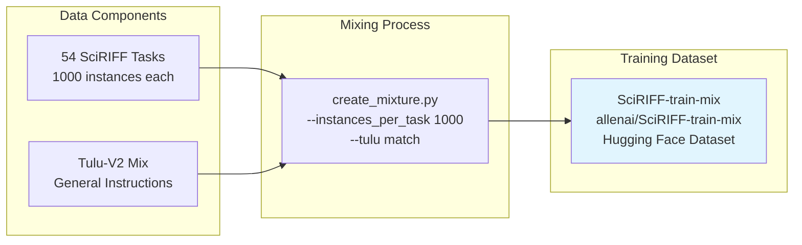
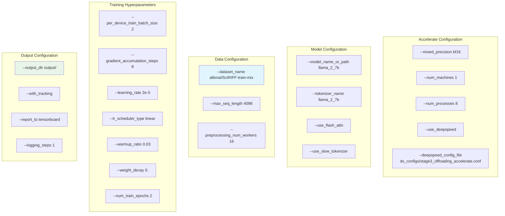
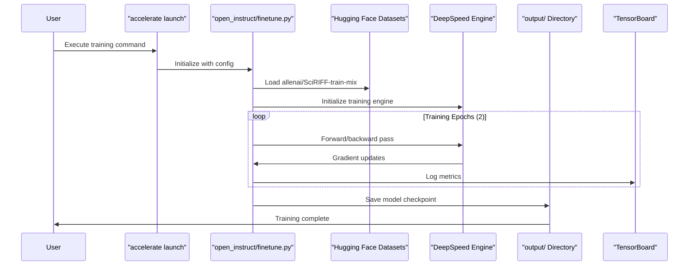
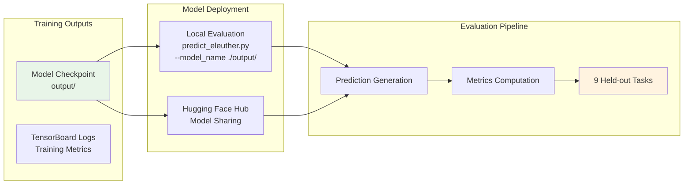

<!-- source: DeepWiki mcp.deepwiki.com · repo allenai/SciRIFF · page 5 Model Training · fetched 2026-10-26 -->

# Model Training

<details>
<summary>Relevant source files</summary>

The following files were used as context for generating this wiki page:

- [LICENSE](LICENSE)
- [README.md](README.md)

</details>


This document covers training new SciTulu models using the SciRIFF training data and the Open Instruct framework. It explains how to set up and execute fine-tuning runs to create scientific instruction-following models based on the SciRIFF dataset. For information about the underlying training data creation, see [Data Processing Pipeline](#4). For evaluation of trained models, see [Evaluation System](#3).

## Training Framework Overview

The SciRIFF model training system leverages the external [Open Instruct](https://github.com/allenai/open-instruct) framework for fine-tuning large language models on scientific instruction-following data. The training process uses the pre-prepared `SciRIFF-train-mix` dataset, which combines scientific tasks with general instruction-following data from the Tulu-V2 mix.



**Training System Architecture**

Sources: [README.md:127-162]()

## Training Data

The training process uses the `SciRIFF-train-mix` dataset, which is available on Hugging Face and contains a carefully balanced mixture of scientific and general instruction-following data.

### Training Mix Composition

| Component | Description | Size |
|-----------|-------------|------|
| SciRIFF Tasks | Scientific instruction-following data | 1,000 instances per task |
| Tulu-V2 Mix | General instruction-following data | Matching amount to science data |
| Total Format | Combined JSONL format | Ready for Tulu training pipeline |

The training mix was created using the `create_mixture.py` script and represents the optimal balance identified in the SciRIFF paper. The dataset is structured to work directly with the Open Instruct training pipeline without additional preprocessing.



**Training Data Flow**

Sources: [README.md:129](), [README.md:171-182]()

## Training Configuration

### Basic Training Setup

The training process requires the Open Instruct repository to be installed and configured. The system uses Accelerate for distributed training and DeepSpeed for memory optimization.

### Core Training Parameters



**Training Configuration Components**

Sources: [README.md:133-159]()

### Hardware Requirements

The training setup supports different hardware configurations depending on the model size:

| Model Size | Recommended Hardware | Configuration |
|------------|---------------------|---------------|
| 7B | Single A6000 GPU | Standard configuration |
| 70B | 4x 80GB A100 GPUs | Multi-GPU with DeepSpeed |

The DeepSpeed Stage 3 configuration with offloading is used to manage memory efficiently during training, particularly for larger models.

## Training Execution

### Command Structure

The training is initiated using the `accelerate launch` command with the Open Instruct `finetune.py` script. The complete command structure integrates all configuration parameters:

```bash
accelerate launch \
  --mixed_precision bf16 \
  --num_machines 1 \
  --num_processes 8 \
  --use_deepspeed \
  --deepspeed_config_file ds_configs/stage3_offloading_accelerate.conf \
  open_instruct/finetune.py \
  [model_parameters] \
  [data_parameters] \
  [training_parameters] \
  [output_parameters]
```

### Training Process Flow



**Training Execution Sequence**

Sources: [README.md:133-159]()

## Model Outputs

### Checkpoint Structure

The training process generates model checkpoints in the specified output directory. These checkpoints are compatible with the Hugging Face ecosystem and can be directly used for inference or further evaluation.

### Integration with Evaluation System

Trained models can be immediately integrated into the SciRIFF evaluation pipeline by updating the model paths in the prediction generation scripts. The evaluation system supports both local checkpoints and Hugging Face Hub models.



**Model Output and Integration Flow**

Sources: [README.md:133-159](), [README.md:161]()

## Advanced Configuration

### Custom Training Mixtures

While the standard `SciRIFF-train-mix` provides the optimal configuration identified in the research, users can create custom training mixtures using the `create_mixture.py` script with different parameters for instances per task or alternative base instruction datasets.

### Multi-GPU Training

The system supports scaling to multiple machines and processes through Accelerate configuration. The DeepSpeed integration enables efficient training of large models across multiple GPUs with automatic memory management and gradient synchronization.

Sources: [README.md:127-162]()

---

