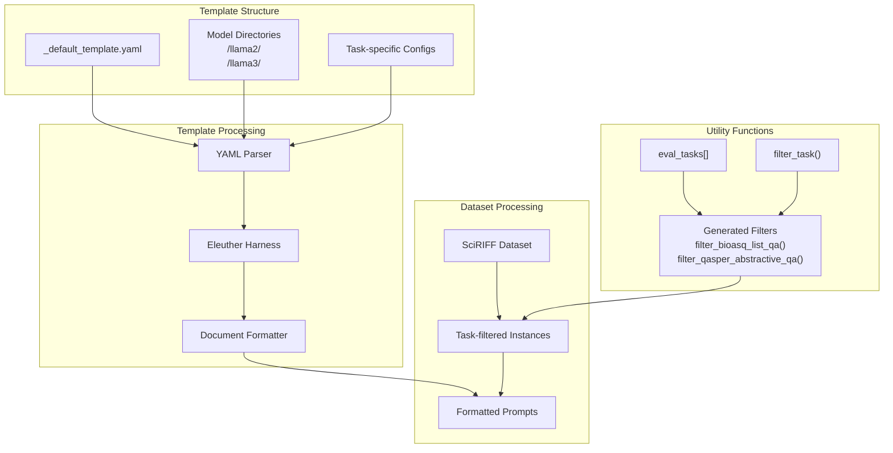
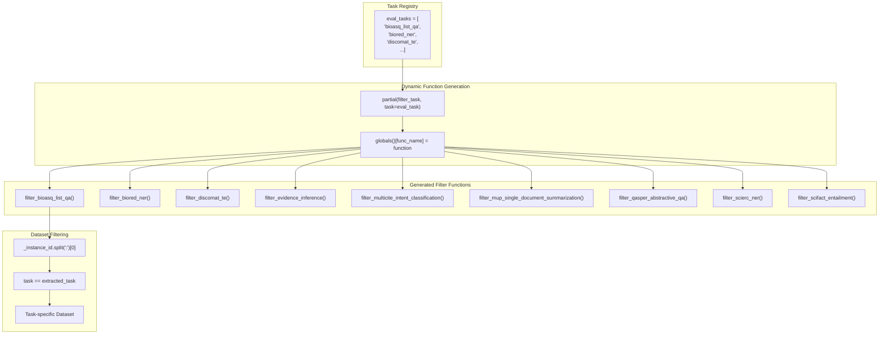

<!-- source: DeepWiki mcp.deepwiki.com · repo allenai/SciRIFF · page 6 Configuration System · fetched 2026-10-26 -->

# Configuration System

Relevant source files

The following files were used as context for generating this wiki page:

- [sciriff/eval/eleuther_templates/llama2/_default_template.yaml](sciriff/eval/eleuther_templates/llama2/_default_template.yaml)
- [sciriff/eval/eleuther_templates/llama2/utils.py](sciriff/eval/eleuther_templates/llama2/utils.py)

The Configuration System provides the foundational framework for configuring and managing evaluation tasks across different model architectures within SciRIFF. This system is built around YAML-based evaluation templates that define how models interact with tasks, along with utility functions for dataset filtering and task management. The system enables consistent evaluation across different model families (Llama2, Llama3, etc.) while maintaining task-specific customizations.

For detailed information about the YAML template structure and model-specific configurations, see [Evaluation Templates](#6.1). For utility functions that support dataset processing within templates, see [Template Utilities](#6.2).

## System Architecture

The Configuration System operates as a bridge between the evaluation framework and the underlying Eleuther AI evaluation harness. It translates SciRIFF's scientific tasks into standardized evaluation configurations that can be executed consistently across different models.

### Configuration Flow Diagram

Sources: [sciriff/eval/eleuther_templates/llama2/_default_template.yaml:1-15](), [sciriff/eval/eleuther_templates/llama2/utils.py:1-24]()

## Template Configuration Components

The configuration system consists of several key components that work together to define evaluation behavior:

| Component | Purpose | Location |
|-----------|---------|----------|
| `_default_template.yaml` | Base template configuration | `/eleuther_templates/llama2/` |
| `utils.py` | Task filtering utilities | `/eleuther_templates/llama2/` |
| Model directories | Model-specific template variations | `/eleuther_templates/{model}/` |
| Task filters | Dynamic task isolation functions | Generated from `eval_tasks` list |

### Core Configuration Elements

The base template defines essential configuration parameters:

- **Dataset Configuration**: Points to `allenai/SciRIFF` with specific dataset splits
- **Prompt Formatting**: Defines `doc_to_text` templates for model-specific prompting
- **Output Processing**: Specifies `doc_to_target` and delimiter configurations  
- **Metrics**: Configures evaluation metrics like BLEU with aggregation methods
- **Grouping**: Assigns tasks to evaluation groups like `science_adapt`

### Task Management System

Sources: [sciriff/eval/eleuther_templates/llama2/utils.py:8-24]()

## Integration with Evaluation Pipeline

The Configuration System serves as the interface between SciRIFF's scientific tasks and the broader evaluation infrastructure. Templates are processed by the Eleuther evaluation harness, which uses the configuration to:

1. **Load Dataset**: Access the SciRIFF dataset from Hugging Face using `dataset_path` and `dataset_name`
2. **Apply Filters**: Use utility functions to isolate specific tasks from the combined dataset
3. **Format Prompts**: Transform raw inputs using `doc_to_text` templates with model-specific formatting
4. **Process Outputs**: Extract targets using `doc_to_target` specifications
5. **Compute Metrics**: Apply configured metrics with specified aggregation methods

The system's modular design allows for easy extension to new model architectures by creating new template directories while maintaining consistent task definitions through the shared utility functions.

Sources: [sciriff/eval/eleuther_templates/llama2/_default_template.yaml:1-15](), [sciriff/eval/eleuther_templates/llama2/utils.py:4-6]()

---

