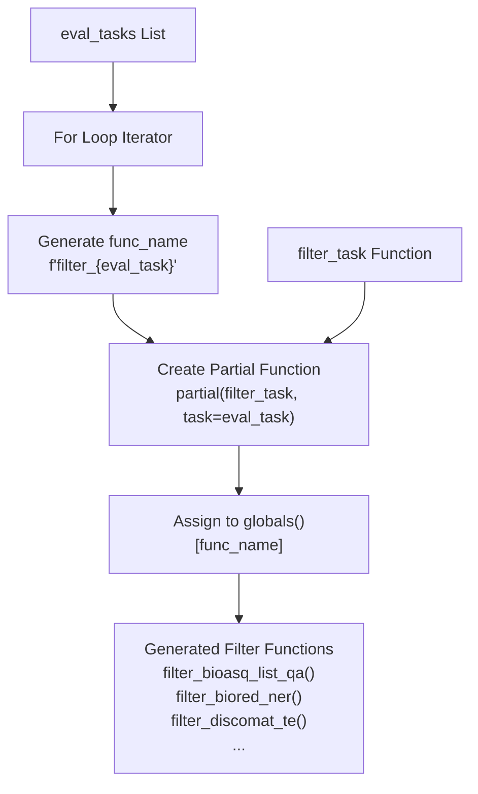
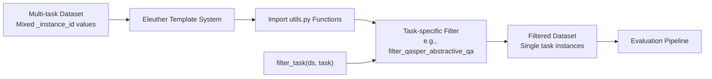

<!-- source: DeepWiki mcp.deepwiki.com · repo allenai/SciRIFF · page 6.2 Template Utilities · fetched 2026-10-26 -->

# Template Utilities

<details>
<summary>Relevant source files</summary>

The following files were used as context for generating this wiki page:

- [sciriff/eval/eleuther_templates/llama2/utils.py](sciriff/eval/eleuther_templates/llama2/utils.py)

</details>


This document covers the utility functions used for filtering and processing datasets within the Eleuther evaluation template system. These utilities provide programmatic access to dataset filtering capabilities that support the evaluation pipeline's template-based configuration.

For information about the broader template configuration system, see [Evaluation Templates](#6.1). For details on the evaluation system architecture, see [Evaluation System](#3).

## Purpose and Scope

The template utilities provide a standardized interface for filtering evaluation datasets by task type within the Eleuther template framework. These utilities enable the template system to dynamically isolate specific evaluation tasks from multi-task datasets during the evaluation process.

## Core Filtering Functionality

The primary utility function `filter_task` provides dataset filtering based on instance identifiers embedded in the data structure.

### Filter Task Function

The `filter_task` function operates by examining the `_instance_id` field of dataset instances and extracting the task identifier from the first component of a colon-separated string.

```
Function: filter_task(ds, task)
- Input: Dataset object (ds), Task identifier string (task)  
- Operation: Filters dataset where instance_id prefix matches task
- Output: Filtered dataset containing only instances for specified task
```

**Implementation Details:**

The function uses the dataset's `filter` method with a lambda function that:
1. Extracts the `_instance_id` field from each instance
2. Splits the ID on the colon separator
3. Compares the first component against the target task name

Sources: [sciriff/eval/eleuther_templates/llama2/utils.py:4-5]()

## Task Registry and Dynamic Function Generation

The utilities define a comprehensive registry of evaluation tasks and automatically generate specialized filter functions for each task.

### Evaluation Task Registry

The system maintains a predefined list of nine evaluation tasks that represent the held-out evaluation suite:

| Task Name | Function Name |
|-----------|---------------|
| bioasq_list_qa | filter_bioasq_list_qa |
| biored_ner | filter_biored_ner |
| discomat_te | filter_discomat_te |
| evidence_inference | filter_evidence_inference |
| multicite_intent_classification | filter_multicite_intent_classification |
| mup_single_document_summarization | filter_mup_single_document_summarization |
| qasper_abstractive_qa | filter_qasper_abstractive_qa |
| scierc_ner | filter_scierc_ner |
| scifact_entailment | filter_scifact_entailment |

Sources: [sciriff/eval/eleuther_templates/llama2/utils.py:8-18]()

### Dynamic Function Creation

The system uses Python's `functools.partial` and dynamic global assignment to create specialized filter functions at module import time:



This approach creates individual filter functions such as `filter_bioasq_list_qa`, `filter_biored_ner`, etc., each pre-configured to filter for their specific task type.

Sources: [sciriff/eval/eleuther_templates/llama2/utils.py:21-23]()

## Template System Integration

The utilities integrate with the broader Eleuther template system to enable task-specific dataset processing during evaluation runs.

### Dataset Processing Pipeline



### Function Access Pattern

Template configurations can access these utilities through standard Python import mechanisms:

1. Templates import the utility module
2. Access pre-generated filter functions by name
3. Apply functions to datasets during template processing
4. Pass filtered datasets to downstream evaluation components

Sources: [sciriff/eval/eleuther_templates/llama2/utils.py:1-24]()

## Usage in Template Context

The generated filter functions serve as building blocks for template-based evaluation workflows, allowing templates to specify which subset of a multi-task dataset should be processed for a particular evaluation run.

### Instance ID Format

The filtering logic assumes instance IDs follow the format: `{task_name}:{additional_identifier}`

Examples:
- `qasper_abstractive_qa:12345`
- `bioasq_list_qa:67890` 
- `scifact_entailment:abcdef`

The filter functions extract the task name prefix to determine dataset membership.

Sources: [sciriff/eval/eleuther_templates/llama2/utils.py:4-5]()