# Page: Overview

# Overview

<details>
<summary>Relevant source files</summary>

The following files were used as context for generating this wiki page:

- [LICENSE](LICENSE)
- [README.md](README.md)

</details>


This document provides a high-level overview of the SciRIFF system, a comprehensive framework for scientific instruction-following evaluation and model training. SciRIFF encompasses a 54-task scientific dataset, the SciTulu model family, and associated evaluation infrastructure for assessing language model performance on scientific literature tasks.

For detailed setup instructions, see [Installation and Setup](#1.1). For immediate usage examples, see [Quick Start](#1.2). For evaluation-specific details, see [Evaluation System](#3). For model training information, see [Model Training](#5).

## System Architecture

The SciRIFF system consists of four primary subsystems that work together to create a complete scientific instruction-following pipeline:

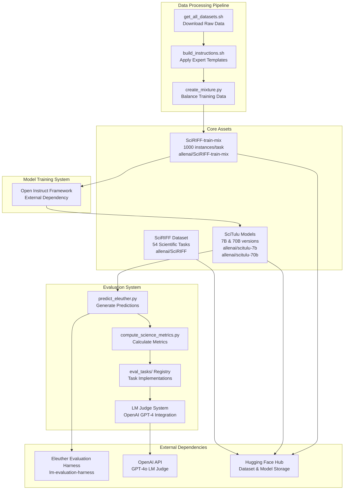

Sources: [README.md:22-27](), [README.md:129](), [README.md:167-182]()

## Core Components

### SciRIFF Dataset and SciTulu Models

The system centers around two main artifacts available on Hugging Face:

| Asset | Description | Hugging Face Path |
|-------|-------------|-------------------|
| **SciRIFF Dataset** | 54 scientific instruction-following tasks | `allenai/SciRIFF` |
| **SciTulu 7B Model** | 7B parameter instruction-tuned model | `allenai/scitulu-7b` |
| **SciTulu 70B Model** | 70B parameter instruction-tuned model | `allenai/scitulu-70b` |
| **Training Mix** | Balanced training data (1000 instances/task) | `allenai/SciRIFF-train-mix` |

The dataset creation process transforms raw scientific datasets into instruction-following format using expert-written templates, with the final dataset supporting evaluation across diverse scientific domains.

Sources: [README.md:24-27]()

### Evaluation Pipeline

The evaluation system operates through a two-stage process managed by key scripts:

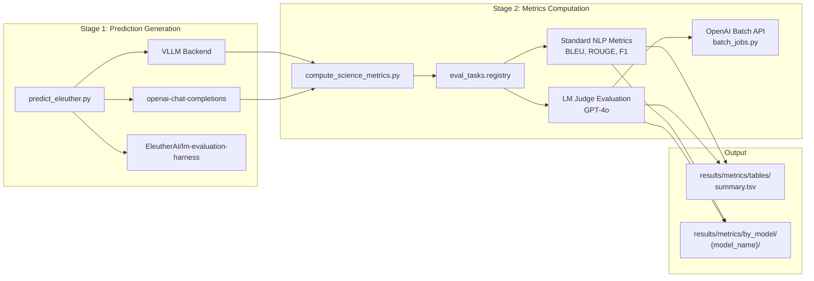

The system supports multiple inference backends including VLLM for local models and OpenAI API for cloud-based evaluation. Advanced tasks use GPT-4 as an LM judge with OpenAI Batch API integration for cost-effective large-scale evaluation.

Sources: [README.md:81-106](), [README.md:110-125]()

### Data Processing Pipeline

Raw scientific datasets undergo transformation through a structured pipeline:

1. **Data Acquisition**: The `get_all_datasets.sh` script downloads datasets not available on Hugging Face
2. **Instruction Generation**: The `build_instructions.sh` script applies expert-written templates to convert datasets into instruction-following format
3. **Mixture Creation**: The `create_mixture.py` script balances training data by sampling instances across tasks

The processed data supports both model training and evaluation, with configurable context lengths and instance limits per task.

Sources: [README.md:167-182]()

### Model Training Integration

SciRIFF integrates with the Open Instruct framework for model training. The training process uses the `SciRIFF-train-mix` dataset, which combines 1000 instances per scientific task with matching data from the Tulu-V2 instruction mix.

Training configurations support both 7B and 70B parameter models using the Llama 2 architecture as base models, with specialized hyperparameters optimized for scientific instruction-following performance.

Sources: [README.md:128-161]()

## Key Code Organization

The codebase follows a modular structure with clear separation of concerns:

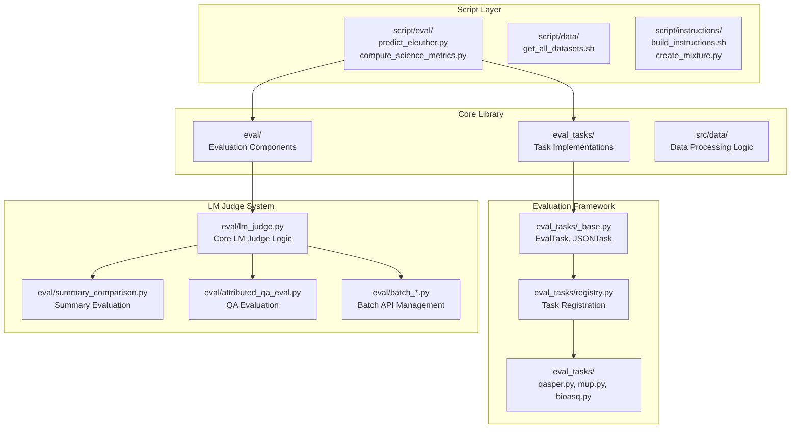

This architecture enables extensibility through the task registry system and provides clear interfaces for adding new evaluation tasks or modifying existing ones.

Sources: [README.md:77](), [README.md:110](), [README.md:119]()

## System Integration Points

The SciRIFF system integrates with several external services and frameworks:

- **Eleuther AI Harness**: Provides standardized inference and evaluation infrastructure
- **OpenAI API**: Enables LM judge evaluations with GPT-4 and cost optimization through Batch API
- **Hugging Face Hub**: Hosts datasets and models with seamless integration for training and evaluation
- **VLLM**: Supports efficient local model inference with GPU optimization
- **Open Instruct**: Facilitates model training with proven instruction-tuning methodologies

These integrations ensure the system can handle both research and production use cases while maintaining compatibility with the broader machine learning ecosystem.

Sources: [README.md:44-51](), [README.md:67-71](), [README.md:119]()

---

# Page: Installation and Setup

# Installation and Setup

<details>
<summary>Relevant source files</summary>

The following files were used as context for generating this wiki page:

- [LICENSE](LICENSE)
- [README.md](README.md)
- [setup.py](setup.py)

</details>


This document provides step-by-step instructions for setting up the SciRIFF environment, including all dependencies required for model evaluation, training, and dataset processing. The setup process involves installing the Eleuther evaluation harness, the SciRIFF package, and configuring external services for LM judge evaluations.

For information about using the system after installation, see [Quick Start](#1.2). For details about the evaluation pipeline, see [Evaluation System](#3).

## Prerequisites

Before beginning installation, ensure you have the following:

- Python 3.11 or compatible version
- Conda package manager
- Git with Git LFS support
- CUDA-compatible GPU (recommended for local model inference)
- OpenAI API key (required for LM judge evaluations)

## Environment Setup

### Creating the Conda Environment

The SciRIFF system requires a dedicated conda environment to manage dependencies and avoid conflicts:

```bash
conda create --name sciriff python=3.11
conda activate sciriff
```

### Setting Environment Variables

Configure the `PROJECT_ROOT` environment variable to point to your SciRIFF installation directory:

```bash
conda env config vars set PROJECT_ROOT=[path-to-sciriff-code]
```

For LM judge evaluations using OpenAI models, configure your API key:

```bash
conda env config vars set OPENAI_API_KEY=[your_openai_key]
```

**Setup Environment Flow**
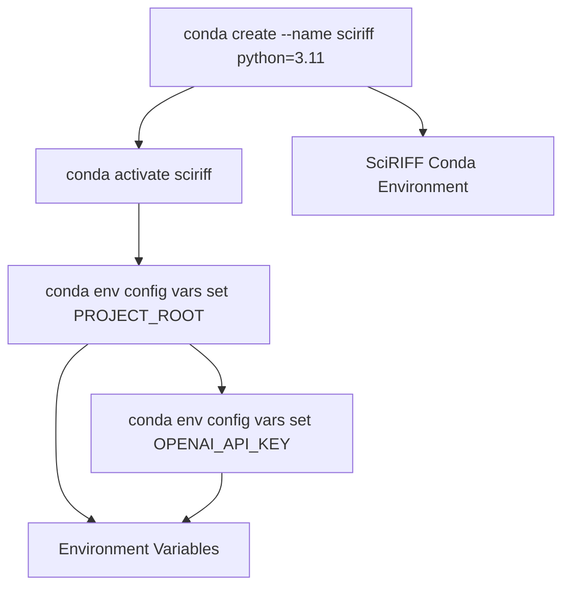

Sources: [README.md:31-42](), [README.md:67-71]()

## Core Dependencies Installation

### Eleuther Evaluation Harness

The system uses the Eleuther harness for model inference and evaluation. Install a specific commit for stability:

```bash
git clone https://github.com/EleutherAI/lm-evaluation-harness.git
cd lm-evaluation-harness
git checkout 543617f
pip install -e .[vllm]
```

The `[vllm]` extra installs VLLM support for efficient GPU inference with large models.

### SciRIFF Package

Install the SciRIFF package in development mode from the project directory:

```bash
cd [path-to-sciriff-code]
pip install -e .
```

This installs the package dependencies defined in [setup.py:8-24](), including:

| Package | Version | Purpose |
|---------|---------|---------|
| `pandas` | 2.2.2 | Data manipulation for metrics computation |
| `openai` | 1.47.0 | OpenAI API client for LM judge evaluations |
| `spacy` | 3.7.4 | NLP processing for text evaluation |
| `rouge_score` | 0.1.2 | ROUGE metrics computation |
| `huggingface-hub` | 0.23.3 | Model and dataset access |

### Additional Language Model

Install the Spacy English model required for text processing:

```bash
python -m spacy download en_core_web_sm
```

**Dependencies Architecture**
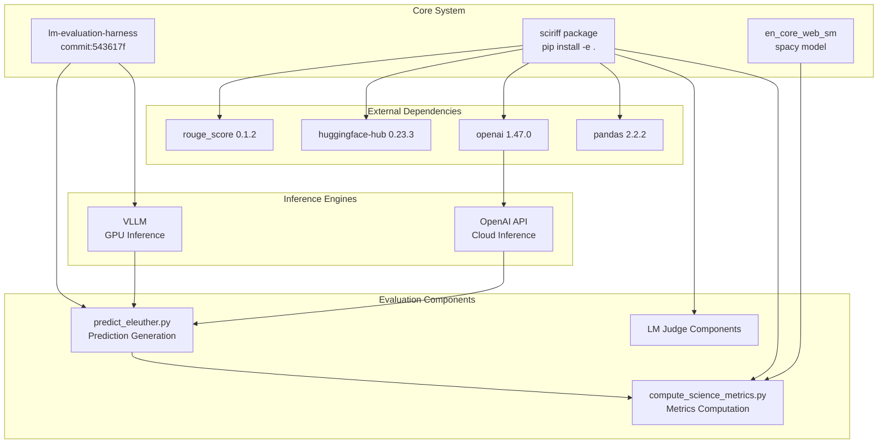

Sources: [README.md:44-57](), [README.md:61-65](), [setup.py:8-24]()

## Dataset Support Setup

### Git LFS Configuration

Some datasets in the SciRIFF collection require Git LFS for large file storage. Install Git LFS if not already available:

```bash
# Installation varies by system
# Ubuntu/Debian: apt install git-lfs
# macOS: brew install git-lfs
# Or download from https://git-lfs.com/

git lfs install
```

### Dataset Access Requirements

Certain datasets require manual registration and download:

- **BioASQ**: Register at http://participants-area.bioasq.org/datasets/ and download Task 11B files to `data/preprocessing/downloads/bioasq_task11b/`

**Dataset Setup Flow**
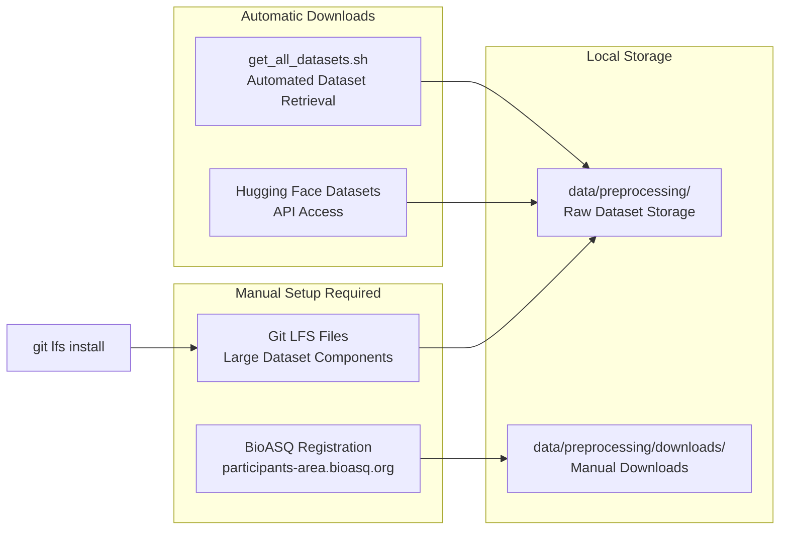

Sources: [README.md:73-74](), [README.md:167-169]()

## Installation Verification

### Verify Core Installation

Test that the main components are properly installed:

```bash
# Test SciRIFF package import
python -c "import sciriff; print('SciRIFF package installed successfully')"

# Test Eleuther harness
python -c "import lm_eval; print('LM Eval harness available')"

# Test VLLM availability
python -c "import vllm; print('VLLM available for GPU inference')"
```

### Verify Environment Variables

Confirm that environment variables are properly set:

```bash
echo $PROJECT_ROOT
echo $OPENAI_API_KEY  # Should show your API key
```

### Test Prediction Script

Verify the evaluation pipeline with a minimal test:

```bash
python script/eval/predict_eleuther.py --help
```

This should display the help message for the prediction script, confirming that the Eleuther harness integration is working.

**Verification Workflow**
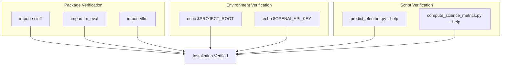

Sources: [README.md:54-57](), [README.md:86-94](), [README.md:113-117]()

## Common Installation Issues

### Typer Version Warnings

During installation, you may see warnings about incompatible versions of the `typer` package. These warnings can be safely ignored and do not affect functionality.

### VLLM GPU Requirements

For VLLM inference:
- **7B models**: Single A6000 GPU or equivalent
- **70B models**: 4x 80GB A100 GPUs or equivalent memory capacity

### API Rate Limits

The OpenAI API key is required for:
- MUP single document summarization evaluation (via LM judge)
- Qasper abstractive QA evaluation (via LM judge)

Configure rate limits and billing limits appropriately in your OpenAI account.

Sources: [README.md:59-60](), [README.md:83-84](), [README.md:67-68]()

---

# Page: Quick Start

# Quick Start

<details>
<summary>Relevant source files</summary>

The following files were used as context for generating this wiki page:

- [LICENSE](LICENSE)
- [README.md](README.md)

</details>


This guide provides essential usage examples for the two primary SciRIFF workflows: evaluating models on scientific tasks and training new models with SciRIFF data. For detailed installation instructions, see [Installation and Setup](#1.1). For comprehensive evaluation details, see [Evaluation System](#3).

## Basic Evaluation Workflow

The evaluation workflow consists of two main steps: generating predictions and computing metrics. This process evaluates any language model on the 9 held-out SciRIFF tasks.

### Quick Evaluation Example

Here's the minimal workflow to evaluate a model:

```bash
# Step 1: Generate predictions
python script/eval/predict_eleuther.py \
  --model vllm \
  --model_name allenai/scitulu-7b \
  --chat_template tulu \
  --gpus 1 \
  --tasks science_adapt \
  --result_base results/predictions

# Step 2: Compute metrics
python script/eval/compute_science_metrics.py \
  --pred_dir results/predictions \
  --metrics_dir results/metrics
```

**Evaluation Workflow Architecture**

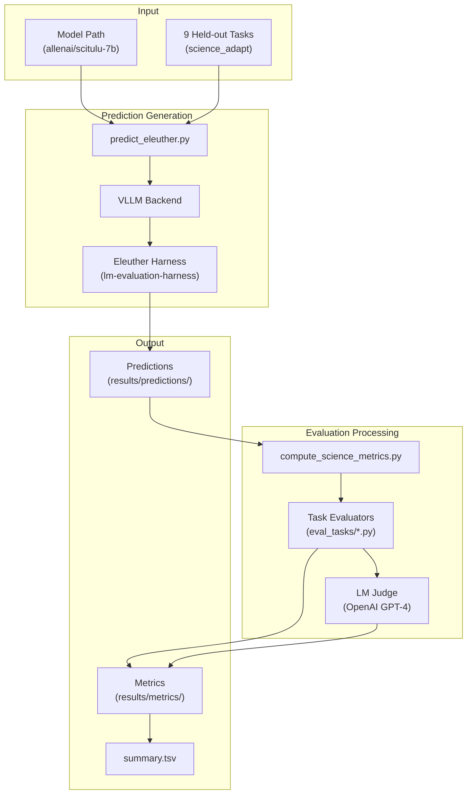

Sources: [README.md:75-126](), [script/eval/predict_eleuther.py](), [script/eval/compute_science_metrics.py]()

### Prediction Generation Options

The `predict_eleuther.py` script supports multiple inference backends:

| Backend | Usage | Requirements |
|---------|--------|-------------|
| `vllm` | Local GPU inference | GPU with sufficient VRAM |
| `openai-chat-completions` | OpenAI API | `OPENAI_API_KEY` environment variable |
| `anthropic-chat-completions` | Anthropic API | API credentials |

**Example: API-based Evaluation**

```bash
python script/eval/predict_eleuther.py \
  --model openai-chat-completions \
  --model_name gpt-3.5-turbo-1106 \
  --chat_template general \
  --tasks science_adapt \
  --result_base results/predictions \
  --limit 50
```

Sources: [README.md:96-106]()

### Metrics Computation

The `compute_science_metrics.py` script processes predictions through task-specific evaluators and generates comprehensive metrics:

- **Standard metrics**: BLEU, ROUGE, F1 scores for most tasks
- **LM Judge evaluation**: GPT-4 assessment for `qasper_abstractive_qa` and `mup_single_document_summarization`
- **Batch API support**: Cost-effective evaluation using OpenAI's batch API

Sources: [README.md:108-126]()

## Basic Training Workflow

Training new models uses the SciRIFF training mixture with the Open Instruct framework.

**Training Data Pipeline**

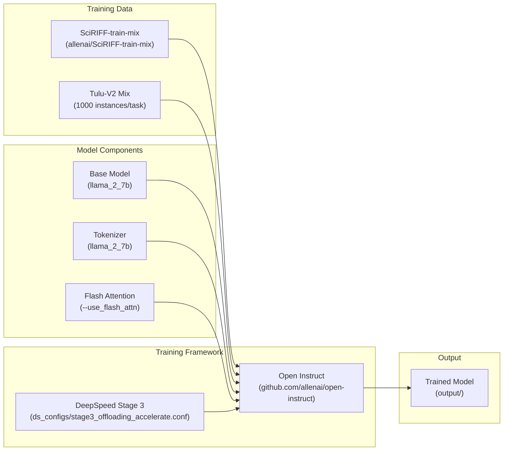

Sources: [README.md:127-162]()

### Quick Training Example

```bash
accelerate launch \
  --mixed_precision bf16 \
  --num_machines 1 \
  --num_processes 8 \
  --use_deepspeed \
  --deepspeed_config_file ds_configs/stage3_offloading_accelerate.conf \
  open_instruct/finetune.py \
  --model_name_or_path llama_2_7b \
  --use_flash_attn \
  --tokenizer_name llama_2_7b \
  --dataset_name allenai/SciRIFF-train-mix \
  --use_slow_tokenizer \
  --max_seq_length 4096 \
  --preprocessing_num_workers 16 \
  --per_device_train_batch_size 2 \
  --gradient_accumulation_steps 8 \
  --learning_rate 2e-5 \
  --lr_scheduler_type linear \
  --warmup_ratio 0.03 \
  --weight_decay 0. \
  --num_train_epochs 2 \
  --output_dir output/ \
  --with_tracking \
  --report_to tensorboard \
  --logging_steps 1
```

Sources: [README.md:133-159]()

## Key Entry Points and File Structure

The following table maps common tasks to their corresponding entry points:

| Task | Script | Key Parameters |
|------|--------|----------------|
| Model evaluation | `script/eval/predict_eleuther.py` | `--model`, `--model_name`, `--tasks` |
| Metrics computation | `script/eval/compute_science_metrics.py` | `--pred_dir`, `--metrics_dir` |
| Dataset creation | `script/data/get_all_datasets.sh` | Downloads raw datasets |
| Instruction formatting | `script/instructions/build_instructions.sh` | Applies templates |
| Training mixture | `script/instructions/create_mixture.py` | `--instances_per_task`, `--tulu` |

**Core System Components**

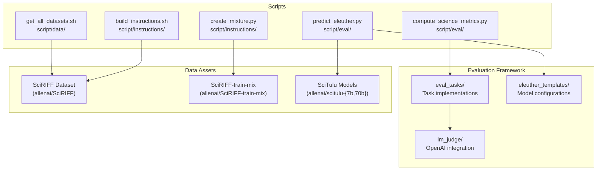

Sources: [README.md:11-187](), [script/eval/](), [script/data/](), [script/instructions/](), [eval_tasks/](), [lm_judge/](), [eleuther_templates/]()

## Resource Requirements

| Component | Memory | Notes |
|-----------|---------|-------|
| SciTulu-7B evaluation | 1x A6000 (48GB) | Single GPU sufficient |
| SciTulu-70B evaluation | 4x A100 (80GB each) | May work with less |
| Training (7B model) | 8x GPU + DeepSpeed | Stage 3 offloading required |

**Evaluation Time Estimates**
- Full evaluation suite: Several hours
- Use `--limit` flag to cap instances per task for testing
- LM Judge tasks (Qasper, MUP) require additional time for API calls

Sources: [README.md:82-84](), [README.md:133-159]()

---

# Page: Dataset and Models

# Dataset and Models

<details>
<summary>Relevant source files</summary>

The following files were used as context for generating this wiki page:

- [LICENSE](LICENSE)
- [README.md](README.md)

</details>


This document describes the core SciRIFF dataset collection and the SciTulu model family. The SciRIFF dataset consists of 54 scientific tasks converted to instruction-following format, while SciTulu models are fine-tuned language models trained on this data. For information about evaluation procedures, see [Evaluation System](#3). For details on data processing workflows, see [Data Processing Pipeline](#4). For model training procedures, see [Model Training](#5).

## SciRIFF Dataset Collection

The SciRIFF dataset collection provides scientific instruction-following data in two primary configurations hosted on Hugging Face. The collection transforms existing scientific datasets into a unified instruction-following format using expert-written templates.

### Dataset Structure

**Full SciRIFF Dataset**
The complete `allenai/SciRIFF` dataset contains all 54 scientific tasks across multiple domain areas. Each task maintains separate train/validation/test splits where available from the source datasets.

**Training Mixture**
The `allenai/SciRIFF-train-mix` dataset provides the specific training configuration used for SciTulu models, combining 1000 instances per scientific task with matching data from the Tulu-V2 instruction dataset.

### Task Categories and Distribution

The 54 tasks span multiple scientific domains and task types:

| Domain | Task Types | Example Tasks |
|--------|------------|---------------|
| Biomedical | QA, NER, Text Classification | BioASQ, BioRED, SciERCNER |
| General Science | Summarization, QA, Entailment | Qasper, SciFact, MUP |
| Citation Analysis | Intent Classification, Evidence | Multicite, Evidence Inference |
| Domain-Specific | Relation Extraction, Classification | Discomat, ChemProt |

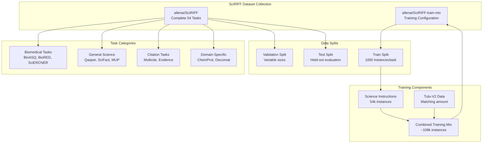

Sources: [README.md:22-28]()

### Dataset Format and Structure

Each task in the SciRIFF collection follows a consistent instruction-following format with standardized fields:

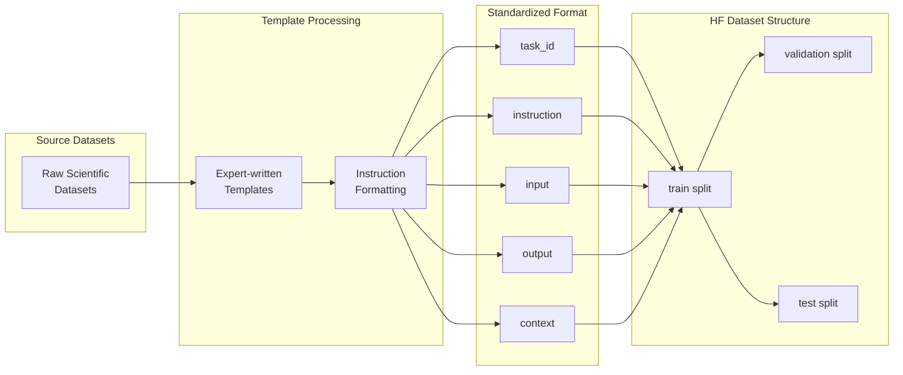

Sources: [README.md:3](), [README.md:169-179]()

## SciTulu Model Family

The SciTulu models are instruction-tuned language models fine-tuned specifically on the SciRIFF training mixture to enhance performance on scientific instruction-following tasks.

### Model Variants

| Model | Parameters | Base Model | Training Data | HF Repository |
|-------|------------|------------|---------------|---------------|
| SciTulu-7B | 7 billion | Llama 2 7B | SciRIFF-train-mix | `allenai/scitulu-7b` |
| SciTulu-70B | 70 billion | Llama 2 70B | SciRIFF-train-mix | `allenai/scitulu-70b` |

### Model Architecture and Training

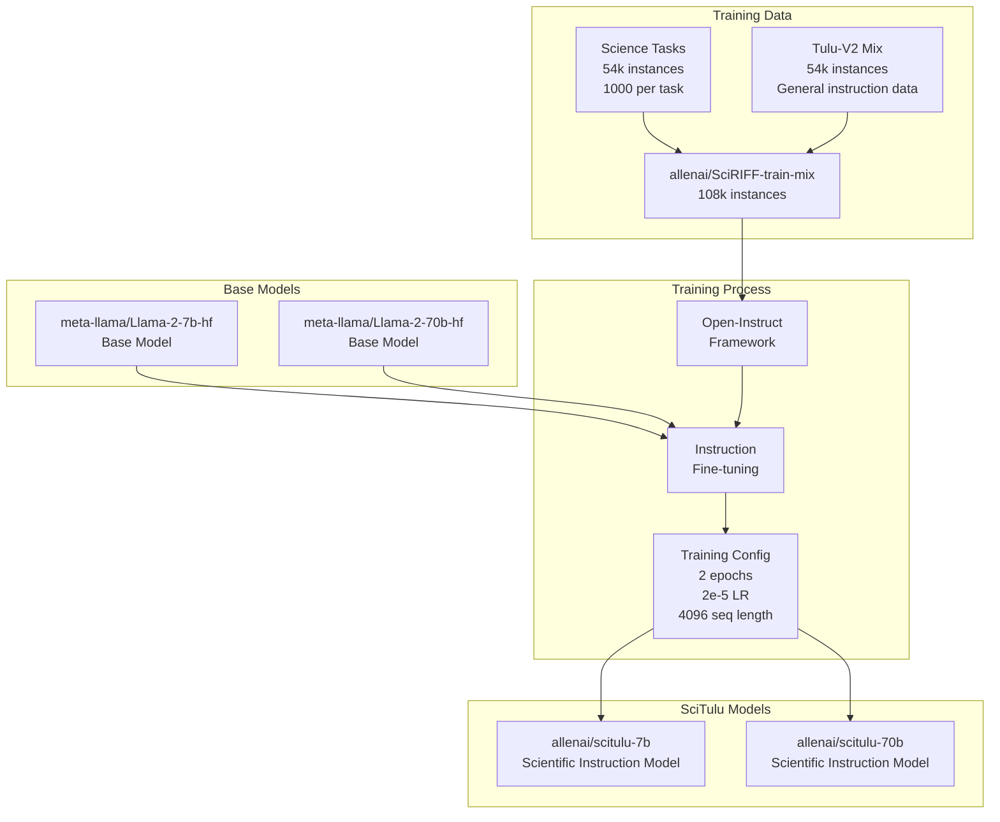

Sources: [README.md:26-27](), [README.md:128-159]()

### Model Capabilities and Performance

The SciTulu models demonstrate enhanced performance on scientific instruction-following tasks compared to their base models and general instruction-following models. Key capabilities include:

**Scientific Task Proficiency:**
- Biomedical question answering and information extraction
- Scientific literature summarization and analysis  
- Citation intent classification and evidence assessment
- Domain-specific named entity recognition and relation extraction

**Technical Specifications:**
- Maximum sequence length: 4096 tokens
- Chat template compatibility: Tulu format
- Inference backend support: VLLM, transformers, OpenAI-compatible APIs
- Hardware requirements: 7B model runs on single A6000, 70B model requires 4x A100 80GB

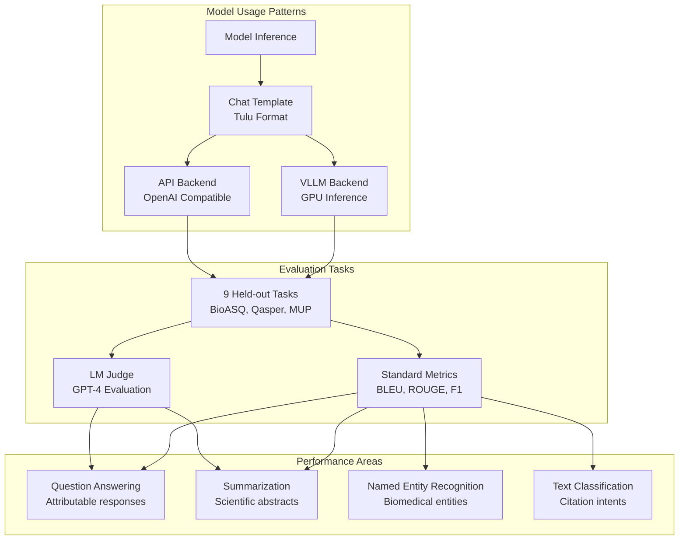

Sources: [README.md:81-106](), [README.md:141-142]()

### Model Access and Integration

Both SciTulu models are available through the Hugging Face Hub and can be integrated into evaluation and inference workflows using standard tooling:

**Direct Model Loading:**
- Compatible with `transformers` library
- Supports VLLM for high-throughput inference
- Available through OpenAI-compatible API servers

**Evaluation Integration:**
- Compatible with Eleuther AI evaluation harness
- Integrated with SciRIFF evaluation pipeline via `predict_eleuther.py`
- Supports both chat template and completion-style inference

Sources: [README.md:86-94](), [README.md:99-106]()

---

# Page: Evaluation System

# Evaluation System

<details>
<summary>Relevant source files</summary>

The following files were used as context for generating this wiki page:

- [LICENSE](LICENSE)
- [README.md](README.md)
- [script/eval/compute_science_metrics.py](script/eval/compute_science_metrics.py)

</details>


The evaluation system provides a comprehensive framework for assessing model performance on scientific instruction-following tasks. It handles the complete pipeline from generating model predictions to computing final metrics across 9 held-out evaluation tasks. The system supports multiple inference backends (VLLM, OpenAI API, Anthropic) and advanced evaluation methods including LM judge assessment for tasks requiring nuanced evaluation.

For information about the specific evaluation tasks and their implementations, see [Evaluation Tasks](#3.3). For details on generating training data and model training workflows, see [Data Processing Pipeline](#4) and [Model Training](#5).

## Architecture Overview

The evaluation system consists of two main entry points that orchestrate a multi-stage pipeline:

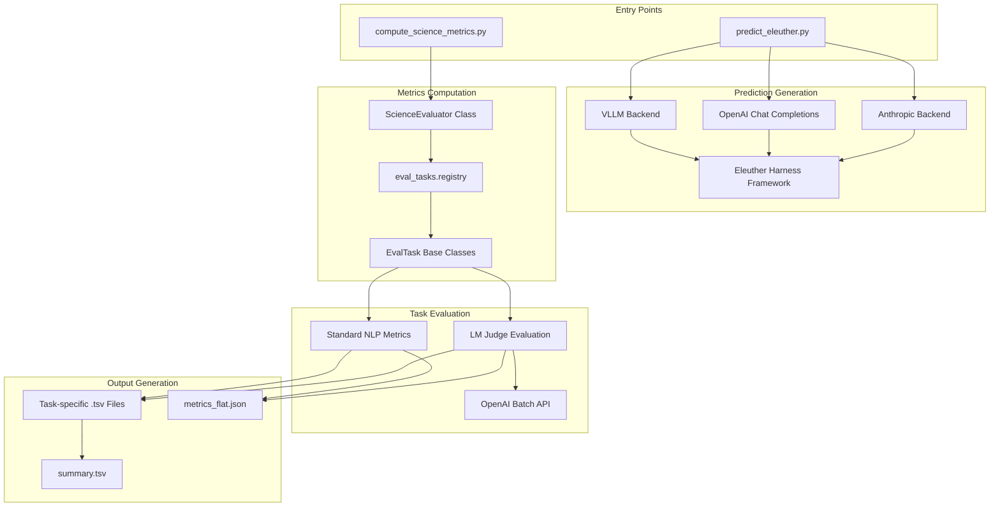

**Sources:** [README.md:75-126](), [script/eval/compute_science_metrics.py:29-47]()

## Prediction Generation Pipeline

The `predict_eleuther.py` script serves as the main entry point for generating model predictions across all evaluation tasks. It leverages the Eleuther evaluation harness framework to handle different model types and inference backends:

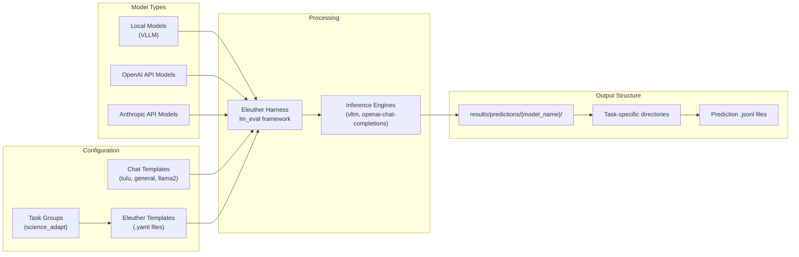

**Sources:** [README.md:79-106]()

## Metrics Computation Framework

The `ScienceEvaluator` class in [script/eval/compute_science_metrics.py]() orchestrates the evaluation process by loading predictions, applying task-specific evaluators, and generating comprehensive results:

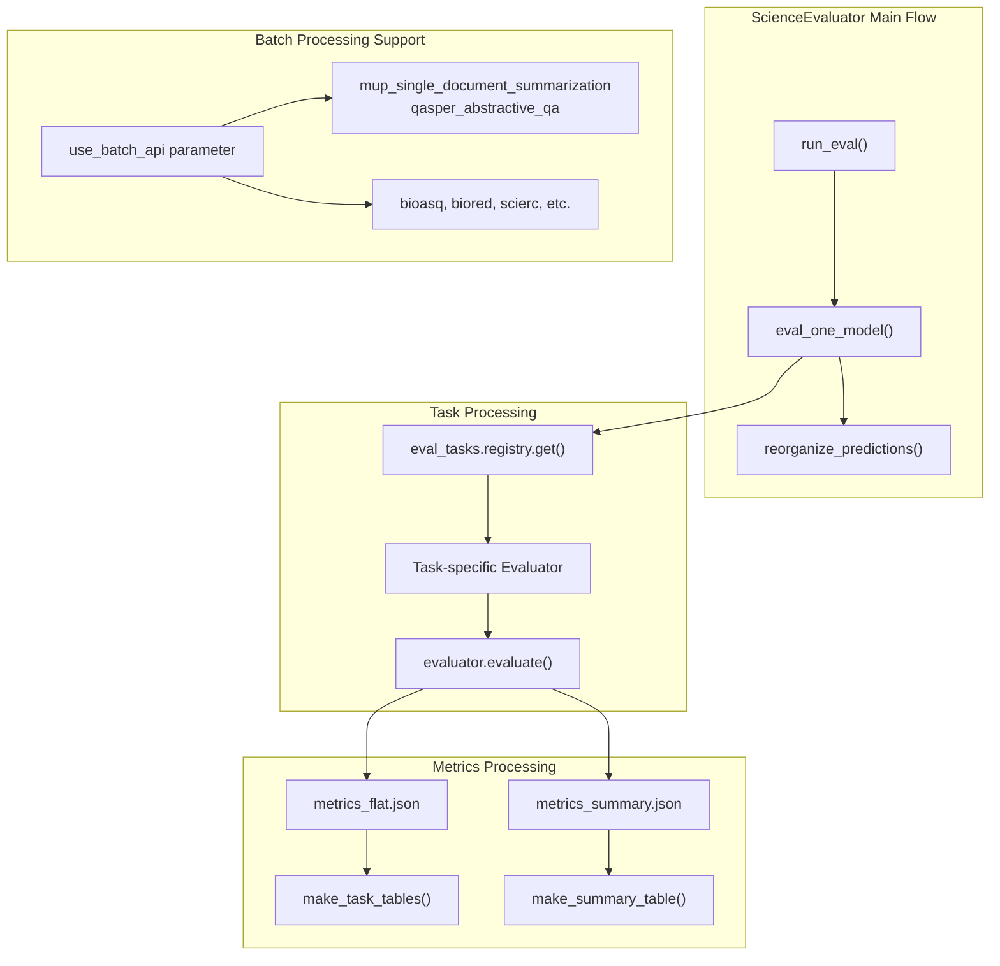

**Sources:** [script/eval/compute_science_metrics.py:135-197](), [script/eval/compute_science_metrics.py:198-220]()

## Task Evaluation Registry System

The evaluation framework uses a registry pattern to dynamically dispatch to appropriate evaluators based on task names. The registry system maps task identifiers to their corresponding evaluation classes:

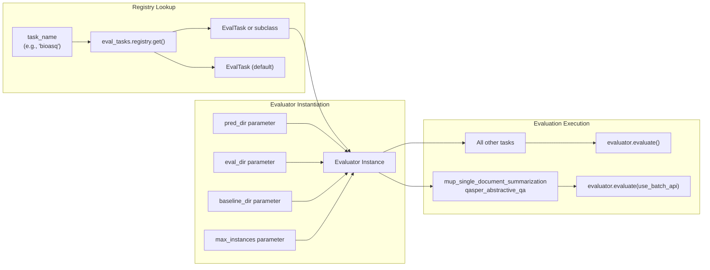

**Sources:** [script/eval/compute_science_metrics.py:156-167]()

## Summary Metrics Generation

The system generates comprehensive summary tables that aggregate performance across all tasks using predefined metrics combinations. The `make_summary_table` method computes cross-task performance scores:

| Task | Primary Metric | Description |
|------|----------------|-------------|
| bioasq | f1 | List-based QA F1 score |
| biored | f1 | Named Entity Recognition F1 |
| discomat | bleu | Text classification BLEU score |
| evidence_inference | f1_overlap | Evidence inference F1 with overlap |
| multicite | f1 | Citation intent classification F1 |
| mup | lm_judge_reference | LM judge reference-based evaluation |
| qasper | lm_judge_answer | LM judge answer quality evaluation |
| qasper | f1_evidence | Evidence extraction F1 score |
| scierc | f1 | Scientific entity relation classification F1 |
| scifact | f1_label | Scientific fact verification label F1 |
| scifact | f1_evidence_token | Evidence token-level F1 |

The summary computation includes both mean and median aggregation across all task metrics, with results sorted by model name and saved as tab-separated values in `summary.tsv`.

**Sources:** [script/eval/compute_science_metrics.py:48-84]()

## File Organization and Output Structure

The evaluation system maintains a structured directory hierarchy for organizing predictions, metrics, and results:

```
results/
├── predictions/
│   └── {model_name}/
│       ├── {task_name}/
│       │   ├── eleuther.jsonl
│       │   └── prediction_files...
├── metrics/
│   ├── by_model/
│   │   └── {model_name}/
│   │       └── {task_name}/
│   │           ├── metrics_flat.json
│   │           ├── metrics_summary.json
│   │           └── task_specific_outputs...
│   └── tables/
│       ├── summary.tsv
│       └── {task_name}.tsv
```

The `reorganize_predictions` method handles the transformation from the initial Eleuther harness output format (single `science_adapt` directory) to task-specific directories for easier processing.

**Sources:** [script/eval/compute_science_metrics.py:97-134]()

---

# Page: Generating Predictions

# Generating Predictions

<details>
<summary>Relevant source files</summary>

The following files were used as context for generating this wiki page:

- [script/eval/predict_eleuther.py](script/eval/predict_eleuther.py)

</details>


This document covers the prediction generation system in SciRIFF, which is responsible for running inference on scientific evaluation tasks using various model backends. The system uses the Eleuther evaluation harness to generate model predictions that are subsequently evaluated by the metrics computation pipeline.

For information about computing metrics from these predictions, see [Computing Metrics](#3.2). For details about the underlying evaluation tasks, see [Evaluation Tasks](#3.3).

## Overview

The prediction generation system is implemented in [script/eval/predict_eleuther.py:1-291]() and serves as a wrapper around the Eleuther evaluation harness. It supports multiple model backends and can run either locally or on AI2's Beaker cluster system for large-scale evaluations.

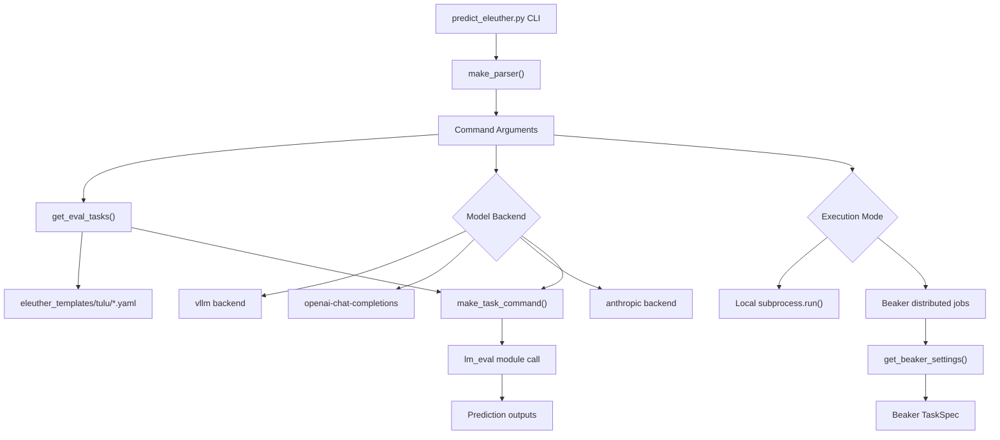

Sources: [script/eval/predict_eleuther.py:1-291]()

## Model Backend Configuration

The system supports three primary model backends, each with different configuration requirements:

### VLLM Backend
For local or self-hosted models using VLLM for efficient inference:

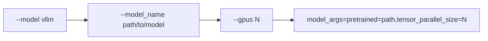

The VLLM backend constructs model arguments as [script/eval/predict_eleuther.py:194]():
```
model_args = f"pretrained={args.model_name},tensor_parallel_size={args.gpus},dtype=float16"
```

### OpenAI and Anthropic APIs
For API-based models, the configuration is simpler:

| Backend | Model Argument Example |
|---------|----------------------|
| `openai-chat-completions` | `gpt-4-turbo` |
| `anthropic` | `claude-3-opus-20240229` |

Both API backends use the same model argument pattern [script/eval/predict_eleuther.py:196]():
```
model_args = f"model={args.model_name}"
```

Sources: [script/eval/predict_eleuther.py:18-19](), [script/eval/predict_eleuther.py:193-196]()

## Task Selection and Templates

The system automatically discovers evaluation tasks from YAML template files:

```mermaid
flowchart TD
    TaskDir["paths.EVAL_DIR/eleuther_templates/tulu"] --> YAMLFiles["*.yaml files"]
    YAMLFiles --> TaskFilter["Filter _default_template"]
    TaskFilter --> TaskList["Available task names"]
    
    UserTasks["--tasks argument"] --> TaskValidation{Task exists?}
    TaskValidation -->|Yes| SelectedTasks["Selected tasks"]
    TaskValidation -->|No| Error["ValueError"]
    
    NoTasks["No --tasks specified"] --> AllTasks["Use all available tasks"]
    
    SpecialCase["--tasks science_adapt"] --> SingleProcess["Run all tasks in one process"]
```

The task discovery process is implemented in [script/eval/predict_eleuther.py:115-131]():

```python
def get_eval_tasks(args):
    eval_task_dir = paths.EVAL_DIR / "eleuther_templates/tulu"
    names = [p.stem for p in eval_task_dir.glob("*.yaml")]
    names = [name for name in names if name != "_default_template"]
```

Sources: [script/eval/predict_eleuther.py:115-131]()

## Chat Template System

The system supports different chat templates through the `--chat_template` argument:

- **Default**: `general` template
- **Template Path**: `eleuther_templates/{chat_template}/`
- **Special Handling**: When `--apply_chat_template` is used with non-`general` templates, validation prevents double-templating [script/eval/predict_eleuther.py:222-226]()

Sources: [script/eval/predict_eleuther.py:37-41](), [script/eval/predict_eleuther.py:190](), [script/eval/predict_eleuther.py:222-227]()

## Command Generation

The core of the system is the `make_task_command()` function that constructs Eleuther evaluation harness commands:

```mermaid
graph TD
    TaskName["task_name"] --> ResultCheck{Results exist?}
    ResultCheck -->|Yes| Skip["Return None (skip)"]
    ResultCheck -->|No| BuildCommand["Construct lm_eval command"]
    
    BuildCommand --> BaseCmd["python -m lm_eval"]
    BaseCmd --> IncludePath["--include_path eleuther_templates/template"]
    IncludePath --> ModelType["--model backend_type"]
    ModelType --> ModelArgs["--model_args backend_specific"]
    ModelArgs --> GenKwargs["--gen_kwargs max_gen_toks=1024"]
    GenKwargs --> TaskArg["--tasks task_name"]
    TaskArg --> BatchSize["--batch_size 1"]
    BatchSize --> PredictOnly["--predict_only --log_samples"]
    PredictOnly --> OutputPath["--output_path result_dir"]
    
    OptionalArgs["Optional: --limit, --apply_chat_template"] --> FinalCommand["Complete command array"]
```

The command structure [script/eval/predict_eleuther.py:198-228]():

```python
command = [
    "python", "-m", "lm_eval",
    "--include_path", include_path,
    "--model", args.model,
    "--model_args", model_args,
    "--gen_kwargs", "max_gen_toks=1024",
    "--tasks", task_name,
    "--batch_size", "1",
    "--predict_only", "--log_samples",
    "--output_path", result_file,
]
```

Sources: [script/eval/predict_eleuther.py:178-228]()

## Execution Modes

### Local Execution
When `--beaker` is not specified, tasks run sequentially in the current process:

```python
for task_spec in experiment_tasks:
    print(f"Running {task_spec.name}.")
    subprocess.run(task_spec.command)
```

### Beaker Distributed Execution  
For large-scale evaluations, the system creates Beaker experiments with parallel task execution:

```mermaid
graph TD
    BeakerArgs["Beaker arguments"] --> Settings["get_beaker_settings()"]
    Settings --> Clusters["AI2 cluster configuration"]
    Settings --> Datasets["Model datasets and NFS mounts"]
    Settings --> EnvVars["API keys and secrets"]
    
    Tasks["Task commands"] --> TaskSpecs["Beaker TaskSpec objects"]
    TaskSpecs --> ExperimentSpec["Beaker ExperimentSpec"]
    ExperimentSpec --> BeakerClient["Beaker.from_env()"]
    BeakerClient --> JobSubmission["beaker_client.experiment.create()"]
```

Beaker configuration includes [script/eval/predict_eleuther.py:134-175]():
- Cluster selection (s2-cirrascale variants)
- Environment variables for API keys
- Dataset mounts including NFS and model datasets
- Resource allocation (GPU count)

Sources: [script/eval/predict_eleuther.py:259-280](), [script/eval/predict_eleuther.py:134-175]()

## Output Structure

Predictions are organized by model and task:

```
results/by_model/
├── {model_display_name}/
│   ├── bioasq/
│   │   └── eleuther prediction files
│   ├── qasper/
│   │   └── eleuther prediction files
│   └── [other_tasks]/
```

The output directory structure is determined by [script/eval/predict_eleuther.py:232-241]():

```python
if args.model_display_name is not None:
    model_stem = args.model_display_name
else:
    if args.model == "vllm":
        model_stem = Path(args.model_name).name
    else:
        model_stem = args.model_name

result_dir = Path(args.result_base) / model_stem
```

Sources: [script/eval/predict_eleuther.py:180-187](), [script/eval/predict_eleuther.py:232-241]()

---

# Page: Computing Metrics

# Computing Metrics

<details>
<summary>Relevant source files</summary>

The following files were used as context for generating this wiki page:

- [script/eval/compute_science_metrics.py](script/eval/compute_science_metrics.py)

</details>


This document describes the metrics computation system used to evaluate model predictions in SciRIFF. The `compute_science_metrics.py` script processes prediction files generated by the evaluation pipeline and computes both task-specific and cross-task summary metrics.

For information about generating predictions, see [Generating Predictions](#3.1). For details about individual evaluation task implementations, see [Evaluation Tasks](#3.3).

## Overview

The metrics computation system takes prediction files from multiple models and tasks, runs evaluation using task-specific evaluators, and produces both detailed metrics and summary tables. The system is implemented in the `ScienceEvaluator` class which orchestrates the evaluation of all models across all tasks.

**Metrics Computation Flow**

```mermaid
flowchart TD
    PredDir["pred_dir/"]
    --> ModelDirs["model1/, model2/, model3/"]
    
    ModelDirs --> TaskDirs["bioasq/, qasper/, mup/, ..."]
    
    TaskDirs --> ScienceEvaluator["ScienceEvaluator.eval_one_model()"]
    
    ScienceEvaluator --> Registry["eval_tasks.registry.get()"]
    Registry --> TaskEvaluator["Task-specific EvalTask"]
    
    TaskEvaluator --> MetricsFlat["metrics_flat.json"]
    TaskEvaluator --> MetricsSummary["metrics_summary.json"]
    
    MetricsFlat --> TaskTables["tables/{task_name}.tsv"]
    MetricsSummary --> SummaryTable["tables/summary.tsv"]
    
    subgraph "Output Structure"
        MetricsDir["metrics_dir/"]
        MetricsDir --> ByModel["by_model/{model}/{task}/"]
        MetricsDir --> Tables["tables/"]
        ByModel --> MetricsFlat
        ByModel --> MetricsSummary
        Tables --> TaskTables
        Tables --> SummaryTable
    end
```

Sources: [script/eval/compute_science_metrics.py:29-220]()

## Input and Output Structure

The metrics computation system expects a specific directory structure for inputs and produces organized outputs for analysis.

**Directory Structure**

| Component | Path | Description |
|-----------|------|-------------|
| Prediction Directory | `pred_dir/{model_name}/{task_name}/` | Contains prediction files from models |
| Metrics Directory | `metrics_dir/by_model/{model_name}/{task_name}/` | Detailed metrics for each model-task pair |
| Summary Tables | `metrics_dir/tables/` | Cross-model comparison tables |

**Input Requirements**

The prediction directory must contain subdirectories for each model, with task-specific prediction files. The system can handle both reorganized predictions (one directory per task) and legacy formats where predictions are in a single `science_adapt` directory.

```mermaid
graph TD
    InputDir["pred_dir/"]
    --> Model1["model1/"]
    --> Task1["bioasq/"]
    --> PredFile1["predictions.jsonl"]
    
    InputDir --> Model2["model2/"]
    --> Task2["qasper/"]
    --> PredFile2["predictions.jsonl"]
    
    InputDir --> Model3["model3/"]
    --> ScienceAdapt["science_adapt/"]
    --> CombinedPreds["combined_predictions.jsonl"]
    
    subgraph "Reorganization"
        ScienceAdapt -.-> ReorgTasks["bioasq/, qasper/, mup/, ..."]
    end
```

Sources: [script/eval/compute_science_metrics.py:97-134]()

## ScienceEvaluator Class

The `ScienceEvaluator` class is the main orchestrator for metrics computation. It manages the evaluation process across multiple models and tasks, handling both standard metrics and LM judge evaluations.

**Class Architecture**

```mermaid
classDiagram
    class ScienceEvaluator {
        +pred_dir: Path
        +metrics_dir: Path
        +max_instances: int
        +clobber: bool
        +model_pattern: regex
        +use_batch_api: bool
        
        +__init__(args)
        +run_eval()
        +eval_one_model(model_dir, use_batch_api)
        +reorganize_predictions(model_dir)
        +make_summary_table(metrics_summary)
        +make_task_tables(metrics_flat)
    }
    
    ScienceEvaluator --> EvalTask : "uses"
    ScienceEvaluator --> "eval_tasks.registry" : "queries"
```

**Key Methods**

- `run_eval()`: Main entry point that processes all models and generates final tables
- `eval_one_model()`: Evaluates a single model across all its tasks
- `reorganize_predictions()`: Converts legacy prediction format to task-organized structure
- `make_summary_table()`: Creates cross-task comparison table
- `make_task_tables()`: Creates per-task comparison tables

Sources: [script/eval/compute_science_metrics.py:29-47](), [script/eval/compute_science_metrics.py:198-220]()

## Task Evaluation Process

For each model-task combination, the system loads the appropriate evaluator from the task registry and runs evaluation. Tasks requiring LM judge evaluation are handled specially with batch API support.

**Task Evaluation Flow**

```mermaid
flowchart TD
    ModelDir["model_dir/"] 
    --> TaskLoop["for task_dir in model_dir"]
    
    TaskLoop --> GetEvaluator["eval_tasks.registry.get(task_name)"]
    GetEvaluator --> CreateEvaluator["EvalTask(pred_dir, eval_dir)"]
    
    CreateEvaluator --> CheckCache{"metrics_flat.json exists?"}
    CheckCache -->|"No or --clobber"| RunEval["evaluator.evaluate()"]
    CheckCache -->|"Yes"| LoadMetrics["Load existing metrics"]
    
    RunEval --> LMJudgeCheck{"LM Judge task?"}
    LMJudgeCheck -->|"Yes"| BatchEval["evaluator.evaluate(use_batch_api)"]
    LMJudgeCheck -->|"No"| StandardEval["evaluator.evaluate()"]
    
    BatchEval --> SaveMetrics["Save metrics_flat.json"]
    StandardEval --> SaveMetrics
    LoadMetrics --> SaveMetrics
    
    SaveMetrics --> UpdateSummary["Add to metrics_summary"]
```

The system identifies LM judge tasks by name: `mup_single_document_summarization` and `qasper_abstractive_qa` are evaluated using the batch API option for cost-effective OpenAI API usage.

Sources: [script/eval/compute_science_metrics.py:135-197]()

## Summary Metrics and Tables

The system generates comprehensive summary tables that aggregate metrics across tasks and models, enabling easy comparison of model performance.

**Summary Metrics Configuration**

The summary table uses a predefined set of representative metrics for each task:

| Task | Metric | Description |
|------|--------|-------------|
| bioasq | f1 | F1 score for list question answering |
| biored | f1 | F1 score for named entity recognition |
| discomat | bleu | BLEU score for discourse marker prediction |
| evidence_inference | f1_overlap | F1 score with overlap matching |
| multicite | f1 | F1 score for citation intent classification |
| mup | lm_judge_reference | LM judge score vs reference |
| qasper | lm_judge_answer | LM judge score for answer quality |
| qasper | f1_evidence | F1 score for evidence selection |
| scierc | f1 | F1 score for named entity recognition |
| scifact | f1_label | F1 score for claim verification |
| scifact | f1_evidence_token | F1 score for evidence selection |

**Table Generation Process**

```mermaid
flowchart TD
    MetricsSummary["List of {model, task, metric, value}"] 
    --> PivotTable["pd.pivot_table(index='model', columns=['task', 'metric'])"]
    
    PivotTable --> FilterCols["Filter to summary_metrics columns"]
    FilterCols --> ComputeStats["Compute mean and median across tasks"]
    
    ComputeStats --> SortModels["Sort by sort_key(model_name)"]
    SortModels --> ScalePercent["Scale to percentages (* 100)"]
    
    ScalePercent --> SaveTSV["Save to tables/summary.tsv"]
    
    subgraph "sort_key Function"
        ModelName["model_name"] --> RemoveSeed["Remove -seed suffix"]
        RemoveSeed --> SplitParts["Split by underscore"]
        SplitParts --> ExtractNum["Extract final number"]
        ExtractNum --> SortTuple["(prefix, n_instances)"]
    end
```

The `sort_key` function ensures models are ordered logically, grouping by base name and sorting by number of training instances.

Sources: [script/eval/compute_science_metrics.py:48-96](), [script/eval/compute_science_metrics.py:17-26]()

## Command Line Interface

The script provides comprehensive command-line options for flexible metrics computation across different evaluation scenarios.

**Usage Pattern**

```bash
python script/eval/compute_science_metrics.py \
    --pred_dir /path/to/predictions \
    --metrics_dir /path/to/output \
    [additional options]
```

**Key Arguments**

| Argument | Type | Description |
|----------|------|-------------|
| `--pred_dir` | str | Directory containing prediction files from all models |
| `--metrics_dir` | str | Output directory for computed metrics |
| `--max_instances` | int | Limit evaluation to N instances per task (debugging) |
| `--clobber` | flag | Recompute metrics even if files exist |
| `--model_pattern` | str | Regex to filter models for evaluation |
| `--model_name` | str | Evaluate only specified model (no summary table) |
| `--use_batch_api` | flag | Use OpenAI batch API for LM judge evaluations |

**Batch API Integration**

For tasks requiring LM judge evaluation (`mup_single_document_summarization` and `qasper_abstractive_qa`), the `--use_batch_api` flag enables cost-effective batch processing through OpenAI's batch API, significantly reducing evaluation costs for large-scale experiments.

Sources: [script/eval/compute_science_metrics.py:222-263]()

---

# Page: Evaluation Tasks

# Evaluation Tasks

<details>
<summary>Relevant source files</summary>

The following files were used as context for generating this wiki page:

- [sciriff/eval/tasks/_base.py](sciriff/eval/tasks/_base.py)

</details>


This page documents the architecture and implementation of individual evaluation tasks within the SciRIFF evaluation framework. Evaluation tasks are responsible for processing model predictions, computing task-specific metrics, and outputting standardized results. For information about generating predictions, see [Generating Predictions](#3.1). For information about the overall metrics computation pipeline, see [Computing Metrics](#3.2). For details about LM judge evaluation methods, see [LM Judge System](#3.4).

## Purpose and Architecture

The evaluation task system provides a standardized framework for evaluating model performance across the 9 held-out scientific tasks in SciRIFF. Each task inherits from base classes that handle common functionality like prediction loading, result formatting, and file I/O, while implementing task-specific evaluation logic.

### Task Class Hierarchy

```mermaid
graph TD
    EvalTask["EvalTask<br/>(Base Class)"] --> JSONTask["JSONTask<br/>(JSON Parsing Support)"]
    EvalTask --> StandardTasks["Standard Metric Tasks"]
    JSONTask --> StructuredTasks["Structured Output Tasks"]
    
    StandardTasks --> BioASQ["BioASQTask<br/>(List QA)"]
    StandardTasks --> BioRED["BioREDNERTask<br/>(Named Entity Recognition)"]
    StandardTasks --> SciERC["SciERCNERTask<br/>(Named Entity Recognition)"]
    StandardTasks --> SciFact["SciFactTask<br/>(Entailment)"]
    StandardTasks --> Evidence["EvidenceInferenceTask<br/>(Evidence Inference)"]
    
    JSONTask --> Qasper["QasperTask<br/>(Abstractive QA)"]
    JSONTask --> MUP["MUPTask<br/>(Document Summarization)"]
    JSONTask --> Multicite["MulticiteTask<br/>(Intent Classification)"]
    JSONTask --> Discomat["DiscomatTETask<br/>(Text Entailment)"]
```

Sources: [sciriff/eval/tasks/_base.py:13-125](), [sciriff/eval/tasks/_base.py:126-180]()

### Task Processing Pipeline

```mermaid
flowchart TD
    PredFile["Prediction File<br/>(JSONL format)"] --> LoadPreds["load_predictions()"]
    LoadPreds --> RawPreds["get_raw_predictions()"]
    
    subgraph "Task-Specific Processing"
        RawPreds --> StandardPath["Standard Tasks<br/>(Direct Evaluation)"]
        RawPreds --> JSONPath["JSON Tasks<br/>(parse_predictions())"]
        
        JSONPath --> JSONParser["JSONParser<br/>(Extract Structured Data)"]
        JSONParser --> ParsedPairs["Parsed Prediction-Reference Pairs"]
    end
    
    subgraph "Metric Computation"
        StandardPath --> StandardMetrics["Standard Metrics<br/>(BLEU, ROUGE, F1)"]
        ParsedPairs --> TaskMetrics["Task-Specific Metrics"]
        TaskMetrics --> LMJudge["LM Judge Evaluation<br/>(GPT-4 Assessment)"]
    end
    
    subgraph "Output Generation"
        StandardMetrics --> Results["metrics.json"]
        LMJudge --> Results
        Results --> FlatMetrics["metrics_flat.json"]
        Results --> SummaryMetrics["metrics_summary.json"]
        RawPreds --> RawOutput["raw_predictions.jsonl"]
    end
```

Sources: [sciriff/eval/tasks/_base.py:46-61](), [sciriff/eval/tasks/_base.py:98-109](), [sciriff/eval/tasks/_base.py:158-179]()

## Task Types and Implementation

The evaluation system supports two primary categories of tasks, each with different processing requirements and evaluation methodologies.

### Standard Metric Tasks

Standard metric tasks evaluate predictions using traditional NLP metrics such as BLEU, ROUGE, and F1 scores. These tasks inherit directly from the `EvalTask` base class and work with string-based predictions.

| Task | Dataset | Evaluation Type | Primary Metrics |
|------|---------|-----------------|-----------------|
| BioASQ | Biomedical QA | List Question Answering | F1, Exact Match |
| BioRED NER | Biomedical Text | Named Entity Recognition | Precision, Recall, F1 |
| SciERC NER | Scientific Text | Named Entity Recognition | Precision, Recall, F1 |
| SciFact | Scientific Claims | Textual Entailment | Accuracy, F1 |
| Evidence Inference | Medical Evidence | Evidence Assessment | Macro-F1, Accuracy |

### Structured Output Tasks (JSONTask)

Structured output tasks require models to generate JSON-formatted responses, which are then parsed and validated before evaluation. These tasks inherit from `JSONTask`, which extends `EvalTask` with JSON parsing capabilities.

```mermaid
graph TD
    ModelOutput["Model Output<br/>(Raw String)"] --> JSONParser["JSONParser.parse()"]
    JSONParser --> ValidJSON["Valid JSON<br/>(Structured Data)"]
    JSONParser --> ParseFailure["Parse Failure<br/>(Default Value)"]
    
    ValidJSON --> TaskEval["Task-Specific Evaluation"]
    ParseFailure --> TaskEval
    
    subgraph "Evaluation Methods"
        TaskEval --> StandardMetrics["Standard Metrics<br/>(BLEU, ROUGE)"]
        TaskEval --> LMJudgeMetrics["LM Judge Metrics<br/>(GPT-4 Assessment)"]
    end
    
    StandardMetrics --> Results["Final Metrics"]
    LMJudgeMetrics --> Results
```

Sources: [sciriff/eval/tasks/_base.py:126-180](), [sciriff/eval/metrics/json_parser.py]()

## Task Initialization and Configuration

Each evaluation task is initialized with a standardized set of parameters that define input sources, output destinations, and processing constraints.

### Initialization Parameters

```python
# Base initialization signature for all tasks
EvalTask(pred_dir, eval_dir, baseline_dir, max_instances=None)
```

| Parameter | Purpose | Example Value |
|-----------|---------|---------------|
| `pred_dir` | Directory containing model predictions | `/path/to/predictions/qasper/` |
| `eval_dir` | Output directory for evaluation results | `/path/to/evaluation/qasper/` |
| `baseline_dir` | Directory containing baseline predictions | `/path/to/baselines/` |
| `max_instances` | Limit on number of instances to evaluate | `1000` |

### Prediction File Discovery

The task framework automatically discovers prediction files using a standardized naming convention:

```mermaid
flowchart TD
    PredDir["pred_dir/"] --> SearchFiles["Search for Files"]
    SearchFiles --> Pattern1["Files containing<br/>'pretrained__'"]
    SearchFiles --> Pattern2["Files containing<br/>'model__'"]
    SearchFiles --> Pattern3["Files containing<br/>'samples_'"]
    
    Pattern1 --> SingleFile["Single File Found"]
    Pattern2 --> SingleFile
    Pattern3 --> SingleFile
    
    SingleFile --> VLLMCheck["VLLM Structure Check"]
    VLLMCheck --> SubdirSearch["Search Subdirectories<br/>(if needed)"]
    SubdirSearch --> PredFile["Final Prediction File"]
    SingleFile --> PredFile
    
    PredFile --> LoadPreds["load_predictions()"]
```

Sources: [sciriff/eval/tasks/_base.py:24-44]()

## Evaluation Workflow

The evaluation process follows a standardized workflow across all task types, with task-specific customizations at key stages.

### Core Evaluation Steps

1. **Prediction Loading**: Load model outputs from JSONL files
2. **Data Processing**: Extract and format prediction-reference pairs
3. **Metric Computation**: Apply task-appropriate evaluation metrics
4. **Result Formatting**: Generate standardized output files

### Output File Structure

Each task generates a consistent set of output files in its designated evaluation directory:

| File | Purpose | Format |
|------|---------|--------|
| `metrics.json` | Complete evaluation results | Hierarchical JSON |
| `metrics_flat.json` | Flattened metrics for tabular analysis | Flat JSON |
| `metrics_summary.json` | Summary statistics | Condensed JSON |
| `raw_predictions.jsonl` | Processed prediction-reference pairs | JSONL |

Sources: [sciriff/eval/tasks/_base.py:87-96](), [sciriff/eval/tasks/_base.py:111-124]()

## Integration with Evaluation Pipeline

Evaluation tasks integrate with the broader SciRIFF evaluation system through a registry-based architecture that enables dynamic task discovery and execution.

### Task Registration and Discovery

```mermaid
graph LR
    ComputeScript["compute_science_metrics.py"] --> TaskRegistry["eval_tasks.registry"]
    TaskRegistry --> TaskClasses["Task Class Lookup"]
    TaskClasses --> TaskInit["Task Initialization"]
    TaskInit --> TaskEval["Task.evaluate()"]
    TaskEval --> Results["Evaluation Results"]
```

The evaluation system dynamically instantiates and executes tasks based on the directory structure of prediction files, allowing for flexible evaluation of different model outputs against multiple scientific tasks.

Sources: [sciriff/eval/tasks/_base.py](), [sciriff/eval/compute_science_metrics.py]()

---

# Page: Task Framework

# Task Framework

<details>
<summary>Relevant source files</summary>

The following files were used as context for generating this wiki page:

- [sciriff/eval/tasks/_base.py](sciriff/eval/tasks/_base.py)

</details>


This document covers the base classes and common functionality that underpin all evaluation tasks in the SciRIFF evaluation system. The Task Framework provides standardized interfaces for loading predictions, computing metrics, and handling JSON parsing across different scientific evaluation tasks.

For implementation details of specific evaluation tasks like Qasper or MUP, see [Qasper Abstractive QA](#3.3.2) and [MUP Document Summarization](#3.3.3). For the broader evaluation pipeline context, see [Evaluation System](#3).

## Architecture Overview

The Task Framework is built around two main base classes that provide common functionality for all evaluation tasks in the system.

### Class Hierarchy

```mermaid
classDiagram
    class EvalTask {
        +Path pred_dir
        +Path eval_dir
        +baseline_dir
        +max_instances
        +Path pred_file
        +__init__(pred_dir, eval_dir, baseline_dir, max_instances)
        +get_prediction_file(wkdir) Path
        +load_predictions(fname) list
        +get_raw_predictions(fname) list
        +get_bleu() float
        +evaluate() void
        +dump_results(res) void
        +make_flattened_metrics(res)$ dict
        +make_summary_metrics(res)$ dict
    }
    
    class JSONTask {
        +JSONParser json_parser
        +dict counts
        +default
        +__init__(pred_dir, eval_dir, baseline_dir, max_instances)
        +parse_predictions() tuple
        +_make_pairs(preds, refs, prompts)$ dict
    }
    
    class JSONParser {
        +default
        +task
        +__call__(texts) tuple
    }
    
    EvalTask <|-- JSONTask
    JSONTask --> JSONParser : uses
```

Sources: [sciriff/eval/tasks/_base.py:13-125](), [sciriff/eval/tasks/_base.py:126-180]()

## EvalTask Base Class

The `EvalTask` class provides core functionality that all evaluation tasks inherit, including prediction loading, basic metrics computation, and result storage.

### Core Initialization and Setup

The base class handles standard directory setup and prediction file discovery:

```mermaid
flowchart TD
    init["EvalTask.__init__()"] --> setup_dirs["Setup eval_dir, pred_dir paths"]
    setup_dirs --> find_pred["get_prediction_file()"]
    find_pred --> search_patterns["Search for files matching:<br/>pretrained__, model__, samples_"]
    search_patterns --> check_vllm["Check subdirectories<br/>for VLLM output structure"]
    check_vllm --> validate["Validate single prediction file found"]
    validate --> store_path["Store in self.pred_file"]
```

Sources: [sciriff/eval/tasks/_base.py:14-44]()

### Prediction Loading and Processing

The framework provides standardized methods for loading and processing model predictions:

| Method | Purpose | Return Type |
|--------|---------|-------------|
| `load_predictions()` | Load raw prediction data from JSONL files | `list` |
| `get_raw_predictions()` | Extract and structure predictions with prompts and references | `list[dict]` |
| `get_bleu()` | Compute BLEU scores using HuggingFace evaluate library | `float` |

The `get_raw_predictions()` method standardizes the prediction format across different model outputs:

```mermaid
flowchart LR
    raw_entry["Raw Prediction Entry"] --> extract_prompt["Extract prompt from<br/>arguments.gen_args_0.arg_0"]
    extract_prompt --> extract_ref["Extract reference<br/>from target field"]
    raw_entry --> extract_pred["Extract prediction from<br/>filtered_resps[0]"]
    extract_pred --> clean_pred["Strip '</s>' tokens<br/>from Tulu models"]
    clean_pred --> structured["Structured Output:<br/>{prompt, pred, ref}"]
    extract_ref --> structured
```

Sources: [sciriff/eval/tasks/_base.py:46-61](), [sciriff/eval/tasks/_base.py:98-109]()

### Metrics and Results Management

The base class provides a standardized approach to metrics computation and result storage:

```mermaid
flowchart TD
    evaluate["evaluate() method"] --> compute_bleu["Compute BLEU scores"]
    compute_bleu --> dump_metrics["dump_results()"]
    dump_metrics --> save_raw["Save metrics.json"]
    dump_metrics --> save_flat["Save metrics_flat.json<br/>via make_flattened_metrics()"]
    dump_metrics --> save_summary["Save metrics_summary.json<br/>via make_summary_metrics()"]
    evaluate --> save_predictions["Save raw_predictions.jsonl<br/>via util.write_jsonl()"]
```

Sources: [sciriff/eval/tasks/_base.py:63-75](), [sciriff/eval/tasks/_base.py:87-96](), [sciriff/eval/tasks/_base.py:111-124]()

## JSONTask Extended Framework

The `JSONTask` class extends `EvalTask` to handle evaluation tasks that require JSON parsing of model outputs, which is common in scientific tasks with structured responses.

### JSON Parsing Integration

```mermaid
flowchart TD
    jsontask_init["JSONTask.__init__()"] --> super_init["Call EvalTask.__init__()"]
    super_init --> create_parser["Initialize JSONParser<br/>with default and task name"]
    create_parser --> init_counts["Initialize self.counts = {}"]
    
    parse_call["parse_predictions()"] --> get_raw["Get raw predictions"]
    get_raw --> parse_refs["Parse references with JSONParser"]
    parse_refs --> validate_refs["Validate all refs parse successfully"]
    validate_refs --> parse_preds["Parse predictions with JSONParser"]
    parse_preds --> track_counts["Track parsing success/failure counts"]
    track_counts --> make_pairs["_make_pairs() creates paired data"]
    make_pairs --> return_data["Return {parsed, all, raw} versions"]
```

Sources: [sciriff/eval/tasks/_base.py:130-135](), [sciriff/eval/tasks/_base.py:158-179]()

### Data Pairing Strategy

The `_make_pairs()` static method creates multiple versions of the evaluation data to handle JSON parsing failures gracefully:

| Data Version | Description | Use Case |
|--------------|-------------|----------|
| `parsed` | Only successfully parsed predictions | Primary evaluation metrics |
| `all` | All predictions (failed parses use extracted values) | Fallback evaluation |
| `raw` | Unprocessed predictions for debugging | Error analysis and debugging |

```mermaid
flowchart LR
    input_data["Input: preds, refs, prompts"] --> create_raw["Create raw_pairs<br/>for debugging"]
    input_data --> create_all["Create all_pairs<br/>with extracted values"]
    input_data --> filter_success["Filter successful parses<br/>status != 'extract_failure'"]
    filter_success --> create_parsed["Create successful_pairs<br/>for primary metrics"]
    create_raw --> output["Return dict with<br/>parsed, all, raw versions"]
    create_all --> output
    create_parsed --> output
```

Sources: [sciriff/eval/tasks/_base.py:137-156]()

## Integration with Evaluation Pipeline

The Task Framework integrates with the broader evaluation system through standardized interfaces:

```mermaid
flowchart TD
    subgraph "External Components"
        prediction_gen["predict_eleuther.py<br/>Prediction Generation"]
        metrics_comp["compute_science_metrics.py<br/>Metrics Computation"]
        task_registry["eval_tasks.registry<br/>Task Registration"]
    end
    
    subgraph "Task Framework"
        eval_task["EvalTask"]
        json_task["JSONTask"]
        json_parser["JSONParser"]
    end
    
    subgraph "Concrete Tasks"
        qasper_task["QasperTask"]
        mup_task["MUPTask"]
        bioasq_task["BioASQTask"]
    end
    
    prediction_gen --> eval_task
    metrics_comp --> task_registry
    task_registry --> eval_task
    
    eval_task --> json_task
    json_task --> json_parser
    
    json_task --> qasper_task
    json_task --> mup_task
    eval_task --> bioasq_task
```

Sources: [sciriff/eval/tasks/_base.py:1-180]()

---

# Page: Qasper Abstractive QA

# Qasper Abstractive QA

<details>
<summary>Relevant source files</summary>

The following files were used as context for generating this wiki page:

- [sciriff/eval/tasks/qasper_abstractive_qa.py](sciriff/eval/tasks/qasper_abstractive_qa.py)

</details>


This page documents the implementation of the Qasper abstractive question answering evaluation task within the SciRIFF evaluation framework. The Qasper task evaluates model performance on generating natural language answers to questions about scientific papers, along with supporting evidence citations.

For information about the overall evaluation task framework, see [Task Framework](#3.3.1). For details about the underlying LM judge evaluation system used by Qasper, see [Attributed QA Evaluation](#3.4.1).

## Task Overview

The Qasper task implements evaluation for abstractive question answering on scientific papers. Unlike extractive QA tasks that select spans from the source text, this task requires models to generate free-form natural language answers while providing supporting evidence from the paper.

The task expects model outputs in JSON format with two key components:
- `answer`: A natural language response to the question
- `evidence`: Supporting citations or evidence from the source paper

**Architecture Integration**

```mermaid
flowchart TD
    subgraph "Input Processing"
        ModelPreds["Model Predictions<br/>(JSON Format)"]
        QasperDataset["Qasper Dataset<br/>(Questions + Papers)"]
    end
    
    subgraph "Qasper Task Implementation"
        QasperClass["Qasper Class<br/>qasper_abstractive_qa.py"]
        JSONTask["JSONTask<br/>(Base Class)"]
        DefaultVals["default = {answer: None, evidence: None}"]
    end
    
    subgraph "Evaluation Components"
        ParsePreds["parse_predictions()<br/>JSONTask method"]
        AttributedQAEval["AttributedQAEval<br/>attributed_qa_eval.py"]
        BLEUMetric["get_bleu()<br/>Standard metric"]
    end
    
    subgraph "LM Judge Integration"
        LMJudgeFile["lm_judge.json"]
        LMJudgeRaw["lm_judge_raw.json"]  
        LMJudgeMapping["lm_judge_mapping.json"]
        BatchAPI["OpenAI Batch API<br/>(Optional)"]
    end
    
    subgraph "Output Metrics"
        ValidJSONResults["results[valid_json]<br/>Successfully parsed only"]
        AllResults["results[all]<br/>All predictions"]
        FlatMetrics["Flattened Metrics<br/>make_flattened_metrics()"]
        SummaryMetrics["Summary Metrics<br/>make_summary_metrics()"]
    end
    
    ModelPreds --> QasperClass
    QasperDataset --> QasperClass
    QasperClass --> JSONTask
    JSONTask --> ParsePreds
    
    QasperClass --> DefaultVals
    ParsePreds --> AttributedQAEval
    QasperClass --> BLEUMetric
    
    AttributedQAEval --> LMJudgeFile
    AttributedQAEval --> LMJudgeRaw
    AttributedQAEval --> LMJudgeMapping
    AttributedQAEval --> BatchAPI
    
    AttributedQAEval --> ValidJSONResults
    AttributedQAEval --> AllResults
    ValidJSONResults --> FlatMetrics
    AllResults --> FlatMetrics
    AllResults --> SummaryMetrics
    
    style QasperClass fill:#f9f9f9
    style AttributedQAEval fill:#f9f9f9
    style BatchAPI fill:#f9f9f9
```

Sources: [sciriff/eval/tasks/qasper_abstractive_qa.py:1-65]()

## Implementation Details

### Class Structure

The `Qasper` class inherits from `JSONTask`, providing automatic JSON parsing capabilities for structured model outputs. The class defines default values for expected output fields:

```python
default = {"answer": None, "evidence": None}
```

This default structure ensures that even when models fail to generate valid JSON, the evaluation can proceed with null values for missing fields.

**Key Methods**

```mermaid
classDiagram
    class JSONTask {
        +parse_predictions()
        +get_bleu()
        +dump_results()
    }
    
    class Qasper {
        +default: dict
        +evaluate(use_batch_api)
        +make_flattened_metrics(res)$ 
        +make_summary_metrics(res)$
    }
    
    class AttributedQAEval {
        +evaluate(predictions, lm_judge_file, lm_judge_raw_file, lm_judge_mapping, use_batch_api)
    }
    
    JSONTask <|-- Qasper
    Qasper ..> AttributedQAEval : uses
    
    note for Qasper : "Static methods for\nmetric aggregation"
    note for AttributedQAEval : "LM judge evaluation\nfor answer quality"
```

Sources: [sciriff/eval/tasks/qasper_abstractive_qa.py:8-10](), [sciriff/eval/tasks/qasper_abstractive_qa.py:40-64]()

### Evaluation Process

The main evaluation workflow occurs in the `evaluate` method, which coordinates multiple evaluation components:

1. **JSON Parsing**: Inherited `parse_predictions()` method processes model outputs
2. **Attributed QA Evaluation**: `AttributedQAEval` assesses answer quality and evidence
3. **Standard Metrics**: BLEU score computation for reference comparison
4. **Results Aggregation**: Combines metrics from different evaluation modes

The evaluation runs on two data subsets:
- `valid_json`: Only predictions that successfully parsed as JSON
- `all`: All predictions, with defaults used for parsing failures

**Evaluation Flow**

```mermaid
flowchart TD
    subgraph "Input Processing"
        EvaluateCall["evaluate(use_batch_api=False)"]
        ParsePreds["predictions, json_counts = parse_predictions()"]
    end
    
    subgraph "File Preparation" 
        LMJudgeFiles["lm_judge.json<br/>lm_judge_raw.json<br/>lm_judge_mapping.json"]
        EvaluatorInit["evaluator = AttributedQAEval()"]
    end
    
    subgraph "Dual Evaluation"
        ValidJSONEval["evaluator.evaluate(predictions[parsed])"]
        AllEval["evaluator.evaluate(predictions[all], lm_judge_file=..., use_batch_api=...)"]
    end
    
    subgraph "Additional Metrics"
        BLEUComp["get_bleu()"]
        JSONCounts["json_counts tracking"]
    end
    
    subgraph "Results Assembly"
        ResultsDict["res[results][valid_json]<br/>res[results][all]<br/>res[bleu]<br/>res[json_counts]"]
        BatchCheck["Check if batch job submitted"]
        DumpResults["dump_results(res)"]
    end
    
    EvaluateCall --> ParsePreds
    ParsePreds --> LMJudgeFiles
    LMJudgeFiles --> EvaluatorInit
    
    EvaluatorInit --> ValidJSONEval
    EvaluatorInit --> AllEval
    ParsePreds --> BLEUComp
    ParsePreds --> JSONCounts
    
    ValidJSONEval --> ResultsDict
    AllEval --> ResultsDict
    BLEUComp --> ResultsDict
    JSONCounts --> ResultsDict
    
    ResultsDict --> BatchCheck
    BatchCheck --> DumpResults
    
    style AllEval fill:#f9f9f9
    style BatchCheck fill:#f9f9f9
```

Sources: [sciriff/eval/tasks/qasper_abstractive_qa.py:40-64]()

## Metrics Computation

### Flattened Metrics

The `make_flattened_metrics` static method transforms nested evaluation results into a flat dictionary structure suitable for tabular reporting. It processes metrics for both evaluation settings (`valid_json` and `all`):

| Metric Category | Examples | Purpose |
|---|---|---|
| Parse Success Rates | `all_answer_frac_parsed`, `valid_json_evidence_frac_parsed` | Track JSON parsing success |
| Performance Scores | `all_f1_answer_all`, `valid_json_lm_judge` | Core evaluation metrics |
| Standard Metrics | `bleu`, `json_parsed` | Traditional NLP metrics |

The flattening process extracts:
- **Parsing Statistics**: Success rates for answer, evidence, and string validation
- **Performance Metrics**: All scores from the AttributedQAEval results  
- **Global Metrics**: BLEU scores and overall JSON parsing success

**Metrics Processing Pipeline**

```mermaid
flowchart LR
    subgraph "Raw Results Structure"
        NestedRes["res[results][setting][scores][metric]<br/>res[results][setting][answer_parse][method]<br/>res[bleu]<br/>res[json_counts]"]
    end
    
    subgraph "Flattening Process"
        SettingLoop["For each setting:<br/>valid_json, all"]
        ParseMetrics["Extract parse fractions:<br/>answer, evidence, answer_entry_is_str"]
        ScoreMetrics["Extract all scores:<br/>f1_answer_all, lm_judge, etc."]
        GlobalMetrics["Add bleu, json_parsed"]
    end
    
    subgraph "Flattened Output" 
        FlatDict["metrics_flat[setting_metric] = value<br/>Example: all_f1_answer_all = 0.75"]
    end
    
    NestedRes --> SettingLoop
    SettingLoop --> ParseMetrics
    SettingLoop --> ScoreMetrics
    NestedRes --> GlobalMetrics
    
    ParseMetrics --> FlatDict
    ScoreMetrics --> FlatDict
    GlobalMetrics --> FlatDict
    
    style FlatDict fill:#f9f9f9
```

Sources: [sciriff/eval/tasks/qasper_abstractive_qa.py:11-30]()

### Summary Metrics

The `make_summary_metrics` method extracts the most important metrics for cross-task comparison, focusing on the `all` setting which includes all predictions:

- **`lm_judge_answer`**: LM judge score for answer quality (may be None if not available)
- **`f1_answer_all`**: F1 score for answer content matching
- **`f1_evidence_all`**: F1 score for evidence citation accuracy

These summary metrics appear in the final evaluation tables and enable comparison across different tasks and models.

Sources: [sciriff/eval/tasks/qasper_abstractive_qa.py:32-38]()

## Batch Processing Support

The Qasper task supports OpenAI's Batch API for cost-effective LM judge evaluation. When `use_batch_api=True` is passed to the `evaluate` method:

1. Evaluation requests are submitted to the batch API
2. The method returns early with a notification message
3. Results must be retrieved later using batch processing utilities

This integration allows large-scale evaluation while reducing API costs, particularly important for the computationally expensive LM judge evaluations that Qasper relies on.

Sources: [sciriff/eval/tasks/qasper_abstractive_qa.py:52-60]()

---

# Page: MUP Document Summarization

# MUP Document Summarization

<details>
<summary>Relevant source files</summary>

The following files were used as context for generating this wiki page:

- [sciriff/eval/tasks/mup_single_document_summarization.py](sciriff/eval/tasks/mup_single_document_summarization.py)

</details>


This document covers the MUP (Multi-document Summarization in Biomedical Domain) single document summarization evaluation task implementation. This task evaluates model performance on summarizing scientific documents by comparing generated summaries against reference summaries using both traditional automated metrics and LM judge evaluation.

For information about the overall evaluation system architecture, see [Evaluation System](#3). For details about the LM judge summary comparison implementation, see [Summary Comparison](#3.4.2).

## Purpose and Scope

The MUP evaluation task assesses model capabilities in generating high-quality summaries of scientific documents. It combines traditional metrics (BLEU, ROUGE) with sophisticated LM judge evaluation to provide comprehensive assessment of summary quality, coherence, and factual accuracy.

## Task Architecture

The MUP evaluation task follows the standard evaluation framework while incorporating specialized summary evaluation components.

```mermaid
graph TD
    subgraph "Task Framework"
        EvalTask["EvalTask (Base)"]
        MUPTask["MUP"]
        EvalTask --> MUPTask
    end
    
    subgraph "Input Processing"
        RawPreds["raw_predictions"]
        Predictions["predictions[]"]
        References["references[]"]
        Prompts["prompts[]"]
        
        RawPreds --> Predictions
        RawPreds --> References  
        RawPreds --> Prompts
    end
    
    subgraph "Evaluation Methods"
        BLEUEval["BLEU Scoring"]
        ROUGEEval["ROUGE Scoring"]
        LMJudge["LM Judge Evaluation"]
        
        subgraph "LM Judge Components"
            SummaryComp["SummaryComparison"]
            RefComparison["reference_comparison"]
        end
    end
    
    subgraph "Output Generation"
        FlattenedMetrics["make_flattened_metrics()"]
        SummaryMetrics["make_summary_metrics()"]
        ResultsDump["dump_results()"]
    end
    
    MUPTask --> Predictions
    MUPTask --> References
    MUPTask --> Prompts
    
    Predictions --> BLEUEval
    Predictions --> ROUGEEval
    Predictions --> LMJudge
    References --> ROUGEEval
    References --> LMJudge
    
    LMJudge --> SummaryComp
    SummaryComp --> RefComparison
    
    BLEUEval --> FlattenedMetrics
    ROUGEEval --> FlattenedMetrics
    RefComparison --> FlattenedMetrics
    
    FlattenedMetrics --> SummaryMetrics
    SummaryMetrics --> ResultsDump
```

Sources: [sciriff/eval/tasks/mup_single_document_summarization.py:13-116]()

## Evaluation Pipeline

The MUP evaluation follows a multi-stage pipeline that processes predictions through different evaluation methods.

### Instance Initialization

The `_initiate_instances()` method prepares evaluation data by extracting predictions, references, and prompts from raw prediction files.

```mermaid
flowchart TD
    subgraph "Data Preparation"
        PredFile["pred_file"]
        RawPreds["get_raw_predictions()"]
        JSONLWrite["util.write_jsonl()"]
        
        PredFile --> RawPreds
        RawPreds --> JSONLWrite
    end
    
    subgraph "Data Extraction"
        RawPreds --> Predictions["predictions = [entry['pred']]"]
        RawPreds --> References["references = [entry['ref']]"] 
        RawPreds --> Prompts["prompts = [entry['prompt']]"]
    end
    
    subgraph "Instance Creation"
        Predictions --> Instances["instances[i] = {...}"]
        References --> Instances
        Prompts --> Instances
        
        Instances --> InstanceDict["{'prediction': ..., 'reference': ..., 'prompt': ...}"]
    end
    
    InstanceDict --> ReturnValues["return instances, predictions, references"]
```

Sources: [sciriff/eval/tasks/mup_single_document_summarization.py:34-59]()

### Evaluation Execution

The main `evaluate()` method orchestrates different evaluation approaches:

| Evaluation Type | Method | Purpose |
|----------------|---------|---------|
| BLEU | `get_bleu()` | Lexical similarity to reference |
| ROUGE | `evaluate.load("rouge")` | N-gram and sequence overlap |
| LM Judge | `SummaryComparison` | Quality and coherence assessment |

```mermaid
graph TD
    subgraph "Traditional Metrics"
        BLEUComp["get_bleu()"]
        ROUGELoad["evaluate.load('rouge')"]
        ROUGEComp["rouge_scorer.compute()"]
        
        ROUGELoad --> ROUGEComp
    end
    
    subgraph "LM Judge Setup"
        LMJudgeFiles["lm_judge_raw_results_file<br/>lm_judge_agg_results_file<br/>lm_judge_outputs<br/>lm_judge_mapping"]
        BatchCheck["Check existing results"]
        BatchRetrieve["retrieve_batch_job_results()"]
        
        LMJudgeFiles --> BatchCheck
        BatchCheck --> BatchRetrieve
    end
    
    subgraph "Summary Evaluation"
        SummaryEval["SummaryComparison.evaluate()"]
        EvalParams["eval_type='reference_comparison'<br/>n_sample=100<br/>use_batch_api"]
        
        SummaryEval --> EvalParams
    end
    
    subgraph "Result Processing"
        ResDict["res = {}"]
        BLEUComp --> ResDict
        ROUGEComp --> ResDict
        SummaryEval --> ResDict
        ResDict --> DumpResults["dump_results(res)"]
    end
```

Sources: [sciriff/eval/tasks/mup_single_document_summarization.py:61-116]()

## Implementation Details

### Class Structure

The `MUP` class extends the base `EvalTask` with summarization-specific functionality:

```mermaid
classDiagram
    class EvalTask {
        +get_raw_predictions()
        +get_bleu()
        +dump_results()
    }
    
    class MUP {
        +make_flattened_metrics()$
        +make_summary_metrics()$
        +_initiate_instances()
        +evaluate(use_batch_api)
        -lm_judge_file
    }
    
    class SummaryComparison {
        +evaluate()
    }
    
    EvalTask <|-- MUP
    MUP --> SummaryComparison : uses
```

Sources: [sciriff/eval/tasks/mup_single_document_summarization.py:13-26]()

### Metrics Processing

The task implements two static methods for metrics aggregation:

#### Flattened Metrics
`make_flattened_metrics()` creates a flat dictionary combining all evaluation scores:

```mermaid
graph LR
    subgraph "Input Metrics"
        BLEUScore["res['bleu']"]
        ROUGEScores["res['rouge']"]
        LMJudgeScores["res['lm_judge']"]
    end
    
    subgraph "Processing"
        FlatDict["metrics_flat = {}"]
        BLEUAdd["metrics_flat['bleu'] = ..."]
        ROUGEUpdate["metrics_flat.update(rouge)"]
        LMJudgeLoop["for k,v in lm_judge.items()"]
        KeyFormat["lm_judge_{k}_{sub_k}"]
    end
    
    BLEUScore --> BLEUAdd
    ROUGEScores --> ROUGEUpdate
    LMJudgeScores --> LMJudgeLoop
    LMJudgeLoop --> KeyFormat
    
    BLEUAdd --> FlatDict
    ROUGEUpdate --> FlatDict
    KeyFormat --> FlatDict
```

Sources: [sciriff/eval/tasks/mup_single_document_summarization.py:14-25]()

#### Summary Metrics
`make_summary_metrics()` extracts key metrics for high-level reporting:

| Metric | Source | Purpose |
|--------|--------|---------|
| `lm_judge_reference` | `avg_rating` from reference comparison | Overall quality score |
| `rouge` | `rougeL` score | Sequence-level similarity |

Sources: [sciriff/eval/tasks/mup_single_document_summarization.py:27-32]()

### Batch Processing Integration

The task supports OpenAI batch API for cost-effective LM judge evaluation:

```mermaid
sequenceDiagram
    participant MUP as "MUP.evaluate()"
    participant BatchCheck as "Batch File Check"
    participant BatchAPI as "OpenAI Batch API"
    participant SummComp as "SummaryComparison"
    
    MUP->>BatchCheck: Check lm_judge_mapping.json
    alt Batch exists
        BatchCheck->>BatchAPI: fetch_batch_file()
        BatchAPI->>BatchCheck: Return file_id
        BatchCheck->>MUP: retrieve_batch_job_results()
    else No batch
        MUP->>SummComp: evaluate(use_batch_api=True)
        SummComp->>BatchAPI: Submit batch job
        BatchAPI->>SummComp: Return batch_id
        SummComp->>MUP: Save batch mapping
    end
```

Sources: [sciriff/eval/tasks/mup_single_document_summarization.py:94-113]()

## Output Structure

The evaluation produces structured results combining traditional metrics with LM judge assessments:

```mermaid
graph TD
    subgraph "Result Structure"
        ResRoot["res = {}"]
        BLEURes["res['bleu']"]
        ROUGERes["res['rouge']"]
        LMJudgeRes["res['lm_judge']"]
        
        subgraph "ROUGE Breakdown"
            Rouge1["rouge['rouge1']"]
            Rouge2["rouge['rouge2']"]  
            RougeL["rouge['rougeL']"]
        end
        
        subgraph "LM Judge Breakdown"
            RefComp["lm_judge['reference_comparison']"]
            AvgRating["reference_comparison['avg_rating']"]
        end
        
        ResRoot --> BLEURes
        ResRoot --> ROUGERes
        ResRoot --> LMJudgeRes
        
        ROUGERes --> Rouge1
        ROUGERes --> Rouge2
        ROUGERes --> RougeL
        
        LMJudgeRes --> RefComp
        RefComp --> AvgRating
    end
    
    subgraph "Final Processing"
        FlatMetrics["make_flattened_metrics()"]
        SummMetrics["make_summary_metrics()"]
        DumpResults["dump_results()"]
        
        ResRoot --> FlatMetrics
        FlatMetrics --> SummMetrics
        SummMetrics --> DumpResults
    end
```

Sources: [sciriff/eval/tasks/mup_single_document_summarization.py:64-115]()

---

# Page: LM Judge System

# LM Judge System

<details>
<summary>Relevant source files</summary>

The following files were used as context for generating this wiki page:

- [sciriff/eval/metrics/attributed_qa_eval.py](sciriff/eval/metrics/attributed_qa_eval.py)
- [sciriff/eval/metrics/summary_comparison.py](sciriff/eval/metrics/summary_comparison.py)

</details>


The LM Judge System provides advanced evaluation capabilities using Large Language Models as judges for nuanced assessment of model outputs in scientific tasks. It enables both reference-based comparison (rating model outputs against expert references on a 1-5 scale) and model-based comparison (determining winners between competing model outputs) for tasks where traditional metrics are insufficient.

For task-specific implementations using LM judges, see [Attributed QA Evaluation](#3.4.1) and [Summary Comparison](#3.4.2). For batch processing management, see [Batch Processing](#3.4.3).

## System Architecture

The LM Judge System operates as a specialized evaluation component within SciRIFF's evaluation pipeline, providing sophisticated assessment capabilities for complex scientific tasks that require human-like judgment.

**LM Judge System Architecture**
```mermaid
graph TB
    subgraph "Evaluation Tasks"
        QasperTask["Qasper Task"]
        MUPTask["MUP Task"]
    end
    
    subgraph "LM Judge Evaluators"
        AttributedQAEval["AttributedQAEval"]
        SummaryComparison["SummaryComparison"]
    end
    
    subgraph "Evaluation Types"
        ReferenceComparison["Reference Comparison<br/>1-5 Scale Rating"]
        ModelComparison["Model Comparison<br/>Win/Tie/Lose"]
    end
    
    subgraph "OpenAI Integration"
        DirectAPI["Direct API Calls<br/>call_lm_judge()"]
        BatchAPI["Batch API<br/>create_batch_file()"]
        GPT4["GPT-4o-2024-08-06<br/>Judge Model"]
    end
    
    subgraph "Processing Components"
        PromptGeneration["make_prompt()"]
        ResponseParsing["extract_rating()<br/>parse_model_response()"]
        ResultAggregation["Score Aggregation<br/>Result Processing"]
    end
    
    QasperTask --> AttributedQAEval
    MUPTask --> SummaryComparison
    
    AttributedQAEval --> ReferenceComparison
    SummaryComparison --> ReferenceComparison
    SummaryComparison --> ModelComparison
    
    ReferenceComparison --> PromptGeneration
    ModelComparison --> PromptGeneration
    
    PromptGeneration --> DirectAPI
    PromptGeneration --> BatchAPI
    
    DirectAPI --> GPT4
    BatchAPI --> GPT4
    
    GPT4 --> ResponseParsing
    ResponseParsing --> ResultAggregation
```

Sources: [sciriff/eval/metrics/attributed_qa_eval.py:1-334](), [sciriff/eval/metrics/summary_comparison.py:1-437]()

## Core Components

The system consists of two main evaluator classes that implement LM judge functionality for different types of scientific evaluation tasks.

### AttributedQAEval Class

The `AttributedQAEval` class handles evaluation of attributed question answering tasks, where models must provide both answers and supporting evidence.

**AttributedQAEval Component Structure**
```mermaid
graph TD
    subgraph "AttributedQAEval Class"
        EvaluateMethod["evaluate()"]
        EvaluateOneMethod["_evaluate_one()"]
        NormalizeAnswer["_normalize_answer()"]
        GetRougeScores["_get_rouge_scores()"]
    end
    
    subgraph "LM Judge Functions"
        MakePrompt["make_prompt()"]
        CallLMJudge["call_lm_judge()"]
        ExtractRating["extract_rating()"]
        BatchLMJudge["batch_lm_judge()"]
    end
    
    subgraph "Batch Processing"
        CreateBatchFile["create_batch_file()"]
        SubmitBatchJob["submit_batch_job()"]
        GetBatchResults["get_batch_results()"]
    end
    
    subgraph "Metrics Computed"
        F1Answer["F1 Answer Scores"]
        F1Evidence["F1 Evidence Scores"]
        RougeScores["ROUGE Scores"]
        LMJudgeScores["LM Judge Ratings"]
    end
    
    EvaluateMethod --> EvaluateOneMethod
    EvaluateOneMethod --> NormalizeAnswer
    EvaluateOneMethod --> CallLMJudge
    EvaluateMethod --> GetRougeScores
    
    CallLMJudge --> MakePrompt
    CallLMJudge --> ExtractRating
    
    BatchLMJudge --> CreateBatchFile
    CreateBatchFile --> SubmitBatchJob
    BatchLMJudge --> GetBatchResults
    
    EvaluateOneMethod --> F1Answer
    EvaluateOneMethod --> F1Evidence
    GetRougeScores --> RougeScores
    CallLMJudge --> LMJudgeScores
```

Sources: [sciriff/eval/metrics/attributed_qa_eval.py:190-334]()

### SummaryComparison Class

The `SummaryComparison` class evaluates document summarization tasks through both reference comparison and model comparison approaches.

| Method | Purpose | Output Format |
|--------|---------|---------------|
| `_evaluate_reference_comparison()` | Compare model summary to expert reference | 1-5 scale rating |
| `_evaluate_model_comparison()` | Compare two model summaries | Win/Tie/Lose decision |
| `_extract_data_from_prompt()` | Extract paper title and body text | Structured data |

Sources: [sciriff/eval/metrics/summary_comparison.py:272-437]()

## Evaluation Types

The LM Judge System supports two primary evaluation paradigms, each optimized for different assessment scenarios.

### Reference Comparison

Reference comparison evaluates model outputs against expert-written references using a 1-5 scale rating system.

**Reference Comparison Prompt Structure**
```mermaid
graph LR
    subgraph "Prompt Components"
        Instructions["Evaluation Instructions<br/>1-5 Scale Criteria"]
        PaperContext["Paper Title + Body Text"]
        RefSummary["Reference Summary"]
        ModelOutput["Model Output"]
    end
    
    subgraph "Rating Scale"
        Scale5["5: All important info included"]
        Scale3["3: Somewhat similar"]
        Scale1["1: Totally inaccurate"]
    end
    
    Instructions --> Scale5
    Instructions --> Scale3
    Instructions --> Scale1
    
    PaperContext --> PromptTemplate["Complete Prompt"]
    RefSummary --> PromptTemplate
    ModelOutput --> PromptTemplate
    Instructions --> PromptTemplate
```

Sources: [sciriff/eval/metrics/summary_comparison.py:102-131](), [sciriff/eval/metrics/attributed_qa_eval.py:96-138]()

### Model Comparison

Model comparison pits two model outputs against each other to determine the superior response for peer review assessment.

The evaluation considers factors such as:
- Usefulness for peer reviewers
- Adherence to target length requirements
- Overall quality and accuracy

Sources: [sciriff/eval/metrics/summary_comparison.py:70-100]()

## Batch Processing Integration

The system leverages OpenAI's Batch API for cost-effective large-scale evaluation, providing up to 50% cost savings compared to direct API calls.

**Batch Processing Workflow**
```mermaid
sequenceDiagram
    participant Evaluator as "Evaluator Class"
    participant BatchFile as "create_batch_file()"
    participant OpenAI as "OpenAI Batch API"
    participant JobMonitor as "Job Monitoring"
    participant Results as "Result Processing"
    
    Evaluator->>BatchFile: instances
    BatchFile->>BatchFile: Generate JSONL tasks
    BatchFile->>OpenAI: submit_batch_job()
    OpenAI->>JobMonitor: batch_job_id
    
    Note over JobMonitor: Polling for completion
    JobMonitor->>OpenAI: Check job status
    OpenAI->>JobMonitor: Status update
    
    Note over OpenAI: Job completes (up to 24h)
    OpenAI->>Results: Batch results file
    Results->>Results: extract_rating() / parse_model_response()
    Results->>Evaluator: Processed scores
```

| Batch Function | File Location | Purpose |
|----------------|---------------|---------|
| `create_batch_file()` | [attributed_qa_eval.py:19-48]() | Generate JSONL batch request file |
| `submit_batch_job()` | [attributed_qa_eval.py:50-63]() | Submit batch job to OpenAI API |
| `get_batch_results()` | [attributed_qa_eval.py:65-80]() | Retrieve completed batch results |
| `batch_lm_judge()` | [attributed_qa_eval.py:156-174]() | Orchestrate batch evaluation process |

Sources: [sciriff/eval/metrics/attributed_qa_eval.py:19-80](), [sciriff/eval/metrics/summary_comparison.py:12-55]()

## Integration with Evaluation Pipeline

The LM Judge System integrates seamlessly with SciRIFF's broader evaluation framework through standardized interfaces and file-based result caching.

**Pipeline Integration Points**
```mermaid
graph TB
    subgraph "Evaluation Framework"
        ComputeMetrics["compute_science_metrics.py"]
        TaskRegistry["Task Registry"]
    end
    
    subgraph "Task Implementations"
        QasperTask["QasperTask"]
        MUPTask["MUPTask"]
    end
    
    subgraph "LM Judge Components"
        AttributedQAEval["AttributedQAEval.evaluate()"]
        SummaryComparison["SummaryComparison.evaluate()"]
    end
    
    subgraph "Result Files"
        LMJudgeFile["lm_judge_scores.json"]
        RawResultsFile["lm_judge_raw.json"]
        AggResultsFile["lm_judge_agg.json"]
    end
    
    subgraph "Final Metrics"
        TaskMetrics["Task-specific Tables"]
        SummaryTable["summary.tsv"]
    end
    
    ComputeMetrics --> TaskRegistry
    TaskRegistry --> QasperTask
    TaskRegistry --> MUPTask
    
    QasperTask --> AttributedQAEval
    MUPTask --> SummaryComparison
    
    AttributedQAEval --> LMJudgeFile
    SummaryComparison --> RawResultsFile
    SummaryComparison --> AggResultsFile
    
    LMJudgeFile --> TaskMetrics
    RawResultsFile --> TaskMetrics
    AggResultsFile --> TaskMetrics
    TaskMetrics --> SummaryTable
```

The system uses file-based caching to avoid redundant API calls:
- Results are persisted to JSON files after computation
- Existing result files are loaded on subsequent runs
- Batch job mappings track pending evaluations

Sources: [sciriff/eval/metrics/attributed_qa_eval.py:269-333](), [sciriff/eval/metrics/summary_comparison.py:395-436]()

---

# Page: Attributed QA Evaluation

# Attributed QA Evaluation

<details>
<summary>Relevant source files</summary>

The following files were used as context for generating this wiki page:

- [sciriff/eval/metrics/attributed_qa_eval.py](sciriff/eval/metrics/attributed_qa_eval.py)

</details>


This document covers the attributed question answering evaluation system, which assesses model performance on tasks requiring both accurate answers and supporting evidence. This evaluation uses Large Language Models as judges to provide nuanced assessment of answer quality beyond traditional metrics.

For information about summary comparison evaluation, see [Summary Comparison](#3.4.2). For the broader LM judge framework and batch processing utilities, see [LM Judge System](#3.4).

## System Overview

The `AttributedQAEval` class provides comprehensive evaluation for attributed question answering tasks, combining traditional token-level metrics with LM judge assessments. The system evaluates both the accuracy of answers and the quality of supporting evidence citations.

```mermaid
flowchart TD
    subgraph "Input Processing"
        instances["Evaluation Instances"]
        pred_dict["instance['pred']"]
        ref_dict["instance['ref']"]
    end
    
    subgraph "AttributedQAEval Class"
        evaluator["AttributedQAEval"]
        normalize["_normalize_answer()"]
        evaluate_one["_evaluate_one()"]
        get_rouge["_get_rouge_scores()"]
    end
    
    subgraph "Scoring Systems"
        f1_scoring["Token F1 Computation"]
        rouge_scoring["ROUGE Evaluation"]
        lm_judge_scoring["LM Judge Assessment"]
    end
    
    subgraph "LM Judge Pipeline"
        make_prompt["make_prompt()"]
        batch_api["batch_lm_judge()"]
        direct_api["call_lm_judge()"]
        extract_rating["extract_rating()"]
    end
    
    subgraph "Output Metrics"
        f1_scores["F1 Scores\n(answer/evidence)"]
        rouge_scores["ROUGE Scores"]
        judge_scores["LM Judge Ratings\n(1-5 scale)"]
        failure_counts["Parse Failure Tracking"]
    end
    
    instances --> evaluator
    pred_dict --> normalize
    ref_dict --> evaluate_one
    evaluator --> evaluate_one
    normalize --> f1_scoring
    
    evaluate_one --> f1_scoring
    evaluate_one --> lm_judge_scoring
    evaluator --> get_rouge
    get_rouge --> rouge_scoring
    
    lm_judge_scoring --> make_prompt
    make_prompt --> batch_api
    make_prompt --> direct_api
    batch_api --> extract_rating
    direct_api --> extract_rating
    
    f1_scoring --> f1_scores
    rouge_scoring --> rouge_scores
    extract_rating --> judge_scores
    evaluator --> failure_counts
    
    style evaluator fill:#f9f9f9
    style batch_api fill:#e8f4fd
```

**Sources:** [sciriff/eval/metrics/attributed_qa_eval.py:190-333]()

## Core Evaluation Metrics

The system computes multiple metrics to provide comprehensive assessment of attributed QA performance:

### Token-Level Metrics

| Metric Type | Variants | Description |
|-------------|----------|-------------|
| **Answer F1** | `f1_answer_all`, `f1_answer_parsed` | Token overlap between predicted and reference answers |
| **Evidence F1** | `f1_evidence_all`, `f1_evidence_parsed` | Token overlap between predicted and reference evidence |
| **ROUGE Scores** | `rouge1`, `rouge2`, `rougeL` | N-gram and longest common subsequence overlap |

The `_all` variants include all instances (assigning 0 to parsing failures), while `_parsed` variants only include successfully parsed responses.

```mermaid
flowchart LR
    subgraph "Answer Processing"
        answer_pred["instance['pred']['answer']"]
        answer_ref["instance['ref']['answer']"]
        normalize_answer["_normalize_answer()"]
        compute_f1["util.compute_token_f1()"]
    end
    
    subgraph "Evidence Processing" 
        evidence_pred["instance['pred']['evidence']"]
        evidence_ref["instance['ref']['evidence']"]
        flatten_evidence["util.flatten()"]
        join_evidence["' '.join()"]
    end
    
    answer_pred --> normalize_answer
    normalize_answer --> compute_f1
    answer_ref --> compute_f1
    
    evidence_pred --> flatten_evidence
    flatten_evidence --> join_evidence
    evidence_ref --> join_evidence
    join_evidence --> compute_f1
    
    style normalize_answer fill:#f9f9f9
    style flatten_evidence fill:#f9f9f9
```

**Sources:** [sciriff/eval/metrics/attributed_qa_eval.py:193-205](), [sciriff/eval/metrics/attributed_qa_eval.py:243-255](), [sciriff/eval/metrics/attributed_qa_eval.py:256-267]()

### LM Judge Assessment

The LM judge provides qualitative assessment using GPT-4o on a 1-5 scale:

- **5**: Model answer includes all important information from the reference
- **3**: Model answer is somewhat similar but not completely accurate  
- **1**: Model answer is totally inaccurate or unrelated

Ratings are normalized to 0-1 scale using `(rating - 1) / 4` for final reporting.

**Sources:** [sciriff/eval/metrics/attributed_qa_eval.py:112-115](), [sciriff/eval/metrics/attributed_qa_eval.py:320-321]()

## LM Judge Implementation

The system supports both synchronous and batch processing for LM judge evaluation:

### Prompt Construction

The `make_prompt()` function constructs evaluation prompts by extracting key elements from the evaluation instance:

```mermaid
flowchart TD
    subgraph "Prompt Components"
        instance_prompt["instance['prompt']"]
        title_extract["Title Extraction"]
        question_extract["Question Regex Matching"]
        evidence_join["Evidence Concatenation"]
    end
    
    subgraph "Structured Prompt"
        paper_title["Paper Title"]
        excerpts["Paper Excerpts"]
        question["Question Text"]
        ref_answer["Reference Answer"]
        pred_answer["Model Answer"]
    end
    
    subgraph "Rating Instructions"
        scale_def["1-5 Rating Scale"]
        format_spec["Response Format Requirements"]
        eval_criteria["Evaluation Criteria"]
    end
    
    instance_prompt --> title_extract
    instance_prompt --> question_extract
    instance_prompt --> evidence_join
    
    title_extract --> paper_title
    question_extract --> question
    evidence_join --> excerpts
    
    paper_title --> structured_prompt["Final LM Judge Prompt"]
    excerpts --> structured_prompt
    question --> structured_prompt
    ref_answer --> structured_prompt
    pred_answer --> structured_prompt
    
    scale_def --> structured_prompt
    format_spec --> structured_prompt
    eval_criteria --> structured_prompt
    
    style structured_prompt fill:#e8f4fd
```

**Sources:** [sciriff/eval/metrics/attributed_qa_eval.py:96-138]()

### Response Processing

The `extract_rating()` function parses LM judge responses using regex pattern matching:

- **Pattern**: `r"Rating:\s*(\d+)"`
- **Validation**: Ensures rating is in [1,2,3,4,5] range
- **Fallback**: Returns rating of 3 for parsing failures

**Sources:** [sciriff/eval/metrics/attributed_qa_eval.py:141-153]()

## Batch Processing System

For cost-effective evaluation at scale, the system supports OpenAI's Batch API:

```mermaid
flowchart TD
    subgraph "Batch Job Creation"
        instances["Evaluation Instances"]
        create_batch_file["create_batch_file()"]
        batch_tasks["JSONL Batch Tasks"]
        submit_batch_job["submit_batch_job()"]
    end
    
    subgraph "OpenAI Batch API"
        upload_file["files.create()"]
        create_batch["batches.create()"]
        batch_job_id["Batch Job ID"]
    end
    
    subgraph "Result Processing"
        get_batch_results["get_batch_results()"]
        batch_lm_judge["batch_lm_judge()"]
        extract_ratings["Rating Extraction"]
    end
    
    subgraph "File Management"
        timestamped_logs["./attributed_qa_eval-logs/"]
        lm_judge_raw_file["Raw Results JSON"]
        lm_judge_mapping["Batch ID Mapping"]
    end
    
    instances --> create_batch_file
    create_batch_file --> batch_tasks
    batch_tasks --> submit_batch_job
    
    submit_batch_job --> upload_file
    upload_file --> create_batch
    create_batch --> batch_job_id
    
    batch_job_id --> get_batch_results
    get_batch_results --> batch_lm_judge
    batch_lm_judge --> extract_ratings
    
    create_batch_file --> timestamped_logs
    batch_lm_judge --> lm_judge_raw_file
    submit_batch_job --> lm_judge_mapping
    
    style create_batch_file fill:#f9f9f9
    style batch_lm_judge fill:#f9f9f9
```

**Sources:** [sciriff/eval/metrics/attributed_qa_eval.py:19-48](), [sciriff/eval/metrics/attributed_qa_eval.py:50-63](), [sciriff/eval/metrics/attributed_qa_eval.py:156-174]()

### Batch Configuration

Each batch task uses the following configuration:
- **Model**: `gpt-4o-2024-08-06`  
- **Endpoint**: `/v1/chat/completions`
- **Completion Window**: 24 hours
- **File Format**: JSONL with custom task IDs

**Sources:** [sciriff/eval/metrics/attributed_qa_eval.py:23-39]()

## Error Handling and Robustness

The evaluation system implements comprehensive error handling:

### Parse Failure Tracking

The system tracks various failure modes using structured counters:

| Failure Type | Tracked Values | Purpose |
|--------------|---------------|---------|
| `answer` | `yes`/`no` | Whether answer field was successfully parsed |
| `evidence` | `yes`/`no` | Whether evidence field was successfully parsed |  
| `answer_entry_is_str` | `yes`/`no` | Whether answer is string vs other types |

**Sources:** [sciriff/eval/metrics/attributed_qa_eval.py:288-292]()

### Data Normalization

The `_normalize_answer()` method handles various response formats:

- **String responses**: Used directly
- **List responses**: Flattened and joined with spaces
- **Dictionary responses**: Converted to string representation
- **Other types**: Raises exception for unexpected formats

**Sources:** [sciriff/eval/metrics/attributed_qa_eval.py:193-205]()

### Graceful Degradation

When parsing fails:
- **F1 scores**: Assigned value of 0
- **LM judge scores**: Assigned minimum rating of 1
- **Failure tracking**: Incremented appropriately
- **Evaluation continues**: Other instances still processed

**Sources:** [sciriff/eval/metrics/attributed_qa_eval.py:222-227](), [sciriff/eval/metrics/attributed_qa_eval.py:244-246]()

## Integration with Evaluation Pipeline

The `AttributedQAEval` class integrates with the broader evaluation system through standardized interfaces:

```mermaid
graph TD
    subgraph "Evaluation Task"
        task_class["Task Implementation"]
        call_evaluator["evaluator = AttributedQAEval()"]
        run_evaluation["evaluator.evaluate()"]
    end
    
    subgraph "File Management" 
        lm_judge_file["LM Judge Scores Cache"]
        lm_judge_raw_file["Raw API Responses"]
        lm_judge_mapping["Batch Job Mapping"]
    end
    
    subgraph "Configuration"
        use_batch_api["Batch API Flag"]
        instances["Evaluation Instances"]
    end
    
    subgraph "Output"
        scores_dict["Aggregated Scores"]
        failure_stats["Parsing Statistics"]
        final_results["Task Results"]
    end
    
    task_class --> call_evaluator
    call_evaluator --> run_evaluation
    
    lm_judge_file --> run_evaluation
    lm_judge_raw_file --> run_evaluation
    lm_judge_mapping --> run_evaluation
    
    use_batch_api --> run_evaluation
    instances --> run_evaluation
    
    run_evaluation --> scores_dict
    run_evaluation --> failure_stats
    scores_dict --> final_results
    failure_stats --> final_results
    
    style run_evaluation fill:#e8f4fd
```

**Sources:** [sciriff/eval/metrics/attributed_qa_eval.py:269-333]()

---

# Page: Summary Comparison

# Summary Comparison

<details>
<summary>Relevant source files</summary>

The following files were used as context for generating this wiki page:

- [sciriff/eval/metrics/summary_comparison.py](sciriff/eval/metrics/summary_comparison.py)

</details>


This document covers the Summary Comparison system, which implements Large Language Model (LM) judge evaluation for comparing and rating summaries within the SciRIFF evaluation framework. The system provides two evaluation modes: comparing model outputs against each other and rating model outputs against reference summaries.

For information about other LM judge evaluation types, see [Attributed QA Evaluation](#3.4.1). For details about batch API management utilities, see [Batch Processing](#3.4.3).

## Purpose and Architecture

The Summary Comparison system evaluates summary quality using GPT-4 as a judge. It supports the MUP Single Document Summarization task by providing automated evaluation that correlates better with human judgment than traditional metrics like ROUGE or BLEU.

### Summary Comparison System Architecture

```mermaid
flowchart TD
    subgraph "Input Processing"
        Instances["instances<br/>(dict)"]
        PromptData["prompt data<br/>title, body_text"]
        TargetSents["target_sents<br/>(sentence count)"]
    end
    
    subgraph "SummaryComparison Class"
        MainEval["evaluate()"]
        ModelComp["_evaluate_model_comparison()"]
        RefComp["_evaluate_reference_comparison()"]
        BatchRefComp["_batch_evaluate_reference_comparison()"]
        ExtractData["_extract_data_from_prompt()"]
    end
    
    subgraph "Prompt Generation"
        MakePrompt["make_prompt()"]
        ModelCompPrompt["model_comparison prompt"]
        RefCompPrompt["reference_comparison prompt"]
    end
    
    subgraph "LM Judge Execution"
        DirectJudge["call_lm_judge()"]
        BatchJudge["batch_lm_judge()"]
        CreateBatch["create_batch_file()"]
        SubmitBatch["submit_batch_job()"]
    end
    
    subgraph "OpenAI Integration"
        CLIENT["OpenAI CLIENT"]
        GPT4["gpt-4o-2024-08-06"]
        BatchAPI["OpenAI Batch API"]
        DirectAPI["OpenAI Direct API"]
    end
    
    subgraph "Response Processing"
        ParseResponse["parse_model_response()"]
        DecodeOrder["decode_summary_order()"]
        WinLoseTie["win/lose/tie results"]
        RatingScore["1-5 scale ratings"]
    end
    
    Instances --> MainEval
    MainEval --> ModelComp
    MainEval --> RefComp
    MainEval --> BatchRefComp
    
    ModelComp --> ExtractData
    RefComp --> ExtractData
    BatchRefComp --> ExtractData
    
    ExtractData --> MakePrompt
    MakePrompt --> ModelCompPrompt
    MakePrompt --> RefCompPrompt
    
    ModelCompPrompt --> DirectJudge
    RefCompPrompt --> DirectJudge
    RefCompPrompt --> BatchJudge
    
    DirectJudge --> CLIENT
    BatchJudge --> CreateBatch
    CreateBatch --> SubmitBatch
    SubmitBatch --> CLIENT
    
    CLIENT --> DirectAPI
    CLIENT --> BatchAPI
    DirectAPI --> GPT4
    BatchAPI --> GPT4
    
    GPT4 --> ParseResponse
    ParseResponse --> DecodeOrder
    DecodeOrder --> WinLoseTie
    ParseResponse --> RatingScore
```

Sources: [sciriff/eval/metrics/summary_comparison.py:1-437]()

## Evaluation Modes

The system provides two distinct evaluation approaches, each designed for different use cases in summary evaluation.

### Model Comparison Mode

Model comparison mode pits two summaries against each other, asking the LM judge to determine which summary is more useful for a peer reviewer assessing paper quality.

```mermaid
flowchart LR
    subgraph "Input Preparation"
        PredSum["prediction summary"]
        BaseSum["baseline summary"]
        RandomOrder["pred_first_in_prompt<br/>(randomized)"]
    end
    
    subgraph "Prompt Construction"
        Summary1["Summary1<br/>(position 1)"]
        Summary2["Summary2<br/>(position 2)"]
        CompPrompt["comparison prompt<br/>peer reviewer usefulness"]
    end
    
    subgraph "LM Judge Response"
        Decision["Decision: 1 or 2 or tie"]
        Explanation["Explanation: reasoning"]
    end
    
    subgraph "Result Processing"
        DecodeOrder["decode_summary_order()"]
        WinLoseMap["win/lose/tie mapping"]
        FinalScores["lm_judge_wins<br/>lm_judge_wins_and_ties"]
    end
    
    PredSum --> Summary1
    BaseSum --> Summary2
    RandomOrder --> Summary1
    RandomOrder --> Summary2
    
    Summary1 --> CompPrompt
    Summary2 --> CompPrompt
    CompPrompt --> Decision
    CompPrompt --> Explanation
    
    Decision --> DecodeOrder
    Explanation --> DecodeOrder
    DecodeOrder --> WinLoseMap
    WinLoseMap --> FinalScores
```

The system randomizes summary order to prevent position bias, with `pred_first_in_prompt` determining whether the prediction appears as Summary1 or Summary2. Results are decoded back to prediction vs baseline terminology.

Sources: [sciriff/eval/metrics/summary_comparison.py:290-332](), [sciriff/eval/metrics/summary_comparison.py:138-149]()

### Reference Comparison Mode

Reference comparison mode rates how well a model-generated summary matches an expert-written reference summary on a 1-5 scale.

```mermaid
flowchart LR
    subgraph "Input Components"
        RefSum["reference summary<br/>(expert-written)"]
        ModelSum["model summary<br/>(prediction)"]
        PaperText["paper title + body"]
    end
    
    subgraph "Rating Prompt"
        RefCompPrompt["reference comparison prompt<br/>1-5 similarity scale"]
        ScaleDesc["5: All important info<br/>3: Somewhat similar<br/>1: Totally inaccurate"]
    end
    
    subgraph "LM Judge Response"
        RatingDecision["Decision: 1-5 integer"]
        RatingExplanation["Explanation: reasoning"]
    end
    
    subgraph "Score Processing"
        Normalize["(rating - 1) / 4<br/>normalize to 0-1"]
        AvgRating["avg_rating calculation"]
        NSamples["lm_judge_n_samples count"]
    end
    
    RefSum --> RefCompPrompt
    ModelSum --> RefCompPrompt
    PaperText --> RefCompPrompt
    ScaleDesc --> RefCompPrompt
    
    RefCompPrompt --> RatingDecision
    RefCompPrompt --> RatingExplanation
    
    RatingDecision --> Normalize
    Normalize --> AvgRating
    AvgRating --> NSamples
```

The 1-5 ratings are normalized to 0-1 scale for consistency with other metrics in the evaluation framework.

Sources: [sciriff/eval/metrics/summary_comparison.py:371-393](), [sciriff/eval/metrics/summary_comparison.py:334-369]()

## Batch Processing Integration

The system supports both direct API calls and OpenAI's batch API for cost-effective large-scale evaluation.

### Batch Processing Workflow

```mermaid
sequenceDiagram
    participant Evaluator as "SummaryComparison.evaluate()"
    participant BatchFunc as "batch_lm_judge()"
    participant FileCreator as "create_batch_file()"
    participant JobSubmitter as "submit_batch_job()"
    participant OpenAI as "OpenAI Batch API"
    participant ResultProcessor as "parse_model_response()"
    
    Evaluator->>BatchFunc: instances, eval_type
    
    alt Batch results don't exist
        BatchFunc->>FileCreator: create JSONL file
        FileCreator->>JobSubmitter: batch_tasks.jsonl
        JobSubmitter->>OpenAI: submit batch job
        OpenAI-->>JobSubmitter: batch_job_id
        JobSubmitter-->>BatchFunc: job submitted
        BatchFunc-->>Evaluator: None (come back later)
    else Batch results exist
        BatchFunc->>ResultProcessor: process results
        ResultProcessor-->>BatchFunc: parsed ratings
        BatchFunc-->>Evaluator: aggregated scores
    end
```

The batch system creates timestamped JSONL files in `./summary_comparison-logs/` directory and tracks job IDs for result retrieval.

Sources: [sciriff/eval/metrics/summary_comparison.py:12-55](), [sciriff/eval/metrics/summary_comparison.py:222-249]()

## Implementation Details

### Core Class Structure

| Component | Purpose | Key Methods |
|-----------|---------|-------------|
| `SummaryComparison` | Main evaluator class | `evaluate()`, `_evaluate_model_comparison()`, `_evaluate_reference_comparison()` |
| Prompt Generation | Creates LM judge prompts | `make_prompt()` |
| Response Parsing | Processes LM judge outputs | `parse_model_response()`, `decode_summary_order()` |
| Batch Management | Handles batch API operations | `create_batch_file()`, `submit_batch_job()` |

### Data Flow and Processing

```mermaid
flowchart TD
    subgraph "Data Extraction"
        ExtractTitle["_extract_data_from_prompt()<br/>extract title"]
        ExtractBody["_extract_data_from_prompt()<br/>extract body_text"]
        ExtractTarget["regex extract<br/>target_sents"]
    end
    
    subgraph "Sampling and Filtering"
        RandomSample["random.sample()<br/>n_samples selection"]
        FilterInstances["filter to chosen_samples_for_llm"]
    end
    
    subgraph "Evaluation Execution"
        EvalType{"eval_type"}
        ModelCompPath["model_comparison path"]
        RefCompPath["reference_comparison path"]
        BatchFlag{"use_batch_api"}
    end
    
    subgraph "Result Storage"
        RawResults["lm_judge_raw_results_file"]
        AggResults["lm_judge_agg_results_file"]
        ScoresDict["self.scores dict"]
    end
    
    ExtractTitle --> RandomSample
    ExtractBody --> RandomSample
    ExtractTarget --> RandomSample
    
    RandomSample --> FilterInstances
    FilterInstances --> EvalType
    
    EvalType -->|"model_comparison"| ModelCompPath
    EvalType -->|"reference_comparison"| RefCompPath
    
    RefCompPath --> BatchFlag
    BatchFlag -->|"True"| "Batch API"
    BatchFlag -->|"False"| "Direct API"
    
    ModelCompPath --> ScoresDict
    "Batch API" --> ScoresDict
    "Direct API" --> ScoresDict
    
    ScoresDict --> RawResults
    ScoresDict --> AggResults
```

The system uses regex patterns to extract paper titles and body text from evaluation prompts, handles random sampling for evaluation efficiency, and provides comprehensive result storage.

Sources: [sciriff/eval/metrics/summary_comparison.py:274-289](), [sciriff/eval/metrics/summary_comparison.py:395-436]()

### Configuration and Model Selection

The system uses GPT-4 (`gpt-4o-2024-08-06`) as the default LM judge model, configured through the OpenAI client. Evaluation supports configurable sample sizes with random seed (42) for reproducible results.

Key configuration parameters:
- `eval_type`: "model_comparison" or "reference_comparison"
- `n_samples`: Number of instances to evaluate
- `use_batch_api`: Enable batch processing for cost efficiency
- Random seed: 42 (ensures reproducible sampling)

Sources: [sciriff/eval/metrics/summary_comparison.py:22](), [sciriff/eval/metrics/summary_comparison.py:255](), [sciriff/eval/metrics/summary_comparison.py:408-410]()

---

# Page: Batch Processing

# Batch Processing

<details>
<summary>Relevant source files</summary>

The following files were used as context for generating this wiki page:

- [batch_cancel.py](batch_cancel.py)
- [batch_jobs.py](batch_jobs.py)
- [retrieval_batch_job.py](retrieval_batch_job.py)
- [sciriff/eval/metrics/lm_judge.py](sciriff/eval/metrics/lm_judge.py)

</details>


This document covers the batch processing system for managing OpenAI batch API jobs in cost-effective large-scale LM judge evaluations. The batch processing utilities provide tools for submitting, monitoring, canceling, and retrieving results from asynchronous OpenAI API batch jobs.

For information about the overall LM judge evaluation system, see [LM Judge System](#3.4). For details on specific evaluation tasks that use batch processing, see [Attributed QA Evaluation](#3.4.1) and [Summary Comparison](#3.4.2).

## System Overview

The batch processing system enables efficient and cost-effective evaluation by leveraging OpenAI's batch API, which offers significant cost savings compared to synchronous API calls. The system provides a complete workflow for managing batch jobs throughout their lifecycle.

```mermaid
graph TD
    subgraph "Batch Job Lifecycle"
        Submit["Batch Job Submission<br/>(via LM Judge Tasks)"]
        Monitor["batch_jobs.py<br/>Monitor Status"]
        Cancel["batch_cancel.py<br/>Cancel if Needed"] 
        Retrieve["retrieval_batch_job.py<br/>Retrieve Results"]
        Process["lm_judge.py<br/>Process Results"]
    end
    
    subgraph "OpenAI Batch API"
        BatchEndpoint["OpenAI Batches Endpoint<br/>/v1/batches"]
        FileEndpoint["OpenAI Files Endpoint<br/>/v1/files"]
    end
    
    Submit --> BatchEndpoint
    Monitor --> BatchEndpoint
    Cancel --> BatchEndpoint
    Retrieve --> BatchEndpoint
    Retrieve --> FileEndpoint
    FileEndpoint --> Process
    
    Monitor --> Cancel
    Monitor --> Retrieve
```

Sources: [batch_jobs.py:1-59](), [batch_cancel.py:1-19](), [retrieval_batch_job.py:1-52](), [sciriff/eval/metrics/lm_judge.py:1-41]()

## Batch Job Monitoring

The `batch_jobs.py` utility provides an interactive interface for monitoring all batch jobs associated with your OpenAI account. It displays job status and allows detailed inspection of individual jobs.

### Core Functions

| Function | Purpose | API Endpoint |
|----------|---------|--------------|
| `fetch_batches()` | Retrieve all batch jobs | `GET /v1/batches` |
| `display_batches()` | Show numbered list of batches | - |
| `fetch_batch_details()` | Get detailed job information | `GET /v1/batches/{batch_id}` |

### Batch Status Monitoring Workflow

```mermaid
flowchart TD
    Start["Start batch_jobs.py"]
    FetchBatches["fetch_batches()<br/>GET /v1/batches"]
    DisplayList["display_batches()<br/>Show numbered list"]
    UserInput["User selects batch number"]
    FetchDetails["fetch_batch_details()<br/>GET /v1/batches/{batch_id}"]
    ShowDetails["Display batch details<br/>(status, created_at, etc.)"]
    Continue{"Continue monitoring?"}
    
    Start --> FetchBatches
    FetchBatches --> DisplayList
    DisplayList --> UserInput
    UserInput --> FetchDetails
    FetchDetails --> ShowDetails
    ShowDetails --> Continue
    Continue -->|Yes| FetchBatches
    Continue -->|No| End["Exit"]
```

Sources: [batch_jobs.py:3-12](), [batch_jobs.py:14-19](), [batch_jobs.py:21-31](), [batch_jobs.py:35-58]()

## Batch Job Cancellation

The `batch_cancel.py` utility provides a simple command-line interface for canceling running batch jobs. This is useful when jobs need to be stopped due to configuration errors or changing requirements.

### Usage Pattern

The cancellation utility follows a straightforward pattern:

```mermaid
graph LR
    CLI["Command Line<br/>batch_cancel.py <job_id>"]
    Validate["Validate Arguments<br/>sys.argv check"]
    OpenAI["OpenAI Client<br/>client.batches.cancel()"]
    Response["Success/Error Message"]
    
    CLI --> Validate
    Validate --> OpenAI
    OpenAI --> Response
```

The `cancel_job()` function at [batch_cancel.py:4-10]() handles the OpenAI API interaction, while the main script at [batch_cancel.py:12-18]() provides command-line argument validation and user interface.

Sources: [batch_cancel.py:1-19]()

## Batch Result Retrieval

The `retrieval_batch_job.py` utility handles downloading and processing completed batch job results. It interfaces with both the batches and files endpoints to retrieve the actual evaluation results.

### Retrieval Process

```mermaid
sequenceDiagram
    participant CLI as "Command Line"
    participant Script as "retrieval_batch_job.py"
    participant BatchAPI as "OpenAI Batch API"
    participant FileAPI as "OpenAI File API"
    participant FS as "File System"
    
    CLI->>Script: job_id, output_file
    Script->>BatchAPI: fetch_batch_file(batch_id)
    BatchAPI-->>Script: batch details + output_file_id
    Script->>FileAPI: client.files.content(file_id)
    FileAPI-->>Script: raw JSONL content
    Script->>Script: parse JSONL lines
    Script->>FS: save JSON results to output_file
```

### Key Functions

The retrieval system consists of two primary functions:

- `fetch_batch_file()` at [retrieval_batch_job.py:29-40]() - Retrieves batch metadata and extracts the output file ID
- `retrieve_batch_job_results()` at [retrieval_batch_job.py:12-27]() - Downloads file content and processes JSONL format into structured JSON

Sources: [retrieval_batch_job.py:1-52]()

## LM Judge Integration

The batch processing system integrates with the broader LM judge evaluation framework through the `lm_judge.py` module, which provides result processing capabilities that complement the batch utilities.

### Integration Points

```mermaid
graph TB
    subgraph "LM Judge Tasks"
        AttrQAEval["AttributedQAEval"]
        SummaryComp["SummaryComparison"]
    end
    
    subgraph "Batch Processing Layer"
        BatchSubmit["Batch Job Submission<br/>(Internal to Tasks)"]
        BatchMonitor["batch_jobs.py<br/>External Monitoring"]
        BatchRetrieve["retrieval_batch_job.py<br/>Result Download"]
    end
    
    subgraph "Result Processing"
        LMJudgeUtils["lm_judge.py<br/>retrieve_batch_job_results()"]
        ProcessedResults["Processed Evaluation Results"]
    end
    
    AttrQAEval --> BatchSubmit
    SummaryComp --> BatchSubmit
    BatchSubmit --> BatchMonitor
    BatchMonitor --> BatchRetrieve
    BatchRetrieve --> LMJudgeUtils
    LMJudgeUtils --> ProcessedResults
```

The `lm_judge.py` module contains duplicate utility functions at [sciriff/eval/metrics/lm_judge.py:12-27]() and [sciriff/eval/metrics/lm_judge.py:29-40]() that mirror the functionality in `retrieval_batch_job.py`, providing programmatic access to batch result retrieval within the evaluation pipeline.

Sources: [sciriff/eval/metrics/lm_judge.py:1-41]()

## Environment Configuration

All batch processing utilities require the `OPENAI_API_KEY` environment variable to be set for authentication with the OpenAI API. This is consistently handled across all utilities:

| Utility | API Key Usage |
|---------|---------------|
| `batch_jobs.py` | [batch_jobs.py:36]() - Environment variable check |
| `batch_cancel.py` | [batch_cancel.py:5]() - OpenAI client initialization |
| `retrieval_batch_job.py` | [retrieval_batch_job.py:8]() - Global API key setup |
| `lm_judge.py` | [sciriff/eval/metrics/lm_judge.py:8]() - Global API key setup |

Sources: [batch_jobs.py:33-39](), [batch_cancel.py:5](), [retrieval_batch_job.py:7-9](), [sciriff/eval/metrics/lm_judge.py:7-9]()

---

# Page: Data Processing Pipeline

# Data Processing Pipeline

<details>
<summary>Relevant source files</summary>

The following files were used as context for generating this wiki page:

- [LICENSE](LICENSE)
- [README.md](README.md)

</details>


This document describes how raw scientific datasets are transformed into instruction-following format and assembled into training mixtures for the SciRIFF project. The pipeline consists of three main phases: dataset acquisition, instruction format conversion, and training mixture creation.

For information about model training using the processed data, see [Model Training](#5). For details about the evaluation system that uses held-out tasks, see [Evaluation System](#3).

## Overview

The data processing pipeline transforms 54 diverse scientific datasets into a unified instruction-following format suitable for training language models. The pipeline produces two main outputs: the complete SciRIFF dataset for research use and SciRIFF-train-mix for training the SciTulu models.

```mermaid
graph TD
    subgraph "Phase 1: Dataset Acquisition"
        RawData["Raw Scientific Datasets<br/>54 tasks from various sources"]
        GetDatasets["get_all_datasets.sh<br/>Download & preprocessing"]
        ManualDownload["Manual Downloads<br/>(BioASQ, others)"]
        PreprocessingDir["data/preprocessing/<br/>Downloaded datasets"]
    end
    
    subgraph "Phase 2: Instruction Conversion"
        ExpertTemplates["Expert-written Templates<br/>Task-specific formats"]
        BuildInstructions["build_instructions.sh<br/>Apply templates to datasets"]
        InstantiateScript["instantiate.py<br/>Core conversion logic"]
        InstructionData["data/instructions/{context_length}/{task_name}<br/>Per-task instruction data"]
        MergedData["instructions_hf/{context_length}<br/>Merged cross-task files"]
    end
    
    subgraph "Phase 3: Training Mixture Creation"
        TuluData["Tulu-V2 Mix<br/>General instruction data"]
        CreateMixture["create_mixture.py<br/>Balance science + general data"]
        TrainingMix["data/training_mix/<br/>Final training mixture"]
    end
    
    subgraph "Output Datasets"
        SciRIFFDataset["allenai/SciRIFF<br/>Complete dataset (HF)"]
        SciRIFFTrainMix["allenai/SciRIFF-train-mix<br/>Training mixture (HF)"]
    end
    
    RawData --> GetDatasets
    RawData --> ManualDownload
    GetDatasets --> PreprocessingDir
    ManualDownload --> PreprocessingDir
    
    PreprocessingDir --> BuildInstructions
    ExpertTemplates --> BuildInstructions
    BuildInstructions --> InstantiateScript
    InstantiateScript --> InstructionData
    InstructionData --> MergedData
    
    MergedData --> CreateMixture
    TuluData --> CreateMixture
    CreateMixture --> TrainingMix
    
    MergedData --> SciRIFFDataset
    TrainingMix --> SciRIFFTrainMix
```

Sources: [README.md:165-182]()

## Phase 1: Dataset Acquisition

The first phase downloads and preprocesses raw scientific datasets that are not readily available on Hugging Face. This is handled by the `get_all_datasets.sh` script, which manages downloads for datasets requiring special handling.

### Automated Downloads

Most datasets are automatically downloaded and preprocessed using:

```bash
bash script/data/get_all_datasets.sh
```

This script downloads datasets to `data/preprocessing/` and handles format standardization for datasets not hosted on Hugging Face Hub.

### Manual Downloads

Some datasets require manual registration and download due to licensing restrictions:

| Dataset | Requirements | Location |
|---------|-------------|----------|
| BioASQ | Registration at participants-area.bioasq.org | `data/preprocessing/downloads/bioasq_task11b` |
| Others | See [lfs_datasets.md] for Git LFS datasets | Various subdirectories |

### Git LFS Assets

Several datasets that weren't easily downloadable are stored using Git LFS. These are documented in the project's LFS datasets documentation and require Git LFS to be installed for full dataset recreation.

Sources: [README.md:167-169](), [README.md:73]()

## Phase 2: Instruction Format Conversion

The core of the pipeline converts heterogeneous scientific datasets into a unified instruction-following format using expert-written templates. This phase is orchestrated by `build_instructions.sh`.

### Template System

Each of the 54 scientific tasks has expert-written templates that define how to convert the original dataset format into instruction-response pairs suitable for language model training.

### Conversion Process

```mermaid
graph TB
    subgraph "Input Processing"
        SourceData["Source Dataset Files<br/>data/preprocessing/"]
        Templates["Expert Templates<br/>Task-specific conversion rules"]
    end
    
    subgraph "build_instructions.sh Orchestration"
        BuildScript["build_instructions.sh<br/>Main orchestration script"]
        InstantiateCore["instantiate.py<br/>Core conversion logic"]
        WorkerProcs["Parallel Workers<br/>--workers flag control"]
    end
    
    subgraph "Per-Task Output"
        TaskDirs["data/instructions/{context_length}/{task_name}/<br/>Individual task conversions"]
        SubSample["Random Subsampling<br/>Max 2,500 instances per task"]
    end
    
    subgraph "Merged Output"
        CrossTask["instructions_hf/{context_length}/<br/>Cross-task merged files"]
        SplitFiles["train.jsonl, validation.jsonl, test.jsonl<br/>Standard splits"]
    end
    
    SourceData --> BuildScript
    Templates --> BuildScript
    BuildScript --> InstantiateCore
    BuildScript --> WorkerProcs
    InstantiateCore --> TaskDirs
    TaskDirs --> SubSample
    SubSample --> CrossTask
    CrossTask --> SplitFiles
```

The conversion process:

1. **Template Application**: `instantiate.py` applies task-specific templates to convert original dataset formats into instruction-response pairs
2. **Parallel Processing**: The script supports parallel processing across tasks using the `--workers` flag
3. **Context Length Handling**: Outputs are organized by context length (e.g., 4096 tokens)
4. **Subsampling**: Tasks with more than 2,500 instances are randomly subsampled to maintain balance
5. **Cross-Task Merging**: Individual task outputs are merged into unified files per split

### Key Commands

```bash
bash script/instructions/build_instructions.sh
```

The script must be run from the project root to ensure correct path resolution. Output structure:

- `data/instructions/{context_length}/{task_name}/` - Per-task instruction data
- `instructions_hf/{context_length}/` - Merged cross-task files
- `instructions_hf/4096/` - Corresponds to `allenai/SciRIFF` on Hugging Face

Sources: [README.md:169-171]()

## Phase 3: Training Mixture Creation

The final phase creates balanced training mixtures that combine scientific instruction data with general-domain instruction data from the Tulu-V2 mix. This is handled by `create_mixture.py`.

### Mixture Configuration

The training mixture balances scientific domain expertise with general instruction-following capabilities:

```mermaid
graph LR
    subgraph "Science Component"
        ScienceInst["Scientific Instructions<br/>1000 instances per task<br/>54 tasks total"]
    end
    
    subgraph "General Component"  
        TuluSample["Tulu-V2 Sample<br/>Matching number of instances<br/>Random selection"]
    end
    
    subgraph "create_mixture.py"
        MixtureLogic["Mixture Creation Logic<br/>--instances_per_task 1000<br/>--tulu match"]
    end
    
    subgraph "Output"
        FinalMix["data/training_mix/<br/>tulu_match_science_1000_eval_no.jsonl"]
        HFDataset["allenai/SciRIFF-train-mix<br/>Hugging Face dataset"]
    end
    
    ScienceInst --> MixtureLogic
    TuluSample --> MixtureLogic
    MixtureLogic --> FinalMix
    FinalMix --> HFDataset
```

### Mixture Creation Command

```bash
python script/instructions/create_mixture.py \
  --instances_per_task 1000 \
  --instance_dir data/instructions/4096 \
  --tulu match \
  --out_dir data/training_mix
```

### Configuration Options

| Parameter | Purpose | Example Value |
|-----------|---------|---------------|
| `--instances_per_task` | Number of instances per science task | `1000` |
| `--instance_dir` | Source directory for instruction data | `data/instructions/4096` |
| `--tulu` | Tulu data integration strategy | `match` (equal amounts) |
| `--out_dir` | Output directory for mixture | `data/training_mix` |

The `match` strategy ensures the training mixture contains equal amounts of scientific and general instruction data, which was found to be optimal in the SciRIFF preprint.

Sources: [README.md:171-181]()

## Output Datasets

The pipeline produces two main datasets available on Hugging Face:

### SciRIFF Complete Dataset

- **Location**: `allenai/SciRIFF` on Hugging Face
- **Content**: Full instruction-following dataset with all 54 scientific tasks
- **Source**: `instructions_hf/4096/` directory output
- **Purpose**: Research and evaluation use

### SciRIFF Training Mix  

- **Location**: `allenai/SciRIFF-train-mix` on Hugging Face  
- **Content**: Balanced mixture of 1000 instances per science task + matching Tulu data
- **Source**: `data/training_mix/tulu_match_science_1000_eval_no.jsonl` output
- **Purpose**: Training SciTulu models and other scientific instruction-following models

Both datasets are formatted to support training frameworks like Open Instruct and follow standard instruction-following data conventions.

Sources: [README.md:22-28](), [README.md:129]()

## Data Flow Summary

```mermaid
flowchart TD
    subgraph "External Sources"
        HFHub["Hugging Face Hub<br/>Readily available datasets"]
        ManualSites["Registration Required<br/>BioASQ, others"]
        GitLFS["Git LFS Assets<br/>Specialized datasets"]
    end
    
    subgraph "Local Storage Structure"
        Preprocessing["data/preprocessing/<br/>Raw downloaded data"]
        Instructions["data/instructions/{context_length}/{task_name}/<br/>Per-task instruction data"]  
        InstructionsHF["instructions_hf/{context_length}/<br/>Merged instruction files"]
        TrainingMix["data/training_mix/<br/>Final training mixtures"]
    end
    
    subgraph "Processing Scripts"
        GetData["get_all_datasets.sh"]
        BuildInst["build_instructions.sh → instantiate.py"] 
        CreateMix["create_mixture.py"]
    end
    
    subgraph "Published Outputs"
        SciRIFF["allenai/SciRIFF<br/>Complete dataset"]
        TrainMix["allenai/SciRIFF-train-mix<br/>Training mixture"]
    end
    
    HFHub --> GetData
    ManualSites --> GetData
    GitLFS --> GetData
    GetData --> Preprocessing
    
    Preprocessing --> BuildInst
    BuildInst --> Instructions
    Instructions --> InstructionsHF
    
    InstructionsHF --> CreateMix
    CreateMix --> TrainingMix
    
    InstructionsHF --> SciRIFF
    TrainingMix --> TrainMix
```

This pipeline ensures scientific datasets are consistently formatted for instruction-following training while maintaining the diversity and quality needed for effective scientific language model development.

Sources: [README.md:165-182]()

---

# Page: Model Training

# Model Training

<details>
<summary>Relevant source files</summary>

The following files were used as context for generating this wiki page:

- [LICENSE](LICENSE)
- [README.md](README.md)

</details>


This document covers training new SciTulu models using the SciRIFF training data and the Open Instruct framework. It explains how to set up and execute fine-tuning runs to create scientific instruction-following models based on the SciRIFF dataset. For information about the underlying training data creation, see [Data Processing Pipeline](#4). For evaluation of trained models, see [Evaluation System](#3).

## Training Framework Overview

The SciRIFF model training system leverages the external [Open Instruct](https://github.com/allenai/open-instruct) framework for fine-tuning large language models on scientific instruction-following data. The training process uses the pre-prepared `SciRIFF-train-mix` dataset, which combines scientific tasks with general instruction-following data from the Tulu-V2 mix.

```mermaid
graph TB
    subgraph "Training Data Sources"
        SciRIFFData["SciRIFF-train-mix<br/>allenai/SciRIFF-train-mix"]
        BaseModel["Base Models<br/>llama_2_7b, llama_2_70b"]
    end
    
    subgraph "Open Instruct Framework"
        AccelerateLaunch["accelerate launch"]
        FinetuneScript["open_instruct/finetune.py"]
        DeepSpeedConfig["ds_configs/stage3_offloading_accelerate.conf"]
        
        AccelerateLaunch --> FinetuneScript
        AccelerateLaunch --> DeepSpeedConfig
    end
    
    subgraph "Training Configuration"
        ModelParams["Model Parameters<br/>--model_name_or_path<br/>--tokenizer_name<br/>--use_flash_attn"]
        DataParams["Data Parameters<br/>--dataset_name<br/>--max_seq_length<br/>--use_slow_tokenizer"]
        TrainParams["Training Parameters<br/>--learning_rate<br/>--num_train_epochs<br/>--batch_size"]
    end
    
    subgraph "Training Output"
        OutputDir["output/<br/>Trained Model Checkpoint"]
        TensorBoard["TensorBoard Logs<br/>--report_to tensorboard"]
    end
    
    SciRIFFData --> FinetuneScript
    BaseModel --> ModelParams
    ModelParams --> FinetuneScript
    DataParams --> FinetuneScript
    TrainParams --> FinetuneScript
    
    FinetuneScript --> OutputDir
    FinetuneScript --> TensorBoard
    
    style SciRIFFData fill:#e1f5fe
    style OutputDir fill:#e8f5e8
```

**Training System Architecture**

Sources: [README.md:127-162]()

## Training Data

The training process uses the `SciRIFF-train-mix` dataset, which is available on Hugging Face and contains a carefully balanced mixture of scientific and general instruction-following data.

### Training Mix Composition

| Component | Description | Size |
|-----------|-------------|------|
| SciRIFF Tasks | Scientific instruction-following data | 1,000 instances per task |
| Tulu-V2 Mix | General instruction-following data | Matching amount to science data |
| Total Format | Combined JSONL format | Ready for Tulu training pipeline |

The training mix was created using the `create_mixture.py` script and represents the optimal balance identified in the SciRIFF paper. The dataset is structured to work directly with the Open Instruct training pipeline without additional preprocessing.

```mermaid
flowchart LR
    subgraph "Data Components"
        SciTasks["54 SciRIFF Tasks<br/>1000 instances each"]
        TuluData["Tulu-V2 Mix<br/>General Instructions"]
    end
    
    subgraph "Mixing Process"
        CreateMixture["create_mixture.py<br/>--instances_per_task 1000<br/>--tulu match"]
    end
    
    subgraph "Training Dataset"
        TrainMix["SciRIFF-train-mix<br/>allenai/SciRIFF-train-mix<br/>Hugging Face Dataset"]
    end
    
    SciTasks --> CreateMixture
    TuluData --> CreateMixture
    CreateMixture --> TrainMix
    
    style TrainMix fill:#e1f5fe
```

**Training Data Flow**

Sources: [README.md:129](), [README.md:171-182]()

## Training Configuration

### Basic Training Setup

The training process requires the Open Instruct repository to be installed and configured. The system uses Accelerate for distributed training and DeepSpeed for memory optimization.

### Core Training Parameters

```mermaid
graph TD
    subgraph "Accelerate Configuration"
        MixedPrecision["--mixed_precision bf16"]
        NumMachines["--num_machines 1"]
        NumProcesses["--num_processes 8"]
        UseDeepSpeed["--use_deepspeed"]
        DeepSpeedConf["--deepspeed_config_file<br/>ds_configs/stage3_offloading_accelerate.conf"]
    end
    
    subgraph "Model Configuration"
        ModelPath["--model_name_or_path llama_2_7b"]
        TokenizerName["--tokenizer_name llama_2_7b"]
        UseFlashAttn["--use_flash_attn"]
        UseSlowTokenizer["--use_slow_tokenizer"]
    end
    
    subgraph "Data Configuration"
        DatasetName["--dataset_name allenai/SciRIFF-train-mix"]
        MaxSeqLength["--max_seq_length 4096"]
        PreprocessingWorkers["--preprocessing_num_workers 16"]
    end
    
    subgraph "Training Hyperparameters"
        BatchSize["--per_device_train_batch_size 2"]
        GradAccum["--gradient_accumulation_steps 8"]
        LearningRate["--learning_rate 2e-5"]
        LRScheduler["--lr_scheduler_type linear"]
        WarmupRatio["--warmup_ratio 0.03"]
        WeightDecay["--weight_decay 0."]
        NumEpochs["--num_train_epochs 2"]
    end
    
    subgraph "Output Configuration"
        OutputDir["--output_dir output/"]
        WithTracking["--with_tracking"]
        ReportTo["--report_to tensorboard"]
        LoggingSteps["--logging_steps 1"]
    end
    
    style DatasetName fill:#e1f5fe
    style OutputDir fill:#e8f5e8
```

**Training Configuration Components**

Sources: [README.md:133-159]()

### Hardware Requirements

The training setup supports different hardware configurations depending on the model size:

| Model Size | Recommended Hardware | Configuration |
|------------|---------------------|---------------|
| 7B | Single A6000 GPU | Standard configuration |
| 70B | 4x 80GB A100 GPUs | Multi-GPU with DeepSpeed |

The DeepSpeed Stage 3 configuration with offloading is used to manage memory efficiently during training, particularly for larger models.

## Training Execution

### Command Structure

The training is initiated using the `accelerate launch` command with the Open Instruct `finetune.py` script. The complete command structure integrates all configuration parameters:

```bash
accelerate launch \
  --mixed_precision bf16 \
  --num_machines 1 \
  --num_processes 8 \
  --use_deepspeed \
  --deepspeed_config_file ds_configs/stage3_offloading_accelerate.conf \
  open_instruct/finetune.py \
  [model_parameters] \
  [data_parameters] \
  [training_parameters] \
  [output_parameters]
```

### Training Process Flow

```mermaid
sequenceDiagram
    participant User
    participant AccelerateLaunch as "accelerate launch"
    participant FinetuneScript as "open_instruct/finetune.py"
    participant HFDatasets as "Hugging Face Datasets"
    participant DeepSpeed as "DeepSpeed Engine"
    participant OutputDir as "output/ Directory"
    participant TensorBoard as "TensorBoard"
    
    User->>AccelerateLaunch: Execute training command
    AccelerateLaunch->>FinetuneScript: Initialize with config
    FinetuneScript->>HFDatasets: Load allenai/SciRIFF-train-mix
    FinetuneScript->>DeepSpeed: Initialize training engine
    
    loop Training Epochs (2)
        FinetuneScript->>DeepSpeed: Forward/backward pass
        DeepSpeed->>FinetuneScript: Gradient updates
        FinetuneScript->>TensorBoard: Log metrics
    end
    
    FinetuneScript->>OutputDir: Save model checkpoint
    OutputDir->>User: Training complete
```

**Training Execution Sequence**

Sources: [README.md:133-159]()

## Model Outputs

### Checkpoint Structure

The training process generates model checkpoints in the specified output directory. These checkpoints are compatible with the Hugging Face ecosystem and can be directly used for inference or further evaluation.

### Integration with Evaluation System

Trained models can be immediately integrated into the SciRIFF evaluation pipeline by updating the model paths in the prediction generation scripts. The evaluation system supports both local checkpoints and Hugging Face Hub models.

```mermaid
graph LR
    subgraph "Training Outputs"
        ModelCheckpoint["Model Checkpoint<br/>output/"]
        TBLogs["TensorBoard Logs<br/>Training Metrics"]
    end
    
    subgraph "Model Deployment"
        LocalEval["Local Evaluation<br/>predict_eleuther.py<br/>--model_name ./output/"]
        HFUpload["Hugging Face Hub<br/>Model Sharing"]
    end
    
    subgraph "Evaluation Pipeline"
        PredGeneration["Prediction Generation"]
        MetricsComp["Metrics Computation"]
        TaskEvaluation["9 Held-out Tasks"]
    end
    
    ModelCheckpoint --> LocalEval
    ModelCheckpoint --> HFUpload
    LocalEval --> PredGeneration
    HFUpload --> PredGeneration
    PredGeneration --> MetricsComp
    MetricsComp --> TaskEvaluation
    
    style ModelCheckpoint fill:#e8f5e8
    style TaskEvaluation fill:#fff3e0
```

**Model Output and Integration Flow**

Sources: [README.md:133-159](), [README.md:161]()

## Advanced Configuration

### Custom Training Mixtures

While the standard `SciRIFF-train-mix` provides the optimal configuration identified in the research, users can create custom training mixtures using the `create_mixture.py` script with different parameters for instances per task or alternative base instruction datasets.

### Multi-GPU Training

The system supports scaling to multiple machines and processes through Accelerate configuration. The DeepSpeed integration enables efficient training of large models across multiple GPUs with automatic memory management and gradient synchronization.

Sources: [README.md:127-162]()

---

# Page: Configuration System

# Configuration System

<details>
<summary>Relevant source files</summary>

The following files were used as context for generating this wiki page:

- [sciriff/eval/eleuther_templates/llama2/_default_template.yaml](sciriff/eval/eleuther_templates/llama2/_default_template.yaml)
- [sciriff/eval/eleuther_templates/llama2/utils.py](sciriff/eval/eleuther_templates/llama2/utils.py)

</details>


The Configuration System provides the foundational framework for configuring and managing evaluation tasks across different model architectures within SciRIFF. This system is built around YAML-based evaluation templates that define how models interact with tasks, along with utility functions for dataset filtering and task management. The system enables consistent evaluation across different model families (Llama2, Llama3, etc.) while maintaining task-specific customizations.

For detailed information about the YAML template structure and model-specific configurations, see [Evaluation Templates](#6.1). For utility functions that support dataset processing within templates, see [Template Utilities](#6.2).

## System Architecture

The Configuration System operates as a bridge between the evaluation framework and the underlying Eleuther AI evaluation harness. It translates SciRIFF's scientific tasks into standardized evaluation configurations that can be executed consistently across different models.

### Configuration Flow Diagram

```mermaid
flowchart TD
    subgraph "Template Structure"
        BaseTemplate["_default_template.yaml"]
        ModelDirs["Model Directories<br/>/llama2/<br/>/llama3/"]
        TaskConfigs["Task-specific Configs"]
    end
    
    subgraph "Template Processing"
        EleutherHarness["Eleuther Harness"]
        YAMLParser["YAML Parser"]
        DocFormatter["Document Formatter"]
    end
    
    subgraph "Utility Functions"
        FilterTask["filter_task()"]
        TaskList["eval_tasks[]"]
        DynamicFilters["Generated Filters<br/>filter_bioasq_list_qa()<br/>filter_qasper_abstractive_qa()"]
    end
    
    subgraph "Dataset Processing"
        SciRIFFDataset["SciRIFF Dataset"]
        FilteredInstances["Task-filtered Instances"]
        FormattedPrompts["Formatted Prompts"]
    end
    
    BaseTemplate --> YAMLParser
    ModelDirs --> YAMLParser  
    TaskConfigs --> YAMLParser
    
    YAMLParser --> EleutherHarness
    EleutherHarness --> DocFormatter
    
    TaskList --> DynamicFilters
    FilterTask --> DynamicFilters
    
    SciRIFFDataset --> FilteredInstances
    DynamicFilters --> FilteredInstances
    DocFormatter --> FormattedPrompts
    FilteredInstances --> FormattedPrompts
```

Sources: [sciriff/eval/eleuther_templates/llama2/_default_template.yaml:1-15](), [sciriff/eval/eleuther_templates/llama2/utils.py:1-24]()

## Template Configuration Components

The configuration system consists of several key components that work together to define evaluation behavior:

| Component | Purpose | Location |
|-----------|---------|----------|
| `_default_template.yaml` | Base template configuration | `/eleuther_templates/llama2/` |
| `utils.py` | Task filtering utilities | `/eleuther_templates/llama2/` |
| Model directories | Model-specific template variations | `/eleuther_templates/{model}/` |
| Task filters | Dynamic task isolation functions | Generated from `eval_tasks` list |

### Core Configuration Elements

The base template defines essential configuration parameters:

- **Dataset Configuration**: Points to `allenai/SciRIFF` with specific dataset splits
- **Prompt Formatting**: Defines `doc_to_text` templates for model-specific prompting
- **Output Processing**: Specifies `doc_to_target` and delimiter configurations  
- **Metrics**: Configures evaluation metrics like BLEU with aggregation methods
- **Grouping**: Assigns tasks to evaluation groups like `science_adapt`

### Task Management System

```mermaid
graph TD
    subgraph "Task Registry"
        EvalTasksList["eval_tasks = [<br/>'bioasq_list_qa',<br/>'biored_ner',<br/>'discomat_te',<br/>...]"]
    end
    
    subgraph "Dynamic Function Generation"
        PartialFunc["partial(filter_task, task=eval_task)"]
        GlobalsAssignment["globals()[func_name] = function"]
    end
    
    subgraph "Generated Filter Functions"
        FilterBioASQ["filter_bioasq_list_qa()"]
        FilterBioRED["filter_biored_ner()"]
        FilterDiscomat["filter_discomat_te()"]
        FilterEvidence["filter_evidence_inference()"]
        FilterMulticite["filter_multicite_intent_classification()"]
        FilterMUP["filter_mup_single_document_summarization()"]
        FilterQasper["filter_qasper_abstractive_qa()"]
        FilterSciERC["filter_scierc_ner()"]
        FilterSciFact["filter_scifact_entailment()"]
    end
    
    subgraph "Dataset Filtering"
        InstanceID["_instance_id.split(':')[0]"]
        TaskMatch["task == extracted_task"]
        FilteredDataset["Task-specific Dataset"]
    end
    
    EvalTasksList --> PartialFunc
    PartialFunc --> GlobalsAssignment
    
    GlobalsAssignment --> FilterBioASQ
    GlobalsAssignment --> FilterBioRED  
    GlobalsAssignment --> FilterDiscomat
    GlobalsAssignment --> FilterEvidence
    GlobalsAssignment --> FilterMulticite
    GlobalsAssignment --> FilterMUP
    GlobalsAssignment --> FilterQasper
    GlobalsAssignment --> FilterSciERC
    GlobalsAssignment --> FilterSciFact
    
    FilterBioASQ --> InstanceID
    InstanceID --> TaskMatch
    TaskMatch --> FilteredDataset
```

Sources: [sciriff/eval/eleuther_templates/llama2/utils.py:8-24]()

## Integration with Evaluation Pipeline

The Configuration System serves as the interface between SciRIFF's scientific tasks and the broader evaluation infrastructure. Templates are processed by the Eleuther evaluation harness, which uses the configuration to:

1. **Load Dataset**: Access the SciRIFF dataset from Hugging Face using `dataset_path` and `dataset_name`
2. **Apply Filters**: Use utility functions to isolate specific tasks from the combined dataset
3. **Format Prompts**: Transform raw inputs using `doc_to_text` templates with model-specific formatting
4. **Process Outputs**: Extract targets using `doc_to_target` specifications
5. **Compute Metrics**: Apply configured metrics with specified aggregation methods

The system's modular design allows for easy extension to new model architectures by creating new template directories while maintaining consistent task definitions through the shared utility functions.

Sources: [sciriff/eval/eleuther_templates/llama2/_default_template.yaml:1-15](), [sciriff/eval/eleuther_templates/llama2/utils.py:4-6]()

---

# Page: Evaluation Templates

# Evaluation Templates

<details>
<summary>Relevant source files</summary>

The following files were used as context for generating this wiki page:

- [sciriff/eval/eleuther_templates/llama2/_default_template.yaml](sciriff/eval/eleuther_templates/llama2/_default_template.yaml)
- [sciriff/eval/eleuther_templates/llama2/bioasq_list_qa.yaml](sciriff/eval/eleuther_templates/llama2/bioasq_list_qa.yaml)
- [sciriff/eval/eleuther_templates/llama3/_default_template.yaml](sciriff/eval/eleuther_templates/llama3/_default_template.yaml)

</details>


This document describes the YAML-based evaluation template system used to configure model evaluation tasks in SciRIFF. These templates define how different models and tasks are evaluated through the Eleuther evaluation harness integration, specifying prompt formatting, metrics, and task-specific processing.

For information about the broader evaluation framework, see [Evaluation System](#3). For details on individual task implementations, see [Evaluation Tasks](#3.3).

## Template System Overview

The evaluation template system provides a hierarchical configuration structure that separates model-specific formatting (like chat templates) from task-specific evaluation logic. Templates are organized by model architecture and use YAML inheritance to reduce duplication.

```mermaid
flowchart TD
    subgraph "Template Hierarchy"
        DefaultLlama2["_default_template.yaml<br/>(llama2/)"]
        DefaultLlama3["_default_template.yaml<br/>(llama3/)"] 
        TaskTemplates["Task-specific Templates<br/>(bioasq_list_qa.yaml)"]
    end
    
    subgraph "Configuration Components"
        ModelFormat["Model-specific<br/>Chat Templates"]
        TaskConfig["Task Configuration<br/>(dataset, metrics)"]
        ProcessingFuncs["Processing Functions<br/>(utils.filter_*)"]
    end
    
    subgraph "Eleuther Integration"
        EvalHarness["Eleuther Evaluation<br/>Harness"]
        SciRIFFDataset["SciRIFF Dataset<br/>(allenai/SciRIFF)"]
    end
    
    DefaultLlama2 --> ModelFormat
    DefaultLlama3 --> ModelFormat
    TaskTemplates --> TaskConfig
    TaskTemplates --> ProcessingFuncs
    
    TaskTemplates --> DefaultLlama2
    TaskTemplates --> DefaultLlama3
    
    ModelFormat --> EvalHarness
    TaskConfig --> EvalHarness
    EvalHarness --> SciRIFFDataset
```

Sources: [sciriff/eval/eleuther_templates/llama2/_default_template.yaml:1-15](), [sciriff/eval/eleuther_templates/llama3/_default_template.yaml:1-15](), [sciriff/eval/eleuther_templates/llama2/bioasq_list_qa.yaml:1-4]()

## Model-Specific Default Templates

Default templates define the base configuration shared across all tasks for a specific model architecture. The primary differences between model templates are the chat formatting strings used in the `doc_to_text` field.

### Llama 2 Template Structure

The Llama 2 default template uses the standard Llama 2 chat format with system instructions:

| Configuration Field | Value | Purpose |
|---------------------|-------|---------|
| `group` | `science_adapt` | Task grouping identifier |
| `dataset_path` | `allenai/SciRIFF` | Hugging Face dataset location |
| `dataset_name` | `"4096"` | Dataset configuration name |
| `validation_split` | `validation` | Data split for evaluation |
| `doc_to_text` | Llama 2 chat template | Input formatting |
| `doc_to_target` | `output` | Target field mapping |
| `metric_list` | BLEU configuration | Default metrics |

### Llama 3 Template Structure

The Llama 3 template uses the updated Llama 3 chat format with structured headers:

```mermaid
flowchart LR
    subgraph "Template Processing Flow"
        InputData["{{ input }}"]
        Llama2Format["<s>[INST] <<SYS>><br/>System Message<br/><</SYS>><br/>{{ input }} [/INST]"]
        Llama3Format["<|begin_of_text|><|start_header_id|>system<|end_header_id|><br/>System Message<br/><|start_header_id|>user<|end_header_id|><br/>{{ input }}<|eot_id|>"]
        
        EvalHarness["Eleuther Harness<br/>Evaluation"]
    end
    
    InputData --> Llama2Format
    InputData --> Llama3Format
    Llama2Format --> EvalHarness
    Llama3Format --> EvalHarness
```

Sources: [sciriff/eval/eleuther_templates/llama2/_default_template.yaml:6](), [sciriff/eval/eleuther_templates/llama3/_default_template.yaml:6]()

## Task-Specific Templates

Individual evaluation tasks inherit from model default templates and add task-specific configuration. Tasks can specify custom processing functions, metrics, or override default settings.

### Template Inheritance

Task templates use YAML inheritance to extend default configurations:

```mermaid
flowchart TD
    subgraph "Template Inheritance"
        TaskTemplate["bioasq_list_qa.yaml"]
        DefaultTemplate["_default_template.yaml"]
        
        TaskSpecific["Task-specific Fields:<br/>- task: bioasq_list_qa<br/>- process_docs: utils.filter_bioasq_list_qa"]
        DefaultConfig["Default Configuration:<br/>- dataset_path<br/>- doc_to_text<br/>- metric_list"]
    end
    
    subgraph "Final Configuration"
        MergedConfig["Complete Task Configuration<br/>for Evaluation"]
    end
    
    TaskTemplate --> DefaultTemplate
    TaskTemplate --> TaskSpecific
    DefaultTemplate --> DefaultConfig
    
    TaskSpecific --> MergedConfig
    DefaultConfig --> MergedConfig
```

Sources: [sciriff/eval/eleuther_templates/llama2/bioasq_list_qa.yaml:1-4]()

## Configuration Fields Reference

### Core Template Fields

| Field | Type | Description | Example |
|-------|------|-------------|---------|
| `include` | string | Parent template to inherit from | `_default_template.yaml` |
| `task` | string | Unique task identifier | `bioasq_list_qa` |
| `group` | list | Task grouping for organization | `[science_adapt]` |
| `dataset_path` | string | HuggingFace dataset path | `allenai/SciRIFF` |
| `dataset_name` | string | Dataset configuration | `"4096"` |
| `validation_split` | string | Data split to evaluate | `validation` |

### Text Processing Fields

| Field | Type | Description |
|-------|------|-------------|
| `doc_to_text` | string | Template for input formatting with model-specific chat format |
| `doc_to_target` | string | Field name containing expected output |
| `target_delimiter` | string | Separator for multi-part targets |
| `fewshot_delimiter` | string | Separator between few-shot examples |

### Evaluation Configuration

| Field | Type | Description |
|-------|------|-------------|
| `process_docs` | function | Custom document processing function |
| `metric_list` | list | Metrics to compute with aggregation settings |

Sources: [sciriff/eval/eleuther_templates/llama2/_default_template.yaml:1-15](), [sciriff/eval/eleuther_templates/llama2/bioasq_list_qa.yaml:1-4]()

## Processing Functions Integration

Task templates can specify custom processing functions to filter or transform datasets before evaluation. These functions are defined in utility modules and referenced using the `!function` YAML tag.

```mermaid
flowchart LR
    subgraph "Document Processing Pipeline"
        RawDataset["SciRIFF Dataset<br/>(Raw)"]
        ProcessFunc["utils.filter_bioasq_list_qa"]
        FilteredData["Filtered Dataset"]
        EvalTask["Evaluation Task<br/>Execution"]
    end
    
    subgraph "Template Configuration"
        TaskTemplate["bioasq_list_qa.yaml<br/>process_docs: !function utils.filter_bioasq_list_qa"]
    end
    
    TaskTemplate --> ProcessFunc
    RawDataset --> ProcessFunc
    ProcessFunc --> FilteredData
    FilteredData --> EvalTask
```

Sources: [sciriff/eval/eleuther_templates/llama2/bioasq_list_qa.yaml:3]()

## Template Directory Structure

The template system is organized by model architecture to accommodate different chat formats and tokenization requirements:

```
sciriff/eval/eleuther_templates/
├── llama2/
│   ├── _default_template.yaml
│   └── bioasq_list_qa.yaml
└── llama3/
    └── _default_template.yaml
```

This structure allows the evaluation system to automatically select the appropriate template based on the model being evaluated, ensuring proper formatting and compatibility.

Sources: [sciriff/eval/eleuther_templates/llama2/_default_template.yaml:1-15](), [sciriff/eval/eleuther_templates/llama3/_default_template.yaml:1-15](), [sciriff/eval/eleuther_templates/llama2/bioasq_list_qa.yaml:1-4]()

---

# Page: Template Utilities

# Template Utilities

<details>
<summary>Relevant source files</summary>

The following files were used as context for generating this wiki page:

- [sciriff/eval/eleuther_templates/llama2/utils.py](sciriff/eval/eleuther_templates/llama2/utils.py)

</details>


This document covers the utility functions used for filtering and processing datasets within the Eleuther evaluation template system. These utilities provide programmatic access to dataset filtering capabilities that support the evaluation pipeline's template-based configuration.

For information about the broader template configuration system, see [Evaluation Templates](#6.1). For details on the evaluation system architecture, see [Evaluation System](#3).

## Purpose and Scope

The template utilities provide a standardized interface for filtering evaluation datasets by task type within the Eleuther template framework. These utilities enable the template system to dynamically isolate specific evaluation tasks from multi-task datasets during the evaluation process.

## Core Filtering Functionality

The primary utility function `filter_task` provides dataset filtering based on instance identifiers embedded in the data structure.

### Filter Task Function

The `filter_task` function operates by examining the `_instance_id` field of dataset instances and extracting the task identifier from the first component of a colon-separated string.

```
Function: filter_task(ds, task)
- Input: Dataset object (ds), Task identifier string (task)  
- Operation: Filters dataset where instance_id prefix matches task
- Output: Filtered dataset containing only instances for specified task
```

**Implementation Details:**

The function uses the dataset's `filter` method with a lambda function that:
1. Extracts the `_instance_id` field from each instance
2. Splits the ID on the colon separator
3. Compares the first component against the target task name

Sources: [sciriff/eval/eleuther_templates/llama2/utils.py:4-5]()

## Task Registry and Dynamic Function Generation

The utilities define a comprehensive registry of evaluation tasks and automatically generate specialized filter functions for each task.

### Evaluation Task Registry

The system maintains a predefined list of nine evaluation tasks that represent the held-out evaluation suite:

| Task Name | Function Name |
|-----------|---------------|
| bioasq_list_qa | filter_bioasq_list_qa |
| biored_ner | filter_biored_ner |
| discomat_te | filter_discomat_te |
| evidence_inference | filter_evidence_inference |
| multicite_intent_classification | filter_multicite_intent_classification |
| mup_single_document_summarization | filter_mup_single_document_summarization |
| qasper_abstractive_qa | filter_qasper_abstractive_qa |
| scierc_ner | filter_scierc_ner |
| scifact_entailment | filter_scifact_entailment |

Sources: [sciriff/eval/eleuther_templates/llama2/utils.py:8-18]()

### Dynamic Function Creation

The system uses Python's `functools.partial` and dynamic global assignment to create specialized filter functions at module import time:

```mermaid
flowchart TD
    eval_tasks["eval_tasks List"] --> for_loop["For Loop Iterator"]
    for_loop --> func_name["Generate func_name<br/>f'filter_{eval_task}'"]
    func_name --> partial_func["Create Partial Function<br/>partial(filter_task, task=eval_task)"]
    partial_func --> globals_assign["Assign to globals()[func_name]"]
    globals_assign --> filter_functions["Generated Filter Functions<br/>filter_bioasq_list_qa()<br/>filter_biored_ner()<br/>filter_discomat_te()<br/>..."]
    
    filter_task["filter_task Function"] --> partial_func
```

This approach creates individual filter functions such as `filter_bioasq_list_qa`, `filter_biored_ner`, etc., each pre-configured to filter for their specific task type.

Sources: [sciriff/eval/eleuther_templates/llama2/utils.py:21-23]()

## Template System Integration

The utilities integrate with the broader Eleuther template system to enable task-specific dataset processing during evaluation runs.

### Dataset Processing Pipeline

```mermaid
flowchart LR
    multi_task_ds["Multi-task Dataset<br/>Mixed _instance_id values"] --> template_system["Eleuther Template System"]
    template_system --> utils_import["Import utils.py Functions"]
    utils_import --> task_specific_filter["Task-specific Filter<br/>e.g., filter_qasper_abstractive_qa"]
    task_specific_filter --> filtered_ds["Filtered Dataset<br/>Single task instances"]
    filtered_ds --> eval_pipeline["Evaluation Pipeline"]
    
    filter_task["filter_task(ds, task)"] --> task_specific_filter
```

### Function Access Pattern

Template configurations can access these utilities through standard Python import mechanisms:

1. Templates import the utility module
2. Access pre-generated filter functions by name
3. Apply functions to datasets during template processing
4. Pass filtered datasets to downstream evaluation components

Sources: [sciriff/eval/eleuther_templates/llama2/utils.py:1-24]()

## Usage in Template Context

The generated filter functions serve as building blocks for template-based evaluation workflows, allowing templates to specify which subset of a multi-task dataset should be processed for a particular evaluation run.

### Instance ID Format

The filtering logic assumes instance IDs follow the format: `{task_name}:{additional_identifier}`

Examples:
- `qasper_abstractive_qa:12345`
- `bioasq_list_qa:67890` 
- `scifact_entailment:abcdef`

The filter functions extract the task name prefix to determine dataset membership.

Sources: [sciriff/eval/eleuther_templates/llama2/utils.py:4-5]()