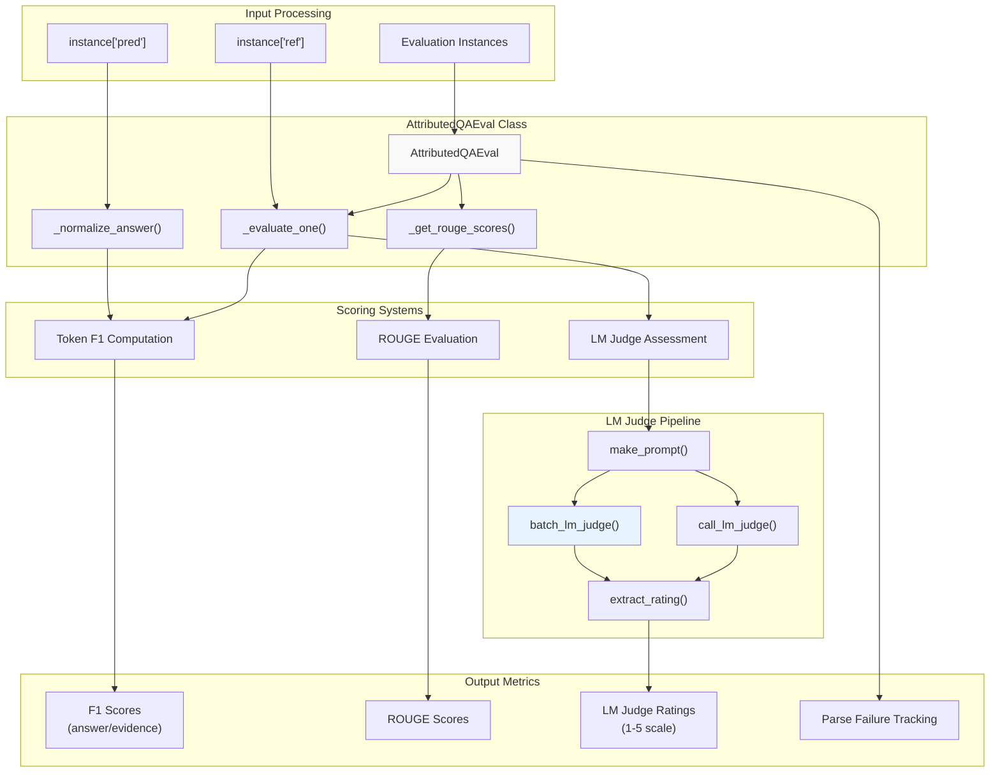
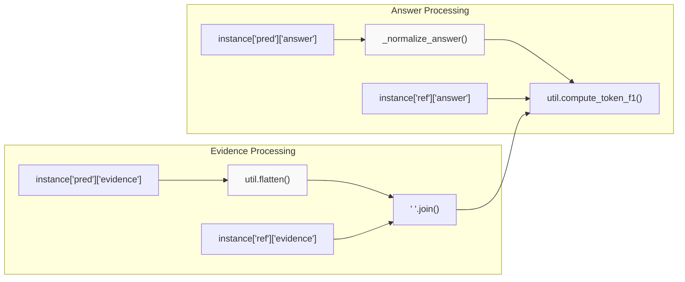
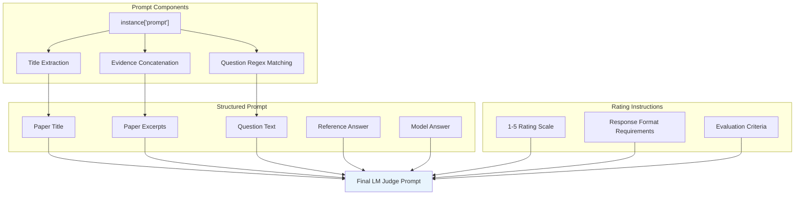
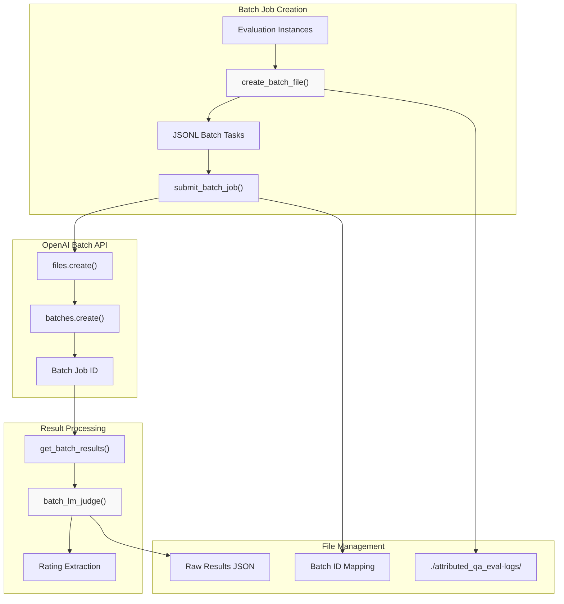
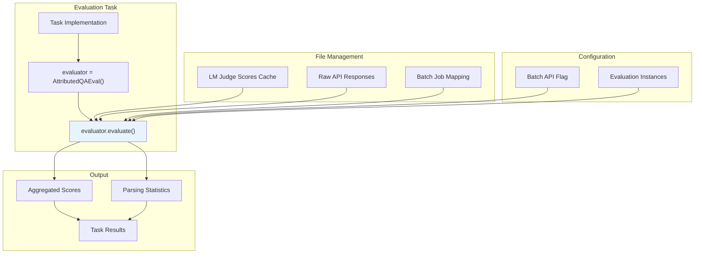

<!-- source: DeepWiki mcp.deepwiki.com · repo allenai/SciRIFF · extra page Attributed QA Evaluation · fetched 2026-10-26 -->

# Attributed QA Evaluation

Relevant source files

The following files were used as context for generating this wiki page:

- [sciriff/eval/metrics/attributed_qa_eval.py](sciriff/eval/metrics/attributed_qa_eval.py)

This document covers the attributed question answering evaluation system, which assesses model performance on tasks requiring both accurate answers and supporting evidence. This evaluation uses Large Language Models as judges to provide nuanced assessment of answer quality beyond traditional metrics.

For information about summary comparison evaluation, see [Summary Comparison](#3.4.2). For the broader LM judge framework and batch processing utilities, see [LM Judge System](#3.4).

## System Overview

The `AttributedQAEval` class provides comprehensive evaluation for attributed question answering tasks, combining traditional token-level metrics with LM judge assessments. The system evaluates both the accuracy of answers and the quality of supporting evidence citations.

**Sources:** [sciriff/eval/metrics/attributed_qa_eval.py:190-333]()

## Core Evaluation Metrics

The system computes multiple metrics to provide comprehensive assessment of attributed QA performance:

### Token-Level Metrics

| Metric Type | Variants | Description |
|-------------|----------|-------------|
| **Answer F1** | `f1_answer_all`, `f1_answer_parsed` | Token overlap between predicted and reference answers |
| **Evidence F1** | `f1_evidence_all`, `f1_evidence_parsed` | Token overlap between predicted and reference evidence |
| **ROUGE Scores** | `rouge1`, `rouge2`, `rougeL` | N-gram and longest common subsequence overlap |

The `_all` variants include all instances (assigning 0 to parsing failures), while `_parsed` variants only include successfully parsed responses.

**Sources:** [sciriff/eval/metrics/attributed_qa_eval.py:193-205](), [sciriff/eval/metrics/attributed_qa_eval.py:243-255](), [sciriff/eval/metrics/attributed_qa_eval.py:256-267]()

### LM Judge Assessment

The LM judge provides qualitative assessment using GPT-4o on a 1-5 scale:

- **5**: Model answer includes all important information from the reference
- **3**: Model answer is somewhat similar but not completely accurate  
- **1**: Model answer is totally inaccurate or unrelated

Ratings are normalized to 0-1 scale using `(rating - 1) / 4` for final reporting.

**Sources:** [sciriff/eval/metrics/attributed_qa_eval.py:112-115](), [sciriff/eval/metrics/attributed_qa_eval.py:320-321]()

## LM Judge Implementation

The system supports both synchronous and batch processing for LM judge evaluation:

### Prompt Construction

The `make_prompt()` function constructs evaluation prompts by extracting key elements from the evaluation instance:

**Sources:** [sciriff/eval/metrics/attributed_qa_eval.py:96-138]()

### Response Processing

The `extract_rating()` function parses LM judge responses using regex pattern matching:

- **Pattern**: `r"Rating:\s*(\d+)"`
- **Validation**: Ensures rating is in [1,2,3,4,5] range
- **Fallback**: Returns rating of 3 for parsing failures

**Sources:** [sciriff/eval/metrics/attributed_qa_eval.py:141-153]()

## Batch Processing System

For cost-effective evaluation at scale, the system supports OpenAI's Batch API:

**Sources:** [sciriff/eval/metrics/attributed_qa_eval.py:19-48](), [sciriff/eval/metrics/attributed_qa_eval.py:50-63](), [sciriff/eval/metrics/attributed_qa_eval.py:156-174]()

### Batch Configuration

Each batch task uses the following configuration:
- **Model**: `gpt-4o-2024-08-06`  
- **Endpoint**: `/v1/chat/completions`
- **Completion Window**: 24 hours
- **File Format**: JSONL with custom task IDs

**Sources:** [sciriff/eval/metrics/attributed_qa_eval.py:23-39]()

## Error Handling and Robustness

The evaluation system implements comprehensive error handling:

### Parse Failure Tracking

The system tracks various failure modes using structured counters:

| Failure Type | Tracked Values | Purpose |
|--------------|---------------|---------|
| `answer` | `yes`/`no` | Whether answer field was successfully parsed |
| `evidence` | `yes`/`no` | Whether evidence field was successfully parsed |  
| `answer_entry_is_str` | `yes`/`no` | Whether answer is string vs other types |

**Sources:** [sciriff/eval/metrics/attributed_qa_eval.py:288-292]()

### Data Normalization

The `_normalize_answer()` method handles various response formats:

- **String responses**: Used directly
- **List responses**: Flattened and joined with spaces
- **Dictionary responses**: Converted to string representation
- **Other types**: Raises exception for unexpected formats

**Sources:** [sciriff/eval/metrics/attributed_qa_eval.py:193-205]()

### Graceful Degradation

When parsing fails:
- **F1 scores**: Assigned value of 0
- **LM judge scores**: Assigned minimum rating of 1
- **Failure tracking**: Incremented appropriately
- **Evaluation continues**: Other instances still processed

**Sources:** [sciriff/eval/metrics/attributed_qa_eval.py:222-227](), [sciriff/eval/metrics/attributed_qa_eval.py:244-246]()

## Integration with Evaluation Pipeline

The `AttributedQAEval` class integrates with the broader evaluation system through standardized interfaces:

**Sources:** [sciriff/eval/metrics/attributed_qa_eval.py:269-333]()

---

