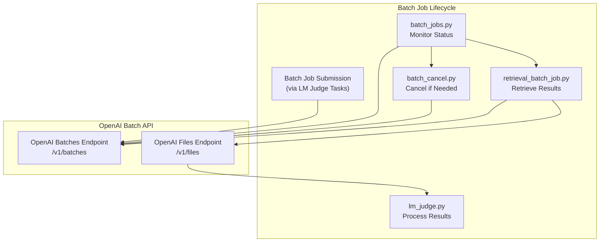
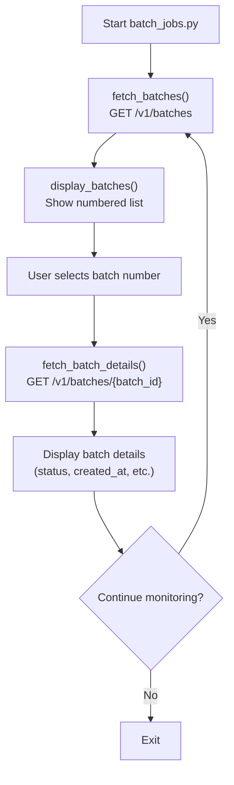
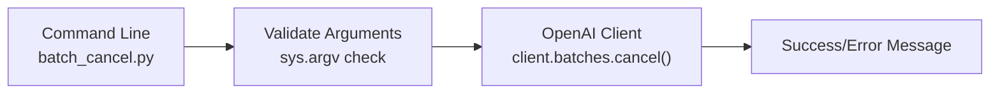
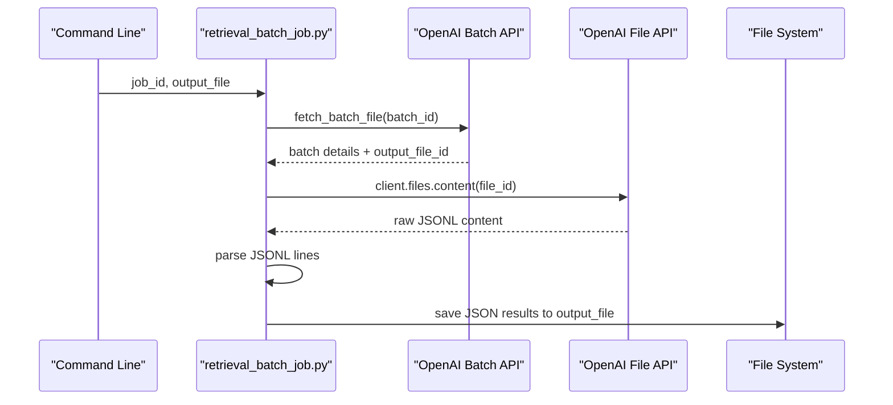
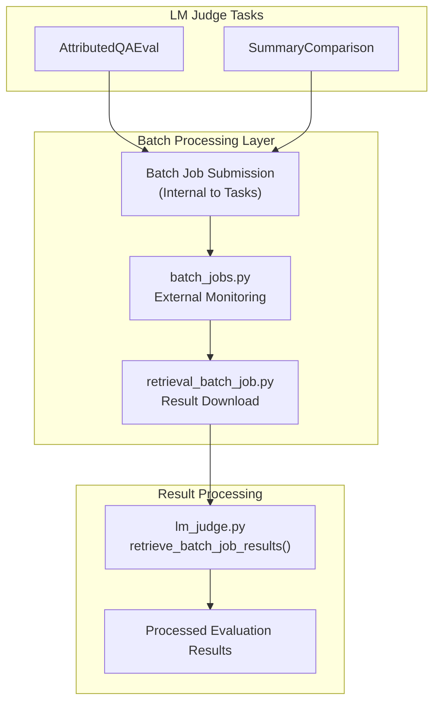

<!-- source: DeepWiki mcp.deepwiki.com · repo allenai/SciRIFF · extra page Batch Processing · fetched 2026-10-26 -->

# Batch Processing

Relevant source files

The following files were used as context for generating this wiki page:

- [batch_cancel.py](batch_cancel.py)
- [batch_jobs.py](batch_jobs.py)
- [retrieval_batch_job.py](retrieval_batch_job.py)
- [sciriff/eval/metrics/lm_judge.py](sciriff/eval/metrics/lm_judge.py)

This document covers the batch processing system for managing OpenAI batch API jobs in cost-effective large-scale LM judge evaluations. The batch processing utilities provide tools for submitting, monitoring, canceling, and retrieving results from asynchronous OpenAI API batch jobs.

For information about the overall LM judge evaluation system, see [LM Judge System](#3.4). For details on specific evaluation tasks that use batch processing, see [Attributed QA Evaluation](#3.4.1) and [Summary Comparison](#3.4.2).

## System Overview

The batch processing system enables efficient and cost-effective evaluation by leveraging OpenAI's batch API, which offers significant cost savings compared to synchronous API calls. The system provides a complete workflow for managing batch jobs throughout their lifecycle.

Sources: [batch_jobs.py:1-59](), [batch_cancel.py:1-19](), [retrieval_batch_job.py:1-52](), [sciriff/eval/metrics/lm_judge.py:1-41]()

## Batch Job Monitoring

The `batch_jobs.py` utility provides an interactive interface for monitoring all batch jobs associated with your OpenAI account. It displays job status and allows detailed inspection of individual jobs.

### Core Functions

| Function | Purpose | API Endpoint |
|----------|---------|--------------|
| `fetch_batches()` | Retrieve all batch jobs | `GET /v1/batches` |
| `display_batches()` | Show numbered list of batches | - |
| `fetch_batch_details()` | Get detailed job information | `GET /v1/batches/{batch_id}` |

### Batch Status Monitoring Workflow

Sources: [batch_jobs.py:3-12](), [batch_jobs.py:14-19](), [batch_jobs.py:21-31](), [batch_jobs.py:35-58]()

## Batch Job Cancellation

The `batch_cancel.py` utility provides a simple command-line interface for canceling running batch jobs. This is useful when jobs need to be stopped due to configuration errors or changing requirements.

### Usage Pattern

The cancellation utility follows a straightforward pattern:

The `cancel_job()` function at [batch_cancel.py:4-10]() handles the OpenAI API interaction, while the main script at [batch_cancel.py:12-18]() provides command-line argument validation and user interface.

Sources: [batch_cancel.py:1-19]()

## Batch Result Retrieval

The `retrieval_batch_job.py` utility handles downloading and processing completed batch job results. It interfaces with both the batches and files endpoints to retrieve the actual evaluation results.

### Retrieval Process

### Key Functions

The retrieval system consists of two primary functions:

- `fetch_batch_file()` at [retrieval_batch_job.py:29-40]() - Retrieves batch metadata and extracts the output file ID
- `retrieve_batch_job_results()` at [retrieval_batch_job.py:12-27]() - Downloads file content and processes JSONL format into structured JSON

Sources: [retrieval_batch_job.py:1-52]()

## LM Judge Integration

The batch processing system integrates with the broader LM judge evaluation framework through the `lm_judge.py` module, which provides result processing capabilities that complement the batch utilities.

### Integration Points

The `lm_judge.py` module contains duplicate utility functions at [sciriff/eval/metrics/lm_judge.py:12-27]() and [sciriff/eval/metrics/lm_judge.py:29-40]() that mirror the functionality in `retrieval_batch_job.py`, providing programmatic access to batch result retrieval within the evaluation pipeline.

Sources: [sciriff/eval/metrics/lm_judge.py:1-41]()

## Environment Configuration

All batch processing utilities require the `OPENAI_API_KEY` environment variable to be set for authentication with the OpenAI API. This is consistently handled across all utilities:

| Utility | API Key Usage |
|---------|---------------|
| `batch_jobs.py` | [batch_jobs.py:36]() - Environment variable check |
| `batch_cancel.py` | [batch_cancel.py:5]() - OpenAI client initialization |
| `retrieval_batch_job.py` | [retrieval_batch_job.py:8]() - Global API key setup |
| `lm_judge.py` | [sciriff/eval/metrics/lm_judge.py:8]() - Global API key setup |

Sources: [batch_jobs.py:33-39](), [batch_cancel.py:5](), [retrieval_batch_job.py:7-9](), [sciriff/eval/metrics/lm_judge.py:7-9]()

---

