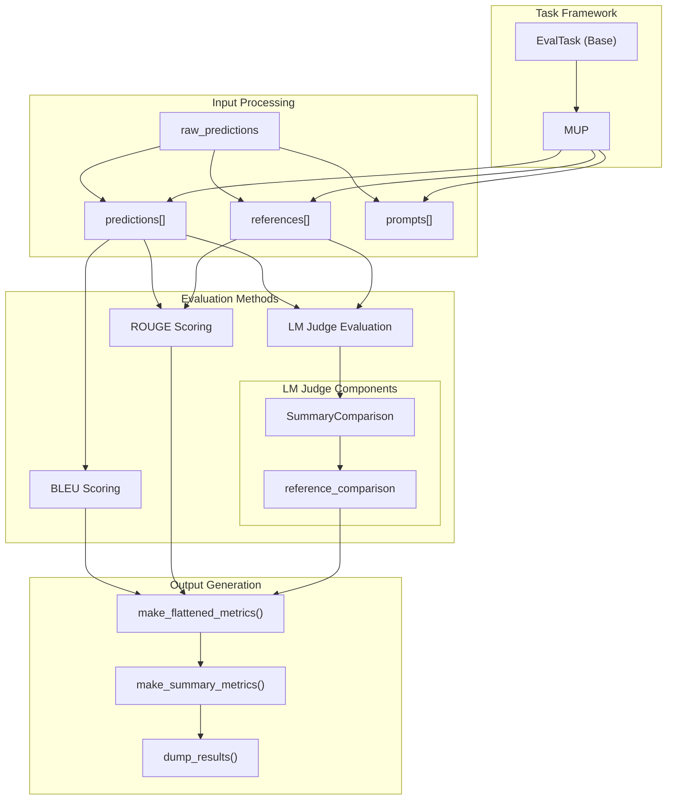
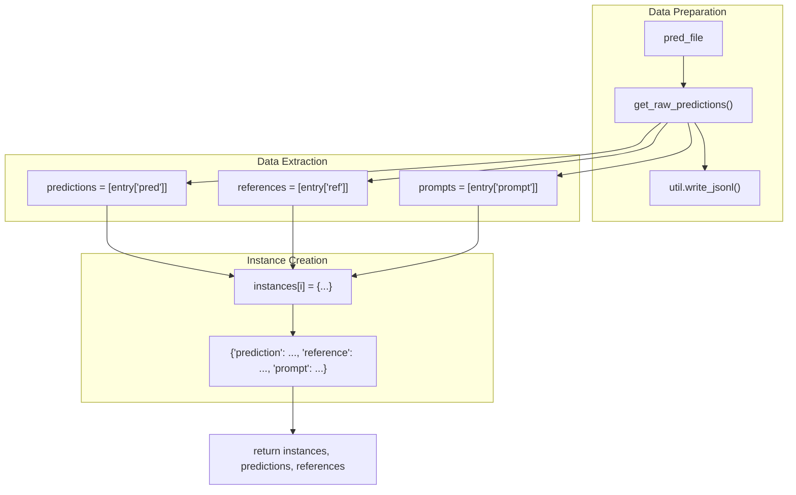
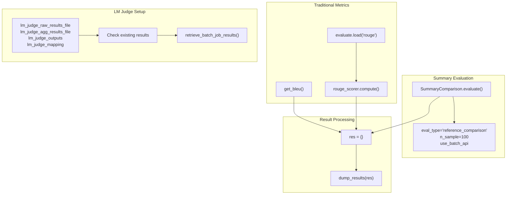
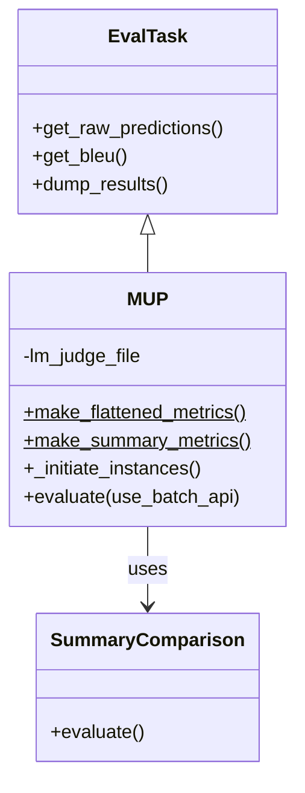
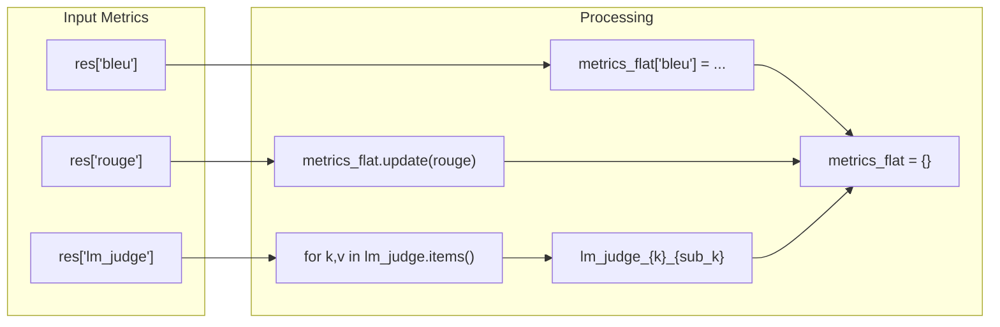
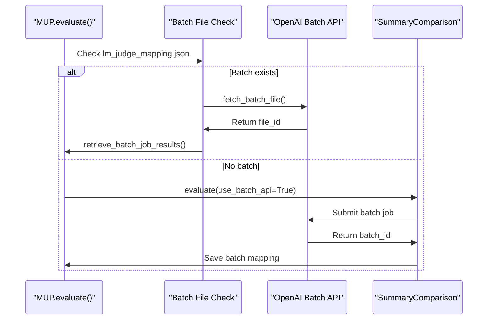
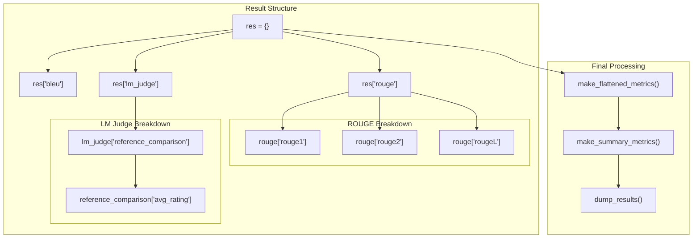

<!-- source: DeepWiki mcp.deepwiki.com · repo allenai/SciRIFF · extra page MUP Document Summarization · fetched 2026-10-26 -->

# MUP Document Summarization

Relevant source files

The following files were used as context for generating this wiki page:

- [sciriff/eval/tasks/mup_single_document_summarization.py](sciriff/eval/tasks/mup_single_document_summarization.py)

This document covers the MUP (Multi-document Summarization in Biomedical Domain) single document summarization evaluation task implementation. This task evaluates model performance on summarizing scientific documents by comparing generated summaries against reference summaries using both traditional automated metrics and LM judge evaluation.

For information about the overall evaluation system architecture, see [Evaluation System](#3). For details about the LM judge summary comparison implementation, see [Summary Comparison](#3.4.2).

## Purpose and Scope

The MUP evaluation task assesses model capabilities in generating high-quality summaries of scientific documents. It combines traditional metrics (BLEU, ROUGE) with sophisticated LM judge evaluation to provide comprehensive assessment of summary quality, coherence, and factual accuracy.

## Task Architecture

The MUP evaluation task follows the standard evaluation framework while incorporating specialized summary evaluation components.

Sources: [sciriff/eval/tasks/mup_single_document_summarization.py:13-116]()

## Evaluation Pipeline

The MUP evaluation follows a multi-stage pipeline that processes predictions through different evaluation methods.

### Instance Initialization

The `_initiate_instances()` method prepares evaluation data by extracting predictions, references, and prompts from raw prediction files.

Sources: [sciriff/eval/tasks/mup_single_document_summarization.py:34-59]()

### Evaluation Execution

The main `evaluate()` method orchestrates different evaluation approaches:

| Evaluation Type | Method | Purpose |
|----------------|---------|---------|
| BLEU | `get_bleu()` | Lexical similarity to reference |
| ROUGE | `evaluate.load("rouge")` | N-gram and sequence overlap |
| LM Judge | `SummaryComparison` | Quality and coherence assessment |

Sources: [sciriff/eval/tasks/mup_single_document_summarization.py:61-116]()

## Implementation Details

### Class Structure

The `MUP` class extends the base `EvalTask` with summarization-specific functionality:

Sources: [sciriff/eval/tasks/mup_single_document_summarization.py:13-26]()

### Metrics Processing

The task implements two static methods for metrics aggregation:

#### Flattened Metrics
`make_flattened_metrics()` creates a flat dictionary combining all evaluation scores:

Sources: [sciriff/eval/tasks/mup_single_document_summarization.py:14-25]()

#### Summary Metrics
`make_summary_metrics()` extracts key metrics for high-level reporting:

| Metric | Source | Purpose |
|--------|--------|---------|
| `lm_judge_reference` | `avg_rating` from reference comparison | Overall quality score |
| `rouge` | `rougeL` score | Sequence-level similarity |

Sources: [sciriff/eval/tasks/mup_single_document_summarization.py:27-32]()

### Batch Processing Integration

The task supports OpenAI batch API for cost-effective LM judge evaluation:

Sources: [sciriff/eval/tasks/mup_single_document_summarization.py:94-113]()

## Output Structure

The evaluation produces structured results combining traditional metrics with LM judge assessments:

Sources: [sciriff/eval/tasks/mup_single_document_summarization.py:64-115]()

---

