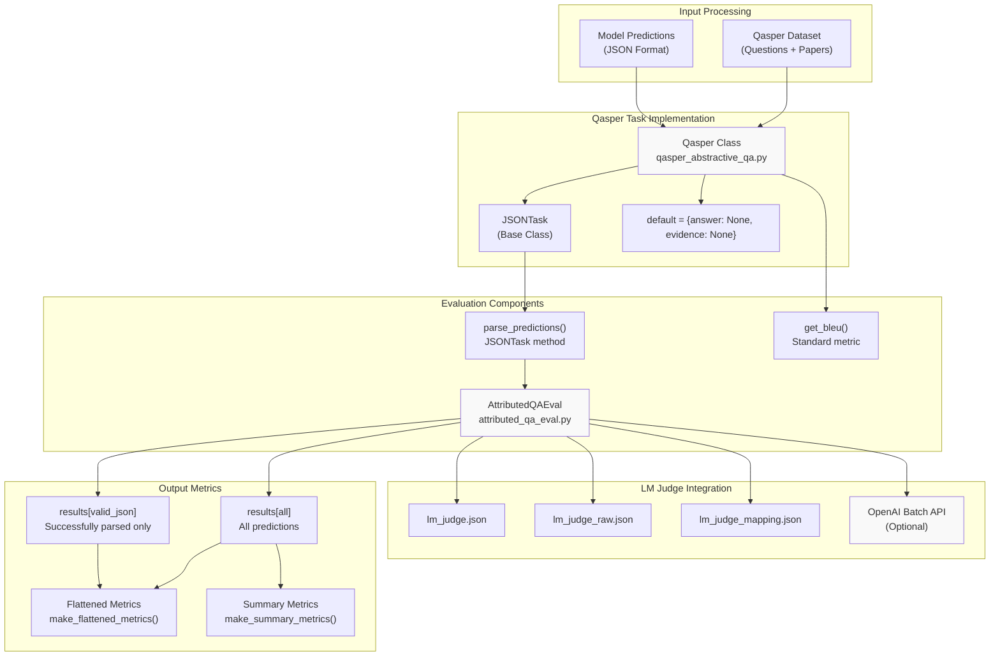
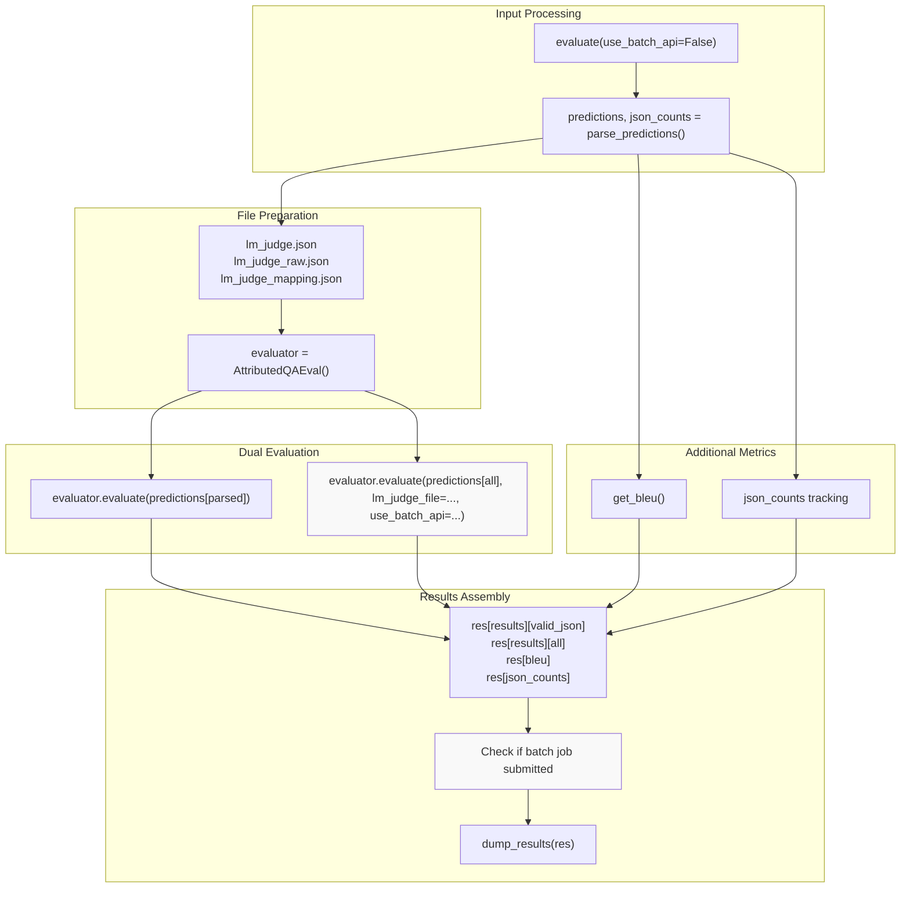
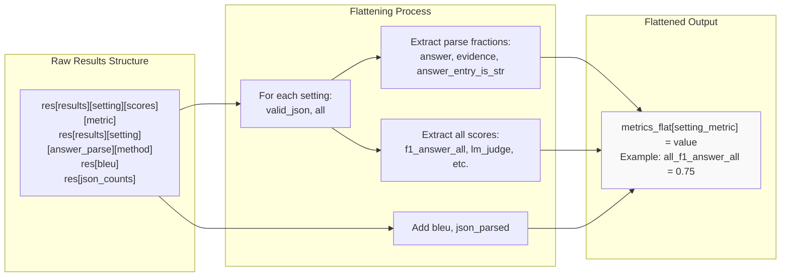

<!-- source: DeepWiki mcp.deepwiki.com · repo allenai/SciRIFF · extra page Qasper Abstractive QA · fetched 2026-10-26 -->

# Qasper Abstractive QA

<details>
<summary>Relevant source files</summary>

The following files were used as context for generating this wiki page:

- [sciriff/eval/tasks/qasper_abstractive_qa.py](sciriff/eval/tasks/qasper_abstractive_qa.py)

</details>


This page documents the implementation of the Qasper abstractive question answering evaluation task within the SciRIFF evaluation framework. The Qasper task evaluates model performance on generating natural language answers to questions about scientific papers, along with supporting evidence citations.

For information about the overall evaluation task framework, see [Task Framework](#3.3.1). For details about the underlying LM judge evaluation system used by Qasper, see [Attributed QA Evaluation](#3.4.1).

## Task Overview

The Qasper task implements evaluation for abstractive question answering on scientific papers. Unlike extractive QA tasks that select spans from the source text, this task requires models to generate free-form natural language answers while providing supporting evidence from the paper.

The task expects model outputs in JSON format with two key components:
- `answer`: A natural language response to the question
- `evidence`: Supporting citations or evidence from the source paper

**Architecture Integration**



Sources: [sciriff/eval/tasks/qasper_abstractive_qa.py:1-65]()

## Implementation Details

### Class Structure

The `Qasper` class inherits from `JSONTask`, providing automatic JSON parsing capabilities for structured model outputs. The class defines default values for expected output fields:

```python
default = {"answer": None, "evidence": None}
```

This default structure ensures that even when models fail to generate valid JSON, the evaluation can proceed with null values for missing fields.

**Key Methods**

```mermaid
classDiagram
    class JSONTask {
        +parse_predictions()
        +get_bleu()
        +dump_results()
    }
    
    class Qasper {
        +default: dict
        +evaluate(use_batch_api)
        +make_flattened_metrics(res)$ 
        +make_summary_metrics(res)$
    }
    
    class AttributedQAEval {
        +evaluate(predictions, lm_judge_file, lm_judge_raw_file, lm_judge_mapping, use_batch_api)
    }
    
    JSONTask <|-- Qasper
    Qasper ..> AttributedQAEval : uses
    
    note for Qasper : "Static methods for\nmetric aggregation"
    note for AttributedQAEval : "LM judge evaluation\nfor answer quality"
```

Sources: [sciriff/eval/tasks/qasper_abstractive_qa.py:8-10](), [sciriff/eval/tasks/qasper_abstractive_qa.py:40-64]()

### Evaluation Process

The main evaluation workflow occurs in the `evaluate` method, which coordinates multiple evaluation components:

1. **JSON Parsing**: Inherited `parse_predictions()` method processes model outputs
2. **Attributed QA Evaluation**: `AttributedQAEval` assesses answer quality and evidence
3. **Standard Metrics**: BLEU score computation for reference comparison
4. **Results Aggregation**: Combines metrics from different evaluation modes

The evaluation runs on two data subsets:
- `valid_json`: Only predictions that successfully parsed as JSON
- `all`: All predictions, with defaults used for parsing failures

**Evaluation Flow**



Sources: [sciriff/eval/tasks/qasper_abstractive_qa.py:40-64]()

## Metrics Computation

### Flattened Metrics

The `make_flattened_metrics` static method transforms nested evaluation results into a flat dictionary structure suitable for tabular reporting. It processes metrics for both evaluation settings (`valid_json` and `all`):

| Metric Category | Examples | Purpose |
|---|---|---|
| Parse Success Rates | `all_answer_frac_parsed`, `valid_json_evidence_frac_parsed` | Track JSON parsing success |
| Performance Scores | `all_f1_answer_all`, `valid_json_lm_judge` | Core evaluation metrics |
| Standard Metrics | `bleu`, `json_parsed` | Traditional NLP metrics |

The flattening process extracts:
- **Parsing Statistics**: Success rates for answer, evidence, and string validation
- **Performance Metrics**: All scores from the AttributedQAEval results  
- **Global Metrics**: BLEU scores and overall JSON parsing success

**Metrics Processing Pipeline**



Sources: [sciriff/eval/tasks/qasper_abstractive_qa.py:11-30]()

### Summary Metrics

The `make_summary_metrics` method extracts the most important metrics for cross-task comparison, focusing on the `all` setting which includes all predictions:

- **`lm_judge_answer`**: LM judge score for answer quality (may be None if not available)
- **`f1_answer_all`**: F1 score for answer content matching
- **`f1_evidence_all`**: F1 score for evidence citation accuracy

These summary metrics appear in the final evaluation tables and enable comparison across different tasks and models.

Sources: [sciriff/eval/tasks/qasper_abstractive_qa.py:32-38]()

## Batch Processing Support

The Qasper task supports OpenAI's Batch API for cost-effective LM judge evaluation. When `use_batch_api=True` is passed to the `evaluate` method:

1. Evaluation requests are submitted to the batch API
2. The method returns early with a notification message
3. Results must be retrieved later using batch processing utilities

This integration allows large-scale evaluation while reducing API costs, particularly important for the computationally expensive LM judge evaluations that Qasper relies on.

Sources: [sciriff/eval/tasks/qasper_abstractive_qa.py:52-60]()

---

