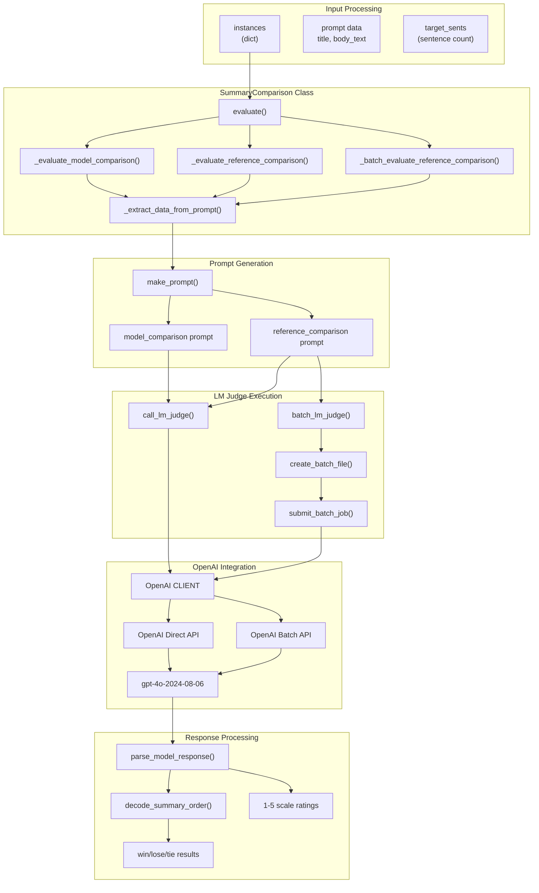
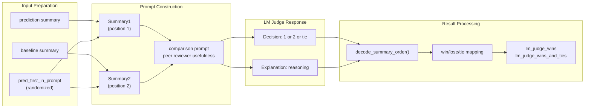
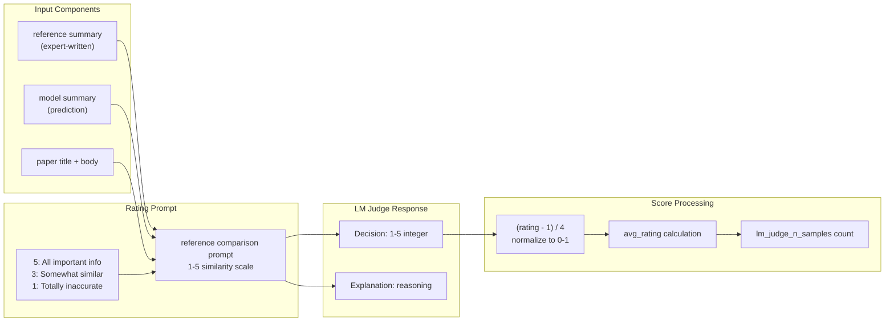
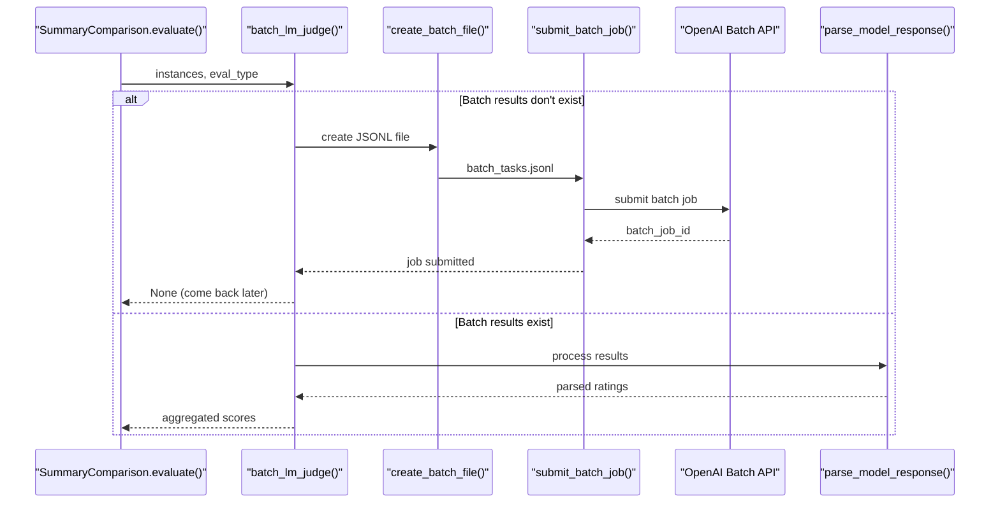

<!-- source: DeepWiki mcp.deepwiki.com · repo allenai/SciRIFF · extra page Summary Comparison · fetched 2026-10-26 -->

# Summary Comparison

<details>
<summary>Relevant source files</summary>

The following files were used as context for generating this wiki page:

- [sciriff/eval/metrics/summary_comparison.py](sciriff/eval/metrics/summary_comparison.py)

</details>


This document covers the Summary Comparison system, which implements Large Language Model (LM) judge evaluation for comparing and rating summaries within the SciRIFF evaluation framework. The system provides two evaluation modes: comparing model outputs against each other and rating model outputs against reference summaries.

For information about other LM judge evaluation types, see [Attributed QA Evaluation](#3.4.1). For details about batch API management utilities, see [Batch Processing](#3.4.3).

## Purpose and Architecture

The Summary Comparison system evaluates summary quality using GPT-4 as a judge. It supports the MUP Single Document Summarization task by providing automated evaluation that correlates better with human judgment than traditional metrics like ROUGE or BLEU.

### Summary Comparison System Architecture



Sources: [sciriff/eval/metrics/summary_comparison.py:1-437]()

## Evaluation Modes

The system provides two distinct evaluation approaches, each designed for different use cases in summary evaluation.

### Model Comparison Mode

Model comparison mode pits two summaries against each other, asking the LM judge to determine which summary is more useful for a peer reviewer assessing paper quality.



The system randomizes summary order to prevent position bias, with `pred_first_in_prompt` determining whether the prediction appears as Summary1 or Summary2. Results are decoded back to prediction vs baseline terminology.

Sources: [sciriff/eval/metrics/summary_comparison.py:290-332](), [sciriff/eval/metrics/summary_comparison.py:138-149]()

### Reference Comparison Mode

Reference comparison mode rates how well a model-generated summary matches an expert-written reference summary on a 1-5 scale.



The 1-5 ratings are normalized to 0-1 scale for consistency with other metrics in the evaluation framework.

Sources: [sciriff/eval/metrics/summary_comparison.py:371-393](), [sciriff/eval/metrics/summary_comparison.py:334-369]()

## Batch Processing Integration

The system supports both direct API calls and OpenAI's batch API for cost-effective large-scale evaluation.

### Batch Processing Workflow



The batch system creates timestamped JSONL files in `./summary_comparison-logs/` directory and tracks job IDs for result retrieval.

Sources: [sciriff/eval/metrics/summary_comparison.py:12-55](), [sciriff/eval/metrics/summary_comparison.py:222-249]()

## Implementation Details

### Core Class Structure

| Component | Purpose | Key Methods |
|-----------|---------|-------------|
| `SummaryComparison` | Main evaluator class | `evaluate()`, `_evaluate_model_comparison()`, `_evaluate_reference_comparison()` |
| Prompt Generation | Creates LM judge prompts | `make_prompt()` |
| Response Parsing | Processes LM judge outputs | `parse_model_response()`, `decode_summary_order()` |
| Batch Management | Handles batch API operations | `create_batch_file()`, `submit_batch_job()` |

### Data Flow and Processing

```mermaid
flowchart TD
    subgraph "Data Extraction"
        ExtractTitle["_extract_data_from_prompt()<br/>extract title"]
        ExtractBody["_extract_data_from_prompt()<br/>extract body_text"]
        ExtractTarget["regex extract<br/>target_sents"]
    end
    
    subgraph "Sampling and Filtering"
        RandomSample["random.sample()<br/>n_samples selection"]
        FilterInstances["filter to chosen_samples_for_llm"]
    end
    
    subgraph "Evaluation Execution"
        EvalType{"eval_type"}
        ModelCompPath["model_comparison path"]
        RefCompPath["reference_comparison path"]
        BatchFlag{"use_batch_api"}
    end
    
    subgraph "Result Storage"
        RawResults["lm_judge_raw_results_file"]
        AggResults["lm_judge_agg_results_file"]
        ScoresDict["self.scores dict"]
    end
    
    ExtractTitle --> RandomSample
    ExtractBody --> RandomSample
    ExtractTarget --> RandomSample
    
    RandomSample --> FilterInstances
    FilterInstances --> EvalType
    
    EvalType -->|"model_comparison"| ModelCompPath
    EvalType -->|"reference_comparison"| RefCompPath
    
    RefCompPath --> BatchFlag
    BatchFlag -->|"True"| "Batch API"
    BatchFlag -->|"False"| "Direct API"
    
    ModelCompPath --> ScoresDict
    "Batch API" --> ScoresDict
    "Direct API" --> ScoresDict
    
    ScoresDict --> RawResults
    ScoresDict --> AggResults
```

The system uses regex patterns to extract paper titles and body text from evaluation prompts, handles random sampling for evaluation efficiency, and provides comprehensive result storage.

Sources: [sciriff/eval/metrics/summary_comparison.py:274-289](), [sciriff/eval/metrics/summary_comparison.py:395-436]()

### Configuration and Model Selection

The system uses GPT-4 (`gpt-4o-2024-08-06`) as the default LM judge model, configured through the OpenAI client. Evaluation supports configurable sample sizes with random seed (42) for reproducible results.

Key configuration parameters:
- `eval_type`: "model_comparison" or "reference_comparison"
- `n_samples`: Number of instances to evaluate
- `use_batch_api`: Enable batch processing for cost efficiency
- Random seed: 42 (ensures reproducible sampling)

Sources: [sciriff/eval/metrics/summary_comparison.py:22](), [sciriff/eval/metrics/summary_comparison.py:255](), [sciriff/eval/metrics/summary_comparison.py:408-410]()

---

