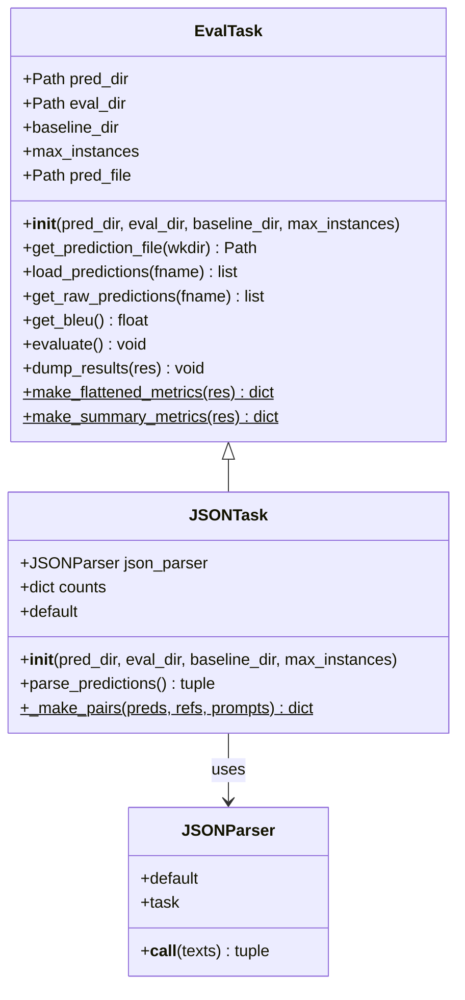
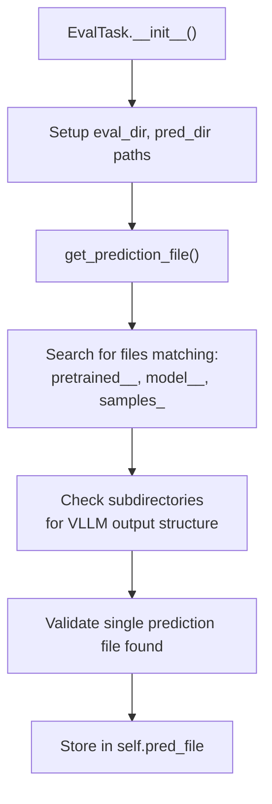
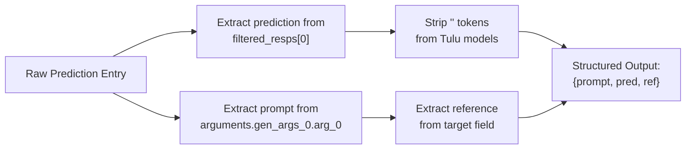
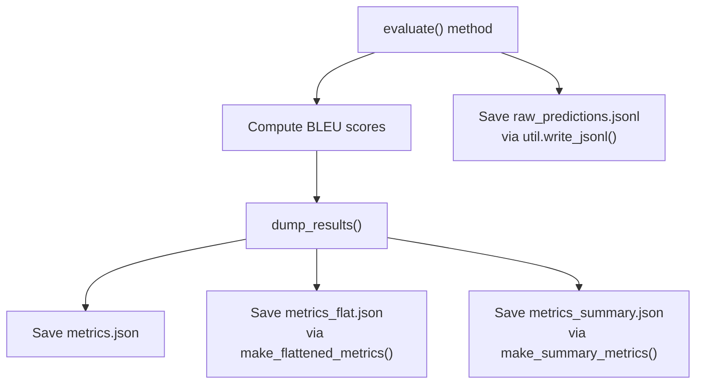
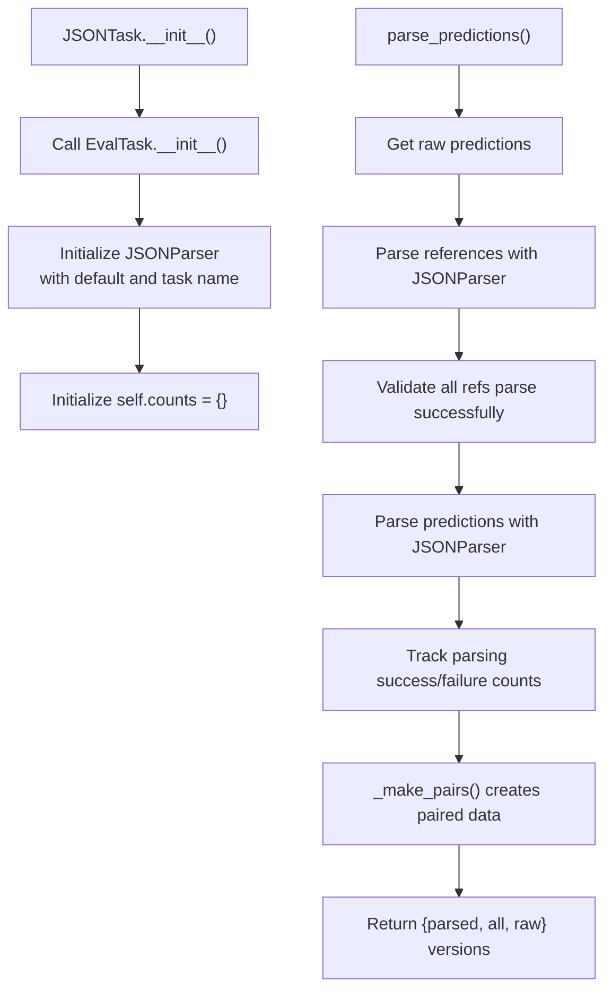
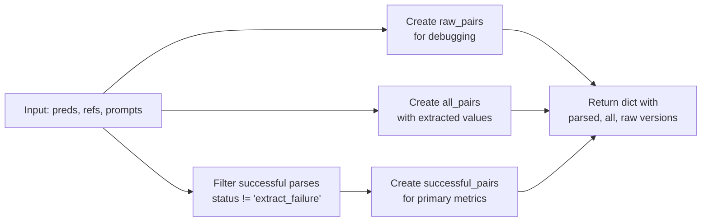
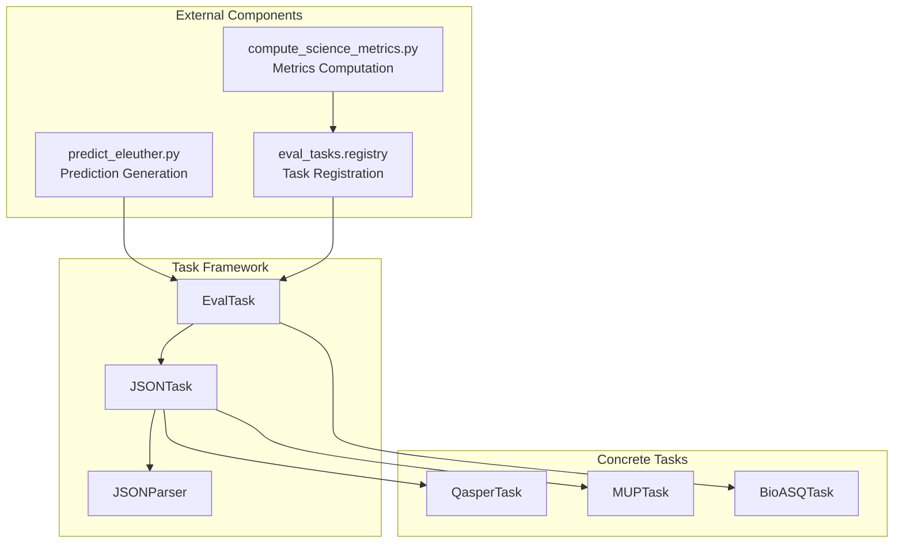

<!-- source: DeepWiki mcp.deepwiki.com · repo allenai/SciRIFF · extra page Task Framework · fetched 2026-10-26 -->

# Task Framework

Relevant source files

The following files were used as context for generating this wiki page:

- [sciriff/eval/tasks/_base.py](sciriff/eval/tasks/_base.py)

This document covers the base classes and common functionality that underpin all evaluation tasks in the SciRIFF evaluation system. The Task Framework provides standardized interfaces for loading predictions, computing metrics, and handling JSON parsing across different scientific evaluation tasks.

For implementation details of specific evaluation tasks like Qasper or MUP, see [Qasper Abstractive QA](#3.3.2) and [MUP Document Summarization](#3.3.3). For the broader evaluation pipeline context, see [Evaluation System](#3).

## Architecture Overview

The Task Framework is built around two main base classes that provide common functionality for all evaluation tasks in the system.

### Class Hierarchy

Sources: [sciriff/eval/tasks/_base.py:13-125](), [sciriff/eval/tasks/_base.py:126-180]()

## EvalTask Base Class

The `EvalTask` class provides core functionality that all evaluation tasks inherit, including prediction loading, basic metrics computation, and result storage.

### Core Initialization and Setup

The base class handles standard directory setup and prediction file discovery:

Sources: [sciriff/eval/tasks/_base.py:14-44]()

### Prediction Loading and Processing

The framework provides standardized methods for loading and processing model predictions:

| Method | Purpose | Return Type |
|--------|---------|-------------|
| `load_predictions()` | Load raw prediction data from JSONL files | `list` |
| `get_raw_predictions()` | Extract and structure predictions with prompts and references | `list[dict]` |
| `get_bleu()` | Compute BLEU scores using HuggingFace evaluate library | `float` |

The `get_raw_predictions()` method standardizes the prediction format across different model outputs:

Sources: [sciriff/eval/tasks/_base.py:46-61](), [sciriff/eval/tasks/_base.py:98-109]()

### Metrics and Results Management

The base class provides a standardized approach to metrics computation and result storage:

Sources: [sciriff/eval/tasks/_base.py:63-75](), [sciriff/eval/tasks/_base.py:87-96](), [sciriff/eval/tasks/_base.py:111-124]()

## JSONTask Extended Framework

The `JSONTask` class extends `EvalTask` to handle evaluation tasks that require JSON parsing of model outputs, which is common in scientific tasks with structured responses.

### JSON Parsing Integration

Sources: [sciriff/eval/tasks/_base.py:130-135](), [sciriff/eval/tasks/_base.py:158-179]()

### Data Pairing Strategy

The `_make_pairs()` static method creates multiple versions of the evaluation data to handle JSON parsing failures gracefully:

| Data Version | Description | Use Case |
|--------------|-------------|----------|
| `parsed` | Only successfully parsed predictions | Primary evaluation metrics |
| `all` | All predictions (failed parses use extracted values) | Fallback evaluation |
| `raw` | Unprocessed predictions for debugging | Error analysis and debugging |

Sources: [sciriff/eval/tasks/_base.py:137-156]()

## Integration with Evaluation Pipeline

The Task Framework integrates with the broader evaluation system through standardized interfaces:

Sources: [sciriff/eval/tasks/_base.py:1-180]()

---

