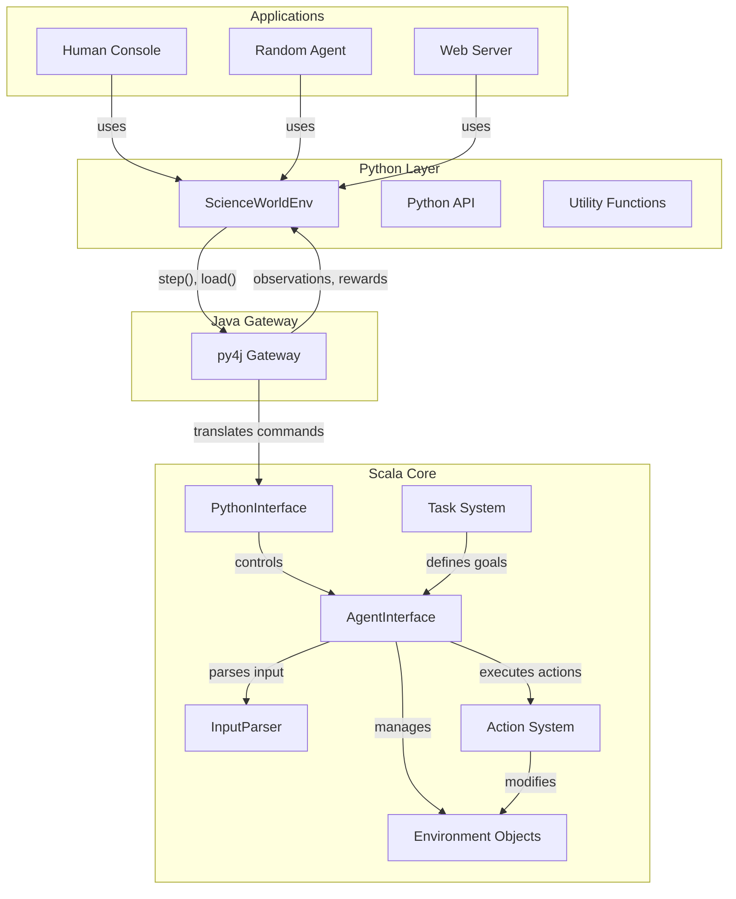
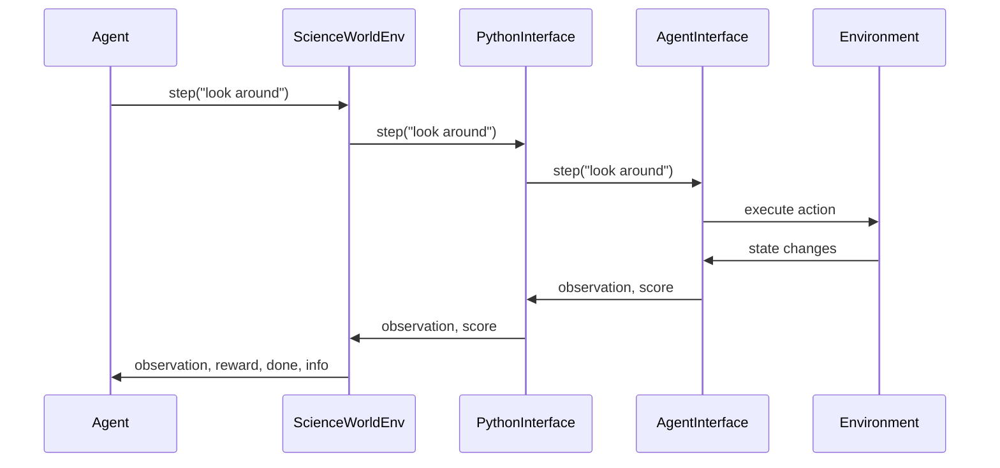
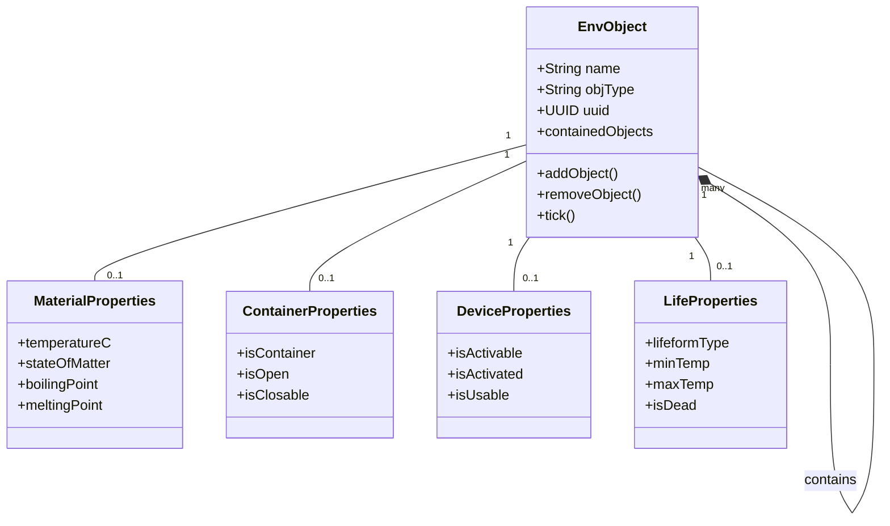
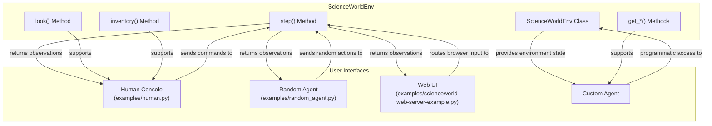

<!-- source: DeepWiki mcp.deepwiki.com · repo allenai/ScienceWorld · page 1 Overview · fetched 2026-10-26 -->

# Overview

<details>
<summary>Relevant source files</summary>

The following files were used as context for generating this wiki page:

- [CHANGELOG.md](CHANGELOG.md)
- [README.md](README.md)
- [scienceworld/scienceworld.py](scienceworld/scienceworld.py)
- [simulator/src/main/scala/scienceworld/runtime/pythonapi/PythonInterface.scala](simulator/src/main/scala/scienceworld/runtime/pythonapi/PythonInterface.scala)
- [tests/test_scienceworld.py](tests/test_scienceworld.py)

</details>


ScienceWorld is a text-based simulation environment designed for accomplishing tasks from elementary science curricula. It provides a platform for training and evaluating AI agents by allowing them to interact with simulated environments through natural language commands.

This overview introduces ScienceWorld's purpose, architecture, and key components. For installation instructions, see [Installation & Setup](#1.1).

## Architecture and Components

ScienceWorld uses a layered architecture with a Python interface communicating with a Scala backend through py4j.



Sources: [scienceworld/scienceworld.py:17-86](), [simulator/src/main/scala/scienceworld/runtime/pythonapi/PythonInterface.scala:26-145]()

### Key Components

1. **Python Layer**:
   - `ScienceWorldEnv`: Main class for interacting with the environment
   - Utility functions for task loading and management
   - Constants defining available tasks

2. **Scala Core**:
   - `PythonInterface`: Handles communication between Python and Scala
   - `AgentInterface`: Controls the agent and environment interaction
   - Environment objects with various properties
   - Task definitions with goals
   - Action processing system

3. **Applications**:
   - Human console for interactive exploration
   - Random agent for automatic testing
   - Web interface for browser-based interaction

## Basic Usage

Here's how to use ScienceWorld programmatically:

```python
from scienceworld import ScienceWorldEnv

# Create an environment
env = ScienceWorldEnv()

# Load a task (boil water task)
env.load("1-1", variationIdx=0, simplificationStr="easy")

# Reset the environment
obs, info = env.reset()

# Take a step
observation, reward, done, info = env.step("look around")

# Get information about the environment
possible_actions = env.get_possible_actions()
possible_objects = env.get_possible_objects()
task_description = env.get_task_description()
```

Sources: [scienceworld/scienceworld.py:87-136](), [tests/test_scienceworld.py:1-14]()

## Action-Observation Loop

ScienceWorld follows a typical reinforcement learning cycle:



The key steps in this interaction loop are:

1. Agent sends a natural language command via the `step()` method
2. Command is processed and executed in the environment
3. Environment state changes in response to the action
4. Observation, reward, completion status, and info are returned to the agent

Sources: [scienceworld/scienceworld.py:410-452](), [simulator/src/main/scala/scienceworld/runtime/pythonapi/PythonInterface.scala:351-404]()

## Task System

ScienceWorld includes tasks across multiple scientific domains, each with numerous variations:

| Task Domain | Examples | Features |
|-------------|----------|----------|
| Matter & States | Boiling, melting, freezing | Temperature changes, phase transitions |
| Measurement | Using thermometers | Tool use, measurement reading |
| Electricity | Building circuits, testing conductivity | Electrical connections, conductivity |
| Biology | Plant growth, animal classification | Life cycles, classification tasks |
| Chemistry | Mixing chemicals, creating solutions | Chemical reactions, colors |
| Physics | Inclined planes, friction | Forces, motion experiments |

Each task can be loaded by its ID (e.g., "1-1" for boiling) or name. Tasks include:
- Goals for successful completion
- Variations to test generalization
- Optional gold action sequences for evaluation

Sources: [README.md:99-133](), [scienceworld/scienceworld.py:398-407]()

## Environment Object System

The environment consists of interrelated objects with various properties:



These object properties enable rich interactions, such as:
- Containers that can hold other objects
- Materials that change state with temperature
- Electrical devices that can be connected
- Living things that grow and change

Sources: [scienceworld/scienceworld.py:291-301]()

## Simplification System

ScienceWorld includes simplifications to reduce environment complexity:

```python
# Available simplifications:
simplifications = [
    "teleportAction",       # Adds teleport actions to any location
    "selfWateringFlowerPots", # Plants won't die from lack of water
    "openContainers",       # Containers are open by default
    "openDoors",            # Doors are open by default
    "noElectricalAction",   # Remove electrical connection actions
    "easy"                  # Use all simplifications above
]

# Load with simplifications
env.load("3-1", simplificationStr="openContainers,openDoors")
```

Simplifications help control task difficulty and can be combined with comma separation.

Sources: [scienceworld/scienceworld.py:164-177](), [scienceworld/scienceworld.py:112-125]()

## Interface Options

ScienceWorld offers multiple interfaces for interaction:



This design allows for flexibility in how agents interact with the environment:
- Python agents can use the API directly
- Human players can use the console or web interface
- Different interaction styles are supported through the same core API

Sources: [README.md:60-87](), [scienceworld/scienceworld.py:455-468]()

## Data Collection and Evaluation

ScienceWorld provides tools for recording agent interactions:

- **Run History**: Records all actions, observations, and rewards
- **Gold Action Sequences**: Pre-determined solutions for evaluation
- **Variation Sets**: Split into training, development, and testing sets

These features enable systematic evaluation of agent performance and help with debugging agent behavior.

Sources: [scienceworld/scienceworld.py:304-370](), [scienceworld/scienceworld.py:373-395]()

## Summary

ScienceWorld provides a rich platform for developing and evaluating AI agents on elementary science tasks. The system combines:

1. A flexible text-based interface for natural language interaction
2. A comprehensive set of scientific tasks with multiple variations
3. A detailed environment with realistic object interactions
4. Tools for simplifying tasks and evaluating agent performance

For more details on specific components, refer to their respective wiki pages.

---

