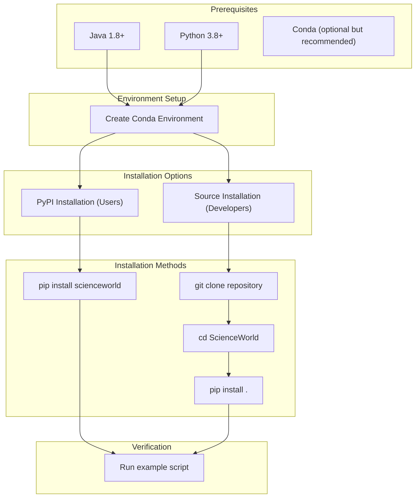
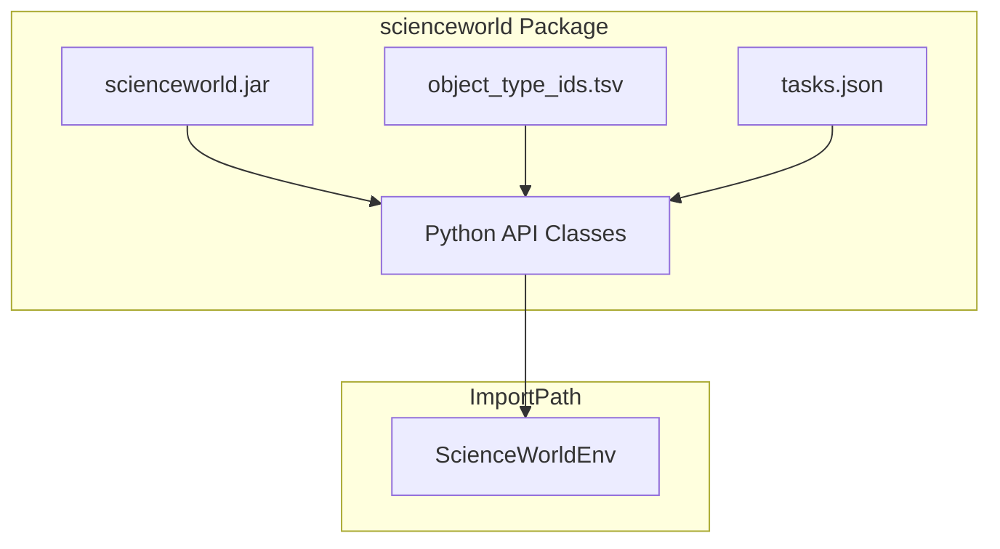
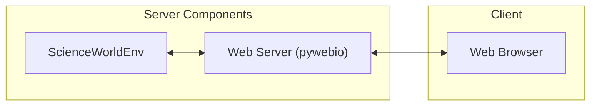

<!-- source: DeepWiki mcp.deepwiki.com · repo allenai/ScienceWorld · page 1.1 Installation & Setup · fetched 2026-10-26 -->

# Installation & Setup

<details>
<summary>Relevant source files</summary>

The following files were used as context for generating this wiki page:

- [CHANGELOG.md](CHANGELOG.md)
- [MANIFEST.in](MANIFEST.in)
- [README.md](README.md)
- [requirements-dev.txt](requirements-dev.txt)
- [requirements.txt](requirements.txt)
- [setup.py](setup.py)
- [tox.ini](tox.ini)

</details>


This page provides detailed instructions for installing ScienceWorld and setting up your development environment. It covers system requirements, installation methods, verification steps, and additional configurations like the web server interface. For information about the high-level architecture of ScienceWorld, see [Architecture](#2).

## Prerequisites

Before installing ScienceWorld, ensure your system meets the following requirements:

| Requirement | Minimum Version |
|-------------|----------------|
| Java        | 1.8+ (Java 8 or higher) |
| Python      | 3.8+ (3.8, 3.9, 3.10, 3.11, 3.12 supported) |
| Operating System | Linux, macOS (Windows may work but is not officially supported) |

Sources: [README.md:42-47](), [tox.ini:3-11]()

## Installation Process

ScienceWorld can be installed via two main methods: PyPI (recommended for users) or from source code (recommended for developers).



Sources: [README.md:44-58]()

### Installation via Conda (Recommended)

It's recommended to use a Conda environment to manage dependencies:

```bash
conda create --name scienceworld python=3.8
conda activate scienceworld
```

Sources: [README.md:44-47]()

### Method 1: PyPI Installation (for Users)

The simplest way to install ScienceWorld is using pip:

```bash
pip install scienceworld
```

This installs the latest stable version from PyPI, including all required dependencies.

Sources: [README.md:49-51]()

### Method 2: Source Installation (for Developers)

For development or to access the latest features:

```bash
git clone https://github.com/allenai/ScienceWorld.git
cd ScienceWorld
pip install .
```

For development mode installation (changes to source code immediately reflected):

```bash
pip install -e .
```

Sources: [README.md:53-58]()

## Package Structure

After installation, the ScienceWorld package contains the following key components:



The JAR file contains the compiled Scala code that powers the simulation environment, while the Python files provide the interface layer.

Sources: [setup.py:8-35](), [MANIFEST.in:1-7]()

## Verification and Basic Usage

After installation, verify that ScienceWorld is working correctly by running one of the example scripts:

### Running a Random Agent

```bash
python examples/random_agent.py --task-num=13 --num-episodes=5 --simplifications-preset easy
```

This runs a random agent on task #13 (classification: place a non-living thing in a box) for 5 episodes with "easy" simplifications.

### Interactive Console

```bash
python examples/human.py --task-num=3 --num-episodes=5
```

This starts an interactive console where you can manually enter commands to interact with the ScienceWorld environment on task #3 (change of state: melting).

Sources: [README.md:60-67]()

## Web Server Setup

ScienceWorld includes a web interface that allows interaction through a browser. This requires additional dependencies.

### Installation with Web Server Support

```bash
pip install scienceworld[webserver]
```

This installs ScienceWorld along with the necessary web server dependencies (primarily pywebio).

### Launching the Web Server

```bash
python examples/scienceworld-web-server-example.py
```

After running this command, navigate to `http://localhost:8080` in your web browser to access the ScienceWorld interface.



Sources: [README.md:69-87](), [setup.py:41-43]()

## Development Setup

For those wanting to contribute to ScienceWorld or modify the codebase, additional steps are needed.

### Installing Development Dependencies

```bash
pip install -r requirements-dev.txt
```

This installs development tools like pytest, flake8, and other utilities needed for testing and code quality.

### Recompiling the JAR File

If you modify the Scala code, you need to recompile the JAR file:

```bash
./simulator/package.sh
pip install -e .
```

This packages the Scala code into a JAR file and reinstalls ScienceWorld with the updated JAR.

Sources: [README.md:90-97](), [requirements-dev.txt:1-8]()

### Running Tests

ScienceWorld uses tox for testing across multiple Python versions:

```bash
tox
```

To run tests for a specific Python version:

```bash
tox -e py38  # For Python 3.8
```

To run code style checks:

```bash
tox -e flake8
```

Sources: [tox.ini:1-30]()

## Troubleshooting Common Issues

### Missing JAR File

If you see an error about a missing JAR file:

```
ERROR: Unable to find required library: [path]/scienceworld.jar
```

This usually means either:
1. The installation was incomplete
2. The JAR file is not in the expected location

Solution: Reinstall using the pip command, or if installing from source, ensure the JAR file is properly compiled.

### Java Version Issues

ScienceWorld requires Java 1.8 or higher. To check your Java version:

```bash
java -version
```

If the version is incorrect or Java is not installed, install or update your Java distribution.

### Python-Java Bridge Issues

ScienceWorld uses py4j to communicate between Python and Java. If you encounter errors related to py4j, ensure it's properly installed:

```bash
pip install py4j
```

Sources: [setup.py:18-21](), [requirements.txt:1]()

---

