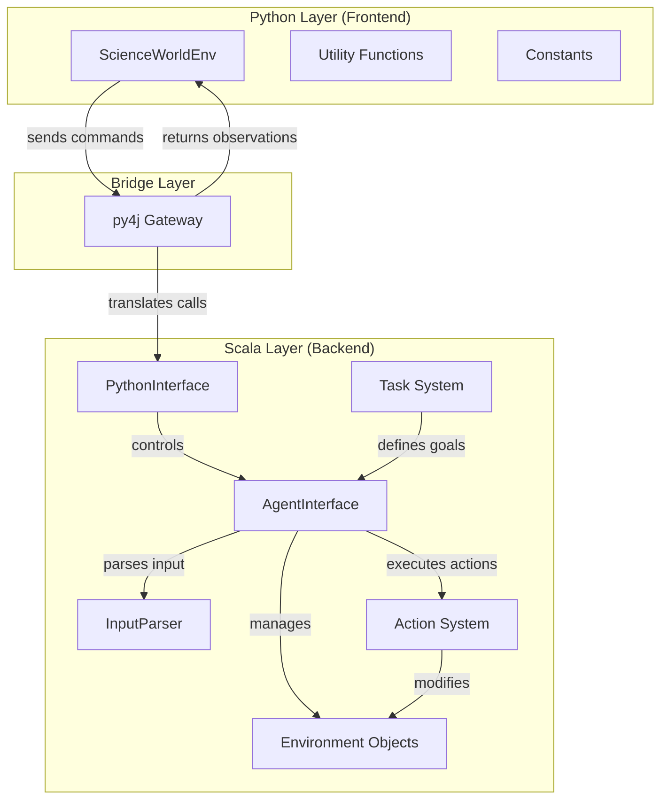
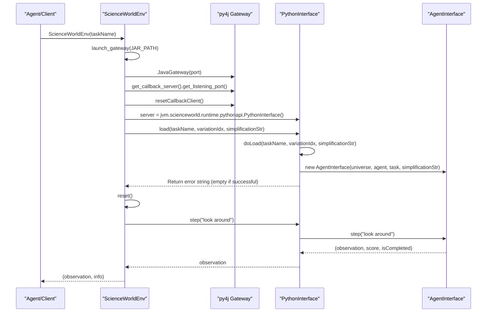
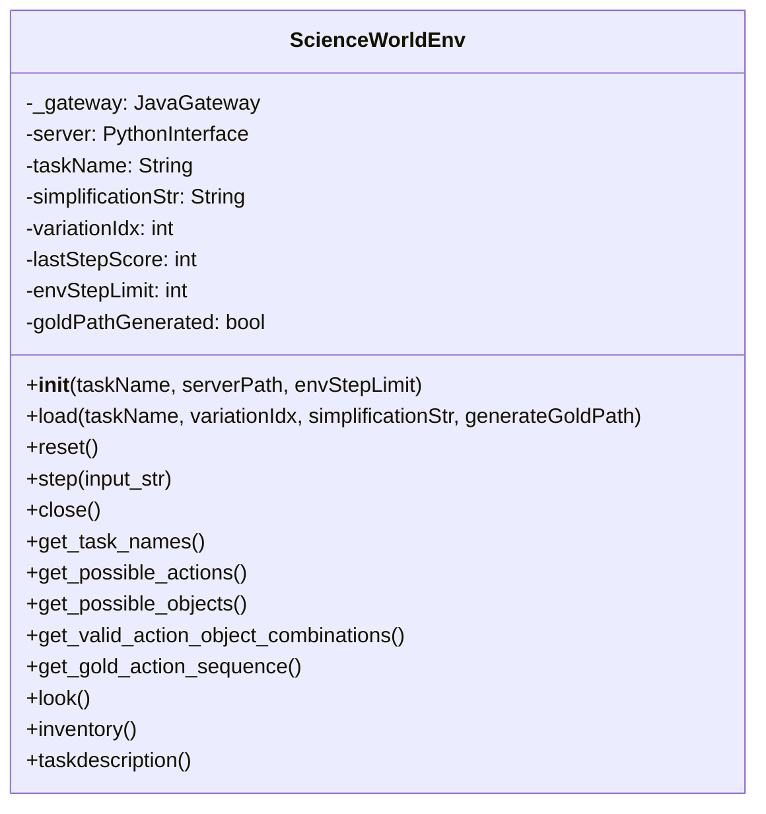
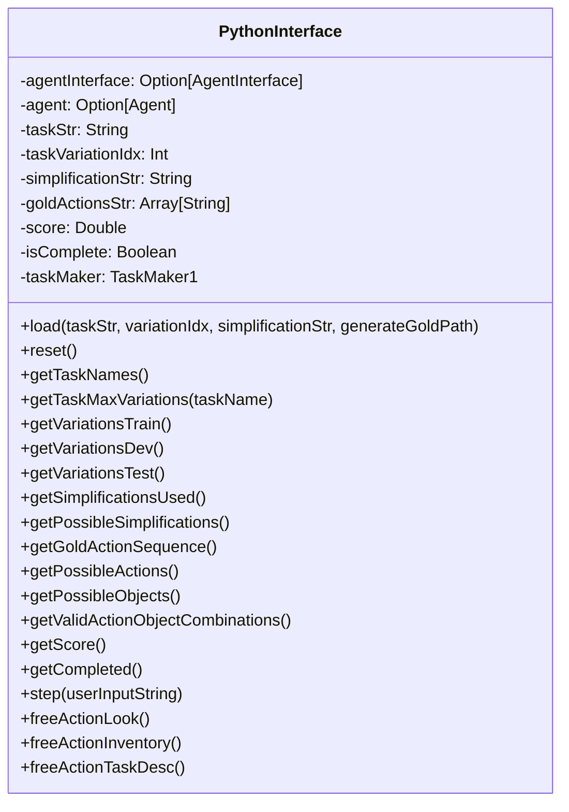
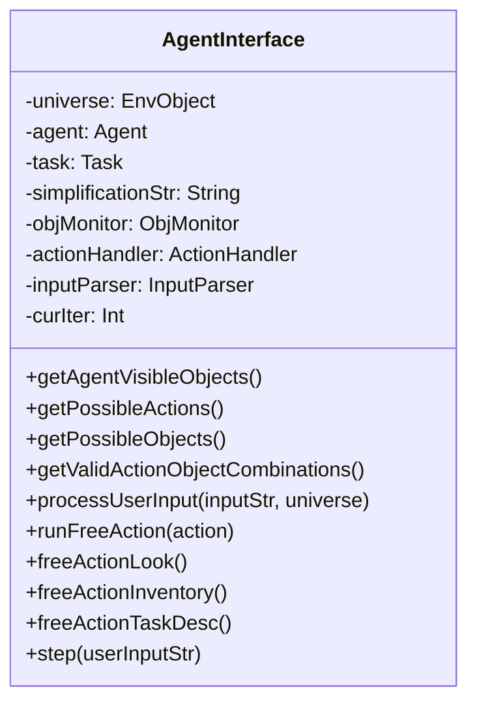
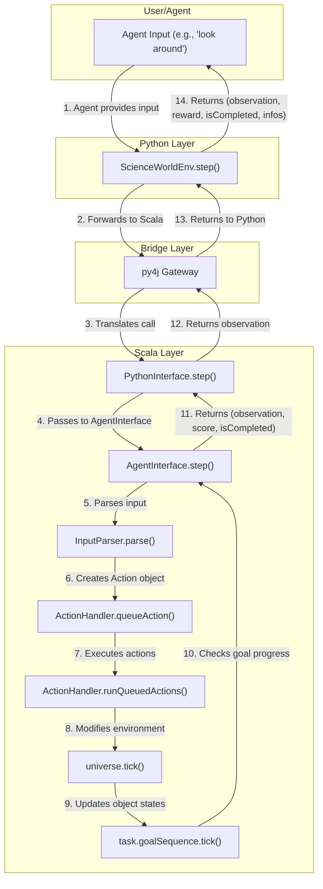
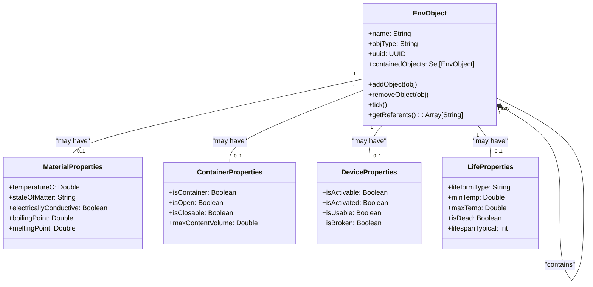
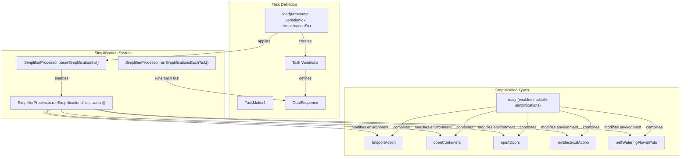
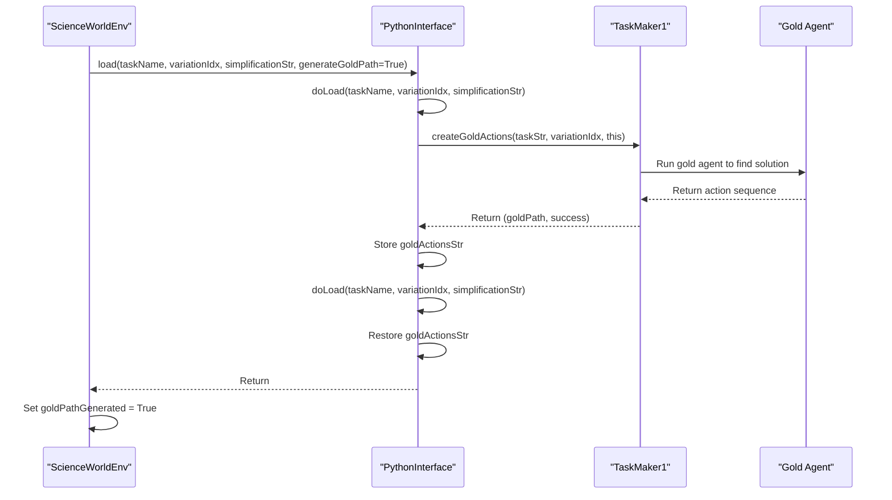

<!-- source: DeepWiki mcp.deepwiki.com · repo allenai/ScienceWorld · page 2 Architecture · fetched 2026-10-26 -->

# Architecture

Relevant source files

The following files were used as context for generating this wiki page:

- [scienceworld/scienceworld.jar](scienceworld/scienceworld.jar)
- [scienceworld/scienceworld.py](scienceworld/scienceworld.py)
- [simulator/build.sbt](simulator/build.sbt)
- [simulator/src/main/scala/scienceworld/runtime/AgentInterface.scala](simulator/src/main/scala/scienceworld/runtime/AgentInterface.scala)
- [simulator/src/main/scala/scienceworld/runtime/pythonapi/PythonInterface.scala](simulator/src/main/scala/scienceworld/runtime/pythonapi/PythonInterface.scala)
- [tests/test_scienceworld.py](tests/test_scienceworld.py)

This document provides a comprehensive overview of the ScienceWorld system architecture, detailing the core components and their interactions. ScienceWorld is a text-based simulation environment designed for elementary science tasks, featuring a Python frontend that communicates with a Scala backend through a bridge layer.

For information about installing and setting up ScienceWorld, see [Installation & Setup](#1.1). For details about specific Python API methods, see [Python API](#3).

## Overall System Architecture

The ScienceWorld architecture follows a layered design pattern with three main layers:

Sources: [scienceworld/scienceworld.py:17-162](). [simulator/src/main/scala/scienceworld/runtime/pythonapi/PythonInterface.scala:26-141]().

1. **Python Layer**: Provides the front-facing API for agents to interact with the environment.
2. **Bridge Layer**: Uses py4j to enable communication between Python and Scala.
3. **Scala Layer**: Contains the simulation logic, environment objects, and task definitions.

## Initialization and Communication Flow

The following diagram illustrates how ScienceWorld initializes and establishes communication between the Python and Scala layers:

Sources: [scienceworld/scienceworld.py:23-85](). [simulator/src/main/scala/scienceworld/runtime/pythonapi/PythonInterface.scala:54-145]().

Key points:
1. The Python `ScienceWorldEnv` initializes by starting a JVM with the Scala code
2. It establishes bidirectional communication through py4j
3. A task is loaded, creating an environment with the appropriate objects and goals
4. The agent can then interact with the environment through the `step()` method

## Core Components

### ScienceWorldEnv (Python)

The `ScienceWorldEnv` class serves as the main interface for agents to interact with ScienceWorld. It handles:

Sources: [scienceworld/scienceworld.py:17-162]().

### PythonInterface (Scala)

The `PythonInterface` class is the entry point for py4j calls from Python. It manages:

Sources: [simulator/src/main/scala/scienceworld/runtime/pythonapi/PythonInterface.scala:26-141]().

### AgentInterface (Scala)

The `AgentInterface` class handles the core simulation logic:

Sources: [simulator/src/main/scala/scienceworld/runtime/AgentInterface.scala:19-596]().

## Action Flow

The following diagram illustrates the flow of an action through the system:

Sources: [scienceworld/scienceworld.py:410-452](). [simulator/src/main/scala/scienceworld/runtime/pythonapi/PythonInterface.scala:351-404](). [simulator/src/main/scala/scienceworld/runtime/AgentInterface.scala:504-594]().

## Environment Object System

ScienceWorld uses a composable object system where environment objects can have various properties:

Sources: [scienceworld/scienceworld.py:292-301]().

## Task System and Simplifications

Tasks define goals that the agent must accomplish. They can be modified through simplifications:

Sources: [scienceworld/scienceworld.py:99-135](). [simulator/src/main/scala/scienceworld/runtime/AgentInterface.scala:36-48]().

Available simplifications:
- **teleportAction**: Adds actions to teleport directly to any possible location
- **openContainers**: Containers are open by default
- **openDoors**: Doors are open by default
- **noElectricalAction**: Remove electrical connection actions to reduce action space
- **selfWateringFlowerPots**: Flower pots water themselves so plants don't die
- **easy**: Enables all the above simplifications (except noElectricalAction for electrical tasks)

## Gold Action Sequences

ScienceWorld supports gold action sequences that provide a demonstration of how to solve a task:

Sources: [scienceworld/scienceworld.py:398-407](). [simulator/src/main/scala/scienceworld/runtime/pythonapi/PythonInterface.scala:57-90]().

Gold action sequences serve as:
1. Demonstrations of task solutions
2. Evaluation benchmarks for agent performance
3. Training data for imitation learning approaches

## Summary

The ScienceWorld architecture provides a flexible simulation environment for elementary science tasks through:

1. A layered design that separates the Python API from the Scala simulation engine
2. A composable object system that allows for complex interactions
3. A task system with variations and simplifications
4. Support for gold action sequences as demonstrations

This architecture enables researchers to develop and evaluate AI agents on tasks that test understanding of scientific concepts in a text-based environment.

Sources: [scienceworld/scienceworld.py](). [simulator/src/main/scala/scienceworld/runtime/pythonapi/PythonInterface.scala](). [simulator/src/main/scala/scienceworld/runtime/AgentInterface.scala]().

---

