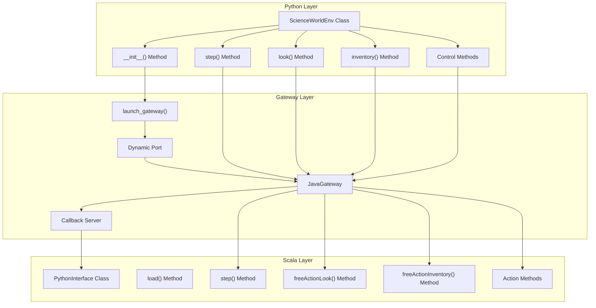
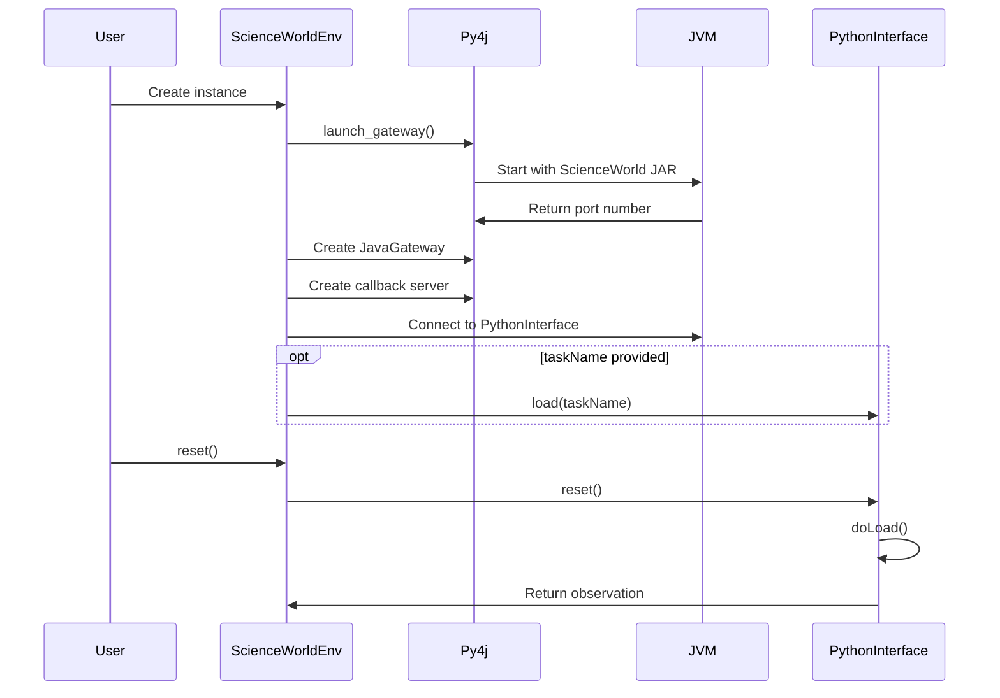
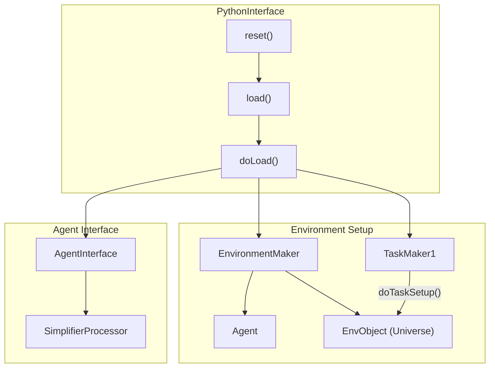
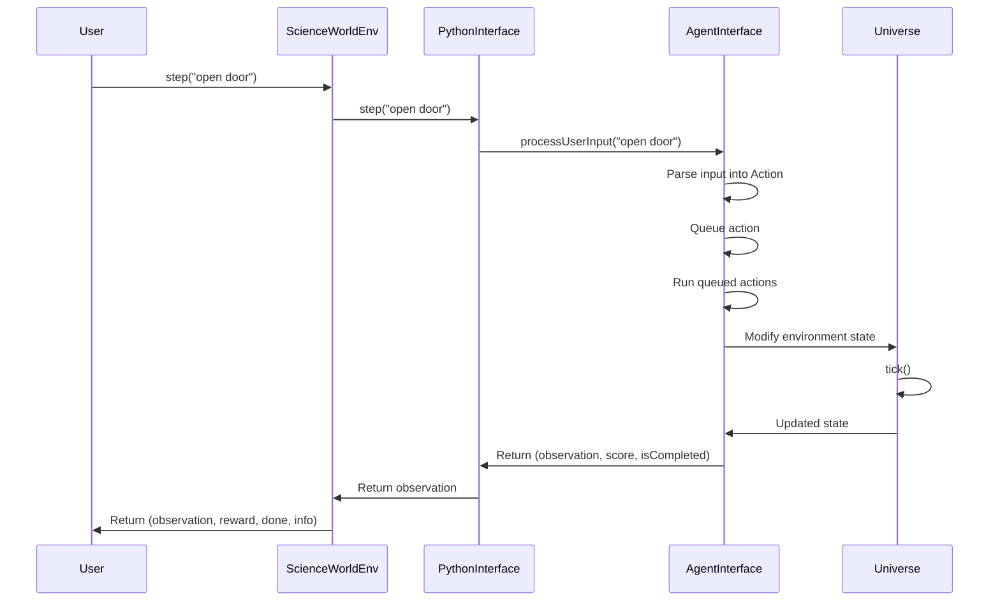
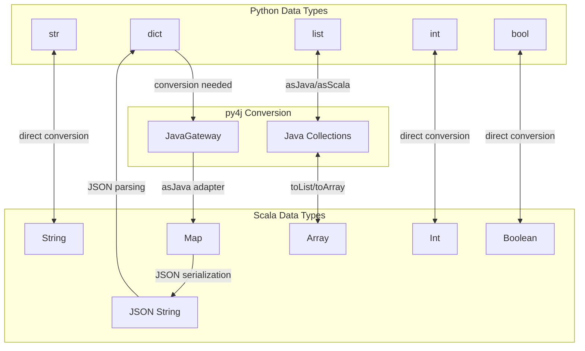
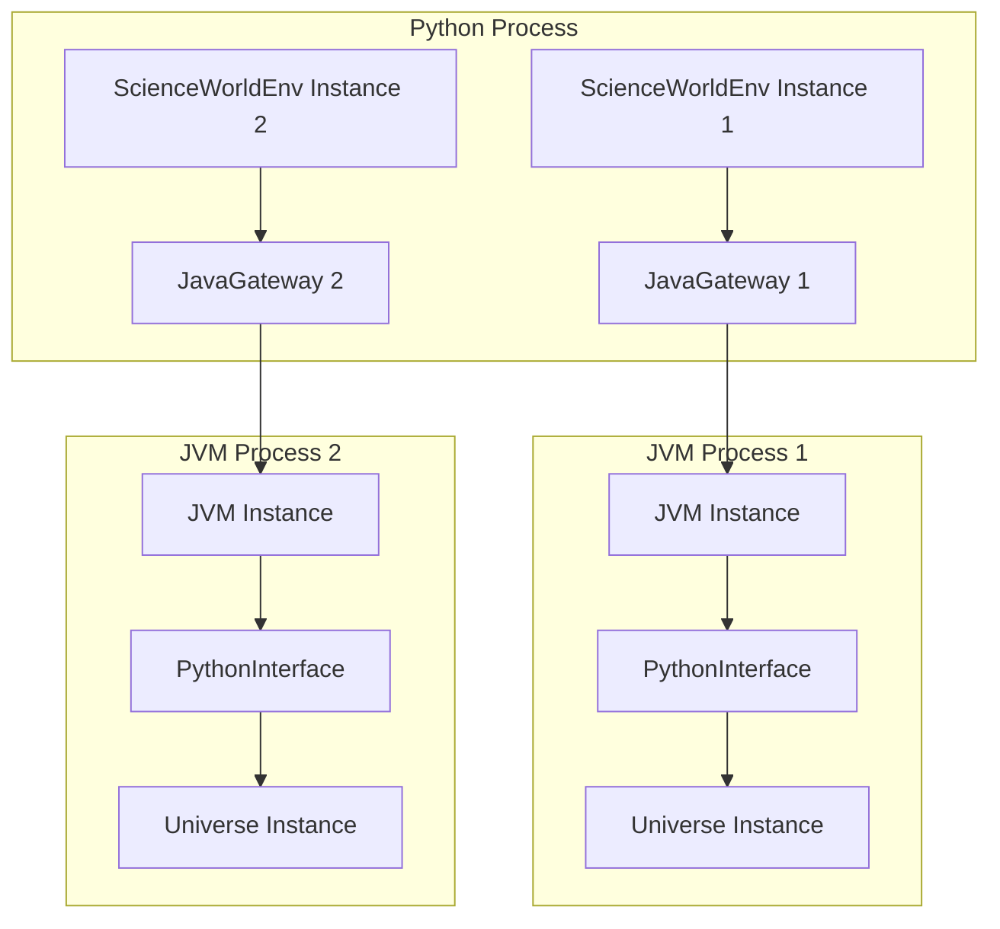

<!-- source: DeepWiki mcp.deepwiki.com · repo allenai/ScienceWorld · page 2.1 Python-Scala Bridge · fetched 2026-10-26 -->

# Python-Scala Bridge

<details>
<summary>Relevant source files</summary>

The following files were used as context for generating this wiki page:

- [scienceworld/scienceworld.py](scienceworld/scienceworld.py)
- [simulator/build.sbt](simulator/build.sbt)
- [simulator/src/main/scala/scienceworld/runtime/AgentInterface.scala](simulator/src/main/scala/scienceworld/runtime/AgentInterface.scala)
- [simulator/src/main/scala/scienceworld/runtime/pythonapi/PythonInterface.scala](simulator/src/main/scala/scienceworld/runtime/pythonapi/PythonInterface.scala)
- [tests/test_scienceworld.py](tests/test_scienceworld.py)

</details>


This page documents the bridge between Python and Scala in ScienceWorld, which enables communication between the Python API and the Scala simulation engine. For information about the core components of the system, see [Core Components](#2.2).

## Overview

ScienceWorld uses a dual-language architecture where the simulation engine is written in Scala, but users interact with the system through a Python API. The Python-Scala bridge, built using py4j, enables this cross-language communication by:

1. Starting a Java Virtual Machine (JVM) from Python
2. Establishing a bidirectional gateway for function calls
3. Passing data between the two languages

This architecture allows the performance advantages of the JVM while maintaining an accessible Python interface for AI researchers and educators.

Sources: [scienceworld/scienceworld.py:16-85](), [simulator/build.sbt:9-13]()

## Architecture

### Bridge Components



The bridge consists of three main layers:
1. **Python Layer**: The `ScienceWorldEnv` class that provides the API for Python users
2. **Gateway Layer**: The py4j infrastructure that handles inter-process communication
3. **Scala Layer**: The `PythonInterface` class that exposes Scala functionality

Sources: [scienceworld/scienceworld.py:17-22](), [simulator/src/main/scala/scienceworld/runtime/pythonapi/PythonInterface.scala:26-27]()

### Initialization Flow



The initialization process involves:
1. Starting the JVM with the ScienceWorld JAR file
2. Establishing a bidirectional gateway between Python and Scala
3. Loading a task environment if specified
4. Setting up initial state

Sources: [scienceworld/scienceworld.py:23-85](), [simulator/src/main/scala/scienceworld/runtime/pythonapi/PythonInterface.scala:54-95]()

## Python Side: ScienceWorldEnv

The `ScienceWorldEnv` class is the main entry point for Python users, providing a clean API to interact with the Scala backend. It handles:

1. **JVM Management**: Starting, connecting to, and shutting down the JVM
2. **Task Management**: Loading and configuring tasks
3. **Agent Interaction**: Processing actions and returning observations

### Key Methods

| Method | Purpose |
|--------|---------|
| `__init__` | Initializes the py4j gateway and connects to the Scala backend |
| `load` | Loads a specific task with variations and simplifications |
| `reset` | Resets the environment to its initial state |
| `step` | Processes an action and returns observation, reward, completion status, and info |
| `close` | Shuts down the gateway and JVM |
| `look` | "Free" action to observe the environment |
| `inventory` | "Free" action to check inventory |

### Gateway Initialization

The Python side launches the JVM and establishes communication through a sequence of steps:

```python
# Launch Java side with dynamic port
port, proc = launch_gateway(classpath=serverPath, die_on_exit=True, cwd=BASEPATH, return_proc=True)

# Create gateway with callback server for bidirectional communication
self._gateway = JavaGateway(
    gateway_parameters=GatewayParameters(auto_field=True, port=port),
    callback_server_parameters=CallbackServerParameters(port=0, daemonize=True),
    java_process=proc)

# Get Python callback server port
python_port = self._gateway.get_callback_server().get_listening_port()

# Tell Java side to connect to Python callback
self._gateway.java_gateway_server.resetCallbackClient(
    self._gateway.java_gateway_server.getCallbackClient().getAddress(),
    python_port)

# Get PythonInterface instance
self.server = self._gateway.jvm.scienceworld.runtime.pythonapi.PythonInterface()
```

Sources: [scienceworld/scienceworld.py:33-65]()

## Scala Side: PythonInterface

The `PythonInterface` class serves as the bridge endpoint on the Scala side, providing methods that the Python code can call. It mediates between the Python API and the core simulation engine through `AgentInterface`.

### Key Methods

| Method | Purpose |
|--------|---------|
| `load` | Sets up a task environment with specified parameters |
| `reset` | Resets the environment to initial state |
| `step` | Processes an action and returns results |
| `getTaskNames` | Returns available task names |
| `getPossibleActions` | Returns possible actions in current state |
| `freeActionLook` | Performs "look around" without consuming a step |
| `freeActionInventory` | Shows inventory without consuming a step |
| `getRunHistoryJSON` | Returns history in JSON format |

### Initialization and Task Loading



The Scala side handles environment creation and task setup:
1. `load` method initializes a task with variations and simplifications
2. `doLoad` handles the actual environment creation
3. Task objects are placed in the agent's inventory
4. Simplifications are applied to adjust environment complexity

Sources: [simulator/src/main/scala/scienceworld/runtime/pythonapi/PythonInterface.scala:54-145]()

## Communication Flow

### Action-Observation Cycle



The communication flow for an action:
1. User calls `step()` in the Python API
2. Request is passed to `PythonInterface.step()`
3. `AgentInterface` processes the input into actions
4. Actions are queued and executed
5. Environment state is updated via `tick()`
6. Results are passed back up through the bridge

Sources: [scienceworld/scienceworld.py:410-452](), [simulator/src/main/scala/scienceworld/runtime/pythonapi/PythonInterface.scala:351-404](), [simulator/src/main/scala/scienceworld/runtime/AgentInterface.scala:504-595]()

### Data Transfer



Data transfer between Python and Scala:
- Basic types (strings, integers, booleans) convert directly
- Complex types use py4j adapters or JSON serialization
- Collections are converted using `asJava`/`asScala` adapters
- Large or complex data structures are serialized to JSON

Sources: [scienceworld/scienceworld.py:256-266](), [simulator/src/main/scala/scienceworld/runtime/pythonapi/PythonInterface.scala:155-226](), [simulator/src/main/scala/scienceworld/runtime/pythonapi/PythonInterface.scala:264-316]()

## Multiple Environments

ScienceWorld supports running multiple environments simultaneously:



Each `ScienceWorldEnv` instance:
1. Starts its own JVM process
2. Runs an independent simulation
3. Has its own gateway and port for communication
4. Can be closed individually without affecting others

Sources: [tests/test_scienceworld.py:16-44](), [scienceworld/scienceworld.py:151-161]()

## Shutdown and Resource Management

The bridge includes careful resource management:

```python
def close(self) -> None:
    self._gateway.shutdown()

    # Send newline to process to make it exit
    if self._gateway.java_process.poll() is None:
        self._gateway.java_process.stdin.write("\n".encode("utf-8"))
        self._gateway.java_process.stdin.flush()

def __del__(self):
    self.close()
```

When a `ScienceWorldEnv` is closed:
1. Gateway is shutdown
2. JVM process is terminated
3. Python resources are released
4. The `__del__` method ensures cleanup even if `close()` isn't called explicitly

Sources: [scienceworld/scienceworld.py:151-161](), [tests/test_scienceworld.py:47-53]()

## Troubleshooting

Common issues with the Python-Scala bridge:

| Issue | Possible Cause | Solution |
|-------|---------------|----------|
| `py4j.protocol.Py4JError` | JVM not started or crashed | Check JAR path and Java installation |
| `ConnectionRefusedError` | Port issues or process terminated | Ensure no port conflicts |
| Memory errors | Large simulations consuming too much memory | Reduce environment complexity or increase JVM memory |
| Slow performance | Excessive data transfer across bridge | Batch operations where possible |
| Hanging on exit | JVM process not terminated properly | Ensure `close()` is called |

The bridge provides error handling mechanisms:
- Error messages are passed from Scala to Python
- JVM exceptions are caught and reported
- Resource cleanup happens during garbage collection

Sources: [scienceworld/scienceworld.py:151-161](), [simulator/src/main/scala/scienceworld/runtime/pythonapi/PythonInterface.scala:400-404]()

## Debug Mode

For development purposes, the bridge includes a debug mode:

```python
if DEBUG_MODE:
    import sys
    import time
    port, proc = launch_gateway(
        classpath=serverPath, die_on_exit=True, cwd=BASEPATH,
        javaopts=['-agentlib:jdwp=transport=dt_socket,server=y,suspend=n,address=5005,quiet=y'],
        redirect_stdout=sys.stdout, redirect_stderr=sys.stderr, return_proc=True)
    logger.debug("Attach debugger within the next 10 seconds")
    time.sleep(10)  # Give time for user to attach debugger
```

When debug mode is enabled:
1. JVM is started with remote debugging enabled on port 5005
2. System waits 10 seconds for debugger attachment
3. Standard output/error from JVM is redirected to Python

Sources: [scienceworld/scienceworld.py:33-46]()

---

