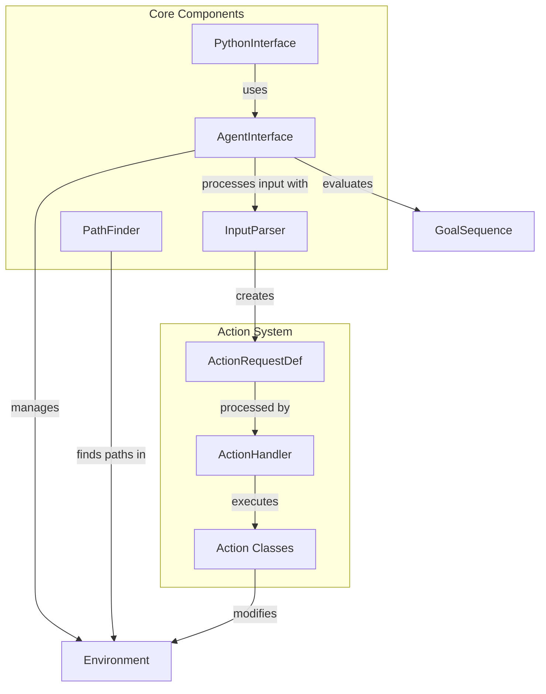
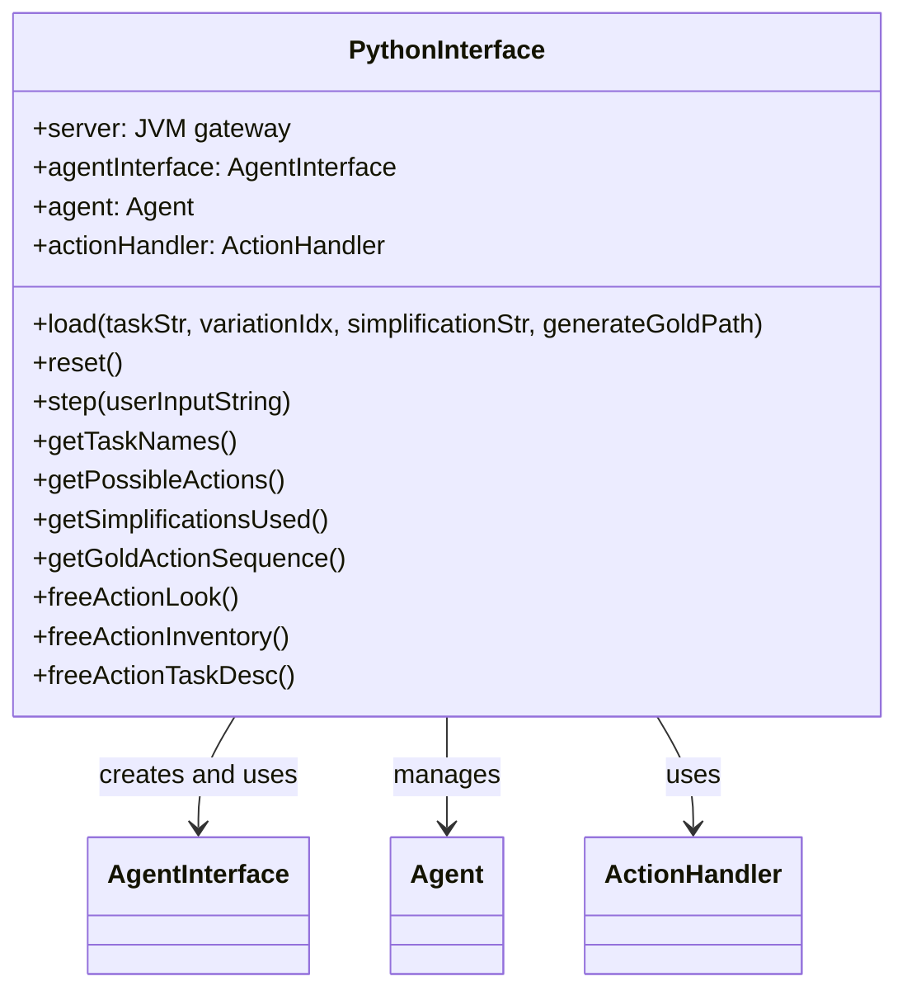
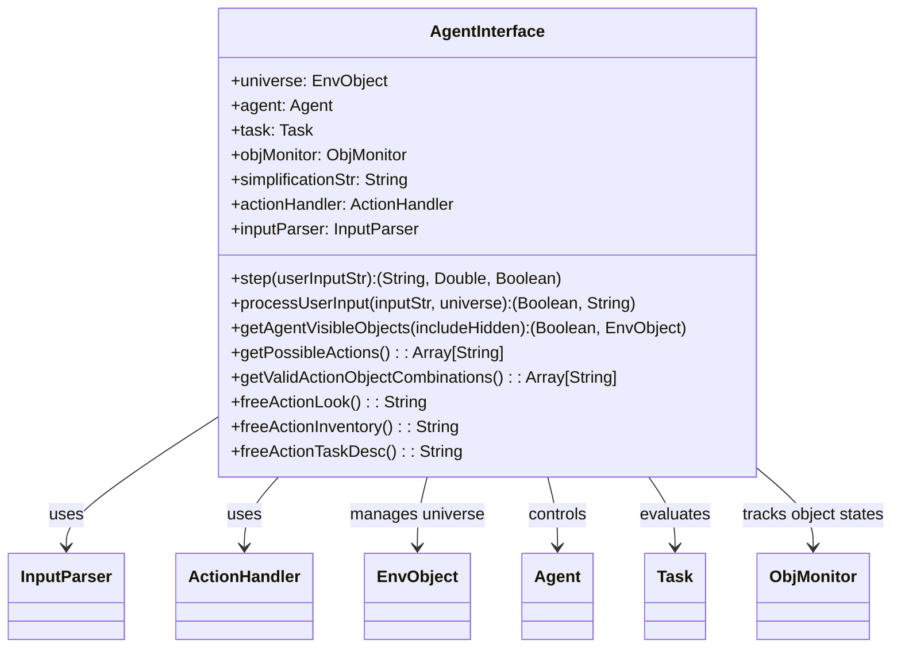
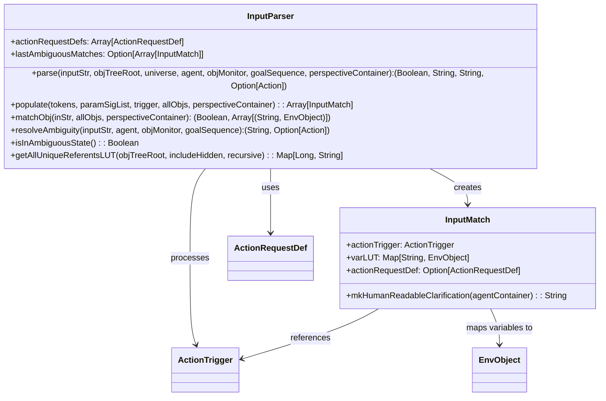
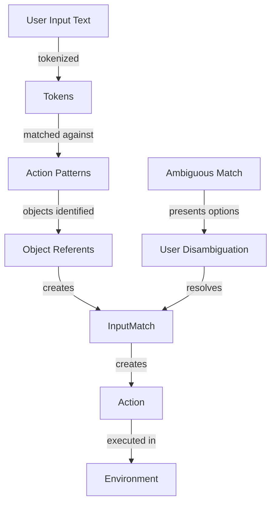
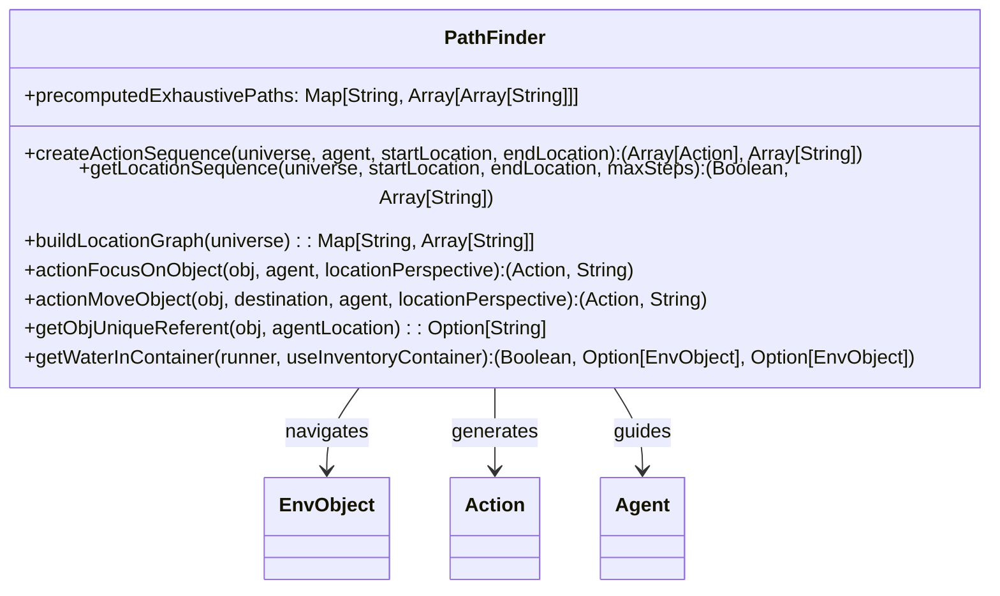
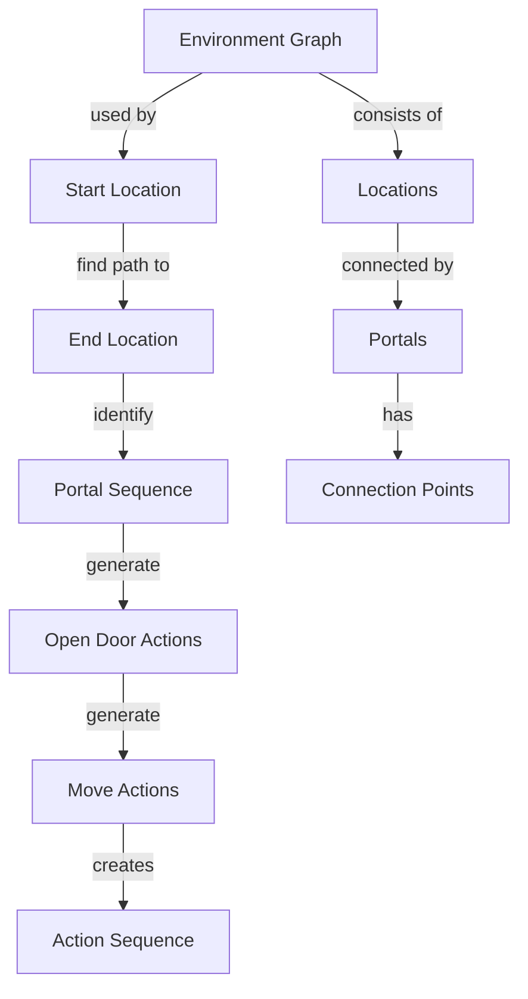
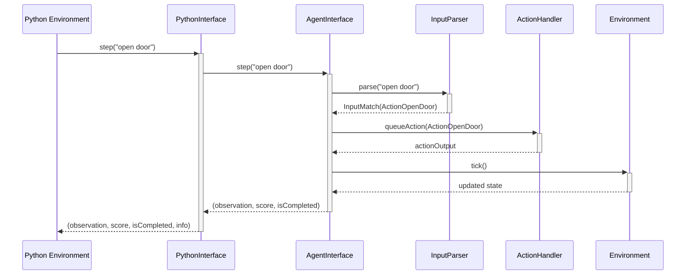
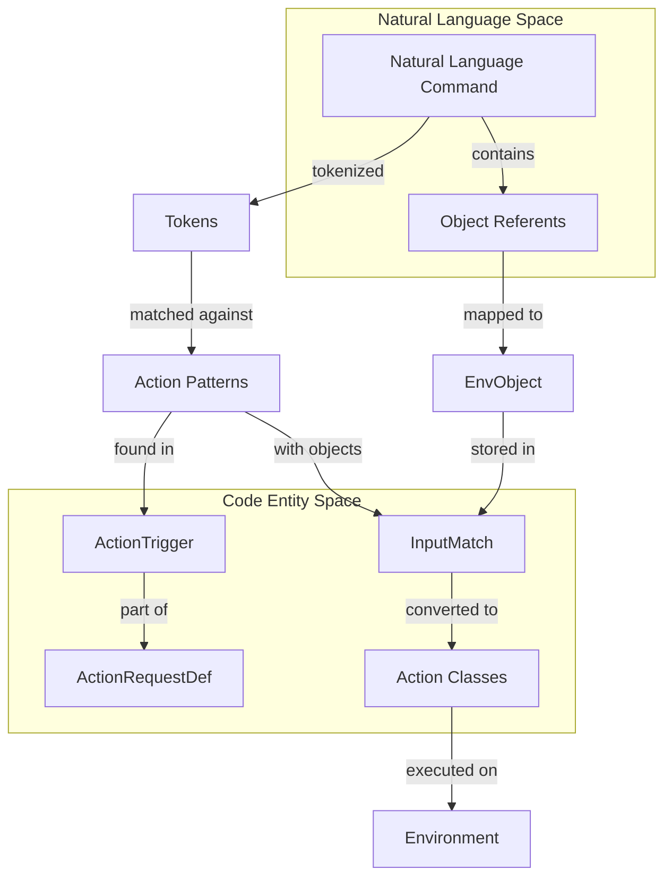
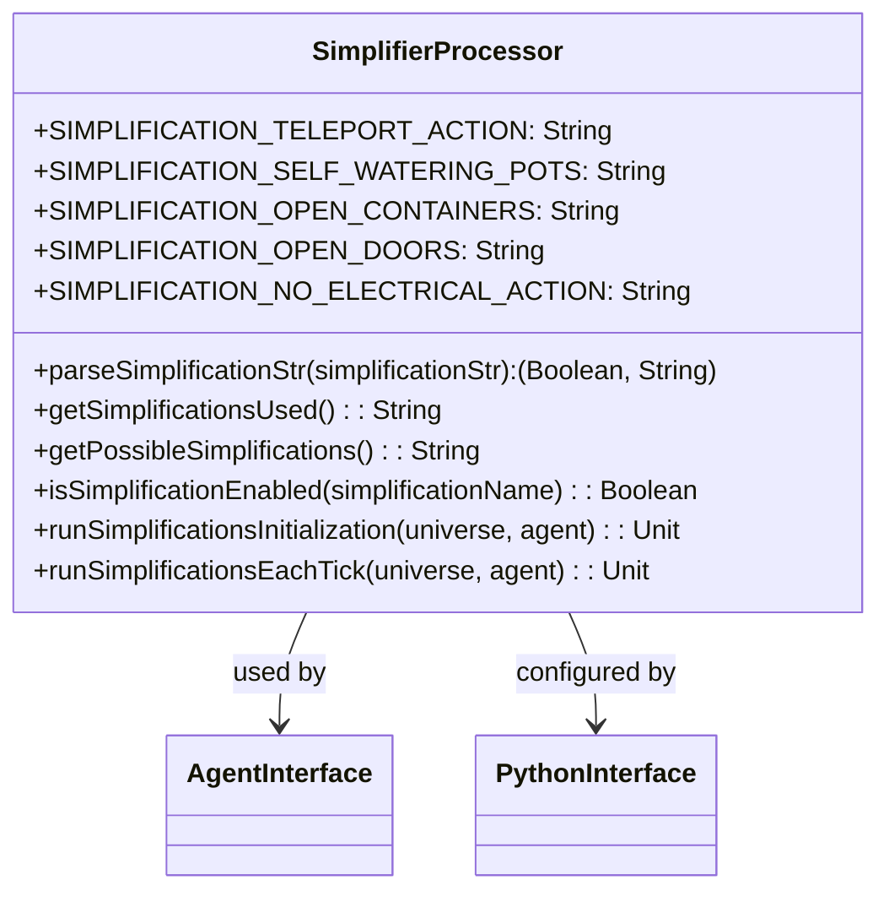

<!-- source: DeepWiki mcp.deepwiki.com · repo allenai/ScienceWorld · page 2.2 Core Components · fetched 2026-10-26 -->

# Core Components

Relevant source files

The following files were used as context for generating this wiki page:

- [scienceworld/scienceworld.py](scienceworld/scienceworld.py)
- [simulator/build.sbt](simulator/build.sbt)
- [simulator/src/main/scala/scienceworld/goldagent/ExampleGoldAgent.scala](simulator/src/main/scala/scienceworld/goldagent/ExampleGoldAgent.scala)
- [simulator/src/main/scala/scienceworld/goldagent/PathFinder.scala](simulator/src/main/scala/scienceworld/goldagent/PathFinder.scala)
- [simulator/src/main/scala/scienceworld/input/InputParser.scala](simulator/src/main/scala/scienceworld/input/InputParser.scala)
- [simulator/src/main/scala/scienceworld/objects/livingthing/plant/PeaPlant.scala](simulator/src/main/scala/scienceworld/objects/livingthing/plant/PeaPlant.scala)
- [simulator/src/main/scala/scienceworld/objects/livingthing/plant/RandomGeneticsPlants.scala](simulator/src/main/scala/scienceworld/objects/livingthing/plant/RandomGeneticsPlants.scala)
- [simulator/src/main/scala/scienceworld/runtime/AgentInterface.scala](simulator/src/main/scala/scienceworld/runtime/AgentInterface.scala)
- [simulator/src/main/scala/scienceworld/runtime/pythonapi/PythonInterface.scala](simulator/src/main/scala/scienceworld/runtime/pythonapi/PythonInterface.scala)
- [tests/test_scienceworld.py](tests/test_scienceworld.py)

This page details the main structural components of ScienceWorld's backend. These components power the simulation environment and enable interactions between agents and the virtual world. These components primarily live in the Scala backend and include the AgentInterface, InputParser, PathFinder, and PythonInterface. For information about the Python-Scala bridge that connects these components to the Python API, see [Python-Scala Bridge](#2.1).

## Component Overview

ScienceWorld's backend architecture consists of several key components that work together to create and manage the interactive environment:

Sources: [simulator/src/main/scala/scienceworld/runtime/AgentInterface.scala](), [simulator/src/main/scala/scienceworld/input/InputParser.scala](), [simulator/src/main/scala/scienceworld/goldagent/PathFinder.scala](), [simulator/src/main/scala/scienceworld/runtime/pythonapi/PythonInterface.scala]()

## PythonInterface

The PythonInterface class serves as the bridge between Python and Scala, exposing the Scala backend to Python through the py4j library.

Key responsibilities:
- Initializes and manages the simulation environment
- Loads tasks and variations
- Processes user input and returns observations
- Provides API methods for interacting with the environment
- Handles "free" actions that don't advance the simulation
- Manages gold action sequence generation

Sources: [simulator/src/main/scala/scienceworld/runtime/pythonapi/PythonInterface.scala:26-91](), [simulator/src/main/scala/scienceworld/runtime/pythonapi/PythonInterface.scala:152-173](), [simulator/src/main/scala/scienceworld/runtime/pythonapi/PythonInterface.scala:351-404]()

## AgentInterface

The AgentInterface class is the central component that manages the simulation environment and the interaction between the agent and the objects in the world.

Key responsibilities:
- Managing the simulation universe and agent
- Processing user input and executing actions
- Tracking task progress and goal completion
- Providing methods to access possible actions and objects
- Handling simplifications for the environment
- Managing the error state of the system

The step method is the core function that processes input and advances the simulation:
1. Parses user input into actions
2. Executes those actions
3. Runs environment tick to update world state
4. Checks goal conditions
5. Returns observation, score, and completion status

Sources: [simulator/src/main/scala/scienceworld/runtime/AgentInterface.scala:19-95](), [simulator/src/main/scala/scienceworld/runtime/AgentInterface.scala:501-594]()

## InputParser

The InputParser component handles parsing natural language input into executable actions by matching input strings against action patterns and resolving references to objects in the environment.

From natural language to action execution:

Key responsibilities:
- Parsing user input text
- Matching input against action patterns
- Resolving object references
- Handling ambiguity in commands
- Converting matched input to executable actions

The InputParser uses pattern matching to identify valid commands and map them to objects in the environment. When multiple interpretations are possible, it manages an ambiguity resolution process to clarify the user's intent.

Sources: [simulator/src/main/scala/scienceworld/input/InputParser.scala:142-229](), [simulator/src/main/scala/scienceworld/input/InputParser.scala:267-352](), [simulator/src/main/scala/scienceworld/input/InputParser.scala:437-511]()

## PathFinder

The PathFinder component is used primarily for generating gold action sequences—optimal paths through the environment to accomplish tasks. It helps with automatic evaluation and agent training.

Path planning process:

Key responsibilities:
- Finding paths between locations in the environment
- Creating sequences of actions to navigate the environment
- Generating action sequences for object manipulation
- Providing helper functions for gold agent implementation
- Building a graph representation of the environment

PathFinder is essential for the automated generation of gold action sequences, which serve as optimal solutions for tasks and can be used for automatic evaluation and agent training.

Sources: [simulator/src/main/scala/scienceworld/goldagent/PathFinder.scala:28-91](), [simulator/src/main/scala/scienceworld/goldagent/PathFinder.scala:166-224](), [simulator/src/main/scala/scienceworld/goldagent/PathFinder.scala:290-342]()

## Component Interactions

The following diagram illustrates the flow of information and control between the core components during a typical interaction with the ScienceWorld environment:

This sequence shows how a user command flows through the system:
1. The Python environment sends a step command to the PythonInterface
2. PythonInterface calls step on the AgentInterface
3. AgentInterface uses the InputParser to convert the text into an action
4. The action is queued in the ActionHandler and executed
5. The environment is updated via the tick method
6. Results are returned back through the chain to the Python environment

Sources: [scienceworld/scienceworld.py:410-452](), [simulator/src/main/scala/scienceworld/runtime/pythonapi/PythonInterface.scala:351-404](), [simulator/src/main/scala/scienceworld/runtime/AgentInterface.scala:501-594]()

## Natural Language Processing Flow

The following diagram illustrates how natural language commands are processed through the input parsing system:

The diagram shows the conversion path from natural language input to executable code:
1. Natural language commands are tokenized
2. Tokens are matched against action patterns defined in ActionTrigger objects
3. Object referents in the command are mapped to EnvObject instances
4. Matched patterns and objects are stored in InputMatch objects
5. InputMatch objects are converted to specific Action classes
6. Actions are executed on the Environment

Sources: [simulator/src/main/scala/scienceworld/input/InputParser.scala:142-229](), [simulator/src/main/scala/scienceworld/input/InputParser.scala:267-352]()

## Simplification System

The simplification system allows the environment complexity to be reduced for easier agent training or evaluation. It's integrated into the AgentInterface and PythonInterface classes.

Available simplifications:
- `teleportAction`: Adds actions to teleport directly to any possible location
- `selfWateringFlowerPots`: Flower pots will water themselves so plants won't die
- `openContainers`: Containers are open by default
- `openDoors`: Doors are open by default
- `noElectricalAction`: Remove electrical connection actions to reduce action space
- `easy`: Use all above simplifications

Simplifications are applied at initialization time and during each tick of the environment, modifying the behavior of objects and available actions.

Sources: [simulator/src/main/scala/scienceworld/runtime/AgentInterface.scala:43-48](), [simulator/src/main/scala/scienceworld/runtime/pythonapi/PythonInterface.scala:232-238](), [scienceworld/scienceworld.py:164-177]()

---

