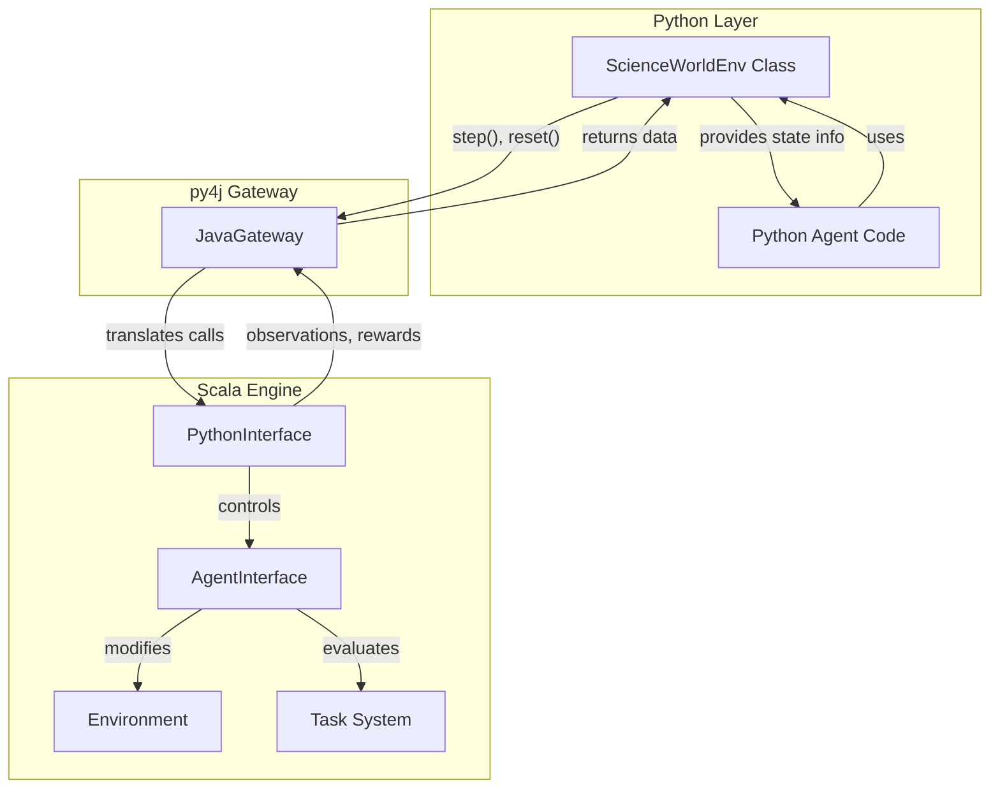
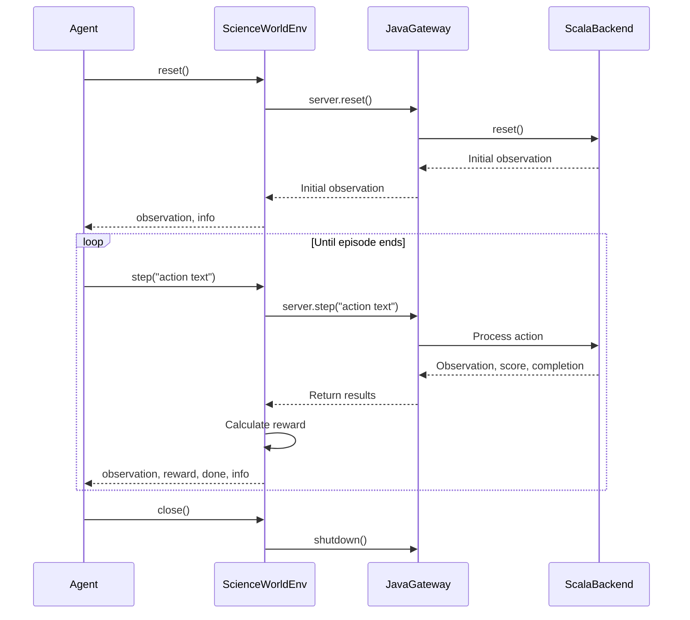
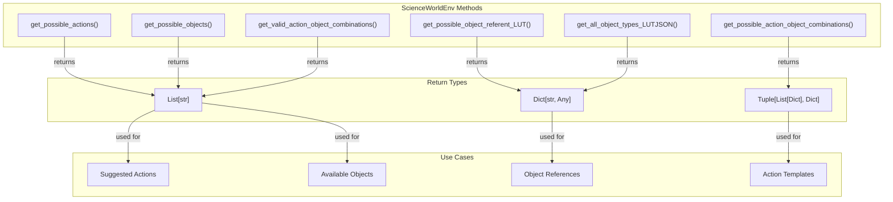
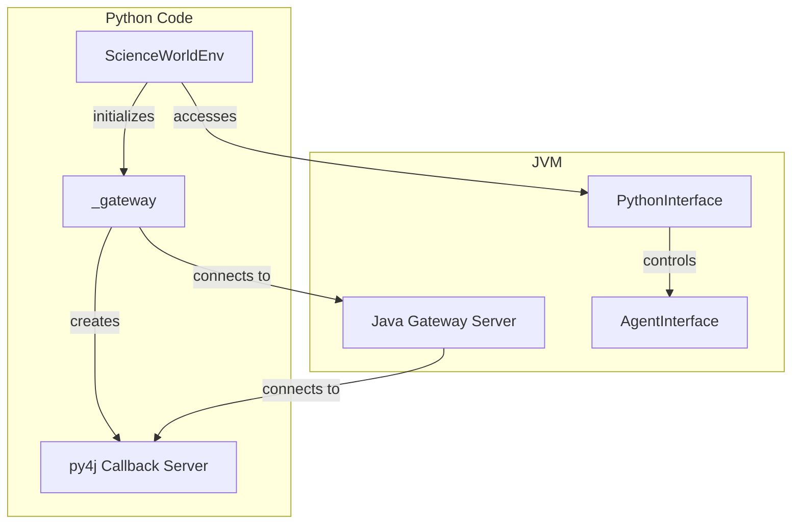

<!-- source: DeepWiki mcp.deepwiki.com · repo allenai/ScienceWorld · page 3 Python API · fetched 2026-10-26 -->

# Python API

<details>
<summary>Relevant source files</summary>

The following files were used as context for generating this wiki page:

- [scienceworld/constants.py](scienceworld/constants.py)
- [scienceworld/scienceworld.py](scienceworld/scienceworld.py)
- [scienceworld/tasks.json](scienceworld/tasks.json)
- [scienceworld/utils.py](scienceworld/utils.py)
- [simulator/src/main/scala/scienceworld/runtime/SimplifierProcessor.scala](simulator/src/main/scala/scienceworld/runtime/SimplifierProcessor.scala)
- [simulator/src/main/scala/scienceworld/runtime/pythonapi/PythonInterface.scala](simulator/src/main/scala/scienceworld/runtime/pythonapi/PythonInterface.scala)
- [simulator/src/main/scala/scienceworld/tasks/specifictasks/TaskElectricalConductivity.scala](simulator/src/main/scala/scienceworld/tasks/specifictasks/TaskElectricalConductivity.scala)
- [simulator/src/main/scala/scienceworld/tasks/specifictasks/TaskElectricalConductivity2.scala](simulator/src/main/scala/scienceworld/tasks/specifictasks/TaskElectricalConductivity2.scala)
- [tests/test_scienceworld.py](tests/test_scienceworld.py)

</details>


The Python API provides a programmatic interface for interacting with the ScienceWorld text-based simulation environment. This document describes how to use the Python layer that communicates with the Scala-based simulation engine, allowing agents to interact with the environment through natural language commands and receive observations, rewards, and state information in return.

For detailed information about specific classes and methods, see [ScienceWorldEnv Class](#3.1). For information about how to use the API to interact with the environment, see [Interacting with the Environment](#3.2).

## API Architecture

The Python API serves as a bridge between Python-based agents and the Scala-based simulation engine. The primary component is the `ScienceWorldEnv` class, which facilitates communication through py4j.



**ScienceWorld Python-Scala Communication Flow**

Sources: [scienceworld/scienceworld.py:17-86](), [simulator/src/main/scala/scienceworld/runtime/pythonapi/PythonInterface.scala:26-86]()

## Setting up the Environment

### Initialization

To use ScienceWorld, first create an instance of the `ScienceWorldEnv` class:

```python
from scienceworld import ScienceWorldEnv

# Create environment with a specific task
env = ScienceWorldEnv(taskName="1-1")  # Task 1-1 is "Boil" task

# Or create without a task (load later)
env = ScienceWorldEnv()
```

The constructor takes the following parameters:
- `taskName`: Optional task name or ID to load immediately
- `serverPath`: Path to the JAR file (defaults to built-in)
- `envStepLimit`: Maximum number of steps allowed (defaults to 100)

Sources: [scienceworld/scienceworld.py:23-85]()

### Loading Tasks

Tasks can be loaded with specific variations and simplifications:

```python
# Load task by ID with variation and simplifications
env.load("1-1", variationIdx=0, simplificationStr="openContainers,openDoors")

# Generate gold path (solution) when loading
env.load("1-1", variationIdx=0, generateGoldPath=True)
```

Tasks can be referenced by:
- Task ID (e.g., "1-1")
- Task name (e.g., "boil")
- Legacy task name (e.g., "task-1-boil")

Sources: [scienceworld/scienceworld.py:88-136](), [scienceworld/utils.py:7-22]()

## Interaction Flow

The primary interaction pattern with the environment follows the standard reinforcement learning loop:



**ScienceWorld API Interaction Flow**

Sources: [scienceworld/scienceworld.py:137-149](), [scienceworld/scienceworld.py:410-452](), [scienceworld/scienceworld.py:151-162]()

### Basic Interaction Loop

```python
# Initialize
env = ScienceWorldEnv("1-1")

# Reset to start episode
observation, info = env.reset()

# Take steps until episode ends
done = False
while not done:
    # Take action
    action = "look around"  # or any action string
    observation, reward, done, info = env.step(action)
    
    # Process observation and reward
    print(observation)
    print(f"Reward: {reward}")
    
# Close when finished
env.close()
```

The `step()` method returns:
- `observation`: Text description of the result
- `reward`: Numerical reward (delta score)
- `done`: Boolean indicating if episode is complete
- `info`: Dictionary with additional information

Sources: [scienceworld/scienceworld.py:410-452]()

### Free Actions

Some actions are considered "free" and don't advance the environment state:

```python
# Look around
description = env.look()

# Check inventory
inventory = env.inventory()

# Check task description
task_desc = env.taskdescription()
```

These methods retrieve information without consuming a step in the environment.

Sources: [scienceworld/scienceworld.py:455-468]()

## Environment Information

The API provides several methods to retrieve information about the environment state:

### Object and Action Information



**Object and Action Information Methods**

Sources: [scienceworld/scienceworld.py:198-280]()

Key methods include:

- `get_possible_actions()`: Returns list of all possible actions
- `get_possible_objects()`: Returns list of all observable objects
- `get_valid_action_object_combinations()`: Returns valid action-object pairs
- `get_vocabulary()`: Returns set of all words with meaning to the simulator

Sources: [scienceworld/scienceworld.py:198-281]()

### Task Information

```python
# Get task description
description = env.get_task_description()

# Get task names
task_names = env.get_task_names()

# Get train/dev/test variations
train_vars = env.get_variations_train()
dev_vars = env.get_variations_dev()
test_vars = env.get_variations_test()

# Get maximum variations for a task
max_vars = env.get_max_variations("1-1")
```

Sources: [scienceworld/scienceworld.py:190-191](), [scienceworld/scienceworld.py:373-395]()

### Simplifications

Simplifications modify the environment to reduce complexity:

```python
# Get available simplifications
simplifications = env.get_possible_simplifications()

# Get currently enabled simplifications
enabled = env.get_simplifications_used()
```

Available simplifications include:
- `teleportAction`: Adds teleport actions to move directly to locations
- `selfWateringFlowerPots`: Flower pots automatically water plants
- `openContainers`: All containers start open
- `openDoors`: All doors start open
- `noElectricalAction`: Removes electrical connection actions
- `easy`: Enables all simplifications

Sources: [scienceworld/scienceworld.py:164-177](), [simulator/src/main/scala/scienceworld/runtime/SimplifierProcessor.scala:99-214]()

## Retrieving Gold Action Sequences

When a task is loaded with `generateGoldPath=True`, the API can provide a gold action sequence:

```python
# Load task with gold path generation
env.load("1-1", variationIdx=0, generateGoldPath=True)

# Get the sequence of actions to complete the task
gold_actions = env.get_gold_action_sequence()
```

Sources: [scienceworld/scienceworld.py:398-407]()

## Run History and Data Collection

The API provides methods to record and save run histories:

```python
# Store current run history
env.store_run_history(episode_idx=1, notes="Test run")

# Save histories to file
env.save_run_histories("experiment_results")

# Clear histories
env.clear_run_histories()

# Utility function to save when buffer is full
env.save_run_histories_buffer_if_full(
    "experiment_results", 
    max_per_file=1000, 
    force_save=False
)
```

Run histories contain detailed information about each step taken during an episode.

Sources: [scienceworld/scienceworld.py:302-371]()

## Implementation Details

### Python-Scala Bridge

The API uses py4j to communicate between Python and Scala:



**Python-Scala Communication Bridge**

Sources: [scienceworld/scienceworld.py:33-65](), [simulator/src/main/scala/scienceworld/runtime/pythonapi/PythonInterface.scala:26-86]()

Key implementation elements:
- Java Gateway manages connection between Python and JVM
- Callback server allows Scala to call back to Python
- PythonInterface class serves as the entry point in Scala

Sources: [scienceworld/scienceworld.py:33-65]()

### Camel Case Compatibility

For backward compatibility, the API includes camel case versions of methods:

```python
# Snake case (preferred)
env.get_possible_actions()

# Camel case (deprecated)
env.getPossibleActions()  # Shows deprecation warning
```

All camel case methods forward to their snake case equivalents and show deprecation warnings.

Sources: [scienceworld/scienceworld.py:476-652]()

## Error Handling and Debug Mode

The API provides debug mode for troubleshooting:

```python
# Enable debug mode via environment variable before import
# export SCIENCEWORLD_DEBUG=1
import os
os.environ["SCIENCEWORLD_DEBUG"] = "1"
from scienceworld import ScienceWorldEnv
```

Debug mode:
- Sends JAR output to console
- Enables Java debugger connection on port 5005
- Adds a 10-second delay for debugger attachment

Sources: [scienceworld/scienceworld.py:35-45](), [scienceworld/constants.py:11-29]()

---

