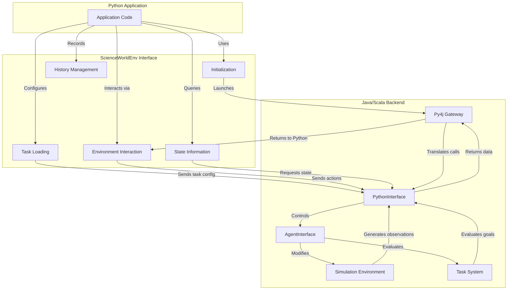
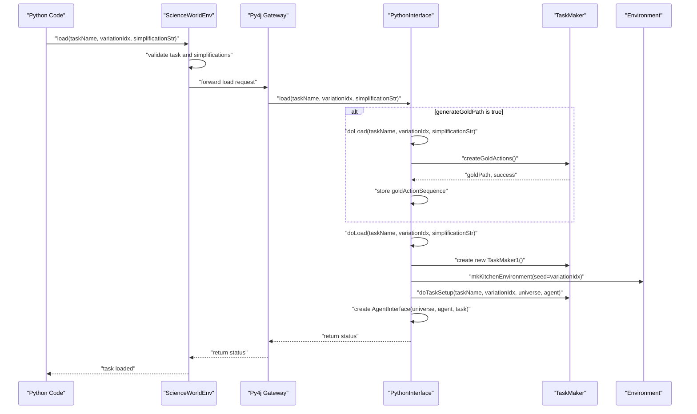
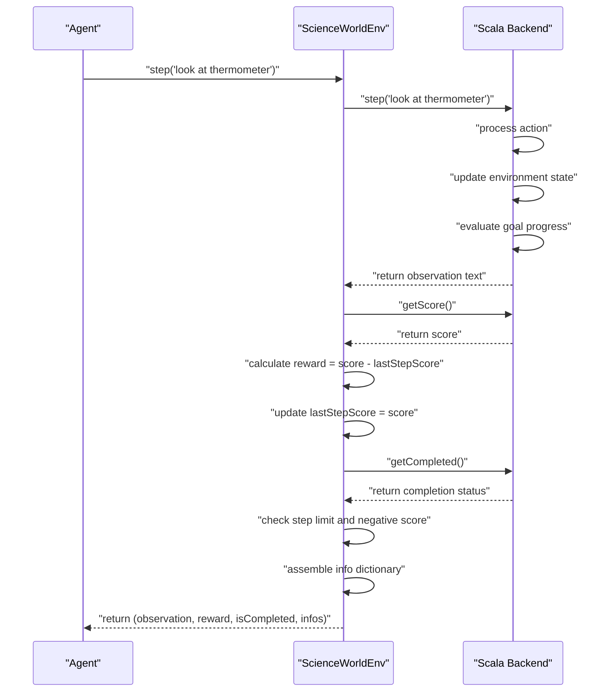
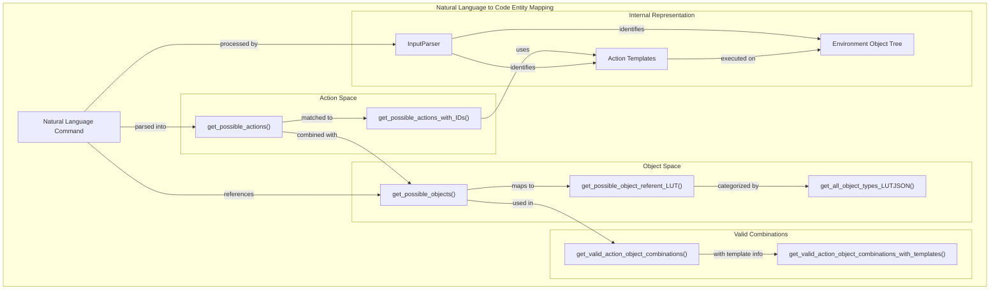

<!-- source: DeepWiki mcp.deepwiki.com · repo allenai/ScienceWorld · page 3.1 ScienceWorldEnv Class · fetched 2026-10-26 -->

# ScienceWorldEnv Class

<details>
<summary>Relevant source files</summary>

The following files were used as context for generating this wiki page:

- [scienceworld/__init__.py](scienceworld/__init__.py)
- [scienceworld/scienceworld.py](scienceworld/scienceworld.py)
- [simulator/src/main/scala/scienceworld/runtime/pythonapi/PythonInterface.scala](simulator/src/main/scala/scienceworld/runtime/pythonapi/PythonInterface.scala)
- [tests/test_scienceworld.py](tests/test_scienceworld.py)

</details>


The `ScienceWorldEnv` class is the primary Python interface to the ScienceWorld text-based simulation environment. This class serves as a bridge between Python applications and the Scala-based simulation engine, providing methods to load tasks, interact with the environment, and retrieve information about the simulation state. For information about how to interact with the environment through specific commands, see [Interacting with the Environment](#3.2).

## Overview

The `ScienceWorldEnv` class creates and manages a connection to a Java Virtual Machine (JVM) running the ScienceWorld simulation engine. It provides a comprehensive API for:

1. Loading and configuring scientific tasks and their variations
2. Executing actions in the environment
3. Retrieving observations, rewards, and state information
4. Exploring the action and object space
5. Managing run histories and gold action sequences



Sources: [scienceworld/scienceworld.py:17-83](), [simulator/src/main/scala/scienceworld/runtime/pythonapi/PythonInterface.scala:26-50]()

## Initialization and Setup

The `ScienceWorldEnv` class initializes a connection to the ScienceWorld simulation engine and sets up the environment.

### Constructor

```python
def __init__(self, taskName: str = None, serverPath: str = None, envStepLimit: int = 100)
```

- `taskName`: The name of the task to load (optional)
- `serverPath`: The path to the ScienceWorld JAR file (defaults to built-in JAR)
- `envStepLimit`: Maximum number of steps in the environment (defaults to 100)

The constructor performs the following operations:
1. Launches a JVM with the ScienceWorld JAR
2. Establishes a connection through py4j
3. Initializes the task if provided
4. Sets up run history tracking

### Loading Tasks

```python
def load(self, taskName: str, variationIdx: int = 0, simplificationStr: str = "", 
         generateGoldPath: bool = False) -> None
```

- `taskName`: The name of the task (will be processed by `infer_task` function)
- `variationIdx`: The specific variation to use (defaults to 0)
- `simplificationStr`: Comma-separated simplification string
- `generateGoldPath`: Whether to generate a gold (optimal) action sequence



Sources: [scienceworld/scienceworld.py:88-136](), [simulator/src/main/scala/scienceworld/runtime/pythonapi/PythonInterface.scala:54-95]()

### Resetting the Environment

```python
def reset(self) -> Tuple[str, Dict[str, Any]]
```

Resets the simulator back to the initial state and returns the initial observation and information.

### Closing the Connection

```python
def close(self) -> None
```

Shuts down the py4j gateway and terminates the JVM process.

Sources: [scienceworld/scienceworld.py:137-161]()

## Environment Interaction

The primary method for interacting with the environment is the `step` method, which takes an action string, executes it in the simulation, and returns the resulting observation, reward, completion status, and additional information.

### Step Method

```python
def step(self, input_str: str) -> Tuple[str, int, bool, Dict[str, Any]]
```

- `input_str`: The action to perform in the environment (natural language command)
- Returns: A tuple of (observation, reward, is_completed, info_dict)

The info dictionary contains:
- `moves`: Number of moves taken
- `score`: Current score (0-100)
- `reward`: Change in score from the last step
- `look`: Result of looking around
- `inv`: Inventory contents
- `taskDesc`: Task description
- `valid`: Valid action-object combinations
- `variationIdx`: Current variation index
- `taskName`: Current task name
- `simplificationStr`: Current simplification string



Sources: [scienceworld/scienceworld.py:410-452](), [simulator/src/main/scala/scienceworld/runtime/pythonapi/PythonInterface.scala:351-404]()

### Free Actions

The class provides "free" actions that don't consume a step:

```python
def look(self) -> str
def inventory(self) -> str
def taskdescription(self) -> str
```

These methods allow examining the current state without advancing the simulation.

Sources: [scienceworld/scienceworld.py:455-467](), [simulator/src/main/scala/scienceworld/runtime/pythonapi/PythonInterface.scala:406-438]()

## Action and Object Space

The `ScienceWorldEnv` class provides methods to explore the action and object space of the environment, which is useful for agents that need to understand what actions are possible.

### Action Methods

```python
def get_possible_actions(self) -> List[str]
def get_possible_actions_with_IDs(self) -> List[Dict[str, Any]]
def get_valid_action_object_combinations(self) -> List[str]
def get_valid_action_object_combinations_with_templates(self) -> List[Dict[str, Any]]
```

### Object Methods

```python
def get_possible_objects(self) -> List[str]
def get_possible_object_referent_LUT(self) -> Dict[str, str]
def get_possible_object_referent_types_LUT(self) -> Dict[str, Dict[str, str]]
def get_all_object_types_LUTJSON(self) -> Dict[str, str]
def get_all_object_ids_types_referents_LUTJSON(self) -> Dict[str, Dict[str, Any]]
```

### Vocabulary

```python
def get_vocabulary(self) -> Set[str]
```

Returns a set of all words that have meaning to the simulator, including action words and object references.



Sources: [scienceworld/scienceworld.py:198-281](), [simulator/src/main/scala/scienceworld/runtime/pythonapi/PythonInterface.scala:264-316]()

## Task and Simplification Management

The class provides methods to work with tasks and simplifications:

### Task Methods

```python
def get_task_names(self) -> List[str]
def get_max_variations(self, task_name) -> int
def get_task_description(self) -> str
```

### Simplification Methods

```python
def get_simplifications_used(self) -> str
def get_possible_simplifications(self) -> List[str]
```

Available simplifications include:
- `teleportAction`: Adds actions to teleport directly to any location
- `selfWateringFlowerPots`: Flower pots water themselves so plants won't die
- `openContainers`: Containers are open by default
- `openDoors`: Doors are open by default
- `noElectricalAction`: Removes "connect X to Y" actions to reduce action space
- `easy`: Uses all of the above simplifications

### Variation Set Management

```python
def get_variations_train(self) -> List[int]
def get_variations_dev(self) -> List[int]
def get_variations_test(self) -> List[int]
def get_random_variation_train(self) -> int
def get_random_variation_dev(self) -> int
def get_random_variation_test(self) -> int
```

These methods help manage the split of task variations into training, development, and testing sets.

Sources: [scienceworld/scienceworld.py:164-196](), [scienceworld/scienceworld.py:373-395](), [simulator/src/main/scala/scienceworld/runtime/pythonapi/PythonInterface.scala:155-238]()

## Run History Management

The `ScienceWorldEnv` class provides methods for recording, storing, and saving run histories, which can be useful for analyzing agent performance:

```python
def get_run_history(self) -> Dict[str, Any]
def store_run_history(self, episode_idx_key: int, notes: str) -> None
def save_run_histories(self, filename_out_prefix: str) -> None
def clear_run_histories(self) -> None
def save_run_histories_buffer_if_full(self, filename_out_prefix: str, max_per_file: int = 1000, force_save: bool = False) -> None
```

In addition, there's a separate `BufferedHistorySaver` class for advanced history management:

```python
class BufferedHistorySaver:
    def __init__(self, filenameOutPrefix)
    def storeRunHistory(self, runHistory, episodeIdxKey, notes)
    def saveRunHistories(self)
    def getRunHistorySize(self)
    def clearRunHistories(self)
    def saveRunHistoriesBufferIfFull(self, maxPerFile=1000, forceSave=False)
```

Sources: [scienceworld/scienceworld.py:303-370](), [scienceworld/scienceworld.py:655-709](), [simulator/src/main/scala/scienceworld/runtime/pythonapi/PythonInterface.scala:251-258]()

## Gold Action Sequences

The class supports generating and retrieving gold action sequences (optimal solution paths) for tasks:

```python
def get_gold_action_sequence(self) -> List[str]
```

To use gold action sequences, the `generateGoldPath` parameter must be set to `True` when loading a task.

Sources: [scienceworld/scienceworld.py:398-407](), [simulator/src/main/scala/scienceworld/runtime/pythonapi/PythonInterface.scala:244-246]()

## Method Reference Table

The following table provides a reference of all methods in the `ScienceWorldEnv` class, grouped by functionality:

| Category | Method | Description |
|----------|--------|-------------|
| **Initialization** | `__init__(taskName, serverPath, envStepLimit)` | Constructor |
| | `load(taskName, variationIdx, simplificationStr, generateGoldPath)` | Load a task |
| | `reset()` | Reset the environment |
| | `close()` | Close the connection |
| **Environment Interaction** | `step(input_str)` | Take an action |
| | `look()` | Look around (free action) |
| | `inventory()` | Check inventory (free action) |
| | `taskdescription()` | Get task description (free action) |
| | `get_goal_progress()` | Get progress towards goal |
| | `get_num_moves()` | Get number of moves taken |
| **Task Management** | `get_task_names()` | Get available tasks |
| | `get_max_variations(task_name)` | Get max variations for a task |
| | `get_task_description()` | Get current task description |
| | `get_simplifications_used()` | Get active simplifications |
| | `get_possible_simplifications()` | Get available simplifications |
| **Variation Sets** | `get_variations_train()` | Get training variations |
| | `get_variations_dev()` | Get development variations |
| | `get_variations_test()` | Get test variations |
| | `get_random_variation_train()` | Get random training variation |
| | `get_random_variation_dev()` | Get random development variation |
| | `get_random_variation_test()` | Get random test variation |
| **Action & Object Space** | `get_possible_actions()` | Get possible actions |
| | `get_possible_actions_with_IDs()` | Get actions with template IDs |
| | `get_possible_objects()` | Get observable objects |
| | `get_possible_object_referent_LUT()` | Get object-referent lookup table |
| | `get_possible_object_referent_types_LUT()` | Get type-based referent lookup table |
| | `get_valid_action_object_combinations()` | Get valid action-object combinations |
| | `get_valid_action_object_combinations_with_templates()` | Get valid combinations with templates |
| | `get_vocabulary()` | Get all words with meaning to the simulator |
| **Run History** | `get_run_history()` | Get run history |
| | `store_run_history(episode_idx_key, notes)` | Store run history |
| | `save_run_histories(filename_out_prefix)` | Save run histories to file |
| | `clear_run_histories()` | Clear run histories |
| | `save_run_histories_buffer_if_full(filename_out_prefix, max_per_file, force_save)` | Save histories if buffer is full |
| **Gold Action Sequences** | `get_gold_action_sequence()` | Get optimal action sequence |
| **Object Tree** | `getObjectTree()` | Get environment object tree as JSON |

Sources: [scienceworld/scienceworld.py:17-653]()

## Camel Case Legacy Methods

The class includes camel case versions of all methods for backward compatibility. These are deprecated and will show a warning when used. New code should use the snake_case versions.

```python
# Example of deprecated camel case methods
env.getPossibleActions()  # Deprecated, shows warning
env.get_possible_actions()  # Preferred snake_case version
```

Sources: [scienceworld/scienceworld.py:476-652]()

## Usage Example

Here's a basic example of using the `ScienceWorldEnv` class:

```python
from scienceworld import ScienceWorldEnv

# Create environment with task 1-1 (boiling task)
env = ScienceWorldEnv("1-1")

# Reset the environment
observation, info = env.reset()
print(observation)

# Take a step in the environment
observation, reward, done, info = env.step("look around")
print(observation)

# Get possible actions
actions = env.get_possible_actions()
print(actions[:5])  # Print first 5 actions

# Close the environment when done
env.close()
```

Sources: [tests/test_scienceworld.py:1-53]()

---

