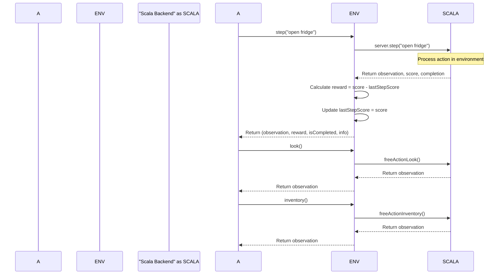
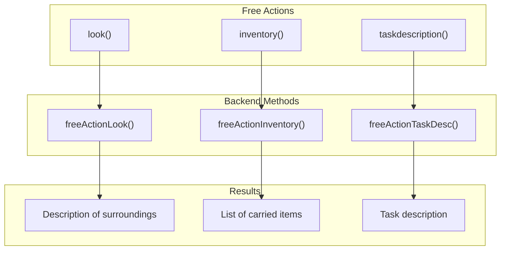
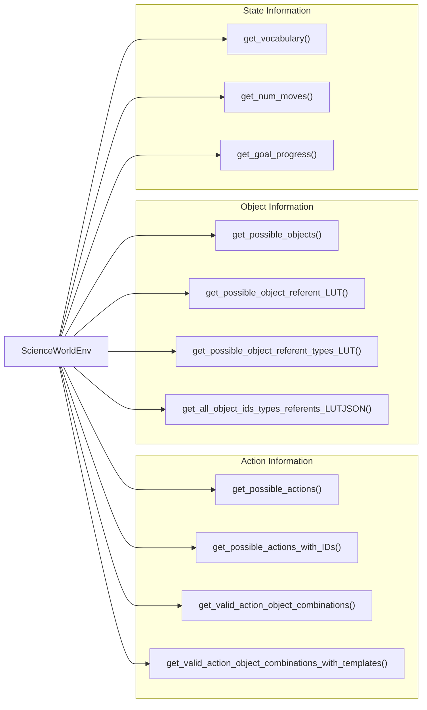

<!-- source: DeepWiki mcp.deepwiki.com · repo allenai/ScienceWorld · page 3.2 Interacting with the Environment · fetched 2026-10-26 -->

# Interacting with the Environment

<details>
<summary>Relevant source files</summary>

The following files were used as context for generating this wiki page:

- [examples/human.py](examples/human.py)
- [examples/random_agent.py](examples/random_agent.py)
- [scienceworld/scienceworld.py](scienceworld/scienceworld.py)
- [simulator/src/main/scala/scienceworld/runtime/pythonapi/PythonInterface.scala](simulator/src/main/scala/scienceworld/runtime/pythonapi/PythonInterface.scala)
- [tests/test_scienceworld.py](tests/test_scienceworld.py)

</details>


This page documents how agents interact with the ScienceWorld environment through the Python API. It explains the primary mechanisms for sending commands to the environment, receiving observations, and querying the environment state. For information about loading tasks and configuring the environment, see [Task Loading and Execution](#3.3).

## Interaction Model

ScienceWorld follows a standard reinforcement learning interaction loop where an agent sends actions to the environment and receives observations and rewards in return. The interaction cycle is facilitated primarily through the `step()` method of the `ScienceWorldEnv` class.



Sources: [scienceworld/scienceworld.py:410-452](), [simulator/src/main/scala/scienceworld/runtime/pythonapi/PythonInterface.scala:351-404]()

## The `step()` Method

The primary method for interacting with the environment is the `step()` method, which takes a natural language command as input and returns a tuple of (observation, reward, isCompleted, info).

### Parameters and Return Values

- **Input:** Natural language command string (e.g., "open fridge", "take apple")
- **Returns:**
  - `observation` (str): Text description of the result of the action
  - `reward` (int): Reward received for this step (change in score from previous step)
  - `isCompleted` (bool): Whether the task is completed or terminated
  - `info` (dict): Dictionary containing additional information:
    - `moves`: Number of moves taken
    - `score`: Current score (0-100)
    - `reward`: Same as the reward return value
    - `look`: Result of looking around
    - `inv`: Current inventory
    - `taskDesc`: Task description
    - `valid`: List of valid action-object combinations
    - `variationIdx`: Current variation index
    - `taskName`: Current task name
    - `simplificationStr`: Current simplifications

Sources: [scienceworld/scienceworld.py:410-452]()

### Example Usage

```python
# Take a step in the environment
observation, reward, is_completed, info = env.step("open fridge")

# Print the observation
print(observation)

# Check the score
print(f"Score: {info['score']}")

# Check if the task is completed
if is_completed:
    print("Task completed or terminated!")
```

Sources: [examples/human.py:114-121](), [examples/random_agent.py:66-72]()

## Special "Free" Actions

ScienceWorld provides several special actions that don't consume game time or count as moves. These are useful for gathering information about the current state without advancing the game state.



### Available Free Actions

| Method | Description | Example |
|--------|-------------|---------|
| `look()` | Returns a description of the agent's surroundings | `env.look()` |
| `inventory()` | Returns a list of items the agent is carrying | `env.inventory()` |
| `taskdescription()` | Returns the current task description | `env.taskdescription()` |

Sources: [scienceworld/scienceworld.py:455-468](), [simulator/src/main/scala/scienceworld/runtime/pythonapi/PythonInterface.scala:406-438]()

## Querying the Environment

ScienceWorld provides numerous methods to query the environment state, allowing agents to obtain information about possible actions, objects, and valid combinations.

### Common Query Methods



### Action Information Methods

These methods provide information about possible actions in the current environment state:

| Method | Description | Return Type |
|--------|-------------|-------------|
| `get_possible_actions()` | Get all action templates | List[str] |
| `get_possible_actions_with_IDs()` | Get action templates with IDs | List[Dict] |
| `get_valid_action_object_combinations()` | Get valid action-object combinations | List[str] |
| `get_valid_action_object_combinations_with_templates()` | Get valid actions with template info | List[Dict] |

Sources: [scienceworld/scienceworld.py:198-235]()

### Object Information Methods

These methods provide information about objects in the environment:

| Method | Description | Return Type |
|--------|-------------|-------------|
| `get_possible_objects()` | Get all observable objects | List[str] |
| `get_possible_object_referent_LUT()` | Get mapping of object IDs to referents | Dict[str, str] |
| `get_possible_object_referent_types_LUT()` | Get mapping of object type IDs to objects | Dict[str, Dict[str, str]] |
| `get_all_object_ids_types_referents_LUTJSON()` | Get detailed object information | Dict[str, Dict[str, Any]] |

Sources: [scienceworld/scienceworld.py:211-248]()

### Example: Getting Valid Actions

```python
# Get all valid action-object combinations
valid_actions = env.get_valid_action_object_combinations()
print("Valid actions:", valid_actions)

# Get detailed information about valid actions
valid_actions_with_templates = env.get_valid_action_object_combinations_with_templates()
for action_info in valid_actions_with_templates:
    print(f"Action: {action_info['action']}, Template ID: {action_info['template_id']}")
```

Sources: [examples/human.py:106-108](), [examples/random_agent.py:90-93]()

## Getting Environment State

Besides actions and objects, the environment provides methods to query its general state:

| Method | Description | Return Type |
|--------|-------------|-------------|
| `get_vocabulary()` | Get all meaningful words in the environment | Set[str] |
| `get_num_moves()` | Get current number of moves | int |
| `get_goal_progress()` | Get progress toward task goals | str |

Sources: [scienceworld/scienceworld.py:268-474]()

## Object Tree

ScienceWorld provides a method to get the complete object tree of the environment, which can be useful for debugging or visualization:

```python
# Get the complete object tree
obj_tree = env.getObjectTree()
```

This returns a JSON representation of all objects in the environment, their properties, and their hierarchical relationships.

Sources: [scienceworld/scienceworld.py:292-301](), [tests/test_scienceworld.py:134-138]()

## Complete Interaction Loop Example

Below is a complete example of an interaction loop with the ScienceWorld environment:

```python
# Initialize environment
env = ScienceWorldEnv("1-1")  # Load task 1-1 (boiling)

# Reset environment
observation, info = env.reset()
print("Initial observation:", observation)

# Game loop
done = False
while not done:
    # Get valid actions
    valid_actions = env.get_valid_action_object_combinations()
    
    # Choose an action (for example, the first valid action)
    action = valid_actions[0] if valid_actions else "look around"
    
    # Take a step in the environment
    observation, reward, done, info = env.step(action)
    
    # Print results
    print(f"\nAction: {action}")
    print(f"Observation: {observation}")
    print(f"Reward: {reward}")
    print(f"Score: {info['score']}")
    print(f"Moves: {info['moves']}")
    
    # Check inventory as a free action
    inventory = env.inventory()
    print(f"Inventory: {inventory}")
    
    # Check goal progress
    goal_progress = env.get_goal_progress()
    print(f"Goal progress: {goal_progress}")
    
    # Stop if task is completed or terminated
    if done:
        print("Task completed or terminated!")
```

This loop demonstrates the typical interaction pattern with the ScienceWorld environment:
1. Reset the environment to initialize it
2. Get valid actions
3. Choose an action
4. Take a step with the chosen action
5. Process the results
6. Check additional state information
7. Repeat until the task is completed or terminated

Sources: [examples/human.py:94-142](), [examples/random_agent.py:60-102]()

---

