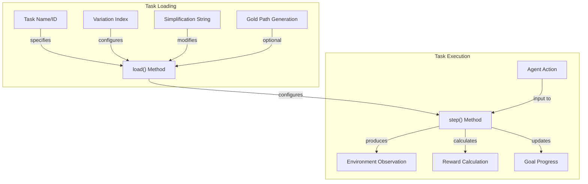
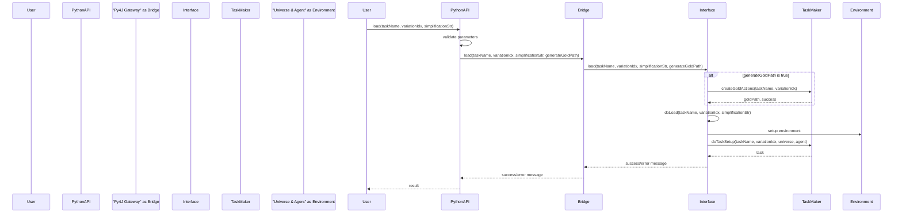
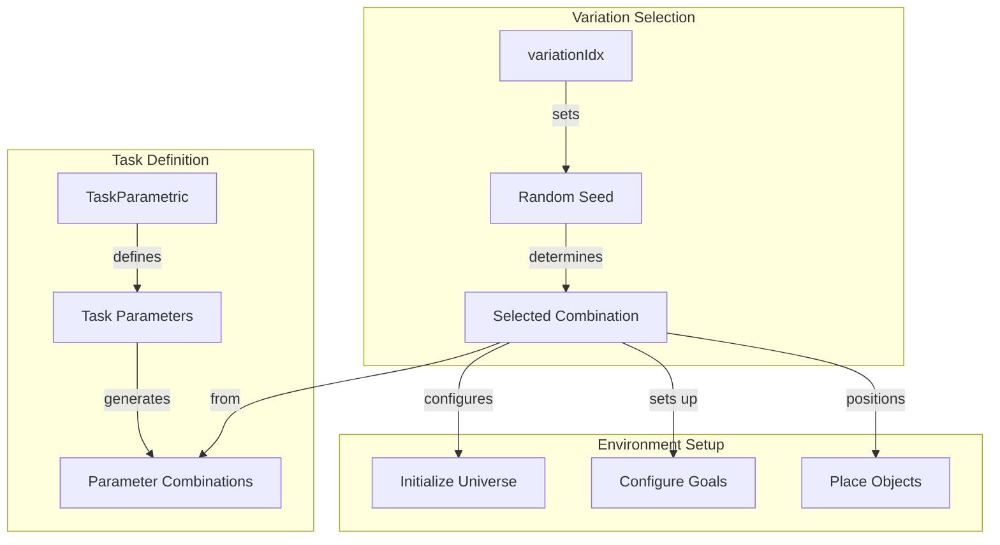
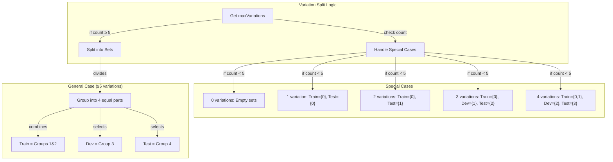
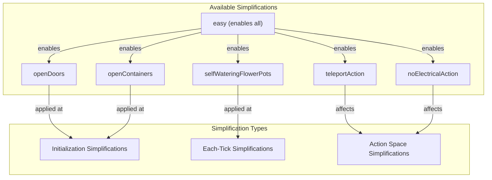
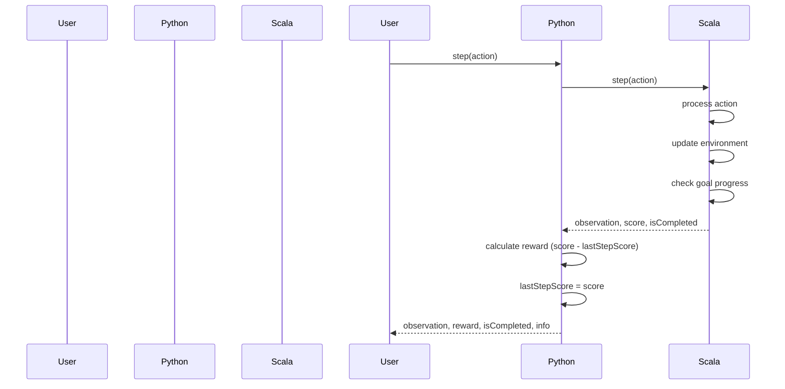
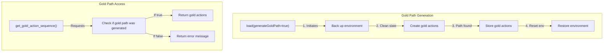

<!-- source: DeepWiki mcp.deepwiki.com · repo allenai/ScienceWorld · page 3.3 Task Loading and Execution · fetched 2026-10-26 -->

# Task Loading and Execution

<details>
<summary>Relevant source files</summary>

The following files were used as context for generating this wiki page:

- [scienceworld/constants.py](scienceworld/constants.py)
- [scienceworld/scienceworld.py](scienceworld/scienceworld.py)
- [scienceworld/tasks.json](scienceworld/tasks.json)
- [scienceworld/utils.py](scienceworld/utils.py)
- [simulator/src/main/scala/scienceworld/runtime/SimplifierProcessor.scala](simulator/src/main/scala/scienceworld/runtime/SimplifierProcessor.scala)
- [simulator/src/main/scala/scienceworld/runtime/pythonapi/PythonInterface.scala](simulator/src/main/scala/scienceworld/runtime/pythonapi/PythonInterface.scala)
- [simulator/src/main/scala/scienceworld/tasks/specifictasks/TaskElectricalConductivity.scala](simulator/src/main/scala/scienceworld/tasks/specifictasks/TaskElectricalConductivity.scala)
- [simulator/src/main/scala/scienceworld/tasks/specifictasks/TaskElectricalConductivity2.scala](simulator/src/main/scala/scienceworld/tasks/specifictasks/TaskElectricalConductivity2.scala)
- [tests/test_scienceworld.py](tests/test_scienceworld.py)

</details>


This page documents how to load tasks in ScienceWorld, configure task variations, apply simplifications, and execute tasks within the environment. For information about the overall task system architecture, see [Task System Architecture](#4.1).

## Overview

ScienceWorld provides a flexible system for loading and executing scientific tasks. The system allows you to:

1. Load specific tasks by name or ID
2. Select from multiple variations of each task
3. Apply simplifications to make tasks easier
4. Generate and access gold action sequences
5. Execute and monitor task progress



Sources: [scienceworld/scienceworld.py:88-136](), [scienceworld/scienceworld.py:410-452]()

## Task Loading

Tasks are loaded using the `load` method of the `ScienceWorldEnv` class. This method configures the environment for a specific task, variation, and set of simplifications.

### Basic Usage

```python
from scienceworld import ScienceWorldEnv

# Create environment
env = ScienceWorldEnv()

# Load a task
env.load(taskName="1-1",              # Task ID or name
         variationIdx=0,              # Variation index
         simplificationStr="",        # Comma-separated simplifications
         generateGoldPath=False)      # Whether to generate gold action sequence

# Reset the environment to start the task
observation, info = env.reset()
```

### Task Loading Flow

The following diagram illustrates the task loading process from Python to the Scala backend:



Sources: [scienceworld/scienceworld.py:88-136](), [simulator/src/main/scala/scienceworld/runtime/pythonapi/PythonInterface.scala:54-145]()

### Task Naming Conventions

Tasks can be specified in several ways:

1. **Task ID**: Short form like "1-1" or "3-2"
2. **Task name**: Descriptive form like "boil" or "test-conductivity" 
3. **Former task names**: Legacy names for backward compatibility

The `infer_task` function in `utils.py` handles conversion between these formats:

```python
# All these load the same task
env.load("1-1")                           # Task ID
env.load("boil")                          # Task name
env.load("task-1-boil")                   # Former task name
env.load("Matter Changes of State (Boiling)") # Topic and task description
```

Sources: [scienceworld/utils.py:7-22](), [scienceworld/constants.py:34-36]()

## Task Variations

Each task in ScienceWorld has multiple variations, which are different configurations of the same task. Variations can have different objects, locations, goals, or other parameters.

### Variation Selection

Variations are specified by an integer index from 0 to the maximum number of variations for a task:

```python
# Get the maximum number of variations for a task
max_variations = env.get_max_variations("1-1")

# Load a specific variation
env.load("1-1", variationIdx=3)
```

When a variation is selected, its index is used to seed the random number generator, ensuring deterministic environment generation for that variation.



Sources: [scienceworld/scienceworld.py:193-195](), [simulator/src/main/scala/scienceworld/runtime/pythonapi/PythonInterface.scala:114-118]()

### Train/Dev/Test Variation Sets

Variations are divided into train (50%), dev (25%), and test (25%) sets for structured evaluation:

```python
# Get variations for different sets
train_variations = env.get_variations_train()
dev_variations = env.get_variations_dev()
test_variations = env.get_variations_test()

# Get a random variation from a specific set
random_train_var = env.get_random_variation_train()
```

The split is handled in the Scala backend, with special cases for tasks with few variations:



Sources: [scienceworld/scienceworld.py:373-395](), [simulator/src/main/scala/scienceworld/runtime/pythonapi/PythonInterface.scala:171-226]()

## Task Simplifications

Simplifications make tasks easier by modifying the environment or action space. They can be applied individually or in combination.

### Available Simplifications

| Simplification | Description |
| --- | --- |
| `teleportAction` | Adds actions to teleport directly to any location |
| `selfWateringFlowerPots` | Flower pots will water themselves so plants won't die |
| `openContainers` | All containers are open by default |
| `openDoors` | All doors are open by default |
| `noElectricalAction` | Remove all `connect X to Y` actions to reduce action space |
| `easy` | Use all of the above simplifications |

```python
# Get possible simplifications
simplifications = env.get_possible_simplifications()

# Load a task with specific simplifications
env.load("1-1", simplificationStr="openDoors,openContainers")

# Use all simplifications
env.load("1-1", simplificationStr="easy")

# Get the currently used simplifications
current = env.get_simplifications_used()
```

### Simplification System

Simplifications are applied at different points in the system:



Sources: [scienceworld/scienceworld.py:164-177](), [simulator/src/main/scala/scienceworld/runtime/SimplifierProcessor.scala:102-214]()

## Task Execution

After loading a task, it can be executed using the `step` method, which processes agent actions and returns observations.

### Basic Execution Loop

```python
# Load and reset
env.load("1-1")
observation, info = env.reset()

# Execution loop
while True:
    action = "look around"  # Replace with actual action
    observation, reward, done, info = env.step(action)
    
    # Print observation
    print(observation)
    
    # Check if task is completed
    if done:
        break
```

### Task Execution Cycle

The following diagram illustrates the execution cycle:



The `step` method returns four values:

1. **observation**: Text description of the current state
2. **reward**: Numerical reward for the action (delta score)
3. **done**: Boolean indicating if the task is completed
4. **info**: Dictionary with additional information:
   - `moves`: Number of moves taken
   - `score`: Current score (0-100)
   - `reward`: Same as the reward return value
   - `look`: Result of looking around
   - `inv`: Inventory contents
   - `taskDesc`: Task description
   - `valid`: Valid action-object combinations
   - `variationIdx`: Current variation index
   - `taskName`: Current task name
   - `simplificationStr`: Current simplifications

Sources: [scienceworld/scienceworld.py:410-452](), [simulator/src/main/scala/scienceworld/runtime/pythonapi/PythonInterface.scala:351-404]()

### Task Progress Monitoring

ScienceWorld provides several methods to monitor task progress:

```python
# Get task description
task_desc = env.get_task_description()

# Get goal progress 
goal_progress = env.get_goal_progress()

# Free actions (don't count as steps)
look_result = env.look()
inventory = env.inventory()
task_desc = env.taskdescription()
```

Sources: [scienceworld/scienceworld.py:455-474](), [simulator/src/main/scala/scienceworld/runtime/pythonapi/PythonInterface.scala:406-438]()

## Gold Action Sequences

Gold action sequences are predefined sequences of actions that successfully complete a task. They serve as demonstrations and can be used for evaluation.

### Generating Gold Sequences

To generate a gold sequence, set `generateGoldPath=True` when loading:

```python
# Load a task and generate gold path
env.load("1-1", generateGoldPath=True)

# Get the gold action sequence
gold_actions = env.get_gold_action_sequence()
```

If you attempt to get a gold action sequence without generating it, an error message will be returned.

### Gold Sequence Generation Process



The gold sequence generation happens in the Scala backend, where the `TaskMaker` class determines the appropriate actions to complete the task based on the specific task and variation.

Sources: [scienceworld/scienceworld.py:398-407](), [simulator/src/main/scala/scienceworld/runtime/pythonapi/PythonInterface.scala:57-87](), [simulator/src/main/scala/scienceworld/tasks/specifictasks/TaskElectricalConductivity.scala:313-574]()

## Summary

Task loading and execution in ScienceWorld provides a flexible framework for configuring and running scientific challenges. Key components include:

1. **Task Loading**: Configure tasks with specific variations and simplifications
2. **Variations**: Select from multiple configurations of the same task
3. **Simplifications**: Apply modifications to make tasks easier
4. **Execution**: Interact with the environment through text commands
5. **Monitoring**: Track task progress and goal completion
6. **Gold Sequences**: Use predefined solution sequences

This system allows for systematic training and evaluation of agents on elementary science tasks with controlled difficulty and variety.

Sources: [scienceworld/scienceworld.py:17-86]()

---

