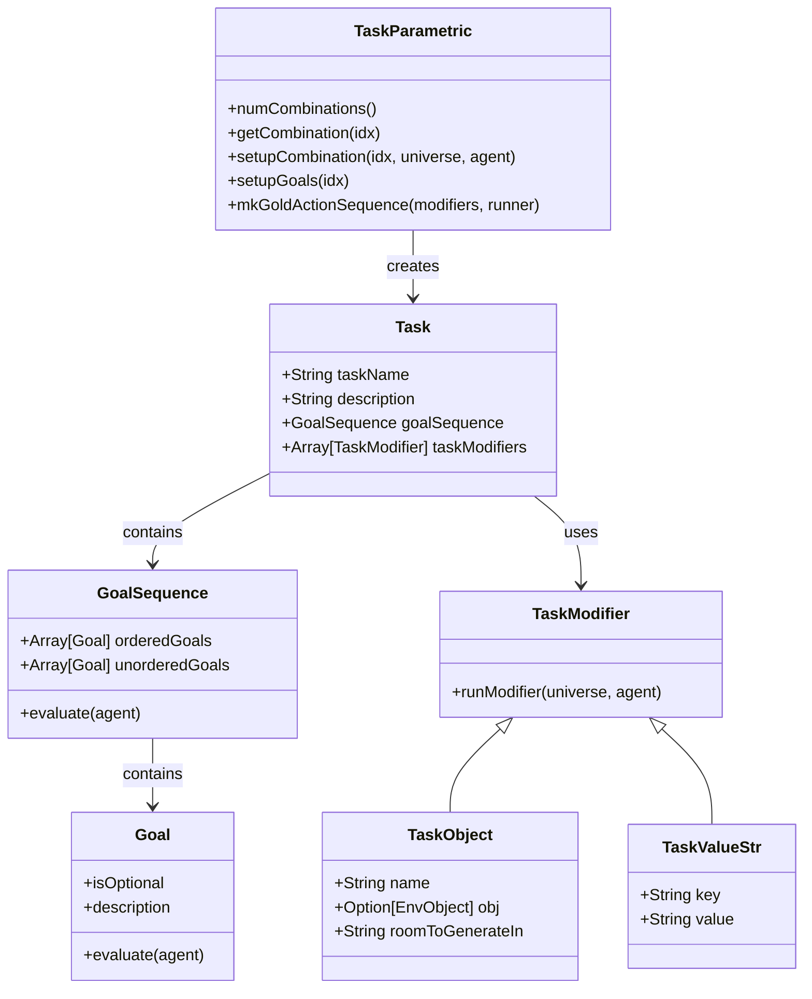
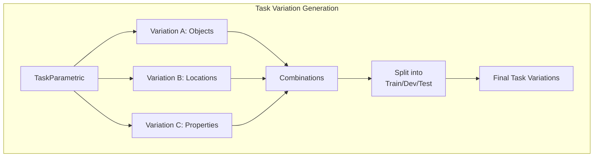
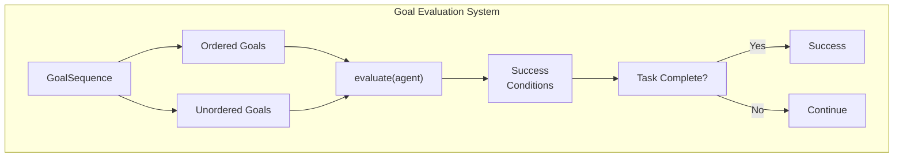
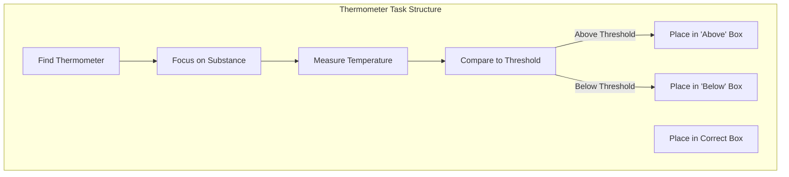
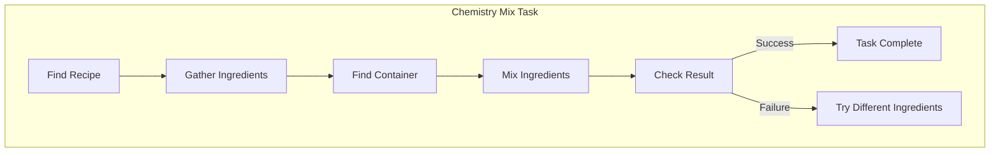
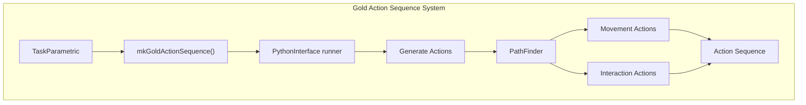
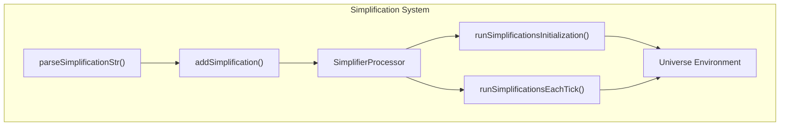
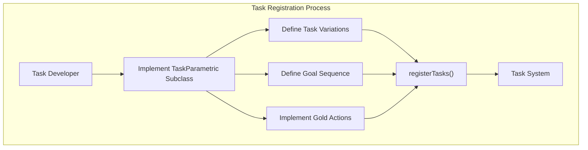

<!-- source: DeepWiki mcp.deepwiki.com · repo allenai/ScienceWorld · page 4 Tasks & Experiments · fetched 2026-10-26 -->

# Tasks & Experiments

Relevant source files

The following files were used as context for generating this wiki page:

- [scienceworld/utils.py](scienceworld/utils.py)
- [simulator/src/main/scala/scienceworld/objects/substance/food/Food.scala](simulator/src/main/scala/scienceworld/objects/substance/food/Food.scala)
- [simulator/src/main/scala/scienceworld/processes/Chemistry.scala](simulator/src/main/scala/scienceworld/processes/Chemistry.scala)
- [simulator/src/main/scala/scienceworld/runtime/SimplifierProcessor.scala](simulator/src/main/scala/scienceworld/runtime/SimplifierProcessor.scala)
- [simulator/src/main/scala/scienceworld/tasks/specifictasks/TaskChemistryMix.scala](simulator/src/main/scala/scienceworld/tasks/specifictasks/TaskChemistryMix.scala)
- [simulator/src/main/scala/scienceworld/tasks/specifictasks/TaskElectricalConductivity.scala](simulator/src/main/scala/scienceworld/tasks/specifictasks/TaskElectricalConductivity.scala)
- [simulator/src/main/scala/scienceworld/tasks/specifictasks/TaskElectricalConductivity2.scala](simulator/src/main/scala/scienceworld/tasks/specifictasks/TaskElectricalConductivity2.scala)
- [simulator/src/main/scala/scienceworld/tasks/specifictasks/TaskUseInstrumentThermometer.scala](simulator/src/main/scala/scienceworld/tasks/specifictasks/TaskUseInstrumentThermometer.scala)
- [simulator/src/main/scala/scienceworld/tasks/specifictasks/TaskUseInstrumentThermometer2.scala](simulator/src/main/scala/scienceworld/tasks/specifictasks/TaskUseInstrumentThermometer2.scala)
- [simulator/src/main/scala/scienceworld/tasks/specifictasks/TaskUseInstrumentThermometer3.scala](simulator/src/main/scala/scienceworld/tasks/specifictasks/TaskUseInstrumentThermometer3.scala)

## Purpose and Scope

This page documents the task system in ScienceWorld, explaining how tasks are defined, structured, executed, and evaluated. Tasks in ScienceWorld are experimental scenarios that agents must complete by following specific goals, simulating elementary science activities. This page covers the architecture of the task system, available tasks, gold action sequences, and the simplification system.

For information about how to load and execute tasks through the Python API, see [Task Loading and Execution](#3.3).

## Task System Architecture

The task system in ScienceWorld is built around the concept of parametric tasks with variations, goals, and gold action sequences. Tasks are designed to be flexible, allowing for different configurations and difficulty levels.

### Task Variations and Combinations

Tasks in ScienceWorld are defined parametrically, allowing for numerous variations of the same basic task. These variations are created by combining different task modifiers:

1. **TaskObject**: Places specific objects in the environment
2. **TaskValueStr/TaskValueBool/TaskValueDouble**: Stores configuration values for the task

The system creates combinations of these modifiers to produce different task variations. These combinations are typically split into training, development, and test sets.

Sources:
- [simulator/src/main/scala/scienceworld/tasks/specifictasks/TaskUseInstrumentThermometer.scala:33-145]()
- [simulator/src/main/scala/scienceworld/tasks/specifictasks/TaskChemistryMix.scala:30-116]()

### Goal System

Tasks define their success criteria through goals. Goals are organized into a GoalSequence, which contains:

1. **Ordered Goals**: Must be completed in sequence
2. **Unordered Goals**: Can be completed in any order, often optional

Goals evaluate the agent's progress and determine when a task is complete. Different goal types check for different conditions, such as:

- Finding specific objects
- Moving objects to specific locations
- Connecting electrical components
- Measuring properties

Sources:
- [simulator/src/main/scala/scienceworld/tasks/specifictasks/TaskUseInstrumentThermometer.scala:170-220]()
- [simulator/src/main/scala/scienceworld/tasks/specifictasks/TaskElectricalConductivity.scala:250-295]()

## Available Tasks

ScienceWorld includes a variety of tasks covering different areas of elementary science. These tasks are implemented as subclasses of `TaskParametric`.

### Task Categories

| Category | Description | Example Tasks |
|----------|-------------|---------------|
| Measurement | Using instruments to measure properties | Use thermometer, measure melting points |
| Electricity | Building and testing electrical circuits | Test conductivity, build simple circuits |
| Chemistry | Mixing substances and observing reactions | Mix chemicals, create solutions |
| Biology | Plant growth and animal life cycles | Grow plants, observe life cycles |
| Physics | Forces, motion, and energy | Test friction, build inclined planes |

### Example Task: Thermometer Measurement

The thermometer measurement task requires the agent to:
1. Find a thermometer
2. Measure the temperature of a substance
3. Determine if the substance's temperature is above/below a threshold
4. Place it in the correct answer box

Sources:
- [simulator/src/main/scala/scienceworld/tasks/specifictasks/TaskUseInstrumentThermometer.scala:168-220]()
- [simulator/src/main/scala/scienceworld/tasks/specifictasks/TaskUseInstrumentThermometer2.scala:224-297]()

### Example Task: Chemistry Mixing

The chemistry mixing task requires the agent to:
1. Find a recipe
2. Gather the required ingredients
3. Mix them in a container
4. Produce the target substance

Sources:
- [simulator/src/main/scala/scienceworld/tasks/specifictasks/TaskChemistryMix.scala:166-183]()
- [simulator/src/main/scala/scienceworld/processes/Chemistry.scala:62-440]()

## Gold Action Sequences

Gold action sequences are predefined optimal solutions for tasks. They serve as:
1. Demonstrations of how to solve a task
2. Evaluation benchmarks for agent performance
3. Testing tools for the task system

Each task implementation includes methods to generate gold action sequences for each task variation:

The gold action sequences typically follow these stages:
1. **Navigation**: Moving to relevant locations
2. **Collection**: Finding and picking up necessary objects
3. **Manipulation**: Using objects correctly
4. **Goal Completion**: Satisfying the task's success criteria

Sources:
- [simulator/src/main/scala/scienceworld/tasks/specifictasks/TaskUseInstrumentThermometer.scala:242-323]()
- [simulator/src/main/scala/scienceworld/tasks/specifictasks/TaskChemistryMix.scala:214-420]()
- [simulator/src/main/scala/scienceworld/tasks/specifictasks/TaskElectricalConductivity.scala:325-573]()

## Simplification System

The simplification system allows tasks to be made easier by applying various simplifications to the environment. These simplifications can remove complex aspects of tasks, making them more accessible for learning agents.

### Available Simplifications

| Simplification | Description | Effect |
|----------------|-------------|--------|
| `openDoors` | All doors are open by default | Eliminates need to open doors |
| `openContainers` | All containers are open by default | Eliminates need to open containers |
| `teleportAction` | Adds a teleport action | Simplifies navigation |
| `noElectricalAction` | Removes electrical actions | Reduces action space complexity |
| `selfWateringFlowerPots` | Flower pots are self-watering | Simplifies plant care tasks |

### Simplification Process

Simplifications can be applied at initialization time or during each tick:

Sources:
- [simulator/src/main/scala/scienceworld/runtime/SimplifierProcessor.scala:14-194]()
- [simulator/src/main/scala/scienceworld/runtime/SimplifierProcessor.scala:201-213]()

## Task Creation and Registration

To create new tasks, developers need to:
1. Create a subclass of `TaskParametric`
2. Define variations and combinations
3. Implement setup and goal methods
4. Create gold action sequences
5. Register the task with the task system

Sources:
- [simulator/src/main/scala/scienceworld/tasks/specifictasks/TaskUseInstrumentThermometer.scala:331-334]()
- [simulator/src/main/scala/scienceworld/tasks/specifictasks/TaskChemistryMix.scala:429-431]()
- [simulator/src/main/scala/scienceworld/tasks/specifictasks/TaskElectricalConductivity.scala:702-706]()

---

