<!-- source: DeepWiki mcp.deepwiki.com · repo allenai/ScienceWorld · page 4.1 Task System Architecture · fetched 2026-10-26 -->

# Task System Architecture

<details>
<summary>Relevant source files</summary>

The following files were used as context for generating this wiki page:

- [scienceworld/utils.py](scienceworld/utils.py)
- [simulator/src/main/scala/scienceworld/objects/substance/food/Food.scala](simulator/src/main/scala/scienceworld/objects/substance/food/Food.scala)
- [simulator/src/main/scala/scienceworld/processes/Chemistry.scala](simulator/src/main/scala/scienceworld/processes/Chemistry.scala)
- [simulator/src/main/scala/scienceworld/runtime/SimplifierProcessor.scala](simulator/src/main/scala/scienceworld/runtime/SimplifierProcessor.scala)
- [simulator/src/main/scala/scienceworld/tasks/specifictasks/TaskChemistryMix.scala](simulator/src/main/scala/scienceworld/tasks/specifictasks/TaskChemistryMix.scala)
- [simulator/src/main/scala/scienceworld/tasks/specifictasks/TaskElectricalConductivity.scala](simulator/src/main/scala/scienceworld/tasks/specifictasks/TaskElectricalConductivity.scala)
- [simulator/src/main/scala/scienceworld/tasks/specifictasks/TaskElectricalConductivity2.scala](simulator/src/main/scala/scienceworld/tasks/specifictasks/TaskElectricalConductivity2.scala)

</details>


This document describes the architecture of the task system in ScienceWorld, which is responsible for defining, creating, and evaluating scientific tasks that agents can perform in the simulated environment. The task system serves as the foundation for measuring an agent's scientific understanding and problem-solving abilities.

For information about the specific tasks available in ScienceWorld, see [Available Tasks](#4.2). For details on gold action sequences used for evaluation, see [Gold Action Sequences](#4.3).

## Task System Overview

The ScienceWorld task system provides a parameterized framework for creating diverse scientific challenges across multiple domains. Tasks are defined as goal-oriented problems that agents must solve by interacting with the environment.

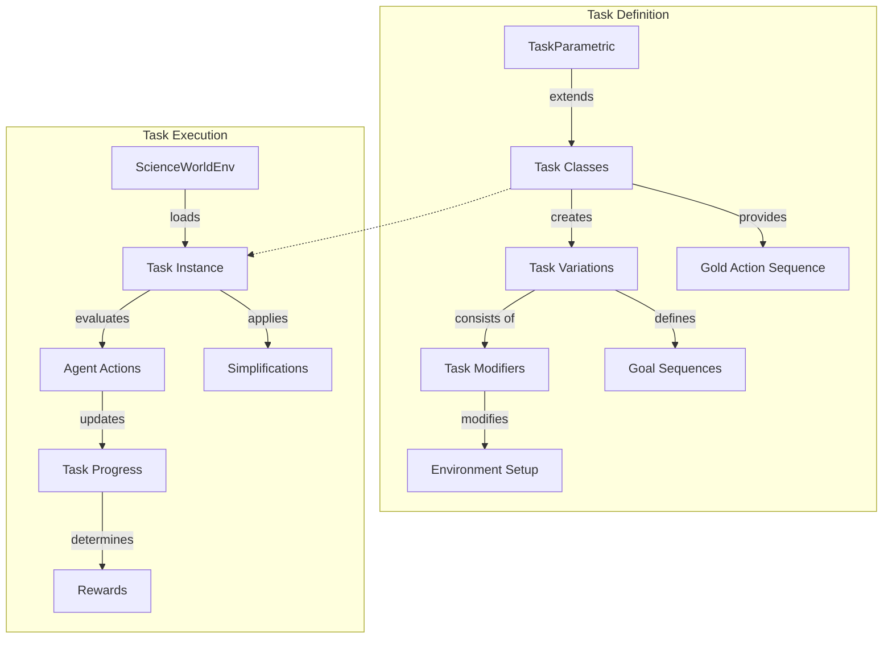

Sources: [simulator/src/main/scala/scienceworld/tasks/specifictasks/TaskChemistryMix.scala](), [simulator/src/main/scala/scienceworld/runtime/SimplifierProcessor.scala]()

## Task Class Hierarchy

Tasks in ScienceWorld are organized in a hierarchical structure that enables parameterization and variation generation.

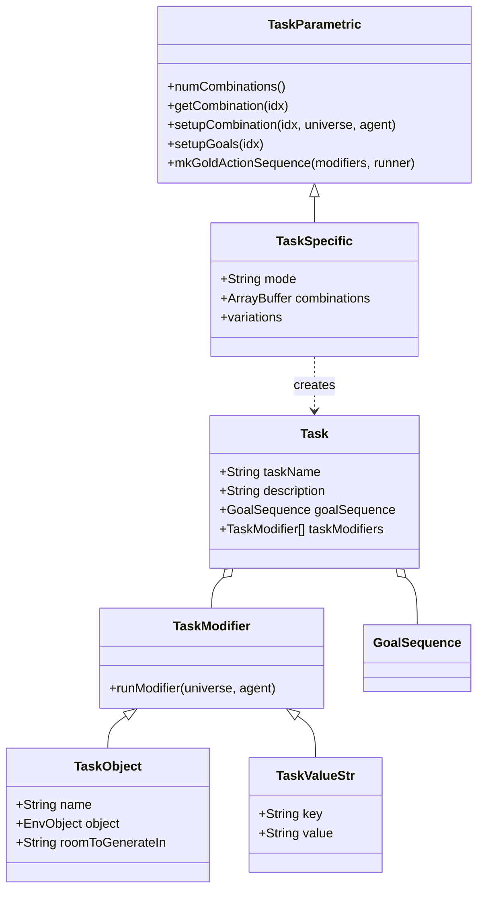

Sources: [simulator/src/main/scala/scienceworld/tasks/specifictasks/TaskChemistryMix.scala:25-423](), [simulator/src/main/scala/scienceworld/tasks/specifictasks/TaskElectricalConductivity.scala:26-696]()

## Task Definition Process

Tasks are defined through parameterized variations that allow for the generation of many task instances from a single task class. This process follows a consistent pattern across all task types.

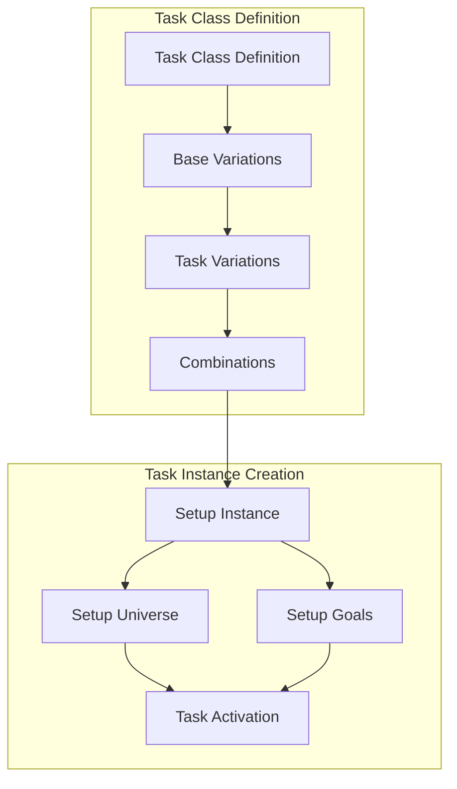

A typical task definition involves:

1. **Task Class Definition**: Create a class extending `TaskParametric` with a specific mode
2. **Base Variations**: Define base variations for different aspects of the task
3. **Task Variations**: Generate task modifiers for each variation
4. **Combinations**: Create combinations of variations to define unique task instances
5. **Instance Creation**: Set up the environment and goals for a specific task instance

Sources: [simulator/src/main/scala/scienceworld/tasks/specifictasks/TaskChemistryMix.scala:25-130]()

## Task Components

### Task Modifiers

Task modifiers are the building blocks used to configure task instances. They define how the environment should be set up for a specific task variation.

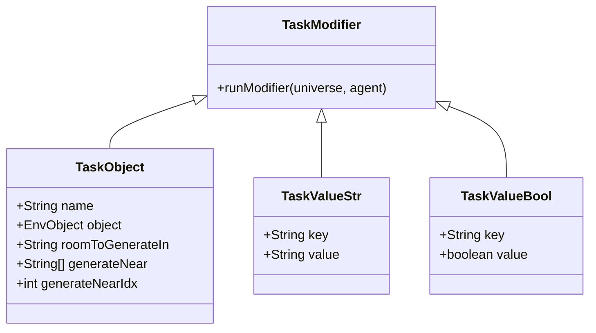

Common types of modifiers include:
- **TaskObject**: Places specific objects in the environment
- **TaskValueStr**: Stores string values associated with task parameters
- **TaskValueBool**: Stores boolean values for task conditions

Example from Chemistry Mix task:
```
val recipe = Recipe.mkRecipe(resultObject, thingsToMix = inputObjects.map(_.name))
out.append(new TaskObject(recipe.name, Some(recipe), roomToGenerateIn = generateLocation, Array.empty[String], generateNear = 0))
```

Sources: [simulator/src/main/scala/scienceworld/tasks/specifictasks/TaskChemistryMix.scala:432-455]()

### Goal Sequences

Goals define the success criteria for tasks. They are organized into sequences that must be completed in order, plus unordered goals that can be completed at any time.

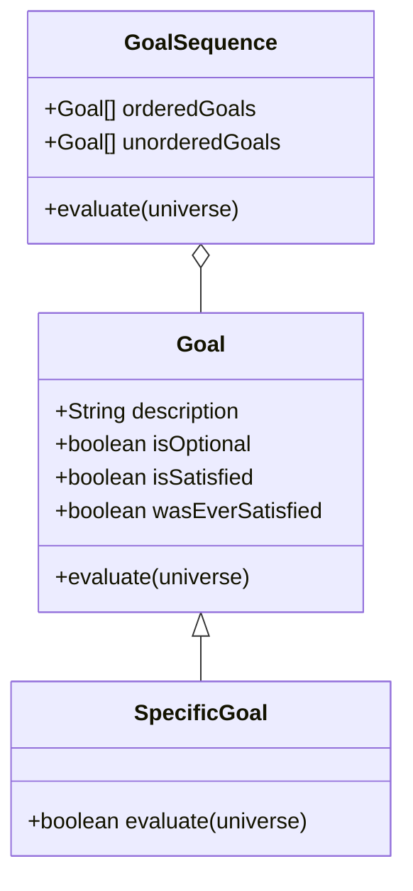

Common goal types include:
- **GoalFind**: Agent must focus on a specific object
- **GoalObjectInContainer**: Object must be placed in a specific container
- **GoalInRoomWithObject**: Agent must be in the same room as an object
- **GoalMoveToNewLocation**: Agent must move to a new location
- **GoalWireConnects**: Electrical connections must be made between components

Sources: [simulator/src/main/scala/scienceworld/tasks/specifictasks/TaskChemistryMix.scala:154-195](), [simulator/src/main/scala/scienceworld/tasks/specifictasks/TaskElectricalConductivity.scala:252-291]()

## Task Execution Flow

The task execution process involves:

1. **Task Loading**: Python layer loads a task variation
2. **Environment Initialization**: Task modifiers configure the environment
3. **Agent Interaction**: Agent performs actions in the environment
4. **Goal Evaluation**: Goals are checked after each action
5. **Reward Calculation**: Rewards are calculated based on goal completion

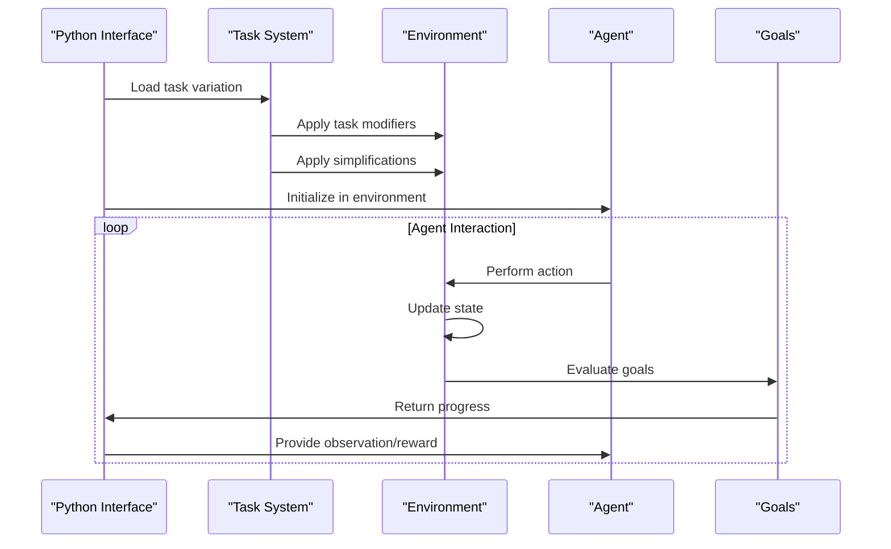

Sources: [simulator/src/main/scala/scienceworld/tasks/specifictasks/TaskChemistryMix.scala:142-149](), [scienceworld/utils.py:7-22]()

## Simplification System

The simplification system allows tasks to be made easier by reducing environment complexity. Simplifications can be enabled at initialization or applied on each tick.

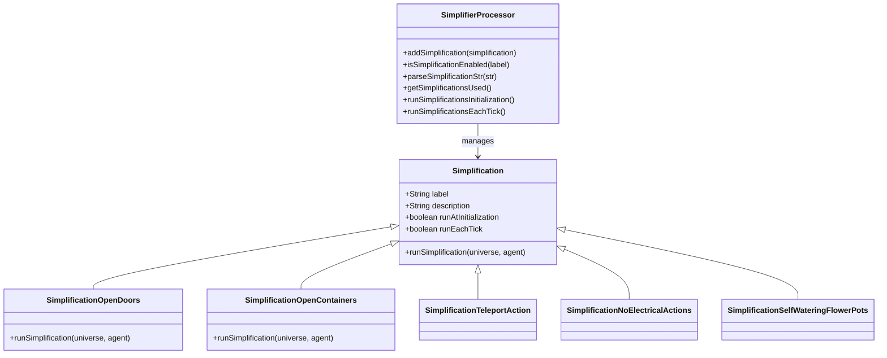

Available simplifications include:
- Opening all doors automatically
- Opening all containers
- Adding teleport actions to simplify navigation
- Removing electrical actions to reduce action space complexity
- Making flower pots self-watering for plant experiments

Sources: [simulator/src/main/scala/scienceworld/runtime/SimplifierProcessor.scala:14-213]()

## Gold Action Sequences

Gold action sequences represent optimal solutions to tasks, used for evaluation and demonstration. They are generated through task-specific methods that navigate the environment and perform required actions.

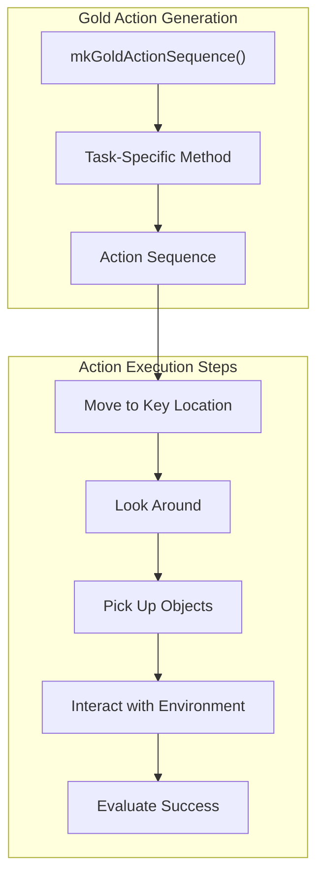

For example, the Chemistry Mix task gold sequence:
1. Moves to the kitchen to get a container
2. Moves to the specified location to find the recipe
3. Reads the recipe
4. Collects all required ingredients
5. Mixes the ingredients in the container
6. Focuses on the result

Sources: [simulator/src/main/scala/scienceworld/tasks/specifictasks/TaskChemistryMix.scala:202-419]()

## Chemistry Example: Task Creation Process

To illustrate the task system, let's examine how the Chemistry Mix task is defined:

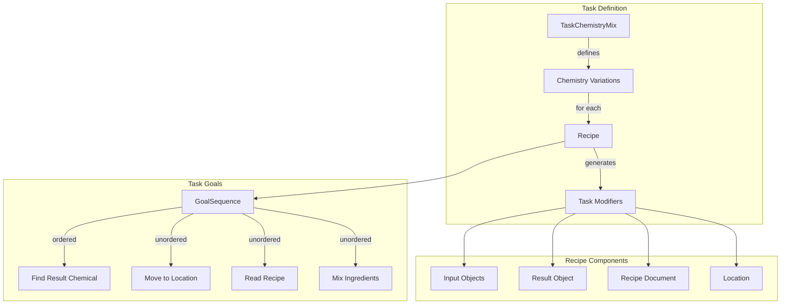

The Chemistry Mix task:
1. Defines recipes (e.g., salt + water = salt water)
2. Creates variations for each recipe
3. Generates task modifiers to place objects in the environment
4. Creates goal sequences for finding and mixing ingredients
5. Provides gold action sequences for evaluation

Sources: [simulator/src/main/scala/scienceworld/tasks/specifictasks/TaskChemistryMix.scala:34-107](), [simulator/src/main/scala/scienceworld/processes/Chemistry.scala:61-437]()

## Task Variation System

The task variation system creates different instances of the same fundamental task. This allows for:
- Different difficulty levels
- Train/dev/test splits
- Generalization testing

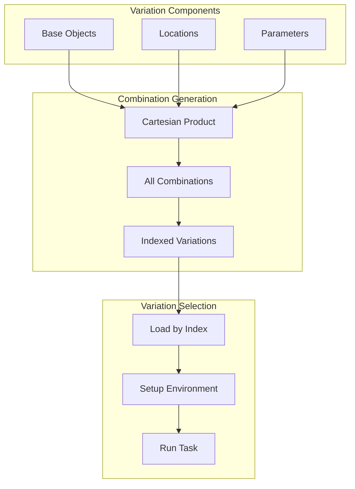

Example from the Electrical Conductivity task:
1. Defines variations for power sources
2. Defines variations for components to power
3. Defines variations for substances to test
4. Defines variations for answer boxes
5. Creates all combinations through cartesian product
6. Provides indexed access to specific variations

Sources: [simulator/src/main/scala/scienceworld/tasks/specifictasks/TaskElectricalConductivity.scala:34-204]()

## Task-Environment Integration

Tasks are tightly integrated with the environment system, allowing them to modify the environment state, evaluate agent progress, and provide feedback.

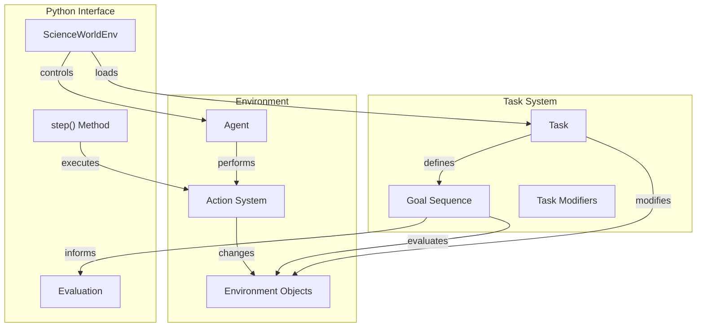

The integration process:
1. Python interface loads a task variation
2. Task modifiers set up the environment
3. Agent performs actions in the environment
4. Goal sequence evaluates progress after each action
5. Rewards and observations are returned to the agent

Sources: [scienceworld/utils.py:7-22](), [simulator/src/main/scala/scienceworld/tasks/specifictasks/TaskChemistryMix.scala:142-149]()

---

