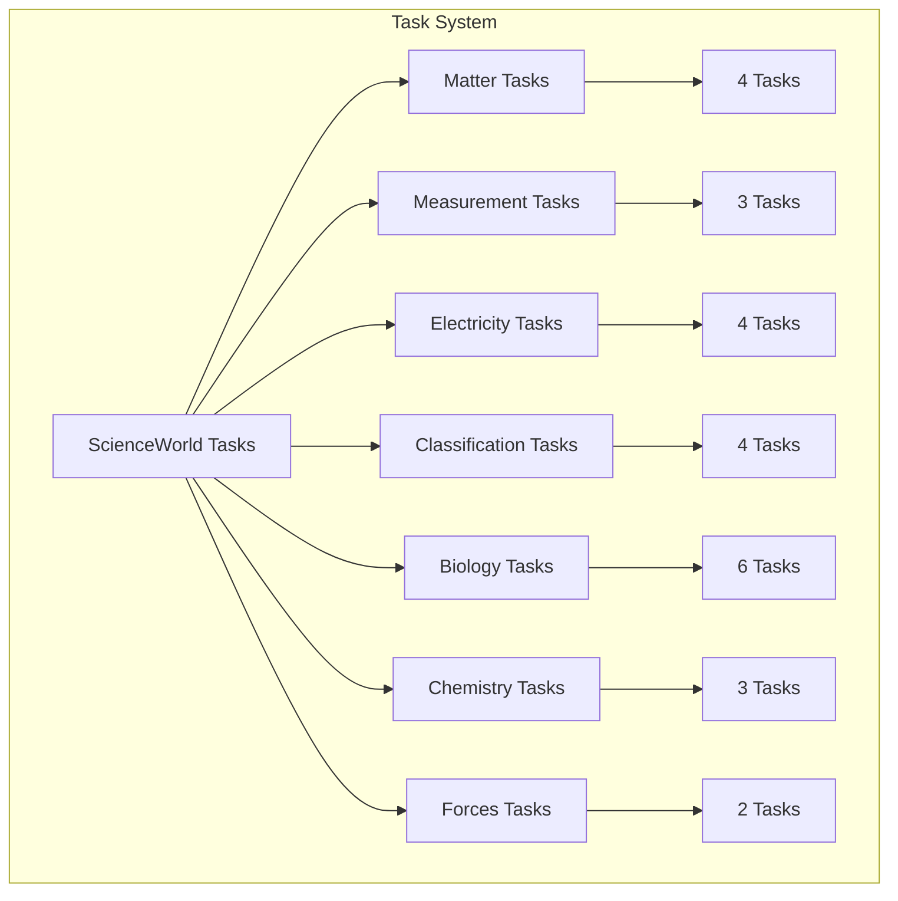
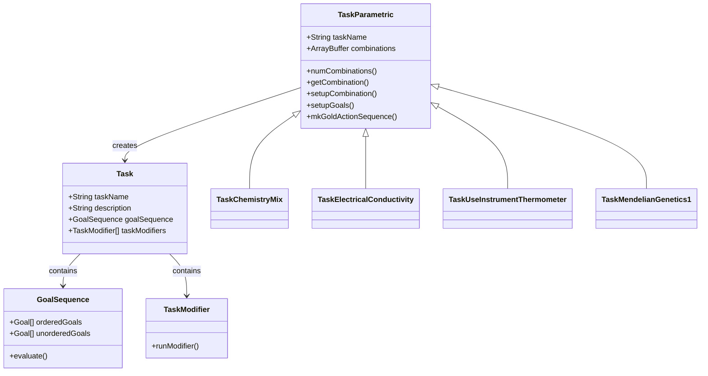
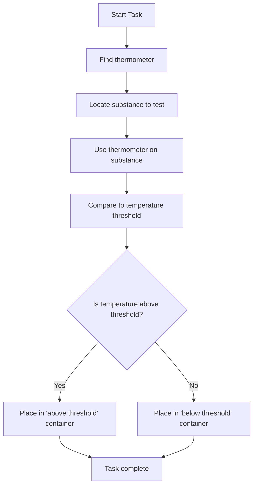
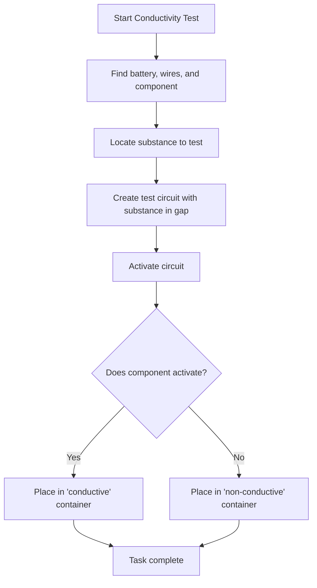
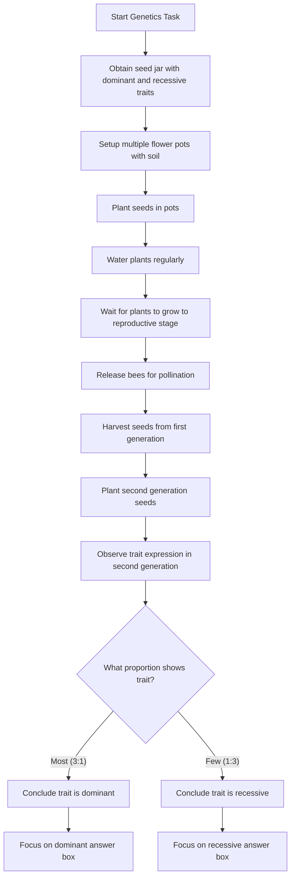
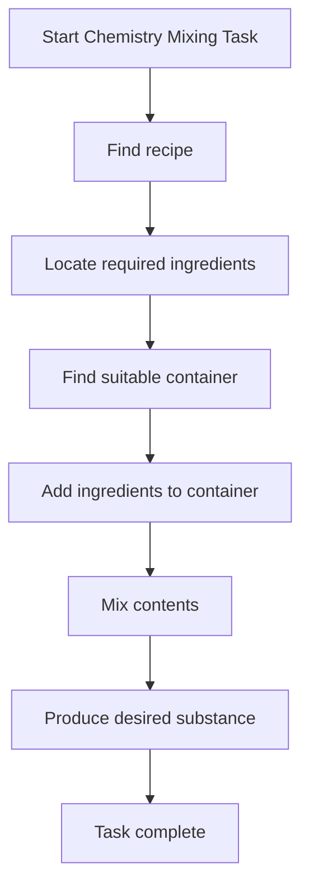
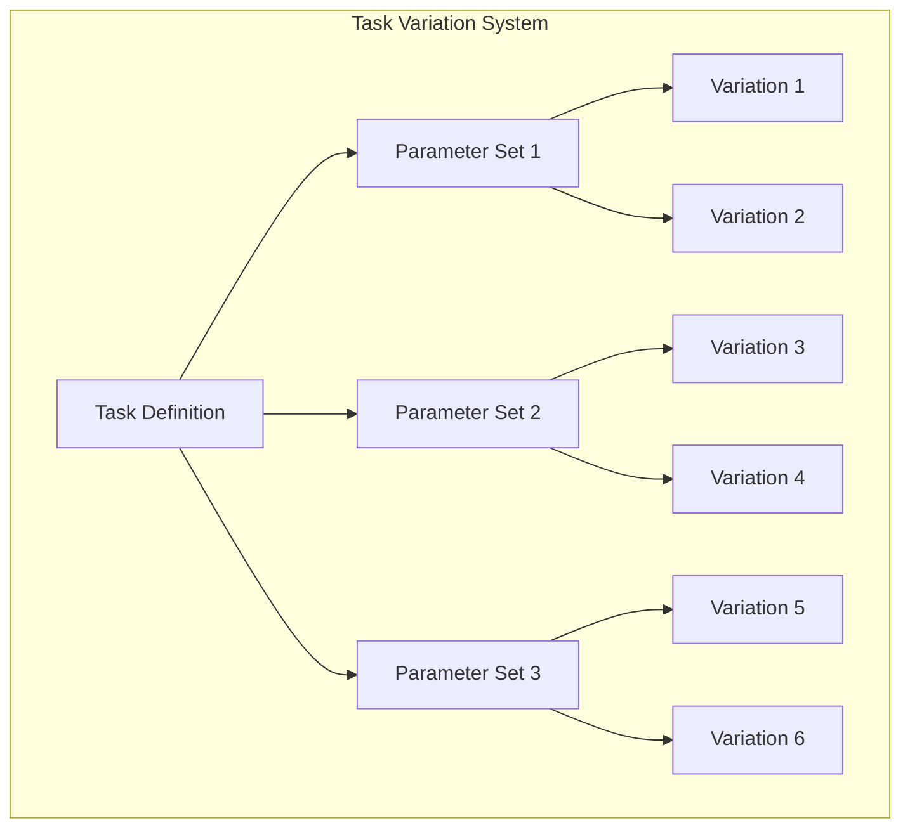

<!-- source: DeepWiki mcp.deepwiki.com · repo allenai/ScienceWorld · page 4.2 Available Tasks · fetched 2026-10-26 -->

# Available Tasks

<details>
<summary>Relevant source files</summary>

The following files were used as context for generating this wiki page:

- [scienceworld/constants.py](scienceworld/constants.py)
- [scienceworld/tasks.json](scienceworld/tasks.json)
- [scienceworld/utils.py](scienceworld/utils.py)
- [simulator/src/main/scala/scienceworld/objects/substance/food/Food.scala](simulator/src/main/scala/scienceworld/objects/substance/food/Food.scala)
- [simulator/src/main/scala/scienceworld/processes/Chemistry.scala](simulator/src/main/scala/scienceworld/processes/Chemistry.scala)
- [simulator/src/main/scala/scienceworld/runtime/SimplifierProcessor.scala](simulator/src/main/scala/scienceworld/runtime/SimplifierProcessor.scala)
- [simulator/src/main/scala/scienceworld/tasks/specifictasks/TaskChemistryMix.scala](simulator/src/main/scala/scienceworld/tasks/specifictasks/TaskChemistryMix.scala)
- [simulator/src/main/scala/scienceworld/tasks/specifictasks/TaskElectricalConductivity.scala](simulator/src/main/scala/scienceworld/tasks/specifictasks/TaskElectricalConductivity.scala)
- [simulator/src/main/scala/scienceworld/tasks/specifictasks/TaskElectricalConductivity2.scala](simulator/src/main/scala/scienceworld/tasks/specifictasks/TaskElectricalConductivity2.scala)
- [simulator/src/main/scala/scienceworld/tasks/specifictasks/TaskMendelianGenetics1.scala](simulator/src/main/scala/scienceworld/tasks/specifictasks/TaskMendelianGenetics1.scala)
- [simulator/src/main/scala/scienceworld/tasks/specifictasks/TaskUseInstrumentThermometer.scala](simulator/src/main/scala/scienceworld/tasks/specifictasks/TaskUseInstrumentThermometer.scala)
- [simulator/src/main/scala/scienceworld/tasks/specifictasks/TaskUseInstrumentThermometer2.scala](simulator/src/main/scala/scienceworld/tasks/specifictasks/TaskUseInstrumentThermometer2.scala)
- [simulator/src/main/scala/scienceworld/tasks/specifictasks/TaskUseInstrumentThermometer3.scala](simulator/src/main/scala/scienceworld/tasks/specifictasks/TaskUseInstrumentThermometer3.scala)

</details>


This page provides a comprehensive catalog of the pre-defined tasks available in the ScienceWorld environment. These tasks represent specific scientific challenges that agents can attempt to solve, covering various elementary science curricula topics. For information about how tasks are defined and executed, see [Task System Architecture](#4.1). For details on gold action sequences that demonstrate successful task completion, see [Gold Action Sequences](#4.3).

## Task Overview

ScienceWorld includes 26 unique tasks spread across 7 scientific domains. Each task is designed to test different scientific concepts and problem-solving skills. Tasks are parameterized, allowing for numerous variations with different objects, locations, and specific goals while maintaining the same underlying challenge.



Sources:
- [scienceworld/tasks.json:1-182]()
- [scienceworld/constants.py:1-37]()

## Task Categories and IDs

All available tasks are defined in the tasks.json file with unique identifiers, enabling precise task selection for training and evaluation.

### Matter (Changes of State)

| Task ID | Topic | Description | Implementation |
|---------|-------|-------------|----------------|
| 1-1 | Matter | Changes of State (Boiling) | Cause water or other liquids to boil |
| 1-2 | Matter | Changes of State (Melting) | Cause solids like ice or chocolate to melt |
| 1-3 | Matter | Changes of State (Freezing) | Cause liquids to freeze into solids |
| 1-4 | Matter | Changes of State (Any) | Change the state of matter of any substance |

Sources:
- [scienceworld/tasks.json:1-25]()

### Measurement

| Task ID | Topic | Description | Implementation |
|---------|-------|-------------|----------------|
| 2-1 | Measurement | Use Thermometer | Use a thermometer to measure object temperature |
| 2-2 | Measurement | Measuring Melting Point (known) | Determine if a substance's melting point is above/below threshold |
| 2-3 | Measurement | Measuring Melting Point (unknown) | Measure melting point of unknown substances |

Sources:
- [scienceworld/tasks.json:26-43]()
- [simulator/src/main/scala/scienceworld/tasks/specifictasks/TaskUseInstrumentThermometer.scala:1-345]()
- [simulator/src/main/scala/scienceworld/tasks/specifictasks/TaskUseInstrumentThermometer2.scala:1-507]()
- [simulator/src/main/scala/scienceworld/tasks/specifictasks/TaskUseInstrumentThermometer3.scala:1-513]()

### Electricity

| Task ID | Topic | Description | Implementation |
|---------|-------|-------------|----------------|
| 3-1 | Electricity | Create a circuit | Connect components to build a working circuit |
| 3-2 | Electricity | Renewable vs Non-renewable Energy | Create circuit with renewable energy source |
| 3-3 | Electricity | Test Conductivity (known) | Test if known materials conduct electricity |
| 3-4 | Electricity | Test Conductivity (unknown) | Test if unknown substances conduct electricity |

Sources:
- [scienceworld/tasks.json:44-67]()
- [simulator/src/main/scala/scienceworld/tasks/specifictasks/TaskElectricalConductivity.scala:1-592]()
- [simulator/src/main/scala/scienceworld/tasks/specifictasks/TaskElectricalConductivity2.scala:1-428]()

### Classification

| Task ID | Topic | Description | Implementation |
|---------|-------|-------------|----------------|
| 4-1 | Classification | Find a living thing | Identify and focus on any living organism |
| 4-2 | Classification | Find a non-living thing | Identify and focus on any non-living object |
| 4-3 | Classification | Find a plant | Identify and focus on any plant |
| 4-4 | Classification | Find an animal | Identify and focus on any animal |

Sources:
- [scienceworld/tasks.json:68-91]()

### Biology

| Task ID | Topic | Description | Implementation |
|---------|-------|-------------|----------------|
| 5-1 | Biology | Grow a plant | Successfully grow a plant to adult stage |
| 5-2 | Biology | Grow a fruit | Grow plant that produces fruit |
| 7-1 | Biology | Identify longest-lived animal | Find animal with longest lifespan |
| 7-2 | Biology | Identify shortest-lived animal | Find animal with shortest lifespan |
| 7-3 | Biology | Identify longest-then-shortest-lived | Sequence of longest then shortest lifespan |
| 8-1 | Biology | Identify life stages (plant) | Identify different life stages of plants |
| 8-2 | Biology | Identify life stages (animal) | Identify different life stages of animals |
| 10-1 | Biology | Mendelian Genetics (known plants) | Determine if trait is dominant/recessive |
| 10-2 | Biology | Mendelian Genetics (unknown plants) | Genetics with unknown plant species |

Sources:
- [scienceworld/tasks.json:92-105]()
- [scienceworld/tasks.json:122-153]()
- [scienceworld/tasks.json:171-181]()
- [simulator/src/main/scala/scienceworld/tasks/specifictasks/TaskMendelianGenetics1.scala:1-657]()

### Chemistry

| Task ID | Topic | Description | Implementation |
|---------|-------|-------------|----------------|
| 6-1 | Chemistry | Mixing (generic) | Create specific substances by mixing ingredients |
| 6-2 | Chemistry | Mixing paints (secondary colours) | Mix primary colors to create secondary colors |
| 6-3 | Chemistry | Mixing paints (tertiary colours) | Create tertiary colors through mixing |

Sources:
- [scienceworld/tasks.json:106-121]()
- [simulator/src/main/scala/scienceworld/tasks/specifictasks/TaskChemistryMix.scala:1-423]()
- [simulator/src/main/scala/scienceworld/processes/Chemistry.scala:1-442]()

### Forces

| Task ID | Topic | Description | Implementation |
|---------|-------|-------------|----------------|
| 9-1 | Forces | Inclined Planes (determine angle) | Find angle that causes object to slide |
| 9-2 | Forces | Friction (known surfaces) | Test friction with known materials |
| 9-3 | Forces | Friction (unknown surfaces) | Test friction with unknown materials |

Sources:
- [scienceworld/tasks.json:154-170]()

## Task Structure and Implementation

Each task in ScienceWorld follows a parametric design pattern, allowing for multiple variations with different objects, locations, and specific requirements. The task system creates combinatorial variations to generate a large number of unique scenarios.



Sources:
- [simulator/src/main/scala/scienceworld/tasks/specifictasks/TaskMendelianGenetics1.scala:29-598]()
- [simulator/src/main/scala/scienceworld/tasks/specifictasks/TaskChemistryMix.scala:25-422]()
- [simulator/src/main/scala/scienceworld/tasks/specifictasks/TaskUseInstrumentThermometer.scala:28-326]()

## Detailed Task Descriptions

### Matter Tasks

These tasks involve changing the state of matter of various substances through heating, cooling, or other processes.

**Boiling Task (1-1)**: The agent must cause water or another liquid to boil by using heating implements like a stove or fire. Success requires the liquid to transition from liquid to gas state.

**Melting Task (1-2)**: The agent must cause a solid (like ice, chocolate, or metal) to melt by heating it above its melting point. Success requires the substance to transition from solid to liquid state.

**Freezing Task (1-3)**: The agent must cause a liquid to freeze into a solid by using cooling implements like a freezer. Success requires the liquid to transition to solid state.

**General State Change Task (1-4)**: The agent must change the state of matter of any given substance, which could be solid-to-liquid, liquid-to-gas, or vice-versa.

### Measurement Tasks

These tasks involve using measurement tools to determine physical properties of substances.

**Thermometer Task (2-1)**: The agent must use a thermometer to measure the temperature of a specific object, then place the object in the correct container based on whether its temperature is above or below a certain threshold.



Sources:
- [simulator/src/main/scala/scienceworld/tasks/specifictasks/TaskUseInstrumentThermometer.scala:184-208]()
- [simulator/src/main/scala/scienceworld/tasks/specifictasks/TaskUseInstrumentThermometer.scala:242-323]()

**Measuring Melting Point Tasks (2-2, 2-3)**: These tasks require the agent to determine whether a substance's melting point is above or below a given threshold. The substance can be either known (2-2) or unknown (2-3). The agent must:
1. Find the substance and a thermometer
2. Heat the substance (if solid) or cool it (if liquid) until it changes state
3. Measure the temperature at the phase transition point
4. Determine if this melting/freezing point is above or below the given threshold

Sources:
- [simulator/src/main/scala/scienceworld/tasks/specifictasks/TaskUseInstrumentThermometer2.scala:184-289]()
- [simulator/src/main/scala/scienceworld/tasks/specifictasks/TaskUseInstrumentThermometer3.scala:171-237]()
- [simulator/src/main/scala/scienceworld/tasks/specifictasks/TaskUseInstrumentThermometer3.scala:268-464]()

### Electricity Tasks

These tasks focus on electrical circuits and properties of materials related to electricity.

**Circuit Creation Task (3-1)**: The agent must create a working electrical circuit by connecting a power source (like a battery) to a component (like a light bulb) using wires. Success requires the component to be activated.

**Renewable Energy Task (3-2)**: Similar to the basic circuit task, but specifically requires using a renewable energy source (like a solar panel or wind generator) instead of a battery.

**Electrical Conductivity Tasks (3-3, 3-4)**: These tasks require the agent to test whether a material conducts electricity. In task 3-3, the materials are known substances, while in 3-4, they are unknown. The agent must:
1. Create a circuit with a gap
2. Place the test material in the gap
3. Determine if the circuit activates (indicating conductivity)
4. Place the material in the appropriate container based on its conductivity



Sources:
- [simulator/src/main/scala/scienceworld/tasks/specifictasks/TaskElectricalConductivity.scala:252-292]()
- [simulator/src/main/scala/scienceworld/tasks/specifictasks/TaskElectricalConductivity.scala:325-415]()
- [simulator/src/main/scala/scienceworld/tasks/specifictasks/TaskElectricalConductivity2.scala:154-195]()

### Classification Tasks

These tasks focus on identifying and classifying objects based on their properties.

**Find Living/Non-living Tasks (4-1, 4-2)**: The agent must identify and focus on either a living thing (4-1) or a non-living thing (4-2) within the environment.

**Find Plant/Animal Tasks (4-3, 4-4)**: The agent must identify and focus on either a plant (4-3) or an animal (4-4) within the environment.

### Biology Tasks

These tasks involve understanding biological concepts, life cycles, and genetics.

**Plant Growth Tasks (5-1, 5-2)**: The agent must successfully grow a plant from seed to adult stage (5-1) or to the point of producing fruit (5-2). This requires:
1. Obtaining soil, seeds, and a container
2. Planting the seeds in soil
3. Watering the plant regularly
4. Waiting for the plant to grow through various life stages

**Lifespan Tasks (7-1, 7-2, 7-3)**: These tasks involve identifying animals based on their lifespans. The agent must find the animal with the longest lifespan (7-1), shortest lifespan (7-2), or both in sequence (7-3).

**Life Stages Tasks (8-1, 8-2)**: The agent must identify different life stages of either plants (8-1) or animals (8-2).

**Mendelian Genetics Tasks (10-1, 10-2)**: These complex tasks require the agent to determine whether a trait is dominant or recessive by growing plants and observing inheritance patterns.



Sources:
- [simulator/src/main/scala/scienceworld/tasks/specifictasks/TaskMendelianGenetics1.scala:170-232]()
- [simulator/src/main/scala/scienceworld/tasks/specifictasks/TaskMendelianGenetics1.scala:264-596]()

### Chemistry Tasks

These tasks involve chemical reactions and mixtures.

**Mixing Task (6-1)**: The agent must create a specific substance by mixing the correct ingredients. Different combinations yield different results, requiring the agent to:
1. Find the necessary ingredients
2. Combine them in a container
3. Mix them to create the target substance



Sources:
- [simulator/src/main/scala/scienceworld/tasks/specifictasks/TaskChemistryMix.scala:164-181]()
- [simulator/src/main/scala/scienceworld/tasks/specifictasks/TaskChemistryMix.scala:214-418]()
- [simulator/src/main/scala/scienceworld/processes/Chemistry.scala:62-440]()

**Color Mixing Tasks (6-2, 6-3)**: These tasks specifically involve mixing paints to create either secondary colors (by mixing primary colors) or tertiary colors (by mixing primary and secondary colors).

Sources:
- [simulator/src/main/scala/scienceworld/processes/Chemistry.scala:292-362]()

### Forces Tasks

These tasks focus on physics concepts like inclined planes and friction.

**Inclined Plane Task (9-1)**: The agent must determine the minimum angle at which an object will slide down an inclined plane.

**Friction Tasks (9-2, 9-3)**: The agent must test friction properties of different surfaces, either known materials (9-2) or unknown materials (9-3), by seeing which angle causes objects to slide.

## Task Variation and Parameterization

Each task class in ScienceWorld can generate numerous variations through combinatorial parameter selection. For example, the Chemistry Mixing task (`TaskChemistryMix`) can create variations with different:

- Input chemicals (salt, water, soap, flour, etc.)
- Desired output chemicals (salt water, soapy water, dough, etc.)
- Locations where materials are found
- Container types for mixing



Sources:
- [simulator/src/main/scala/scienceworld/tasks/specifictasks/TaskChemistryMix.scala:30-114]()
- [simulator/src/main/scala/scienceworld/tasks/specifictasks/TaskUseInstrumentThermometer.scala:34-136]()
- [simulator/src/main/scala/scienceworld/tasks/specifictasks/TaskMendelianGenetics1.scala:35-102]()

## Task Simplifications

ScienceWorld includes a simplification system that can reduce task complexity. Available simplifications include:

| Simplification ID | Description | Effect |
|-------------------|-------------|--------|
| openDoors | Open doors by default | All doors in environment start open |
| openContainers | Open containers by default | All containers start open |
| teleportAction | Add teleport action | Enables teleporting between locations |
| noElectricalAction | Remove electrical actions | Simplifies action space by removing electrical actions |
| selfWateringFlowerPots | Self-watering pots | Flower pots water plants automatically |

Sources:
- [simulator/src/main/scala/scienceworld/runtime/SimplifierProcessor.scala:24-213]()

## Integration with Python API

Tasks can be loaded and executed through the Python API using the task ID or name. The `infer_task` function in the utilities handles normalization of task names.

```python
# Example of loading a task by ID or name
task_id = "1-1"  # Boiling task
task_name = "boil"  # Alternative way to specify the same task
```

Sources:
- [scienceworld/utils.py:7-22]()
- [scienceworld/constants.py:31-36]()

---

