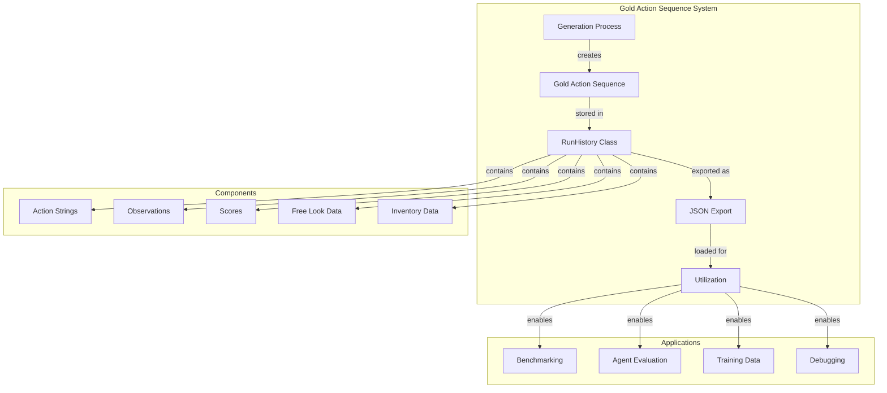
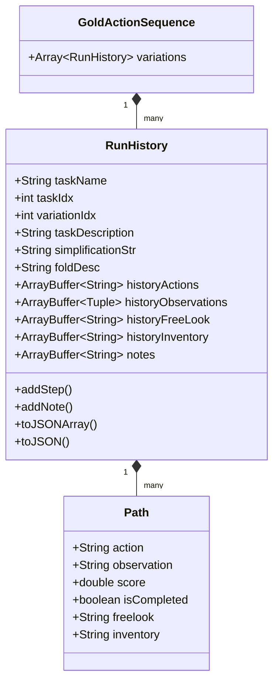
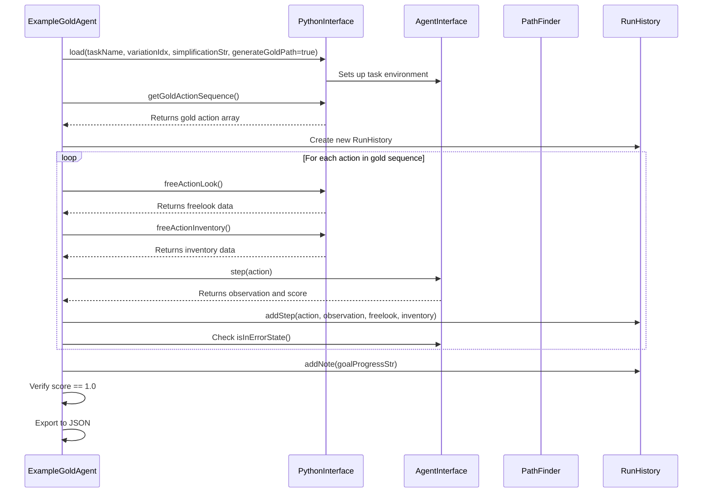
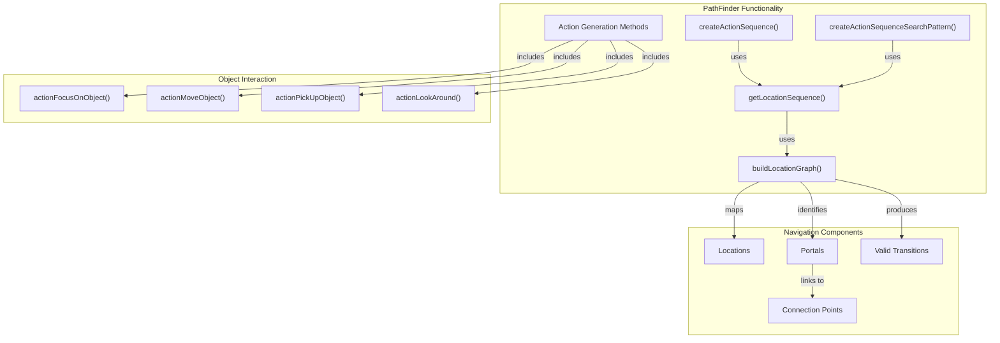
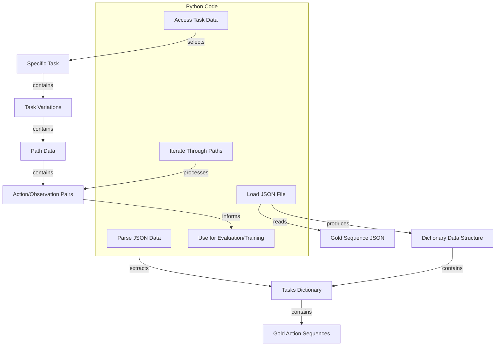
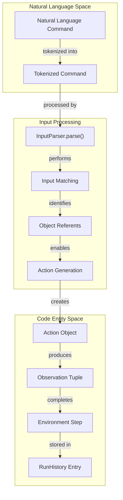
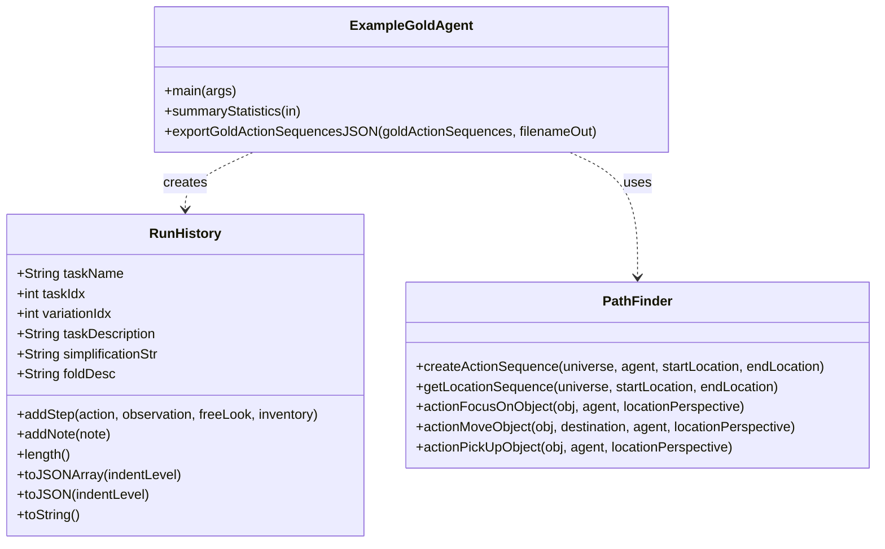
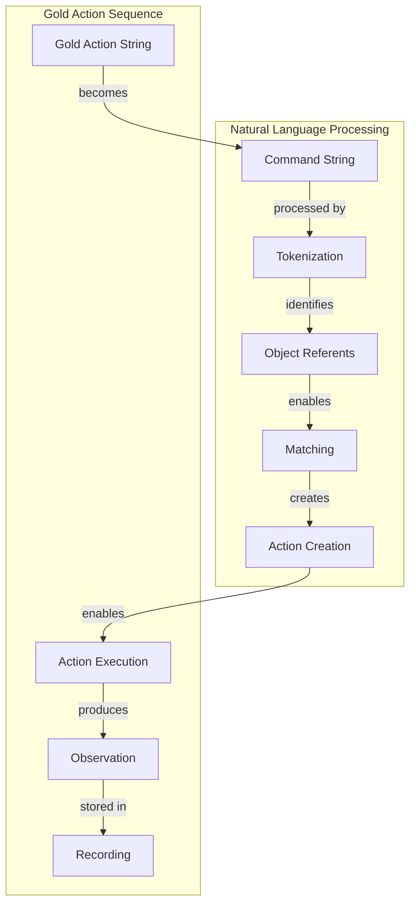
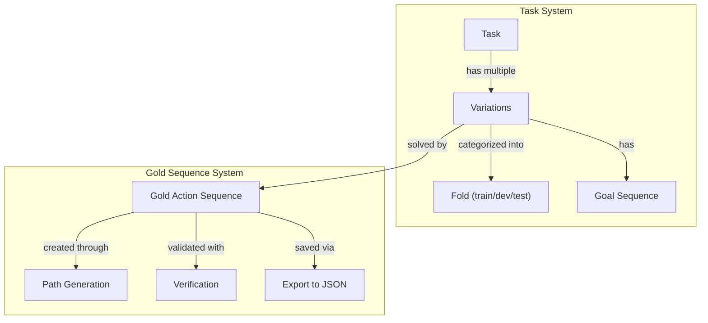

<!-- source: DeepWiki mcp.deepwiki.com · repo allenai/ScienceWorld · page 4.3 Gold Action Sequences · fetched 2026-10-26 -->

# Gold Action Sequences

<details>
<summary>Relevant source files</summary>

The following files were used as context for generating this wiki page:

- [goldpaths/exampleLoadGoldPaths.py](goldpaths/exampleLoadGoldPaths.py)
- [simulator/src/main/scala/scienceworld/goldagent/ExampleGoldAgent.scala](simulator/src/main/scala/scienceworld/goldagent/ExampleGoldAgent.scala)
- [simulator/src/main/scala/scienceworld/goldagent/PathFinder.scala](simulator/src/main/scala/scienceworld/goldagent/PathFinder.scala)
- [simulator/src/main/scala/scienceworld/input/InputParser.scala](simulator/src/main/scala/scienceworld/input/InputParser.scala)
- [simulator/src/main/scala/scienceworld/objects/livingthing/plant/PeaPlant.scala](simulator/src/main/scala/scienceworld/objects/livingthing/plant/PeaPlant.scala)
- [simulator/src/main/scala/scienceworld/objects/livingthing/plant/RandomGeneticsPlants.scala](simulator/src/main/scala/scienceworld/objects/livingthing/plant/RandomGeneticsPlants.scala)

</details>


## Purpose and Scope

This page documents the Gold Action Sequences system in ScienceWorld. Gold action sequences are pre-defined, expert-created solution paths that demonstrate how to successfully complete tasks in the environment. They serve as reference solutions or "oracle" paths that can be used for evaluation, agent training, or benchmarking.

This documentation covers how gold sequences are generated, stored, and utilized within ScienceWorld. For information about the general task system, see [Task System Architecture](#4.1), and for information about available tasks, see [Available Tasks](#4.2).

## Overview of Gold Action Sequences

Gold action sequences are predetermined sequences of actions that, when executed in order, successfully complete a specific task variation. They represent optimal or near-optimal solutions to tasks and are created by developers with complete knowledge of the environment.



Sources: [simulator/src/main/scala/scienceworld/goldagent/ExampleGoldAgent.scala:49-178](), [goldpaths/exampleLoadGoldPaths.py:1-58]()

## Structure of Gold Action Sequences

Each gold action sequence is stored as a `RunHistory` object that contains:

1. **Task Metadata**: Includes the task name, task index, variation index, and task description
2. **Action History**: The sequence of action strings that solve the task
3. **Observations**: The environment's response to each action
4. **Scores**: The score achieved after each action
5. **Free Look Data**: The result of "look around" commands at each step
6. **Inventory Data**: The contents of the agent's inventory at each step
7. **Notes**: Additional information about the task execution

The following diagram illustrates the structure of a gold action sequence:



Sources: [simulator/src/main/scala/scienceworld/goldagent/ExampleGoldAgent.scala:292-407]()

## Generation of Gold Action Sequences

Gold action sequences are generated using the `ExampleGoldAgent` class. The process involves:

1. Loading a specific task and variation
2. Setting the environment to generate a gold path
3. Retrieving the gold action sequence from the environment
4. Executing each action in the sequence
5. Recording the actions, observations, and other data
6. Validating that the sequence leads to a perfect score
7. Exporting the validated sequences to JSON

The following diagram illustrates the generation process:



Sources: [simulator/src/main/scala/scienceworld/goldagent/ExampleGoldAgent.scala:94-179](), [simulator/src/main/scala/scienceworld/goldagent/ExampleGoldAgent.scala:247-287]()

### Role of PathFinder in Gold Sequences

The `PathFinder` class plays a crucial role in generating gold action sequences by finding optimal paths between locations in the environment. It provides methods to:

1. Create action sequences for navigation between locations
2. Generate exhaustive search patterns to explore the environment
3. Find valid paths through a location graph
4. Generate actions for interacting with objects



Sources: [simulator/src/main/scala/scienceworld/goldagent/PathFinder.scala:32-91](), [simulator/src/main/scala/scienceworld/goldagent/PathFinder.scala:166-274](), [simulator/src/main/scala/scienceworld/goldagent/PathFinder.scala:282-342]()

## Using Gold Action Sequences

Gold action sequences are stored in JSON files that can be loaded and used for various purposes.

### JSON Structure

The JSON structure of exported gold action sequences looks like this:

```
{
  "taskIdx": {
    "taskIdx": taskIndex,
    "taskName": "taskName",
    "goldActionSequences": [
      {
        "variationIdx": variationIndex,
        "fold": "train/dev/test",
        "taskDescription": "description",
        "path": [
          {
            "action": "action string",
            "observation": "observation text",
            "score": "score value",
            "isCompleted": "completion status",
            "freelook": "freelook text",
            "inventory": "inventory text"
          },
          ...
        ]
      },
      ...
    ]
  },
  ...
}
```

Sources: [simulator/src/main/scala/scienceworld/goldagent/ExampleGoldAgent.scala:247-287](), [simulator/src/main/scala/scienceworld/goldagent/ExampleGoldAgent.scala:317-345]()

### Loading and Using Gold Sequences

The following diagram illustrates how gold action sequences are loaded and used:



Sources: [goldpaths/exampleLoadGoldPaths.py:1-58]()

## Applications of Gold Action Sequences

Gold action sequences serve several important purposes in ScienceWorld:

1. **Evaluation Benchmark**: They provide a reference solution for evaluating agent performance.
2. **Task Verification**: They verify that tasks are solvable and well-defined.
3. **Agent Training**: They can be used as demonstration data for imitation learning.
4. **Environment Testing**: They help test the robustness of the environment.
5. **Task Analysis**: They provide insights into task difficulty and structure.

### From Natural Language to Actions

The following diagram illustrates how natural language commands in gold sequences are processed by the system:



Sources: [simulator/src/main/scala/scienceworld/input/InputParser.scala:144-229](), [simulator/src/main/scala/scienceworld/goldagent/ExampleGoldAgent.scala:125-143]()

## Implementation Details

### The RunHistory Class

The `RunHistory` class is the core data structure for storing gold action sequences. It maintains a history of actions taken, observations received, and additional data like free look and inventory information.



Sources: [simulator/src/main/scala/scienceworld/goldagent/ExampleGoldAgent.scala:292-407]()

### ExampleGoldAgent

The `ExampleGoldAgent` class is responsible for generating and exporting gold action sequences. Key methods include:

- `main()`: Orchestrates the gold sequence generation process
- `summaryStatistics()`: Calculates statistics for task scores
- `exportGoldActionSequencesJSON()`: Exports gold sequences to JSON format

### Relation to Input Parsing

Gold action sequences interact with the `InputParser` class, which is responsible for parsing natural language commands into actions:



Sources: [simulator/src/main/scala/scienceworld/input/InputParser.scala:18-230](), [simulator/src/main/scala/scienceworld/goldagent/ExampleGoldAgent.scala:125-143]()

## Using Gold Sequences for Evaluation

Gold action sequences provide a way to evaluate the performance of agents by comparing their solutions to the gold standard. This can include:

1. **Action Matching**: Comparing the agent's actions to the gold sequence actions
2. **Score Progression**: Comparing how scores progress throughout task completion
3. **Task Completion**: Verifying whether the agent successfully completes the task
4. **Efficiency**: Measuring how efficiently the agent solves the task compared to the gold sequence

The table below summarizes the structure of task variations and gold sequences:

| Component | Description |
|-----------|-------------|
| Task | A specific scientific task to be completed |
| Variation | A specific configuration or setup of a task |
| Gold Sequence | The reference solution for a task variation |
| Action | A natural language command in the gold sequence |
| Observation | The environment's response to an action |
| Score | A value indicating progress toward task completion |

Sources: [simulator/src/main/scala/scienceworld/goldagent/ExampleGoldAgent.scala:101-179](), [goldpaths/exampleLoadGoldPaths.py:27-50]()

## Integration with Task System

Gold action sequences are tightly integrated with the task system in ScienceWorld:

1. Each task may have multiple variations
2. Each variation has a gold action sequence
3. Gold sequences are generated when `generateGoldPath = true` is set during task loading
4. Variations are divided into training, development, and test folds



Sources: [simulator/src/main/scala/scienceworld/goldagent/ExampleGoldAgent.scala:101-114](), [simulator/src/main/scala/scienceworld/goldagent/ExampleGoldAgent.scala:247-287]()

## Summary

Gold action sequences are a crucial component of the ScienceWorld environment that provide reference solutions for tasks. They are generated using expert knowledge, stored in a structured format, and can be used for various purposes including agent evaluation, training, and environment testing.

By understanding how gold action sequences are created and used, developers can leverage them to improve agent performance and evaluate the effectiveness of different approaches to solving tasks in ScienceWorld.

---

