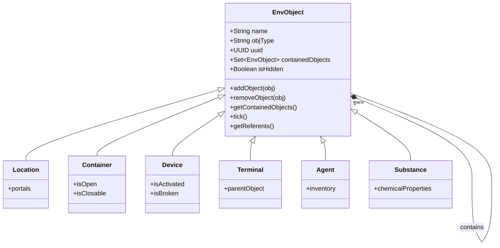
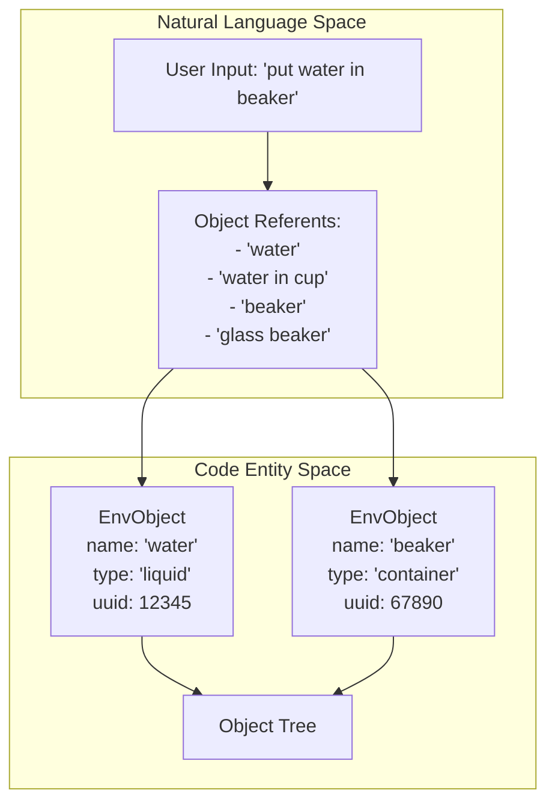
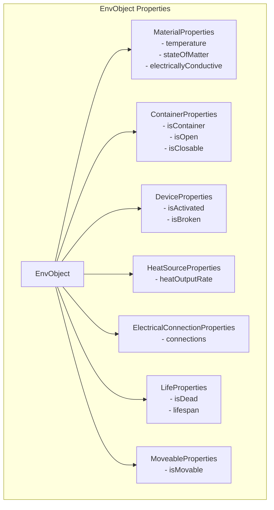
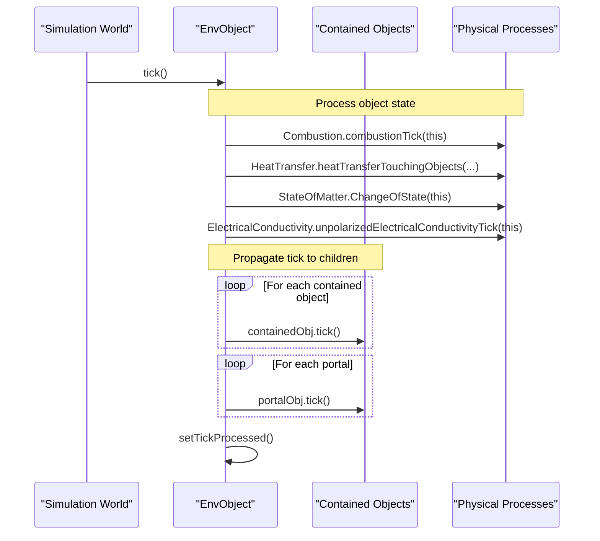
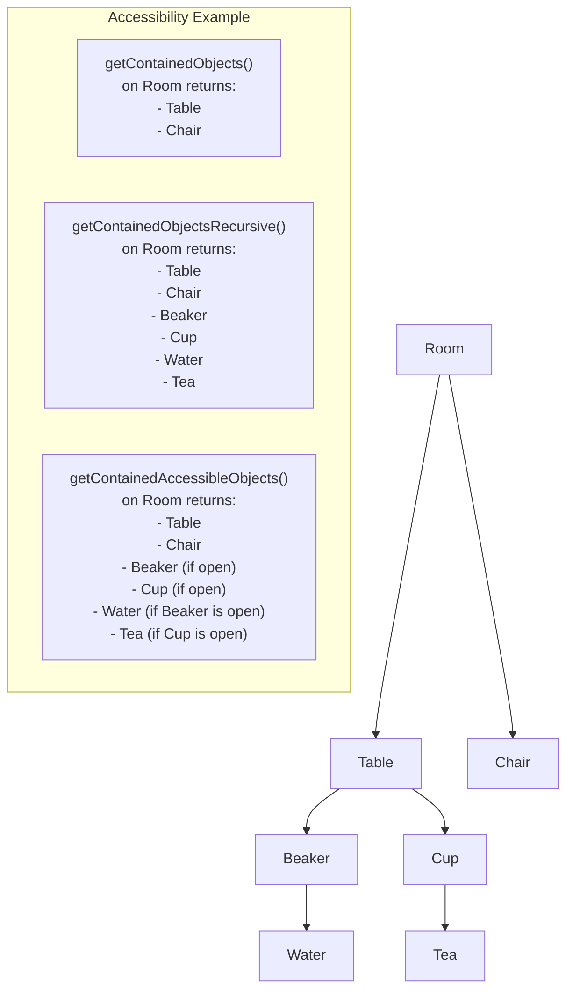
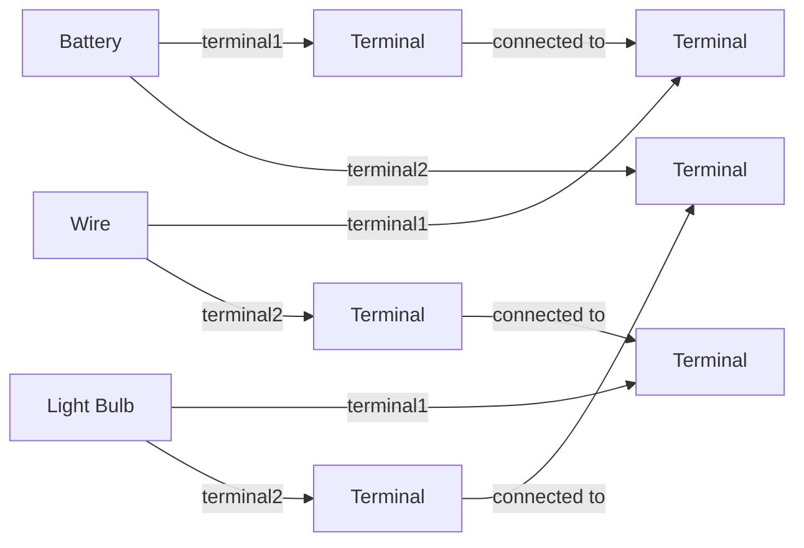
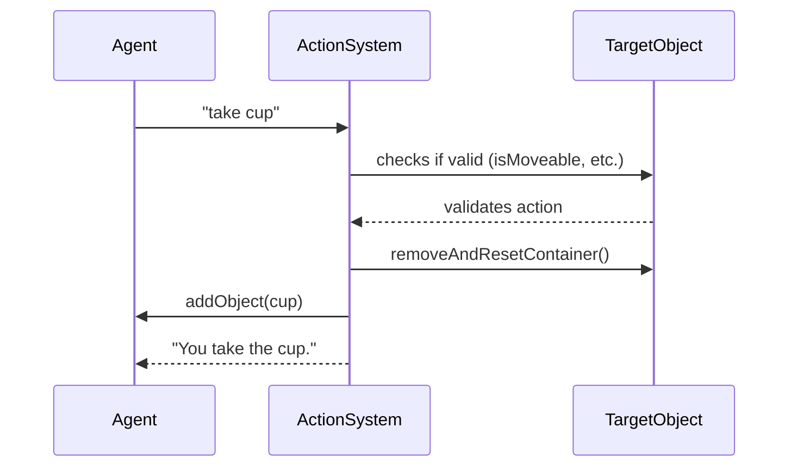
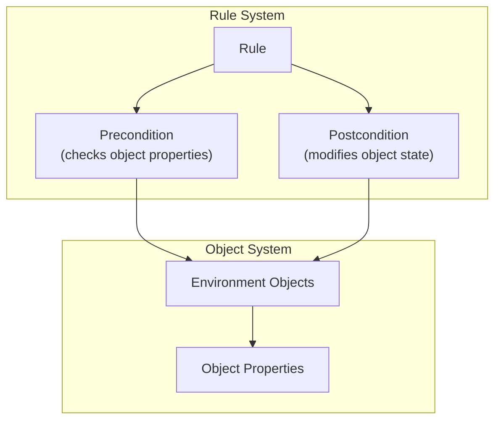
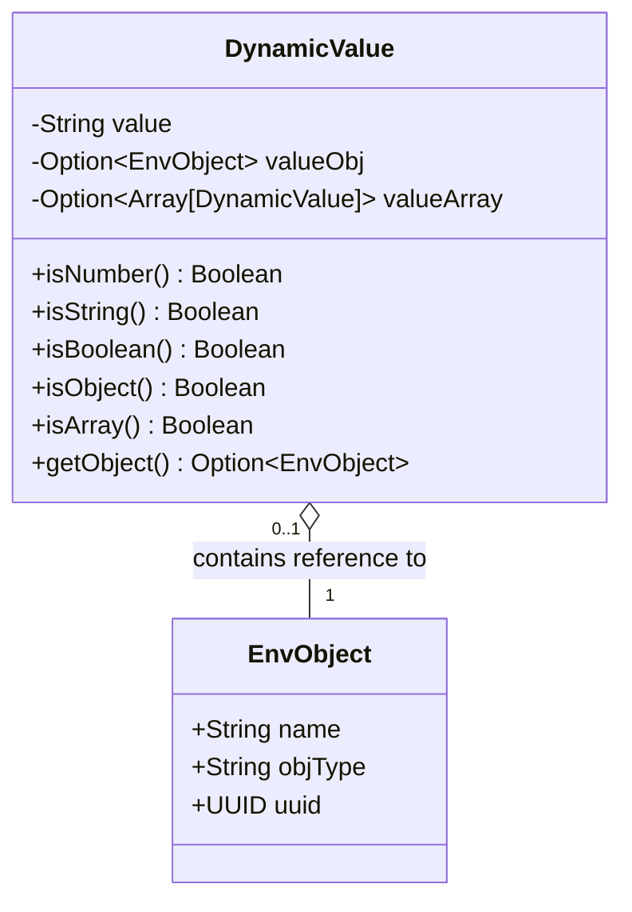

<!-- source: DeepWiki mcp.deepwiki.com · repo allenai/ScienceWorld · page 5 Environment Objects · fetched 2026-10-26 -->

# Environment Objects

<details>
<summary>Relevant source files</summary>

The following files were used as context for generating this wiki page:

- [scienceworld/object_type_ids.tsv](scienceworld/object_type_ids.tsv)
- [simulator/src/main/scala/language/runtime/runners/PredicateRunner.scala](simulator/src/main/scala/language/runtime/runners/PredicateRunner.scala)
- [simulator/src/main/scala/language/runtime/runners/RuleRunner.scala](simulator/src/main/scala/language/runtime/runners/RuleRunner.scala)
- [simulator/src/main/scala/language/struct/DynamicValue.scala](simulator/src/main/scala/language/struct/DynamicValue.scala)
- [simulator/src/main/scala/scienceworld/actions/Action.scala](simulator/src/main/scala/scienceworld/actions/Action.scala)
- [simulator/src/main/scala/scienceworld/actions/ActionConnectElectrical.scala](simulator/src/main/scala/scienceworld/actions/ActionConnectElectrical.scala)
- [simulator/src/main/scala/scienceworld/actions/ActionMoveToLocation.scala](simulator/src/main/scala/scienceworld/actions/ActionMoveToLocation.scala)
- [simulator/src/main/scala/scienceworld/properties/MaterialProperties.scala](simulator/src/main/scala/scienceworld/properties/MaterialProperties.scala)
- [simulator/src/main/scala/scienceworld/struct/EnvObject.scala](simulator/src/main/scala/scienceworld/struct/EnvObject.scala)

</details>


## Purpose and Scope

This document describes the environment object system in ScienceWorld, which forms the foundation of the simulation environment. Environment objects represent every physical entity within the simulation, from rooms and furniture to scientific instruments and substances. This page explains the structure of the object system, how objects are represented in code, their properties, and how they interact in the simulated world.

For information about object properties specifically, see [Object Properties](#5.1). For details on simplifications that can be applied to objects to control simulation complexity, see [Simplification System](#5.2).

Sources: [simulator/src/main/scala/scienceworld/struct/EnvObject.scala:1-696]()

## Core Object Architecture

Environment objects are the building blocks of the ScienceWorld simulation. Every entity in the environment is represented as an instance of the `EnvObject` class or one of its subclasses.

### Object Hierarchy and Composition



The environment in ScienceWorld is represented as a tree of objects. Each object can contain other objects, creating a hierarchical structure. For example, a room might contain a table, which contains a beaker, which contains water.

Sources: [simulator/src/main/scala/scienceworld/struct/EnvObject.scala:18-111](), [scienceworld/object_type_ids.tsv:1-219]()

### Object Identification and References

Each environment object has:
- A **name** (human-readable string, e.g., "cup")
- An **object type** (semantic category, e.g., "container")
- A **unique identifier** (UUID for internal references)
- A set of **referents** (natural language expressions that can refer to the object)

When parsing natural language input, the system uses referents to resolve ambiguities and identify which object the user is referring to.



Sources: [simulator/src/main/scala/scienceworld/struct/EnvObject.scala:557-588]()

## Property System

Environment objects have various optional properties that define their behavior in the simulation. These properties are represented as traits that can be mixed into objects.

### Core Properties



Each property is implemented as an optional field on the `EnvObject` class. This allows objects to have only the properties that are relevant to them.

```scala
var propMaterial: Option[MaterialProperties] = None
var propContainer: Option[ContainerProperties] = None
var propDevice: Option[DeviceProperties] = None
var propHeatSource: Option[HeatSourceProperties] = None
var propCoolingSource: Option[CoolingSourceProperties] = None
var propMoveable: Option[MoveableProperties] = Some(new MoveableProperties(isMovable = true))
var propElectricalConnection: Option[ElectricalConnectionProperties] = None
var propLife: Option[LifeProperties] = None
```

Sources: [simulator/src/main/scala/scienceworld/struct/EnvObject.scala:57-69](), [simulator/src/main/scala/scienceworld/properties/MaterialProperties.scala:1-46]()

### Material Properties

Material properties are particularly important as they define how objects behave under different conditions and interact with other objects. The `MaterialProperties` trait defines characteristics like:

| Property | Description | Example Values |
|----------|-------------|----------------|
| `substanceName` | Identifier for the material | "water", "iron", "wood" |
| `temperatureC` | Current temperature in Celsius | 10.0, 100.0, -15.0 |
| `stateOfMatter` | Current physical state | "solid", "liquid", "gas" |
| `boilingPoint` | Temperature at which the substance boils | 100.0 (water), 2862.0 (iron) |
| `meltingPoint` | Temperature at which the substance melts | 0.0 (water), 1538.0 (iron) |
| `electricallyConductive` | Whether the material conducts electricity | true (metals), false (plastic) |
| `frictionCoefficient` | Coefficient of friction | 0.0 (no friction) to 1.0 (maximum friction) |

Sources: [simulator/src/main/scala/scienceworld/properties/MaterialProperties.scala:3-46]()

## Object Lifecycle and Simulation

Environment objects participate in the simulation through the `tick()` method, which advances the simulation state for each object.

### Simulation Processes

During each tick, objects:
1. Process combustion (if applicable)
2. Transfer heat to/from contained objects
3. Update state of matter based on temperature
4. Process electrical conductivity
5. Recursively tick contained objects



Sources: [simulator/src/main/scala/scienceworld/struct/EnvObject.scala:504-555]()

## Object Containment and Accessibility

The object system in ScienceWorld implements a rich containment model that allows objects to contain other objects, creating a hierarchical structure.

### Containment Methods

The `EnvObject` class provides several methods for managing containment:

| Method | Description |
|--------|-------------|
| `addObject(obj)` | Adds an object to this container |
| `removeObjectFromContainer(obj)` | Removes an object from this container |
| `getContainedObjects()` | Returns all objects contained in this object |
| `getContainedObjectsRecursive()` | Returns all objects contained in this object and its subcontainers |
| `getContainedAccessibleObjects()` | Returns objects that are visible/accessible (e.g., in open containers) |
| `contains(obj)` | Checks if an object is directly contained in this object |
| `containsRecursive(obj)` | Checks if an object is contained anywhere in the object tree |

These methods allow for complex interactions with objects, including accessing objects in nested containers and checking container relationships.



Sources: [simulator/src/main/scala/scienceworld/struct/EnvObject.scala:149-233](), [simulator/src/main/scala/scienceworld/struct/EnvObject.scala:259-294]()

## Electrical Connections

ScienceWorld implements an electrical connection system that allows objects to be connected to form circuits. This is primarily used for electrical experiments in the simulation.

### Terminals and Connections

Each object can have up to two electrical terminals that can be connected to other objects:

```scala
val terminal1: Option[Terminal] = if (includeElectricalTerminals) { Some(new Terminal(this, "terminal 1")) } else { None }
val terminal2: Option[Terminal] = if (includeElectricalTerminals) { Some(new Terminal(this, "terminal 2")) } else { None }
```

These terminals can be connected to form electrical circuits:



The system includes methods for managing electrical connections:

| Method | Description |
|--------|-------------|
| `isElectricallyConnected()` | Checks if the object is connected to an electrical circuit |
| `hasUnpolarizedElectricalTerminals()` | Checks if the object has standard terminals |
| `getOtherElectricalTerminal(terminal)` | Gets the opposite terminal on the same object |
| `getUnconnectedElectricalTerminal()` | Gets a terminal that isn't yet connected, if any |
| `disconnectElectricalTerminals()` | Disconnects all electrical connections |

Sources: [simulator/src/main/scala/scienceworld/struct/EnvObject.scala:39-51](), [simulator/src/main/scala/scienceworld/struct/EnvObject.scala:420-456](), [simulator/src/main/scala/scienceworld/actions/ActionConnectElectrical.scala:1-170]()

## Interaction with the Action System

Environment objects are the targets of actions performed by agents in the simulation. When an action is performed, it typically involves one or more environment objects.



The action system checks if an action is valid based on the properties and state of the involved objects. For example, to pick up an object, it must have the `MoveableProperties` and be marked as movable.

Sources: [simulator/src/main/scala/scienceworld/actions/Action.scala:1-74](), [simulator/src/main/scala/scienceworld/actions/ActionMoveToLocation.scala:1-178]()

## Object Representation and Serialization

Environment objects can be represented in various formats to support different use cases:

### String Representation

Objects can be converted to string representations for debugging and display:

```scala
// Minimal representation (just core identifiers)
def toStringMinimal(): String

// Standard representation (includes contents)
override def toString(): String

// Full hierarchical representation (includes all contained objects)
def toStringIncludingContents(indent: Int = 0): String
```

### JSON Serialization

Objects can be serialized to JSON for storage or transmission:

```scala
def toJSON(): String
```

This JSON representation includes all properties and contained objects, facilitating state saving and loading.

Sources: [simulator/src/main/scala/scienceworld/struct/EnvObject.scala:619-694]()

## Integration with Language Processing

Environment objects integrate with the language processing system through referents - the natural language expressions that can refer to an object.

### Referent Generation

The `getReferents()` method generates the possible ways an object can be referred to in natural language:

```scala
def getReferents(): Set[String] = {
  val out = mutable.Set[String]()
  out.add("object")
  out.add(this.name)
  out.add(this.getDescriptName())
  // Return
  out.toSet
}
```

For disambiguation, objects can also generate referents that include their containers:

```scala
def getReferentsWithContainers(perspectiveContainer: EnvObject): Set[String] = {
  // Generates referents like "water in cup" or "book on table"
}
```

This rich referent system allows users to interact with objects using natural language commands like "take the book from the shelf" or "put the water in the beaker."

Sources: [simulator/src/main/scala/scienceworld/struct/EnvObject.scala:557-588]()

## Rule System Integration

Environment objects are also used in the rule system, which defines how objects interact with each other in the simulation. Rules can check object properties and modify object states.



The rule system evaluates predicates on objects to determine when rules should be triggered, then updates object states accordingly.

Sources: [simulator/src/main/scala/language/runtime/runners/PredicateRunner.scala:1-312](), [simulator/src/main/scala/language/runtime/runners/RuleRunner.scala:1-333]()

## Object Dynamic Values

For more complex operations, objects can be wrapped in a `DynamicValue` class that allows them to be used in expressions and compared with other values.



This allows objects to be used in expressions like:

```
if (obj1.temperature > obj2.temperature) {
  // Do something
}
```

Sources: [simulator/src/main/scala/language/struct/DynamicValue.scala:1-367]()

## Summary

The environment object system is the foundation of the ScienceWorld simulation. It provides:

1. A hierarchical structure for representing physical entities in the world
2. A property system that defines object behaviors and characteristics
3. Methods for object interaction, containment, and manipulation
4. Integration with the simulation, action, and language processing systems

By modeling objects with appropriate properties and behaviors, ScienceWorld creates a rich, interactive environment for exploring scientific concepts and solving problems.

---

