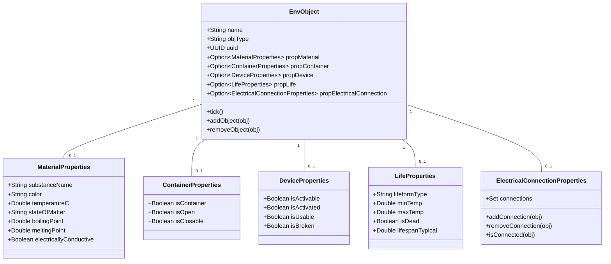
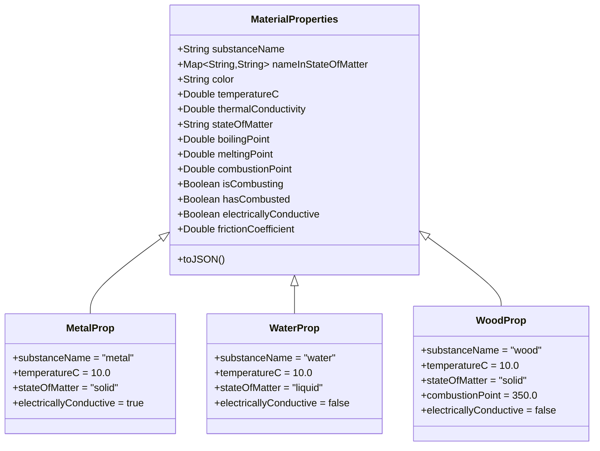
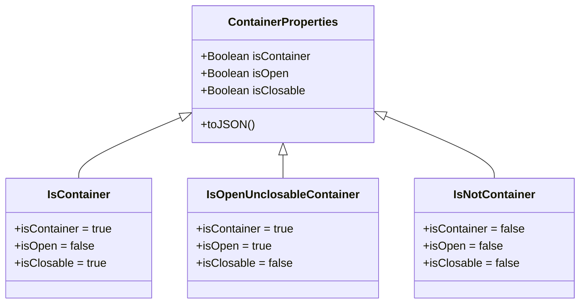
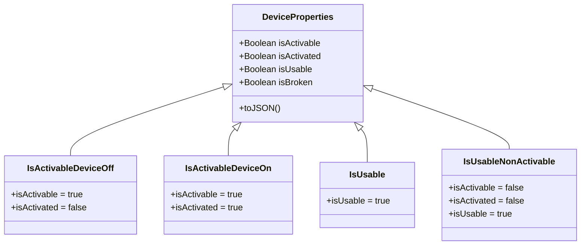
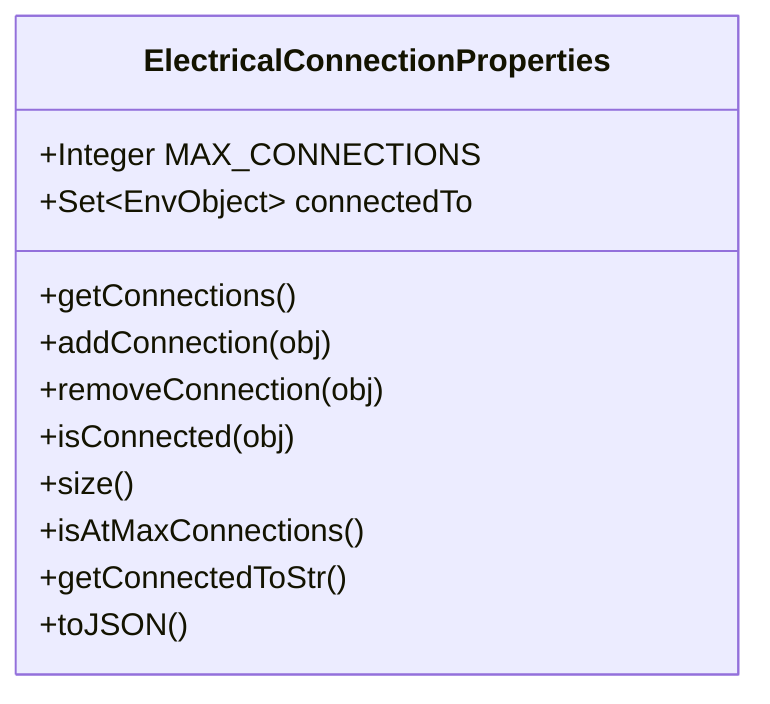
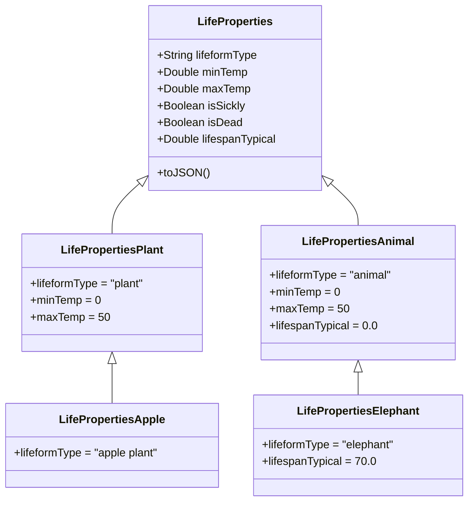
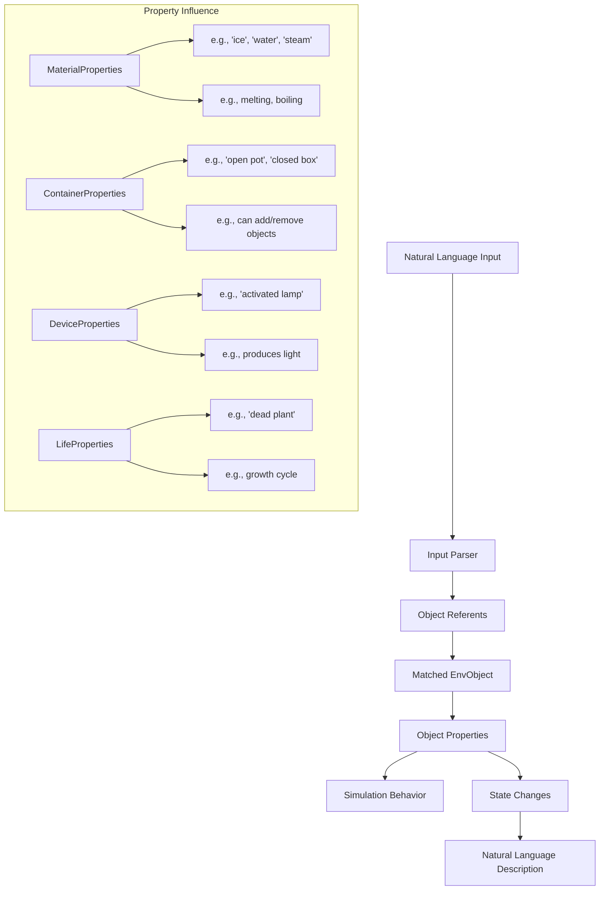
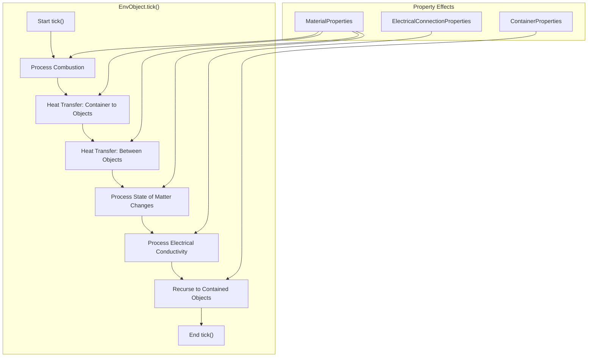

<!-- source: DeepWiki mcp.deepwiki.com · repo allenai/ScienceWorld · page 5.1 Object Properties · fetched 2026-10-26 -->

# Object Properties

<details>
<summary>Relevant source files</summary>

The following files were used as context for generating this wiki page:

- [simulator/src/main/scala/scienceworld/properties/ContainerProperties.scala](simulator/src/main/scala/scienceworld/properties/ContainerProperties.scala)
- [simulator/src/main/scala/scienceworld/properties/DeviceProperties.scala](simulator/src/main/scala/scienceworld/properties/DeviceProperties.scala)
- [simulator/src/main/scala/scienceworld/properties/ElectricalConnectionProperties.scala](simulator/src/main/scala/scienceworld/properties/ElectricalConnectionProperties.scala)
- [simulator/src/main/scala/scienceworld/properties/LifeProperties.scala](simulator/src/main/scala/scienceworld/properties/LifeProperties.scala)
- [simulator/src/main/scala/scienceworld/properties/MaterialProperties.scala](simulator/src/main/scala/scienceworld/properties/MaterialProperties.scala)
- [simulator/src/main/scala/scienceworld/struct/EnvObject.scala](simulator/src/main/scala/scienceworld/struct/EnvObject.scala)

</details>


This document describes the property system used by environment objects in ScienceWorld. Properties define the characteristics and behaviors of objects in the simulation environment, allowing for realistic interactions and state changes. Properties are modular components that can be attached to objects, enabling a flexible composition-based approach to defining object behavior.

For information about the broader environment object system, see [Environment Objects](#5).

## Property System Architecture

In ScienceWorld, the `EnvObject` class serves as the base for all objects in the simulation. Rather than using inheritance for different types of objects, ScienceWorld uses a composition-based approach with properties. Each `EnvObject` can have zero or more properties that define its behavior.



Sources: [simulator/src/main/scala/scienceworld/struct/EnvObject.scala:57-69]()

Properties are implemented as `Option` types in the `EnvObject` class, meaning they can be present or absent. This allows for dynamic composition of object behaviors based on which properties are defined.

## Core Property Types

ScienceWorld implements several core property types that can be assigned to objects. Each provides specific functionality:

### Material Properties

The `MaterialProperties` trait defines physical characteristics of objects, including:

- **Substance name**: Identifies the material
- **Temperature**: Current temperature in Celsius
- **State of matter**: Solid, liquid, or gas
- **Thermal properties**: Melting point, boiling point, thermal conductivity
- **Electrical conductivity**: Whether the material conducts electricity
- **Combustion properties**: Combustion point, whether it's burning or has burned
- **Friction**: Coefficient of friction



Sources: [simulator/src/main/scala/scienceworld/properties/MaterialProperties.scala:3-46]()

ScienceWorld implements numerous specific material property classes for different materials, including metals (such as `CopperProp`, `AluminumProp`), liquids (such as `WaterProp`), and organic materials (such as `WoodProp`, `PlantMatterProp`).

### Container Properties

The `ContainerProperties` class defines whether an object can contain other objects and how it behaves as a container:

- **isContainer**: Whether the object can contain other objects
- **isOpen**: Whether the container is currently open
- **isClosable**: Whether the container can be opened and closed



Sources: [simulator/src/main/scala/scienceworld/properties/ContainerProperties.scala:3-41]()

### Device Properties

The `DeviceProperties` trait defines whether an object can be activated and used as a device:

- **isActivable**: Whether the device can be activated/deactivated
- **isActivated**: Current activation state
- **isUsable**: Whether the device is usable (for instantaneous use)
- **isBroken**: Whether the device is broken



Sources: [simulator/src/main/scala/scienceworld/properties/DeviceProperties.scala:4-56]()

### Electrical Connection Properties

The `ElectricalConnectionProperties` class defines how objects can electrically connect to other objects:

- Set of connected objects
- Methods for adding, removing, and checking connections
- Maximum connection limit



Sources: [simulator/src/main/scala/scienceworld/properties/ElectricalConnectionProperties.scala:9-77]()

### Life Properties

The `LifeProperties` class defines characteristics for living objects (plants and animals):

- **lifeformType**: The type of lifeform
- **Temperature tolerance**: Min and max temperatures the lifeform can survive
- **Health state**: Whether sick or dead
- **lifespan**: Typical lifespan for the lifeform (in years)



Sources: [simulator/src/main/scala/scienceworld/properties/LifeProperties.scala:3-239]()

## Property Relationships to Natural Language

One key feature of the property system is how it bridges the simulation code with natural language descriptions. Properties define how objects behave in simulation and also influence how they can be referred to in text.



Sources: [simulator/src/main/scala/scienceworld/struct/EnvObject.scala:557-588]()

The `getReferents()` method in `EnvObject` generates text strings that can be used to refer to the object, influenced by its properties. For example, water with `MaterialProperties` might be referred to as "ice", "water", or "steam" depending on its state of matter.

## Property Usage in Simulation

Properties are a key part of the simulation loop in ScienceWorld. The `tick()` method of `EnvObject` processes each object on every simulation step, applying changes based on its properties.



Sources: [simulator/src/main/scala/scienceworld/struct/EnvObject.scala:504-555]()

During each simulation tick:

1. **Combustion** processes any burning objects based on `MaterialProperties`
2. **Heat Transfer** occurs between objects and their containers based on `MaterialProperties`
3. **State changes** (solid/liquid/gas) occur based on temperature and `MaterialProperties`
4. **Electrical conductivity** is calculated for connected objects
5. **Tick processing** recurses to all contained objects

## Common Property Combinations

Different types of objects in ScienceWorld typically use combinations of properties to achieve their behavior:

| Object Type | Material Properties | Container Properties | Device Properties | Life Properties | Electrical Connection Properties |
|-------------|:-------------------:|:--------------------:|:-----------------:|:--------------:|:--------------------------------:|
| Metal pot   | ✓ (MetalProp)       | ✓ (IsContainer)      |                   |                |                                  |
| Light bulb  | ✓ (GlassProp)       |                      | ✓ (IsActivable)   |                | ✓                                |
| Plant       | ✓ (PlantMatterProp) |                      |                   | ✓ (LifePropertiesPlant) |                        |
| Thermometer | ✓ (MetalProp)       |                      | ✓ (IsUsable)      |                |                                  |
| Battery     | ✓ (MetalProp)       |                      | ✓ (IsActivable)   |                | ✓                                |
| Water       | ✓ (WaterProp)       |                      |                   |                |                                  |

## Property Interaction Examples

Properties don't exist in isolation - they interact with each other to create complex behaviors:

1. **Container + Material**: A container with open/closed state affects how liquid materials can be added or removed
2. **Material + Life**: Temperature of a plant affects its life properties (can die if too hot/cold)
3. **Material + Electrical**: Objects with conductive materials and electrical connection properties form circuits
4. **Device + Electrical**: Devices activate when electrical current flows through them

These interactions allow for the creation of complex scenarios like electrical circuits, chemistry experiments, and plant growth simulations.

## Implementation Notes

When creating a new environment object in ScienceWorld:

1. Create a new class extending `EnvObject`
2. Add appropriate properties using the `propXXX` fields
3. Override methods like `tick()` or `useWith()` if needed for special behavior
4. Add custom referents using `getReferents()` for natural language interaction

Properties are implemented as `Option` types, meaning they can be `None` (not present) or `Some(property)` (present with a value). This allows for checking if a property exists before using it:

```scala
// Example of checking for a property before using it
if (obj.propMaterial.isDefined && obj.propMaterial.get.stateOfMatter == "liquid") {
  // Handle liquid
}
```

The property system makes it easy to modify object behavior at runtime - properties can be added, removed, or modified during simulation.

---

