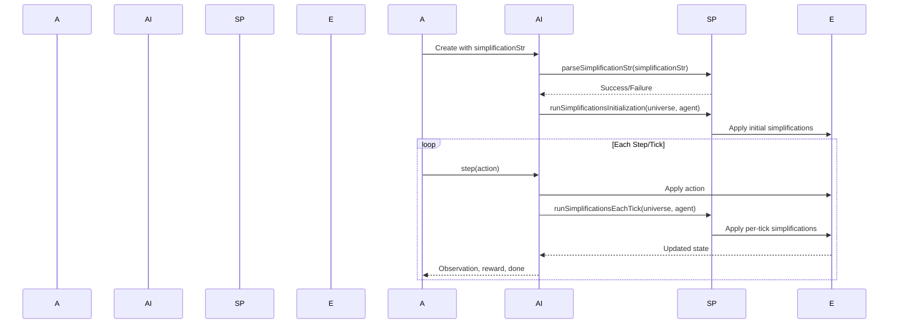
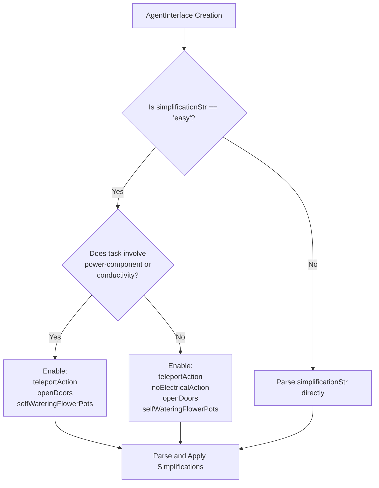
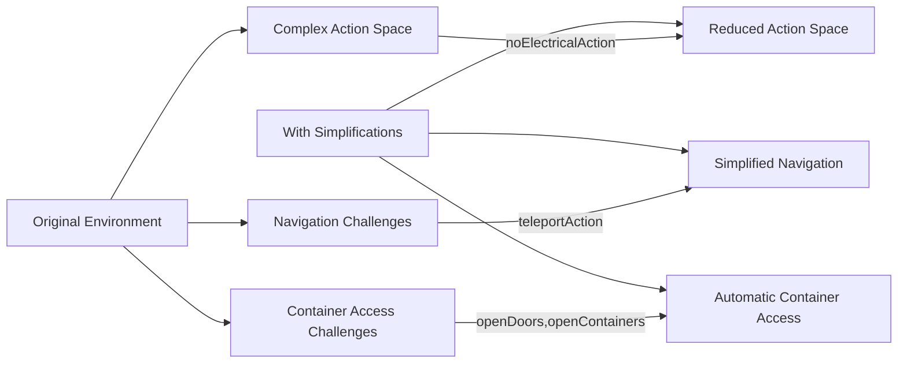

<!-- source: DeepWiki mcp.deepwiki.com · repo allenai/ScienceWorld · page 5.2 Simplification System · fetched 2026-10-26 -->

# Simplification System

<details>
<summary>Relevant source files</summary>

The following files were used as context for generating this wiki page:

- [scienceworld/utils.py](scienceworld/utils.py)
- [simulator/build.sbt](simulator/build.sbt)
- [simulator/src/main/scala/scienceworld/runtime/AgentInterface.scala](simulator/src/main/scala/scienceworld/runtime/AgentInterface.scala)
- [simulator/src/main/scala/scienceworld/runtime/SimplifierProcessor.scala](simulator/src/main/scala/scienceworld/runtime/SimplifierProcessor.scala)
- [simulator/src/main/scala/scienceworld/tasks/specifictasks/TaskElectricalConductivity.scala](simulator/src/main/scala/scienceworld/tasks/specifictasks/TaskElectricalConductivity.scala)
- [simulator/src/main/scala/scienceworld/tasks/specifictasks/TaskElectricalConductivity2.scala](simulator/src/main/scala/scienceworld/tasks/specifictasks/TaskElectricalConductivity2.scala)

</details>


The Simplification System provides a configurable way to modify the ScienceWorld environment's complexity to make tasks more approachable for agents. This system allows researchers to selectively enable various simplifications that can reduce the action space, open containers by default, or make other modifications that lower the difficulty of completing tasks.

Sources: [simulator/src/main/scala/scienceworld/runtime/SimplifierProcessor.scala:14-21]()

## System Architecture

The Simplification System is built around a simple inheritance structure with a `Simplification` base class and specific implementations for different types of simplifications. The `SimplifierProcessor` acts as the central registry for all active simplifications.

### Simplification System Structure

```mermaid
classDiagram
    class "Simplification" {
        +String label
        +String description
        +bool runAtInitialization
        +bool runEachTick
        +runSimplification(universe, agent)
    }
    
    class "SimplifierProcessor" {
        +ArrayBuffer simplifications
        +addSimplification(simplification)
        +isSimplificationEnabled(label)
        +parseSimplificationStr(str)
        +runSimplificationsInitialization()
        +runSimplificationsEachTick()
        +getAllSimplifications()
    }
    
    class "SimplificationOpenDoors" {
        +runSimplification(universe, agent)
    }
    
    class "SimplificationOpenContainers" {
        +runSimplification(universe, agent)
    }
    
    class "SimplificationTeleportAction" {
    }
    
    class "SimplificationNoElectricalActions" {
    }
    
    class "SimplificationSelfWateringFlowerPots" {
    }
    
    "Simplification" <|-- "SimplificationOpenDoors"
    "Simplification" <|-- "SimplificationOpenContainers"
    "Simplification" <|-- "SimplificationTeleportAction"
    "Simplification" <|-- "SimplificationNoElectricalActions"
    "Simplification" <|-- "SimplificationSelfWateringFlowerPots"
    
    "SimplifierProcessor" o-- "Simplification" : manages
```

Sources: [simulator/src/main/scala/scienceworld/runtime/SimplifierProcessor.scala:14-214]()

The system is designed to:
1. Allow registration of simplifications through a central processor
2. Enable simplifications to be applied at specific points in the simulation lifecycle
3. Support parsing a string format for enabling multiple simplifications at once

## Available Simplifications

ScienceWorld includes several built-in simplifications that can be enabled individually or in combination:

| Simplification Label | Description | Effect |
|----------------------|-------------|--------|
| `openDoors` | All doors are open by default | Makes navigation easier |
| `openContainers` | All containers are open by default | Eliminates need for open/close actions |
| `teleportAction` | Adds a teleport action | Allows instant movement between rooms |
| `noElectricalAction` | Remove electrical actions | Reduces action space complexity |
| `selfWateringFlowerPots` | Flower pots are self-watering | Simplifies plant care tasks |

Sources: [simulator/src/main/scala/scienceworld/runtime/SimplifierProcessor.scala:100-107](), [simulator/src/main/scala/scienceworld/runtime/SimplifierProcessor.scala:200-212]()

## Integration with Agent Interface

The Simplification System integrates with the Agent Interface, which serves as the main point of interaction between agents and the ScienceWorld environment.



Sources: [simulator/src/main/scala/scienceworld/runtime/AgentInterface.scala:35-48](), [simulator/src/main/scala/scienceworld/runtime/AgentInterface.scala:561-562]()

The Agent Interface supports a special "easy" mode that applies a predefined set of simplifications based on the task type:



Sources: [simulator/src/main/scala/scienceworld/runtime/AgentInterface.scala:35-43]()

## Simplification Implementation Details

Each simplification has its own implementation strategy, designed to modify the environment in specific ways:

### Environment Modification Simplifications

These simplifications directly modify objects in the environment:

1. **Open Doors Simplification**
   - Finds all portals (doors) in the environment
   - Sets each openable portal to be open
   - Run at initialization only

2. **Open Containers Simplification**
   - Finds all containers in the environment
   - Sets each closable container to be open
   - Run at initialization only

3. **Self-Watering Flower Pots**
   - Flag-based simplification that changes behavior of flower pots
   - Does not have direct implementation logic but is checked by flower pot objects

Sources: [simulator/src/main/scala/scienceworld/runtime/SimplifierProcessor.scala:24-71](), [simulator/src/main/scala/scienceworld/runtime/SimplifierProcessor.scala:89-91]()

### Action Space Simplifications

These simplifications modify the available action space for agents:

1. **Teleport Action**
   - Adds a special teleport action for instant travel
   - Flag-based simplification checked during action initialization

2. **No Electrical Actions**
   - Removes the electrical connection actions from the action space
   - Reduces the complexity of action selection
   - Implemented as a flag checked during action generation

Sources: [simulator/src/main/scala/scienceworld/runtime/SimplifierProcessor.scala:74-83](), [simulator/src/main/scala/scienceworld/runtime/AgentInterface.scala:171-180]()

## Using Simplifications

To enable simplifications, you can:

1. **Use the easy preset**:
   ```python
   env = ScienceWorldEnv(simplification="easy")
   ```

2. **Specify simplifications directly**:
   ```python
   env = ScienceWorldEnv(simplification="openDoors,teleportAction")
   ```

3. **Get available simplifications**:
   ```python
   # Lists all possible simplifications
   simplifications = env.get_possible_simplifications()
   print(simplifications)
   
   # Shows currently active simplifications
   active = env.get_current_simplifications()
   print(active)
   ```

When specifying multiple simplifications, use a comma-separated string with no spaces.

Sources: [scienceworld/utils.py:1-28](), [simulator/src/main/scala/scienceworld/runtime/SimplifierProcessor.scala:134-156]()

## Impact on Task Difficulty

The simplification system can significantly impact the difficulty of tasks in ScienceWorld. For example, in tasks involving electrical circuits (such as `TaskElectricalConductivity`), the "easy" mode selectively enables simplifications that reduce navigation complexity while preserving the electrical action space necessary for the task.



Sources: [simulator/src/main/scala/scienceworld/tasks/specifictasks/TaskElectricalConductivity.scala:1-708](), [simulator/src/main/scala/scienceworld/tasks/specifictasks/TaskElectricalConductivity2.scala:1-428]()

## Extending the Simplification System

To add a new simplification to the system:

1. Create a new class that extends `Simplification` with a unique label and description
2. Implement the `runSimplification` method if the simplification requires active changes to the environment
3. Add the new simplification class to the `getAllSimplifications()` method in `SimplifierProcessor`

### Implementation Example Template

For simplifications that need to actively modify the environment:

```scala
class MyNewSimplification extends Simplification(
  label = "myNewSimplification", 
  description = "Description of what this simplification does."
) {
  runAtInitialization = true  // Run when environment is created
  runEachTick = false         // Don't run every tick
  
  override def runSimplification(universe: EnvObject, agent: Agent): Boolean = {
    // Modification logic here
    return true  // Return success/failure
  }
}
```

For flag-based simplifications that just need to be checked elsewhere in the code:

```scala
class MyFlagSimplification extends Simplification(
  label = "myFlagSimplification", 
  description = "A simplification that just acts as a flag."
) {
  // No implementation needed - just check SimplifierProcessor.isSimplificationEnabled("myFlagSimplification") 
  // in the relevant part of your code
}
```

Sources: [simulator/src/main/scala/scienceworld/runtime/SimplifierProcessor.scala:14-214]()

---

