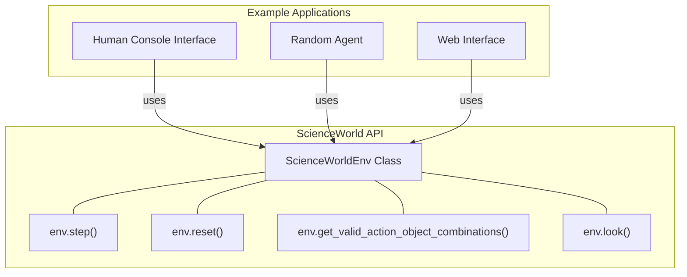
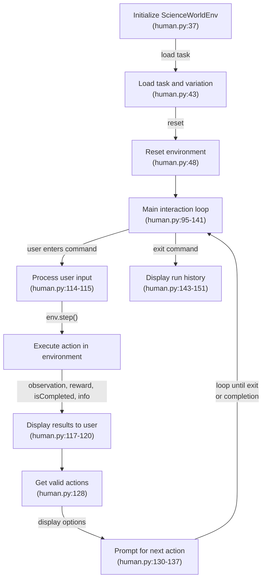
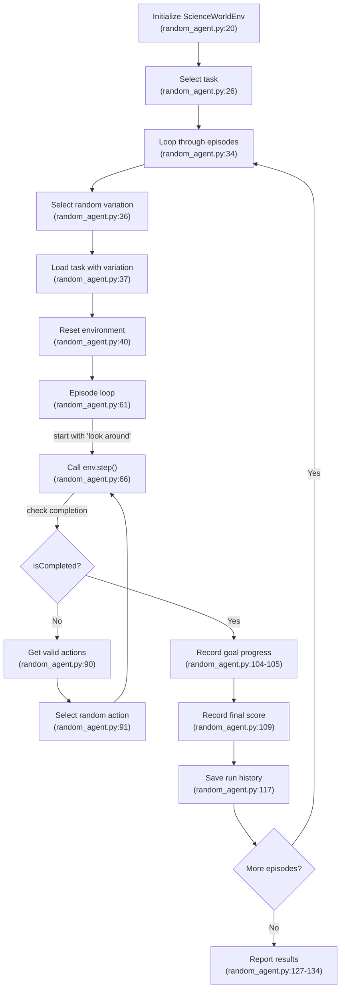
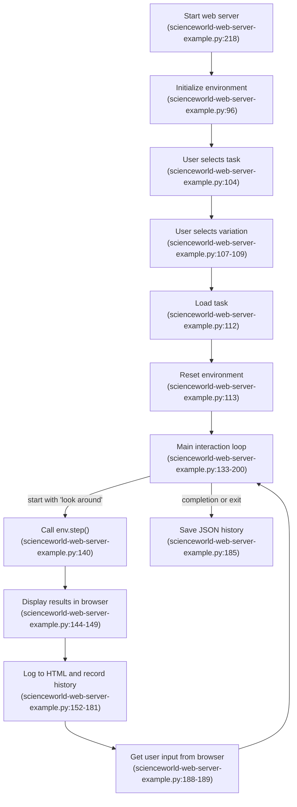
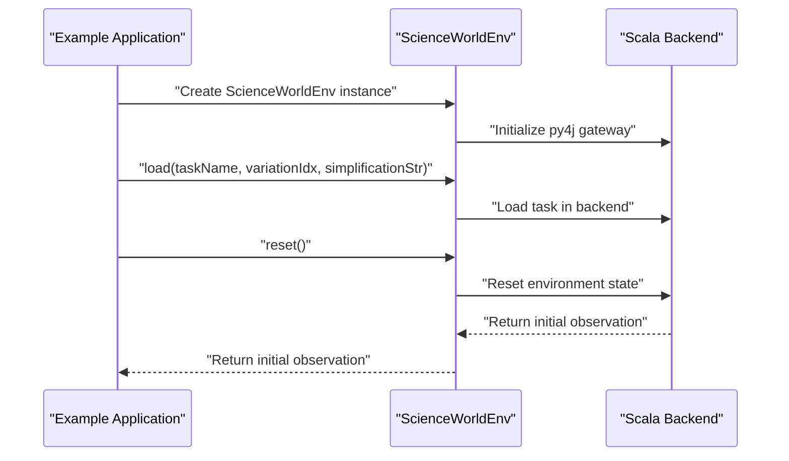
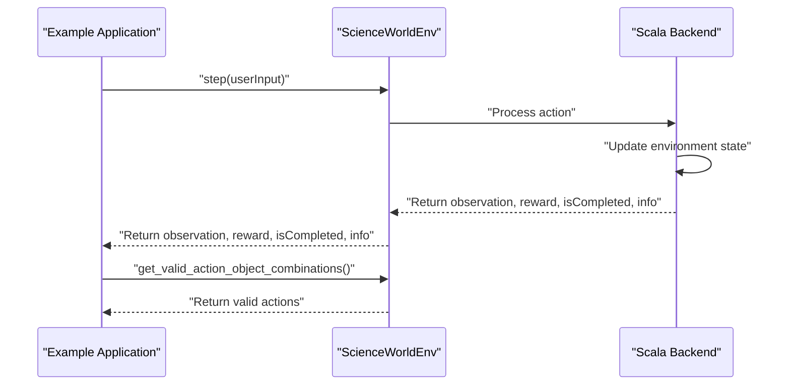

<!-- source: DeepWiki mcp.deepwiki.com · repo allenai/ScienceWorld · page 6 Example Applications · fetched 2026-10-26 -->

# Example Applications

<details>
<summary>Relevant source files</summary>

The following files were used as context for generating this wiki page:

- [.gitignore](.gitignore)
- [examples/human.py](examples/human.py)
- [examples/random_agent.py](examples/random_agent.py)
- [examples/scienceworld-web-server-example.py](examples/scienceworld-web-server-example.py)

</details>


This document provides an overview of the example applications included with ScienceWorld. These applications demonstrate how to interact with the ScienceWorld environment using different interfaces and approaches. For information about the underlying Python API that powers these applications, see [Python API](#3).

## Overview

ScienceWorld includes three main example applications that showcase different ways to interact with the environment:

1. **Human Console**: A command-line interface for direct human interaction
2. **Random Agent**: An automated agent that selects random actions for testing
3. **Web Interface**: A browser-based interface for easier interaction

Each example demonstrates a different approach to working with the ScienceWorld API and can serve as a starting point for developing custom applications.

Sources: [examples/human.py:1-222](), [examples/random_agent.py:1-213](), [examples/scienceworld-web-server-example.py:1-218]()

## Example Applications Architecture

The example applications share a common architecture, all interfacing with the ScienceWorld environment through the Python API.



Sources: [examples/human.py:25-153](), [examples/random_agent.py:8-137](), [examples/scienceworld-web-server-example.py:87-202]()

## Human Console

The Human Console provides a text-based interface for directly interacting with ScienceWorld through the command line.

### Features

- Interactive text-based interface
- Command history and auto-completion (when `prompt_toolkit` is available)
- Support for all ScienceWorld tasks and variations
- Environment simplification options
- Access to environment information (valid actions, objects, goal progress)
- Run history export

### Usage Flow



### Implementation Details

The Human Console is implemented in `examples/human.py` and consists of:

- `userConsole()` - Main function that handles user interaction with the environment
- `build_simplification_str()` - Helper function to build simplification strings
- Command-line argument parsing for configuration

The application initializes the ScienceWorld environment, loads a specified task and variation, and then enters an interactive loop where users can type commands and see the results.

Example command-line usage:
```
python examples/human.py --task-num 13 --var-num 0 --teleport --open-doors
```

Sources: [examples/human.py:25-153](), [examples/human.py:156-210]()

## Random Agent

The Random Agent is an automated test agent that selects random valid actions at each step, useful for baseline testing or exploring the environment.

### Features

- Fully automated interaction
- Runs multiple episodes on different task variations
- Records scores and statistics
- Saves run histories to JSON files
- Configurable environment simplifications

### Random Agent Flow



### Implementation Details

The Random Agent is implemented in `examples/random_agent.py` and consists of:

- `randomModel()` - Main function that runs the random agent
- Similar helper functions to the Human Console for simplifications and argument parsing

The agent runs for a specified number of episodes, randomly selecting valid actions at each step and recording the results.

Example command-line usage:
```
python examples/random_agent.py --task-num 13 --num-episodes 10 --env-step-limit 100
```

Sources: [examples/random_agent.py:8-137](), [examples/random_agent.py:140-209]()

## Web Interface

The Web Interface provides a browser-based way to interact with ScienceWorld, making it more accessible for users who prefer GUI interfaces.

### Features

- Browser-based user interface
- Task and variation selection through web forms
- HTML-formatted output with styling
- Session transcript export
- JSON history recording and export

### Web Interface Flow



### Implementation Details

The Web Interface is implemented in `examples/scienceworld-web-server-example.py` and consists of:

- `app()` - Main web application function
- `OutputLog` class - Helper for HTML formatting
- `saveJSONHistory()` - Function to export session history

The interface uses the `pywebio` library to create a simple web server that renders the environment output in HTML format.

Example command-line usage:
```
python examples/scienceworld-web-server-example.py --port 8080
```

After starting the server, users can connect to http://localhost:8080 in their web browser.

Sources: [examples/scienceworld-web-server-example.py:22-57](), [examples/scienceworld-web-server-example.py:59-81](), [examples/scienceworld-web-server-example.py:87-202]()

## Common Patterns Across Applications

All three example applications share common patterns for interacting with the ScienceWorld environment:

### Environment Initialization



### Action Execution Pattern



### Simplification Options

All examples support the same simplification options to make tasks easier or focus on specific aspects:

| Simplification | Flag | Description |
|----------------|------|-------------|
| Teleportation | `--teleport` | Allows instant movement to any location |
| Self-Watering Plants | `--self-watering-plants` | Plants don't need frequent watering |
| Open Containers | `--open-containers` | All containers are opened by default |
| Open Doors | `--open-doors` | All doors are opened by default |
| No Electrical | `--no-electrical` | Removes electrical actions from action space |
| Easy Preset | `--simplifications-preset easy` | Applies all simplifications |

Sources: [examples/human.py:156-174](), [examples/random_agent.py:140-158]()

## Building Custom Applications

The example applications demonstrate the key patterns for building custom applications with ScienceWorld:

1. **Initialize the environment**:
   ```python
   from scienceworld import ScienceWorldEnv
   env = ScienceWorldEnv()
   ```

2. **Load a task and variation**:
   ```python
   env.load(taskName, variationIdx, simplificationStr)
   ```

3. **Reset the environment**:
   ```python
   initialObs, initialDict = env.reset()
   ```

4. **Interaction loop**:
   ```python
   while not isCompleted:
       observation, reward, isCompleted, info = env.step(action)
       # Process results
       # Choose next action
   ```

5. **Access environment information**:
   ```python
   valid_actions = env.get_valid_action_object_combinations()
   goal_progress = env.get_goal_progress()
   ```

By following these patterns and examining the example applications, developers can create custom agents, interfaces, or evaluation systems for ScienceWorld.

Sources: [examples/human.py:37-48](), [examples/random_agent.py:20-40](), [examples/scienceworld-web-server-example.py:96-113]()

---

