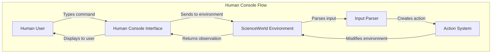
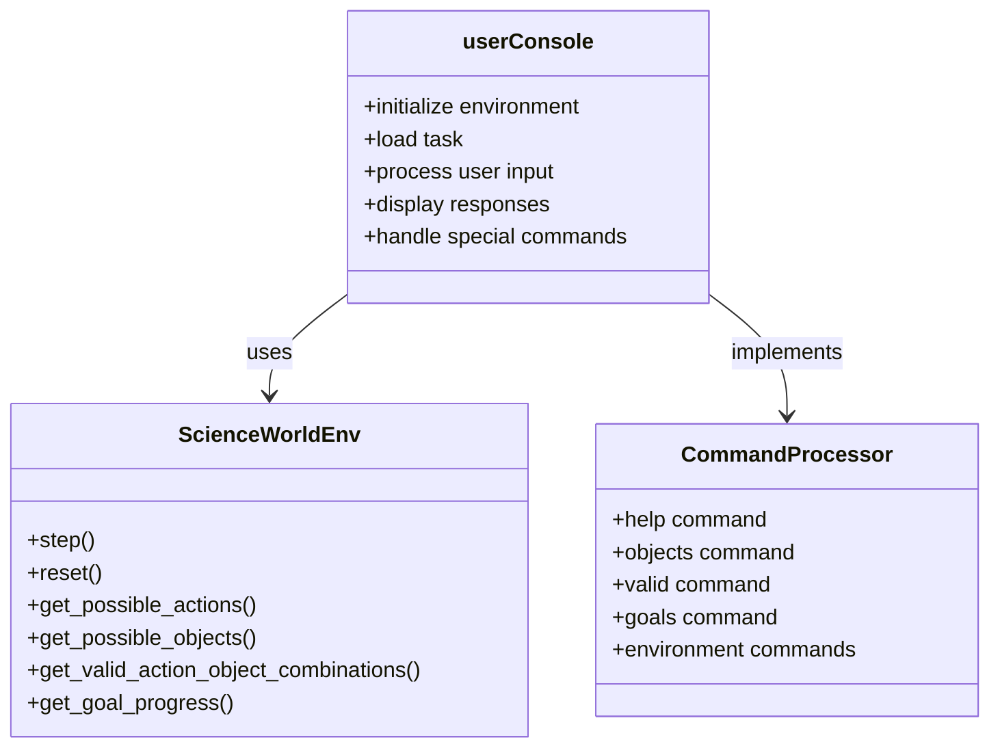
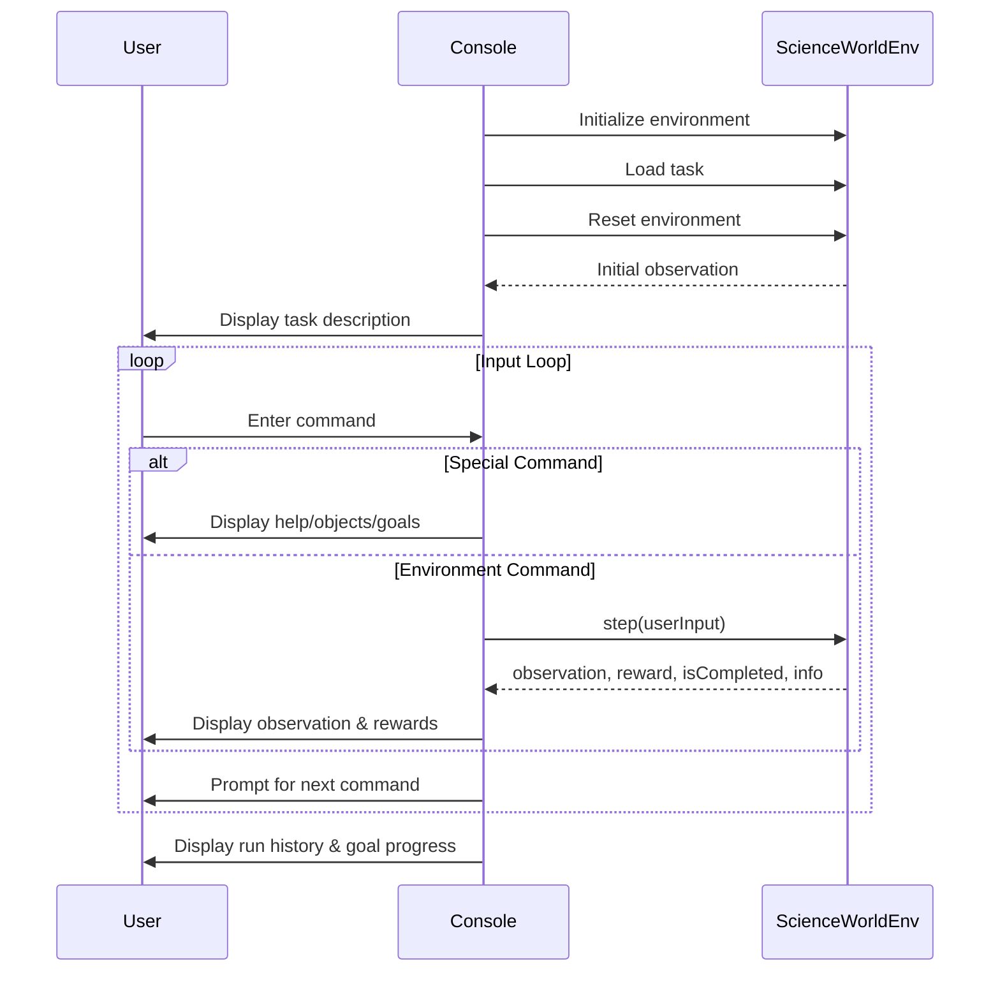
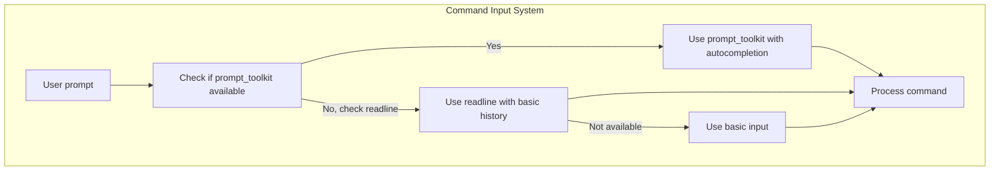
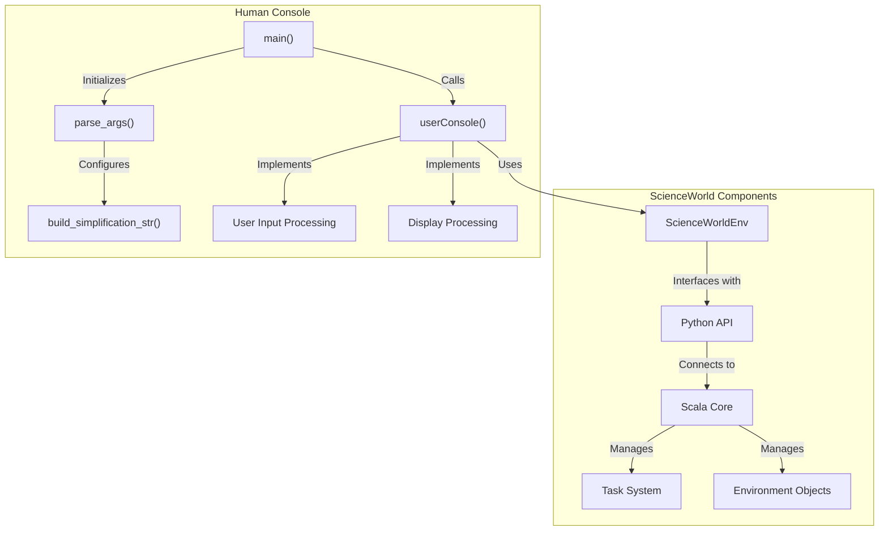

<!-- source: DeepWiki mcp.deepwiki.com · repo allenai/ScienceWorld · page 6.1 Human Console · fetched 2026-10-26 -->

# Human Console

<details>
<summary>Relevant source files</summary>

The following files were used as context for generating this wiki page:

- [examples/human.py](examples/human.py)
- [examples/random_agent.py](examples/random_agent.py)

</details>


The Human Console is an interactive text-based interface for manually exploring and interacting with ScienceWorld environments. This interface allows users to issue natural language commands, observe environment responses, and navigate through science tasks in a way that mimics how an agent would interact with the system.

For programmatic interaction with ScienceWorld, see [Python API](#3) and for automated testing using random actions, see [Random Agent](#6.2).

## Overview and Purpose

The Human Console serves several key functions in the ScienceWorld ecosystem:

1. **Environment Exploration**: Allows users to manually explore environments, understand object interactions, and debug tasks
2. **Task Testing**: Provides a way to test task definitions and verify goal conditions
3. **Agent Development**: Helps developers understand expected agent inputs/outputs for building automated agents
4. **Data Collection**: Enables manual collection of expert trajectories through environments



Sources: [examples/human.py:25-153]()

## Implementation Details

The Human Console is implemented as a Python script that interacts with the ScienceWorld environment through the Python API. The core functionality is provided by the `userConsole` function which handles user input and displays environment responses.



Sources: [examples/human.py:25-153](), [examples/human.py:7-22]()

### Key Components

1. **Command Input Processing**: The console captures user input with support for command history and autocomplete (when available through `prompt_toolkit`).
2. **Environment Interaction**: User commands are sent to the environment via the `env.step()` method.
3. **Special Commands**: Several utility commands are implemented:
   - `help`: Lists possible actions
   - `objects`: Lists possible objects
   - `valid`: Shows valid action-object combinations
   - `goals`: Displays progress on subgoals
   - `exit`/`quit`: Terminates the console session

Sources: [examples/human.py:93-138]()

## Command Line Interface

The Human Console can be launched from the command line with various configuration options to control tasks, variations, and environment simplifications.

### Command Line Arguments

| Argument | Description | Default |
|----------|-------------|---------|
| `--jar_path` | Path to ScienceWorld jar file | [uses built-in] |
| `--task-num` | Task index to play | 13 |
| `--var-num` | Task variation to play | 0 |
| `--env-step-limit` | Maximum steps per episode | 100 |
| `--simplifications-preset` | Preset simplification options | None |
| `--teleport` | Enable teleportation between locations | False |
| `--self-watering-plants` | Plants don't need frequent watering | False |
| `--open-containers` | All containers start open | False |
| `--open-doors` | All doors start open | False |
| `--no-electrical` | Remove electrical actions | False |

Sources: [examples/human.py:177-209]()

## User Interaction Flow

The Human Console follows a specific flow from initialization to user interaction:



Sources: [examples/human.py:37-153]()

## Command Processing and Autocompletion

The Human Console includes two modes of operation depending on whether the `prompt_toolkit` library is available:

1. **Enhanced Mode**: When `prompt_toolkit` is available, the console provides:
   - Command history navigation (up/down arrows)
   - Tab-completion for valid actions
   - In-memory history storage

2. **Basic Mode**: When `prompt_toolkit` is not available:
   - Basic command history through `readline` if available
   - No autocompletion, but valid actions are displayed



Sources: [examples/human.py:8-22](), [examples/human.py:127-140]()

## Environment Information Display

When the Human Console starts, it displays extensive information about the environment to help users understand what actions and objects are available:

- Task names and descriptions
- Possible actions
- Possible objects and their referents
- Valid action-object combinations
- Object types and properties
- Gold action sequence (solution path)
- Task variation information

This information provides users with the context needed to effectively navigate and interact with the environment.

Sources: [examples/human.py:47-89]()

## Example Session

A typical Human Console session follows this pattern:

1. **Initialization**: The environment is loaded with a specified task and variation
2. **Initial Display**: Task information and environment details are shown
3. **First Action**: The session starts with "look around" to observe the environment 
4. **Command Loop**:
   - User enters a command
   - Environment processes the command
   - Results (observation, reward, score) are displayed
   - User is prompted for the next command
5. **Session End**: Upon exit, run history and goal progress are displayed

Sources: [examples/human.py:93-153]()

## Running the Human Console

To launch the Human Console, run the `human.py` script with appropriate arguments:

```
python examples/human.py --task-num 13 --var-num 0 --env-step-limit 100
```

For easier gameplay, you can add simplifications:

```
python examples/human.py --task-num 13 --simplifications-preset easy
```

Or select specific simplifications:

```
python examples/human.py --task-num 13 --teleport --open-containers
```

Sources: [examples/human.py:211-222]()

## Integration with ScienceWorld

The Human Console integrates with the core ScienceWorld architecture as follows:



Sources: [examples/human.py:212-218]()

## Special Features

### Command History

The Human Console implements command history in two ways:

1. **In-Memory History**: When using `prompt_toolkit`, command history is stored in memory and can be navigated using arrow keys
2. **Readline History**: As a fallback, the standard `readline` library is used for basic command history

Sources: [examples/human.py:8-22](), [examples/human.py:27-29]()

### Autocompletion

When `prompt_toolkit` is available, the console provides tab-completion for valid action-object combinations. This helps users discover available commands and reduces typing errors.

Sources: [examples/human.py:131-134]()

### Environment Simplifications

The Human Console supports various simplifications to make gameplay easier:

1. **Teleportation**: Allows instant movement to any location
2. **Self-Watering Plants**: Removes the need to frequently water plants
3. **Open Containers**: All containers start in an open state
4. **Open Doors**: All doors start in an open state
5. **No Electrical Actions**: Removes electrical actions to simplify the action space

These simplifications can be enabled individually or through the "easy" preset.

Sources: [examples/human.py:156-174](), [examples/human.py:193-196]()

## Related Components

The Human Console is one of several interfaces for interacting with ScienceWorld:

- **Human Console**: Manual text-based interaction (this document)
- **Random Agent**: Automated exploration with random actions (see [Random Agent](#6.2))
- **Web Interface**: Browser-based interaction (see [Web Interface](#6.3))
- **Custom Agent**: Programmatic interaction through the Python API (see [Python API](#3))

Each interface serves different purposes, from manual exploration and testing to automated agent evaluation.

---

