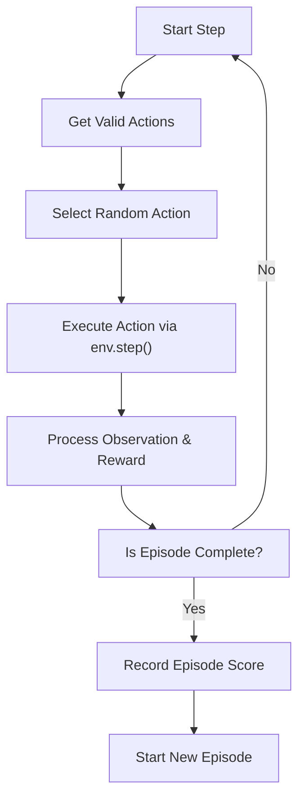
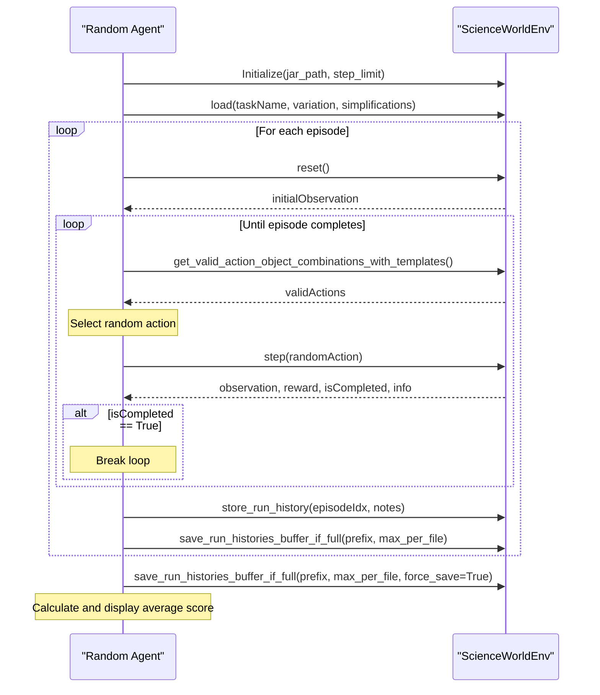
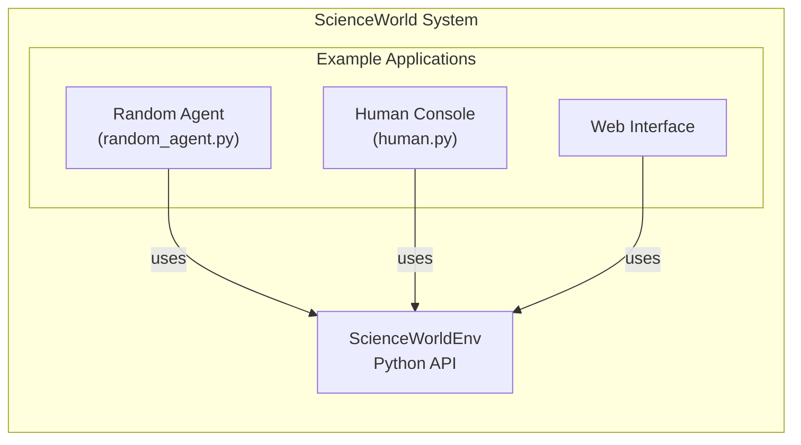

<!-- source: DeepWiki mcp.deepwiki.com · repo allenai/ScienceWorld · page 6.2 Random Agent · fetched 2026-10-26 -->

# Random Agent

<details>
<summary>Relevant source files</summary>

The following files were used as context for generating this wiki page:

- [examples/human.py](examples/human.py)
- [examples/random_agent.py](examples/random_agent.py)

</details>


The Random Agent is an example application in ScienceWorld that demonstrates how to create an automated agent for interacting with the environment. This agent selects actions randomly from the set of valid actions and can be used as a baseline for evaluating more sophisticated agents or for testing environment functionality.

For information about other example applications, see [Example Applications](#6) and for the Human Console interface, see [Human Console](#6.1).

## Overview

The Random Agent provides a simple implementation that:

1. Initializes the ScienceWorld environment
2. Loads a specified task with optional simplifications
3. Runs multiple episodes, selecting random valid actions at each step
4. Records performance metrics and episode histories

This serves both as an example for developing custom agents and as a baseline for evaluation.

```mermaid
graph TD
    subgraph "Random Agent"
        INIT["Initialize Environment"]
        LOAD["Load Task"]
        RESET["Reset Environment"]
        SELECT["Select Random Action"]
        STEP["Step Environment"]
        RECORD["Record Results"]
    end
    
    subgraph "ScienceWorld Environment"
        ENV["ScienceWorldEnv"]
        VALID["Valid Actions"]
        OBS["Observations"]
        REWARD["Rewards"]
        HISTORY["Run History"]
    end
    
    INIT -->|"initialize"| ENV
    LOAD -->|"load(taskName, variation, simplifications)"| ENV
    RESET -->|"reset()"| ENV
    ENV -->|"get_valid_action_object_combinations()"| VALID
    VALID -->|"provides"| SELECT
    SELECT -->|"action"| STEP
    STEP -->|"step(action)"| ENV
    ENV -->|"observation, reward, isCompleted, info"| STEP
    STEP --> RECORD
    RECORD -->|"store_run_history()"| HISTORY
```



Sources: [examples/random_agent.py:8-137]()

## Implementation

The Random Agent is implemented in the `randomModel` function in `examples/random_agent.py`. This function initializes the environment, runs episodes, and reports results.

### Core Components

```mermaid
classDiagram
    class "randomModel()" {
        +Initialize environment
        +Load task
        +Run episodes
        +Report results
    }
    
    class "ScienceWorldEnv" {
        +load(taskName, variation, simplifications)
        +reset()
        +step(action)
        +get_valid_action_object_combinations()
        +store_run_history()
        +save_run_histories_buffer_if_full()
    }
    
    class "Episode Loop" {
        +Reset environment
        +Select random actions
        +Track scores
        +Store history
    }
    
    "randomModel()" --> "ScienceWorldEnv": uses
    "randomModel()" --> "Episode Loop": contains
    "Episode Loop" --> "ScienceWorldEnv": interacts with
```

Sources: [examples/random_agent.py:8-137]()

### Random Action Selection

The Random Agent selects random actions from the set of valid actions at each step:



The agent uses the `get_valid_action_object_combinations_with_templates()` method to obtain valid actions and then randomly selects one using Python's `random.choice()` function.

Sources: [examples/random_agent.py:89-93]()

## Usage

The Random Agent can be run from the command line with various configuration options.

### Command-Line Arguments

The following table summarizes the key command-line arguments:

| Argument | Description | Default |
|----------|-------------|---------|
| `--jar_path` | Path to ScienceWorld jar file | Use builtin |
| `--task-num` | Task number to play | 13 |
| `--env-step-limit` | Maximum steps per episode | 100 |
| `--num-episodes` | Number of episodes to play | 5 |
| `--seed` | Seed for random action selection | None |
| `--output-path-prefix` | Path prefix for saving episode transcripts | "save-histories" |

Sources: [examples/random_agent.py:164-182]()

### Simplification Options

The Random Agent supports various simplifications to make the environment easier:

| Simplification | Description |
|----------------|-------------|
| `--teleport` | Enables instant movement between locations |
| `--self-watering-plants` | Plants don't require frequent watering |
| `--open-containers` | All containers are opened by default |
| `--open-doors` | All doors are opened by default |
| `--no-electrical` | Removes electrical actions |
| `--simplifications-preset easy` | Applies all simplifications |

Sources: [examples/random_agent.py:140-158](), [examples/random_agent.py:184-196]()

## Example Workflow

Below is the typical workflow of the Random Agent during execution:



Sources: [examples/random_agent.py:8-137]()

## Output and Analysis

The Random Agent provides several types of output:

1. **Per-step information**: For each step, it displays the observation, reward, and score
2. **Episode summaries**: After each episode, it shows goal progress and final score
3. **Run history**: Saved episode transcripts for further analysis
4. **Performance summary**: Average score across all episodes

This information is useful for:
- Baseline performance assessment
- Environment testing
- Identifying task difficulty

Sources: [examples/random_agent.py:104-134]()

## Integration with ScienceWorld

The Random Agent is part of the example applications in ScienceWorld, demonstrating how to create automated agents. It uses the same Python API as other applications like the Human Console.



Sources: [examples/random_agent.py:4-5](), [examples/human.py:4-5]()

## Running the Random Agent

To run the Random Agent:

1. Ensure ScienceWorld is installed
2. Run the script with desired parameters:

```
python examples/random_agent.py --task-num 5 --num-episodes 10 --env-step-limit 150
```

For multiple runs with different random seeds:

```
python examples/random_agent.py --task-num 5 --num-episodes 10 --seed 42
python examples/random_agent.py --task-num 5 --num-episodes 10 --seed 43
```

Sources: [examples/random_agent.py:203-213]()

---

