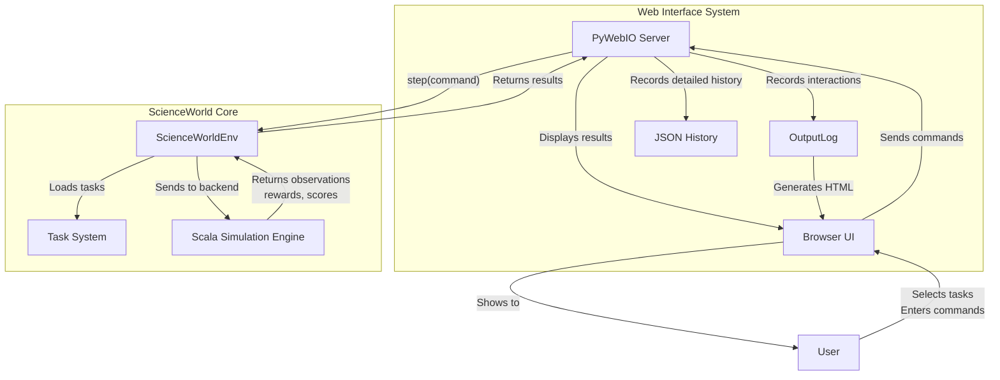
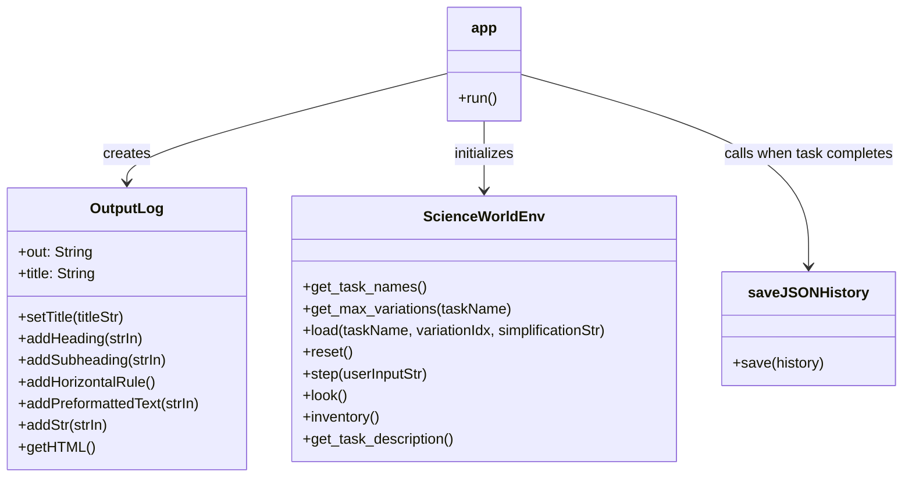
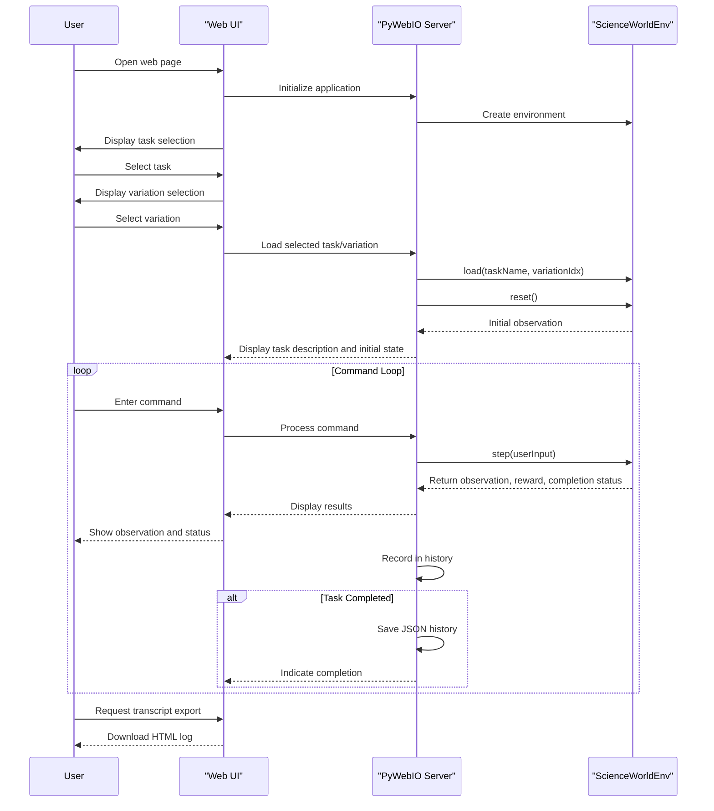
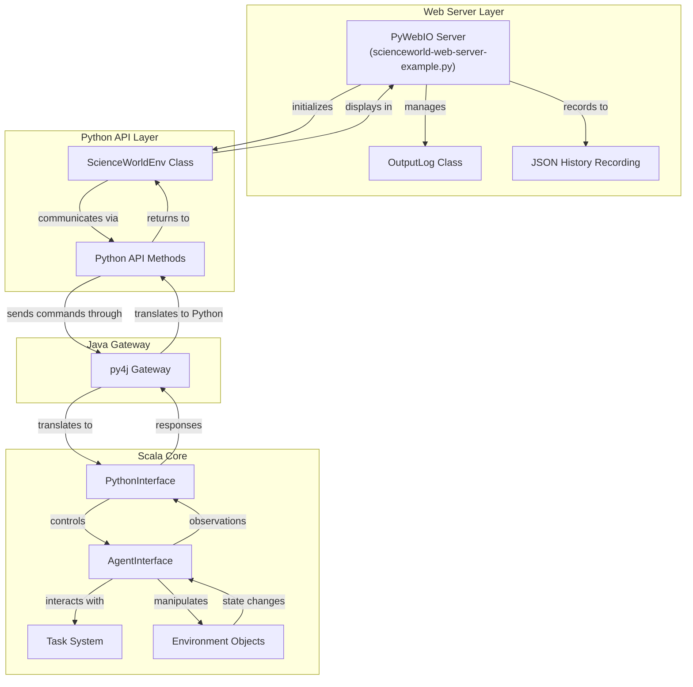

<!-- source: DeepWiki mcp.deepwiki.com · repo allenai/ScienceWorld · page 6.3 Web Interface · fetched 2026-10-26 -->

# Web Interface

<details>
<summary>Relevant source files</summary>

The following files were used as context for generating this wiki page:

- [.gitignore](.gitignore)
- [examples/scienceworld-web-server-example.py](examples/scienceworld-web-server-example.py)

</details>


This document describes the web-based interface for ScienceWorld, which allows users to interact with the simulation environment through a web browser. The web interface provides an accessible way to explore ScienceWorld without requiring command-line skills or programming knowledge.

For information about other ways to interact with ScienceWorld, see [Human Console](#6.1) and [Random Agent](#6.2).

## Overview

The ScienceWorld web interface is a browser-based front-end that connects to the ScienceWorld environment. It's implemented as a Python web server using the PyWebIO library, which renders interactive elements directly in the browser. The interface allows users to:

- Select tasks and variations
- Send natural language commands to the environment
- View observations and feedback
- Track progress through rewards and scores
- Export interaction transcripts for future reference



Sources: [examples/scienceworld-web-server-example.py:86-202]()

## Installation and Setup

To use the web interface, you need to:

1. Install ScienceWorld according to the standard installation instructions
2. Install the PyWebIO library:

```
pip install -U pywebio
```

3. Run the web server example script:

```
python examples/scienceworld-web-server-example.py
```

4. Open a web browser and navigate to `http://localhost:8080`

The server can be configured with custom ports and debug settings through command-line arguments:

```
python examples/scienceworld-web-server-example.py --port 9000 --debug
```

Sources: [examples/scienceworld-web-server-example.py:1-8](), [examples/scienceworld-web-server-example.py:205-218]()

## Architecture Components

The web interface is composed of several key components that work together to provide a complete interactive experience.



### PyWebIO Server

The server is built with PyWebIO, a library for creating interactive web applications using pure Python. The server handles:

- Starting and configuring the web application
- Rendering UI elements
- Processing user input
- Managing the interaction between the user and ScienceWorld

### OutputLog

The `OutputLog` class is responsible for formatting the HTML output for the web interface and transcript export. It provides methods for:

- Adding headings and subheadings
- Formatting preformatted text blocks
- Adding strings and horizontal rules
- Generating complete HTML documents

### Session Recording

The interface includes tools for recording interaction sessions:

- HTML logs for readable transcripts
- JSON history for structured data analysis
- Automatic saving of completed sessions

Sources: [examples/scienceworld-web-server-example.py:22-56](), [examples/scienceworld-web-server-example.py:59-81]()

## User Interaction Flow

The web interface follows a specific flow for user interaction with the ScienceWorld environment:



### Task Selection

When starting the web interface, users first select:

1. A task from the available ScienceWorld tasks
2. A variation index for the selected task

### Command Loop

After task selection, the interface enters the main command loop:

1. User enters a natural language command
2. Command is sent to the ScienceWorld environment
3. Environment processes the command and returns:
   - Text observation
   - Reward value
   - Current score
   - Completion status
4. Results are displayed in the web UI
5. Loop continues until the task is completed or the user exits

### Session Export

The interface provides options to export the interaction:

- HTML transcript through the "export transcript" button
- JSON recordings saved automatically upon task completion

Sources: [examples/scienceworld-web-server-example.py:87-202]()

## User Interface Elements

The web interface presents several key UI elements organized to facilitate interaction with ScienceWorld:

| Element | Description |
|---------|-------------|
| Task Selection Dropdown | Displays all available ScienceWorld tasks for selection |
| Variation Input | Text input for selecting the task variation index |
| Task Description | Displays the current task's description |
| Interaction History | Shows previous observations and commands |
| Command Input | Text field for entering natural language commands |
| Status Display | Shows current score, reward, and completion status |
| Export Button | Provides option to download the transcript as HTML |

### Example Interface Flow

1. User is presented with task selection
2. After selecting a task and variation, the task description is displayed
3. Initial "look around" command is automatically executed
4. Each move is numbered and the interaction history grows as commands are entered
5. Score and status are updated after each command
6. Transcript can be exported at any point

Sources: [examples/scienceworld-web-server-example.py:93-162]()

## Data Recording and Export

The web interface maintains two types of records during interaction:

### HTML Transcript

- Formatted with headings for moves
- Contains all observations and user inputs
- Color-coded completion status
- Exportable as HTML file
- Named with task and timestamp

### JSON History

The interface automatically records detailed session information in JSON format:

- All observations and commands
- Rewards and scores
- Task information
- Environment state at each step
- Saved to the "recordings/" directory

Example JSON history contents:

```json
[
  {
    "observation": "You are in...",
    "reward": 0,
    "score": 0.0,
    "isCompleted": false,
    "userInput": "look around",
    "taskName": "task_name",
    "taskDescription": "Task description...",
    "look": "Look description...",
    "inventory": "Inventory contents...",
    "variationIdx": 0,
    "consoleMoveCount": 0
  },
  // Additional moves...
]
```

The recording system follows a specific naming convention for easy identification:
```
recording-[taskName]-var[variationIdx]-[result]-timestamp[dateTime].json
```

Sources: [examples/scienceworld-web-server-example.py:59-81](), [examples/scienceworld-web-server-example.py:160-185](), [.gitignore:5-6]()

## Integration with ScienceWorld Core

The web interface connects to the core ScienceWorld system through the Python API, providing a bridge between the user's browser and the Scala simulation backend.



### Key Integration Points

1. **Environment Initialization**:
   The web server creates a `ScienceWorldEnv` instance to connect to the Scala backend.
   ```python
   env = ScienceWorldEnv("", serverPath=None, envStepLimit=10_000)
   ```

2. **Task Management**:
   The interface accesses task information through API methods:
   - `get_task_names()` - Lists available tasks
   - `get_max_variations()` - Gets number of variations for a task
   - `load()` - Loads a specific task and variation
   - `get_task_description()` - Retrieves human-readable task description

3. **Command Processing**:
   User commands are sent to the environment using the `step()` method, which returns:
   - Text observation
   - Reward value (numeric)
   - Completion status (boolean)
   - Additional information dictionary (containing score)

4. **Environment Queries**:
   Additional environment state can be queried using:
   - `look()` - Get detailed description of current location
   - `inventory()` - List items carried by the agent

Sources: [examples/scienceworld-web-server-example.py:96-114](), [examples/scienceworld-web-server-example.py:140-141]()

## Conclusion

The ScienceWorld web interface provides an accessible way to interact with the simulation environment through a standard web browser. It offers:

- Easy task selection and configuration
- Natural language command input
- Clear presentation of observations and status
- Comprehensive logging and export functionality
- Integration with the core ScienceWorld simulation engine

This interface is particularly useful for demonstrations, manual exploration of tasks, and collecting human interaction data without requiring users to have programming experience or use command-line tools.

---

