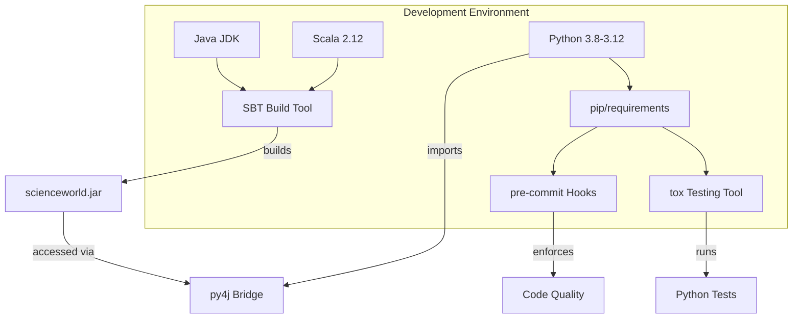
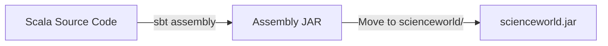
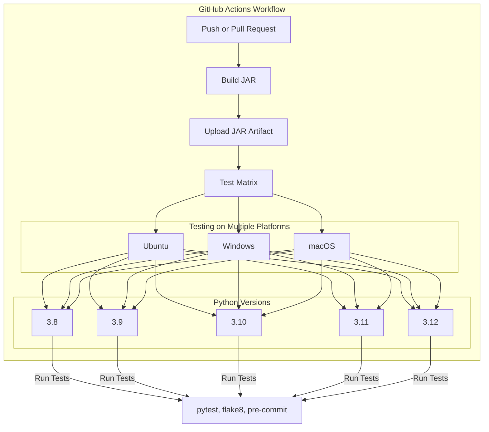
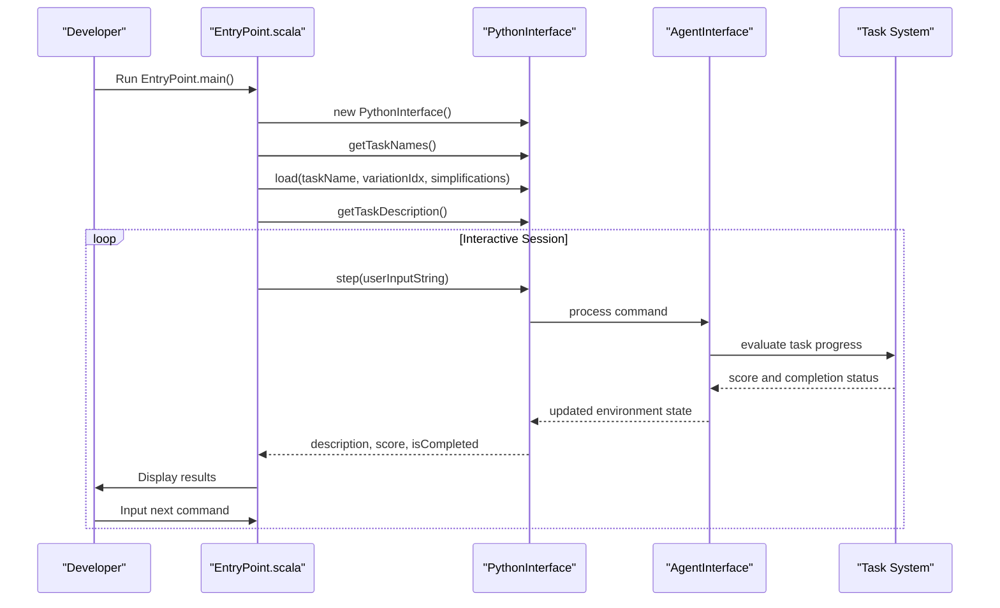
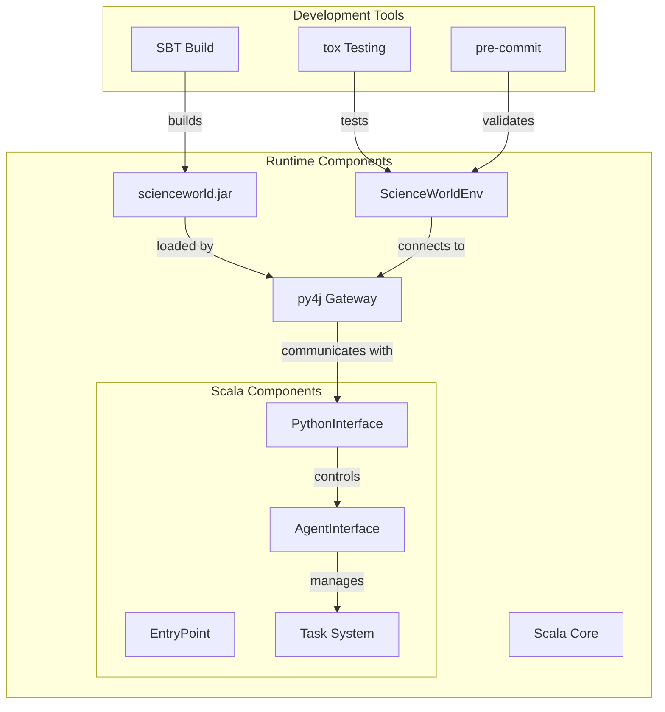

<!-- source: DeepWiki mcp.deepwiki.com · repo allenai/ScienceWorld · page 7 Developer Guide · fetched 2026-10-26 -->

# Developer Guide

<details>
<summary>Relevant source files</summary>

The following files were used as context for generating this wiki page:

- [.github/workflows/tests.yaml](.github/workflows/tests.yaml)
- [.pre-commit-config.yaml](.pre-commit-config.yaml)
- [MANIFEST.in](MANIFEST.in)
- [requirements-dev.txt](requirements-dev.txt)
- [requirements.txt](requirements.txt)
- [simulator/package.sh](simulator/package.sh)
- [simulator/src/main/scala/scienceworld/EntryPoint.scala](simulator/src/main/scala/scienceworld/EntryPoint.scala)
- [tox.ini](tox.ini)

</details>


This guide provides essential information for developers who want to contribute to or modify the ScienceWorld codebase. It covers building from source, testing, the continuous integration pipeline, and development best practices. For installation instructions for regular users, see [Installation & Setup](#1.1).

## Development Environment Overview

ScienceWorld is a hybrid Python-Scala project that uses py4j to bridge between Python and JVM code. The core simulation logic is implemented in Scala, while the Python layer provides an accessible API for agent development.



Sources: [requirements.txt](), [requirements-dev.txt](), [simulator/package.sh]()

## Building from Source

To build ScienceWorld from source, you'll need to compile the Scala code into a JAR file and then set up the Python environment.

### Building the JAR

The Scala component is built using SBT (Scala Build Tool):



Use the `package.sh` script to automate this process:

```bash
./simulator/package.sh
```

This script:
1. Changes to the simulator directory
2. Runs `sbt assembly` to create a fat JAR with all dependencies
3. Moves the JAR to the `scienceworld` directory for use by the Python code

Sources: [simulator/package.sh]()

### Python Environment Setup

After building the JAR, set up the Python environment:

1. Install the development dependencies:
   ```bash
   pip install -r requirements-dev.txt
   ```

2. Install ScienceWorld in development mode:
   ```bash
   pip install -e .
   ```

Sources: [requirements-dev.txt](), [.github/workflows/tests.yaml:56-62]()

## Testing Framework

ScienceWorld uses tox for testing across multiple Python versions and environments.

### Running Tests

To run the full test suite:

```bash
tox
```

To run tests for a specific Python version:

```bash
tox -e py38  # For Python 3.8
```

To run only linting checks:

```bash
tox -e flake8
```

To run pre-commit checks:

```bash
tox -e precommit
```

### Test Matrix

The test suite runs across multiple platforms and Python versions:

| OS | Python Versions |
|----|-----------------|
| Ubuntu | 3.8, 3.9, 3.10, 3.11, 3.12 |
| Windows | 3.8, 3.9, 3.10, 3.11, 3.12 |
| macOS | 3.8, 3.9, 3.10, 3.11, 3.12 |

Sources: [tox.ini](), [.github/workflows/tests.yaml:24-32]()

## CI/CD Pipeline

ScienceWorld uses GitHub Actions for continuous integration and testing.



The CI workflow:
1. Compiles the Scala code into a JAR
2. Uploads the JAR as a build artifact
3. Downloads the JAR on each test environment
4. Tests across a matrix of operating systems and Python versions
5. Runs pytest, flake8, and pre-commit checks

Sources: [.github/workflows/tests.yaml]()

## Code Quality Tools

ScienceWorld uses pre-commit hooks to maintain code quality.

### Setting Up Pre-commit

```bash
pip install pre-commit
pre-commit install
```

### Running Pre-commit Checks

To run pre-commit checks on all files:

```bash
pre-commit run --all-files
```

### Included Checks

| Check Type | Description |
|------------|-------------|
| Syntax | Check Python AST, YAML, JSON |
| Formatting | End-of-file fixers, line endings, trailing whitespace |
| Security | Detect private keys and merge conflicts |
| Shell scripts | ShellCheck validation |
| Spelling | codespell for detecting typos |

Sources: [.pre-commit-config.yaml]()

## Development Workflow

### Entry Point for Interactive Development

The EntryPoint class in Scala provides an interactive console for testing the simulation:



This interactive mode allows you to:
1. Select a task from the available task list
2. Apply simplifications to the environment
3. Test actions with immediate feedback
4. View possible actions and object referents
5. Check task progress and goal sequences

Sources: [simulator/src/main/scala/scienceworld/EntryPoint.scala]()

## Packaging and Distribution

### MANIFEST.in

The `MANIFEST.in` file specifies which files are included when the Python package is built:

```
include LICENSE
include README.md
include requirements.txt
include requirements-dev.txt

include scienceworld/scienceworld-*.jar
include scienceworld/object_type_ids.tsv
```

This ensures the JAR file and any necessary resources are properly bundled with the package.

Sources: [MANIFEST.in]()

### Building the Python Package

To build a distributable package:

```bash
python -m build
```

This creates both source and wheel distributions in the `dist` directory.

## Contributing Guidelines

When contributing to ScienceWorld:

1. **Ensure tests pass**: Run `tox` to verify tests pass on all supported platforms and Python versions

2. **Follow code style**: Run pre-commit checks with `pre-commit run --all-files`

3. **Build and test locally**: Before submitting a PR, build the JAR and install the package locally

4. **Cross-platform compatibility**: Consider compatibility across Linux, Windows, and macOS

5. **Documentation**: Update documentation to reflect your changes

## Troubleshooting

### Common Build Issues

- **Missing JAR file**: Ensure `./simulator/package.sh` completed successfully
- **py4j connection issues**: Verify Java is installed and accessible
- **Test failures**: Use `tox -e py310 -- -v` for verbose test output
- **Pre-commit failures**: Run `pre-commit run --all-files` to identify and fix issues

## Technical Architecture Reference

The following diagram shows how the development components connect to the runtime architecture:



Sources: [.github/workflows/tests.yaml](), [simulator/package.sh](), [simulator/src/main/scala/scienceworld/EntryPoint.scala]()

---

