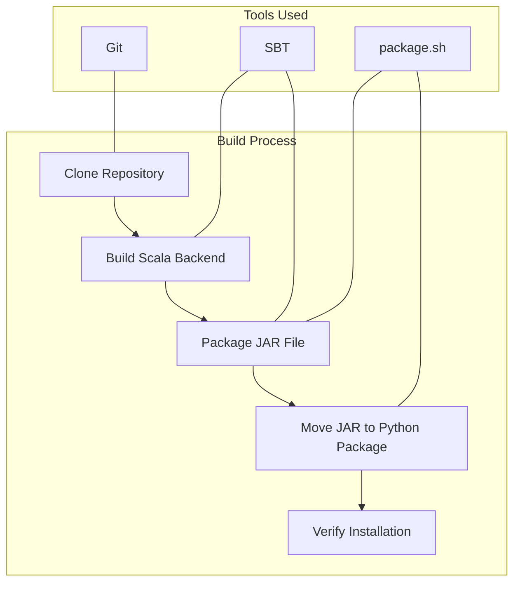
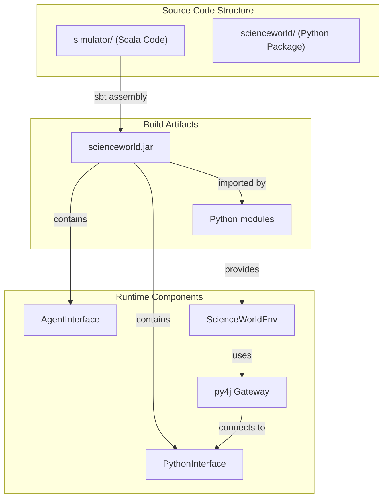
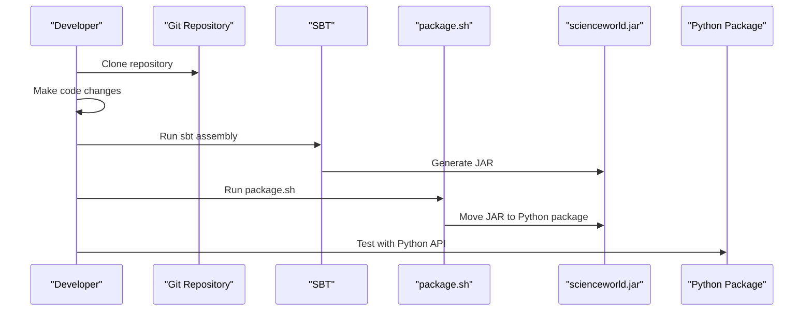

<!-- source: DeepWiki mcp.deepwiki.com · repo allenai/ScienceWorld · page 7.1 Building from Source · fetched 2026-10-26 -->

# Building from Source

<details>
<summary>Relevant source files</summary>

The following files were used as context for generating this wiki page:

- [.pre-commit-config.yaml](.pre-commit-config.yaml)
- [simulator/build.sbt](simulator/build.sbt)
- [simulator/package.sh](simulator/package.sh)
- [simulator/src/main/scala/scienceworld/runtime/AgentInterface.scala](simulator/src/main/scala/scienceworld/runtime/AgentInterface.scala)

</details>


This document provides instructions for building ScienceWorld from source code. It covers the prerequisites, build process, and verification steps needed to successfully compile the ScienceWorld environment from its Scala and Python components. For information about running the built application, see [Installation & Setup](#1.1).

## Prerequisites

Before building ScienceWorld, ensure you have the following tools installed on your system:

| Tool | Version | Purpose |
|------|---------|---------|
| Java Development Kit (JDK) | 8 or higher | Required for Scala compilation |
| Scala | 2.12.9 | Programming language for the core environment |
| SBT (Scala Build Tool) | Latest | Build system for Scala projects |
| Python | 3.6 or higher | Required for the Python interface |
| Git | Latest | Version control to clone the repository |

## Build Process Overview



Sources: [simulator/build.sbt](), [simulator/package.sh]()

## Getting the Source Code

Clone the ScienceWorld repository from GitHub:

```bash
git clone https://github.com/allenai/ScienceWorld.git
cd ScienceWorld
```

## Building the Scala Backend

The Scala backend is the core of ScienceWorld, containing all the simulation logic and environment objects. It's compiled into a JAR file that's used by the Python interface.

```mermaid
classDiagram
    class "build.sbt" {
        name: scienceworld-scala
        version: 1.2.2
        scalaVersion: 2.12.9
        dependencies()
        mainClass()
    }
    
    class "PythonInterface" {
        main class
        handles Python<->Scala bridge
    }
    
    class "package.sh" {
        runs sbt assembly
        moves JAR to Python directory
    }
    
    "build.sbt" --> "PythonInterface" : specifies
    "package.sh" --> "build.sbt" : reads from
```

Sources: [simulator/build.sbt](), [simulator/package.sh](), [simulator/src/main/scala/scienceworld/runtime/AgentInterface.scala]()

### Step 1: Build the JAR file

Navigate to the `simulator` directory and run the build script:

```bash
cd simulator
./package.sh
```

This script performs the following actions:
1. Runs `sbt assembly` to compile the Scala code and package it into a JAR file
2. Extracts the version number from `build.sbt`
3. Moves the compiled JAR to the `scienceworld` Python package directory as `scienceworld.jar`

If you prefer to build manually instead of using the script, you can run:

```bash
cd simulator
sbt assembly
```

This will create a JAR file at `target/scala-2.12/scienceworld-scala-assembly-1.2.2.jar` (the version number may differ based on your build.sbt).

## Build Configuration

ScienceWorld's build is configured through the `build.sbt` file, which specifies:

- Project name: `scienceworld-scala`
- Version: `1.2.2`
- Scala version: `2.12.9`
- Dependencies:
  - scala-parser-combinators (for parsing natural language commands)
  - py4j (for Java-Python interoperability)
- Main class: `scienceworld.runtime.pythonapi.PythonInterface`

Sources: [simulator/build.sbt]()

## System Components and Build Artifacts



Sources: [simulator/build.sbt](), [simulator/package.sh](), [simulator/src/main/scala/scienceworld/runtime/AgentInterface.scala]()

## Verifying the Build

After building, verify that the JAR file exists in the expected location:

```bash
ls -l ../scienceworld/scienceworld.jar
```

You should see the `scienceworld.jar` file with a recent timestamp.

## Troubleshooting Common Build Issues

### Missing Dependencies

If SBT fails to resolve dependencies, ensure your system can access the Maven Central repository and the custom resolvers specified in build.sbt:

```
resolvers += "jetbrains-intellij-dependencies" at "https://packages.jetbrains.team/maven/p/ij/intellij-dependencies"
```

### Permission Issues with package.sh

If you encounter permission issues when running the package.sh script, make it executable:

```bash
chmod +x package.sh
```

### Java Version Mismatch

If you encounter errors related to Java versions, ensure you're using a compatible JDK version. ScienceWorld was developed with JDK 8 compatibility in mind.

## Development Workflow



Sources: [simulator/build.sbt](), [simulator/package.sh](), [.pre-commit-config.yaml]()

## Using Pre-commit Hooks

ScienceWorld uses pre-commit hooks to maintain code quality. These hooks perform checks like:
- Code formatting
- Syntax checking
- Detecting potential issues

To set up pre-commit hooks for development:

1. Install pre-commit: `pip install pre-commit`
2. In the repository root, run: `pre-commit install`

This ensures all commits meet the project's quality standards.

Sources: [.pre-commit-config.yaml]()

## Conclusion

After successfully building ScienceWorld from source, you should have a `scienceworld.jar` file in the `scienceworld` Python package directory. This JAR file contains the Scala backend that powers the simulation environment, while the Python package provides a convenient API for interacting with it.

---

