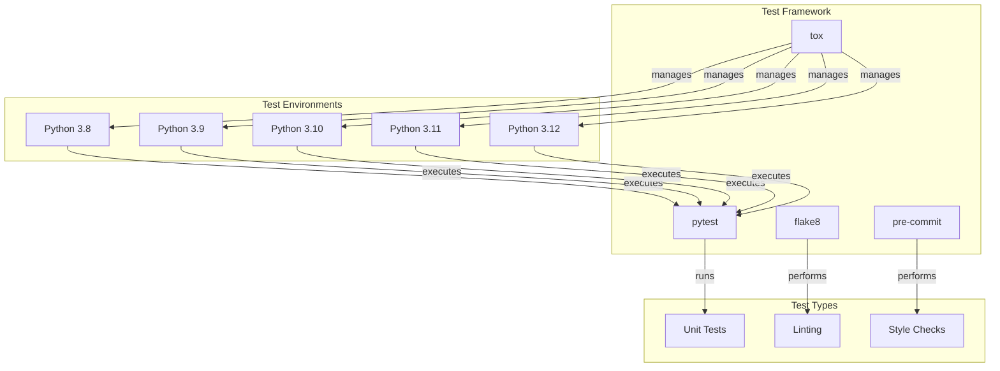
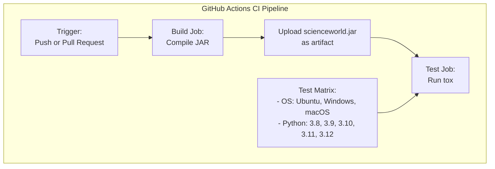
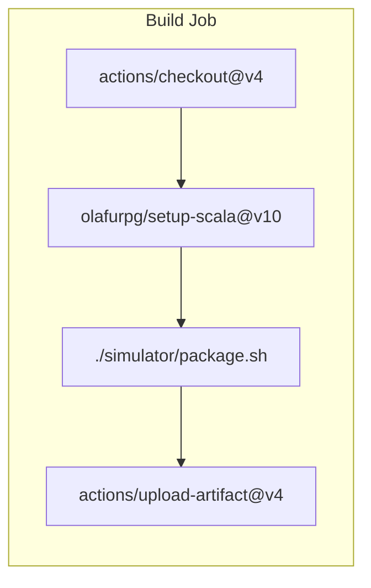
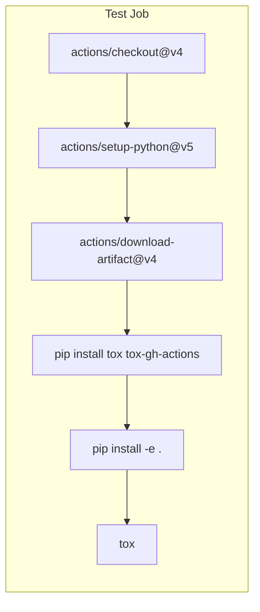

<!-- source: DeepWiki mcp.deepwiki.com · repo allenai/ScienceWorld · page 7.2 Testing · fetched 2026-10-26 -->

# Testing

<details>
<summary>Relevant source files</summary>

The following files were used as context for generating this wiki page:

- [.github/workflows/tests.yaml](.github/workflows/tests.yaml)
- [MANIFEST.in](MANIFEST.in)
- [requirements-dev.txt](requirements-dev.txt)
- [requirements.txt](requirements.txt)
- [simulator/src/main/scala/scienceworld/EntryPoint.scala](simulator/src/main/scala/scienceworld/EntryPoint.scala)
- [tox.ini](tox.ini)

</details>


This document outlines the testing framework and procedures for ScienceWorld. It covers how to run tests locally, the automated testing infrastructure, and the different types of tests available in the codebase. For information about building from source, see [Building from Source](#7.1).

## Test Framework Components

ScienceWorld employs a comprehensive testing setup that ensures code quality and functionality across different platforms and Python versions.



Sources: [tox.ini:1-20](), [requirements-dev.txt:1-8]()

### Core Test Components

- **pytest**: Primary test runner for executing Python unit tests
- **tox**: Tool for managing and running tests in isolated environments
- **flake8**: Linting tool that checks code against style guides
- **pre-commit**: Framework for managing and maintaining pre-commit hooks

The testing framework ensures that ScienceWorld works properly across multiple Python versions (3.8 through 3.12) and operating systems (Linux, Windows, macOS).

Sources: [tox.ini:1-20](), [requirements-dev.txt:1-8]()

## Running Tests Locally

To run tests locally, you need to have the development dependencies installed.

### Installing Test Dependencies

```bash
pip install -r requirements-dev.txt
```

This will install all the necessary testing tools including pytest, tox, flake8, and pre-commit.

Sources: [requirements-dev.txt:1-8]()

### Using tox

Tox automates testing across multiple Python environments. The primary way to run tests locally is:

```bash
tox
```

This will test against all Python versions configured in the tox.ini file. To run tests for a specific Python version:

```bash
tox -e py38  # For Python 3.8
tox -e py39  # For Python 3.9
tox -e py310  # For Python 3.10
tox -e py311  # For Python 3.11
tox -e py312  # For Python 3.12
```

To run only the linting tests:

```bash
tox -e flake8
```

To run pre-commit checks:

```bash
tox -e precommit
```

Sources: [tox.ini:1-29]()

### Using pytest Directly

For faster development cycles, you can run pytest directly:

```bash
pytest
```

This will run all tests using your current Python environment without the overhead of creating virtual environments.

Sources: [tox.ini:13-19]()

## Continuous Integration

ScienceWorld uses GitHub Actions for continuous integration testing.



Sources: [.github/workflows/tests.yaml:1-66]()

### CI Workflow

1. The CI workflow is triggered on every push and pull request
2. First, the build job compiles the ScienceWorld JAR file
3. The JAR file is uploaded as an artifact to be used by subsequent jobs
4. The test job runs against a matrix of:
   - Operating systems: Ubuntu, Windows, macOS
   - Python versions: 3.8, 3.9, 3.10, 3.11, 3.12
5. For each combination in the matrix, the following happens:
   - Python environment is set up
   - Dependencies are installed
   - ScienceWorld is installed in development mode
   - Tox runs the tests

Sources: [.github/workflows/tests.yaml:1-66]()

### Build Job Details

The build job compiles the ScienceWorld Scala code into a JAR file:



Sources: [.github/workflows/tests.yaml:8-22]()

### Test Job Details

The test job runs tests across multiple platforms and Python versions:



Sources: [.github/workflows/tests.yaml:24-65]()

## Test Mapping Configuration

Tox is configured to map Python versions to specific test environments in the CI pipeline through the `gh-actions` section in the tox.ini file:

| Python Version | Test Environments                |
|----------------|----------------------------------|
| 3.8            | py38, flake8, precommit          |
| 3.9            | py39, flake8, precommit          |
| 3.10           | py310, flake8, precommit         |
| 3.11           | py311, flake8, precommit         |
| 3.12           | py312, flake8, precommit         |

This configuration ensures that each Python version runs its own test environment, and the linting and pre-commit checks are run for each version as well.

Sources: [tox.ini:5-11]()

## Code Style Checking

ScienceWorld enforces code style through flake8 and pre-commit hooks.

### flake8 Configuration

Flake8 is configured to allow longer line lengths (120 characters) than the standard PEP 8 recommendation (79 characters):

```bash
flake8 --max-line-length 120
```

Sources: [tox.ini:21-24]()

### pre-commit Hooks

Pre-commit hooks are run to ensure code quality before commits:

```bash
pre-commit run --all-files
```

This runs all configured pre-commit hooks on all files in the repository.

Sources: [tox.ini:26-29]()

## Package Testing

The package itself is tested to ensure that it can be properly installed and includes all necessary files. The `MANIFEST.in` file specifies which files should be included in the package:

```
include LICENSE
include README.md
include requirements.txt
include requirements-dev.txt

include scienceworld/scienceworld-*.jar
include scienceworld/object_type_ids.tsv
```

This ensures that when the package is installed, it includes the necessary JAR file and other required resources.

Sources: [MANIFEST.in:1-8]()

## Test Implementation Details

The tests themselves are likely implemented using pytest and located in a tests directory. The specific test files are not provided in the context, but based on standard Python project structure, they would likely be organized as:

```
tests/
  __init__.py
  test_environment.py  # Tests for the environment functionality
  test_actions.py      # Tests for action handling
  test_tasks.py        # Tests for task completion
  ...
```

Each test file would contain test cases that verify different aspects of the ScienceWorld functionality.

## Summary

ScienceWorld employs a comprehensive testing infrastructure that includes:

1. **Local testing** through tox and pytest
2. **Continuous integration** through GitHub Actions
3. **Code quality checks** through flake8 and pre-commit
4. **Multi-platform testing** across different operating systems
5. **Python version compatibility** testing across Python 3.8 to 3.12

This testing framework helps ensure that ScienceWorld functions correctly across different environments and maintains code quality standards.

---

