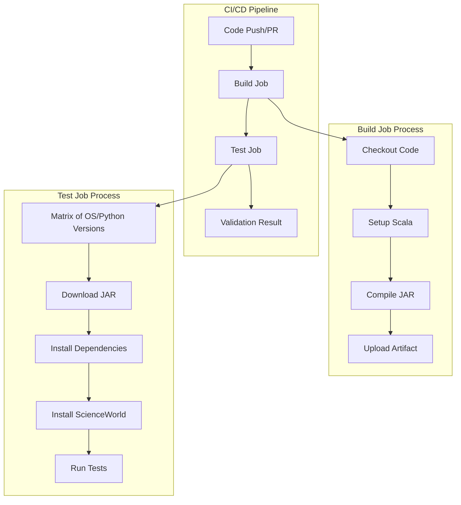
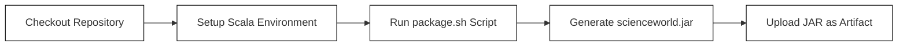
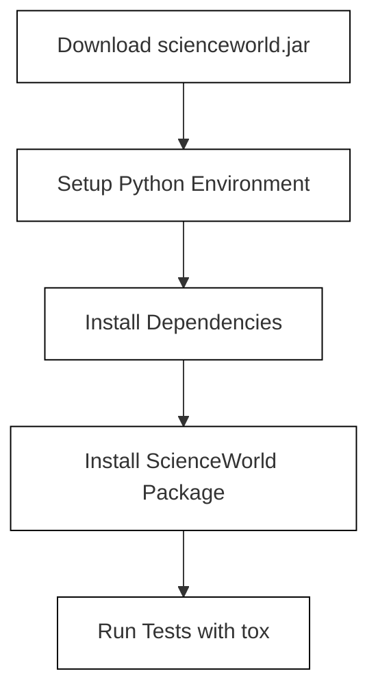
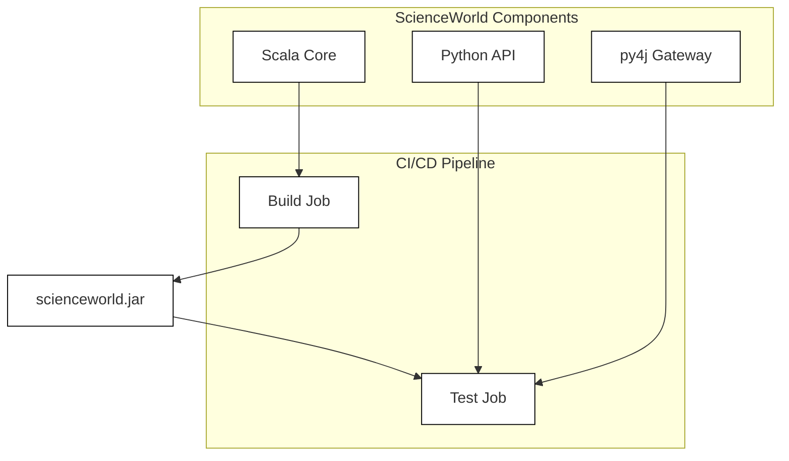
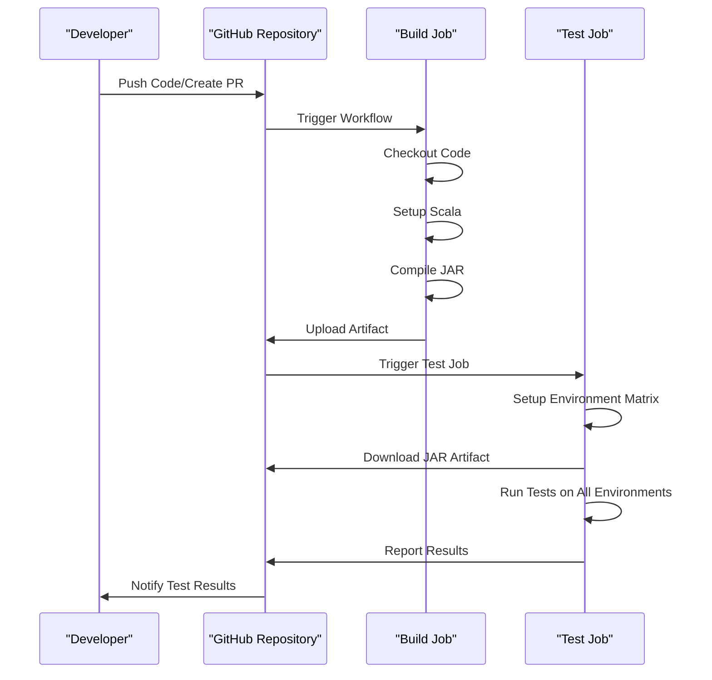

<!-- source: DeepWiki mcp.deepwiki.com · repo allenai/ScienceWorld · page 7.3 CI/CD Pipeline · fetched 2026-10-26 -->

# CI/CD Pipeline

<details>
<summary>Relevant source files</summary>

The following files were used as context for generating this wiki page:

- [.github/workflows/tests.yaml](.github/workflows/tests.yaml)
- [simulator/src/main/scala/scienceworld/EntryPoint.scala](simulator/src/main/scala/scienceworld/EntryPoint.scala)

</details>


This page documents the Continuous Integration and Continuous Deployment (CI/CD) pipeline for ScienceWorld. The pipeline automates the process of building, testing, and validating the ScienceWorld environment across multiple operating systems and Python versions.

For information on running tests locally, see [Testing](#7.2). For building from source, see [Building from Source](#7.1).

## Overview

ScienceWorld's CI/CD pipeline is implemented using GitHub Actions, which automatically runs a series of validation steps whenever code is pushed to the repository or when pull requests are submitted. This ensures that all contributions maintain compatibility and functionality across the supported platforms.



Sources: [.github/workflows/tests.yaml:1-66]()

## Pipeline Components

The CI/CD pipeline consists of two primary jobs:

1. **Build Job**: Compiles the Scala codebase into a JAR file
2. **Test Job**: Tests the compiled JAR with various Python versions on multiple operating systems

### Build Job

The build job runs on Ubuntu and is responsible for compiling the Scala code into a JAR file that can be used by the Python interface.



Sources: [.github/workflows/tests.yaml:8-22]()

The build job:

1. Checks out the repository code
2. Sets up Scala using the `olafurpg/setup-scala@v10` action
3. Runs the `./simulator/package.sh` script to compile the JAR
4. Uploads the compiled JAR as an artifact named `scienceworld.jar`

### Test Job

The test job runs after the build job completes and tests the compatibility of ScienceWorld across multiple platforms and Python versions.



Sources: [.github/workflows/tests.yaml:24-65]()

## Test Matrix

The test job runs on a matrix of operating systems and Python versions to ensure cross-platform compatibility:

| Operating System | Python Versions |
|-----------------|-----------------|
| Ubuntu Latest   | 3.8, 3.9, 3.10, 3.11, 3.12 |
| Windows Latest  | 3.8, 3.9, 3.10, 3.11, 3.12 |
| macOS Latest    | 3.8, 3.9, 3.10, 3.11, 3.12 |

Sources: [.github/workflows/tests.yaml:25-31]()

## Workflow File Structure

The CI/CD pipeline is defined in the `.github/workflows/tests.yaml` file. This file follows the GitHub Actions workflow syntax and defines the jobs, steps, and conditions for the pipeline.

```mermaid
classDiagram
    class "GitHub Workflow" {
        name: Tests
        triggers: push, pull_request
        jobs: build, test
    }
    
    class "Build Job" {
        runs-on: ubuntu-latest
        steps:
          - checkout
          - setup-scala
          - compile-jar
          - upload-artifact
    }
    
    class "Test Job" {
        needs: build
        runs-on: matrix.os
        strategy: matrix
        steps:
          - setup-git
          - checkout
          - setup-python
          - download-artifact
          - install-dependencies
          - install-scienceworld
          - run-tests
    }
    
    class "Matrix Strategy" {
        os: ubuntu, windows, macos
        python-version: 3.8-3.12
    }
    
    "GitHub Workflow" --> "Build Job"
    "GitHub Workflow" --> "Test Job"
    "Test Job" --> "Matrix Strategy"
```

Sources: [.github/workflows/tests.yaml:1-66]()

## Integration with the ScienceWorld System

The CI/CD pipeline plays a crucial role in the ScienceWorld architecture by ensuring that the Python-Scala bridge functions correctly across all supported platforms.



Sources: [.github/workflows/tests.yaml:1-66](), [simulator/src/main/scala/scienceworld/EntryPoint.scala:1-192]()

## CI/CD Pipeline Workflow

When a developer pushes code or creates a pull request, the following sequence occurs:

1. GitHub Actions triggers the workflow defined in `tests.yaml`
2. The build job compiles the Scala code into a JAR file
3. The test job downloads the JAR and runs tests across multiple environments
4. If all tests pass, the PR can be safely merged; if any tests fail, the issues must be addressed



Sources: [.github/workflows/tests.yaml:1-66]()

## Dependency Management

The CI/CD pipeline manages dependencies in two key ways:

1. **Scala Dependencies**: Managed during the build process via the package script
2. **Python Dependencies**: Installed during the test job using pip and tox

| Dependency Type | Management Tool | Environment |
|----------------|-----------------|-------------|
| Scala Dependencies | package.sh script | Build Job |
| Python Dependencies | pip, tox | Test Job |

Sources: [.github/workflows/tests.yaml:16-16](), [.github/workflows/tests.yaml:55-58]()

The test job specifically installs:
- `tox`: For running tests in isolated environments
- `tox-gh-actions`: For integrating tox with GitHub Actions
- ScienceWorld package itself

## Line Ending Management

The CI/CD pipeline addresses cross-platform line ending issues by explicitly configuring git to use LF line endings. This ensures consistent behavior across Unix-like systems (Ubuntu, macOS) and Windows.

```
git config --global core.autocrlf false
git config --global core.eol lf
```

Sources: [.github/workflows/tests.yaml:34-37]()

## Artifact Management

The pipeline uses GitHub's artifact system to pass the compiled JAR file from the build job to the test job:

1. Build job uploads scienceworld.jar as an artifact
2. Test job downloads the artifact for testing

This approach ensures that all tests are running against the same compiled code, regardless of the test environment.

Sources: [.github/workflows/tests.yaml:17-22](), [.github/workflows/tests.yaml:46-53]()