# Page: Overview

# Overview

<details>
<summary>Relevant source files</summary>

The following files were used as context for generating this wiki page:

- [CHANGELOG.md](CHANGELOG.md)
- [README.md](README.md)
- [scienceworld/scienceworld.py](scienceworld/scienceworld.py)
- [simulator/src/main/scala/scienceworld/runtime/pythonapi/PythonInterface.scala](simulator/src/main/scala/scienceworld/runtime/pythonapi/PythonInterface.scala)
- [tests/test_scienceworld.py](tests/test_scienceworld.py)

</details>


ScienceWorld is a text-based simulation environment designed for accomplishing tasks from elementary science curricula. It provides a platform for training and evaluating AI agents by allowing them to interact with simulated environments through natural language commands.

This overview introduces ScienceWorld's purpose, architecture, and key components. For installation instructions, see [Installation & Setup](#1.1).

## Architecture and Components

ScienceWorld uses a layered architecture with a Python interface communicating with a Scala backend through py4j.

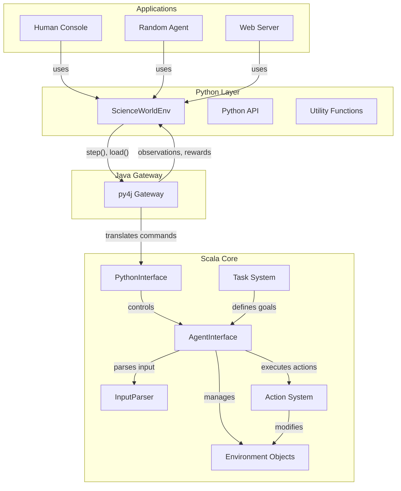

Sources: [scienceworld/scienceworld.py:17-86](), [simulator/src/main/scala/scienceworld/runtime/pythonapi/PythonInterface.scala:26-145]()

### Key Components

1. **Python Layer**:
   - `ScienceWorldEnv`: Main class for interacting with the environment
   - Utility functions for task loading and management
   - Constants defining available tasks

2. **Scala Core**:
   - `PythonInterface`: Handles communication between Python and Scala
   - `AgentInterface`: Controls the agent and environment interaction
   - Environment objects with various properties
   - Task definitions with goals
   - Action processing system

3. **Applications**:
   - Human console for interactive exploration
   - Random agent for automatic testing
   - Web interface for browser-based interaction

## Basic Usage

Here's how to use ScienceWorld programmatically:

```python
from scienceworld import ScienceWorldEnv

# Create an environment
env = ScienceWorldEnv()

# Load a task (boil water task)
env.load("1-1", variationIdx=0, simplificationStr="easy")

# Reset the environment
obs, info = env.reset()

# Take a step
observation, reward, done, info = env.step("look around")

# Get information about the environment
possible_actions = env.get_possible_actions()
possible_objects = env.get_possible_objects()
task_description = env.get_task_description()
```

Sources: [scienceworld/scienceworld.py:87-136](), [tests/test_scienceworld.py:1-14]()

## Action-Observation Loop

ScienceWorld follows a typical reinforcement learning cycle:

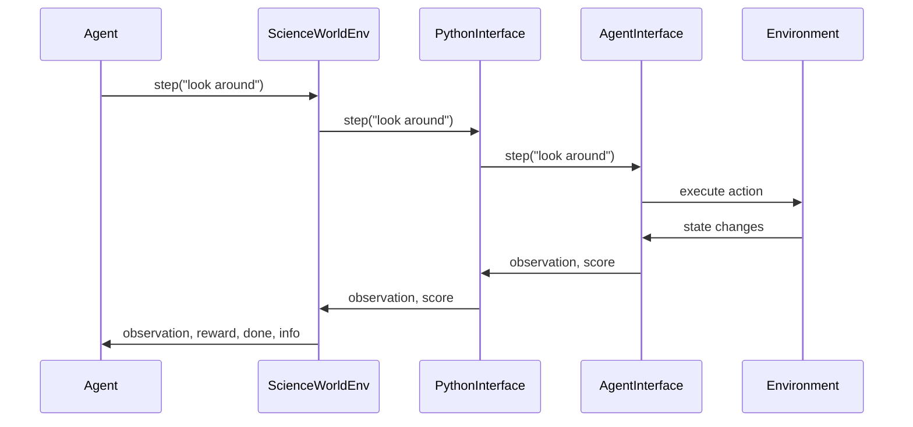

The key steps in this interaction loop are:

1. Agent sends a natural language command via the `step()` method
2. Command is processed and executed in the environment
3. Environment state changes in response to the action
4. Observation, reward, completion status, and info are returned to the agent

Sources: [scienceworld/scienceworld.py:410-452](), [simulator/src/main/scala/scienceworld/runtime/pythonapi/PythonInterface.scala:351-404]()

## Task System

ScienceWorld includes tasks across multiple scientific domains, each with numerous variations:

| Task Domain | Examples | Features |
|-------------|----------|----------|
| Matter & States | Boiling, melting, freezing | Temperature changes, phase transitions |
| Measurement | Using thermometers | Tool use, measurement reading |
| Electricity | Building circuits, testing conductivity | Electrical connections, conductivity |
| Biology | Plant growth, animal classification | Life cycles, classification tasks |
| Chemistry | Mixing chemicals, creating solutions | Chemical reactions, colors |
| Physics | Inclined planes, friction | Forces, motion experiments |

Each task can be loaded by its ID (e.g., "1-1" for boiling) or name. Tasks include:
- Goals for successful completion
- Variations to test generalization
- Optional gold action sequences for evaluation

Sources: [README.md:99-133](), [scienceworld/scienceworld.py:398-407]()

## Environment Object System

The environment consists of interrelated objects with various properties:

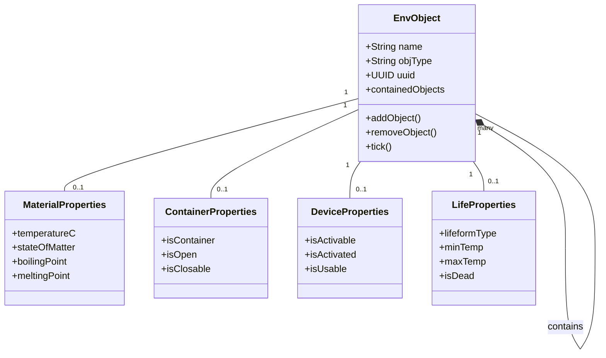

These object properties enable rich interactions, such as:
- Containers that can hold other objects
- Materials that change state with temperature
- Electrical devices that can be connected
- Living things that grow and change

Sources: [scienceworld/scienceworld.py:291-301]()

## Simplification System

ScienceWorld includes simplifications to reduce environment complexity:

```python
# Available simplifications:
simplifications = [
    "teleportAction",       # Adds teleport actions to any location
    "selfWateringFlowerPots", # Plants won't die from lack of water
    "openContainers",       # Containers are open by default
    "openDoors",            # Doors are open by default
    "noElectricalAction",   # Remove electrical connection actions
    "easy"                  # Use all simplifications above
]

# Load with simplifications
env.load("3-1", simplificationStr="openContainers,openDoors")
```

Simplifications help control task difficulty and can be combined with comma separation.

Sources: [scienceworld/scienceworld.py:164-177](), [scienceworld/scienceworld.py:112-125]()

## Interface Options

ScienceWorld offers multiple interfaces for interaction:

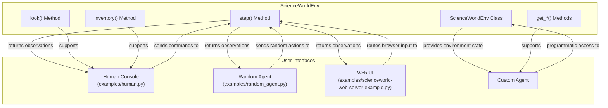

This design allows for flexibility in how agents interact with the environment:
- Python agents can use the API directly
- Human players can use the console or web interface
- Different interaction styles are supported through the same core API

Sources: [README.md:60-87](), [scienceworld/scienceworld.py:455-468]()

## Data Collection and Evaluation

ScienceWorld provides tools for recording agent interactions:

- **Run History**: Records all actions, observations, and rewards
- **Gold Action Sequences**: Pre-determined solutions for evaluation
- **Variation Sets**: Split into training, development, and testing sets

These features enable systematic evaluation of agent performance and help with debugging agent behavior.

Sources: [scienceworld/scienceworld.py:304-370](), [scienceworld/scienceworld.py:373-395]()

## Summary

ScienceWorld provides a rich platform for developing and evaluating AI agents on elementary science tasks. The system combines:

1. A flexible text-based interface for natural language interaction
2. A comprehensive set of scientific tasks with multiple variations
3. A detailed environment with realistic object interactions
4. Tools for simplifying tasks and evaluating agent performance

For more details on specific components, refer to their respective wiki pages.

---

# Page: Installation & Setup

# Installation & Setup

<details>
<summary>Relevant source files</summary>

The following files were used as context for generating this wiki page:

- [CHANGELOG.md](CHANGELOG.md)
- [MANIFEST.in](MANIFEST.in)
- [README.md](README.md)
- [requirements-dev.txt](requirements-dev.txt)
- [requirements.txt](requirements.txt)
- [setup.py](setup.py)
- [tox.ini](tox.ini)

</details>


This page provides detailed instructions for installing ScienceWorld and setting up your development environment. It covers system requirements, installation methods, verification steps, and additional configurations like the web server interface. For information about the high-level architecture of ScienceWorld, see [Architecture](#2).

## Prerequisites

Before installing ScienceWorld, ensure your system meets the following requirements:

| Requirement | Minimum Version |
|-------------|----------------|
| Java        | 1.8+ (Java 8 or higher) |
| Python      | 3.8+ (3.8, 3.9, 3.10, 3.11, 3.12 supported) |
| Operating System | Linux, macOS (Windows may work but is not officially supported) |

Sources: [README.md:42-47](), [tox.ini:3-11]()

## Installation Process

ScienceWorld can be installed via two main methods: PyPI (recommended for users) or from source code (recommended for developers).

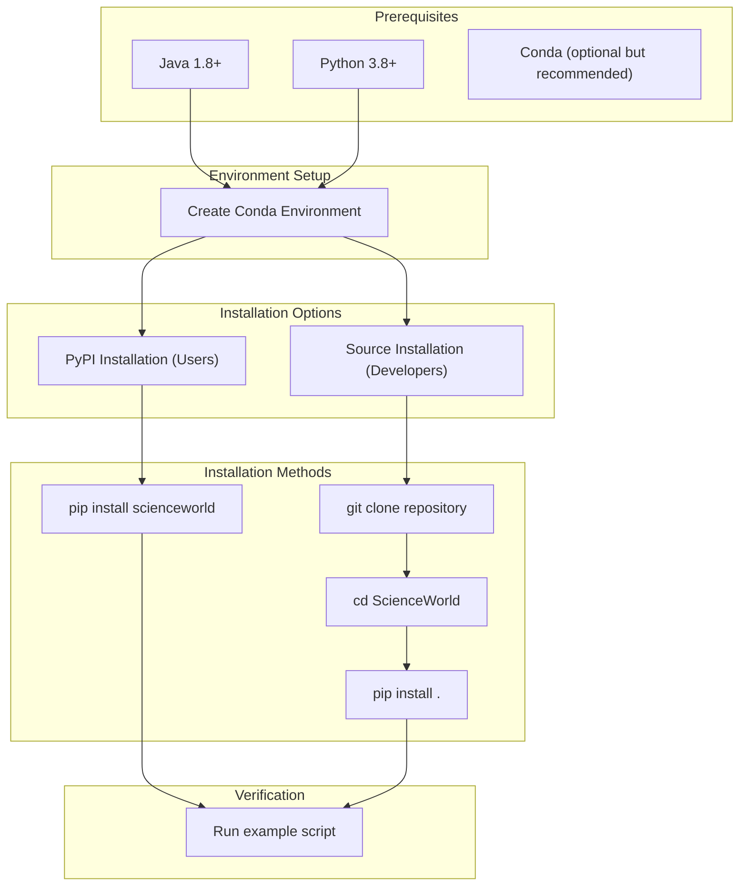

Sources: [README.md:44-58]()

### Installation via Conda (Recommended)

It's recommended to use a Conda environment to manage dependencies:

```bash
conda create --name scienceworld python=3.8
conda activate scienceworld
```

Sources: [README.md:44-47]()

### Method 1: PyPI Installation (for Users)

The simplest way to install ScienceWorld is using pip:

```bash
pip install scienceworld
```

This installs the latest stable version from PyPI, including all required dependencies.

Sources: [README.md:49-51]()

### Method 2: Source Installation (for Developers)

For development or to access the latest features:

```bash
git clone https://github.com/allenai/ScienceWorld.git
cd ScienceWorld
pip install .
```

For development mode installation (changes to source code immediately reflected):

```bash
pip install -e .
```

Sources: [README.md:53-58]()

## Package Structure

After installation, the ScienceWorld package contains the following key components:

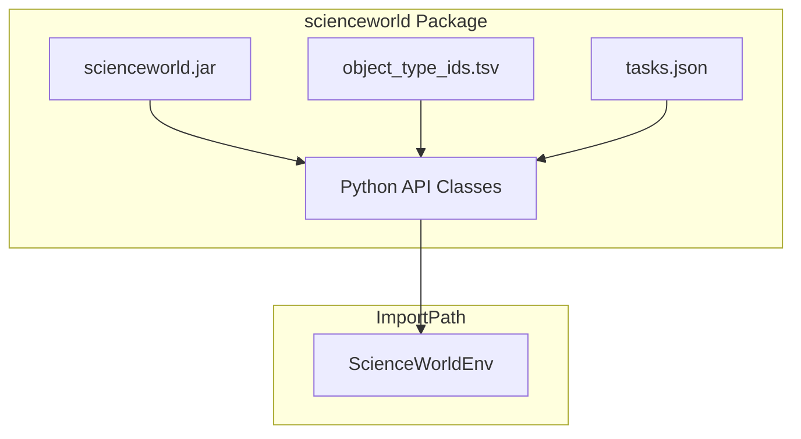

The JAR file contains the compiled Scala code that powers the simulation environment, while the Python files provide the interface layer.

Sources: [setup.py:8-35](), [MANIFEST.in:1-7]()

## Verification and Basic Usage

After installation, verify that ScienceWorld is working correctly by running one of the example scripts:

### Running a Random Agent

```bash
python examples/random_agent.py --task-num=13 --num-episodes=5 --simplifications-preset easy
```

This runs a random agent on task #13 (classification: place a non-living thing in a box) for 5 episodes with "easy" simplifications.

### Interactive Console

```bash
python examples/human.py --task-num=3 --num-episodes=5
```

This starts an interactive console where you can manually enter commands to interact with the ScienceWorld environment on task #3 (change of state: melting).

Sources: [README.md:60-67]()

## Web Server Setup

ScienceWorld includes a web interface that allows interaction through a browser. This requires additional dependencies.

### Installation with Web Server Support

```bash
pip install scienceworld[webserver]
```

This installs ScienceWorld along with the necessary web server dependencies (primarily pywebio).

### Launching the Web Server

```bash
python examples/scienceworld-web-server-example.py
```

After running this command, navigate to `http://localhost:8080` in your web browser to access the ScienceWorld interface.

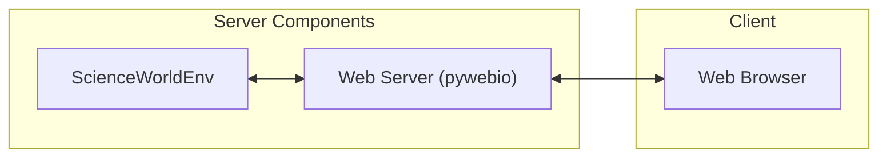

Sources: [README.md:69-87](), [setup.py:41-43]()

## Development Setup

For those wanting to contribute to ScienceWorld or modify the codebase, additional steps are needed.

### Installing Development Dependencies

```bash
pip install -r requirements-dev.txt
```

This installs development tools like pytest, flake8, and other utilities needed for testing and code quality.

### Recompiling the JAR File

If you modify the Scala code, you need to recompile the JAR file:

```bash
./simulator/package.sh
pip install -e .
```

This packages the Scala code into a JAR file and reinstalls ScienceWorld with the updated JAR.

Sources: [README.md:90-97](), [requirements-dev.txt:1-8]()

### Running Tests

ScienceWorld uses tox for testing across multiple Python versions:

```bash
tox
```

To run tests for a specific Python version:

```bash
tox -e py38  # For Python 3.8
```

To run code style checks:

```bash
tox -e flake8
```

Sources: [tox.ini:1-30]()

## Troubleshooting Common Issues

### Missing JAR File

If you see an error about a missing JAR file:

```
ERROR: Unable to find required library: [path]/scienceworld.jar
```

This usually means either:
1. The installation was incomplete
2. The JAR file is not in the expected location

Solution: Reinstall using the pip command, or if installing from source, ensure the JAR file is properly compiled.

### Java Version Issues

ScienceWorld requires Java 1.8 or higher. To check your Java version:

```bash
java -version
```

If the version is incorrect or Java is not installed, install or update your Java distribution.

### Python-Java Bridge Issues

ScienceWorld uses py4j to communicate between Python and Java. If you encounter errors related to py4j, ensure it's properly installed:

```bash
pip install py4j
```

Sources: [setup.py:18-21](), [requirements.txt:1]()

---

# Page: Architecture

# Architecture

<details>
<summary>Relevant source files</summary>

The following files were used as context for generating this wiki page:

- [scienceworld/scienceworld.jar](scienceworld/scienceworld.jar)
- [scienceworld/scienceworld.py](scienceworld/scienceworld.py)
- [simulator/build.sbt](simulator/build.sbt)
- [simulator/src/main/scala/scienceworld/runtime/AgentInterface.scala](simulator/src/main/scala/scienceworld/runtime/AgentInterface.scala)
- [simulator/src/main/scala/scienceworld/runtime/pythonapi/PythonInterface.scala](simulator/src/main/scala/scienceworld/runtime/pythonapi/PythonInterface.scala)
- [tests/test_scienceworld.py](tests/test_scienceworld.py)

</details>


This document provides a comprehensive overview of the ScienceWorld system architecture, detailing the core components and their interactions. ScienceWorld is a text-based simulation environment designed for elementary science tasks, featuring a Python frontend that communicates with a Scala backend through a bridge layer.

For information about installing and setting up ScienceWorld, see [Installation & Setup](#1.1). For details about specific Python API methods, see [Python API](#3).

## Overall System Architecture

The ScienceWorld architecture follows a layered design pattern with three main layers:

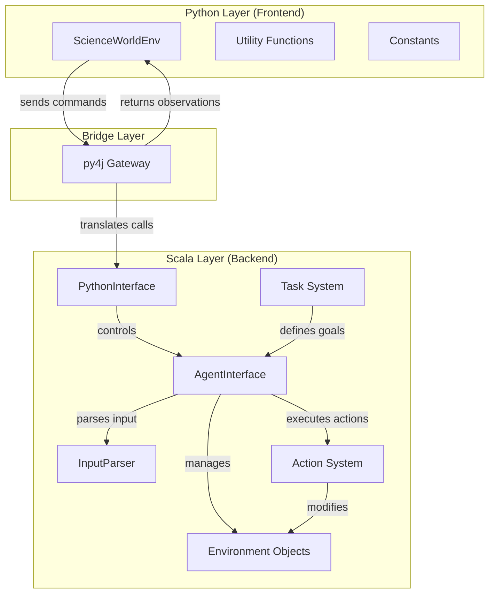

Sources: [scienceworld/scienceworld.py:17-162](). [simulator/src/main/scala/scienceworld/runtime/pythonapi/PythonInterface.scala:26-141]().

1. **Python Layer**: Provides the front-facing API for agents to interact with the environment.
2. **Bridge Layer**: Uses py4j to enable communication between Python and Scala.
3. **Scala Layer**: Contains the simulation logic, environment objects, and task definitions.

## Initialization and Communication Flow

The following diagram illustrates how ScienceWorld initializes and establishes communication between the Python and Scala layers:

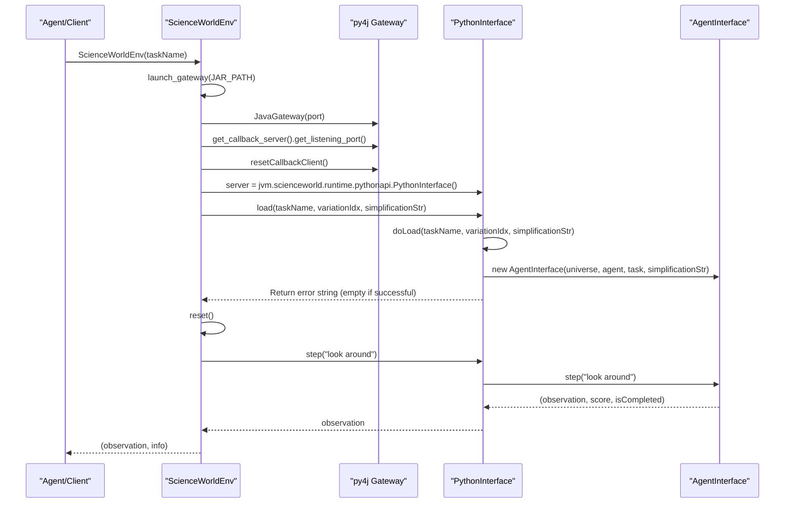

Sources: [scienceworld/scienceworld.py:23-85](). [simulator/src/main/scala/scienceworld/runtime/pythonapi/PythonInterface.scala:54-145]().

Key points:
1. The Python `ScienceWorldEnv` initializes by starting a JVM with the Scala code
2. It establishes bidirectional communication through py4j
3. A task is loaded, creating an environment with the appropriate objects and goals
4. The agent can then interact with the environment through the `step()` method

## Core Components

### ScienceWorldEnv (Python)

The `ScienceWorldEnv` class serves as the main interface for agents to interact with ScienceWorld. It handles:

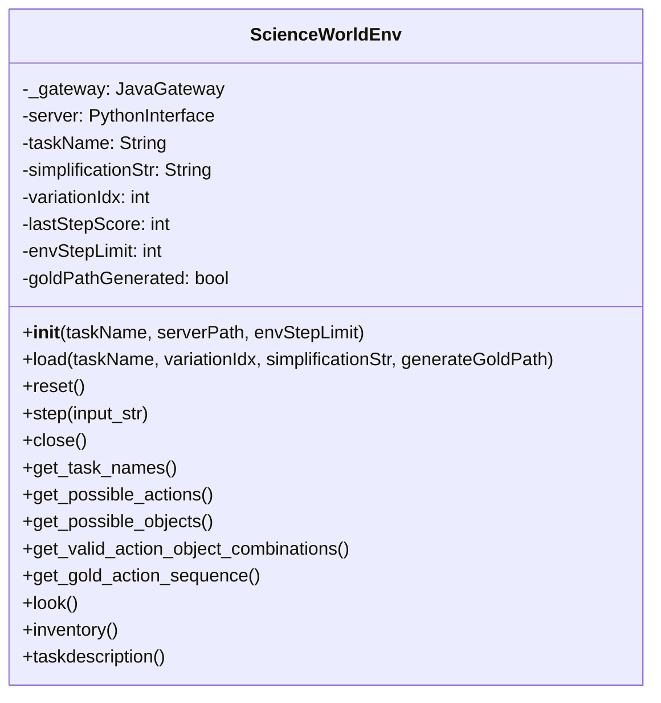

Sources: [scienceworld/scienceworld.py:17-162]().

### PythonInterface (Scala)

The `PythonInterface` class is the entry point for py4j calls from Python. It manages:

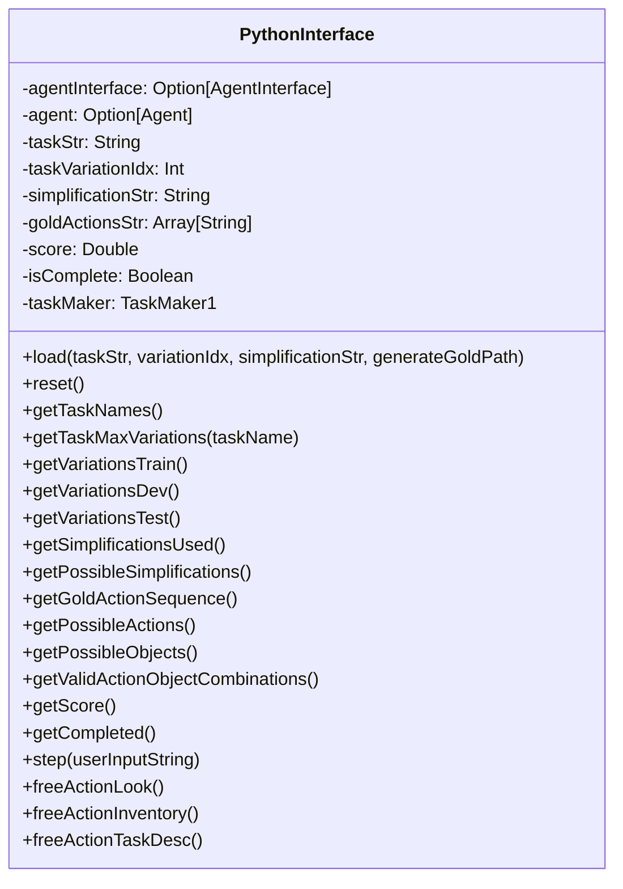

Sources: [simulator/src/main/scala/scienceworld/runtime/pythonapi/PythonInterface.scala:26-141]().

### AgentInterface (Scala)

The `AgentInterface` class handles the core simulation logic:

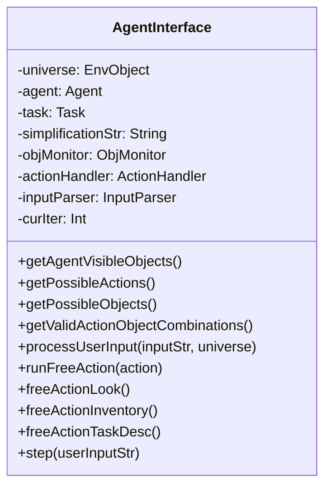

Sources: [simulator/src/main/scala/scienceworld/runtime/AgentInterface.scala:19-596]().

## Action Flow

The following diagram illustrates the flow of an action through the system:

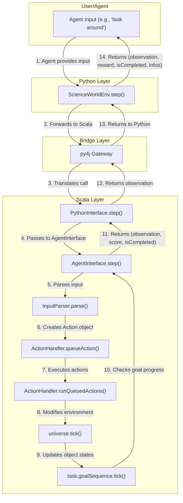

Sources: [scienceworld/scienceworld.py:410-452](). [simulator/src/main/scala/scienceworld/runtime/pythonapi/PythonInterface.scala:351-404](). [simulator/src/main/scala/scienceworld/runtime/AgentInterface.scala:504-594]().

## Environment Object System

ScienceWorld uses a composable object system where environment objects can have various properties:

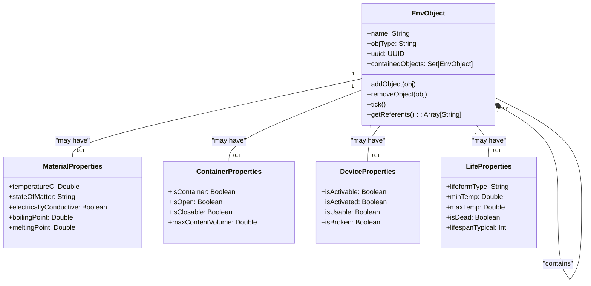

Sources: [scienceworld/scienceworld.py:292-301]().

## Task System and Simplifications

Tasks define goals that the agent must accomplish. They can be modified through simplifications:

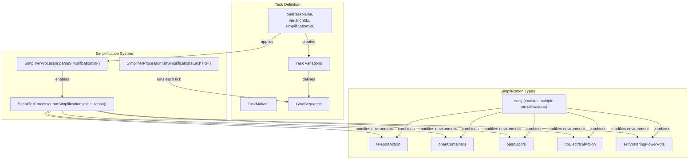

Sources: [scienceworld/scienceworld.py:99-135](). [simulator/src/main/scala/scienceworld/runtime/AgentInterface.scala:36-48]().

Available simplifications:
- **teleportAction**: Adds actions to teleport directly to any possible location
- **openContainers**: Containers are open by default
- **openDoors**: Doors are open by default
- **noElectricalAction**: Remove electrical connection actions to reduce action space
- **selfWateringFlowerPots**: Flower pots water themselves so plants don't die
- **easy**: Enables all the above simplifications (except noElectricalAction for electrical tasks)

## Gold Action Sequences

ScienceWorld supports gold action sequences that provide a demonstration of how to solve a task:

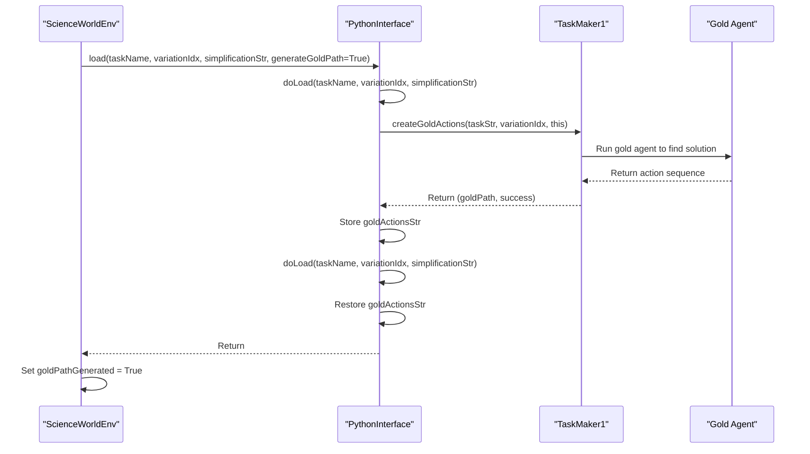

Sources: [scienceworld/scienceworld.py:398-407](). [simulator/src/main/scala/scienceworld/runtime/pythonapi/PythonInterface.scala:57-90]().

Gold action sequences serve as:
1. Demonstrations of task solutions
2. Evaluation benchmarks for agent performance
3. Training data for imitation learning approaches

## Summary

The ScienceWorld architecture provides a flexible simulation environment for elementary science tasks through:

1. A layered design that separates the Python API from the Scala simulation engine
2. A composable object system that allows for complex interactions
3. A task system with variations and simplifications
4. Support for gold action sequences as demonstrations

This architecture enables researchers to develop and evaluate AI agents on tasks that test understanding of scientific concepts in a text-based environment.

Sources: [scienceworld/scienceworld.py](). [simulator/src/main/scala/scienceworld/runtime/pythonapi/PythonInterface.scala](). [simulator/src/main/scala/scienceworld/runtime/AgentInterface.scala]().

---

# Page: Python-Scala Bridge

# Python-Scala Bridge

<details>
<summary>Relevant source files</summary>

The following files were used as context for generating this wiki page:

- [scienceworld/scienceworld.py](scienceworld/scienceworld.py)
- [simulator/build.sbt](simulator/build.sbt)
- [simulator/src/main/scala/scienceworld/runtime/AgentInterface.scala](simulator/src/main/scala/scienceworld/runtime/AgentInterface.scala)
- [simulator/src/main/scala/scienceworld/runtime/pythonapi/PythonInterface.scala](simulator/src/main/scala/scienceworld/runtime/pythonapi/PythonInterface.scala)
- [tests/test_scienceworld.py](tests/test_scienceworld.py)

</details>


This page documents the bridge between Python and Scala in ScienceWorld, which enables communication between the Python API and the Scala simulation engine. For information about the core components of the system, see [Core Components](#2.2).

## Overview

ScienceWorld uses a dual-language architecture where the simulation engine is written in Scala, but users interact with the system through a Python API. The Python-Scala bridge, built using py4j, enables this cross-language communication by:

1. Starting a Java Virtual Machine (JVM) from Python
2. Establishing a bidirectional gateway for function calls
3. Passing data between the two languages

This architecture allows the performance advantages of the JVM while maintaining an accessible Python interface for AI researchers and educators.

Sources: [scienceworld/scienceworld.py:16-85](), [simulator/build.sbt:9-13]()

## Architecture

### Bridge Components

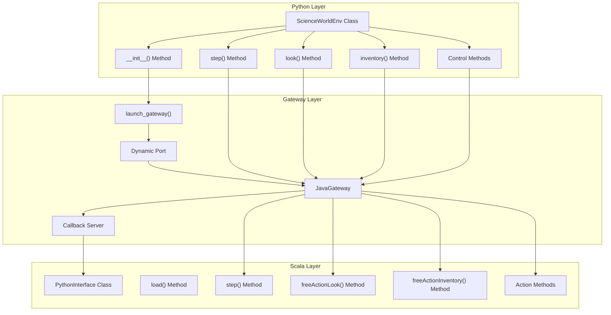

The bridge consists of three main layers:
1. **Python Layer**: The `ScienceWorldEnv` class that provides the API for Python users
2. **Gateway Layer**: The py4j infrastructure that handles inter-process communication
3. **Scala Layer**: The `PythonInterface` class that exposes Scala functionality

Sources: [scienceworld/scienceworld.py:17-22](), [simulator/src/main/scala/scienceworld/runtime/pythonapi/PythonInterface.scala:26-27]()

### Initialization Flow

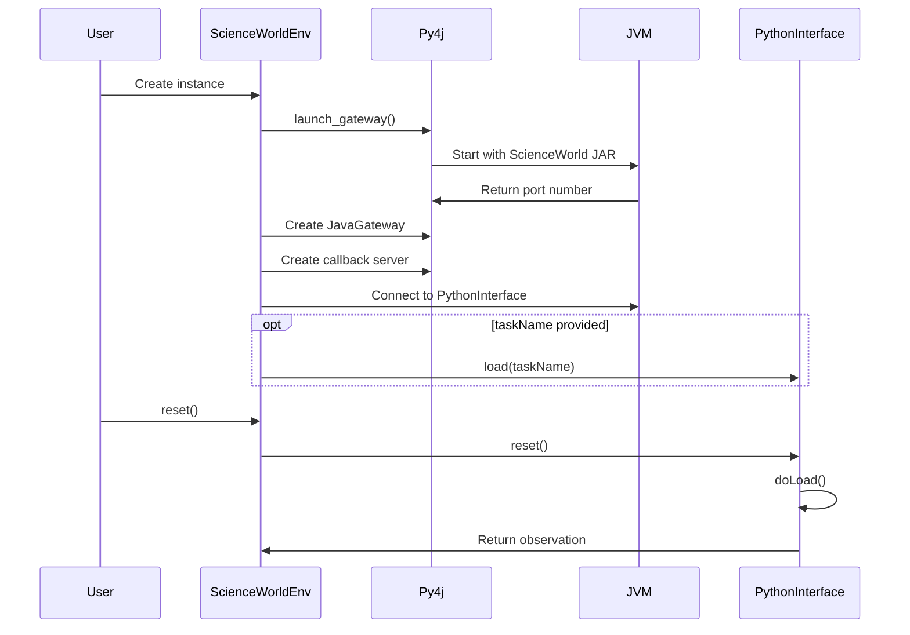

The initialization process involves:
1. Starting the JVM with the ScienceWorld JAR file
2. Establishing a bidirectional gateway between Python and Scala
3. Loading a task environment if specified
4. Setting up initial state

Sources: [scienceworld/scienceworld.py:23-85](), [simulator/src/main/scala/scienceworld/runtime/pythonapi/PythonInterface.scala:54-95]()

## Python Side: ScienceWorldEnv

The `ScienceWorldEnv` class is the main entry point for Python users, providing a clean API to interact with the Scala backend. It handles:

1. **JVM Management**: Starting, connecting to, and shutting down the JVM
2. **Task Management**: Loading and configuring tasks
3. **Agent Interaction**: Processing actions and returning observations

### Key Methods

| Method | Purpose |
|--------|---------|
| `__init__` | Initializes the py4j gateway and connects to the Scala backend |
| `load` | Loads a specific task with variations and simplifications |
| `reset` | Resets the environment to its initial state |
| `step` | Processes an action and returns observation, reward, completion status, and info |
| `close` | Shuts down the gateway and JVM |
| `look` | "Free" action to observe the environment |
| `inventory` | "Free" action to check inventory |

### Gateway Initialization

The Python side launches the JVM and establishes communication through a sequence of steps:

```python
# Launch Java side with dynamic port
port, proc = launch_gateway(classpath=serverPath, die_on_exit=True, cwd=BASEPATH, return_proc=True)

# Create gateway with callback server for bidirectional communication
self._gateway = JavaGateway(
    gateway_parameters=GatewayParameters(auto_field=True, port=port),
    callback_server_parameters=CallbackServerParameters(port=0, daemonize=True),
    java_process=proc)

# Get Python callback server port
python_port = self._gateway.get_callback_server().get_listening_port()

# Tell Java side to connect to Python callback
self._gateway.java_gateway_server.resetCallbackClient(
    self._gateway.java_gateway_server.getCallbackClient().getAddress(),
    python_port)

# Get PythonInterface instance
self.server = self._gateway.jvm.scienceworld.runtime.pythonapi.PythonInterface()
```

Sources: [scienceworld/scienceworld.py:33-65]()

## Scala Side: PythonInterface

The `PythonInterface` class serves as the bridge endpoint on the Scala side, providing methods that the Python code can call. It mediates between the Python API and the core simulation engine through `AgentInterface`.

### Key Methods

| Method | Purpose |
|--------|---------|
| `load` | Sets up a task environment with specified parameters |
| `reset` | Resets the environment to initial state |
| `step` | Processes an action and returns results |
| `getTaskNames` | Returns available task names |
| `getPossibleActions` | Returns possible actions in current state |
| `freeActionLook` | Performs "look around" without consuming a step |
| `freeActionInventory` | Shows inventory without consuming a step |
| `getRunHistoryJSON` | Returns history in JSON format |

### Initialization and Task Loading

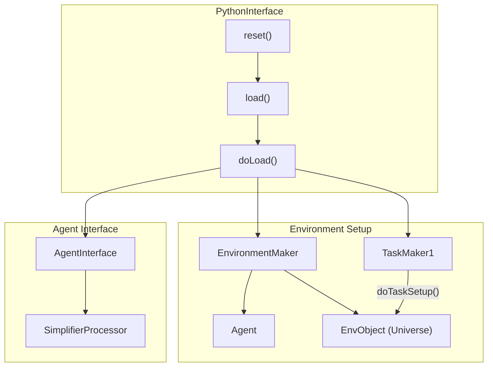

The Scala side handles environment creation and task setup:
1. `load` method initializes a task with variations and simplifications
2. `doLoad` handles the actual environment creation
3. Task objects are placed in the agent's inventory
4. Simplifications are applied to adjust environment complexity

Sources: [simulator/src/main/scala/scienceworld/runtime/pythonapi/PythonInterface.scala:54-145]()

## Communication Flow

### Action-Observation Cycle

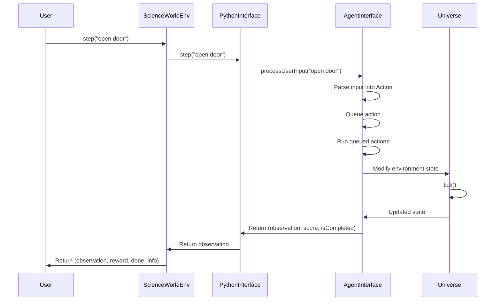

The communication flow for an action:
1. User calls `step()` in the Python API
2. Request is passed to `PythonInterface.step()`
3. `AgentInterface` processes the input into actions
4. Actions are queued and executed
5. Environment state is updated via `tick()`
6. Results are passed back up through the bridge

Sources: [scienceworld/scienceworld.py:410-452](), [simulator/src/main/scala/scienceworld/runtime/pythonapi/PythonInterface.scala:351-404](), [simulator/src/main/scala/scienceworld/runtime/AgentInterface.scala:504-595]()

### Data Transfer

```mermaid
graph TD
    subgraph "Python Data Types"
        PYSTR["str"]
        PYDICT["dict"]
        PYLIST["list"]
        PYINT["int"]
        PYBOOL["bool"]
    end
    
    subgraph "py4j Conversion"
        GATEWAY["JavaGateway"]
        JCOL["Java Collections"]
    end
    
    subgraph "Scala Data Types"
        SCSTR["String"]
        SCMAP["Map"]
        SCARRAY["Array"]
        SCINT["Int"]
        SCBOOL["Boolean"]
        SCJSON["JSON String"]
    end
    
    PYSTR<-->|"direct conversion"|SCSTR
    PYINT<-->|"direct conversion"|SCINT
    PYBOOL<-->|"direct conversion"|SCBOOL
    
    PYDICT-->|"conversion needed"|GATEWAY
    GATEWAY-->|"asJava adapter"|SCMAP
    
    SCMAP-->|"JSON serialization"|SCJSON
    SCJSON-->|"JSON parsing"|PYDICT
    
    PYLIST<-->|"asJava/asScala"|JCOL
    JCOL<-->|"toList/toArray"|SCARRAY
```

Data transfer between Python and Scala:
- Basic types (strings, integers, booleans) convert directly
- Complex types use py4j adapters or JSON serialization
- Collections are converted using `asJava`/`asScala` adapters
- Large or complex data structures are serialized to JSON

Sources: [scienceworld/scienceworld.py:256-266](), [simulator/src/main/scala/scienceworld/runtime/pythonapi/PythonInterface.scala:155-226](), [simulator/src/main/scala/scienceworld/runtime/pythonapi/PythonInterface.scala:264-316]()

## Multiple Environments

ScienceWorld supports running multiple environments simultaneously:

```mermaid
graph TD
    subgraph "Python Process"
        ENV1["ScienceWorldEnv Instance 1"]
        ENV2["ScienceWorldEnv Instance 2"]
        GATE1["JavaGateway 1"]
        GATE2["JavaGateway 2"]
    end
    
    subgraph "JVM Process 1"
        JVM1["JVM Instance"]
        PI1["PythonInterface"]
        UNIVERSE1["Universe Instance"]
    end
    
    subgraph "JVM Process 2"
        JVM2["JVM Instance"]
        PI2["PythonInterface"]
        UNIVERSE2["Universe Instance"]
    end
    
    ENV1-->GATE1
    GATE1-->JVM1
    JVM1-->PI1
    PI1-->UNIVERSE1
    
    ENV2-->GATE2
    GATE2-->JVM2
    JVM2-->PI2
    PI2-->UNIVERSE2
```

Each `ScienceWorldEnv` instance:
1. Starts its own JVM process
2. Runs an independent simulation
3. Has its own gateway and port for communication
4. Can be closed individually without affecting others

Sources: [tests/test_scienceworld.py:16-44](), [scienceworld/scienceworld.py:151-161]()

## Shutdown and Resource Management

The bridge includes careful resource management:

```python
def close(self) -> None:
    self._gateway.shutdown()

    # Send newline to process to make it exit
    if self._gateway.java_process.poll() is None:
        self._gateway.java_process.stdin.write("\n".encode("utf-8"))
        self._gateway.java_process.stdin.flush()

def __del__(self):
    self.close()
```

When a `ScienceWorldEnv` is closed:
1. Gateway is shutdown
2. JVM process is terminated
3. Python resources are released
4. The `__del__` method ensures cleanup even if `close()` isn't called explicitly

Sources: [scienceworld/scienceworld.py:151-161](), [tests/test_scienceworld.py:47-53]()

## Troubleshooting

Common issues with the Python-Scala bridge:

| Issue | Possible Cause | Solution |
|-------|---------------|----------|
| `py4j.protocol.Py4JError` | JVM not started or crashed | Check JAR path and Java installation |
| `ConnectionRefusedError` | Port issues or process terminated | Ensure no port conflicts |
| Memory errors | Large simulations consuming too much memory | Reduce environment complexity or increase JVM memory |
| Slow performance | Excessive data transfer across bridge | Batch operations where possible |
| Hanging on exit | JVM process not terminated properly | Ensure `close()` is called |

The bridge provides error handling mechanisms:
- Error messages are passed from Scala to Python
- JVM exceptions are caught and reported
- Resource cleanup happens during garbage collection

Sources: [scienceworld/scienceworld.py:151-161](), [simulator/src/main/scala/scienceworld/runtime/pythonapi/PythonInterface.scala:400-404]()

## Debug Mode

For development purposes, the bridge includes a debug mode:

```python
if DEBUG_MODE:
    import sys
    import time
    port, proc = launch_gateway(
        classpath=serverPath, die_on_exit=True, cwd=BASEPATH,
        javaopts=['-agentlib:jdwp=transport=dt_socket,server=y,suspend=n,address=5005,quiet=y'],
        redirect_stdout=sys.stdout, redirect_stderr=sys.stderr, return_proc=True)
    logger.debug("Attach debugger within the next 10 seconds")
    time.sleep(10)  # Give time for user to attach debugger
```

When debug mode is enabled:
1. JVM is started with remote debugging enabled on port 5005
2. System waits 10 seconds for debugger attachment
3. Standard output/error from JVM is redirected to Python

Sources: [scienceworld/scienceworld.py:33-46]()

---

# Page: Core Components

# Core Components

<details>
<summary>Relevant source files</summary>

The following files were used as context for generating this wiki page:

- [scienceworld/scienceworld.py](scienceworld/scienceworld.py)
- [simulator/build.sbt](simulator/build.sbt)
- [simulator/src/main/scala/scienceworld/goldagent/ExampleGoldAgent.scala](simulator/src/main/scala/scienceworld/goldagent/ExampleGoldAgent.scala)
- [simulator/src/main/scala/scienceworld/goldagent/PathFinder.scala](simulator/src/main/scala/scienceworld/goldagent/PathFinder.scala)
- [simulator/src/main/scala/scienceworld/input/InputParser.scala](simulator/src/main/scala/scienceworld/input/InputParser.scala)
- [simulator/src/main/scala/scienceworld/objects/livingthing/plant/PeaPlant.scala](simulator/src/main/scala/scienceworld/objects/livingthing/plant/PeaPlant.scala)
- [simulator/src/main/scala/scienceworld/objects/livingthing/plant/RandomGeneticsPlants.scala](simulator/src/main/scala/scienceworld/objects/livingthing/plant/RandomGeneticsPlants.scala)
- [simulator/src/main/scala/scienceworld/runtime/AgentInterface.scala](simulator/src/main/scala/scienceworld/runtime/AgentInterface.scala)
- [simulator/src/main/scala/scienceworld/runtime/pythonapi/PythonInterface.scala](simulator/src/main/scala/scienceworld/runtime/pythonapi/PythonInterface.scala)
- [tests/test_scienceworld.py](tests/test_scienceworld.py)

</details>


This page details the main structural components of ScienceWorld's backend. These components power the simulation environment and enable interactions between agents and the virtual world. These components primarily live in the Scala backend and include the AgentInterface, InputParser, PathFinder, and PythonInterface. For information about the Python-Scala bridge that connects these components to the Python API, see [Python-Scala Bridge](#2.1).

## Component Overview

ScienceWorld's backend architecture consists of several key components that work together to create and manage the interactive environment:

```mermaid
graph TD
    subgraph "Core Components"
        AI["AgentInterface"] 
        IP["InputParser"]
        PF["PathFinder"]
        PI["PythonInterface"]
    end
    
    PI -->|"uses"| AI
    AI -->|"processes input with"| IP
    AI -->|"manages"| ENV["Environment"]
    AI -->|"evaluates"| GS["GoalSequence"]
    PF -->|"finds paths in"| ENV
    
    subgraph "Action System"
        AR["ActionRequestDef"]
        AH["ActionHandler"]
        A["Action Classes"]
    end
    
    IP -->|"creates"| AR
    AR -->|"processed by"| AH
    AH -->|"executes"| A
    A -->|"modifies"| ENV
```

Sources: [simulator/src/main/scala/scienceworld/runtime/AgentInterface.scala](), [simulator/src/main/scala/scienceworld/input/InputParser.scala](), [simulator/src/main/scala/scienceworld/goldagent/PathFinder.scala](), [simulator/src/main/scala/scienceworld/runtime/pythonapi/PythonInterface.scala]()

## PythonInterface

The PythonInterface class serves as the bridge between Python and Scala, exposing the Scala backend to Python through the py4j library.

```mermaid
classDiagram
    class PythonInterface {
        +server: JVM gateway
        +agentInterface: AgentInterface
        +agent: Agent
        +actionHandler: ActionHandler
        +load(taskStr, variationIdx, simplificationStr, generateGoldPath)
        +reset()
        +step(userInputString)
        +getTaskNames()
        +getPossibleActions()
        +getSimplificationsUsed()
        +getGoldActionSequence()
        +freeActionLook()
        +freeActionInventory()
        +freeActionTaskDesc()
    }
    
    PythonInterface --> AgentInterface: creates and uses
    PythonInterface --> Agent: manages
    PythonInterface --> ActionHandler: uses
```

Key responsibilities:
- Initializes and manages the simulation environment
- Loads tasks and variations
- Processes user input and returns observations
- Provides API methods for interacting with the environment
- Handles "free" actions that don't advance the simulation
- Manages gold action sequence generation

Sources: [simulator/src/main/scala/scienceworld/runtime/pythonapi/PythonInterface.scala:26-91](), [simulator/src/main/scala/scienceworld/runtime/pythonapi/PythonInterface.scala:152-173](), [simulator/src/main/scala/scienceworld/runtime/pythonapi/PythonInterface.scala:351-404]()

## AgentInterface

The AgentInterface class is the central component that manages the simulation environment and the interaction between the agent and the objects in the world.

```mermaid
classDiagram
    class AgentInterface {
        +universe: EnvObject
        +agent: Agent
        +task: Task
        +objMonitor: ObjMonitor
        +simplificationStr: String
        +actionHandler: ActionHandler
        +inputParser: InputParser
        +step(userInputStr): (String, Double, Boolean)
        +processUserInput(inputStr, universe): (Boolean, String)
        +getAgentVisibleObjects(includeHidden): (Boolean, EnvObject)
        +getPossibleActions(): Array[String]
        +getValidActionObjectCombinations(): Array[String]
        +freeActionLook(): String
        +freeActionInventory(): String
        +freeActionTaskDesc(): String
    }
    
    AgentInterface --> InputParser: uses
    AgentInterface --> ActionHandler: uses
    AgentInterface --> EnvObject: manages universe
    AgentInterface --> Agent: controls
    AgentInterface --> Task: evaluates
    AgentInterface --> ObjMonitor: tracks object states
```

Key responsibilities:
- Managing the simulation universe and agent
- Processing user input and executing actions
- Tracking task progress and goal completion
- Providing methods to access possible actions and objects
- Handling simplifications for the environment
- Managing the error state of the system

The step method is the core function that processes input and advances the simulation:
1. Parses user input into actions
2. Executes those actions
3. Runs environment tick to update world state
4. Checks goal conditions
5. Returns observation, score, and completion status

Sources: [simulator/src/main/scala/scienceworld/runtime/AgentInterface.scala:19-95](), [simulator/src/main/scala/scienceworld/runtime/AgentInterface.scala:501-594]()

## InputParser

The InputParser component handles parsing natural language input into executable actions by matching input strings against action patterns and resolving references to objects in the environment.

```mermaid
classDiagram
    class InputParser {
        +actionRequestDefs: Array[ActionRequestDef]
        +lastAmbiguousMatches: Option[Array[InputMatch]]
        +parse(inputStr, objTreeRoot, universe, agent, objMonitor, goalSequence, perspectiveContainer): (Boolean, String, String, Option[Action])
        +populate(tokens, paramSigList, trigger, allObjs, perspectiveContainer): Array[InputMatch]
        +matchObj(inStr, allObjs, perspectiveContainer): (Boolean, Array[(String, EnvObject)])
        +resolveAmbiguity(inputStr, agent, objMonitor, goalSequence): (String, Option[Action])
        +isInAmbiguousState(): Boolean
        +getAllUniqueReferentsLUT(objTreeRoot, includeHidden, recursive): Map[Long, String]
    }
    
    class InputMatch {
        +actionTrigger: ActionTrigger
        +varLUT: Map[String, EnvObject]
        +actionRequestDef: Option[ActionRequestDef]
        +mkHumanReadableClarification(agentContainer): String
    }
    
    InputParser --> InputMatch: creates
    InputParser --> ActionRequestDef: uses
    InputParser --> ActionTrigger: processes
    InputMatch --> ActionTrigger: references
    InputMatch --> EnvObject: maps variables to
```

From natural language to action execution:

```mermaid
flowchart TD
    A["User Input Text"] -->|"tokenized"| B["Tokens"]
    B -->|"matched against"| C["Action Patterns"]
    C -->|"objects identified"| D["Object Referents"]
    D -->|"creates"| E["InputMatch"]
    E -->|"creates"| F["Action"]
    F -->|"executed in"| G["Environment"]
    
    H["Ambiguous Match"] -->|"presents options"| I["User Disambiguation"]
    I -->|"resolves"| E
```

Key responsibilities:
- Parsing user input text
- Matching input against action patterns
- Resolving object references
- Handling ambiguity in commands
- Converting matched input to executable actions

The InputParser uses pattern matching to identify valid commands and map them to objects in the environment. When multiple interpretations are possible, it manages an ambiguity resolution process to clarify the user's intent.

Sources: [simulator/src/main/scala/scienceworld/input/InputParser.scala:142-229](), [simulator/src/main/scala/scienceworld/input/InputParser.scala:267-352](), [simulator/src/main/scala/scienceworld/input/InputParser.scala:437-511]()

## PathFinder

The PathFinder component is used primarily for generating gold action sequences—optimal paths through the environment to accomplish tasks. It helps with automatic evaluation and agent training.

```mermaid
classDiagram
    class PathFinder {
        +precomputedExhaustivePaths: Map[String, Array[Array[String]]]
        +createActionSequence(universe, agent, startLocation, endLocation): (Array[Action], Array[String])
        +getLocationSequence(universe, startLocation, endLocation, maxSteps): (Boolean, Array[String])
        +buildLocationGraph(universe): Map[String, Array[String]]
        +actionFocusOnObject(obj, agent, locationPerspective): (Action, String)
        +actionMoveObject(obj, destination, agent, locationPerspective): (Action, String)
        +getObjUniqueReferent(obj, agentLocation): Option[String]
        +getWaterInContainer(runner, useInventoryContainer): (Boolean, Option[EnvObject], Option[EnvObject])
    }
    
    PathFinder --> EnvObject: navigates
    PathFinder --> Action: generates
    PathFinder --> Agent: guides
```

Path planning process:

```mermaid
flowchart TD
    A["Start Location"] -->|"find path to"| B["End Location"]
    B -->|"identify"| C["Portal Sequence"]
    C -->|"generate"| D["Open Door Actions"]
    D -->|"generate"| E["Move Actions"]
    E -->|"creates"| F["Action Sequence"]
    
    G["Environment Graph"] -->|"used by"| A
    G -->|"consists of"| H["Locations"]
    H -->|"connected by"| I["Portals"]
    I -->|"has"| J["Connection Points"]
```

Key responsibilities:
- Finding paths between locations in the environment
- Creating sequences of actions to navigate the environment
- Generating action sequences for object manipulation
- Providing helper functions for gold agent implementation
- Building a graph representation of the environment

PathFinder is essential for the automated generation of gold action sequences, which serve as optimal solutions for tasks and can be used for automatic evaluation and agent training.

Sources: [simulator/src/main/scala/scienceworld/goldagent/PathFinder.scala:28-91](), [simulator/src/main/scala/scienceworld/goldagent/PathFinder.scala:166-224](), [simulator/src/main/scala/scienceworld/goldagent/PathFinder.scala:290-342]()

## Component Interactions

The following diagram illustrates the flow of information and control between the core components during a typical interaction with the ScienceWorld environment:

```mermaid
sequenceDiagram
    participant PE as Python Environment
    participant PI as PythonInterface
    participant AI as AgentInterface
    participant IP as InputParser
    participant AH as ActionHandler
    participant Env as Environment

    PE->>+PI: step("open door")
    PI->>+AI: step("open door")
    AI->>+IP: parse("open door")
    IP-->>-AI: InputMatch(ActionOpenDoor)
    AI->>+AH: queueAction(ActionOpenDoor)
    AH-->>-AI: actionOutput
    AI->>+Env: tick()
    Env-->>-AI: updated state
    AI-->>-PI: (observation, score, isCompleted)
    PI-->>-PE: (observation, score, isCompleted, info)
```

This sequence shows how a user command flows through the system:
1. The Python environment sends a step command to the PythonInterface
2. PythonInterface calls step on the AgentInterface
3. AgentInterface uses the InputParser to convert the text into an action
4. The action is queued in the ActionHandler and executed
5. The environment is updated via the tick method
6. Results are returned back through the chain to the Python environment

Sources: [scienceworld/scienceworld.py:410-452](), [simulator/src/main/scala/scienceworld/runtime/pythonapi/PythonInterface.scala:351-404](), [simulator/src/main/scala/scienceworld/runtime/AgentInterface.scala:501-594]()

## Natural Language Processing Flow

The following diagram illustrates how natural language commands are processed through the input parsing system:

```mermaid
graph TD
    subgraph "Natural Language Space"
        NL["Natural Language Command"]
        REF["Object Referents"]
    end
    
    subgraph "Code Entity Space"
        AT["ActionTrigger"]
        ARD["ActionRequestDef"]
        IM["InputMatch"]
        A["Action Classes"]
    end
    
    NL -->|"tokenized"| TOK["Tokens"]
    TOK -->|"matched against"| PAT["Action Patterns"]
    PAT -->|"found in"| AT
    AT -->|"part of"| ARD
    
    NL -->|"contains"| REF
    REF -->|"mapped to"| OBJ["EnvObject"]
    
    PAT -->|"with objects"| IM
    OBJ -->|"stored in"| IM
    
    IM -->|"converted to"| A
    A -->|"executed on"| ENV["Environment"]
```

The diagram shows the conversion path from natural language input to executable code:
1. Natural language commands are tokenized
2. Tokens are matched against action patterns defined in ActionTrigger objects
3. Object referents in the command are mapped to EnvObject instances
4. Matched patterns and objects are stored in InputMatch objects
5. InputMatch objects are converted to specific Action classes
6. Actions are executed on the Environment

Sources: [simulator/src/main/scala/scienceworld/input/InputParser.scala:142-229](), [simulator/src/main/scala/scienceworld/input/InputParser.scala:267-352]()

## Simplification System

The simplification system allows the environment complexity to be reduced for easier agent training or evaluation. It's integrated into the AgentInterface and PythonInterface classes.

```mermaid
classDiagram
    class SimplifierProcessor {
        +SIMPLIFICATION_TELEPORT_ACTION: String
        +SIMPLIFICATION_SELF_WATERING_POTS: String
        +SIMPLIFICATION_OPEN_CONTAINERS: String
        +SIMPLIFICATION_OPEN_DOORS: String
        +SIMPLIFICATION_NO_ELECTRICAL_ACTION: String
        +parseSimplificationStr(simplificationStr): (Boolean, String)
        +getSimplificationsUsed(): String
        +getPossibleSimplifications(): String
        +isSimplificationEnabled(simplificationName): Boolean
        +runSimplificationsInitialization(universe, agent): Unit
        +runSimplificationsEachTick(universe, agent): Unit
    }
    
    SimplifierProcessor --> AgentInterface: used by
    SimplifierProcessor --> PythonInterface: configured by
```

Available simplifications:
- `teleportAction`: Adds actions to teleport directly to any possible location
- `selfWateringFlowerPots`: Flower pots will water themselves so plants won't die
- `openContainers`: Containers are open by default
- `openDoors`: Doors are open by default
- `noElectricalAction`: Remove electrical connection actions to reduce action space
- `easy`: Use all above simplifications

Simplifications are applied at initialization time and during each tick of the environment, modifying the behavior of objects and available actions.

Sources: [simulator/src/main/scala/scienceworld/runtime/AgentInterface.scala:43-48](), [simulator/src/main/scala/scienceworld/runtime/pythonapi/PythonInterface.scala:232-238](), [scienceworld/scienceworld.py:164-177]()

---

# Page: Python API

# Python API

<details>
<summary>Relevant source files</summary>

The following files were used as context for generating this wiki page:

- [scienceworld/constants.py](scienceworld/constants.py)
- [scienceworld/scienceworld.py](scienceworld/scienceworld.py)
- [scienceworld/tasks.json](scienceworld/tasks.json)
- [scienceworld/utils.py](scienceworld/utils.py)
- [simulator/src/main/scala/scienceworld/runtime/SimplifierProcessor.scala](simulator/src/main/scala/scienceworld/runtime/SimplifierProcessor.scala)
- [simulator/src/main/scala/scienceworld/runtime/pythonapi/PythonInterface.scala](simulator/src/main/scala/scienceworld/runtime/pythonapi/PythonInterface.scala)
- [simulator/src/main/scala/scienceworld/tasks/specifictasks/TaskElectricalConductivity.scala](simulator/src/main/scala/scienceworld/tasks/specifictasks/TaskElectricalConductivity.scala)
- [simulator/src/main/scala/scienceworld/tasks/specifictasks/TaskElectricalConductivity2.scala](simulator/src/main/scala/scienceworld/tasks/specifictasks/TaskElectricalConductivity2.scala)
- [tests/test_scienceworld.py](tests/test_scienceworld.py)

</details>


The Python API provides a programmatic interface for interacting with the ScienceWorld text-based simulation environment. This document describes how to use the Python layer that communicates with the Scala-based simulation engine, allowing agents to interact with the environment through natural language commands and receive observations, rewards, and state information in return.

For detailed information about specific classes and methods, see [ScienceWorldEnv Class](#3.1). For information about how to use the API to interact with the environment, see [Interacting with the Environment](#3.2).

## API Architecture

The Python API serves as a bridge between Python-based agents and the Scala-based simulation engine. The primary component is the `ScienceWorldEnv` class, which facilitates communication through py4j.

```mermaid
graph TD
    subgraph "Python Layer"
        PY["ScienceWorldEnv Class"]
        API["Python Agent Code"]
    end
    
    subgraph "py4j Gateway"
        JG["JavaGateway"]
    end
    
    subgraph "Scala Engine"
        PI["PythonInterface"]
        AI["AgentInterface"]
        ENV["Environment"]
        TASK["Task System"]
    end
    
    API -->|"uses"| PY
    PY -->|"step(), reset()"| JG
    JG -->|"translates calls"| PI
    PI -->|"controls"| AI
    AI -->|"modifies"| ENV
    AI -->|"evaluates"| TASK
    
    PI -->|"observations, rewards"| JG
    JG -->|"returns data"| PY
    PY -->|"provides state info"| API
```

**ScienceWorld Python-Scala Communication Flow**

Sources: [scienceworld/scienceworld.py:17-86](), [simulator/src/main/scala/scienceworld/runtime/pythonapi/PythonInterface.scala:26-86]()

## Setting up the Environment

### Initialization

To use ScienceWorld, first create an instance of the `ScienceWorldEnv` class:

```python
from scienceworld import ScienceWorldEnv

# Create environment with a specific task
env = ScienceWorldEnv(taskName="1-1")  # Task 1-1 is "Boil" task

# Or create without a task (load later)
env = ScienceWorldEnv()
```

The constructor takes the following parameters:
- `taskName`: Optional task name or ID to load immediately
- `serverPath`: Path to the JAR file (defaults to built-in)
- `envStepLimit`: Maximum number of steps allowed (defaults to 100)

Sources: [scienceworld/scienceworld.py:23-85]()

### Loading Tasks

Tasks can be loaded with specific variations and simplifications:

```python
# Load task by ID with variation and simplifications
env.load("1-1", variationIdx=0, simplificationStr="openContainers,openDoors")

# Generate gold path (solution) when loading
env.load("1-1", variationIdx=0, generateGoldPath=True)
```

Tasks can be referenced by:
- Task ID (e.g., "1-1")
- Task name (e.g., "boil")
- Legacy task name (e.g., "task-1-boil")

Sources: [scienceworld/scienceworld.py:88-136](), [scienceworld/utils.py:7-22]()

## Interaction Flow

The primary interaction pattern with the environment follows the standard reinforcement learning loop:

```mermaid
sequenceDiagram
    participant Agent
    participant ScienceWorldEnv
    participant JavaGateway
    participant ScalaBackend
    
    Agent->>ScienceWorldEnv: reset()
    ScienceWorldEnv->>JavaGateway: server.reset()
    JavaGateway->>ScalaBackend: reset()
    ScalaBackend-->>JavaGateway: Initial observation
    JavaGateway-->>ScienceWorldEnv: Initial observation
    ScienceWorldEnv-->>Agent: observation, info
    
    loop Until episode ends
        Agent->>ScienceWorldEnv: step("action text")
        ScienceWorldEnv->>JavaGateway: server.step("action text")
        JavaGateway->>ScalaBackend: Process action
        ScalaBackend-->>JavaGateway: Observation, score, completion
        JavaGateway-->>ScienceWorldEnv: Return results
        ScienceWorldEnv->>ScienceWorldEnv: Calculate reward
        ScienceWorldEnv-->>Agent: observation, reward, done, info
    end
    
    Agent->>ScienceWorldEnv: close()
    ScienceWorldEnv->>JavaGateway: shutdown()
```

**ScienceWorld API Interaction Flow**

Sources: [scienceworld/scienceworld.py:137-149](), [scienceworld/scienceworld.py:410-452](), [scienceworld/scienceworld.py:151-162]()

### Basic Interaction Loop

```python
# Initialize
env = ScienceWorldEnv("1-1")

# Reset to start episode
observation, info = env.reset()

# Take steps until episode ends
done = False
while not done:
    # Take action
    action = "look around"  # or any action string
    observation, reward, done, info = env.step(action)
    
    # Process observation and reward
    print(observation)
    print(f"Reward: {reward}")
    
# Close when finished
env.close()
```

The `step()` method returns:
- `observation`: Text description of the result
- `reward`: Numerical reward (delta score)
- `done`: Boolean indicating if episode is complete
- `info`: Dictionary with additional information

Sources: [scienceworld/scienceworld.py:410-452]()

### Free Actions

Some actions are considered "free" and don't advance the environment state:

```python
# Look around
description = env.look()

# Check inventory
inventory = env.inventory()

# Check task description
task_desc = env.taskdescription()
```

These methods retrieve information without consuming a step in the environment.

Sources: [scienceworld/scienceworld.py:455-468]()

## Environment Information

The API provides several methods to retrieve information about the environment state:

### Object and Action Information

```mermaid
graph TD
    subgraph "ScienceWorldEnv Methods"
        GA["get_possible_actions()"]
        GO["get_possible_objects()"]
        GV["get_valid_action_object_combinations()"]
        GR["get_possible_object_referent_LUT()"]
        GT["get_all_object_types_LUTJSON()"]
        GC["get_possible_action_object_combinations()"]
    end
    
    subgraph "Return Types"
        LA["List[str]"]
        LD["Dict[str, Any]"]
        LT["Tuple[List[Dict], Dict]"]
    end
    
    subgraph "Use Cases"
        US["Suggested Actions"]
        UO["Available Objects"]
        UR["Object References"]
        UA["Action Templates"]
    end
    
    GA -->|"returns"| LA
    GO -->|"returns"| LA
    GV -->|"returns"| LA
    GR -->|"returns"| LD
    GT -->|"returns"| LD
    GC -->|"returns"| LT
    
    LA -->|"used for"| US
    LA -->|"used for"| UO
    LD -->|"used for"| UR
    LT -->|"used for"| UA
```

**Object and Action Information Methods**

Sources: [scienceworld/scienceworld.py:198-280]()

Key methods include:

- `get_possible_actions()`: Returns list of all possible actions
- `get_possible_objects()`: Returns list of all observable objects
- `get_valid_action_object_combinations()`: Returns valid action-object pairs
- `get_vocabulary()`: Returns set of all words with meaning to the simulator

Sources: [scienceworld/scienceworld.py:198-281]()

### Task Information

```python
# Get task description
description = env.get_task_description()

# Get task names
task_names = env.get_task_names()

# Get train/dev/test variations
train_vars = env.get_variations_train()
dev_vars = env.get_variations_dev()
test_vars = env.get_variations_test()

# Get maximum variations for a task
max_vars = env.get_max_variations("1-1")
```

Sources: [scienceworld/scienceworld.py:190-191](), [scienceworld/scienceworld.py:373-395]()

### Simplifications

Simplifications modify the environment to reduce complexity:

```python
# Get available simplifications
simplifications = env.get_possible_simplifications()

# Get currently enabled simplifications
enabled = env.get_simplifications_used()
```

Available simplifications include:
- `teleportAction`: Adds teleport actions to move directly to locations
- `selfWateringFlowerPots`: Flower pots automatically water plants
- `openContainers`: All containers start open
- `openDoors`: All doors start open
- `noElectricalAction`: Removes electrical connection actions
- `easy`: Enables all simplifications

Sources: [scienceworld/scienceworld.py:164-177](), [simulator/src/main/scala/scienceworld/runtime/SimplifierProcessor.scala:99-214]()

## Retrieving Gold Action Sequences

When a task is loaded with `generateGoldPath=True`, the API can provide a gold action sequence:

```python
# Load task with gold path generation
env.load("1-1", variationIdx=0, generateGoldPath=True)

# Get the sequence of actions to complete the task
gold_actions = env.get_gold_action_sequence()
```

Sources: [scienceworld/scienceworld.py:398-407]()

## Run History and Data Collection

The API provides methods to record and save run histories:

```python
# Store current run history
env.store_run_history(episode_idx=1, notes="Test run")

# Save histories to file
env.save_run_histories("experiment_results")

# Clear histories
env.clear_run_histories()

# Utility function to save when buffer is full
env.save_run_histories_buffer_if_full(
    "experiment_results", 
    max_per_file=1000, 
    force_save=False
)
```

Run histories contain detailed information about each step taken during an episode.

Sources: [scienceworld/scienceworld.py:302-371]()

## Implementation Details

### Python-Scala Bridge

The API uses py4j to communicate between Python and Scala:

```mermaid
graph TD
    subgraph "Python Code"
        ENV["ScienceWorldEnv"]
        GW["_gateway"]
        PCT["py4j Callback Server"]
    end
    
    subgraph "JVM"
        JGS["Java Gateway Server"]
        PI["PythonInterface"]
        AI["AgentInterface"]
    end
    
    ENV -->|"initializes"| GW
    GW -->|"creates"| PCT
    GW -->|"connects to"| JGS
    JGS -->|"connects to"| PCT
    ENV -->|"accesses"| PI
    PI -->|"controls"| AI
```

**Python-Scala Communication Bridge**

Sources: [scienceworld/scienceworld.py:33-65](), [simulator/src/main/scala/scienceworld/runtime/pythonapi/PythonInterface.scala:26-86]()

Key implementation elements:
- Java Gateway manages connection between Python and JVM
- Callback server allows Scala to call back to Python
- PythonInterface class serves as the entry point in Scala

Sources: [scienceworld/scienceworld.py:33-65]()

### Camel Case Compatibility

For backward compatibility, the API includes camel case versions of methods:

```python
# Snake case (preferred)
env.get_possible_actions()

# Camel case (deprecated)
env.getPossibleActions()  # Shows deprecation warning
```

All camel case methods forward to their snake case equivalents and show deprecation warnings.

Sources: [scienceworld/scienceworld.py:476-652]()

## Error Handling and Debug Mode

The API provides debug mode for troubleshooting:

```python
# Enable debug mode via environment variable before import
# export SCIENCEWORLD_DEBUG=1
import os
os.environ["SCIENCEWORLD_DEBUG"] = "1"
from scienceworld import ScienceWorldEnv
```

Debug mode:
- Sends JAR output to console
- Enables Java debugger connection on port 5005
- Adds a 10-second delay for debugger attachment

Sources: [scienceworld/scienceworld.py:35-45](), [scienceworld/constants.py:11-29]()

---

# Page: ScienceWorldEnv Class

# ScienceWorldEnv Class

<details>
<summary>Relevant source files</summary>

The following files were used as context for generating this wiki page:

- [scienceworld/__init__.py](scienceworld/__init__.py)
- [scienceworld/scienceworld.py](scienceworld/scienceworld.py)
- [simulator/src/main/scala/scienceworld/runtime/pythonapi/PythonInterface.scala](simulator/src/main/scala/scienceworld/runtime/pythonapi/PythonInterface.scala)
- [tests/test_scienceworld.py](tests/test_scienceworld.py)

</details>


The `ScienceWorldEnv` class is the primary Python interface to the ScienceWorld text-based simulation environment. This class serves as a bridge between Python applications and the Scala-based simulation engine, providing methods to load tasks, interact with the environment, and retrieve information about the simulation state. For information about how to interact with the environment through specific commands, see [Interacting with the Environment](#3.2).

## Overview

The `ScienceWorldEnv` class creates and manages a connection to a Java Virtual Machine (JVM) running the ScienceWorld simulation engine. It provides a comprehensive API for:

1. Loading and configuring scientific tasks and their variations
2. Executing actions in the environment
3. Retrieving observations, rewards, and state information
4. Exploring the action and object space
5. Managing run histories and gold action sequences

```mermaid
graph TD
    subgraph "Python Application"
        APP["Application Code"]
    end
    
    subgraph "ScienceWorldEnv Interface"
        INIT["Initialization"]
        LOAD["Task Loading"]
        STEP["Environment Interaction"]
        INFO["State Information"]
        HIST["History Management"]
    end
    
    subgraph "Java/Scala Backend"
        GATE["Py4j Gateway"]
        PY_INTERFACE["PythonInterface"]
        AGENT["AgentInterface"]
        ENV["Simulation Environment"]
        TASK["Task System"]
    end
    
    APP -->|"Uses"| INIT
    APP -->|"Configures"| LOAD
    APP -->|"Interacts via"| STEP
    APP -->|"Queries"| INFO
    APP -->|"Records"| HIST
    
    INIT -->|"Launches"| GATE
    LOAD -->|"Sends task config"| PY_INTERFACE
    STEP -->|"Sends actions"| PY_INTERFACE
    INFO -->|"Requests state"| PY_INTERFACE
    
    GATE -->|"Translates calls"| PY_INTERFACE
    PY_INTERFACE -->|"Controls"| AGENT
    AGENT -->|"Modifies"| ENV
    AGENT -->|"Evaluates"| TASK
    
    ENV -->|"Generates observations"| PY_INTERFACE
    TASK -->|"Evaluates goals"| PY_INTERFACE
    PY_INTERFACE -->|"Returns data"| GATE
    GATE -->|"Returns to Python"| STEP
```

Sources: [scienceworld/scienceworld.py:17-83](), [simulator/src/main/scala/scienceworld/runtime/pythonapi/PythonInterface.scala:26-50]()

## Initialization and Setup

The `ScienceWorldEnv` class initializes a connection to the ScienceWorld simulation engine and sets up the environment.

### Constructor

```python
def __init__(self, taskName: str = None, serverPath: str = None, envStepLimit: int = 100)
```

- `taskName`: The name of the task to load (optional)
- `serverPath`: The path to the ScienceWorld JAR file (defaults to built-in JAR)
- `envStepLimit`: Maximum number of steps in the environment (defaults to 100)

The constructor performs the following operations:
1. Launches a JVM with the ScienceWorld JAR
2. Establishes a connection through py4j
3. Initializes the task if provided
4. Sets up run history tracking

### Loading Tasks

```python
def load(self, taskName: str, variationIdx: int = 0, simplificationStr: str = "", 
         generateGoldPath: bool = False) -> None
```

- `taskName`: The name of the task (will be processed by `infer_task` function)
- `variationIdx`: The specific variation to use (defaults to 0)
- `simplificationStr`: Comma-separated simplification string
- `generateGoldPath`: Whether to generate a gold (optimal) action sequence

```mermaid
sequenceDiagram
    participant A as "Python Code"
    participant SWE as "ScienceWorldEnv"
    participant GW as "Py4j Gateway"
    participant PI as "PythonInterface"
    participant TM as "TaskMaker"
    participant E as "Environment"
    
    A->>SWE: "load(taskName, variationIdx, simplificationStr)"
    SWE->>SWE: "validate task and simplifications"
    SWE->>GW: "forward load request"
    GW->>PI: "load(taskName, variationIdx, simplificationStr)"
    
    alt generateGoldPath is true
        PI->>PI: "doLoad(taskName, variationIdx, simplificationStr)"
        PI->>TM: "createGoldActions()"
        TM-->>PI: "goldPath, success"
        PI->>PI: "store goldActionSequence"
    end
    
    PI->>PI: "doLoad(taskName, variationIdx, simplificationStr)"
    PI->>TM: "create new TaskMaker1()"
    PI->>E: "mkKitchenEnvironment(seed=variationIdx)"
    PI->>TM: "doTaskSetup(taskName, variationIdx, universe, agent)"
    PI->>PI: "create AgentInterface(universe, agent, task)"
    
    PI-->>GW: "return status"
    GW-->>SWE: "return status"
    SWE-->>A: "task loaded"
```

Sources: [scienceworld/scienceworld.py:88-136](), [simulator/src/main/scala/scienceworld/runtime/pythonapi/PythonInterface.scala:54-95]()

### Resetting the Environment

```python
def reset(self) -> Tuple[str, Dict[str, Any]]
```

Resets the simulator back to the initial state and returns the initial observation and information.

### Closing the Connection

```python
def close(self) -> None
```

Shuts down the py4j gateway and terminates the JVM process.

Sources: [scienceworld/scienceworld.py:137-161]()

## Environment Interaction

The primary method for interacting with the environment is the `step` method, which takes an action string, executes it in the simulation, and returns the resulting observation, reward, completion status, and additional information.

### Step Method

```python
def step(self, input_str: str) -> Tuple[str, int, bool, Dict[str, Any]]
```

- `input_str`: The action to perform in the environment (natural language command)
- Returns: A tuple of (observation, reward, is_completed, info_dict)

The info dictionary contains:
- `moves`: Number of moves taken
- `score`: Current score (0-100)
- `reward`: Change in score from the last step
- `look`: Result of looking around
- `inv`: Inventory contents
- `taskDesc`: Task description
- `valid`: Valid action-object combinations
- `variationIdx`: Current variation index
- `taskName`: Current task name
- `simplificationStr`: Current simplification string

```mermaid
sequenceDiagram
    participant A as "Agent"
    participant SWE as "ScienceWorldEnv"
    participant SCALA as "Scala Backend"
    
    A->>SWE: "step('look at thermometer')"
    SWE->>SCALA: "step('look at thermometer')"
    SCALA->>SCALA: "process action"
    SCALA->>SCALA: "update environment state"
    SCALA->>SCALA: "evaluate goal progress"
    SCALA-->>SWE: "return observation text"
    SWE->>SCALA: "getScore()"
    SCALA-->>SWE: "return score"
    SWE->>SWE: "calculate reward = score - lastStepScore"
    SWE->>SWE: "update lastStepScore = score"
    SWE->>SCALA: "getCompleted()"
    SCALA-->>SWE: "return completion status"
    SWE->>SWE: "check step limit and negative score"
    SWE->>SWE: "assemble info dictionary"
    SWE-->>A: "return (observation, reward, isCompleted, infos)"
```

Sources: [scienceworld/scienceworld.py:410-452](), [simulator/src/main/scala/scienceworld/runtime/pythonapi/PythonInterface.scala:351-404]()

### Free Actions

The class provides "free" actions that don't consume a step:

```python
def look(self) -> str
def inventory(self) -> str
def taskdescription(self) -> str
```

These methods allow examining the current state without advancing the simulation.

Sources: [scienceworld/scienceworld.py:455-467](), [simulator/src/main/scala/scienceworld/runtime/pythonapi/PythonInterface.scala:406-438]()

## Action and Object Space

The `ScienceWorldEnv` class provides methods to explore the action and object space of the environment, which is useful for agents that need to understand what actions are possible.

### Action Methods

```python
def get_possible_actions(self) -> List[str]
def get_possible_actions_with_IDs(self) -> List[Dict[str, Any]]
def get_valid_action_object_combinations(self) -> List[str]
def get_valid_action_object_combinations_with_templates(self) -> List[Dict[str, Any]]
```

### Object Methods

```python
def get_possible_objects(self) -> List[str]
def get_possible_object_referent_LUT(self) -> Dict[str, str]
def get_possible_object_referent_types_LUT(self) -> Dict[str, Dict[str, str]]
def get_all_object_types_LUTJSON(self) -> Dict[str, str]
def get_all_object_ids_types_referents_LUTJSON(self) -> Dict[str, Dict[str, Any]]
```

### Vocabulary

```python
def get_vocabulary(self) -> Set[str]
```

Returns a set of all words that have meaning to the simulator, including action words and object references.

```mermaid
graph TD
    subgraph "Natural Language to Code Entity Mapping"
        NL["Natural Language Command"]
        
        subgraph "Action Space"
            ACT["get_possible_actions()"]
            ACT_ID["get_possible_actions_with_IDs()"]
        end
        
        subgraph "Object Space"
            OBJ["get_possible_objects()"]
            OBJ_REF["get_possible_object_referent_LUT()"]
            OBJ_TYPE["get_all_object_types_LUTJSON()"]
        end
        
        subgraph "Valid Combinations"
            VALID["get_valid_action_object_combinations()"]
            VALID_TEMP["get_valid_action_object_combinations_with_templates()"]
        end
        
        subgraph "Internal Representation"
            PARSING["InputParser"]
            TEMPLATE["Action Templates"]
            OBJECT_TREE["Environment Object Tree"]
        end
    end
    
    NL -->|"parsed into"| ACT
    ACT -->|"matched to"| ACT_ID
    ACT_ID -->|"uses"| TEMPLATE
    
    NL -->|"references"| OBJ
    OBJ -->|"maps to"| OBJ_REF
    OBJ_REF -->|"categorized by"| OBJ_TYPE
    
    ACT -->|"combined with"| OBJ
    OBJ -->|"used in"| VALID
    VALID -->|"with template info"| VALID_TEMP
    
    NL -->|"processed by"| PARSING
    PARSING -->|"identifies"| TEMPLATE
    PARSING -->|"identifies"| OBJECT_TREE
    
    TEMPLATE -->|"executed on"| OBJECT_TREE
```

Sources: [scienceworld/scienceworld.py:198-281](), [simulator/src/main/scala/scienceworld/runtime/pythonapi/PythonInterface.scala:264-316]()

## Task and Simplification Management

The class provides methods to work with tasks and simplifications:

### Task Methods

```python
def get_task_names(self) -> List[str]
def get_max_variations(self, task_name) -> int
def get_task_description(self) -> str
```

### Simplification Methods

```python
def get_simplifications_used(self) -> str
def get_possible_simplifications(self) -> List[str]
```

Available simplifications include:
- `teleportAction`: Adds actions to teleport directly to any location
- `selfWateringFlowerPots`: Flower pots water themselves so plants won't die
- `openContainers`: Containers are open by default
- `openDoors`: Doors are open by default
- `noElectricalAction`: Removes "connect X to Y" actions to reduce action space
- `easy`: Uses all of the above simplifications

### Variation Set Management

```python
def get_variations_train(self) -> List[int]
def get_variations_dev(self) -> List[int]
def get_variations_test(self) -> List[int]
def get_random_variation_train(self) -> int
def get_random_variation_dev(self) -> int
def get_random_variation_test(self) -> int
```

These methods help manage the split of task variations into training, development, and testing sets.

Sources: [scienceworld/scienceworld.py:164-196](), [scienceworld/scienceworld.py:373-395](), [simulator/src/main/scala/scienceworld/runtime/pythonapi/PythonInterface.scala:155-238]()

## Run History Management

The `ScienceWorldEnv` class provides methods for recording, storing, and saving run histories, which can be useful for analyzing agent performance:

```python
def get_run_history(self) -> Dict[str, Any]
def store_run_history(self, episode_idx_key: int, notes: str) -> None
def save_run_histories(self, filename_out_prefix: str) -> None
def clear_run_histories(self) -> None
def save_run_histories_buffer_if_full(self, filename_out_prefix: str, max_per_file: int = 1000, force_save: bool = False) -> None
```

In addition, there's a separate `BufferedHistorySaver` class for advanced history management:

```python
class BufferedHistorySaver:
    def __init__(self, filenameOutPrefix)
    def storeRunHistory(self, runHistory, episodeIdxKey, notes)
    def saveRunHistories(self)
    def getRunHistorySize(self)
    def clearRunHistories(self)
    def saveRunHistoriesBufferIfFull(self, maxPerFile=1000, forceSave=False)
```

Sources: [scienceworld/scienceworld.py:303-370](), [scienceworld/scienceworld.py:655-709](), [simulator/src/main/scala/scienceworld/runtime/pythonapi/PythonInterface.scala:251-258]()

## Gold Action Sequences

The class supports generating and retrieving gold action sequences (optimal solution paths) for tasks:

```python
def get_gold_action_sequence(self) -> List[str]
```

To use gold action sequences, the `generateGoldPath` parameter must be set to `True` when loading a task.

Sources: [scienceworld/scienceworld.py:398-407](), [simulator/src/main/scala/scienceworld/runtime/pythonapi/PythonInterface.scala:244-246]()

## Method Reference Table

The following table provides a reference of all methods in the `ScienceWorldEnv` class, grouped by functionality:

| Category | Method | Description |
|----------|--------|-------------|
| **Initialization** | `__init__(taskName, serverPath, envStepLimit)` | Constructor |
| | `load(taskName, variationIdx, simplificationStr, generateGoldPath)` | Load a task |
| | `reset()` | Reset the environment |
| | `close()` | Close the connection |
| **Environment Interaction** | `step(input_str)` | Take an action |
| | `look()` | Look around (free action) |
| | `inventory()` | Check inventory (free action) |
| | `taskdescription()` | Get task description (free action) |
| | `get_goal_progress()` | Get progress towards goal |
| | `get_num_moves()` | Get number of moves taken |
| **Task Management** | `get_task_names()` | Get available tasks |
| | `get_max_variations(task_name)` | Get max variations for a task |
| | `get_task_description()` | Get current task description |
| | `get_simplifications_used()` | Get active simplifications |
| | `get_possible_simplifications()` | Get available simplifications |
| **Variation Sets** | `get_variations_train()` | Get training variations |
| | `get_variations_dev()` | Get development variations |
| | `get_variations_test()` | Get test variations |
| | `get_random_variation_train()` | Get random training variation |
| | `get_random_variation_dev()` | Get random development variation |
| | `get_random_variation_test()` | Get random test variation |
| **Action & Object Space** | `get_possible_actions()` | Get possible actions |
| | `get_possible_actions_with_IDs()` | Get actions with template IDs |
| | `get_possible_objects()` | Get observable objects |
| | `get_possible_object_referent_LUT()` | Get object-referent lookup table |
| | `get_possible_object_referent_types_LUT()` | Get type-based referent lookup table |
| | `get_valid_action_object_combinations()` | Get valid action-object combinations |
| | `get_valid_action_object_combinations_with_templates()` | Get valid combinations with templates |
| | `get_vocabulary()` | Get all words with meaning to the simulator |
| **Run History** | `get_run_history()` | Get run history |
| | `store_run_history(episode_idx_key, notes)` | Store run history |
| | `save_run_histories(filename_out_prefix)` | Save run histories to file |
| | `clear_run_histories()` | Clear run histories |
| | `save_run_histories_buffer_if_full(filename_out_prefix, max_per_file, force_save)` | Save histories if buffer is full |
| **Gold Action Sequences** | `get_gold_action_sequence()` | Get optimal action sequence |
| **Object Tree** | `getObjectTree()` | Get environment object tree as JSON |

Sources: [scienceworld/scienceworld.py:17-653]()

## Camel Case Legacy Methods

The class includes camel case versions of all methods for backward compatibility. These are deprecated and will show a warning when used. New code should use the snake_case versions.

```python
# Example of deprecated camel case methods
env.getPossibleActions()  # Deprecated, shows warning
env.get_possible_actions()  # Preferred snake_case version
```

Sources: [scienceworld/scienceworld.py:476-652]()

## Usage Example

Here's a basic example of using the `ScienceWorldEnv` class:

```python
from scienceworld import ScienceWorldEnv

# Create environment with task 1-1 (boiling task)
env = ScienceWorldEnv("1-1")

# Reset the environment
observation, info = env.reset()
print(observation)

# Take a step in the environment
observation, reward, done, info = env.step("look around")
print(observation)

# Get possible actions
actions = env.get_possible_actions()
print(actions[:5])  # Print first 5 actions

# Close the environment when done
env.close()
```

Sources: [tests/test_scienceworld.py:1-53]()

---

# Page: Interacting with the Environment

# Interacting with the Environment

<details>
<summary>Relevant source files</summary>

The following files were used as context for generating this wiki page:

- [examples/human.py](examples/human.py)
- [examples/random_agent.py](examples/random_agent.py)
- [scienceworld/scienceworld.py](scienceworld/scienceworld.py)
- [simulator/src/main/scala/scienceworld/runtime/pythonapi/PythonInterface.scala](simulator/src/main/scala/scienceworld/runtime/pythonapi/PythonInterface.scala)
- [tests/test_scienceworld.py](tests/test_scienceworld.py)

</details>


This page documents how agents interact with the ScienceWorld environment through the Python API. It explains the primary mechanisms for sending commands to the environment, receiving observations, and querying the environment state. For information about loading tasks and configuring the environment, see [Task Loading and Execution](#3.3).

## Interaction Model

ScienceWorld follows a standard reinforcement learning interaction loop where an agent sends actions to the environment and receives observations and rewards in return. The interaction cycle is facilitated primarily through the `step()` method of the `ScienceWorldEnv` class.

```mermaid
sequenceDiagram
    participant "Agent" as A
    participant "ScienceWorldEnv" as ENV
    participant "Scala Backend" as SCALA
    
    A->>ENV: step("open fridge")
    ENV->>SCALA: server.step("open fridge")
    Note over SCALA: Process action in environment
    SCALA-->>ENV: Return observation, score, completion
    ENV->>ENV: Calculate reward = score - lastStepScore
    ENV->>ENV: Update lastStepScore = score
    ENV-->>A: Return (observation, reward, isCompleted, info)
    
    A->>ENV: look()
    ENV->>SCALA: freeActionLook()
    SCALA-->>ENV: Return observation
    ENV-->>A: Return observation
    
    A->>ENV: inventory()
    ENV->>SCALA: freeActionInventory()
    SCALA-->>ENV: Return observation
    ENV-->>A: Return observation
```

Sources: [scienceworld/scienceworld.py:410-452](), [simulator/src/main/scala/scienceworld/runtime/pythonapi/PythonInterface.scala:351-404]()

## The `step()` Method

The primary method for interacting with the environment is the `step()` method, which takes a natural language command as input and returns a tuple of (observation, reward, isCompleted, info).

### Parameters and Return Values

- **Input:** Natural language command string (e.g., "open fridge", "take apple")
- **Returns:**
  - `observation` (str): Text description of the result of the action
  - `reward` (int): Reward received for this step (change in score from previous step)
  - `isCompleted` (bool): Whether the task is completed or terminated
  - `info` (dict): Dictionary containing additional information:
    - `moves`: Number of moves taken
    - `score`: Current score (0-100)
    - `reward`: Same as the reward return value
    - `look`: Result of looking around
    - `inv`: Current inventory
    - `taskDesc`: Task description
    - `valid`: List of valid action-object combinations
    - `variationIdx`: Current variation index
    - `taskName`: Current task name
    - `simplificationStr`: Current simplifications

Sources: [scienceworld/scienceworld.py:410-452]()

### Example Usage

```python
# Take a step in the environment
observation, reward, is_completed, info = env.step("open fridge")

# Print the observation
print(observation)

# Check the score
print(f"Score: {info['score']}")

# Check if the task is completed
if is_completed:
    print("Task completed or terminated!")
```

Sources: [examples/human.py:114-121](), [examples/random_agent.py:66-72]()

## Special "Free" Actions

ScienceWorld provides several special actions that don't consume game time or count as moves. These are useful for gathering information about the current state without advancing the game state.

```mermaid
flowchart TD
    subgraph "Free Actions"
        LOOK["look()"]
        INV["inventory()"]
        TASK["taskdescription()"]
    end
    
    subgraph "Backend Methods"
        FLOOK["freeActionLook()"]
        FINV["freeActionInventory()"]
        FTASK["freeActionTaskDesc()"]
    end
    
    LOOK --> FLOOK
    INV --> FINV
    TASK --> FTASK
    
    subgraph "Results"
        DESC["Description of surroundings"]
        ITEMS["List of carried items"]
        TDESC["Task description"]
    end
    
    FLOOK --> DESC
    FINV --> ITEMS
    FTASK --> TDESC
```

### Available Free Actions

| Method | Description | Example |
|--------|-------------|---------|
| `look()` | Returns a description of the agent's surroundings | `env.look()` |
| `inventory()` | Returns a list of items the agent is carrying | `env.inventory()` |
| `taskdescription()` | Returns the current task description | `env.taskdescription()` |

Sources: [scienceworld/scienceworld.py:455-468](), [simulator/src/main/scala/scienceworld/runtime/pythonapi/PythonInterface.scala:406-438]()

## Querying the Environment

ScienceWorld provides numerous methods to query the environment state, allowing agents to obtain information about possible actions, objects, and valid combinations.

### Common Query Methods

```mermaid
flowchart LR
    ENV["ScienceWorldEnv"]
    
    subgraph "Action Information"
        ACT["get_possible_actions()"]
        ACT_ID["get_possible_actions_with_IDs()"]
        VAL_ACT["get_valid_action_object_combinations()"]
        VAL_TEMP["get_valid_action_object_combinations_with_templates()"]
    end
    
    subgraph "Object Information"
        OBJ["get_possible_objects()"]
        OBJ_REF["get_possible_object_referent_LUT()"]
        OBJ_TYPE["get_possible_object_referent_types_LUT()"]
        OBJ_ALL["get_all_object_ids_types_referents_LUTJSON()"]
    end
    
    subgraph "State Information"
        VOCAB["get_vocabulary()"]
        NUM_MOVES["get_num_moves()"]
        GOAL["get_goal_progress()"]
    end
    
    ENV --> ACT
    ENV --> ACT_ID
    ENV --> VAL_ACT
    ENV --> VAL_TEMP
    ENV --> OBJ
    ENV --> OBJ_REF
    ENV --> OBJ_TYPE
    ENV --> OBJ_ALL
    ENV --> VOCAB
    ENV --> NUM_MOVES
    ENV --> GOAL
```

### Action Information Methods

These methods provide information about possible actions in the current environment state:

| Method | Description | Return Type |
|--------|-------------|-------------|
| `get_possible_actions()` | Get all action templates | List[str] |
| `get_possible_actions_with_IDs()` | Get action templates with IDs | List[Dict] |
| `get_valid_action_object_combinations()` | Get valid action-object combinations | List[str] |
| `get_valid_action_object_combinations_with_templates()` | Get valid actions with template info | List[Dict] |

Sources: [scienceworld/scienceworld.py:198-235]()

### Object Information Methods

These methods provide information about objects in the environment:

| Method | Description | Return Type |
|--------|-------------|-------------|
| `get_possible_objects()` | Get all observable objects | List[str] |
| `get_possible_object_referent_LUT()` | Get mapping of object IDs to referents | Dict[str, str] |
| `get_possible_object_referent_types_LUT()` | Get mapping of object type IDs to objects | Dict[str, Dict[str, str]] |
| `get_all_object_ids_types_referents_LUTJSON()` | Get detailed object information | Dict[str, Dict[str, Any]] |

Sources: [scienceworld/scienceworld.py:211-248]()

### Example: Getting Valid Actions

```python
# Get all valid action-object combinations
valid_actions = env.get_valid_action_object_combinations()
print("Valid actions:", valid_actions)

# Get detailed information about valid actions
valid_actions_with_templates = env.get_valid_action_object_combinations_with_templates()
for action_info in valid_actions_with_templates:
    print(f"Action: {action_info['action']}, Template ID: {action_info['template_id']}")
```

Sources: [examples/human.py:106-108](), [examples/random_agent.py:90-93]()

## Getting Environment State

Besides actions and objects, the environment provides methods to query its general state:

| Method | Description | Return Type |
|--------|-------------|-------------|
| `get_vocabulary()` | Get all meaningful words in the environment | Set[str] |
| `get_num_moves()` | Get current number of moves | int |
| `get_goal_progress()` | Get progress toward task goals | str |

Sources: [scienceworld/scienceworld.py:268-474]()

## Object Tree

ScienceWorld provides a method to get the complete object tree of the environment, which can be useful for debugging or visualization:

```python
# Get the complete object tree
obj_tree = env.getObjectTree()
```

This returns a JSON representation of all objects in the environment, their properties, and their hierarchical relationships.

Sources: [scienceworld/scienceworld.py:292-301](), [tests/test_scienceworld.py:134-138]()

## Complete Interaction Loop Example

Below is a complete example of an interaction loop with the ScienceWorld environment:

```python
# Initialize environment
env = ScienceWorldEnv("1-1")  # Load task 1-1 (boiling)

# Reset environment
observation, info = env.reset()
print("Initial observation:", observation)

# Game loop
done = False
while not done:
    # Get valid actions
    valid_actions = env.get_valid_action_object_combinations()
    
    # Choose an action (for example, the first valid action)
    action = valid_actions[0] if valid_actions else "look around"
    
    # Take a step in the environment
    observation, reward, done, info = env.step(action)
    
    # Print results
    print(f"\nAction: {action}")
    print(f"Observation: {observation}")
    print(f"Reward: {reward}")
    print(f"Score: {info['score']}")
    print(f"Moves: {info['moves']}")
    
    # Check inventory as a free action
    inventory = env.inventory()
    print(f"Inventory: {inventory}")
    
    # Check goal progress
    goal_progress = env.get_goal_progress()
    print(f"Goal progress: {goal_progress}")
    
    # Stop if task is completed or terminated
    if done:
        print("Task completed or terminated!")
```

This loop demonstrates the typical interaction pattern with the ScienceWorld environment:
1. Reset the environment to initialize it
2. Get valid actions
3. Choose an action
4. Take a step with the chosen action
5. Process the results
6. Check additional state information
7. Repeat until the task is completed or terminated

Sources: [examples/human.py:94-142](), [examples/random_agent.py:60-102]()

---

# Page: Task Loading and Execution

# Task Loading and Execution

<details>
<summary>Relevant source files</summary>

The following files were used as context for generating this wiki page:

- [scienceworld/constants.py](scienceworld/constants.py)
- [scienceworld/scienceworld.py](scienceworld/scienceworld.py)
- [scienceworld/tasks.json](scienceworld/tasks.json)
- [scienceworld/utils.py](scienceworld/utils.py)
- [simulator/src/main/scala/scienceworld/runtime/SimplifierProcessor.scala](simulator/src/main/scala/scienceworld/runtime/SimplifierProcessor.scala)
- [simulator/src/main/scala/scienceworld/runtime/pythonapi/PythonInterface.scala](simulator/src/main/scala/scienceworld/runtime/pythonapi/PythonInterface.scala)
- [simulator/src/main/scala/scienceworld/tasks/specifictasks/TaskElectricalConductivity.scala](simulator/src/main/scala/scienceworld/tasks/specifictasks/TaskElectricalConductivity.scala)
- [simulator/src/main/scala/scienceworld/tasks/specifictasks/TaskElectricalConductivity2.scala](simulator/src/main/scala/scienceworld/tasks/specifictasks/TaskElectricalConductivity2.scala)
- [tests/test_scienceworld.py](tests/test_scienceworld.py)

</details>


This page documents how to load tasks in ScienceWorld, configure task variations, apply simplifications, and execute tasks within the environment. For information about the overall task system architecture, see [Task System Architecture](#4.1).

## Overview

ScienceWorld provides a flexible system for loading and executing scientific tasks. The system allows you to:

1. Load specific tasks by name or ID
2. Select from multiple variations of each task
3. Apply simplifications to make tasks easier
4. Generate and access gold action sequences
5. Execute and monitor task progress

```mermaid
flowchart TD
    subgraph "Task Loading"
        LoadTask["load() Method"]
        TaskName["Task Name/ID"]
        Variation["Variation Index"]
        Simplifications["Simplification String"]
        GoldPath["Gold Path Generation"]
    end

    subgraph "Task Execution"
        Step["step() Method"]
        Action["Agent Action"]
        Observation["Environment Observation"]
        Reward["Reward Calculation"]
        Progress["Goal Progress"]
    end

    LoadTask -->|configures| Step
    TaskName -->|specifies| LoadTask
    Variation -->|configures| LoadTask
    Simplifications -->|modifies| LoadTask
    GoldPath -->|optional| LoadTask
    
    Action -->|input to| Step
    Step -->|produces| Observation
    Step -->|calculates| Reward
    Step -->|updates| Progress
```

Sources: [scienceworld/scienceworld.py:88-136](), [scienceworld/scienceworld.py:410-452]()

## Task Loading

Tasks are loaded using the `load` method of the `ScienceWorldEnv` class. This method configures the environment for a specific task, variation, and set of simplifications.

### Basic Usage

```python
from scienceworld import ScienceWorldEnv

# Create environment
env = ScienceWorldEnv()

# Load a task
env.load(taskName="1-1",              # Task ID or name
         variationIdx=0,              # Variation index
         simplificationStr="",        # Comma-separated simplifications
         generateGoldPath=False)      # Whether to generate gold action sequence

# Reset the environment to start the task
observation, info = env.reset()
```

### Task Loading Flow

The following diagram illustrates the task loading process from Python to the Scala backend:

```mermaid
sequenceDiagram
    participant "User" as User
    participant "ScienceWorldEnv" as PythonAPI
    participant "Py4J Gateway" as Bridge
    participant "PythonInterface" as Interface
    participant "TaskMaker1" as TaskMaker
    participant "Universe & Agent" as Environment
    
    User->>PythonAPI: load(taskName, variationIdx, simplificationStr)
    PythonAPI->>PythonAPI: validate parameters
    PythonAPI->>Bridge: load(taskName, variationIdx, simplificationStr, generateGoldPath)
    Bridge->>Interface: load(taskName, variationIdx, simplificationStr, generateGoldPath)
    
    alt generateGoldPath is true
        Interface->>TaskMaker: createGoldActions(taskName, variationIdx)
        TaskMaker-->>Interface: goldPath, success
    end
    
    Interface->>Interface: doLoad(taskName, variationIdx, simplificationStr)
    Interface->>Environment: setup environment
    Interface->>TaskMaker: doTaskSetup(taskName, variationIdx, universe, agent)
    TaskMaker-->>Interface: task
    
    Interface-->>Bridge: success/error message
    Bridge-->>PythonAPI: success/error message
    PythonAPI-->>User: result
```

Sources: [scienceworld/scienceworld.py:88-136](), [simulator/src/main/scala/scienceworld/runtime/pythonapi/PythonInterface.scala:54-145]()

### Task Naming Conventions

Tasks can be specified in several ways:

1. **Task ID**: Short form like "1-1" or "3-2"
2. **Task name**: Descriptive form like "boil" or "test-conductivity" 
3. **Former task names**: Legacy names for backward compatibility

The `infer_task` function in `utils.py` handles conversion between these formats:

```python
# All these load the same task
env.load("1-1")                           # Task ID
env.load("boil")                          # Task name
env.load("task-1-boil")                   # Former task name
env.load("Matter Changes of State (Boiling)") # Topic and task description
```

Sources: [scienceworld/utils.py:7-22](), [scienceworld/constants.py:34-36]()

## Task Variations

Each task in ScienceWorld has multiple variations, which are different configurations of the same task. Variations can have different objects, locations, goals, or other parameters.

### Variation Selection

Variations are specified by an integer index from 0 to the maximum number of variations for a task:

```python
# Get the maximum number of variations for a task
max_variations = env.get_max_variations("1-1")

# Load a specific variation
env.load("1-1", variationIdx=3)
```

When a variation is selected, its index is used to seed the random number generator, ensuring deterministic environment generation for that variation.

```mermaid
graph TD
    subgraph "Task Definition"
        TASKDEF["TaskParametric"]
        PARAMS["Task Parameters"]
        COMBS["Parameter Combinations"]
    end
    
    subgraph "Variation Selection"
        VARIDX["variationIdx"]
        SEED["Random Seed"]
        SELECT["Selected Combination"]
    end
    
    subgraph "Environment Setup"
        ENV["Initialize Universe"]
        GOALS["Configure Goals"]
        OBJECTS["Place Objects"]
    end
    
    TASKDEF -->|defines| PARAMS
    PARAMS -->|generates| COMBS
    
    VARIDX -->|sets| SEED
    SEED -->|determines| SELECT
    SELECT -->|from| COMBS
    
    SELECT -->|configures| ENV
    SELECT -->|sets up| GOALS
    SELECT -->|positions| OBJECTS
```

Sources: [scienceworld/scienceworld.py:193-195](), [simulator/src/main/scala/scienceworld/runtime/pythonapi/PythonInterface.scala:114-118]()

### Train/Dev/Test Variation Sets

Variations are divided into train (50%), dev (25%), and test (25%) sets for structured evaluation:

```python
# Get variations for different sets
train_variations = env.get_variations_train()
dev_variations = env.get_variations_dev()
test_variations = env.get_variations_test()

# Get a random variation from a specific set
random_train_var = env.get_random_variation_train()
```

The split is handled in the Scala backend, with special cases for tasks with few variations:

```mermaid
graph TD
    subgraph "Variation Split Logic"
        MAX["Get maxVariations"]
        SPLIT["Split into Sets"]
        SPECIAL["Handle Special Cases"]
    end
    
    subgraph "Special Cases"
        VAR0["0 variations: Empty sets"]
        VAR1["1 variation: Train={0}, Test={0}"]
        VAR2["2 variations: Train={0}, Test={1}"]
        VAR3["3 variations: Train={0}, Dev={1}, Test={2}"]
        VAR4["4 variations: Train={0,1}, Dev={2}, Test={3}"]
    end
    
    subgraph "General Case (≥5 variations)"
        GROUP["Group into 4 equal parts"]
        TRAIN["Train = Groups 1&2"]
        DEV["Dev = Group 3"]
        TEST["Test = Group 4"]
    end
    
    MAX -->|check count| SPECIAL
    SPECIAL -->|if count < 5| VAR0
    SPECIAL -->|if count < 5| VAR1
    SPECIAL -->|if count < 5| VAR2
    SPECIAL -->|if count < 5| VAR3
    SPECIAL -->|if count < 5| VAR4
    
    MAX -->|if count ≥ 5| SPLIT
    SPLIT -->|divides| GROUP
    GROUP -->|combines| TRAIN
    GROUP -->|selects| DEV
    GROUP -->|selects| TEST
```

Sources: [scienceworld/scienceworld.py:373-395](), [simulator/src/main/scala/scienceworld/runtime/pythonapi/PythonInterface.scala:171-226]()

## Task Simplifications

Simplifications make tasks easier by modifying the environment or action space. They can be applied individually or in combination.

### Available Simplifications

| Simplification | Description |
| --- | --- |
| `teleportAction` | Adds actions to teleport directly to any location |
| `selfWateringFlowerPots` | Flower pots will water themselves so plants won't die |
| `openContainers` | All containers are open by default |
| `openDoors` | All doors are open by default |
| `noElectricalAction` | Remove all `connect X to Y` actions to reduce action space |
| `easy` | Use all of the above simplifications |

```python
# Get possible simplifications
simplifications = env.get_possible_simplifications()

# Load a task with specific simplifications
env.load("1-1", simplificationStr="openDoors,openContainers")

# Use all simplifications
env.load("1-1", simplificationStr="easy")

# Get the currently used simplifications
current = env.get_simplifications_used()
```

### Simplification System

Simplifications are applied at different points in the system:

```mermaid
graph TD
    subgraph "Simplification Types"
        INIT["Initialization Simplifications"]
        TICK["Each-Tick Simplifications"]
        ACTION["Action Space Simplifications"]
    end
    
    subgraph "Available Simplifications"
        DOORS["openDoors"]
        CONTAINERS["openContainers"]
        TELEPORT["teleportAction"]
        WATER["selfWateringFlowerPots"]
        ELECTRICAL["noElectricalAction"]
        EASY["easy (enables all)"]
    end
    
    DOORS -->|applied at| INIT
    CONTAINERS -->|applied at| INIT
    TELEPORT -->|affects| ACTION
    WATER -->|applied at| TICK
    ELECTRICAL -->|affects| ACTION
    
    EASY -->|enables| DOORS
    EASY -->|enables| CONTAINERS
    EASY -->|enables| TELEPORT
    EASY -->|enables| WATER
    EASY -->|enables| ELECTRICAL
```

Sources: [scienceworld/scienceworld.py:164-177](), [simulator/src/main/scala/scienceworld/runtime/SimplifierProcessor.scala:102-214]()

## Task Execution

After loading a task, it can be executed using the `step` method, which processes agent actions and returns observations.

### Basic Execution Loop

```python
# Load and reset
env.load("1-1")
observation, info = env.reset()

# Execution loop
while True:
    action = "look around"  # Replace with actual action
    observation, reward, done, info = env.step(action)
    
    # Print observation
    print(observation)
    
    # Check if task is completed
    if done:
        break
```

### Task Execution Cycle

The following diagram illustrates the execution cycle:

```mermaid
sequenceDiagram
    participant "User/Agent" as User
    participant "ScienceWorldEnv" as Python
    participant "PythonInterface" as Scala
    
    User->>Python: step(action)
    Python->>Scala: step(action)
    Scala->>Scala: process action
    Scala->>Scala: update environment
    Scala->>Scala: check goal progress
    Scala-->>Python: observation, score, isCompleted
    Python->>Python: calculate reward (score - lastStepScore)
    Python->>Python: lastStepScore = score
    Python-->>User: observation, reward, isCompleted, info
```

The `step` method returns four values:

1. **observation**: Text description of the current state
2. **reward**: Numerical reward for the action (delta score)
3. **done**: Boolean indicating if the task is completed
4. **info**: Dictionary with additional information:
   - `moves`: Number of moves taken
   - `score`: Current score (0-100)
   - `reward`: Same as the reward return value
   - `look`: Result of looking around
   - `inv`: Inventory contents
   - `taskDesc`: Task description
   - `valid`: Valid action-object combinations
   - `variationIdx`: Current variation index
   - `taskName`: Current task name
   - `simplificationStr`: Current simplifications

Sources: [scienceworld/scienceworld.py:410-452](), [simulator/src/main/scala/scienceworld/runtime/pythonapi/PythonInterface.scala:351-404]()

### Task Progress Monitoring

ScienceWorld provides several methods to monitor task progress:

```python
# Get task description
task_desc = env.get_task_description()

# Get goal progress 
goal_progress = env.get_goal_progress()

# Free actions (don't count as steps)
look_result = env.look()
inventory = env.inventory()
task_desc = env.taskdescription()
```

Sources: [scienceworld/scienceworld.py:455-474](), [simulator/src/main/scala/scienceworld/runtime/pythonapi/PythonInterface.scala:406-438]()

## Gold Action Sequences

Gold action sequences are predefined sequences of actions that successfully complete a task. They serve as demonstrations and can be used for evaluation.

### Generating Gold Sequences

To generate a gold sequence, set `generateGoldPath=True` when loading:

```python
# Load a task and generate gold path
env.load("1-1", generateGoldPath=True)

# Get the gold action sequence
gold_actions = env.get_gold_action_sequence()
```

If you attempt to get a gold action sequence without generating it, an error message will be returned.

### Gold Sequence Generation Process

```mermaid
graph TD
    subgraph "Gold Path Generation"
        LOAD["load(generateGoldPath=true)"]
        BACKUP["Back up environment"]
        CREATE["Create gold actions"]
        RESTORE["Restore environment"]
        STORE["Store gold actions"]
    end
    
    subgraph "Gold Path Access"
        ACCESS["get_gold_action_sequence()"]
        CHECK["Check if gold path was generated"]
        RETURN["Return gold actions"]
        ERROR["Return error message"]
    end
    
    LOAD -->|1. Initiates| BACKUP
    BACKUP -->|2. Clean slate| CREATE
    CREATE -->|3. Path found| STORE
    STORE -->|4. Reset env| RESTORE
    
    ACCESS -->|Requests| CHECK
    CHECK -->|If true| RETURN
    CHECK -->|If false| ERROR
```

The gold sequence generation happens in the Scala backend, where the `TaskMaker` class determines the appropriate actions to complete the task based on the specific task and variation.

Sources: [scienceworld/scienceworld.py:398-407](), [simulator/src/main/scala/scienceworld/runtime/pythonapi/PythonInterface.scala:57-87](), [simulator/src/main/scala/scienceworld/tasks/specifictasks/TaskElectricalConductivity.scala:313-574]()

## Summary

Task loading and execution in ScienceWorld provides a flexible framework for configuring and running scientific challenges. Key components include:

1. **Task Loading**: Configure tasks with specific variations and simplifications
2. **Variations**: Select from multiple configurations of the same task
3. **Simplifications**: Apply modifications to make tasks easier
4. **Execution**: Interact with the environment through text commands
5. **Monitoring**: Track task progress and goal completion
6. **Gold Sequences**: Use predefined solution sequences

This system allows for systematic training and evaluation of agents on elementary science tasks with controlled difficulty and variety.

Sources: [scienceworld/scienceworld.py:17-86]()

---

# Page: Tasks & Experiments

# Tasks & Experiments

<details>
<summary>Relevant source files</summary>

The following files were used as context for generating this wiki page:

- [scienceworld/utils.py](scienceworld/utils.py)
- [simulator/src/main/scala/scienceworld/objects/substance/food/Food.scala](simulator/src/main/scala/scienceworld/objects/substance/food/Food.scala)
- [simulator/src/main/scala/scienceworld/processes/Chemistry.scala](simulator/src/main/scala/scienceworld/processes/Chemistry.scala)
- [simulator/src/main/scala/scienceworld/runtime/SimplifierProcessor.scala](simulator/src/main/scala/scienceworld/runtime/SimplifierProcessor.scala)
- [simulator/src/main/scala/scienceworld/tasks/specifictasks/TaskChemistryMix.scala](simulator/src/main/scala/scienceworld/tasks/specifictasks/TaskChemistryMix.scala)
- [simulator/src/main/scala/scienceworld/tasks/specifictasks/TaskElectricalConductivity.scala](simulator/src/main/scala/scienceworld/tasks/specifictasks/TaskElectricalConductivity.scala)
- [simulator/src/main/scala/scienceworld/tasks/specifictasks/TaskElectricalConductivity2.scala](simulator/src/main/scala/scienceworld/tasks/specifictasks/TaskElectricalConductivity2.scala)
- [simulator/src/main/scala/scienceworld/tasks/specifictasks/TaskUseInstrumentThermometer.scala](simulator/src/main/scala/scienceworld/tasks/specifictasks/TaskUseInstrumentThermometer.scala)
- [simulator/src/main/scala/scienceworld/tasks/specifictasks/TaskUseInstrumentThermometer2.scala](simulator/src/main/scala/scienceworld/tasks/specifictasks/TaskUseInstrumentThermometer2.scala)
- [simulator/src/main/scala/scienceworld/tasks/specifictasks/TaskUseInstrumentThermometer3.scala](simulator/src/main/scala/scienceworld/tasks/specifictasks/TaskUseInstrumentThermometer3.scala)

</details>


## Purpose and Scope

This page documents the task system in ScienceWorld, explaining how tasks are defined, structured, executed, and evaluated. Tasks in ScienceWorld are experimental scenarios that agents must complete by following specific goals, simulating elementary science activities. This page covers the architecture of the task system, available tasks, gold action sequences, and the simplification system.

For information about how to load and execute tasks through the Python API, see [Task Loading and Execution](#3.3).

## Task System Architecture

The task system in ScienceWorld is built around the concept of parametric tasks with variations, goals, and gold action sequences. Tasks are designed to be flexible, allowing for different configurations and difficulty levels.

```mermaid
classDiagram
    class Task {
        +String taskName
        +String description
        +GoalSequence goalSequence
        +Array[TaskModifier] taskModifiers
    }
    
    class TaskParametric {
        +numCombinations()
        +getCombination(idx)
        +setupCombination(idx, universe, agent)
        +setupGoals(idx)
        +mkGoldActionSequence(modifiers, runner)
    }
    
    class GoalSequence {
        +Array[Goal] orderedGoals
        +Array[Goal] unorderedGoals
        +evaluate(agent)
    }
    
    class Goal {
        +isOptional
        +description
        +evaluate(agent)
    }
    
    class TaskModifier {
        +runModifier(universe, agent)
    }
    
    class TaskObject {
        +String name
        +Option[EnvObject] obj
        +String roomToGenerateIn
    }
    
    class TaskValueStr {
        +String key
        +String value
    }
    
    TaskParametric --> Task : creates
    Task --> GoalSequence : contains
    GoalSequence --> Goal : contains
    Task --> TaskModifier : uses
    TaskModifier <|-- TaskObject
    TaskModifier <|-- TaskValueStr
```

### Task Variations and Combinations

Tasks in ScienceWorld are defined parametrically, allowing for numerous variations of the same basic task. These variations are created by combining different task modifiers:

1. **TaskObject**: Places specific objects in the environment
2. **TaskValueStr/TaskValueBool/TaskValueDouble**: Stores configuration values for the task

The system creates combinations of these modifiers to produce different task variations. These combinations are typically split into training, development, and test sets.

```mermaid
flowchart TD
    subgraph "Task Variation Generation"
        TM["TaskParametric"]
        VA["Variation A: Objects"]
        VB["Variation B: Locations"]
        VC["Variation C: Properties"]
        CO["Combinations"]
        
        TM --> VA
        TM --> VB
        TM --> VC
        
        VA --> CO
        VB --> CO
        VC --> CO
        
        CO --> SP["Split into\nTrain/Dev/Test"]
        SP --> FT["Final Task Variations"]
    end
```

Sources:
- [simulator/src/main/scala/scienceworld/tasks/specifictasks/TaskUseInstrumentThermometer.scala:33-145]()
- [simulator/src/main/scala/scienceworld/tasks/specifictasks/TaskChemistryMix.scala:30-116]()

### Goal System

Tasks define their success criteria through goals. Goals are organized into a GoalSequence, which contains:

1. **Ordered Goals**: Must be completed in sequence
2. **Unordered Goals**: Can be completed in any order, often optional

Goals evaluate the agent's progress and determine when a task is complete. Different goal types check for different conditions, such as:

- Finding specific objects
- Moving objects to specific locations
- Connecting electrical components
- Measuring properties

```mermaid
flowchart TD
    subgraph "Goal Evaluation System"
        GT["GoalSequence"]
        OG["Ordered Goals"]
        UG["Unordered Goals"]
        
        GT --> OG
        GT --> UG
        
        OG --> EV["evaluate(agent)"]
        UG --> EV
        
        EV --> SC["Success\nConditions"]
        SC --> CP["Task Complete?"]
        
        CP -- "Yes" --> S["Success"]
        CP -- "No" --> F["Continue"]
    end
```

Sources:
- [simulator/src/main/scala/scienceworld/tasks/specifictasks/TaskUseInstrumentThermometer.scala:170-220]()
- [simulator/src/main/scala/scienceworld/tasks/specifictasks/TaskElectricalConductivity.scala:250-295]()

## Available Tasks

ScienceWorld includes a variety of tasks covering different areas of elementary science. These tasks are implemented as subclasses of `TaskParametric`.

### Task Categories

| Category | Description | Example Tasks |
|----------|-------------|---------------|
| Measurement | Using instruments to measure properties | Use thermometer, measure melting points |
| Electricity | Building and testing electrical circuits | Test conductivity, build simple circuits |
| Chemistry | Mixing substances and observing reactions | Mix chemicals, create solutions |
| Biology | Plant growth and animal life cycles | Grow plants, observe life cycles |
| Physics | Forces, motion, and energy | Test friction, build inclined planes |

### Example Task: Thermometer Measurement

The thermometer measurement task requires the agent to:
1. Find a thermometer
2. Measure the temperature of a substance
3. Determine if the substance's temperature is above/below a threshold
4. Place it in the correct answer box

```mermaid
flowchart TD
    subgraph "Thermometer Task Structure"
        FIND["Find Thermometer"]
        FOCUS["Focus on Substance"]
        MEASURE["Measure Temperature"]
        DECIDE["Compare to Threshold"]
        PLACE["Place in Correct Box"]
        
        FIND --> FOCUS
        FOCUS --> MEASURE
        MEASURE --> DECIDE
        DECIDE -- "Above Threshold" --> ABOVE["Place in 'Above' Box"]
        DECIDE -- "Below Threshold" --> BELOW["Place in 'Below' Box"]
    end
```

Sources:
- [simulator/src/main/scala/scienceworld/tasks/specifictasks/TaskUseInstrumentThermometer.scala:168-220]()
- [simulator/src/main/scala/scienceworld/tasks/specifictasks/TaskUseInstrumentThermometer2.scala:224-297]()

### Example Task: Chemistry Mixing

The chemistry mixing task requires the agent to:
1. Find a recipe
2. Gather the required ingredients
3. Mix them in a container
4. Produce the target substance

```mermaid
flowchart TD
    subgraph "Chemistry Mix Task"
        RCP["Find Recipe"]
        ING["Gather Ingredients"]
        CNT["Find Container"]
        MIX["Mix Ingredients"]
        CHK["Check Result"]
        
        RCP --> ING
        ING --> CNT
        CNT --> MIX
        MIX --> CHK
        CHK -- "Success" --> FIN["Task Complete"]
        CHK -- "Failure" --> RTY["Try Different Ingredients"]
    end
```

Sources:
- [simulator/src/main/scala/scienceworld/tasks/specifictasks/TaskChemistryMix.scala:166-183]()
- [simulator/src/main/scala/scienceworld/processes/Chemistry.scala:62-440]()

## Gold Action Sequences

Gold action sequences are predefined optimal solutions for tasks. They serve as:
1. Demonstrations of how to solve a task
2. Evaluation benchmarks for agent performance
3. Testing tools for the task system

Each task implementation includes methods to generate gold action sequences for each task variation:

```mermaid
flowchart TD
    subgraph "Gold Action Sequence System"
        TASK["TaskParametric"]
        MK["mkGoldActionSequence()"]
        RUN["PythonInterface runner"]
        ACT["Generate Actions"]
        PATH["PathFinder"]
        
        TASK --> MK
        MK --> RUN
        RUN --> ACT
        ACT --> PATH
        PATH --> MVE["Movement Actions"]
        PATH --> INT["Interaction Actions"]
        MVE --> SEQ["Action Sequence"]
        INT --> SEQ
    end
```

The gold action sequences typically follow these stages:
1. **Navigation**: Moving to relevant locations
2. **Collection**: Finding and picking up necessary objects
3. **Manipulation**: Using objects correctly
4. **Goal Completion**: Satisfying the task's success criteria

Sources:
- [simulator/src/main/scala/scienceworld/tasks/specifictasks/TaskUseInstrumentThermometer.scala:242-323]()
- [simulator/src/main/scala/scienceworld/tasks/specifictasks/TaskChemistryMix.scala:214-420]()
- [simulator/src/main/scala/scienceworld/tasks/specifictasks/TaskElectricalConductivity.scala:325-573]()

## Simplification System

The simplification system allows tasks to be made easier by applying various simplifications to the environment. These simplifications can remove complex aspects of tasks, making them more accessible for learning agents.

### Available Simplifications

| Simplification | Description | Effect |
|----------------|-------------|--------|
| `openDoors` | All doors are open by default | Eliminates need to open doors |
| `openContainers` | All containers are open by default | Eliminates need to open containers |
| `teleportAction` | Adds a teleport action | Simplifies navigation |
| `noElectricalAction` | Removes electrical actions | Reduces action space complexity |
| `selfWateringFlowerPots` | Flower pots are self-watering | Simplifies plant care tasks |

### Simplification Process

Simplifications can be applied at initialization time or during each tick:

```mermaid
flowchart TD
    subgraph "Simplification System"
        SIM["SimplifierProcessor"]
        PARSE["parseSimplificationStr()"]
        ADD["addSimplification()"]
        RUN1["runSimplificationsInitialization()"]
        RUN2["runSimplificationsEachTick()"]
        
        PARSE --> ADD
        ADD --> SIM
        SIM --> RUN1
        SIM --> RUN2
        
        RUN1 --> ENV["Universe Environment"]
        RUN2 --> ENV
    end
```

Sources:
- [simulator/src/main/scala/scienceworld/runtime/SimplifierProcessor.scala:14-194]()
- [simulator/src/main/scala/scienceworld/runtime/SimplifierProcessor.scala:201-213]()

## Task Creation and Registration

To create new tasks, developers need to:
1. Create a subclass of `TaskParametric`
2. Define variations and combinations
3. Implement setup and goal methods
4. Create gold action sequences
5. Register the task with the task system

```mermaid
flowchart TD
    subgraph "Task Registration Process"
        DEV["Task Developer"]
        IMPL["Implement TaskParametric Subclass"]
        VAR["Define Task Variations"]
        GOAL["Define Goal Sequence"]
        GOLD["Implement Gold Actions"]
        REG["registerTasks()"]
        SYS["Task System"]
        
        DEV --> IMPL
        IMPL --> VAR
        IMPL --> GOAL
        IMPL --> GOLD
        VAR --> REG
        GOAL --> REG
        GOLD --> REG
        REG --> SYS
    end
```

Sources:
- [simulator/src/main/scala/scienceworld/tasks/specifictasks/TaskUseInstrumentThermometer.scala:331-334]()
- [simulator/src/main/scala/scienceworld/tasks/specifictasks/TaskChemistryMix.scala:429-431]()
- [simulator/src/main/scala/scienceworld/tasks/specifictasks/TaskElectricalConductivity.scala:702-706]()

---

# Page: Task System Architecture

# Task System Architecture

<details>
<summary>Relevant source files</summary>

The following files were used as context for generating this wiki page:

- [scienceworld/utils.py](scienceworld/utils.py)
- [simulator/src/main/scala/scienceworld/objects/substance/food/Food.scala](simulator/src/main/scala/scienceworld/objects/substance/food/Food.scala)
- [simulator/src/main/scala/scienceworld/processes/Chemistry.scala](simulator/src/main/scala/scienceworld/processes/Chemistry.scala)
- [simulator/src/main/scala/scienceworld/runtime/SimplifierProcessor.scala](simulator/src/main/scala/scienceworld/runtime/SimplifierProcessor.scala)
- [simulator/src/main/scala/scienceworld/tasks/specifictasks/TaskChemistryMix.scala](simulator/src/main/scala/scienceworld/tasks/specifictasks/TaskChemistryMix.scala)
- [simulator/src/main/scala/scienceworld/tasks/specifictasks/TaskElectricalConductivity.scala](simulator/src/main/scala/scienceworld/tasks/specifictasks/TaskElectricalConductivity.scala)
- [simulator/src/main/scala/scienceworld/tasks/specifictasks/TaskElectricalConductivity2.scala](simulator/src/main/scala/scienceworld/tasks/specifictasks/TaskElectricalConductivity2.scala)

</details>


This document describes the architecture of the task system in ScienceWorld, which is responsible for defining, creating, and evaluating scientific tasks that agents can perform in the simulated environment. The task system serves as the foundation for measuring an agent's scientific understanding and problem-solving abilities.

For information about the specific tasks available in ScienceWorld, see [Available Tasks](#4.2). For details on gold action sequences used for evaluation, see [Gold Action Sequences](#4.3).

## Task System Overview

The ScienceWorld task system provides a parameterized framework for creating diverse scientific challenges across multiple domains. Tasks are defined as goal-oriented problems that agents must solve by interacting with the environment.

```mermaid
graph TD
    subgraph "Task Definition"
        TD["TaskParametric"] --> |"extends"| TC["Task Classes"]
        TC --> |"creates"| TS["Task Variations"]
        TS --> |"consists of"| TM["Task Modifiers"]
        TM --> |"modifies"| ENV["Environment Setup"]
        TS --> |"defines"| GOALS["Goal Sequences"]
        TC --> |"provides"| GOLD["Gold Action Sequence"]
    end
    
    subgraph "Task Execution"
        PYENV["ScienceWorldEnv"] --> |"loads"| TASK["Task Instance"]
        TASK --> |"evaluates"| AG["Agent Actions"]
        AG --> |"updates"| PROG["Task Progress"]
        PROG --> |"determines"| RWD["Rewards"]
        TASK --> |"applies"| SIMP["Simplifications"]
    end

    TC -.-> TASK
```

Sources: [simulator/src/main/scala/scienceworld/tasks/specifictasks/TaskChemistryMix.scala](), [simulator/src/main/scala/scienceworld/runtime/SimplifierProcessor.scala]()

## Task Class Hierarchy

Tasks in ScienceWorld are organized in a hierarchical structure that enables parameterization and variation generation.

```mermaid
classDiagram
    class Task {
        +String taskName
        +String description
        +GoalSequence goalSequence
        +TaskModifier[] taskModifiers
    }
    
    class TaskParametric {
        +numCombinations()
        +getCombination(idx)
        +setupCombination(idx, universe, agent)
        +setupGoals(idx)
        +mkGoldActionSequence(modifiers, runner)
    }
    
    class TaskSpecific {
        +String mode
        +ArrayBuffer combinations
        +variations
    }
    
    class TaskModifier {
        +runModifier(universe, agent)
    }
    
    class TaskObject {
        +String name
        +EnvObject object
        +String roomToGenerateIn
    }
    
    class TaskValueStr {
        +String key
        +String value
    }
    
    TaskParametric <|-- TaskSpecific
    TaskSpecific ..> Task : creates
    Task o-- GoalSequence
    Task o-- TaskModifier
    TaskModifier <|-- TaskObject
    TaskModifier <|-- TaskValueStr
```

Sources: [simulator/src/main/scala/scienceworld/tasks/specifictasks/TaskChemistryMix.scala:25-423](), [simulator/src/main/scala/scienceworld/tasks/specifictasks/TaskElectricalConductivity.scala:26-696]()

## Task Definition Process

Tasks are defined through parameterized variations that allow for the generation of many task instances from a single task class. This process follows a consistent pattern across all task types.

```mermaid
flowchart TD
    subgraph "Task Class Definition"
        TC["Task Class Definition"]
        BV["Base Variations"] 
        TV["Task Variations"]
        COM["Combinations"]
    end
    
    subgraph "Task Instance Creation"
        SI["Setup Instance"]
        SU["Setup Universe"]
        SG["Setup Goals"]
        TA["Task Activation"]
    end
    
    TC --> BV
    BV --> TV
    TV --> COM
    COM --> SI
    SI --> SU
    SI --> SG
    SU --> TA
    SG --> TA
```

A typical task definition involves:

1. **Task Class Definition**: Create a class extending `TaskParametric` with a specific mode
2. **Base Variations**: Define base variations for different aspects of the task
3. **Task Variations**: Generate task modifiers for each variation
4. **Combinations**: Create combinations of variations to define unique task instances
5. **Instance Creation**: Set up the environment and goals for a specific task instance

Sources: [simulator/src/main/scala/scienceworld/tasks/specifictasks/TaskChemistryMix.scala:25-130]()

## Task Components

### Task Modifiers

Task modifiers are the building blocks used to configure task instances. They define how the environment should be set up for a specific task variation.

```mermaid
classDiagram
    class TaskModifier {
        +runModifier(universe, agent)
    }
    
    class TaskObject {
        +String name
        +EnvObject object
        +String roomToGenerateIn
        +String[] generateNear
        +int generateNearIdx
    }
    
    class TaskValueStr {
        +String key
        +String value
    }
    
    class TaskValueBool {
        +String key
        +boolean value
    }
    
    TaskModifier <|-- TaskObject
    TaskModifier <|-- TaskValueStr
    TaskModifier <|-- TaskValueBool
```

Common types of modifiers include:
- **TaskObject**: Places specific objects in the environment
- **TaskValueStr**: Stores string values associated with task parameters
- **TaskValueBool**: Stores boolean values for task conditions

Example from Chemistry Mix task:
```
val recipe = Recipe.mkRecipe(resultObject, thingsToMix = inputObjects.map(_.name))
out.append(new TaskObject(recipe.name, Some(recipe), roomToGenerateIn = generateLocation, Array.empty[String], generateNear = 0))
```

Sources: [simulator/src/main/scala/scienceworld/tasks/specifictasks/TaskChemistryMix.scala:432-455]()

### Goal Sequences

Goals define the success criteria for tasks. They are organized into sequences that must be completed in order, plus unordered goals that can be completed at any time.

```mermaid
classDiagram
    class GoalSequence {
        +Goal[] orderedGoals
        +Goal[] unorderedGoals
        +evaluate(universe)
    }
    
    class Goal {
        +String description
        +boolean isOptional
        +boolean isSatisfied
        +boolean wasEverSatisfied
        +evaluate(universe)
    }
    
    class SpecificGoal {
        +boolean evaluate(universe)
    }
    
    Goal <|-- SpecificGoal
    GoalSequence o-- Goal
```

Common goal types include:
- **GoalFind**: Agent must focus on a specific object
- **GoalObjectInContainer**: Object must be placed in a specific container
- **GoalInRoomWithObject**: Agent must be in the same room as an object
- **GoalMoveToNewLocation**: Agent must move to a new location
- **GoalWireConnects**: Electrical connections must be made between components

Sources: [simulator/src/main/scala/scienceworld/tasks/specifictasks/TaskChemistryMix.scala:154-195](), [simulator/src/main/scala/scienceworld/tasks/specifictasks/TaskElectricalConductivity.scala:252-291]()

## Task Execution Flow

The task execution process involves:

1. **Task Loading**: Python layer loads a task variation
2. **Environment Initialization**: Task modifiers configure the environment
3. **Agent Interaction**: Agent performs actions in the environment
4. **Goal Evaluation**: Goals are checked after each action
5. **Reward Calculation**: Rewards are calculated based on goal completion

```mermaid
sequenceDiagram
    participant PY as "Python Interface"
    participant TASK as "Task System"
    participant ENV as "Environment"
    participant AGENT as "Agent"
    participant GOALS as "Goals"
    
    PY->>TASK: Load task variation
    TASK->>ENV: Apply task modifiers
    TASK->>ENV: Apply simplifications
    PY->>AGENT: Initialize in environment
    
    loop Agent Interaction
        AGENT->>ENV: Perform action
        ENV->>ENV: Update state
        ENV->>GOALS: Evaluate goals
        GOALS->>PY: Return progress
        PY->>AGENT: Provide observation/reward
    end
```

Sources: [simulator/src/main/scala/scienceworld/tasks/specifictasks/TaskChemistryMix.scala:142-149](), [scienceworld/utils.py:7-22]()

## Simplification System

The simplification system allows tasks to be made easier by reducing environment complexity. Simplifications can be enabled at initialization or applied on each tick.

```mermaid
classDiagram
    class Simplification {
        +String label
        +String description
        +boolean runAtInitialization
        +boolean runEachTick
        +runSimplification(universe, agent)
    }
    
    class SimplificationOpenDoors {
        +runSimplification(universe, agent)
    }
    
    class SimplificationOpenContainers {
        +runSimplification(universe, agent)
    }
    
    class SimplificationTeleportAction {
    }
    
    class SimplificationNoElectricalActions {
    }
    
    class SimplificationSelfWateringFlowerPots {
    }
    
    class SimplifierProcessor {
        +addSimplification(simplification)
        +isSimplificationEnabled(label)
        +parseSimplificationStr(str)
        +getSimplificationsUsed()
        +runSimplificationsInitialization()
        +runSimplificationsEachTick()
    }
    
    Simplification <|-- SimplificationOpenDoors
    Simplification <|-- SimplificationOpenContainers
    Simplification <|-- SimplificationTeleportAction
    Simplification <|-- SimplificationNoElectricalActions
    Simplification <|-- SimplificationSelfWateringFlowerPots
    SimplifierProcessor --> Simplification : manages
```

Available simplifications include:
- Opening all doors automatically
- Opening all containers
- Adding teleport actions to simplify navigation
- Removing electrical actions to reduce action space complexity
- Making flower pots self-watering for plant experiments

Sources: [simulator/src/main/scala/scienceworld/runtime/SimplifierProcessor.scala:14-213]()

## Gold Action Sequences

Gold action sequences represent optimal solutions to tasks, used for evaluation and demonstration. They are generated through task-specific methods that navigate the environment and perform required actions.

```mermaid
flowchart TD
    subgraph "Gold Action Generation"
        GAG["mkGoldActionSequence()"]
        TS["Task-Specific Method"]
        AS["Action Sequence"]
    end
    
    subgraph "Action Execution Steps"
        MV["Move to Key Location"]
        LK["Look Around"]
        PU["Pick Up Objects"]
        INT["Interact with Environment"]
        EVAL["Evaluate Success"]
    end
    
    GAG --> TS
    TS --> AS
    AS --> MV
    MV --> LK
    LK --> PU
    PU --> INT
    INT --> EVAL
```

For example, the Chemistry Mix task gold sequence:
1. Moves to the kitchen to get a container
2. Moves to the specified location to find the recipe
3. Reads the recipe
4. Collects all required ingredients
5. Mixes the ingredients in the container
6. Focuses on the result

Sources: [simulator/src/main/scala/scienceworld/tasks/specifictasks/TaskChemistryMix.scala:202-419]()

## Chemistry Example: Task Creation Process

To illustrate the task system, let's examine how the Chemistry Mix task is defined:

```mermaid
graph TD
    subgraph "Task Definition"
        CM["TaskChemistryMix"] --> |"defines"| CV["Chemistry Variations"]
        CV --> |"for each"| RE["Recipe"]
        RE --> |"generates"| TM["Task Modifiers"]
    end
    
    subgraph "Recipe Components"
        TM --> O1["Input Objects"]
        TM --> O2["Result Object"]
        TM --> O3["Recipe Document"]
        TM --> O4["Location"]
    end
    
    subgraph "Task Goals"
        GS["GoalSequence"] --> |"ordered"| G1["Find Result Chemical"]
        GS --> |"unordered"| G2["Move to Location"]
        GS --> |"unordered"| G3["Read Recipe"]
        GS --> |"unordered"| G4["Mix Ingredients"]
    end
    
    RE --> GS
```

The Chemistry Mix task:
1. Defines recipes (e.g., salt + water = salt water)
2. Creates variations for each recipe
3. Generates task modifiers to place objects in the environment
4. Creates goal sequences for finding and mixing ingredients
5. Provides gold action sequences for evaluation

Sources: [simulator/src/main/scala/scienceworld/tasks/specifictasks/TaskChemistryMix.scala:34-107](), [simulator/src/main/scala/scienceworld/processes/Chemistry.scala:61-437]()

## Task Variation System

The task variation system creates different instances of the same fundamental task. This allows for:
- Different difficulty levels
- Train/dev/test splits
- Generalization testing

```mermaid
flowchart TD
    subgraph "Variation Components"
        V1["Base Objects"]
        V2["Locations"]
        V3["Parameters"]
    end
    
    subgraph "Combination Generation"
        CART["Cartesian Product"]
        COMB["All Combinations"]
        IDX["Indexed Variations"]
    end
    
    subgraph "Variation Selection"
        LOAD["Load by Index"]
        SETUP["Setup Environment"]
        RUN["Run Task"]
    end
    
    V1 --> CART
    V2 --> CART
    V3 --> CART
    CART --> COMB
    COMB --> IDX
    IDX --> LOAD
    LOAD --> SETUP
    SETUP --> RUN
```

Example from the Electrical Conductivity task:
1. Defines variations for power sources
2. Defines variations for components to power
3. Defines variations for substances to test
4. Defines variations for answer boxes
5. Creates all combinations through cartesian product
6. Provides indexed access to specific variations

Sources: [simulator/src/main/scala/scienceworld/tasks/specifictasks/TaskElectricalConductivity.scala:34-204]()

## Task-Environment Integration

Tasks are tightly integrated with the environment system, allowing them to modify the environment state, evaluate agent progress, and provide feedback.

```mermaid
graph TD
    subgraph "Task System"
        TASK["Task"]
        GOALS["Goal Sequence"]
        MODS["Task Modifiers"]
    end
    
    subgraph "Environment"
        ENV["Environment Objects"]
        AGENT["Agent"]
        ACTION["Action System"]
    end
    
    subgraph "Python Interface"
        PYENV["ScienceWorldEnv"]
        STEP["step() Method"]
        EVAL["Evaluation"]
    end
    
    TASK --> |"modifies"| ENV
    TASK --> |"defines"| GOALS
    GOALS --> |"evaluates"| ENV
    AGENT --> |"performs"| ACTION
    ACTION --> |"changes"| ENV
    PYENV --> |"loads"| TASK
    PYENV --> |"controls"| AGENT
    STEP --> |"executes"| ACTION
    GOALS --> |"informs"| EVAL
```

The integration process:
1. Python interface loads a task variation
2. Task modifiers set up the environment
3. Agent performs actions in the environment
4. Goal sequence evaluates progress after each action
5. Rewards and observations are returned to the agent

Sources: [scienceworld/utils.py:7-22](), [simulator/src/main/scala/scienceworld/tasks/specifictasks/TaskChemistryMix.scala:142-149]()

---

# Page: Available Tasks

# Available Tasks

<details>
<summary>Relevant source files</summary>

The following files were used as context for generating this wiki page:

- [scienceworld/constants.py](scienceworld/constants.py)
- [scienceworld/tasks.json](scienceworld/tasks.json)
- [scienceworld/utils.py](scienceworld/utils.py)
- [simulator/src/main/scala/scienceworld/objects/substance/food/Food.scala](simulator/src/main/scala/scienceworld/objects/substance/food/Food.scala)
- [simulator/src/main/scala/scienceworld/processes/Chemistry.scala](simulator/src/main/scala/scienceworld/processes/Chemistry.scala)
- [simulator/src/main/scala/scienceworld/runtime/SimplifierProcessor.scala](simulator/src/main/scala/scienceworld/runtime/SimplifierProcessor.scala)
- [simulator/src/main/scala/scienceworld/tasks/specifictasks/TaskChemistryMix.scala](simulator/src/main/scala/scienceworld/tasks/specifictasks/TaskChemistryMix.scala)
- [simulator/src/main/scala/scienceworld/tasks/specifictasks/TaskElectricalConductivity.scala](simulator/src/main/scala/scienceworld/tasks/specifictasks/TaskElectricalConductivity.scala)
- [simulator/src/main/scala/scienceworld/tasks/specifictasks/TaskElectricalConductivity2.scala](simulator/src/main/scala/scienceworld/tasks/specifictasks/TaskElectricalConductivity2.scala)
- [simulator/src/main/scala/scienceworld/tasks/specifictasks/TaskMendelianGenetics1.scala](simulator/src/main/scala/scienceworld/tasks/specifictasks/TaskMendelianGenetics1.scala)
- [simulator/src/main/scala/scienceworld/tasks/specifictasks/TaskUseInstrumentThermometer.scala](simulator/src/main/scala/scienceworld/tasks/specifictasks/TaskUseInstrumentThermometer.scala)
- [simulator/src/main/scala/scienceworld/tasks/specifictasks/TaskUseInstrumentThermometer2.scala](simulator/src/main/scala/scienceworld/tasks/specifictasks/TaskUseInstrumentThermometer2.scala)
- [simulator/src/main/scala/scienceworld/tasks/specifictasks/TaskUseInstrumentThermometer3.scala](simulator/src/main/scala/scienceworld/tasks/specifictasks/TaskUseInstrumentThermometer3.scala)

</details>


This page provides a comprehensive catalog of the pre-defined tasks available in the ScienceWorld environment. These tasks represent specific scientific challenges that agents can attempt to solve, covering various elementary science curricula topics. For information about how tasks are defined and executed, see [Task System Architecture](#4.1). For details on gold action sequences that demonstrate successful task completion, see [Gold Action Sequences](#4.3).

## Task Overview

ScienceWorld includes 26 unique tasks spread across 7 scientific domains. Each task is designed to test different scientific concepts and problem-solving skills. Tasks are parameterized, allowing for numerous variations with different objects, locations, and specific goals while maintaining the same underlying challenge.

```mermaid
graph TD
    subgraph "Task System"
        TASKS[ScienceWorld Tasks]
        
        MATTER[Matter Tasks]
        MEASURE[Measurement Tasks]
        ELECTRIC[Electricity Tasks]
        CLASS[Classification Tasks]
        BIO[Biology Tasks]
        CHEM[Chemistry Tasks]
        FORCES[Forces Tasks]
        
        TASKS --> MATTER
        TASKS --> MEASURE
        TASKS --> ELECTRIC
        TASKS --> CLASS
        TASKS --> BIO
        TASKS --> CHEM
        TASKS --> FORCES
        
        MATTER --> MATTER_TASKS["4 Tasks"]
        MEASURE --> MEASURE_TASKS["3 Tasks"]
        ELECTRIC --> ELECTRIC_TASKS["4 Tasks"]
        CLASS --> CLASS_TASKS["4 Tasks"]
        BIO --> BIO_TASKS["6 Tasks"]
        CHEM --> CHEM_TASKS["3 Tasks"]
        FORCES --> FORCES_TASKS["2 Tasks"]
    end
```

Sources:
- [scienceworld/tasks.json:1-182]()
- [scienceworld/constants.py:1-37]()

## Task Categories and IDs

All available tasks are defined in the tasks.json file with unique identifiers, enabling precise task selection for training and evaluation.

### Matter (Changes of State)

| Task ID | Topic | Description | Implementation |
|---------|-------|-------------|----------------|
| 1-1 | Matter | Changes of State (Boiling) | Cause water or other liquids to boil |
| 1-2 | Matter | Changes of State (Melting) | Cause solids like ice or chocolate to melt |
| 1-3 | Matter | Changes of State (Freezing) | Cause liquids to freeze into solids |
| 1-4 | Matter | Changes of State (Any) | Change the state of matter of any substance |

Sources:
- [scienceworld/tasks.json:1-25]()

### Measurement

| Task ID | Topic | Description | Implementation |
|---------|-------|-------------|----------------|
| 2-1 | Measurement | Use Thermometer | Use a thermometer to measure object temperature |
| 2-2 | Measurement | Measuring Melting Point (known) | Determine if a substance's melting point is above/below threshold |
| 2-3 | Measurement | Measuring Melting Point (unknown) | Measure melting point of unknown substances |

Sources:
- [scienceworld/tasks.json:26-43]()
- [simulator/src/main/scala/scienceworld/tasks/specifictasks/TaskUseInstrumentThermometer.scala:1-345]()
- [simulator/src/main/scala/scienceworld/tasks/specifictasks/TaskUseInstrumentThermometer2.scala:1-507]()
- [simulator/src/main/scala/scienceworld/tasks/specifictasks/TaskUseInstrumentThermometer3.scala:1-513]()

### Electricity

| Task ID | Topic | Description | Implementation |
|---------|-------|-------------|----------------|
| 3-1 | Electricity | Create a circuit | Connect components to build a working circuit |
| 3-2 | Electricity | Renewable vs Non-renewable Energy | Create circuit with renewable energy source |
| 3-3 | Electricity | Test Conductivity (known) | Test if known materials conduct electricity |
| 3-4 | Electricity | Test Conductivity (unknown) | Test if unknown substances conduct electricity |

Sources:
- [scienceworld/tasks.json:44-67]()
- [simulator/src/main/scala/scienceworld/tasks/specifictasks/TaskElectricalConductivity.scala:1-592]()
- [simulator/src/main/scala/scienceworld/tasks/specifictasks/TaskElectricalConductivity2.scala:1-428]()

### Classification

| Task ID | Topic | Description | Implementation |
|---------|-------|-------------|----------------|
| 4-1 | Classification | Find a living thing | Identify and focus on any living organism |
| 4-2 | Classification | Find a non-living thing | Identify and focus on any non-living object |
| 4-3 | Classification | Find a plant | Identify and focus on any plant |
| 4-4 | Classification | Find an animal | Identify and focus on any animal |

Sources:
- [scienceworld/tasks.json:68-91]()

### Biology

| Task ID | Topic | Description | Implementation |
|---------|-------|-------------|----------------|
| 5-1 | Biology | Grow a plant | Successfully grow a plant to adult stage |
| 5-2 | Biology | Grow a fruit | Grow plant that produces fruit |
| 7-1 | Biology | Identify longest-lived animal | Find animal with longest lifespan |
| 7-2 | Biology | Identify shortest-lived animal | Find animal with shortest lifespan |
| 7-3 | Biology | Identify longest-then-shortest-lived | Sequence of longest then shortest lifespan |
| 8-1 | Biology | Identify life stages (plant) | Identify different life stages of plants |
| 8-2 | Biology | Identify life stages (animal) | Identify different life stages of animals |
| 10-1 | Biology | Mendelian Genetics (known plants) | Determine if trait is dominant/recessive |
| 10-2 | Biology | Mendelian Genetics (unknown plants) | Genetics with unknown plant species |

Sources:
- [scienceworld/tasks.json:92-105]()
- [scienceworld/tasks.json:122-153]()
- [scienceworld/tasks.json:171-181]()
- [simulator/src/main/scala/scienceworld/tasks/specifictasks/TaskMendelianGenetics1.scala:1-657]()

### Chemistry

| Task ID | Topic | Description | Implementation |
|---------|-------|-------------|----------------|
| 6-1 | Chemistry | Mixing (generic) | Create specific substances by mixing ingredients |
| 6-2 | Chemistry | Mixing paints (secondary colours) | Mix primary colors to create secondary colors |
| 6-3 | Chemistry | Mixing paints (tertiary colours) | Create tertiary colors through mixing |

Sources:
- [scienceworld/tasks.json:106-121]()
- [simulator/src/main/scala/scienceworld/tasks/specifictasks/TaskChemistryMix.scala:1-423]()
- [simulator/src/main/scala/scienceworld/processes/Chemistry.scala:1-442]()

### Forces

| Task ID | Topic | Description | Implementation |
|---------|-------|-------------|----------------|
| 9-1 | Forces | Inclined Planes (determine angle) | Find angle that causes object to slide |
| 9-2 | Forces | Friction (known surfaces) | Test friction with known materials |
| 9-3 | Forces | Friction (unknown surfaces) | Test friction with unknown materials |

Sources:
- [scienceworld/tasks.json:154-170]()

## Task Structure and Implementation

Each task in ScienceWorld follows a parametric design pattern, allowing for multiple variations with different objects, locations, and specific requirements. The task system creates combinatorial variations to generate a large number of unique scenarios.

```mermaid
classDiagram
    class TaskParametric {
        +String taskName
        +ArrayBuffer combinations
        +numCombinations()
        +getCombination()
        +setupCombination()
        +setupGoals()
        +mkGoldActionSequence()
    }
    
    class Task {
        +String taskName
        +String description
        +GoalSequence goalSequence
        +TaskModifier[] taskModifiers
    }
    
    class GoalSequence {
        +Goal[] orderedGoals
        +Goal[] unorderedGoals
        +evaluate()
    }
    
    class TaskModifier {
        +runModifier()
    }
    
    TaskParametric --> Task : creates
    Task --> GoalSequence : contains
    Task --> TaskModifier : contains
    
    class TaskChemistryMix
    class TaskElectricalConductivity
    class TaskUseInstrumentThermometer
    class TaskMendelianGenetics1
    
    TaskParametric <|-- TaskChemistryMix
    TaskParametric <|-- TaskElectricalConductivity 
    TaskParametric <|-- TaskUseInstrumentThermometer
    TaskParametric <|-- TaskMendelianGenetics1
```

Sources:
- [simulator/src/main/scala/scienceworld/tasks/specifictasks/TaskMendelianGenetics1.scala:29-598]()
- [simulator/src/main/scala/scienceworld/tasks/specifictasks/TaskChemistryMix.scala:25-422]()
- [simulator/src/main/scala/scienceworld/tasks/specifictasks/TaskUseInstrumentThermometer.scala:28-326]()

## Detailed Task Descriptions

### Matter Tasks

These tasks involve changing the state of matter of various substances through heating, cooling, or other processes.

**Boiling Task (1-1)**: The agent must cause water or another liquid to boil by using heating implements like a stove or fire. Success requires the liquid to transition from liquid to gas state.

**Melting Task (1-2)**: The agent must cause a solid (like ice, chocolate, or metal) to melt by heating it above its melting point. Success requires the substance to transition from solid to liquid state.

**Freezing Task (1-3)**: The agent must cause a liquid to freeze into a solid by using cooling implements like a freezer. Success requires the liquid to transition to solid state.

**General State Change Task (1-4)**: The agent must change the state of matter of any given substance, which could be solid-to-liquid, liquid-to-gas, or vice-versa.

### Measurement Tasks

These tasks involve using measurement tools to determine physical properties of substances.

**Thermometer Task (2-1)**: The agent must use a thermometer to measure the temperature of a specific object, then place the object in the correct container based on whether its temperature is above or below a certain threshold.

```mermaid
flowchart TD
    START["Start Task"] --> FIND["Find thermometer"]
    FIND --> LOCATE["Locate substance to test"]
    LOCATE --> MEASURE["Use thermometer on substance"]
    MEASURE --> COMPARE["Compare to temperature threshold"]
    COMPARE --> DECIDE{"Is temperature above threshold?"}
    DECIDE -->|Yes| ABOVE["Place in 'above threshold' container"]
    DECIDE -->|No| BELOW["Place in 'below threshold' container"]
    ABOVE --> COMPLETE["Task complete"]
    BELOW --> COMPLETE
```

Sources:
- [simulator/src/main/scala/scienceworld/tasks/specifictasks/TaskUseInstrumentThermometer.scala:184-208]()
- [simulator/src/main/scala/scienceworld/tasks/specifictasks/TaskUseInstrumentThermometer.scala:242-323]()

**Measuring Melting Point Tasks (2-2, 2-3)**: These tasks require the agent to determine whether a substance's melting point is above or below a given threshold. The substance can be either known (2-2) or unknown (2-3). The agent must:
1. Find the substance and a thermometer
2. Heat the substance (if solid) or cool it (if liquid) until it changes state
3. Measure the temperature at the phase transition point
4. Determine if this melting/freezing point is above or below the given threshold

Sources:
- [simulator/src/main/scala/scienceworld/tasks/specifictasks/TaskUseInstrumentThermometer2.scala:184-289]()
- [simulator/src/main/scala/scienceworld/tasks/specifictasks/TaskUseInstrumentThermometer3.scala:171-237]()
- [simulator/src/main/scala/scienceworld/tasks/specifictasks/TaskUseInstrumentThermometer3.scala:268-464]()

### Electricity Tasks

These tasks focus on electrical circuits and properties of materials related to electricity.

**Circuit Creation Task (3-1)**: The agent must create a working electrical circuit by connecting a power source (like a battery) to a component (like a light bulb) using wires. Success requires the component to be activated.

**Renewable Energy Task (3-2)**: Similar to the basic circuit task, but specifically requires using a renewable energy source (like a solar panel or wind generator) instead of a battery.

**Electrical Conductivity Tasks (3-3, 3-4)**: These tasks require the agent to test whether a material conducts electricity. In task 3-3, the materials are known substances, while in 3-4, they are unknown. The agent must:
1. Create a circuit with a gap
2. Place the test material in the gap
3. Determine if the circuit activates (indicating conductivity)
4. Place the material in the appropriate container based on its conductivity

```mermaid
flowchart TD
    START["Start Conductivity Test"] --> FIND["Find battery, wires, and component"]
    FIND --> LOCATE["Locate substance to test"]
    LOCATE --> CIRCUIT["Create test circuit with substance in gap"]
    CIRCUIT --> TEST["Activate circuit"]
    TEST --> OBSERVE{"Does component activate?"}
    OBSERVE -->|Yes| CONDUCTIVE["Place in 'conductive' container"]
    OBSERVE -->|No| NONCONDUCTIVE["Place in 'non-conductive' container"]
    CONDUCTIVE --> COMPLETE["Task complete"]
    NONCONDUCTIVE --> COMPLETE
```

Sources:
- [simulator/src/main/scala/scienceworld/tasks/specifictasks/TaskElectricalConductivity.scala:252-292]()
- [simulator/src/main/scala/scienceworld/tasks/specifictasks/TaskElectricalConductivity.scala:325-415]()
- [simulator/src/main/scala/scienceworld/tasks/specifictasks/TaskElectricalConductivity2.scala:154-195]()

### Classification Tasks

These tasks focus on identifying and classifying objects based on their properties.

**Find Living/Non-living Tasks (4-1, 4-2)**: The agent must identify and focus on either a living thing (4-1) or a non-living thing (4-2) within the environment.

**Find Plant/Animal Tasks (4-3, 4-4)**: The agent must identify and focus on either a plant (4-3) or an animal (4-4) within the environment.

### Biology Tasks

These tasks involve understanding biological concepts, life cycles, and genetics.

**Plant Growth Tasks (5-1, 5-2)**: The agent must successfully grow a plant from seed to adult stage (5-1) or to the point of producing fruit (5-2). This requires:
1. Obtaining soil, seeds, and a container
2. Planting the seeds in soil
3. Watering the plant regularly
4. Waiting for the plant to grow through various life stages

**Lifespan Tasks (7-1, 7-2, 7-3)**: These tasks involve identifying animals based on their lifespans. The agent must find the animal with the longest lifespan (7-1), shortest lifespan (7-2), or both in sequence (7-3).

**Life Stages Tasks (8-1, 8-2)**: The agent must identify different life stages of either plants (8-1) or animals (8-2).

**Mendelian Genetics Tasks (10-1, 10-2)**: These complex tasks require the agent to determine whether a trait is dominant or recessive by growing plants and observing inheritance patterns.

```mermaid
flowchart TD
    START["Start Genetics Task"] --> SEEDS["Obtain seed jar with dominant and recessive traits"]
    SEEDS --> CONTAINERS["Setup multiple flower pots with soil"]
    CONTAINERS --> PLANT["Plant seeds in pots"]
    PLANT --> WATER["Water plants regularly"]
    WATER --> GROW["Wait for plants to grow to reproductive stage"]
    GROW --> POLLINATE["Release bees for pollination"]
    POLLINATE --> HARVEST["Harvest seeds from first generation"]
    HARVEST --> PLANT2["Plant second generation seeds"]
    PLANT2 --> OBSERVE["Observe trait expression in second generation"]
    OBSERVE --> RATIO{"What proportion shows trait?"}
    RATIO -->|"Most (3:1)"| DOMINANT["Conclude trait is dominant"]
    RATIO -->|"Few (1:3)"| RECESSIVE["Conclude trait is recessive"]
    DOMINANT --> ANSWER["Focus on dominant answer box"]
    RECESSIVE --> ANSWER2["Focus on recessive answer box"]
```

Sources:
- [simulator/src/main/scala/scienceworld/tasks/specifictasks/TaskMendelianGenetics1.scala:170-232]()
- [simulator/src/main/scala/scienceworld/tasks/specifictasks/TaskMendelianGenetics1.scala:264-596]()

### Chemistry Tasks

These tasks involve chemical reactions and mixtures.

**Mixing Task (6-1)**: The agent must create a specific substance by mixing the correct ingredients. Different combinations yield different results, requiring the agent to:
1. Find the necessary ingredients
2. Combine them in a container
3. Mix them to create the target substance

```mermaid
flowchart TD
    START["Start Chemistry Mixing Task"] --> RECIPE["Find recipe"]
    RECIPE --> INGREDIENTS["Locate required ingredients"]
    INGREDIENTS --> CONTAINER["Find suitable container"]
    CONTAINER --> COMBINE["Add ingredients to container"]
    COMBINE --> MIX["Mix contents"]
    MIX --> RESULT["Produce desired substance"]
    RESULT --> COMPLETE["Task complete"]
```

Sources:
- [simulator/src/main/scala/scienceworld/tasks/specifictasks/TaskChemistryMix.scala:164-181]()
- [simulator/src/main/scala/scienceworld/tasks/specifictasks/TaskChemistryMix.scala:214-418]()
- [simulator/src/main/scala/scienceworld/processes/Chemistry.scala:62-440]()

**Color Mixing Tasks (6-2, 6-3)**: These tasks specifically involve mixing paints to create either secondary colors (by mixing primary colors) or tertiary colors (by mixing primary and secondary colors).

Sources:
- [simulator/src/main/scala/scienceworld/processes/Chemistry.scala:292-362]()

### Forces Tasks

These tasks focus on physics concepts like inclined planes and friction.

**Inclined Plane Task (9-1)**: The agent must determine the minimum angle at which an object will slide down an inclined plane.

**Friction Tasks (9-2, 9-3)**: The agent must test friction properties of different surfaces, either known materials (9-2) or unknown materials (9-3), by seeing which angle causes objects to slide.

## Task Variation and Parameterization

Each task class in ScienceWorld can generate numerous variations through combinatorial parameter selection. For example, the Chemistry Mixing task (`TaskChemistryMix`) can create variations with different:

- Input chemicals (salt, water, soap, flour, etc.)
- Desired output chemicals (salt water, soapy water, dough, etc.)
- Locations where materials are found
- Container types for mixing

```mermaid
graph TD
    subgraph "Task Variation System"
        TASK["Task Definition"]
        PARAM1["Parameter Set 1"]
        PARAM2["Parameter Set 2"]
        PARAM3["Parameter Set 3"]
        
        TASK --> PARAM1
        TASK --> PARAM2
        TASK --> PARAM3
        
        PARAM1 --> VAR1["Variation 1"]
        PARAM1 --> VAR2["Variation 2"]
        PARAM2 --> VAR3["Variation 3"]
        PARAM2 --> VAR4["Variation 4"]
        PARAM3 --> VAR5["Variation 5"]
        PARAM3 --> VAR6["Variation 6"]
    end
```

Sources:
- [simulator/src/main/scala/scienceworld/tasks/specifictasks/TaskChemistryMix.scala:30-114]()
- [simulator/src/main/scala/scienceworld/tasks/specifictasks/TaskUseInstrumentThermometer.scala:34-136]()
- [simulator/src/main/scala/scienceworld/tasks/specifictasks/TaskMendelianGenetics1.scala:35-102]()

## Task Simplifications

ScienceWorld includes a simplification system that can reduce task complexity. Available simplifications include:

| Simplification ID | Description | Effect |
|-------------------|-------------|--------|
| openDoors | Open doors by default | All doors in environment start open |
| openContainers | Open containers by default | All containers start open |
| teleportAction | Add teleport action | Enables teleporting between locations |
| noElectricalAction | Remove electrical actions | Simplifies action space by removing electrical actions |
| selfWateringFlowerPots | Self-watering pots | Flower pots water plants automatically |

Sources:
- [simulator/src/main/scala/scienceworld/runtime/SimplifierProcessor.scala:24-213]()

## Integration with Python API

Tasks can be loaded and executed through the Python API using the task ID or name. The `infer_task` function in the utilities handles normalization of task names.

```python
# Example of loading a task by ID or name
task_id = "1-1"  # Boiling task
task_name = "boil"  # Alternative way to specify the same task
```

Sources:
- [scienceworld/utils.py:7-22]()
- [scienceworld/constants.py:31-36]()

---

# Page: Gold Action Sequences

# Gold Action Sequences

<details>
<summary>Relevant source files</summary>

The following files were used as context for generating this wiki page:

- [goldpaths/exampleLoadGoldPaths.py](goldpaths/exampleLoadGoldPaths.py)
- [simulator/src/main/scala/scienceworld/goldagent/ExampleGoldAgent.scala](simulator/src/main/scala/scienceworld/goldagent/ExampleGoldAgent.scala)
- [simulator/src/main/scala/scienceworld/goldagent/PathFinder.scala](simulator/src/main/scala/scienceworld/goldagent/PathFinder.scala)
- [simulator/src/main/scala/scienceworld/input/InputParser.scala](simulator/src/main/scala/scienceworld/input/InputParser.scala)
- [simulator/src/main/scala/scienceworld/objects/livingthing/plant/PeaPlant.scala](simulator/src/main/scala/scienceworld/objects/livingthing/plant/PeaPlant.scala)
- [simulator/src/main/scala/scienceworld/objects/livingthing/plant/RandomGeneticsPlants.scala](simulator/src/main/scala/scienceworld/objects/livingthing/plant/RandomGeneticsPlants.scala)

</details>


## Purpose and Scope

This page documents the Gold Action Sequences system in ScienceWorld. Gold action sequences are pre-defined, expert-created solution paths that demonstrate how to successfully complete tasks in the environment. They serve as reference solutions or "oracle" paths that can be used for evaluation, agent training, or benchmarking.

This documentation covers how gold sequences are generated, stored, and utilized within ScienceWorld. For information about the general task system, see [Task System Architecture](#4.1), and for information about available tasks, see [Available Tasks](#4.2).

## Overview of Gold Action Sequences

Gold action sequences are predetermined sequences of actions that, when executed in order, successfully complete a specific task variation. They represent optimal or near-optimal solutions to tasks and are created by developers with complete knowledge of the environment.

```mermaid
graph TD
    subgraph "Gold Action Sequence System"
        GOLD["Gold Action Sequence"]
        HIST["RunHistory Class"]
        GEN["Generation Process"]
        EXPORT["JSON Export"]
        USE["Utilization"]
    end
    
    GOLD -->|"stored in"| HIST
    GEN -->|"creates"| GOLD
    HIST -->|"exported as"| EXPORT
    EXPORT -->|"loaded for"| USE
    
    subgraph "Components"
        ACTIONS["Action Strings"]
        OBS["Observations"]
        SCORE["Scores"]
        FREELOOK["Free Look Data"]
        INV["Inventory Data"]
    end
    
    HIST -->|"contains"| ACTIONS
    HIST -->|"contains"| OBS
    HIST -->|"contains"| SCORE
    HIST -->|"contains"| FREELOOK
    HIST -->|"contains"| INV
    
    subgraph "Applications"
        BENCH["Benchmarking"]
        EVAL["Agent Evaluation"]
        TRAIN["Training Data"]
        DEBUG["Debugging"]
    end
    
    USE -->|"enables"| BENCH
    USE -->|"enables"| EVAL
    USE -->|"enables"| TRAIN
    USE -->|"enables"| DEBUG
```

Sources: [simulator/src/main/scala/scienceworld/goldagent/ExampleGoldAgent.scala:49-178](), [goldpaths/exampleLoadGoldPaths.py:1-58]()

## Structure of Gold Action Sequences

Each gold action sequence is stored as a `RunHistory` object that contains:

1. **Task Metadata**: Includes the task name, task index, variation index, and task description
2. **Action History**: The sequence of action strings that solve the task
3. **Observations**: The environment's response to each action
4. **Scores**: The score achieved after each action
5. **Free Look Data**: The result of "look around" commands at each step
6. **Inventory Data**: The contents of the agent's inventory at each step
7. **Notes**: Additional information about the task execution

The following diagram illustrates the structure of a gold action sequence:

```mermaid
classDiagram
    class RunHistory {
        +String taskName
        +int taskIdx
        +int variationIdx
        +String taskDescription
        +String simplificationStr
        +String foldDesc
        +ArrayBuffer~String~ historyActions
        +ArrayBuffer~Tuple~ historyObservations
        +ArrayBuffer~String~ historyFreeLook
        +ArrayBuffer~String~ historyInventory
        +ArrayBuffer~String~ notes
        +addStep()
        +addNote()
        +toJSONArray()
        +toJSON()
    }
    
    class GoldActionSequence {
        +Array~RunHistory~ variations
    }
    
    class Path {
        +String action
        +String observation
        +double score
        +boolean isCompleted
        +String freelook
        +String inventory
    }
    
    RunHistory "1" *-- "many" Path
    GoldActionSequence "1" *-- "many" RunHistory
```

Sources: [simulator/src/main/scala/scienceworld/goldagent/ExampleGoldAgent.scala:292-407]()

## Generation of Gold Action Sequences

Gold action sequences are generated using the `ExampleGoldAgent` class. The process involves:

1. Loading a specific task and variation
2. Setting the environment to generate a gold path
3. Retrieving the gold action sequence from the environment
4. Executing each action in the sequence
5. Recording the actions, observations, and other data
6. Validating that the sequence leads to a perfect score
7. Exporting the validated sequences to JSON

The following diagram illustrates the generation process:

```mermaid
sequenceDiagram
    participant ExampleGoldAgent
    participant PythonInterface
    participant AgentInterface
    participant PathFinder
    participant RunHistory
    
    ExampleGoldAgent->>PythonInterface: load(taskName, variationIdx, simplificationStr, generateGoldPath=true)
    PythonInterface->>AgentInterface: Sets up task environment
    ExampleGoldAgent->>PythonInterface: getGoldActionSequence()
    PythonInterface-->>ExampleGoldAgent: Returns gold action array
    
    ExampleGoldAgent->>RunHistory: Create new RunHistory
    loop For each action in gold sequence
        ExampleGoldAgent->>PythonInterface: freeActionLook()
        PythonInterface-->>ExampleGoldAgent: Returns freelook data
        ExampleGoldAgent->>PythonInterface: freeActionInventory()
        PythonInterface-->>ExampleGoldAgent: Returns inventory data
        
        ExampleGoldAgent->>AgentInterface: step(action)
        AgentInterface-->>ExampleGoldAgent: Returns observation and score
        
        ExampleGoldAgent->>RunHistory: addStep(action, observation, freelook, inventory)
        ExampleGoldAgent->>AgentInterface: Check isInErrorState()
    end
    
    ExampleGoldAgent->>RunHistory: addNote(goalProgressStr)
    ExampleGoldAgent->>ExampleGoldAgent: Verify score == 1.0
    ExampleGoldAgent->>ExampleGoldAgent: Export to JSON
```

Sources: [simulator/src/main/scala/scienceworld/goldagent/ExampleGoldAgent.scala:94-179](), [simulator/src/main/scala/scienceworld/goldagent/ExampleGoldAgent.scala:247-287]()

### Role of PathFinder in Gold Sequences

The `PathFinder` class plays a crucial role in generating gold action sequences by finding optimal paths between locations in the environment. It provides methods to:

1. Create action sequences for navigation between locations
2. Generate exhaustive search patterns to explore the environment
3. Find valid paths through a location graph
4. Generate actions for interacting with objects

```mermaid
graph TD
    subgraph "PathFinder Functionality"
        CREATE["createActionSequence()"]
        SEARCH["createActionSequenceSearchPattern()"]
        PATH["getLocationSequence()"]
        GRAPH["buildLocationGraph()"]
        ACTION["Action Generation Methods"]
    end
    
    subgraph "Navigation Components"
        LOC["Locations"]
        PORTAL["Portals"]
        CONN["Connection Points"]
        TRANS["Valid Transitions"]
    end
    
    CREATE -->|"uses"| PATH
    PATH -->|"uses"| GRAPH
    SEARCH -->|"uses"| PATH
    
    GRAPH -->|"maps"| LOC
    GRAPH -->|"identifies"| PORTAL
    PORTAL -->|"links to"| CONN
    GRAPH -->|"produces"| TRANS
    
    subgraph "Object Interaction"
        FOCUS["actionFocusOnObject()"]
        MOVE["actionMoveObject()"]
        PICKUP["actionPickUpObject()"]
        LOOK["actionLookAround()"]
    end
    
    ACTION -->|"includes"| FOCUS
    ACTION -->|"includes"| MOVE
    ACTION -->|"includes"| PICKUP
    ACTION -->|"includes"| LOOK
```

Sources: [simulator/src/main/scala/scienceworld/goldagent/PathFinder.scala:32-91](), [simulator/src/main/scala/scienceworld/goldagent/PathFinder.scala:166-274](), [simulator/src/main/scala/scienceworld/goldagent/PathFinder.scala:282-342]()

## Using Gold Action Sequences

Gold action sequences are stored in JSON files that can be loaded and used for various purposes.

### JSON Structure

The JSON structure of exported gold action sequences looks like this:

```
{
  "taskIdx": {
    "taskIdx": taskIndex,
    "taskName": "taskName",
    "goldActionSequences": [
      {
        "variationIdx": variationIndex,
        "fold": "train/dev/test",
        "taskDescription": "description",
        "path": [
          {
            "action": "action string",
            "observation": "observation text",
            "score": "score value",
            "isCompleted": "completion status",
            "freelook": "freelook text",
            "inventory": "inventory text"
          },
          ...
        ]
      },
      ...
    ]
  },
  ...
}
```

Sources: [simulator/src/main/scala/scienceworld/goldagent/ExampleGoldAgent.scala:247-287](), [simulator/src/main/scala/scienceworld/goldagent/ExampleGoldAgent.scala:317-345]()

### Loading and Using Gold Sequences

The following diagram illustrates how gold action sequences are loaded and used:

```mermaid
graph TD
    subgraph "Python Code"
        LOAD["Load JSON File"]
        PARSE["Parse JSON Data"]
        ACCESS["Access Task Data"]
        ITERATE["Iterate Through Paths"]
        USE["Use for Evaluation/Training"]
    end
    
    LOAD -->|"reads"| JSON["Gold Sequence JSON"]
    LOAD -->|"produces"| DATA["Dictionary Data Structure"]
    PARSE -->|"extracts"| TASKS["Tasks Dictionary"]
    
    DATA -->|"contains"| TASKS
    TASKS -->|"contains"| SEQUENCES["Gold Action Sequences"]
    ACCESS -->|"selects"| TASK["Specific Task"]
    TASK -->|"contains"| VARIATIONS["Task Variations"]
    ITERATE -->|"processes"| STEP["Action/Observation Pairs"]
    
    VARIATIONS -->|"contains"| PATH["Path Data"]
    PATH -->|"contains"| STEP
    
    STEP -->|"informs"| USE
```

Sources: [goldpaths/exampleLoadGoldPaths.py:1-58]()

## Applications of Gold Action Sequences

Gold action sequences serve several important purposes in ScienceWorld:

1. **Evaluation Benchmark**: They provide a reference solution for evaluating agent performance.
2. **Task Verification**: They verify that tasks are solvable and well-defined.
3. **Agent Training**: They can be used as demonstration data for imitation learning.
4. **Environment Testing**: They help test the robustness of the environment.
5. **Task Analysis**: They provide insights into task difficulty and structure.

### From Natural Language to Actions

The following diagram illustrates how natural language commands in gold sequences are processed by the system:

```mermaid
graph TD
    subgraph "Natural Language Space"
        NL["Natural Language Command"]
        TOKENS["Tokenized Command"]
    end
    
    subgraph "Input Processing"
        PARSE["InputParser.parse()"]
        MATCH["Input Matching"]
        REFER["Object Referents"]
        ACTION["Action Generation"]
    end
    
    subgraph "Code Entity Space"
        ACT["Action Object"]
        OBS["Observation Tuple"]
        STEP["Environment Step"]
        HIST["RunHistory Entry"]
    end
    
    NL -->|"tokenized into"| TOKENS
    TOKENS -->|"processed by"| PARSE
    PARSE -->|"performs"| MATCH
    MATCH -->|"identifies"| REFER
    REFER -->|"enables"| ACTION
    
    ACTION -->|"creates"| ACT
    ACT -->|"produces"| OBS
    OBS -->|"completes"| STEP
    STEP -->|"stored in"| HIST
```

Sources: [simulator/src/main/scala/scienceworld/input/InputParser.scala:144-229](), [simulator/src/main/scala/scienceworld/goldagent/ExampleGoldAgent.scala:125-143]()

## Implementation Details

### The RunHistory Class

The `RunHistory` class is the core data structure for storing gold action sequences. It maintains a history of actions taken, observations received, and additional data like free look and inventory information.

```mermaid
classDiagram
    class RunHistory {
        +String taskName
        +int taskIdx
        +int variationIdx
        +String taskDescription
        +String simplificationStr
        +String foldDesc
        +addStep(action, observation, freeLook, inventory)
        +addNote(note)
        +length()
        +toJSONArray(indentLevel)
        +toJSON(indentLevel)
        +toString()
    }
    
    class ExampleGoldAgent {
        +main(args)
        +summaryStatistics(in)
        +exportGoldActionSequencesJSON(goldActionSequences, filenameOut)
    }
    
    class PathFinder {
        +createActionSequence(universe, agent, startLocation, endLocation)
        +getLocationSequence(universe, startLocation, endLocation)
        +actionFocusOnObject(obj, agent, locationPerspective)
        +actionMoveObject(obj, destination, agent, locationPerspective)
        +actionPickUpObject(obj, agent, locationPerspective)
    }
    
    ExampleGoldAgent ..> RunHistory : creates
    ExampleGoldAgent ..> PathFinder : uses
```

Sources: [simulator/src/main/scala/scienceworld/goldagent/ExampleGoldAgent.scala:292-407]()

### ExampleGoldAgent

The `ExampleGoldAgent` class is responsible for generating and exporting gold action sequences. Key methods include:

- `main()`: Orchestrates the gold sequence generation process
- `summaryStatistics()`: Calculates statistics for task scores
- `exportGoldActionSequencesJSON()`: Exports gold sequences to JSON format

### Relation to Input Parsing

Gold action sequences interact with the `InputParser` class, which is responsible for parsing natural language commands into actions:

```mermaid
graph TD
    subgraph "Natural Language Processing"
        CMD["Command String"]
        TOK["Tokenization"]
        REFER["Object Referents"]
        MATCH["Matching"]
        ACT["Action Creation"]
    end
    
    subgraph "Gold Action Sequence"
        GOLD["Gold Action String"]
        EXEC["Action Execution"]
        OBS["Observation"]
        REC["Recording"]
    end
    
    CMD -->|"processed by"| TOK
    TOK -->|"identifies"| REFER
    REFER -->|"enables"| MATCH
    MATCH -->|"creates"| ACT
    
    GOLD -->|"becomes"| CMD
    ACT -->|"enables"| EXEC
    EXEC -->|"produces"| OBS
    OBS -->|"stored in"| REC
```

Sources: [simulator/src/main/scala/scienceworld/input/InputParser.scala:18-230](), [simulator/src/main/scala/scienceworld/goldagent/ExampleGoldAgent.scala:125-143]()

## Using Gold Sequences for Evaluation

Gold action sequences provide a way to evaluate the performance of agents by comparing their solutions to the gold standard. This can include:

1. **Action Matching**: Comparing the agent's actions to the gold sequence actions
2. **Score Progression**: Comparing how scores progress throughout task completion
3. **Task Completion**: Verifying whether the agent successfully completes the task
4. **Efficiency**: Measuring how efficiently the agent solves the task compared to the gold sequence

The table below summarizes the structure of task variations and gold sequences:

| Component | Description |
|-----------|-------------|
| Task | A specific scientific task to be completed |
| Variation | A specific configuration or setup of a task |
| Gold Sequence | The reference solution for a task variation |
| Action | A natural language command in the gold sequence |
| Observation | The environment's response to an action |
| Score | A value indicating progress toward task completion |

Sources: [simulator/src/main/scala/scienceworld/goldagent/ExampleGoldAgent.scala:101-179](), [goldpaths/exampleLoadGoldPaths.py:27-50]()

## Integration with Task System

Gold action sequences are tightly integrated with the task system in ScienceWorld:

1. Each task may have multiple variations
2. Each variation has a gold action sequence
3. Gold sequences are generated when `generateGoldPath = true` is set during task loading
4. Variations are divided into training, development, and test folds

```mermaid
graph TD
    subgraph "Task System"
        TASK["Task"]
        VAR["Variations"]
        FOLD["Fold (train/dev/test)"]
        GOAL["Goal Sequence"]
    end
    
    subgraph "Gold Sequence System"
        GOLD["Gold Action Sequence"]
        PATH["Path Generation"]
        VERIFY["Verification"]
        EXPORT["Export to JSON"]
    end
    
    TASK -->|"has multiple"| VAR
    VAR -->|"categorized into"| FOLD
    VAR -->|"has"| GOAL
    VAR -->|"solved by"| GOLD
    
    GOLD -->|"created through"| PATH
    GOLD -->|"validated with"| VERIFY
    GOLD -->|"saved via"| EXPORT
```

Sources: [simulator/src/main/scala/scienceworld/goldagent/ExampleGoldAgent.scala:101-114](), [simulator/src/main/scala/scienceworld/goldagent/ExampleGoldAgent.scala:247-287]()

## Summary

Gold action sequences are a crucial component of the ScienceWorld environment that provide reference solutions for tasks. They are generated using expert knowledge, stored in a structured format, and can be used for various purposes including agent evaluation, training, and environment testing.

By understanding how gold action sequences are created and used, developers can leverage them to improve agent performance and evaluate the effectiveness of different approaches to solving tasks in ScienceWorld.

---

# Page: Environment Objects

# Environment Objects

<details>
<summary>Relevant source files</summary>

The following files were used as context for generating this wiki page:

- [scienceworld/object_type_ids.tsv](scienceworld/object_type_ids.tsv)
- [simulator/src/main/scala/language/runtime/runners/PredicateRunner.scala](simulator/src/main/scala/language/runtime/runners/PredicateRunner.scala)
- [simulator/src/main/scala/language/runtime/runners/RuleRunner.scala](simulator/src/main/scala/language/runtime/runners/RuleRunner.scala)
- [simulator/src/main/scala/language/struct/DynamicValue.scala](simulator/src/main/scala/language/struct/DynamicValue.scala)
- [simulator/src/main/scala/scienceworld/actions/Action.scala](simulator/src/main/scala/scienceworld/actions/Action.scala)
- [simulator/src/main/scala/scienceworld/actions/ActionConnectElectrical.scala](simulator/src/main/scala/scienceworld/actions/ActionConnectElectrical.scala)
- [simulator/src/main/scala/scienceworld/actions/ActionMoveToLocation.scala](simulator/src/main/scala/scienceworld/actions/ActionMoveToLocation.scala)
- [simulator/src/main/scala/scienceworld/properties/MaterialProperties.scala](simulator/src/main/scala/scienceworld/properties/MaterialProperties.scala)
- [simulator/src/main/scala/scienceworld/struct/EnvObject.scala](simulator/src/main/scala/scienceworld/struct/EnvObject.scala)

</details>


## Purpose and Scope

This document describes the environment object system in ScienceWorld, which forms the foundation of the simulation environment. Environment objects represent every physical entity within the simulation, from rooms and furniture to scientific instruments and substances. This page explains the structure of the object system, how objects are represented in code, their properties, and how they interact in the simulated world.

For information about object properties specifically, see [Object Properties](#5.1). For details on simplifications that can be applied to objects to control simulation complexity, see [Simplification System](#5.2).

Sources: [simulator/src/main/scala/scienceworld/struct/EnvObject.scala:1-696]()

## Core Object Architecture

Environment objects are the building blocks of the ScienceWorld simulation. Every entity in the environment is represented as an instance of the `EnvObject` class or one of its subclasses.

### Object Hierarchy and Composition

```mermaid
classDiagram
    class EnvObject {
        +String name
        +String objType
        +UUID uuid
        +Set~EnvObject~ containedObjects
        +Boolean isHidden
        +addObject(obj)
        +removeObject(obj)
        +getContainedObjects()
        +tick()
        +getReferents()
    }
    
    class Location {
        +portals
    }
    
    class Container {
        +isOpen
        +isClosable
    }
    
    class Device {
        +isActivated
        +isBroken
    }
    
    class Terminal {
        +parentObject
    }
    
    class Agent {
        +inventory
    }
    
    class Substance {
        +chemicalProperties
    }
    
    EnvObject <|-- Location
    EnvObject <|-- Container
    EnvObject <|-- Device
    EnvObject <|-- Terminal
    EnvObject <|-- Agent
    EnvObject <|-- Substance
    
    EnvObject "1" *-- "many" EnvObject : contains
```

The environment in ScienceWorld is represented as a tree of objects. Each object can contain other objects, creating a hierarchical structure. For example, a room might contain a table, which contains a beaker, which contains water.

Sources: [simulator/src/main/scala/scienceworld/struct/EnvObject.scala:18-111](), [scienceworld/object_type_ids.tsv:1-219]()

### Object Identification and References

Each environment object has:
- A **name** (human-readable string, e.g., "cup")
- An **object type** (semantic category, e.g., "container")
- A **unique identifier** (UUID for internal references)
- A set of **referents** (natural language expressions that can refer to the object)

When parsing natural language input, the system uses referents to resolve ambiguities and identify which object the user is referring to.

```mermaid
graph TD
    subgraph "Natural Language Space"
        UserInput["User Input: 'put water in beaker'"]
        Referents["Object Referents:<br/>- 'water'<br/>- 'water in cup'<br/>- 'beaker'<br/>- 'glass beaker'"]
    end
    
    subgraph "Code Entity Space"
        WaterObject["EnvObject<br/>name: 'water'<br/>type: 'liquid'<br/>uuid: 12345"]
        BeakerObject["EnvObject<br/>name: 'beaker'<br/>type: 'container'<br/>uuid: 67890"]
        Objects["Object Tree"]
    end
    
    UserInput --> Referents
    Referents --> WaterObject
    Referents --> BeakerObject
    WaterObject --> Objects
    BeakerObject --> Objects
```

Sources: [simulator/src/main/scala/scienceworld/struct/EnvObject.scala:557-588]()

## Property System

Environment objects have various optional properties that define their behavior in the simulation. These properties are represented as traits that can be mixed into objects.

### Core Properties

```mermaid
graph TD
    subgraph "EnvObject Properties"
        EnvObj["EnvObject"]
        Material["MaterialProperties<br/>- temperature<br/>- stateOfMatter<br/>- electricallyConductive"]
        Container["ContainerProperties<br/>- isContainer<br/>- isOpen<br/>- isClosable"]
        Device["DeviceProperties<br/>- isActivated<br/>- isBroken"]
        Heat["HeatSourceProperties<br/>- heatOutputRate"]
        Electrical["ElectricalConnectionProperties<br/>- connections"]
        Life["LifeProperties<br/>- isDead<br/>- lifespan"]
        Moveable["MoveableProperties<br/>- isMovable"]
    end
    
    EnvObj --> Material
    EnvObj --> Container
    EnvObj --> Device
    EnvObj --> Heat
    EnvObj --> Electrical
    EnvObj --> Life
    EnvObj --> Moveable
```

Each property is implemented as an optional field on the `EnvObject` class. This allows objects to have only the properties that are relevant to them.

```scala
var propMaterial: Option[MaterialProperties] = None
var propContainer: Option[ContainerProperties] = None
var propDevice: Option[DeviceProperties] = None
var propHeatSource: Option[HeatSourceProperties] = None
var propCoolingSource: Option[CoolingSourceProperties] = None
var propMoveable: Option[MoveableProperties] = Some(new MoveableProperties(isMovable = true))
var propElectricalConnection: Option[ElectricalConnectionProperties] = None
var propLife: Option[LifeProperties] = None
```

Sources: [simulator/src/main/scala/scienceworld/struct/EnvObject.scala:57-69](), [simulator/src/main/scala/scienceworld/properties/MaterialProperties.scala:1-46]()

### Material Properties

Material properties are particularly important as they define how objects behave under different conditions and interact with other objects. The `MaterialProperties` trait defines characteristics like:

| Property | Description | Example Values |
|----------|-------------|----------------|
| `substanceName` | Identifier for the material | "water", "iron", "wood" |
| `temperatureC` | Current temperature in Celsius | 10.0, 100.0, -15.0 |
| `stateOfMatter` | Current physical state | "solid", "liquid", "gas" |
| `boilingPoint` | Temperature at which the substance boils | 100.0 (water), 2862.0 (iron) |
| `meltingPoint` | Temperature at which the substance melts | 0.0 (water), 1538.0 (iron) |
| `electricallyConductive` | Whether the material conducts electricity | true (metals), false (plastic) |
| `frictionCoefficient` | Coefficient of friction | 0.0 (no friction) to 1.0 (maximum friction) |

Sources: [simulator/src/main/scala/scienceworld/properties/MaterialProperties.scala:3-46]()

## Object Lifecycle and Simulation

Environment objects participate in the simulation through the `tick()` method, which advances the simulation state for each object.

### Simulation Processes

During each tick, objects:
1. Process combustion (if applicable)
2. Transfer heat to/from contained objects
3. Update state of matter based on temperature
4. Process electrical conductivity
5. Recursively tick contained objects

```mermaid
sequenceDiagram
    participant World as "Simulation World"
    participant Object as "EnvObject"
    participant Children as "Contained Objects"
    participant Processes as "Physical Processes"
    
    World->>Object: tick()
    
    Note over Object,Processes: Process object state
    
    Object->>Processes: Combustion.combustionTick(this)
    Object->>Processes: HeatTransfer.heatTransferTouchingObjects(...)
    Object->>Processes: StateOfMatter.ChangeOfState(this)
    Object->>Processes: ElectricalConductivity.unpolarizedElectricalConductivityTick(this)
    
    Note over Object,Children: Propagate tick to children
    
    loop For each contained object
        Object->>Children: containedObj.tick()
    end
    
    loop For each portal
        Object->>Children: portalObj.tick()
    end
    
    Object->>Object: setTickProcessed()
```

Sources: [simulator/src/main/scala/scienceworld/struct/EnvObject.scala:504-555]()

## Object Containment and Accessibility

The object system in ScienceWorld implements a rich containment model that allows objects to contain other objects, creating a hierarchical structure.

### Containment Methods

The `EnvObject` class provides several methods for managing containment:

| Method | Description |
|--------|-------------|
| `addObject(obj)` | Adds an object to this container |
| `removeObjectFromContainer(obj)` | Removes an object from this container |
| `getContainedObjects()` | Returns all objects contained in this object |
| `getContainedObjectsRecursive()` | Returns all objects contained in this object and its subcontainers |
| `getContainedAccessibleObjects()` | Returns objects that are visible/accessible (e.g., in open containers) |
| `contains(obj)` | Checks if an object is directly contained in this object |
| `containsRecursive(obj)` | Checks if an object is contained anywhere in the object tree |

These methods allow for complex interactions with objects, including accessing objects in nested containers and checking container relationships.

```mermaid
graph TD
    Room["Room"] --> Table["Table"]
    Room --> Chair["Chair"]
    Table --> Beaker["Beaker"]
    Table --> Cup["Cup"]
    Beaker --> Water["Water"]
    Cup --> Tea["Tea"]
    
    subgraph "Accessibility Example"
        A["getContainedObjects()<br/>on Room returns:<br/>- Table<br/>- Chair"]
        B["getContainedObjectsRecursive()<br/>on Room returns:<br/>- Table<br/>- Chair<br/>- Beaker<br/>- Cup<br/>- Water<br/>- Tea"]
        C["getContainedAccessibleObjects()<br/>on Room returns:<br/>- Table<br/>- Chair<br/>- Beaker (if open)<br/>- Cup (if open)<br/>- Water (if Beaker is open)<br/>- Tea (if Cup is open)"]
    end
```

Sources: [simulator/src/main/scala/scienceworld/struct/EnvObject.scala:149-233](), [simulator/src/main/scala/scienceworld/struct/EnvObject.scala:259-294]()

## Electrical Connections

ScienceWorld implements an electrical connection system that allows objects to be connected to form circuits. This is primarily used for electrical experiments in the simulation.

### Terminals and Connections

Each object can have up to two electrical terminals that can be connected to other objects:

```scala
val terminal1: Option[Terminal] = if (includeElectricalTerminals) { Some(new Terminal(this, "terminal 1")) } else { None }
val terminal2: Option[Terminal] = if (includeElectricalTerminals) { Some(new Terminal(this, "terminal 2")) } else { None }
```

These terminals can be connected to form electrical circuits:

```mermaid
graph LR
    Battery["Battery"] --> |"terminal1"| T1["Terminal"]
    Battery --> |"terminal2"| T2["Terminal"]
    Bulb["Light Bulb"] --> |"terminal1"| T3["Terminal"]
    Bulb --> |"terminal2"| T4["Terminal"]
    Wire["Wire"] --> |"terminal1"| T5["Terminal"]
    Wire --> |"terminal2"| T6["Terminal"]
    
    T1 --> |"connected to"| T5
    T6 --> |"connected to"| T3
    T4 --> |"connected to"| T2
```

The system includes methods for managing electrical connections:

| Method | Description |
|--------|-------------|
| `isElectricallyConnected()` | Checks if the object is connected to an electrical circuit |
| `hasUnpolarizedElectricalTerminals()` | Checks if the object has standard terminals |
| `getOtherElectricalTerminal(terminal)` | Gets the opposite terminal on the same object |
| `getUnconnectedElectricalTerminal()` | Gets a terminal that isn't yet connected, if any |
| `disconnectElectricalTerminals()` | Disconnects all electrical connections |

Sources: [simulator/src/main/scala/scienceworld/struct/EnvObject.scala:39-51](), [simulator/src/main/scala/scienceworld/struct/EnvObject.scala:420-456](), [simulator/src/main/scala/scienceworld/actions/ActionConnectElectrical.scala:1-170]()

## Interaction with the Action System

Environment objects are the targets of actions performed by agents in the simulation. When an action is performed, it typically involves one or more environment objects.

```mermaid
sequenceDiagram
    participant Agent
    participant ActionSystem
    participant TargetObject
    
    Agent->>ActionSystem: "take cup"
    ActionSystem->>TargetObject: checks if valid (isMoveable, etc.)
    TargetObject-->>ActionSystem: validates action
    ActionSystem->>TargetObject: removeAndResetContainer()
    ActionSystem->>Agent: addObject(cup)
    ActionSystem-->>Agent: "You take the cup."
```

The action system checks if an action is valid based on the properties and state of the involved objects. For example, to pick up an object, it must have the `MoveableProperties` and be marked as movable.

Sources: [simulator/src/main/scala/scienceworld/actions/Action.scala:1-74](), [simulator/src/main/scala/scienceworld/actions/ActionMoveToLocation.scala:1-178]()

## Object Representation and Serialization

Environment objects can be represented in various formats to support different use cases:

### String Representation

Objects can be converted to string representations for debugging and display:

```scala
// Minimal representation (just core identifiers)
def toStringMinimal(): String

// Standard representation (includes contents)
override def toString(): String

// Full hierarchical representation (includes all contained objects)
def toStringIncludingContents(indent: Int = 0): String
```

### JSON Serialization

Objects can be serialized to JSON for storage or transmission:

```scala
def toJSON(): String
```

This JSON representation includes all properties and contained objects, facilitating state saving and loading.

Sources: [simulator/src/main/scala/scienceworld/struct/EnvObject.scala:619-694]()

## Integration with Language Processing

Environment objects integrate with the language processing system through referents - the natural language expressions that can refer to an object.

### Referent Generation

The `getReferents()` method generates the possible ways an object can be referred to in natural language:

```scala
def getReferents(): Set[String] = {
  val out = mutable.Set[String]()
  out.add("object")
  out.add(this.name)
  out.add(this.getDescriptName())
  // Return
  out.toSet
}
```

For disambiguation, objects can also generate referents that include their containers:

```scala
def getReferentsWithContainers(perspectiveContainer: EnvObject): Set[String] = {
  // Generates referents like "water in cup" or "book on table"
}
```

This rich referent system allows users to interact with objects using natural language commands like "take the book from the shelf" or "put the water in the beaker."

Sources: [simulator/src/main/scala/scienceworld/struct/EnvObject.scala:557-588]()

## Rule System Integration

Environment objects are also used in the rule system, which defines how objects interact with each other in the simulation. Rules can check object properties and modify object states.

```mermaid
graph TD
    subgraph "Rule System"
        Rule["Rule"] --> Precondition["Precondition<br/>(checks object properties)"]
        Rule --> Postcondition["Postcondition<br/>(modifies object state)"]
    end
    
    subgraph "Object System"
        EnvObjects["Environment Objects"] --> Properties["Object Properties"]
    end
    
    Precondition --> EnvObjects
    Postcondition --> EnvObjects
```

The rule system evaluates predicates on objects to determine when rules should be triggered, then updates object states accordingly.

Sources: [simulator/src/main/scala/language/runtime/runners/PredicateRunner.scala:1-312](), [simulator/src/main/scala/language/runtime/runners/RuleRunner.scala:1-333]()

## Object Dynamic Values

For more complex operations, objects can be wrapped in a `DynamicValue` class that allows them to be used in expressions and compared with other values.

```mermaid
classDiagram
    class DynamicValue {
        -String value
        -Option~EnvObject~ valueObj
        -Option~Array[DynamicValue]~ valueArray
        +isNumber() Boolean
        +isString() Boolean
        +isBoolean() Boolean
        +isObject() Boolean
        +isArray() Boolean
        +getObject() Option~EnvObject~
    }
    
    class EnvObject {
        +String name
        +String objType
        +UUID uuid
    }
    
    DynamicValue "0..1" o-- "1" EnvObject : contains reference to
```

This allows objects to be used in expressions like:

```
if (obj1.temperature > obj2.temperature) {
  // Do something
}
```

Sources: [simulator/src/main/scala/language/struct/DynamicValue.scala:1-367]()

## Summary

The environment object system is the foundation of the ScienceWorld simulation. It provides:

1. A hierarchical structure for representing physical entities in the world
2. A property system that defines object behaviors and characteristics
3. Methods for object interaction, containment, and manipulation
4. Integration with the simulation, action, and language processing systems

By modeling objects with appropriate properties and behaviors, ScienceWorld creates a rich, interactive environment for exploring scientific concepts and solving problems.

---

# Page: Object Properties

# Object Properties

<details>
<summary>Relevant source files</summary>

The following files were used as context for generating this wiki page:

- [simulator/src/main/scala/scienceworld/properties/ContainerProperties.scala](simulator/src/main/scala/scienceworld/properties/ContainerProperties.scala)
- [simulator/src/main/scala/scienceworld/properties/DeviceProperties.scala](simulator/src/main/scala/scienceworld/properties/DeviceProperties.scala)
- [simulator/src/main/scala/scienceworld/properties/ElectricalConnectionProperties.scala](simulator/src/main/scala/scienceworld/properties/ElectricalConnectionProperties.scala)
- [simulator/src/main/scala/scienceworld/properties/LifeProperties.scala](simulator/src/main/scala/scienceworld/properties/LifeProperties.scala)
- [simulator/src/main/scala/scienceworld/properties/MaterialProperties.scala](simulator/src/main/scala/scienceworld/properties/MaterialProperties.scala)
- [simulator/src/main/scala/scienceworld/struct/EnvObject.scala](simulator/src/main/scala/scienceworld/struct/EnvObject.scala)

</details>


This document describes the property system used by environment objects in ScienceWorld. Properties define the characteristics and behaviors of objects in the simulation environment, allowing for realistic interactions and state changes. Properties are modular components that can be attached to objects, enabling a flexible composition-based approach to defining object behavior.

For information about the broader environment object system, see [Environment Objects](#5).

## Property System Architecture

In ScienceWorld, the `EnvObject` class serves as the base for all objects in the simulation. Rather than using inheritance for different types of objects, ScienceWorld uses a composition-based approach with properties. Each `EnvObject` can have zero or more properties that define its behavior.

```mermaid
classDiagram
    class EnvObject {
        +String name
        +String objType
        +UUID uuid
        +Option~MaterialProperties~ propMaterial
        +Option~ContainerProperties~ propContainer
        +Option~DeviceProperties~ propDevice
        +Option~LifeProperties~ propLife
        +Option~ElectricalConnectionProperties~ propElectricalConnection
        +tick()
        +addObject(obj)
        +removeObject(obj)
    }

    class MaterialProperties {
        +String substanceName
        +String color
        +Double temperatureC
        +String stateOfMatter
        +Double boilingPoint
        +Double meltingPoint
        +Boolean electricallyConductive
    }

    class ContainerProperties {
        +Boolean isContainer
        +Boolean isOpen
        +Boolean isClosable
    }

    class DeviceProperties {
        +Boolean isActivable
        +Boolean isActivated
        +Boolean isUsable
        +Boolean isBroken
    }

    class ElectricalConnectionProperties {
        +Set connections
        +addConnection(obj)
        +removeConnection(obj)
        +isConnected(obj)
    }

    class LifeProperties {
        +String lifeformType
        +Double minTemp
        +Double maxTemp
        +Boolean isDead
        +Double lifespanTypical
    }

    EnvObject "1" -- "0..1" MaterialProperties
    EnvObject "1" -- "0..1" ContainerProperties
    EnvObject "1" -- "0..1" DeviceProperties
    EnvObject "1" -- "0..1" LifeProperties
    EnvObject "1" -- "0..1" ElectricalConnectionProperties
```

Sources: [simulator/src/main/scala/scienceworld/struct/EnvObject.scala:57-69]()

Properties are implemented as `Option` types in the `EnvObject` class, meaning they can be present or absent. This allows for dynamic composition of object behaviors based on which properties are defined.

## Core Property Types

ScienceWorld implements several core property types that can be assigned to objects. Each provides specific functionality:

### Material Properties

The `MaterialProperties` trait defines physical characteristics of objects, including:

- **Substance name**: Identifies the material
- **Temperature**: Current temperature in Celsius
- **State of matter**: Solid, liquid, or gas
- **Thermal properties**: Melting point, boiling point, thermal conductivity
- **Electrical conductivity**: Whether the material conducts electricity
- **Combustion properties**: Combustion point, whether it's burning or has burned
- **Friction**: Coefficient of friction

```mermaid
classDiagram
    class MaterialProperties {
        +String substanceName
        +Map~String,String~ nameInStateOfMatter
        +String color
        +Double temperatureC
        +Double thermalConductivity
        +String stateOfMatter
        +Double boilingPoint
        +Double meltingPoint
        +Double combustionPoint
        +Boolean isCombusting
        +Boolean hasCombusted
        +Boolean electricallyConductive
        +Double frictionCoefficient
        +toJSON()
    }

    class MetalProp {
        +substanceName = "metal"
        +temperatureC = 10.0
        +stateOfMatter = "solid"
        +electricallyConductive = true
    }

    class WaterProp {
        +substanceName = "water"
        +temperatureC = 10.0
        +stateOfMatter = "liquid"
        +electricallyConductive = false
    }

    class WoodProp {
        +substanceName = "wood"
        +temperatureC = 10.0
        +stateOfMatter = "solid"
        +combustionPoint = 350.0
        +electricallyConductive = false
    }

    MaterialProperties <|-- MetalProp
    MaterialProperties <|-- WaterProp
    MaterialProperties <|-- WoodProp
```

Sources: [simulator/src/main/scala/scienceworld/properties/MaterialProperties.scala:3-46]()

ScienceWorld implements numerous specific material property classes for different materials, including metals (such as `CopperProp`, `AluminumProp`), liquids (such as `WaterProp`), and organic materials (such as `WoodProp`, `PlantMatterProp`).

### Container Properties

The `ContainerProperties` class defines whether an object can contain other objects and how it behaves as a container:

- **isContainer**: Whether the object can contain other objects
- **isOpen**: Whether the container is currently open
- **isClosable**: Whether the container can be opened and closed

```mermaid
classDiagram
    class ContainerProperties {
        +Boolean isContainer
        +Boolean isOpen
        +Boolean isClosable
        +toJSON()
    }

    class IsContainer {
        +isContainer = true
        +isOpen = false
        +isClosable = true
    }

    class IsOpenUnclosableContainer {
        +isContainer = true
        +isOpen = true
        +isClosable = false
    }

    class IsNotContainer {
        +isContainer = false
        +isOpen = false
        +isClosable = false
    }

    ContainerProperties <|-- IsContainer
    ContainerProperties <|-- IsOpenUnclosableContainer
    ContainerProperties <|-- IsNotContainer
```

Sources: [simulator/src/main/scala/scienceworld/properties/ContainerProperties.scala:3-41]()

### Device Properties

The `DeviceProperties` trait defines whether an object can be activated and used as a device:

- **isActivable**: Whether the device can be activated/deactivated
- **isActivated**: Current activation state
- **isUsable**: Whether the device is usable (for instantaneous use)
- **isBroken**: Whether the device is broken

```mermaid
classDiagram
    class DeviceProperties {
        +Boolean isActivable
        +Boolean isActivated
        +Boolean isUsable
        +Boolean isBroken
        +toJSON()
    }

    class IsActivableDeviceOff {
        +isActivable = true
        +isActivated = false
    }

    class IsActivableDeviceOn {
        +isActivable = true
        +isActivated = true
    }

    class IsUsable {
        +isUsable = true
    }

    class IsUsableNonActivable {
        +isActivable = false
        +isActivated = false
        +isUsable = true
    }

    DeviceProperties <|-- IsActivableDeviceOff
    DeviceProperties <|-- IsActivableDeviceOn
    DeviceProperties <|-- IsUsable
    DeviceProperties <|-- IsUsableNonActivable
```

Sources: [simulator/src/main/scala/scienceworld/properties/DeviceProperties.scala:4-56]()

### Electrical Connection Properties

The `ElectricalConnectionProperties` class defines how objects can electrically connect to other objects:

- Set of connected objects
- Methods for adding, removing, and checking connections
- Maximum connection limit

```mermaid
classDiagram
    class ElectricalConnectionProperties {
        +Integer MAX_CONNECTIONS
        +Set~EnvObject~ connectedTo
        +getConnections()
        +addConnection(obj)
        +removeConnection(obj)
        +isConnected(obj)
        +size()
        +isAtMaxConnections()
        +getConnectedToStr()
        +toJSON()
    }
```

Sources: [simulator/src/main/scala/scienceworld/properties/ElectricalConnectionProperties.scala:9-77]()

### Life Properties

The `LifeProperties` class defines characteristics for living objects (plants and animals):

- **lifeformType**: The type of lifeform
- **Temperature tolerance**: Min and max temperatures the lifeform can survive
- **Health state**: Whether sick or dead
- **lifespan**: Typical lifespan for the lifeform (in years)

```mermaid
classDiagram
    class LifeProperties {
        +String lifeformType
        +Double minTemp
        +Double maxTemp
        +Boolean isSickly
        +Boolean isDead
        +Double lifespanTypical
        +toJSON()
    }

    class LifePropertiesPlant {
        +lifeformType = "plant"
        +minTemp = 0
        +maxTemp = 50
    }

    class LifePropertiesAnimal {
        +lifeformType = "animal"
        +minTemp = 0
        +maxTemp = 50
        +lifespanTypical = 0.0
    }

    class LifePropertiesApple {
        +lifeformType = "apple plant"
    }

    class LifePropertiesElephant {
        +lifeformType = "elephant"
        +lifespanTypical = 70.0
    }

    LifeProperties <|-- LifePropertiesPlant
    LifeProperties <|-- LifePropertiesAnimal
    LifePropertiesPlant <|-- LifePropertiesApple
    LifePropertiesAnimal <|-- LifePropertiesElephant
```

Sources: [simulator/src/main/scala/scienceworld/properties/LifeProperties.scala:3-239]()

## Property Relationships to Natural Language

One key feature of the property system is how it bridges the simulation code with natural language descriptions. Properties define how objects behave in simulation and also influence how they can be referred to in text.

```mermaid
flowchart TD
    NL["Natural Language Input"] --> Parser["Input Parser"]
    Parser --> Referents["Object Referents"]
    Referents --> ObjectMatch["Matched EnvObject"]
    ObjectMatch --> Properties["Object Properties"]
    Properties --> Behavior["Simulation Behavior"]
    Properties --> StateChanges["State Changes"]
    StateChanges --> Description["Natural Language Description"]

    subgraph "Property Influence"
        Mat["MaterialProperties"] --> Ref1["e.g., 'ice', 'water', 'steam'"]
        Mat --> Beh1["e.g., melting, boiling"]
        
        Cont["ContainerProperties"] --> Ref2["e.g., 'open pot', 'closed box'"]
        Cont --> Beh2["e.g., can add/remove objects"]
        
        Dev["DeviceProperties"] --> Ref3["e.g., 'activated lamp'"]
        Dev --> Beh3["e.g., produces light"]
        
        Life["LifeProperties"] --> Ref4["e.g., 'dead plant'"]
        Life --> Beh4["e.g., growth cycle"]
    end
```

Sources: [simulator/src/main/scala/scienceworld/struct/EnvObject.scala:557-588]()

The `getReferents()` method in `EnvObject` generates text strings that can be used to refer to the object, influenced by its properties. For example, water with `MaterialProperties` might be referred to as "ice", "water", or "steam" depending on its state of matter.

## Property Usage in Simulation

Properties are a key part of the simulation loop in ScienceWorld. The `tick()` method of `EnvObject` processes each object on every simulation step, applying changes based on its properties.

```mermaid
flowchart TD
    subgraph "EnvObject.tick()"
        Start["Start tick()"] --> Combustion["Process Combustion"]
        Combustion --> HeatTransfer1["Heat Transfer: Container to Objects"]
        HeatTransfer1 --> HeatTransfer2["Heat Transfer: Between Objects"]
        HeatTransfer2 --> StateChange["Process State of Matter Changes"]
        StateChange --> Electrical["Process Electrical Conductivity"]
        Electrical --> RecurseContained["Recurse to Contained Objects"]
        RecurseContained --> End["End tick()"]
    end

    subgraph "Property Effects"
        MatProp["MaterialProperties"] --> Combustion
        MatProp --> HeatTransfer1
        MatProp --> HeatTransfer2
        MatProp --> StateChange
        
        ElectProp["ElectricalConnectionProperties"] --> Electrical
        
        ContProp["ContainerProperties"] --> RecurseContained
    end
```

Sources: [simulator/src/main/scala/scienceworld/struct/EnvObject.scala:504-555]()

During each simulation tick:

1. **Combustion** processes any burning objects based on `MaterialProperties`
2. **Heat Transfer** occurs between objects and their containers based on `MaterialProperties`
3. **State changes** (solid/liquid/gas) occur based on temperature and `MaterialProperties`
4. **Electrical conductivity** is calculated for connected objects
5. **Tick processing** recurses to all contained objects

## Common Property Combinations

Different types of objects in ScienceWorld typically use combinations of properties to achieve their behavior:

| Object Type | Material Properties | Container Properties | Device Properties | Life Properties | Electrical Connection Properties |
|-------------|:-------------------:|:--------------------:|:-----------------:|:--------------:|:--------------------------------:|
| Metal pot   | ✓ (MetalProp)       | ✓ (IsContainer)      |                   |                |                                  |
| Light bulb  | ✓ (GlassProp)       |                      | ✓ (IsActivable)   |                | ✓                                |
| Plant       | ✓ (PlantMatterProp) |                      |                   | ✓ (LifePropertiesPlant) |                        |
| Thermometer | ✓ (MetalProp)       |                      | ✓ (IsUsable)      |                |                                  |
| Battery     | ✓ (MetalProp)       |                      | ✓ (IsActivable)   |                | ✓                                |
| Water       | ✓ (WaterProp)       |                      |                   |                |                                  |

## Property Interaction Examples

Properties don't exist in isolation - they interact with each other to create complex behaviors:

1. **Container + Material**: A container with open/closed state affects how liquid materials can be added or removed
2. **Material + Life**: Temperature of a plant affects its life properties (can die if too hot/cold)
3. **Material + Electrical**: Objects with conductive materials and electrical connection properties form circuits
4. **Device + Electrical**: Devices activate when electrical current flows through them

These interactions allow for the creation of complex scenarios like electrical circuits, chemistry experiments, and plant growth simulations.

## Implementation Notes

When creating a new environment object in ScienceWorld:

1. Create a new class extending `EnvObject`
2. Add appropriate properties using the `propXXX` fields
3. Override methods like `tick()` or `useWith()` if needed for special behavior
4. Add custom referents using `getReferents()` for natural language interaction

Properties are implemented as `Option` types, meaning they can be `None` (not present) or `Some(property)` (present with a value). This allows for checking if a property exists before using it:

```scala
// Example of checking for a property before using it
if (obj.propMaterial.isDefined && obj.propMaterial.get.stateOfMatter == "liquid") {
  // Handle liquid
}
```

The property system makes it easy to modify object behavior at runtime - properties can be added, removed, or modified during simulation.

---

# Page: Simplification System

# Simplification System

<details>
<summary>Relevant source files</summary>

The following files were used as context for generating this wiki page:

- [scienceworld/utils.py](scienceworld/utils.py)
- [simulator/build.sbt](simulator/build.sbt)
- [simulator/src/main/scala/scienceworld/runtime/AgentInterface.scala](simulator/src/main/scala/scienceworld/runtime/AgentInterface.scala)
- [simulator/src/main/scala/scienceworld/runtime/SimplifierProcessor.scala](simulator/src/main/scala/scienceworld/runtime/SimplifierProcessor.scala)
- [simulator/src/main/scala/scienceworld/tasks/specifictasks/TaskElectricalConductivity.scala](simulator/src/main/scala/scienceworld/tasks/specifictasks/TaskElectricalConductivity.scala)
- [simulator/src/main/scala/scienceworld/tasks/specifictasks/TaskElectricalConductivity2.scala](simulator/src/main/scala/scienceworld/tasks/specifictasks/TaskElectricalConductivity2.scala)

</details>


The Simplification System provides a configurable way to modify the ScienceWorld environment's complexity to make tasks more approachable for agents. This system allows researchers to selectively enable various simplifications that can reduce the action space, open containers by default, or make other modifications that lower the difficulty of completing tasks.

Sources: [simulator/src/main/scala/scienceworld/runtime/SimplifierProcessor.scala:14-21]()

## System Architecture

The Simplification System is built around a simple inheritance structure with a `Simplification` base class and specific implementations for different types of simplifications. The `SimplifierProcessor` acts as the central registry for all active simplifications.

### Simplification System Structure

```mermaid
classDiagram
    class "Simplification" {
        +String label
        +String description
        +bool runAtInitialization
        +bool runEachTick
        +runSimplification(universe, agent)
    }
    
    class "SimplifierProcessor" {
        +ArrayBuffer simplifications
        +addSimplification(simplification)
        +isSimplificationEnabled(label)
        +parseSimplificationStr(str)
        +runSimplificationsInitialization()
        +runSimplificationsEachTick()
        +getAllSimplifications()
    }
    
    class "SimplificationOpenDoors" {
        +runSimplification(universe, agent)
    }
    
    class "SimplificationOpenContainers" {
        +runSimplification(universe, agent)
    }
    
    class "SimplificationTeleportAction" {
    }
    
    class "SimplificationNoElectricalActions" {
    }
    
    class "SimplificationSelfWateringFlowerPots" {
    }
    
    "Simplification" <|-- "SimplificationOpenDoors"
    "Simplification" <|-- "SimplificationOpenContainers"
    "Simplification" <|-- "SimplificationTeleportAction"
    "Simplification" <|-- "SimplificationNoElectricalActions"
    "Simplification" <|-- "SimplificationSelfWateringFlowerPots"
    
    "SimplifierProcessor" o-- "Simplification" : manages
```

Sources: [simulator/src/main/scala/scienceworld/runtime/SimplifierProcessor.scala:14-214]()

The system is designed to:
1. Allow registration of simplifications through a central processor
2. Enable simplifications to be applied at specific points in the simulation lifecycle
3. Support parsing a string format for enabling multiple simplifications at once

## Available Simplifications

ScienceWorld includes several built-in simplifications that can be enabled individually or in combination:

| Simplification Label | Description | Effect |
|----------------------|-------------|--------|
| `openDoors` | All doors are open by default | Makes navigation easier |
| `openContainers` | All containers are open by default | Eliminates need for open/close actions |
| `teleportAction` | Adds a teleport action | Allows instant movement between rooms |
| `noElectricalAction` | Remove electrical actions | Reduces action space complexity |
| `selfWateringFlowerPots` | Flower pots are self-watering | Simplifies plant care tasks |

Sources: [simulator/src/main/scala/scienceworld/runtime/SimplifierProcessor.scala:100-107](), [simulator/src/main/scala/scienceworld/runtime/SimplifierProcessor.scala:200-212]()

## Integration with Agent Interface

The Simplification System integrates with the Agent Interface, which serves as the main point of interaction between agents and the ScienceWorld environment.

```mermaid
sequenceDiagram
    participant "Agent" as A
    participant "AgentInterface" as AI
    participant "SimplifierProcessor" as SP
    participant "Environment" as E
    
    A->>AI: Create with simplificationStr
    AI->>SP: parseSimplificationStr(simplificationStr)
    SP-->>AI: Success/Failure
    
    AI->>SP: runSimplificationsInitialization(universe, agent)
    SP->>E: Apply initial simplifications
    
    loop Each Step/Tick
        A->>AI: step(action)
        AI->>E: Apply action
        AI->>SP: runSimplificationsEachTick(universe, agent)
        SP->>E: Apply per-tick simplifications
        E-->>AI: Updated state
        AI-->>A: Observation, reward, done
    end
```

Sources: [simulator/src/main/scala/scienceworld/runtime/AgentInterface.scala:35-48](), [simulator/src/main/scala/scienceworld/runtime/AgentInterface.scala:561-562]()

The Agent Interface supports a special "easy" mode that applies a predefined set of simplifications based on the task type:

```mermaid
flowchart TD
    A["AgentInterface Creation"] --> B{"Is simplificationStr == 'easy'?"}
    B -->|Yes| C{"Does task involve\npower-component or\nconductivity?"}
    B -->|No| E["Parse simplificationStr directly"]
    
    C -->|Yes| D["Enable:\nteleportAction\nopenDoors\nselfWateringFlowerPots"]
    C -->|No| F["Enable:\nteleportAction\nnoElectricalAction\nopenDoors\nselfWateringFlowerPots"]
    
    D --> G["Parse and Apply Simplifications"]
    F --> G
    E --> G
```

Sources: [simulator/src/main/scala/scienceworld/runtime/AgentInterface.scala:35-43]()

## Simplification Implementation Details

Each simplification has its own implementation strategy, designed to modify the environment in specific ways:

### Environment Modification Simplifications

These simplifications directly modify objects in the environment:

1. **Open Doors Simplification**
   - Finds all portals (doors) in the environment
   - Sets each openable portal to be open
   - Run at initialization only

2. **Open Containers Simplification**
   - Finds all containers in the environment
   - Sets each closable container to be open
   - Run at initialization only

3. **Self-Watering Flower Pots**
   - Flag-based simplification that changes behavior of flower pots
   - Does not have direct implementation logic but is checked by flower pot objects

Sources: [simulator/src/main/scala/scienceworld/runtime/SimplifierProcessor.scala:24-71](), [simulator/src/main/scala/scienceworld/runtime/SimplifierProcessor.scala:89-91]()

### Action Space Simplifications

These simplifications modify the available action space for agents:

1. **Teleport Action**
   - Adds a special teleport action for instant travel
   - Flag-based simplification checked during action initialization

2. **No Electrical Actions**
   - Removes the electrical connection actions from the action space
   - Reduces the complexity of action selection
   - Implemented as a flag checked during action generation

Sources: [simulator/src/main/scala/scienceworld/runtime/SimplifierProcessor.scala:74-83](), [simulator/src/main/scala/scienceworld/runtime/AgentInterface.scala:171-180]()

## Using Simplifications

To enable simplifications, you can:

1. **Use the easy preset**:
   ```python
   env = ScienceWorldEnv(simplification="easy")
   ```

2. **Specify simplifications directly**:
   ```python
   env = ScienceWorldEnv(simplification="openDoors,teleportAction")
   ```

3. **Get available simplifications**:
   ```python
   # Lists all possible simplifications
   simplifications = env.get_possible_simplifications()
   print(simplifications)
   
   # Shows currently active simplifications
   active = env.get_current_simplifications()
   print(active)
   ```

When specifying multiple simplifications, use a comma-separated string with no spaces.

Sources: [scienceworld/utils.py:1-28](), [simulator/src/main/scala/scienceworld/runtime/SimplifierProcessor.scala:134-156]()

## Impact on Task Difficulty

The simplification system can significantly impact the difficulty of tasks in ScienceWorld. For example, in tasks involving electrical circuits (such as `TaskElectricalConductivity`), the "easy" mode selectively enables simplifications that reduce navigation complexity while preserving the electrical action space necessary for the task.

```mermaid
flowchart LR
    A["Original Environment"] --> B["Complex Action Space"]
    A --> C["Navigation Challenges"]
    A --> D["Container Access Challenges"]
    
    E["With Simplifications"] --> F["Reduced Action Space"]
    E --> G["Simplified Navigation"]
    E --> H["Automatic Container Access"]
    
    B -->|"noElectricalAction"| F
    C -->|"teleportAction"| G
    D -->|"openDoors,openContainers"| H
```

Sources: [simulator/src/main/scala/scienceworld/tasks/specifictasks/TaskElectricalConductivity.scala:1-708](), [simulator/src/main/scala/scienceworld/tasks/specifictasks/TaskElectricalConductivity2.scala:1-428]()

## Extending the Simplification System

To add a new simplification to the system:

1. Create a new class that extends `Simplification` with a unique label and description
2. Implement the `runSimplification` method if the simplification requires active changes to the environment
3. Add the new simplification class to the `getAllSimplifications()` method in `SimplifierProcessor`

### Implementation Example Template

For simplifications that need to actively modify the environment:

```scala
class MyNewSimplification extends Simplification(
  label = "myNewSimplification", 
  description = "Description of what this simplification does."
) {
  runAtInitialization = true  // Run when environment is created
  runEachTick = false         // Don't run every tick
  
  override def runSimplification(universe: EnvObject, agent: Agent): Boolean = {
    // Modification logic here
    return true  // Return success/failure
  }
}
```

For flag-based simplifications that just need to be checked elsewhere in the code:

```scala
class MyFlagSimplification extends Simplification(
  label = "myFlagSimplification", 
  description = "A simplification that just acts as a flag."
) {
  // No implementation needed - just check SimplifierProcessor.isSimplificationEnabled("myFlagSimplification") 
  // in the relevant part of your code
}
```

Sources: [simulator/src/main/scala/scienceworld/runtime/SimplifierProcessor.scala:14-214]()

---

# Page: Example Applications

# Example Applications

<details>
<summary>Relevant source files</summary>

The following files were used as context for generating this wiki page:

- [.gitignore](.gitignore)
- [examples/human.py](examples/human.py)
- [examples/random_agent.py](examples/random_agent.py)
- [examples/scienceworld-web-server-example.py](examples/scienceworld-web-server-example.py)

</details>


This document provides an overview of the example applications included with ScienceWorld. These applications demonstrate how to interact with the ScienceWorld environment using different interfaces and approaches. For information about the underlying Python API that powers these applications, see [Python API](#3).

## Overview

ScienceWorld includes three main example applications that showcase different ways to interact with the environment:

1. **Human Console**: A command-line interface for direct human interaction
2. **Random Agent**: An automated agent that selects random actions for testing
3. **Web Interface**: A browser-based interface for easier interaction

Each example demonstrates a different approach to working with the ScienceWorld API and can serve as a starting point for developing custom applications.

Sources: [examples/human.py:1-222](), [examples/random_agent.py:1-213](), [examples/scienceworld-web-server-example.py:1-218]()

## Example Applications Architecture

The example applications share a common architecture, all interfacing with the ScienceWorld environment through the Python API.

```mermaid
graph TD
    subgraph "Example Applications"
        HUMAN["Human Console Interface"]
        RANDOM["Random Agent"]
        WEB["Web Interface"]
    end
    
    subgraph "ScienceWorld API"
        ENV["ScienceWorldEnv Class"]
        STEP["env.step()"]
        RESET["env.reset()"]
        VALID["env.get_valid_action_object_combinations()"]
        LOOK["env.look()"]
    end
    
    HUMAN -->|"uses"| ENV
    RANDOM -->|"uses"| ENV
    WEB -->|"uses"| ENV
    
    ENV --- STEP
    ENV --- RESET
    ENV --- VALID
    ENV --- LOOK
```

Sources: [examples/human.py:25-153](), [examples/random_agent.py:8-137](), [examples/scienceworld-web-server-example.py:87-202]()

## Human Console

The Human Console provides a text-based interface for directly interacting with ScienceWorld through the command line.

### Features

- Interactive text-based interface
- Command history and auto-completion (when `prompt_toolkit` is available)
- Support for all ScienceWorld tasks and variations
- Environment simplification options
- Access to environment information (valid actions, objects, goal progress)
- Run history export

### Usage Flow

```mermaid
graph TD
    INIT["Initialize ScienceWorldEnv\n(human.py:37)"] -->|"load task"| LOAD["Load task and variation\n(human.py:43)"]
    LOAD -->|"reset"| RESET["Reset environment\n(human.py:48)"]
    RESET --> LOOP["Main interaction loop\n(human.py:95-141)"]
    LOOP -->|"user enters command"| INPUT["Process user input\n(human.py:114-115)"]
    INPUT -->|"env.step()"| STEP["Execute action in environment"]
    STEP -->|"observation, reward, isCompleted, info"| DISPLAY["Display results to user\n(human.py:117-120)"]
    DISPLAY --> VALID["Get valid actions\n(human.py:128)"]
    VALID -->|"display options"| PROMPT["Prompt for next action\n(human.py:130-137)"]
    PROMPT -->|"loop until exit\nor completion"| LOOP
    LOOP -->|"exit command"| HISTORY["Display run history\n(human.py:143-151)"]
```

### Implementation Details

The Human Console is implemented in `examples/human.py` and consists of:

- `userConsole()` - Main function that handles user interaction with the environment
- `build_simplification_str()` - Helper function to build simplification strings
- Command-line argument parsing for configuration

The application initializes the ScienceWorld environment, loads a specified task and variation, and then enters an interactive loop where users can type commands and see the results.

Example command-line usage:
```
python examples/human.py --task-num 13 --var-num 0 --teleport --open-doors
```

Sources: [examples/human.py:25-153](), [examples/human.py:156-210]()

## Random Agent

The Random Agent is an automated test agent that selects random valid actions at each step, useful for baseline testing or exploring the environment.

### Features

- Fully automated interaction
- Runs multiple episodes on different task variations
- Records scores and statistics
- Saves run histories to JSON files
- Configurable environment simplifications

### Random Agent Flow

```mermaid
graph TD
    INIT["Initialize ScienceWorldEnv\n(random_agent.py:20)"] --> TASK["Select task\n(random_agent.py:26)"]
    TASK --> EPISODES["Loop through episodes\n(random_agent.py:34)"]
    EPISODES --> VARIATION["Select random variation\n(random_agent.py:36)"]
    VARIATION --> LOAD["Load task with variation\n(random_agent.py:37)"]
    LOAD --> RESET["Reset environment\n(random_agent.py:40)"]
    RESET --> LOOP["Episode loop\n(random_agent.py:61)"]
    LOOP -->|"start with 'look around'"| STEP["Call env.step()\n(random_agent.py:66)"]
    STEP -->|"check completion"| CHECK{"isCompleted?"}
    CHECK --"No"--> VALID["Get valid actions\n(random_agent.py:90)"]
    VALID --> RANDOM["Select random action\n(random_agent.py:91)"]
    RANDOM --> STEP
    CHECK --"Yes"--> PROGRESS["Record goal progress\n(random_agent.py:104-105)"]
    PROGRESS --> SCORE["Record final score\n(random_agent.py:109)"]
    SCORE --> SAVE["Save run history\n(random_agent.py:117)"]
    SAVE --> NEXT{"More episodes?"}
    NEXT --"Yes"--> EPISODES
    NEXT --"No"--> REPORT["Report results\n(random_agent.py:127-134)"]
```

### Implementation Details

The Random Agent is implemented in `examples/random_agent.py` and consists of:

- `randomModel()` - Main function that runs the random agent
- Similar helper functions to the Human Console for simplifications and argument parsing

The agent runs for a specified number of episodes, randomly selecting valid actions at each step and recording the results.

Example command-line usage:
```
python examples/random_agent.py --task-num 13 --num-episodes 10 --env-step-limit 100
```

Sources: [examples/random_agent.py:8-137](), [examples/random_agent.py:140-209]()

## Web Interface

The Web Interface provides a browser-based way to interact with ScienceWorld, making it more accessible for users who prefer GUI interfaces.

### Features

- Browser-based user interface
- Task and variation selection through web forms
- HTML-formatted output with styling
- Session transcript export
- JSON history recording and export

### Web Interface Flow

```mermaid
graph TD
    START["Start web server\n(scienceworld-web-server-example.py:218)"] --> INIT["Initialize environment\n(scienceworld-web-server-example.py:96)"]
    INIT --> TASK["User selects task\n(scienceworld-web-server-example.py:104)"]
    TASK --> VARIATION["User selects variation\n(scienceworld-web-server-example.py:107-109)"]
    VARIATION --> LOAD["Load task\n(scienceworld-web-server-example.py:112)"]
    LOAD --> RESET["Reset environment\n(scienceworld-web-server-example.py:113)"]
    RESET --> LOOP["Main interaction loop\n(scienceworld-web-server-example.py:133-200)"]
    LOOP -->|"start with 'look around'"| STEP["Call env.step()\n(scienceworld-web-server-example.py:140)"]
    STEP --> DISPLAY["Display results in browser\n(scienceworld-web-server-example.py:144-149)"]
    DISPLAY --> LOG["Log to HTML and record history\n(scienceworld-web-server-example.py:152-181)"]
    LOG --> INPUT["Get user input from browser\n(scienceworld-web-server-example.py:188-189)"]
    INPUT --> LOOP
    LOOP -->|"completion or exit"| SAVE["Save JSON history\n(scienceworld-web-server-example.py:185)"]
```

### Implementation Details

The Web Interface is implemented in `examples/scienceworld-web-server-example.py` and consists of:

- `app()` - Main web application function
- `OutputLog` class - Helper for HTML formatting
- `saveJSONHistory()` - Function to export session history

The interface uses the `pywebio` library to create a simple web server that renders the environment output in HTML format.

Example command-line usage:
```
python examples/scienceworld-web-server-example.py --port 8080
```

After starting the server, users can connect to http://localhost:8080 in their web browser.

Sources: [examples/scienceworld-web-server-example.py:22-57](), [examples/scienceworld-web-server-example.py:59-81](), [examples/scienceworld-web-server-example.py:87-202]()

## Common Patterns Across Applications

All three example applications share common patterns for interacting with the ScienceWorld environment:

### Environment Initialization

```mermaid
sequenceDiagram
    participant App as "Example Application"
    participant Env as "ScienceWorldEnv"
    participant Backend as "Scala Backend"
    
    App->>Env: "Create ScienceWorldEnv instance"
    Env->>Backend: "Initialize py4j gateway"
    App->>Env: "load(taskName, variationIdx, simplificationStr)"
    Env->>Backend: "Load task in backend"
    App->>Env: "reset()"
    Env->>Backend: "Reset environment state"
    Backend-->>Env: "Return initial observation"
    Env-->>App: "Return initial observation"
```

### Action Execution Pattern

```mermaid
sequenceDiagram
    participant App as "Example Application"
    participant Env as "ScienceWorldEnv"
    participant Backend as "Scala Backend"
    
    App->>Env: "step(userInput)"
    Env->>Backend: "Process action"
    Backend->>Backend: "Update environment state"
    Backend-->>Env: "Return observation, reward, isCompleted, info"
    Env-->>App: "Return observation, reward, isCompleted, info"
    App->>Env: "get_valid_action_object_combinations()"
    Env-->>App: "Return valid actions"
```

### Simplification Options

All examples support the same simplification options to make tasks easier or focus on specific aspects:

| Simplification | Flag | Description |
|----------------|------|-------------|
| Teleportation | `--teleport` | Allows instant movement to any location |
| Self-Watering Plants | `--self-watering-plants` | Plants don't need frequent watering |
| Open Containers | `--open-containers` | All containers are opened by default |
| Open Doors | `--open-doors` | All doors are opened by default |
| No Electrical | `--no-electrical` | Removes electrical actions from action space |
| Easy Preset | `--simplifications-preset easy` | Applies all simplifications |

Sources: [examples/human.py:156-174](), [examples/random_agent.py:140-158]()

## Building Custom Applications

The example applications demonstrate the key patterns for building custom applications with ScienceWorld:

1. **Initialize the environment**:
   ```python
   from scienceworld import ScienceWorldEnv
   env = ScienceWorldEnv()
   ```

2. **Load a task and variation**:
   ```python
   env.load(taskName, variationIdx, simplificationStr)
   ```

3. **Reset the environment**:
   ```python
   initialObs, initialDict = env.reset()
   ```

4. **Interaction loop**:
   ```python
   while not isCompleted:
       observation, reward, isCompleted, info = env.step(action)
       # Process results
       # Choose next action
   ```

5. **Access environment information**:
   ```python
   valid_actions = env.get_valid_action_object_combinations()
   goal_progress = env.get_goal_progress()
   ```

By following these patterns and examining the example applications, developers can create custom agents, interfaces, or evaluation systems for ScienceWorld.

Sources: [examples/human.py:37-48](), [examples/random_agent.py:20-40](), [examples/scienceworld-web-server-example.py:96-113]()

---

# Page: Human Console

# Human Console

<details>
<summary>Relevant source files</summary>

The following files were used as context for generating this wiki page:

- [examples/human.py](examples/human.py)
- [examples/random_agent.py](examples/random_agent.py)

</details>


The Human Console is an interactive text-based interface for manually exploring and interacting with ScienceWorld environments. This interface allows users to issue natural language commands, observe environment responses, and navigate through science tasks in a way that mimics how an agent would interact with the system.

For programmatic interaction with ScienceWorld, see [Python API](#3) and for automated testing using random actions, see [Random Agent](#6.2).

## Overview and Purpose

The Human Console serves several key functions in the ScienceWorld ecosystem:

1. **Environment Exploration**: Allows users to manually explore environments, understand object interactions, and debug tasks
2. **Task Testing**: Provides a way to test task definitions and verify goal conditions
3. **Agent Development**: Helps developers understand expected agent inputs/outputs for building automated agents
4. **Data Collection**: Enables manual collection of expert trajectories through environments

```mermaid
graph TD
    subgraph "Human Console Flow"
        USER["Human User"]
        CONSOLE["Human Console Interface"]
        ENV["ScienceWorld Environment"]
        PARSER["Input Parser"]
        ACTION["Action System"]
        
        USER -->|"Types command"| CONSOLE
        CONSOLE -->|"Sends to environment"| ENV
        ENV -->|"Parses input"| PARSER
        PARSER -->|"Creates action"| ACTION
        ACTION -->|"Modifies environment"| ENV
        ENV -->|"Returns observation"| CONSOLE
        CONSOLE -->|"Displays to user"| USER
    end
```

Sources: [examples/human.py:25-153]()

## Implementation Details

The Human Console is implemented as a Python script that interacts with the ScienceWorld environment through the Python API. The core functionality is provided by the `userConsole` function which handles user input and displays environment responses.

```mermaid
classDiagram
    class userConsole {
        +initialize environment
        +load task
        +process user input
        +display responses
        +handle special commands
    }
    
    class ScienceWorldEnv {
        +step()
        +reset()
        +get_possible_actions()
        +get_possible_objects()
        +get_valid_action_object_combinations()
        +get_goal_progress()
    }
    
    class CommandProcessor {
        +help command
        +objects command
        +valid command
        +goals command
        +environment commands
    }
    
    userConsole --> ScienceWorldEnv: uses
    userConsole --> CommandProcessor: implements
```

Sources: [examples/human.py:25-153](), [examples/human.py:7-22]()

### Key Components

1. **Command Input Processing**: The console captures user input with support for command history and autocomplete (when available through `prompt_toolkit`).
2. **Environment Interaction**: User commands are sent to the environment via the `env.step()` method.
3. **Special Commands**: Several utility commands are implemented:
   - `help`: Lists possible actions
   - `objects`: Lists possible objects
   - `valid`: Shows valid action-object combinations
   - `goals`: Displays progress on subgoals
   - `exit`/`quit`: Terminates the console session

Sources: [examples/human.py:93-138]()

## Command Line Interface

The Human Console can be launched from the command line with various configuration options to control tasks, variations, and environment simplifications.

### Command Line Arguments

| Argument | Description | Default |
|----------|-------------|---------|
| `--jar_path` | Path to ScienceWorld jar file | [uses built-in] |
| `--task-num` | Task index to play | 13 |
| `--var-num` | Task variation to play | 0 |
| `--env-step-limit` | Maximum steps per episode | 100 |
| `--simplifications-preset` | Preset simplification options | None |
| `--teleport` | Enable teleportation between locations | False |
| `--self-watering-plants` | Plants don't need frequent watering | False |
| `--open-containers` | All containers start open | False |
| `--open-doors` | All doors start open | False |
| `--no-electrical` | Remove electrical actions | False |

Sources: [examples/human.py:177-209]()

## User Interaction Flow

The Human Console follows a specific flow from initialization to user interaction:

```mermaid
sequenceDiagram
    participant User
    participant Console
    participant ScienceWorldEnv
    
    Console->>ScienceWorldEnv: Initialize environment
    Console->>ScienceWorldEnv: Load task
    Console->>ScienceWorldEnv: Reset environment
    ScienceWorldEnv-->>Console: Initial observation
    Console->>User: Display task description
    
    loop Input Loop
        User->>Console: Enter command
        alt Special Command
            Console->>User: Display help/objects/goals
        else Environment Command
            Console->>ScienceWorldEnv: step(userInput)
            ScienceWorldEnv-->>Console: observation, reward, isCompleted, info
            Console->>User: Display observation & rewards
        end
        
        Console->>User: Prompt for next command
    end
    
    Console->>User: Display run history & goal progress
```

Sources: [examples/human.py:37-153]()

## Command Processing and Autocompletion

The Human Console includes two modes of operation depending on whether the `prompt_toolkit` library is available:

1. **Enhanced Mode**: When `prompt_toolkit` is available, the console provides:
   - Command history navigation (up/down arrows)
   - Tab-completion for valid actions
   - In-memory history storage

2. **Basic Mode**: When `prompt_toolkit` is not available:
   - Basic command history through `readline` if available
   - No autocompletion, but valid actions are displayed

```mermaid
flowchart TD
    subgraph "Command Input System"
        START["User prompt"]
        CHECK["Check if prompt_toolkit available"]
        PT["Use prompt_toolkit with autocompletion"]
        RL["Use readline with basic history"]
        BASIC["Use basic input"]
        PROCESS["Process command"]
        
        START --> CHECK
        CHECK -->|"Yes"| PT
        CHECK -->|"No, check readline"| RL
        RL -->|"Not available"| BASIC
        PT --> PROCESS
        RL --> PROCESS
        BASIC --> PROCESS
    end
```

Sources: [examples/human.py:8-22](), [examples/human.py:127-140]()

## Environment Information Display

When the Human Console starts, it displays extensive information about the environment to help users understand what actions and objects are available:

- Task names and descriptions
- Possible actions
- Possible objects and their referents
- Valid action-object combinations
- Object types and properties
- Gold action sequence (solution path)
- Task variation information

This information provides users with the context needed to effectively navigate and interact with the environment.

Sources: [examples/human.py:47-89]()

## Example Session

A typical Human Console session follows this pattern:

1. **Initialization**: The environment is loaded with a specified task and variation
2. **Initial Display**: Task information and environment details are shown
3. **First Action**: The session starts with "look around" to observe the environment 
4. **Command Loop**:
   - User enters a command
   - Environment processes the command
   - Results (observation, reward, score) are displayed
   - User is prompted for the next command
5. **Session End**: Upon exit, run history and goal progress are displayed

Sources: [examples/human.py:93-153]()

## Running the Human Console

To launch the Human Console, run the `human.py` script with appropriate arguments:

```
python examples/human.py --task-num 13 --var-num 0 --env-step-limit 100
```

For easier gameplay, you can add simplifications:

```
python examples/human.py --task-num 13 --simplifications-preset easy
```

Or select specific simplifications:

```
python examples/human.py --task-num 13 --teleport --open-containers
```

Sources: [examples/human.py:211-222]()

## Integration with ScienceWorld

The Human Console integrates with the core ScienceWorld architecture as follows:

```mermaid
graph TD
    subgraph "ScienceWorld Components"
        ENV["ScienceWorldEnv"]
        PY["Python API"]
        SCALA["Scala Core"]
        TASKS["Task System"]
        OBJECTS["Environment Objects"]
    end
    
    subgraph "Human Console"
        MAIN["main()"]
        ARGS["parse_args()"]
        USER["userConsole()"]
        SIMPL["build_simplification_str()"]
        INPUT["User Input Processing"]
        DISPLAY["Display Processing"]
    end
    
    MAIN -->|"Initializes"| ARGS
    ARGS -->|"Configures"| SIMPL
    MAIN -->|"Calls"| USER
    USER -->|"Uses"| ENV
    USER -->|"Implements"| INPUT
    USER -->|"Implements"| DISPLAY
    ENV -->|"Interfaces with"| PY
    PY -->|"Connects to"| SCALA
    SCALA -->|"Manages"| TASKS
    SCALA -->|"Manages"| OBJECTS
```

Sources: [examples/human.py:212-218]()

## Special Features

### Command History

The Human Console implements command history in two ways:

1. **In-Memory History**: When using `prompt_toolkit`, command history is stored in memory and can be navigated using arrow keys
2. **Readline History**: As a fallback, the standard `readline` library is used for basic command history

Sources: [examples/human.py:8-22](), [examples/human.py:27-29]()

### Autocompletion

When `prompt_toolkit` is available, the console provides tab-completion for valid action-object combinations. This helps users discover available commands and reduces typing errors.

Sources: [examples/human.py:131-134]()

### Environment Simplifications

The Human Console supports various simplifications to make gameplay easier:

1. **Teleportation**: Allows instant movement to any location
2. **Self-Watering Plants**: Removes the need to frequently water plants
3. **Open Containers**: All containers start in an open state
4. **Open Doors**: All doors start in an open state
5. **No Electrical Actions**: Removes electrical actions to simplify the action space

These simplifications can be enabled individually or through the "easy" preset.

Sources: [examples/human.py:156-174](), [examples/human.py:193-196]()

## Related Components

The Human Console is one of several interfaces for interacting with ScienceWorld:

- **Human Console**: Manual text-based interaction (this document)
- **Random Agent**: Automated exploration with random actions (see [Random Agent](#6.2))
- **Web Interface**: Browser-based interaction (see [Web Interface](#6.3))
- **Custom Agent**: Programmatic interaction through the Python API (see [Python API](#3))

Each interface serves different purposes, from manual exploration and testing to automated agent evaluation.

---

# Page: Random Agent

# Random Agent

<details>
<summary>Relevant source files</summary>

The following files were used as context for generating this wiki page:

- [examples/human.py](examples/human.py)
- [examples/random_agent.py](examples/random_agent.py)

</details>


The Random Agent is an example application in ScienceWorld that demonstrates how to create an automated agent for interacting with the environment. This agent selects actions randomly from the set of valid actions and can be used as a baseline for evaluating more sophisticated agents or for testing environment functionality.

For information about other example applications, see [Example Applications](#6) and for the Human Console interface, see [Human Console](#6.1).

## Overview

The Random Agent provides a simple implementation that:

1. Initializes the ScienceWorld environment
2. Loads a specified task with optional simplifications
3. Runs multiple episodes, selecting random valid actions at each step
4. Records performance metrics and episode histories

This serves both as an example for developing custom agents and as a baseline for evaluation.

```mermaid
graph TD
    subgraph "Random Agent"
        INIT["Initialize Environment"]
        LOAD["Load Task"]
        RESET["Reset Environment"]
        SELECT["Select Random Action"]
        STEP["Step Environment"]
        RECORD["Record Results"]
    end
    
    subgraph "ScienceWorld Environment"
        ENV["ScienceWorldEnv"]
        VALID["Valid Actions"]
        OBS["Observations"]
        REWARD["Rewards"]
        HISTORY["Run History"]
    end
    
    INIT -->|"initialize"| ENV
    LOAD -->|"load(taskName, variation, simplifications)"| ENV
    RESET -->|"reset()"| ENV
    ENV -->|"get_valid_action_object_combinations()"| VALID
    VALID -->|"provides"| SELECT
    SELECT -->|"action"| STEP
    STEP -->|"step(action)"| ENV
    ENV -->|"observation, reward, isCompleted, info"| STEP
    STEP --> RECORD
    RECORD -->|"store_run_history()"| HISTORY
```

Sources: [examples/random_agent.py:8-137]()

## Implementation

The Random Agent is implemented in the `randomModel` function in `examples/random_agent.py`. This function initializes the environment, runs episodes, and reports results.

### Core Components

```mermaid
classDiagram
    class "randomModel()" {
        +Initialize environment
        +Load task
        +Run episodes
        +Report results
    }
    
    class "ScienceWorldEnv" {
        +load(taskName, variation, simplifications)
        +reset()
        +step(action)
        +get_valid_action_object_combinations()
        +store_run_history()
        +save_run_histories_buffer_if_full()
    }
    
    class "Episode Loop" {
        +Reset environment
        +Select random actions
        +Track scores
        +Store history
    }
    
    "randomModel()" --> "ScienceWorldEnv": uses
    "randomModel()" --> "Episode Loop": contains
    "Episode Loop" --> "ScienceWorldEnv": interacts with
```

Sources: [examples/random_agent.py:8-137]()

### Random Action Selection

The Random Agent selects random actions from the set of valid actions at each step:

```mermaid
flowchart TD
    A["Start Step"] --> B["Get Valid Actions"]
    B --> C["Select Random Action"]
    C --> D["Execute Action via env.step()"]
    D --> E["Process Observation & Reward"]
    E --> F["Is Episode Complete?"]
    F -->|"No"| A
    F -->|"Yes"| G["Record Episode Score"]
    G --> H["Start New Episode"]
```

The agent uses the `get_valid_action_object_combinations_with_templates()` method to obtain valid actions and then randomly selects one using Python's `random.choice()` function.

Sources: [examples/random_agent.py:89-93]()

## Usage

The Random Agent can be run from the command line with various configuration options.

### Command-Line Arguments

The following table summarizes the key command-line arguments:

| Argument | Description | Default |
|----------|-------------|---------|
| `--jar_path` | Path to ScienceWorld jar file | Use builtin |
| `--task-num` | Task number to play | 13 |
| `--env-step-limit` | Maximum steps per episode | 100 |
| `--num-episodes` | Number of episodes to play | 5 |
| `--seed` | Seed for random action selection | None |
| `--output-path-prefix` | Path prefix for saving episode transcripts | "save-histories" |

Sources: [examples/random_agent.py:164-182]()

### Simplification Options

The Random Agent supports various simplifications to make the environment easier:

| Simplification | Description |
|----------------|-------------|
| `--teleport` | Enables instant movement between locations |
| `--self-watering-plants` | Plants don't require frequent watering |
| `--open-containers` | All containers are opened by default |
| `--open-doors` | All doors are opened by default |
| `--no-electrical` | Removes electrical actions |
| `--simplifications-preset easy` | Applies all simplifications |

Sources: [examples/random_agent.py:140-158](), [examples/random_agent.py:184-196]()

## Example Workflow

Below is the typical workflow of the Random Agent during execution:

```mermaid
sequenceDiagram
    participant RA as "Random Agent"
    participant ENV as "ScienceWorldEnv"
    
    RA->>ENV: Initialize(jar_path, step_limit)
    RA->>ENV: load(taskName, variation, simplifications)
    
    loop For each episode
        RA->>ENV: reset()
        ENV-->>RA: initialObservation
        
        loop Until episode completes
            RA->>ENV: get_valid_action_object_combinations_with_templates()
            ENV-->>RA: validActions
            Note over RA: Select random action
            RA->>ENV: step(randomAction)
            ENV-->>RA: observation, reward, isCompleted, info
            
            alt isCompleted == True
                Note over RA: Break loop
            end
        end
        
        RA->>ENV: store_run_history(episodeIdx, notes)
        RA->>ENV: save_run_histories_buffer_if_full(prefix, max_per_file)
    end
    
    RA->>ENV: save_run_histories_buffer_if_full(prefix, max_per_file, force_save=True)
    Note over RA: Calculate and display average score
```

Sources: [examples/random_agent.py:8-137]()

## Output and Analysis

The Random Agent provides several types of output:

1. **Per-step information**: For each step, it displays the observation, reward, and score
2. **Episode summaries**: After each episode, it shows goal progress and final score
3. **Run history**: Saved episode transcripts for further analysis
4. **Performance summary**: Average score across all episodes

This information is useful for:
- Baseline performance assessment
- Environment testing
- Identifying task difficulty

Sources: [examples/random_agent.py:104-134]()

## Integration with ScienceWorld

The Random Agent is part of the example applications in ScienceWorld, demonstrating how to create automated agents. It uses the same Python API as other applications like the Human Console.

```mermaid
graph LR
    subgraph "ScienceWorld System"
        PY["ScienceWorldEnv\nPython API"]
        
        subgraph "Example Applications"
            RA["Random Agent\n(random_agent.py)"]
            HC["Human Console\n(human.py)"]
            WEB["Web Interface"]
        end
    end
    
    RA -->|"uses"| PY
    HC -->|"uses"| PY
    WEB -->|"uses"| PY
```

Sources: [examples/random_agent.py:4-5](), [examples/human.py:4-5]()

## Running the Random Agent

To run the Random Agent:

1. Ensure ScienceWorld is installed
2. Run the script with desired parameters:

```
python examples/random_agent.py --task-num 5 --num-episodes 10 --env-step-limit 150
```

For multiple runs with different random seeds:

```
python examples/random_agent.py --task-num 5 --num-episodes 10 --seed 42
python examples/random_agent.py --task-num 5 --num-episodes 10 --seed 43
```

Sources: [examples/random_agent.py:203-213]()

---

# Page: Web Interface

# Web Interface

<details>
<summary>Relevant source files</summary>

The following files were used as context for generating this wiki page:

- [.gitignore](.gitignore)
- [examples/scienceworld-web-server-example.py](examples/scienceworld-web-server-example.py)

</details>


This document describes the web-based interface for ScienceWorld, which allows users to interact with the simulation environment through a web browser. The web interface provides an accessible way to explore ScienceWorld without requiring command-line skills or programming knowledge.

For information about other ways to interact with ScienceWorld, see [Human Console](#6.1) and [Random Agent](#6.2).

## Overview

The ScienceWorld web interface is a browser-based front-end that connects to the ScienceWorld environment. It's implemented as a Python web server using the PyWebIO library, which renders interactive elements directly in the browser. The interface allows users to:

- Select tasks and variations
- Send natural language commands to the environment
- View observations and feedback
- Track progress through rewards and scores
- Export interaction transcripts for future reference

```mermaid
graph TD
    subgraph "Web Interface System"
        WebServer["PyWebIO Server"]
        UI["Browser UI"]
        Logger["OutputLog"]
        History["JSON History"]
    end
    
    subgraph "ScienceWorld Core"
        SWEnv["ScienceWorldEnv"]
        TaskSystem["Task System"]
        ScalaBackend["Scala Simulation Engine"]
    end
    
    User["User"] -->|"Selects tasks\nEnters commands"| UI
    UI -->|"Sends commands"| WebServer
    WebServer -->|"step(command)"| SWEnv
    SWEnv -->|"Sends to backend"| ScalaBackend
    ScalaBackend -->|"Returns observations\nrewards, scores"| SWEnv
    SWEnv -->|"Returns results"| WebServer
    WebServer -->|"Displays results"| UI
    UI -->|"Shows to"| User
    
    WebServer -->|"Records interactions"| Logger
    Logger -->|"Generates HTML"| UI
    WebServer -->|"Records detailed history"| History
    
    SWEnv -->|"Loads tasks"| TaskSystem
```

Sources: [examples/scienceworld-web-server-example.py:86-202]()

## Installation and Setup

To use the web interface, you need to:

1. Install ScienceWorld according to the standard installation instructions
2. Install the PyWebIO library:

```
pip install -U pywebio
```

3. Run the web server example script:

```
python examples/scienceworld-web-server-example.py
```

4. Open a web browser and navigate to `http://localhost:8080`

The server can be configured with custom ports and debug settings through command-line arguments:

```
python examples/scienceworld-web-server-example.py --port 9000 --debug
```

Sources: [examples/scienceworld-web-server-example.py:1-8](), [examples/scienceworld-web-server-example.py:205-218]()

## Architecture Components

The web interface is composed of several key components that work together to provide a complete interactive experience.

```mermaid
classDiagram
    class app {
        +run()
    }
    
    class OutputLog {
        +out: String
        +title: String
        +setTitle(titleStr)
        +addHeading(strIn)
        +addSubheading(strIn)
        +addHorizontalRule()
        +addPreformattedText(strIn)
        +addStr(strIn)
        +getHTML()
    }
    
    class ScienceWorldEnv {
        +get_task_names()
        +get_max_variations(taskName)
        +load(taskName, variationIdx, simplificationStr)
        +reset()
        +step(userInputStr)
        +look()
        +inventory()
        +get_task_description()
    }
    
    class saveJSONHistory {
        +save(history)
    }
    
    app --> OutputLog: creates
    app --> ScienceWorldEnv: initializes
    app --> saveJSONHistory: calls when task completes
```

### PyWebIO Server

The server is built with PyWebIO, a library for creating interactive web applications using pure Python. The server handles:

- Starting and configuring the web application
- Rendering UI elements
- Processing user input
- Managing the interaction between the user and ScienceWorld

### OutputLog

The `OutputLog` class is responsible for formatting the HTML output for the web interface and transcript export. It provides methods for:

- Adding headings and subheadings
- Formatting preformatted text blocks
- Adding strings and horizontal rules
- Generating complete HTML documents

### Session Recording

The interface includes tools for recording interaction sessions:

- HTML logs for readable transcripts
- JSON history for structured data analysis
- Automatic saving of completed sessions

Sources: [examples/scienceworld-web-server-example.py:22-56](), [examples/scienceworld-web-server-example.py:59-81]()

## User Interaction Flow

The web interface follows a specific flow for user interaction with the ScienceWorld environment:

```mermaid
sequenceDiagram
    participant User
    participant WebUI as "Web UI"
    participant Server as "PyWebIO Server"
    participant SWEnv as "ScienceWorldEnv"
    
    User->>WebUI: Open web page
    WebUI->>Server: Initialize application
    Server->>SWEnv: Create environment
    
    WebUI->>User: Display task selection
    User->>WebUI: Select task
    WebUI->>User: Display variation selection
    User->>WebUI: Select variation
    
    WebUI->>Server: Load selected task/variation
    Server->>SWEnv: load(taskName, variationIdx)
    Server->>SWEnv: reset()
    SWEnv-->>Server: Initial observation
    Server-->>WebUI: Display task description and initial state
    
    loop Command Loop
        User->>WebUI: Enter command
        WebUI->>Server: Process command
        Server->>SWEnv: step(userInput)
        SWEnv-->>Server: Return observation, reward, completion status
        Server-->>WebUI: Display results
        WebUI-->>User: Show observation and status
        Server->>Server: Record in history
        
        alt Task Completed
            Server->>Server: Save JSON history
            Server-->>WebUI: Indicate completion
        end
    end
    
    User->>WebUI: Request transcript export
    WebUI-->>User: Download HTML log
```

### Task Selection

When starting the web interface, users first select:

1. A task from the available ScienceWorld tasks
2. A variation index for the selected task

### Command Loop

After task selection, the interface enters the main command loop:

1. User enters a natural language command
2. Command is sent to the ScienceWorld environment
3. Environment processes the command and returns:
   - Text observation
   - Reward value
   - Current score
   - Completion status
4. Results are displayed in the web UI
5. Loop continues until the task is completed or the user exits

### Session Export

The interface provides options to export the interaction:

- HTML transcript through the "export transcript" button
- JSON recordings saved automatically upon task completion

Sources: [examples/scienceworld-web-server-example.py:87-202]()

## User Interface Elements

The web interface presents several key UI elements organized to facilitate interaction with ScienceWorld:

| Element | Description |
|---------|-------------|
| Task Selection Dropdown | Displays all available ScienceWorld tasks for selection |
| Variation Input | Text input for selecting the task variation index |
| Task Description | Displays the current task's description |
| Interaction History | Shows previous observations and commands |
| Command Input | Text field for entering natural language commands |
| Status Display | Shows current score, reward, and completion status |
| Export Button | Provides option to download the transcript as HTML |

### Example Interface Flow

1. User is presented with task selection
2. After selecting a task and variation, the task description is displayed
3. Initial "look around" command is automatically executed
4. Each move is numbered and the interaction history grows as commands are entered
5. Score and status are updated after each command
6. Transcript can be exported at any point

Sources: [examples/scienceworld-web-server-example.py:93-162]()

## Data Recording and Export

The web interface maintains two types of records during interaction:

### HTML Transcript

- Formatted with headings for moves
- Contains all observations and user inputs
- Color-coded completion status
- Exportable as HTML file
- Named with task and timestamp

### JSON History

The interface automatically records detailed session information in JSON format:

- All observations and commands
- Rewards and scores
- Task information
- Environment state at each step
- Saved to the "recordings/" directory

Example JSON history contents:

```json
[
  {
    "observation": "You are in...",
    "reward": 0,
    "score": 0.0,
    "isCompleted": false,
    "userInput": "look around",
    "taskName": "task_name",
    "taskDescription": "Task description...",
    "look": "Look description...",
    "inventory": "Inventory contents...",
    "variationIdx": 0,
    "consoleMoveCount": 0
  },
  // Additional moves...
]
```

The recording system follows a specific naming convention for easy identification:
```
recording-[taskName]-var[variationIdx]-[result]-timestamp[dateTime].json
```

Sources: [examples/scienceworld-web-server-example.py:59-81](), [examples/scienceworld-web-server-example.py:160-185](), [.gitignore:5-6]()

## Integration with ScienceWorld Core

The web interface connects to the core ScienceWorld system through the Python API, providing a bridge between the user's browser and the Scala simulation backend.

```mermaid
graph TD
    subgraph "Web Server Layer"
        PyWebIO["PyWebIO Server\n(scienceworld-web-server-example.py)"]
        OutputLog["OutputLog Class"]
        JSONHistory["JSON History Recording"]
    end
    
    subgraph "Python API Layer"
        SWEnv["ScienceWorldEnv Class"]
        PythonAPI["Python API Methods"]
    end
    
    subgraph "Java Gateway"
        Py4J["py4j Gateway"]
    end
    
    subgraph "Scala Core"
        PythonInterface["PythonInterface"]
        AgentInterface["AgentInterface"]
        TaskSystem["Task System"]
        EnvObjects["Environment Objects"]
    end
    
    PyWebIO -->|"initializes"| SWEnv
    PyWebIO -->|"manages"| OutputLog
    PyWebIO -->|"records to"| JSONHistory
    
    SWEnv -->|"communicates via"| PythonAPI
    PythonAPI -->|"sends commands through"| Py4J
    Py4J -->|"translates to"| PythonInterface
    PythonInterface -->|"controls"| AgentInterface
    AgentInterface -->|"interacts with"| TaskSystem
    AgentInterface -->|"manipulates"| EnvObjects
    
    EnvObjects -->|"state changes"| AgentInterface
    AgentInterface -->|"observations"| PythonInterface
    PythonInterface -->|"responses"| Py4J
    Py4J -->|"translates to Python"| PythonAPI
    PythonAPI -->|"returns to"| SWEnv
    SWEnv -->|"displays in"| PyWebIO
```

### Key Integration Points

1. **Environment Initialization**:
   The web server creates a `ScienceWorldEnv` instance to connect to the Scala backend.
   ```python
   env = ScienceWorldEnv("", serverPath=None, envStepLimit=10_000)
   ```

2. **Task Management**:
   The interface accesses task information through API methods:
   - `get_task_names()` - Lists available tasks
   - `get_max_variations()` - Gets number of variations for a task
   - `load()` - Loads a specific task and variation
   - `get_task_description()` - Retrieves human-readable task description

3. **Command Processing**:
   User commands are sent to the environment using the `step()` method, which returns:
   - Text observation
   - Reward value (numeric)
   - Completion status (boolean)
   - Additional information dictionary (containing score)

4. **Environment Queries**:
   Additional environment state can be queried using:
   - `look()` - Get detailed description of current location
   - `inventory()` - List items carried by the agent

Sources: [examples/scienceworld-web-server-example.py:96-114](), [examples/scienceworld-web-server-example.py:140-141]()

## Conclusion

The ScienceWorld web interface provides an accessible way to interact with the simulation environment through a standard web browser. It offers:

- Easy task selection and configuration
- Natural language command input
- Clear presentation of observations and status
- Comprehensive logging and export functionality
- Integration with the core ScienceWorld simulation engine

This interface is particularly useful for demonstrations, manual exploration of tasks, and collecting human interaction data without requiring users to have programming experience or use command-line tools.

---

# Page: Developer Guide

# Developer Guide

<details>
<summary>Relevant source files</summary>

The following files were used as context for generating this wiki page:

- [.github/workflows/tests.yaml](.github/workflows/tests.yaml)
- [.pre-commit-config.yaml](.pre-commit-config.yaml)
- [MANIFEST.in](MANIFEST.in)
- [requirements-dev.txt](requirements-dev.txt)
- [requirements.txt](requirements.txt)
- [simulator/package.sh](simulator/package.sh)
- [simulator/src/main/scala/scienceworld/EntryPoint.scala](simulator/src/main/scala/scienceworld/EntryPoint.scala)
- [tox.ini](tox.ini)

</details>


This guide provides essential information for developers who want to contribute to or modify the ScienceWorld codebase. It covers building from source, testing, the continuous integration pipeline, and development best practices. For installation instructions for regular users, see [Installation & Setup](#1.1).

## Development Environment Overview

ScienceWorld is a hybrid Python-Scala project that uses py4j to bridge between Python and JVM code. The core simulation logic is implemented in Scala, while the Python layer provides an accessible API for agent development.

```mermaid
graph TD
    subgraph "Development Environment"
        direction LR
        JAVA["Java JDK"]
        SCALA["Scala 2.12"]
        SBT["SBT Build Tool"]
        PY["Python 3.8-3.12"]
        PIP["pip/requirements"]
        TOX["tox Testing Tool"]
        PRECOM["pre-commit Hooks"]
    end

    JAVA --> SBT
    SCALA --> SBT
    PY --> PIP
    PIP --> TOX
    PIP --> PRECOM
    SBT -->|"builds"| JAR["scienceworld.jar"]
    PY -->|"imports"| PY4J["py4j Bridge"]
    JAR -->|"accessed via"| PY4J
    PRECOM -->|"enforces"| QUALITY["Code Quality"]
    TOX -->|"runs"| TESTS["Python Tests"]
```

Sources: [requirements.txt](), [requirements-dev.txt](), [simulator/package.sh]()

## Building from Source

To build ScienceWorld from source, you'll need to compile the Scala code into a JAR file and then set up the Python environment.

### Building the JAR

The Scala component is built using SBT (Scala Build Tool):

```mermaid
flowchart LR
    SRC["Scala Source Code"] -->|"sbt assembly"| JAR["Assembly JAR"]
    JAR -->|"Move to scienceworld/"| FINAL["scienceworld.jar"]
```

Use the `package.sh` script to automate this process:

```bash
./simulator/package.sh
```

This script:
1. Changes to the simulator directory
2. Runs `sbt assembly` to create a fat JAR with all dependencies
3. Moves the JAR to the `scienceworld` directory for use by the Python code

Sources: [simulator/package.sh]()

### Python Environment Setup

After building the JAR, set up the Python environment:

1. Install the development dependencies:
   ```bash
   pip install -r requirements-dev.txt
   ```

2. Install ScienceWorld in development mode:
   ```bash
   pip install -e .
   ```

Sources: [requirements-dev.txt](), [.github/workflows/tests.yaml:56-62]()

## Testing Framework

ScienceWorld uses tox for testing across multiple Python versions and environments.

### Running Tests

To run the full test suite:

```bash
tox
```

To run tests for a specific Python version:

```bash
tox -e py38  # For Python 3.8
```

To run only linting checks:

```bash
tox -e flake8
```

To run pre-commit checks:

```bash
tox -e precommit
```

### Test Matrix

The test suite runs across multiple platforms and Python versions:

| OS | Python Versions |
|----|-----------------|
| Ubuntu | 3.8, 3.9, 3.10, 3.11, 3.12 |
| Windows | 3.8, 3.9, 3.10, 3.11, 3.12 |
| macOS | 3.8, 3.9, 3.10, 3.11, 3.12 |

Sources: [tox.ini](), [.github/workflows/tests.yaml:24-32]()

## CI/CD Pipeline

ScienceWorld uses GitHub Actions for continuous integration and testing.

```mermaid
flowchart TD
    subgraph "GitHub Actions Workflow"
        TRIGGER["Push or Pull Request"]
        BUILD["Build JAR"]
        UPLOAD["Upload JAR Artifact"]
        MATRIX["Test Matrix"]
        
        subgraph "Testing on Multiple Platforms"
            OS1["Ubuntu"]
            OS2["Windows"]
            OS3["macOS"]
        end
        
        subgraph "Python Versions"
            PY1["3.8"]
            PY2["3.9"]
            PY3["3.10"]
            PY4["3.11"]
            PY5["3.12"]
        end
    end
    
    TRIGGER --> BUILD
    BUILD --> UPLOAD
    UPLOAD --> MATRIX
    MATRIX --> OS1 & OS2 & OS3
    OS1 & OS2 & OS3 --> PY1 & PY2 & PY3 & PY4 & PY5
    PY1 & PY2 & PY3 & PY4 & PY5 -->|"Run Tests"| TESTS["pytest, flake8, pre-commit"]
```

The CI workflow:
1. Compiles the Scala code into a JAR
2. Uploads the JAR as a build artifact
3. Downloads the JAR on each test environment
4. Tests across a matrix of operating systems and Python versions
5. Runs pytest, flake8, and pre-commit checks

Sources: [.github/workflows/tests.yaml]()

## Code Quality Tools

ScienceWorld uses pre-commit hooks to maintain code quality.

### Setting Up Pre-commit

```bash
pip install pre-commit
pre-commit install
```

### Running Pre-commit Checks

To run pre-commit checks on all files:

```bash
pre-commit run --all-files
```

### Included Checks

| Check Type | Description |
|------------|-------------|
| Syntax | Check Python AST, YAML, JSON |
| Formatting | End-of-file fixers, line endings, trailing whitespace |
| Security | Detect private keys and merge conflicts |
| Shell scripts | ShellCheck validation |
| Spelling | codespell for detecting typos |

Sources: [.pre-commit-config.yaml]()

## Development Workflow

### Entry Point for Interactive Development

The EntryPoint class in Scala provides an interactive console for testing the simulation:

```mermaid
sequenceDiagram
    participant DEV as "Developer"
    participant EP as "EntryPoint.scala"
    participant PI as "PythonInterface"
    participant AI as "AgentInterface"
    participant TASK as "Task System"
    
    DEV->>EP: Run EntryPoint.main()
    EP->>PI: new PythonInterface()
    EP->>PI: getTaskNames()
    EP->>PI: load(taskName, variationIdx, simplifications)
    EP->>PI: getTaskDescription()
    
    loop Interactive Session
        EP->>PI: step(userInputString)
        PI->>AI: process command
        AI->>TASK: evaluate task progress
        TASK-->>AI: score and completion status
        AI-->>PI: updated environment state
        PI-->>EP: description, score, isCompleted
        EP->>DEV: Display results
        DEV->>EP: Input next command
    end
```

This interactive mode allows you to:
1. Select a task from the available task list
2. Apply simplifications to the environment
3. Test actions with immediate feedback
4. View possible actions and object referents
5. Check task progress and goal sequences

Sources: [simulator/src/main/scala/scienceworld/EntryPoint.scala]()

## Packaging and Distribution

### MANIFEST.in

The `MANIFEST.in` file specifies which files are included when the Python package is built:

```
include LICENSE
include README.md
include requirements.txt
include requirements-dev.txt

include scienceworld/scienceworld-*.jar
include scienceworld/object_type_ids.tsv
```

This ensures the JAR file and any necessary resources are properly bundled with the package.

Sources: [MANIFEST.in]()

### Building the Python Package

To build a distributable package:

```bash
python -m build
```

This creates both source and wheel distributions in the `dist` directory.

## Contributing Guidelines

When contributing to ScienceWorld:

1. **Ensure tests pass**: Run `tox` to verify tests pass on all supported platforms and Python versions

2. **Follow code style**: Run pre-commit checks with `pre-commit run --all-files`

3. **Build and test locally**: Before submitting a PR, build the JAR and install the package locally

4. **Cross-platform compatibility**: Consider compatibility across Linux, Windows, and macOS

5. **Documentation**: Update documentation to reflect your changes

## Troubleshooting

### Common Build Issues

- **Missing JAR file**: Ensure `./simulator/package.sh` completed successfully
- **py4j connection issues**: Verify Java is installed and accessible
- **Test failures**: Use `tox -e py310 -- -v` for verbose test output
- **Pre-commit failures**: Run `pre-commit run --all-files` to identify and fix issues

## Technical Architecture Reference

The following diagram shows how the development components connect to the runtime architecture:

```mermaid
graph TD
    subgraph "Development Tools"
        SBT["SBT Build"]
        TOX["tox Testing"]
        PRECOM["pre-commit"]
    end
    
    subgraph "Runtime Components"
        JAR["scienceworld.jar"]
        PYAPI["ScienceWorldEnv"]
        PY4J["py4j Gateway"]
        SCALA["Scala Core"]
        
        subgraph "Scala Components"
            ENTRY["EntryPoint"]
            PYINT["PythonInterface"]
            AGENT["AgentInterface"]
            TASK["Task System"]
        end
    end
    
    SBT -->|"builds"| JAR
    JAR -->|"loaded by"| PY4J
    PYAPI -->|"connects to"| PY4J
    PY4J -->|"communicates with"| PYINT
    PYINT -->|"controls"| AGENT
    AGENT -->|"manages"| TASK
    TOX -->|"tests"| PYAPI
    PRECOM -->|"validates"| PYAPI
```

Sources: [.github/workflows/tests.yaml](), [simulator/package.sh](), [simulator/src/main/scala/scienceworld/EntryPoint.scala]()

---

# Page: Building from Source

# Building from Source

<details>
<summary>Relevant source files</summary>

The following files were used as context for generating this wiki page:

- [.pre-commit-config.yaml](.pre-commit-config.yaml)
- [simulator/build.sbt](simulator/build.sbt)
- [simulator/package.sh](simulator/package.sh)
- [simulator/src/main/scala/scienceworld/runtime/AgentInterface.scala](simulator/src/main/scala/scienceworld/runtime/AgentInterface.scala)

</details>


This document provides instructions for building ScienceWorld from source code. It covers the prerequisites, build process, and verification steps needed to successfully compile the ScienceWorld environment from its Scala and Python components. For information about running the built application, see [Installation & Setup](#1.1).

## Prerequisites

Before building ScienceWorld, ensure you have the following tools installed on your system:

| Tool | Version | Purpose |
|------|---------|---------|
| Java Development Kit (JDK) | 8 or higher | Required for Scala compilation |
| Scala | 2.12.9 | Programming language for the core environment |
| SBT (Scala Build Tool) | Latest | Build system for Scala projects |
| Python | 3.6 or higher | Required for the Python interface |
| Git | Latest | Version control to clone the repository |

## Build Process Overview

```mermaid
graph TD
    subgraph "Build Process"
        A["Clone Repository"] --> B["Build Scala Backend"]
        B --> C["Package JAR File"]
        C --> D["Move JAR to Python Package"]
        D --> E["Verify Installation"]
    end

    subgraph "Tools Used"
        G["Git"] --- A
        H["SBT"] --- B
        H --- C
        I["package.sh"] --- C
        I --- D
    end
```

Sources: [simulator/build.sbt](), [simulator/package.sh]()

## Getting the Source Code

Clone the ScienceWorld repository from GitHub:

```bash
git clone https://github.com/allenai/ScienceWorld.git
cd ScienceWorld
```

## Building the Scala Backend

The Scala backend is the core of ScienceWorld, containing all the simulation logic and environment objects. It's compiled into a JAR file that's used by the Python interface.

```mermaid
classDiagram
    class "build.sbt" {
        name: scienceworld-scala
        version: 1.2.2
        scalaVersion: 2.12.9
        dependencies()
        mainClass()
    }
    
    class "PythonInterface" {
        main class
        handles Python<->Scala bridge
    }
    
    class "package.sh" {
        runs sbt assembly
        moves JAR to Python directory
    }
    
    "build.sbt" --> "PythonInterface" : specifies
    "package.sh" --> "build.sbt" : reads from
```

Sources: [simulator/build.sbt](), [simulator/package.sh](), [simulator/src/main/scala/scienceworld/runtime/AgentInterface.scala]()

### Step 1: Build the JAR file

Navigate to the `simulator` directory and run the build script:

```bash
cd simulator
./package.sh
```

This script performs the following actions:
1. Runs `sbt assembly` to compile the Scala code and package it into a JAR file
2. Extracts the version number from `build.sbt`
3. Moves the compiled JAR to the `scienceworld` Python package directory as `scienceworld.jar`

If you prefer to build manually instead of using the script, you can run:

```bash
cd simulator
sbt assembly
```

This will create a JAR file at `target/scala-2.12/scienceworld-scala-assembly-1.2.2.jar` (the version number may differ based on your build.sbt).

## Build Configuration

ScienceWorld's build is configured through the `build.sbt` file, which specifies:

- Project name: `scienceworld-scala`
- Version: `1.2.2`
- Scala version: `2.12.9`
- Dependencies:
  - scala-parser-combinators (for parsing natural language commands)
  - py4j (for Java-Python interoperability)
- Main class: `scienceworld.runtime.pythonapi.PythonInterface`

Sources: [simulator/build.sbt]()

## System Components and Build Artifacts

```mermaid
graph TD
    subgraph "Source Code Structure"
        S1["simulator/ (Scala Code)"]
        S2["scienceworld/ (Python Package)"]
    end
    
    subgraph "Build Artifacts"
        B1["scienceworld.jar"]
        B2["Python modules"]
    end
    
    subgraph "Runtime Components"
        R1["PythonInterface"]
        R2["AgentInterface"]
        R3["ScienceWorldEnv"]
        R4["py4j Gateway"]
    end
    
    S1 -->|"sbt assembly"| B1
    B1 -->|"imported by"| B2
    B1 -->|"contains"| R1
    B1 -->|"contains"| R2
    B2 -->|"provides"| R3
    R3 -->|"uses"| R4
    R4 -->|"connects to"| R1
```

Sources: [simulator/build.sbt](), [simulator/package.sh](), [simulator/src/main/scala/scienceworld/runtime/AgentInterface.scala]()

## Verifying the Build

After building, verify that the JAR file exists in the expected location:

```bash
ls -l ../scienceworld/scienceworld.jar
```

You should see the `scienceworld.jar` file with a recent timestamp.

## Troubleshooting Common Build Issues

### Missing Dependencies

If SBT fails to resolve dependencies, ensure your system can access the Maven Central repository and the custom resolvers specified in build.sbt:

```
resolvers += "jetbrains-intellij-dependencies" at "https://packages.jetbrains.team/maven/p/ij/intellij-dependencies"
```

### Permission Issues with package.sh

If you encounter permission issues when running the package.sh script, make it executable:

```bash
chmod +x package.sh
```

### Java Version Mismatch

If you encounter errors related to Java versions, ensure you're using a compatible JDK version. ScienceWorld was developed with JDK 8 compatibility in mind.

## Development Workflow

```mermaid
sequenceDiagram
    participant D as "Developer"
    participant G as "Git Repository"
    participant S as "SBT"
    participant P as "package.sh"
    participant J as "scienceworld.jar"
    participant Py as "Python Package"
    
    D->>G: Clone repository
    D->>D: Make code changes
    D->>S: Run sbt assembly
    S->>J: Generate JAR
    D->>P: Run package.sh
    P->>J: Move JAR to Python package
    D->>Py: Test with Python API
```

Sources: [simulator/build.sbt](), [simulator/package.sh](), [.pre-commit-config.yaml]()

## Using Pre-commit Hooks

ScienceWorld uses pre-commit hooks to maintain code quality. These hooks perform checks like:
- Code formatting
- Syntax checking
- Detecting potential issues

To set up pre-commit hooks for development:

1. Install pre-commit: `pip install pre-commit`
2. In the repository root, run: `pre-commit install`

This ensures all commits meet the project's quality standards.

Sources: [.pre-commit-config.yaml]()

## Conclusion

After successfully building ScienceWorld from source, you should have a `scienceworld.jar` file in the `scienceworld` Python package directory. This JAR file contains the Scala backend that powers the simulation environment, while the Python package provides a convenient API for interacting with it.

---

# Page: Testing

# Testing

<details>
<summary>Relevant source files</summary>

The following files were used as context for generating this wiki page:

- [.github/workflows/tests.yaml](.github/workflows/tests.yaml)
- [MANIFEST.in](MANIFEST.in)
- [requirements-dev.txt](requirements-dev.txt)
- [requirements.txt](requirements.txt)
- [simulator/src/main/scala/scienceworld/EntryPoint.scala](simulator/src/main/scala/scienceworld/EntryPoint.scala)
- [tox.ini](tox.ini)

</details>


This document outlines the testing framework and procedures for ScienceWorld. It covers how to run tests locally, the automated testing infrastructure, and the different types of tests available in the codebase. For information about building from source, see [Building from Source](#7.1).

## Test Framework Components

ScienceWorld employs a comprehensive testing setup that ensures code quality and functionality across different platforms and Python versions.

```mermaid
graph TD
    subgraph "Test Framework"
        PYTEST["pytest"]
        TOX["tox"]
        FLAKE8["flake8"]
        PRECOMMIT["pre-commit"]
    end
    
    subgraph "Test Environments"
        PY38["Python 3.8"]
        PY39["Python 3.9"]
        PY310["Python 3.10"]
        PY311["Python 3.11"]
        PY312["Python 3.12"]
    end
    
    subgraph "Test Types"
        UNIT["Unit Tests"]
        LINT["Linting"]
        STYLE["Style Checks"]
    end
    
    TOX -->|manages| PY38
    TOX -->|manages| PY39
    TOX -->|manages| PY310
    TOX -->|manages| PY311
    TOX -->|manages| PY312
    
    PYTEST -->|runs| UNIT
    FLAKE8 -->|performs| LINT
    PRECOMMIT -->|performs| STYLE
    
    PY38 -->|executes| PYTEST
    PY39 -->|executes| PYTEST
    PY310 -->|executes| PYTEST
    PY311 -->|executes| PYTEST
    PY312 -->|executes| PYTEST
```

Sources: [tox.ini:1-20](), [requirements-dev.txt:1-8]()

### Core Test Components

- **pytest**: Primary test runner for executing Python unit tests
- **tox**: Tool for managing and running tests in isolated environments
- **flake8**: Linting tool that checks code against style guides
- **pre-commit**: Framework for managing and maintaining pre-commit hooks

The testing framework ensures that ScienceWorld works properly across multiple Python versions (3.8 through 3.12) and operating systems (Linux, Windows, macOS).

Sources: [tox.ini:1-20](), [requirements-dev.txt:1-8]()

## Running Tests Locally

To run tests locally, you need to have the development dependencies installed.

### Installing Test Dependencies

```bash
pip install -r requirements-dev.txt
```

This will install all the necessary testing tools including pytest, tox, flake8, and pre-commit.

Sources: [requirements-dev.txt:1-8]()

### Using tox

Tox automates testing across multiple Python environments. The primary way to run tests locally is:

```bash
tox
```

This will test against all Python versions configured in the tox.ini file. To run tests for a specific Python version:

```bash
tox -e py38  # For Python 3.8
tox -e py39  # For Python 3.9
tox -e py310  # For Python 3.10
tox -e py311  # For Python 3.11
tox -e py312  # For Python 3.12
```

To run only the linting tests:

```bash
tox -e flake8
```

To run pre-commit checks:

```bash
tox -e precommit
```

Sources: [tox.ini:1-29]()

### Using pytest Directly

For faster development cycles, you can run pytest directly:

```bash
pytest
```

This will run all tests using your current Python environment without the overhead of creating virtual environments.

Sources: [tox.ini:13-19]()

## Continuous Integration

ScienceWorld uses GitHub Actions for continuous integration testing.

```mermaid
flowchart TD
    subgraph "GitHub Actions CI Pipeline"
        TRIGGER["Trigger:\nPush or Pull Request"]
        BUILD["Build Job:\nCompile JAR"]
        TEST["Test Job:\nRun tox"]
        ARTIFACTS["Upload scienceworld.jar\nas artifact"]
        MATRIX["Test Matrix:\n- OS: Ubuntu, Windows, macOS\n- Python: 3.8, 3.9, 3.10, 3.11, 3.12"]
    end
    
    TRIGGER --> BUILD
    BUILD --> ARTIFACTS
    ARTIFACTS --> TEST
    MATRIX --> TEST
```

Sources: [.github/workflows/tests.yaml:1-66]()

### CI Workflow

1. The CI workflow is triggered on every push and pull request
2. First, the build job compiles the ScienceWorld JAR file
3. The JAR file is uploaded as an artifact to be used by subsequent jobs
4. The test job runs against a matrix of:
   - Operating systems: Ubuntu, Windows, macOS
   - Python versions: 3.8, 3.9, 3.10, 3.11, 3.12
5. For each combination in the matrix, the following happens:
   - Python environment is set up
   - Dependencies are installed
   - ScienceWorld is installed in development mode
   - Tox runs the tests

Sources: [.github/workflows/tests.yaml:1-66]()

### Build Job Details

The build job compiles the ScienceWorld Scala code into a JAR file:

```mermaid
flowchart LR
    subgraph "Build Job"
        CHECKOUT["actions/checkout@v4"]
        SETUPSCALA["olafurpg/setup-scala@v10"]
        COMPILE["./simulator/package.sh"]
        UPLOAD["actions/upload-artifact@v4"]
    end
    
    CHECKOUT --> SETUPSCALA --> COMPILE --> UPLOAD
```

Sources: [.github/workflows/tests.yaml:8-22]()

### Test Job Details

The test job runs tests across multiple platforms and Python versions:

```mermaid
flowchart LR
    subgraph "Test Job"
        CHECKOUT["actions/checkout@v4"]
        SETUP_PYTHON["actions/setup-python@v5"]
        DOWNLOAD["actions/download-artifact@v4"]
        INSTALL_DEPS["pip install tox tox-gh-actions"]
        INSTALL_SW["pip install -e ."]
        RUN_TESTS["tox"]
    end
    
    CHECKOUT --> SETUP_PYTHON --> DOWNLOAD --> INSTALL_DEPS --> INSTALL_SW --> RUN_TESTS
```

Sources: [.github/workflows/tests.yaml:24-65]()

## Test Mapping Configuration

Tox is configured to map Python versions to specific test environments in the CI pipeline through the `gh-actions` section in the tox.ini file:

| Python Version | Test Environments                |
|----------------|----------------------------------|
| 3.8            | py38, flake8, precommit          |
| 3.9            | py39, flake8, precommit          |
| 3.10           | py310, flake8, precommit         |
| 3.11           | py311, flake8, precommit         |
| 3.12           | py312, flake8, precommit         |

This configuration ensures that each Python version runs its own test environment, and the linting and pre-commit checks are run for each version as well.

Sources: [tox.ini:5-11]()

## Code Style Checking

ScienceWorld enforces code style through flake8 and pre-commit hooks.

### flake8 Configuration

Flake8 is configured to allow longer line lengths (120 characters) than the standard PEP 8 recommendation (79 characters):

```bash
flake8 --max-line-length 120
```

Sources: [tox.ini:21-24]()

### pre-commit Hooks

Pre-commit hooks are run to ensure code quality before commits:

```bash
pre-commit run --all-files
```

This runs all configured pre-commit hooks on all files in the repository.

Sources: [tox.ini:26-29]()

## Package Testing

The package itself is tested to ensure that it can be properly installed and includes all necessary files. The `MANIFEST.in` file specifies which files should be included in the package:

```
include LICENSE
include README.md
include requirements.txt
include requirements-dev.txt

include scienceworld/scienceworld-*.jar
include scienceworld/object_type_ids.tsv
```

This ensures that when the package is installed, it includes the necessary JAR file and other required resources.

Sources: [MANIFEST.in:1-8]()

## Test Implementation Details

The tests themselves are likely implemented using pytest and located in a tests directory. The specific test files are not provided in the context, but based on standard Python project structure, they would likely be organized as:

```
tests/
  __init__.py
  test_environment.py  # Tests for the environment functionality
  test_actions.py      # Tests for action handling
  test_tasks.py        # Tests for task completion
  ...
```

Each test file would contain test cases that verify different aspects of the ScienceWorld functionality.

## Summary

ScienceWorld employs a comprehensive testing infrastructure that includes:

1. **Local testing** through tox and pytest
2. **Continuous integration** through GitHub Actions
3. **Code quality checks** through flake8 and pre-commit
4. **Multi-platform testing** across different operating systems
5. **Python version compatibility** testing across Python 3.8 to 3.12

This testing framework helps ensure that ScienceWorld functions correctly across different environments and maintains code quality standards.

---

# Page: CI/CD Pipeline

# CI/CD Pipeline

<details>
<summary>Relevant source files</summary>

The following files were used as context for generating this wiki page:

- [.github/workflows/tests.yaml](.github/workflows/tests.yaml)
- [simulator/src/main/scala/scienceworld/EntryPoint.scala](simulator/src/main/scala/scienceworld/EntryPoint.scala)

</details>


This page documents the Continuous Integration and Continuous Deployment (CI/CD) pipeline for ScienceWorld. The pipeline automates the process of building, testing, and validating the ScienceWorld environment across multiple operating systems and Python versions.

For information on running tests locally, see [Testing](#7.2). For building from source, see [Building from Source](#7.1).

## Overview

ScienceWorld's CI/CD pipeline is implemented using GitHub Actions, which automatically runs a series of validation steps whenever code is pushed to the repository or when pull requests are submitted. This ensures that all contributions maintain compatibility and functionality across the supported platforms.

```mermaid
flowchart TD
    subgraph "CI/CD Pipeline"
        direction LR
        A["Code Push/PR"] --> B["Build Job"]
        B --> C["Test Job"]
        C --> D["Validation Result"]
    end

    subgraph "Build Job Process"
        direction TB
        B1["Checkout Code"] --> B2["Setup Scala"]
        B2 --> B3["Compile JAR"]
        B3 --> B4["Upload Artifact"]
    end

    subgraph "Test Job Process"
        direction TB
        C1["Matrix of OS/Python Versions"] --> C2["Download JAR"]
        C2 --> C3["Install Dependencies"]
        C3 --> C4["Install ScienceWorld"]
        C4 --> C5["Run Tests"]
    end

    B --> B1
    C --> C1
```

Sources: [.github/workflows/tests.yaml:1-66]()

## Pipeline Components

The CI/CD pipeline consists of two primary jobs:

1. **Build Job**: Compiles the Scala codebase into a JAR file
2. **Test Job**: Tests the compiled JAR with various Python versions on multiple operating systems

### Build Job

The build job runs on Ubuntu and is responsible for compiling the Scala code into a JAR file that can be used by the Python interface.

```mermaid
flowchart LR
    A["Checkout Repository"] --> B["Setup Scala Environment"]
    B --> C["Run package.sh Script"]
    C --> D["Generate scienceworld.jar"]
    D --> E["Upload JAR as Artifact"]

    style A fill:white,stroke:black
    style B fill:white,stroke:black
    style C fill:white,stroke:black
    style D fill:white,stroke:black
    style E fill:white,stroke:black
```

Sources: [.github/workflows/tests.yaml:8-22]()

The build job:

1. Checks out the repository code
2. Sets up Scala using the `olafurpg/setup-scala@v10` action
3. Runs the `./simulator/package.sh` script to compile the JAR
4. Uploads the compiled JAR as an artifact named `scienceworld.jar`

### Test Job

The test job runs after the build job completes and tests the compatibility of ScienceWorld across multiple platforms and Python versions.

```mermaid
flowchart TB
    A["Download scienceworld.jar"] --> B["Setup Python Environment"]
    B --> C["Install Dependencies"]
    C --> D["Install ScienceWorld Package"]
    D --> E["Run Tests with tox"]

    style A fill:white,stroke:black
    style B fill:white,stroke:black
    style C fill:white,stroke:black
    style D fill:white,stroke:black
    style E fill:white,stroke:black
```

Sources: [.github/workflows/tests.yaml:24-65]()

## Test Matrix

The test job runs on a matrix of operating systems and Python versions to ensure cross-platform compatibility:

| Operating System | Python Versions |
|-----------------|-----------------|
| Ubuntu Latest   | 3.8, 3.9, 3.10, 3.11, 3.12 |
| Windows Latest  | 3.8, 3.9, 3.10, 3.11, 3.12 |
| macOS Latest    | 3.8, 3.9, 3.10, 3.11, 3.12 |

Sources: [.github/workflows/tests.yaml:25-31]()

## Workflow File Structure

The CI/CD pipeline is defined in the `.github/workflows/tests.yaml` file. This file follows the GitHub Actions workflow syntax and defines the jobs, steps, and conditions for the pipeline.

```mermaid
classDiagram
    class "GitHub Workflow" {
        name: Tests
        triggers: push, pull_request
        jobs: build, test
    }
    
    class "Build Job" {
        runs-on: ubuntu-latest
        steps:
          - checkout
          - setup-scala
          - compile-jar
          - upload-artifact
    }
    
    class "Test Job" {
        needs: build
        runs-on: matrix.os
        strategy: matrix
        steps:
          - setup-git
          - checkout
          - setup-python
          - download-artifact
          - install-dependencies
          - install-scienceworld
          - run-tests
    }
    
    class "Matrix Strategy" {
        os: ubuntu, windows, macos
        python-version: 3.8-3.12
    }
    
    "GitHub Workflow" --> "Build Job"
    "GitHub Workflow" --> "Test Job"
    "Test Job" --> "Matrix Strategy"
```

Sources: [.github/workflows/tests.yaml:1-66]()

## Integration with the ScienceWorld System

The CI/CD pipeline plays a crucial role in the ScienceWorld architecture by ensuring that the Python-Scala bridge functions correctly across all supported platforms.

```mermaid
flowchart TD
    subgraph "CI/CD Pipeline"
        Build["Build Job"]
        Test["Test Job"]
    end
    
    subgraph "ScienceWorld Components"
        ScalaCore["Scala Core"]
        PythonAPI["Python API"]
        JG["py4j Gateway"]
    end
    
    ScalaCore --> Build
    Build --> JarFile["scienceworld.jar"]
    JarFile --> Test
    PythonAPI --> Test
    JG --> Test
    
    style ScalaCore fill:white,stroke:black
    style PythonAPI fill:white,stroke:black
    style JG fill:white,stroke:black
    style Build fill:white,stroke:black
    style Test fill:white,stroke:black
    style JarFile fill:white,stroke:black
```

Sources: [.github/workflows/tests.yaml:1-66](), [simulator/src/main/scala/scienceworld/EntryPoint.scala:1-192]()

## CI/CD Pipeline Workflow

When a developer pushes code or creates a pull request, the following sequence occurs:

1. GitHub Actions triggers the workflow defined in `tests.yaml`
2. The build job compiles the Scala code into a JAR file
3. The test job downloads the JAR and runs tests across multiple environments
4. If all tests pass, the PR can be safely merged; if any tests fail, the issues must be addressed

```mermaid
sequenceDiagram
    participant Dev as "Developer"
    participant GH as "GitHub Repository"
    participant Build as "Build Job"
    participant Test as "Test Job"
    
    Dev->>GH: Push Code/Create PR
    GH->>Build: Trigger Workflow
    Build->>Build: Checkout Code
    Build->>Build: Setup Scala
    Build->>Build: Compile JAR
    Build->>GH: Upload Artifact
    GH->>Test: Trigger Test Job
    Test->>Test: Setup Environment Matrix
    Test->>GH: Download JAR Artifact
    Test->>Test: Run Tests on All Environments
    Test->>GH: Report Results
    GH->>Dev: Notify Test Results
```

Sources: [.github/workflows/tests.yaml:1-66]()

## Dependency Management

The CI/CD pipeline manages dependencies in two key ways:

1. **Scala Dependencies**: Managed during the build process via the package script
2. **Python Dependencies**: Installed during the test job using pip and tox

| Dependency Type | Management Tool | Environment |
|----------------|-----------------|-------------|
| Scala Dependencies | package.sh script | Build Job |
| Python Dependencies | pip, tox | Test Job |

Sources: [.github/workflows/tests.yaml:16-16](), [.github/workflows/tests.yaml:55-58]()

The test job specifically installs:
- `tox`: For running tests in isolated environments
- `tox-gh-actions`: For integrating tox with GitHub Actions
- ScienceWorld package itself

## Line Ending Management

The CI/CD pipeline addresses cross-platform line ending issues by explicitly configuring git to use LF line endings. This ensures consistent behavior across Unix-like systems (Ubuntu, macOS) and Windows.

```
git config --global core.autocrlf false
git config --global core.eol lf
```

Sources: [.github/workflows/tests.yaml:34-37]()

## Artifact Management

The pipeline uses GitHub's artifact system to pass the compiled JAR file from the build job to the test job:

1. Build job uploads scienceworld.jar as an artifact
2. Test job downloads the artifact for testing

This approach ensures that all tests are running against the same compiled code, regardless of the test environment.

Sources: [.github/workflows/tests.yaml:17-22](), [.github/workflows/tests.yaml:46-53]()