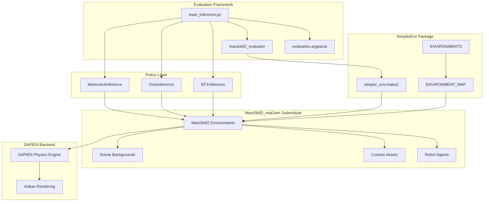
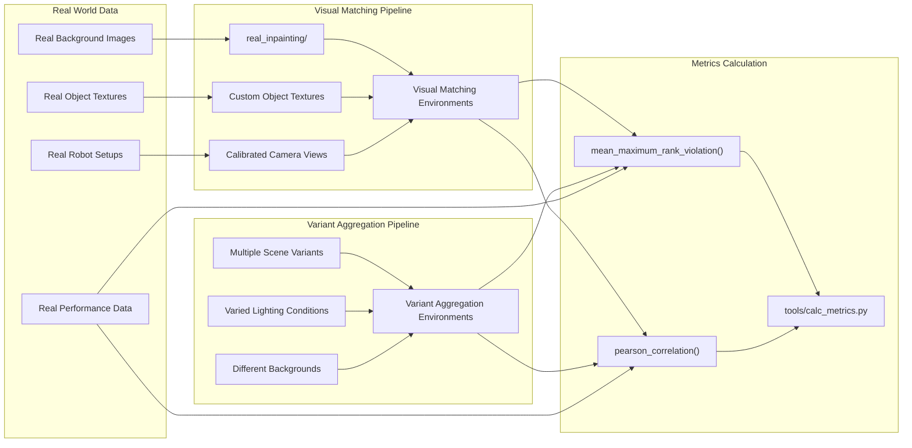
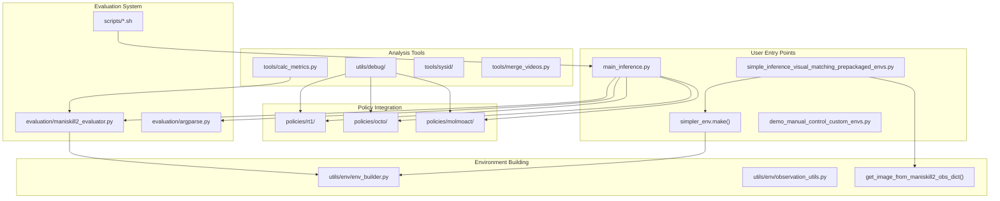

<!-- source: DeepWiki mcp.deepwiki.com · repo allenai/SimplerEnv · page 1 Overview · fetched 2026-10-26 -->

# Overview

Relevant source files

The following files were used as context for generating this wiki page:

- [README.md](README.md)
- [images/example_visualization/google_robot_pick_random_object.png](images/example_visualization/google_robot_pick_random_object.png)
- [images/example_visualization/google_robot_put_apple_in_closed_top_drawer.png](images/example_visualization/google_robot_put_apple_in_closed_top_drawer.png)
- [requirements_full_install.txt](requirements_full_install.txt)
- [simpler_env/__init__.py](simpler_env/__init__.py)

This document provides a comprehensive overview of SimplerEnv, a simulation-based evaluation framework for robotic manipulation policies. SimplerEnv enables scalable and reproducible evaluation of robot policies by creating simulated environments that closely match real-world robot setups.

For installation instructions and basic usage examples, see [Getting Started](#2). For detailed information about supported policy models, see [Policy Models](#3). For comprehensive evaluation procedures and metrics, see [Evaluation Framework](#4).

## Purpose and Scope

SimplerEnv addresses the challenge of evaluating generalist robot manipulation policies in a scalable and reproducible manner. Real-world robot evaluation is operationally expensive and inefficient, making it difficult to compare policies or perform systematic analysis. This system provides a simulation-based alternative that offers:

- **Scalable evaluation**: Run hundreds of policy evaluations in parallel simulation environments
- **Reproducible benchmarks**: Standardized environments and metrics for consistent comparison
- **Real-to-sim validation**: Two evaluation methodologies (Visual Matching and Variant Aggregation) that correlate with real-world performance
- **Multi-policy support**: Built-in integration with RT-1, Octo, and MolmoAct policy architectures

The system is built on the SAPIEN physics simulator and extends the ManiSkill2 benchmark with real-world robot environments and objects.

## System Architecture

The following diagram illustrates the high-level architecture of SimplerEnv and how its major components interact:

### SimplerEnv System Components

Sources: [README.md:182-221](), [simpler_env/__init__.py:1-89]()

## Evaluation Methodologies

SimplerEnv implements two distinct approaches for real-to-sim evaluation, each designed to address different aspects of the simulation-to-reality gap:

### Real-to-Sim Evaluation Approaches

Sources: [README.md:11-14](), [README.md:156-180]()

## Code Organization and Entry Points

The system provides multiple entry points for different use cases, from simple environment creation to comprehensive policy evaluation:

### Core Code Structure and Entry Points

Sources: [README.md:182-221](), [simpler_env/__init__.py:74-88](), [README.md:124-128]()

## Key System Components

### Environment Management

The `simpler_env.make()` function serves as the primary entry point for creating evaluation environments. It maps high-level task names to specific ManiSkill2 environment configurations:

| Component | Description | Code Location |
|-----------|-------------|---------------|
| `ENVIRONMENTS` | List of supported task names | [simpler_env/__init__.py:5-31]() |
| `ENVIRONMENT_MAP` | Mapping from task names to ManiSkill2 environments | [simpler_env/__init__.py:33-71]() |
| `make()` function | Environment factory with prepackaged configurations | [simpler_env/__init__.py:74-88]() |

### Policy Support

SimplerEnv provides built-in support for three major policy architectures:

| Policy Type | Implementation | Key Dependencies |
|-------------|----------------|------------------|
| RT-1 | `simpler_env/policies/rt1/` | TensorFlow 2.15.x, tf_agents |
| Octo | `simpler_env/policies/octo/` | JAX with CUDA, Flax |
| MolmoAct | `simpler_env/policies/molmoact/` | vLLM 0.8.5, Transformers 4.52.3 |

### Evaluation Infrastructure

The evaluation system supports both simple and advanced evaluation scenarios:

- **Simple evaluation**: Use `simple_inference_visual_matching_prepackaged_envs.py` for basic policy testing
- **Advanced evaluation**: Use `main_inference.py` with `evaluation/maniskill2_evaluator.py` for comprehensive evaluation with logging and metrics
- **Batch evaluation**: Shell scripts in `scripts/` directory for reproducing paper results

Sources: [README.md:34-63](), [README.md:245-323](), [requirements_full_install.txt:1-24]()

The system integrates with the ManiSkill2_real2sim submodule to provide the underlying simulation environments, robot models, and object assets needed for realistic manipulation task evaluation.

---

