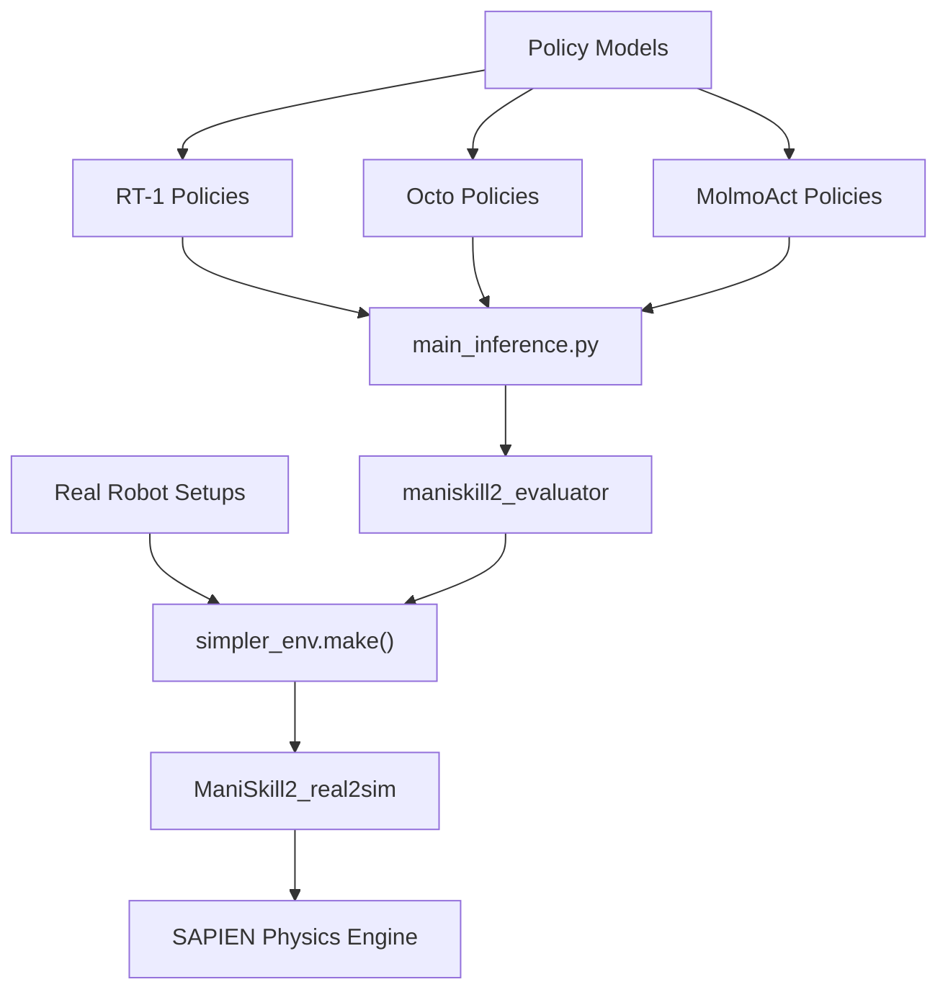
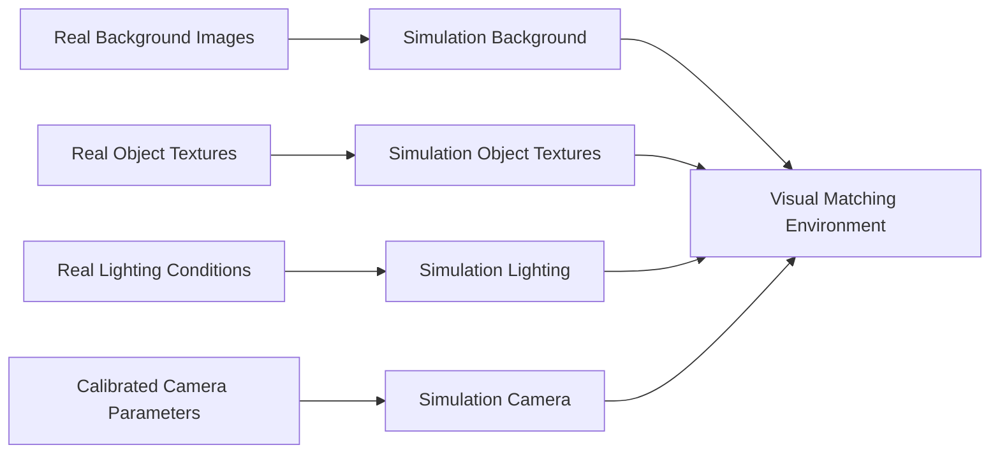
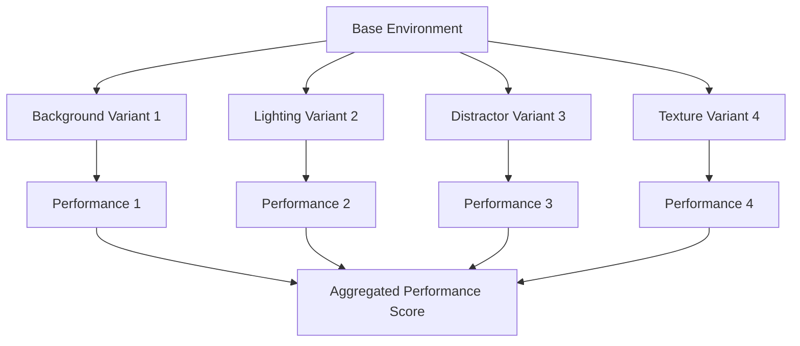
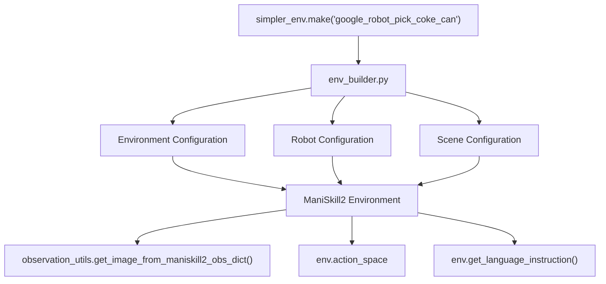
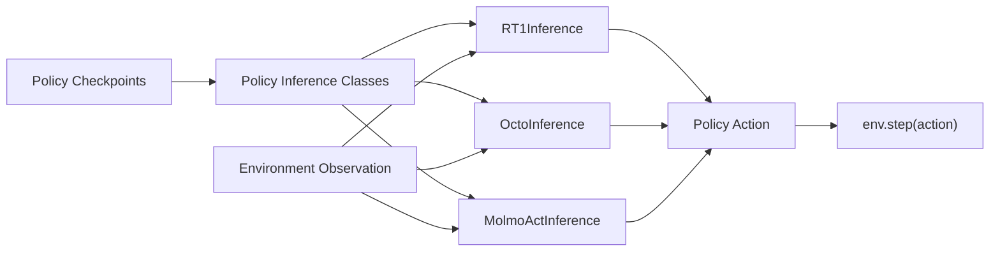
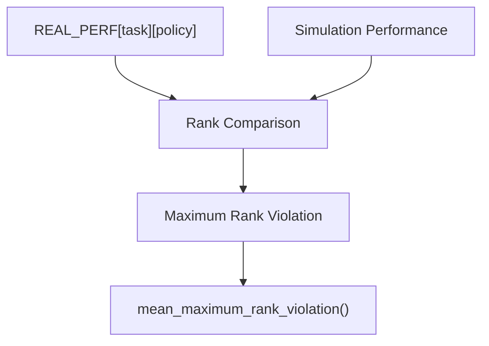
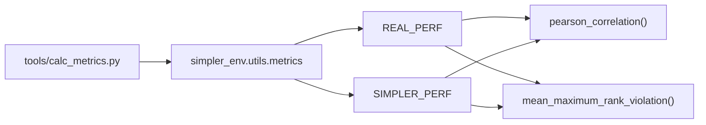
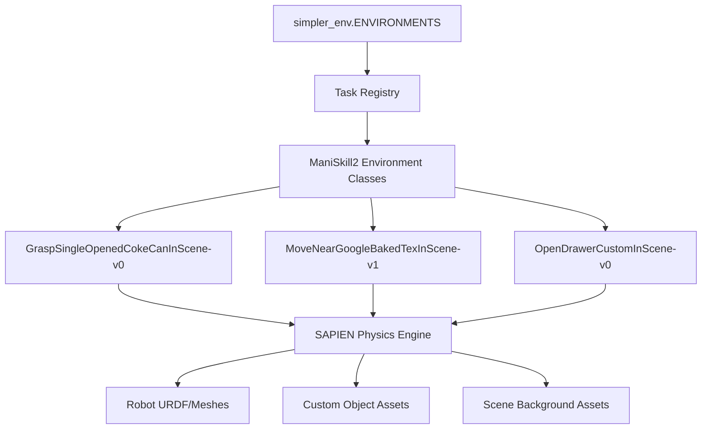

<!-- source: DeepWiki mcp.deepwiki.com · repo allenai/SimplerEnv · page 1.1 Core Concepts · fetched 2026-10-26 -->

# Core Concepts

Relevant source files

The following files were used as context for generating this wiki page:

- [README.md](README.md)
- [requirements_full_install.txt](requirements_full_install.txt)
- [simpler_env/utils/metrics.py](simpler_env/utils/metrics.py)
- [simpler_env/utils/visualization.py](simpler_env/utils/visualization.py)
- [tools/calc_metrics.py](tools/calc_metrics.py)
- [tools/visualize_dataset.py](tools/visualize_dataset.py)

This document explains the fundamental concepts underlying SimplerEnv's real-to-sim evaluation framework. It covers the core evaluation methodologies, system components, and metrics used to assess robotic manipulation policies in simulation environments that mirror real-world setups.

For detailed installation procedures, see [Installation](#2.1). For specific policy implementations, see [Policy Models](#3). For running evaluations, see [Evaluation Framework](#4).

## Real-to-Sim Evaluation Framework

SimplerEnv enables evaluation of robot manipulation policies by creating simulation environments that closely match real-world robot setups. The system addresses the challenge of scalable policy evaluation by providing quantitative metrics that correlate with real-world performance while maintaining computational efficiency.

The framework operates on the principle that well-configured simulation environments can serve as reliable proxies for real-world evaluation, enabling checkpoint selection, failure mode analysis, and standardized benchmarking.

**Core System Integration**

Sources: [README.md:11-15](), [README.md:38-63]()

## Evaluation Approaches

SimplerEnv implements two primary methodologies for real-to-sim evaluation, each designed to address different aspects of the sim-to-real gap.

### Visual Matching

Visual matching creates simulation environments that precisely replicate the visual appearance of real-world setups by overlaying real background images onto simulation scenes and adjusting object textures and lighting conditions.

**Visual Matching Pipeline**

The visual matching approach uses real-world inpainting images stored in `ManiSkill2_real2sim/data/real_inpainting/` and applies them to simulation environments to achieve visual fidelity.

### Variant Aggregation

Variant aggregation creates multiple simulation environment variants with different visual configurations (backgrounds, lighting, distractors, textures) and averages performance across these variants to improve generalization.

**Variant Aggregation Strategy**

Sources: [README.md:12-13](), [README.md:36]()

## Core System Components

SimplerEnv's architecture centers around several key components that work together to provide a complete evaluation framework.

### Environment Creation and Management

The `simpler_env.make()` function serves as the primary entry point for creating evaluation environments. It interfaces with the ManiSkill2_real2sim submodule to instantiate environments with specific configurations.

**Environment Creation Flow**

### Policy Integration Framework

The system supports multiple policy architectures through a unified interface that handles model loading, inference, and action processing.

**Policy Execution Pipeline**

Sources: [README.md:42-44](), [README.md:50-54](), [README.md:198-210]()

## Evaluation Metrics

SimplerEnv employs specific metrics to quantify how well simulation evaluation correlates with real-world performance. These metrics are implemented in the `simpler_env.utils.metrics` module.

### Mean Maximum Rank Violation (MMRV)

MMRV measures the maximum performance difference between policies when their relative rankings differ between simulation and real-world evaluation.

The `mean_maximum_rank_violation()` function computes this metric by comparing policy rankings across evaluation approaches:

### Pearson Correlation Coefficient

The `pearson_correlation()` function measures the linear correlation between simulation and real-world performance scores across different policies.

**Metrics Calculation Workflow**

The metrics system allows researchers to compare their evaluation approaches against SimplerEnv's baseline using the standardized performance data stored in `REAL_PERF` and `SIMPLER_PERF` dictionaries.

Sources: [tools/calc_metrics.py:1-35](), [simpler_env/utils/metrics.py:134-163](), [README.md:156-180]()

## ManiSkill2 Integration

SimplerEnv builds upon the ManiSkill2_real2sim submodule, which provides the underlying simulation infrastructure powered by the SAPIEN physics engine. This integration enables realistic physics simulation while maintaining the flexibility needed for real-to-sim evaluation.

### Environment Variants and Tasks

The system provides prepackaged environments accessible through string identifiers that correspond to specific ManiSkill2 environment classes:

| SimplerEnv Task ID | ManiSkill2 Environment Class | Description |
|-------------------|----------------------------|-------------|
| `google_robot_pick_coke_can` | `GraspSingleOpenedCokeCanInScene-v0` | Object grasping task |
| `google_robot_move_near` | `MoveNearGoogleBakedTexInScene-v1` | Navigation and positioning |
| `google_robot_open_drawer` | `OpenDrawerCustomInScene-v0` | Drawer manipulation |
| `widowx_spoon_on_towel` | `PutSpoonOnTableClothInScene-v0` | Placement task |

**Environment Architecture**

Sources: [README.md:130-154](), [README.md:185-197]()

---

