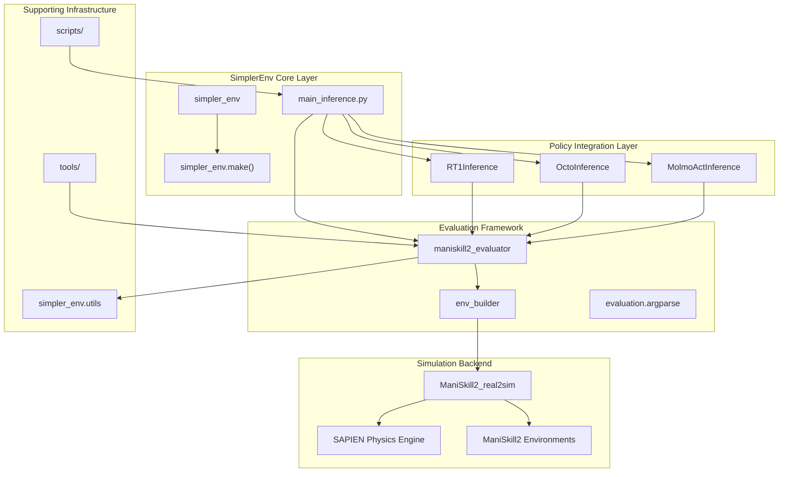
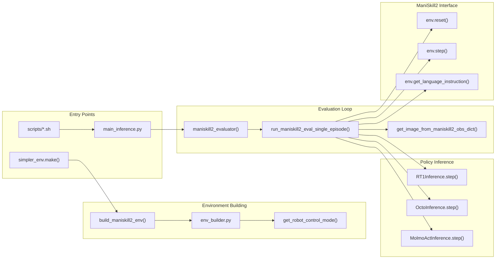
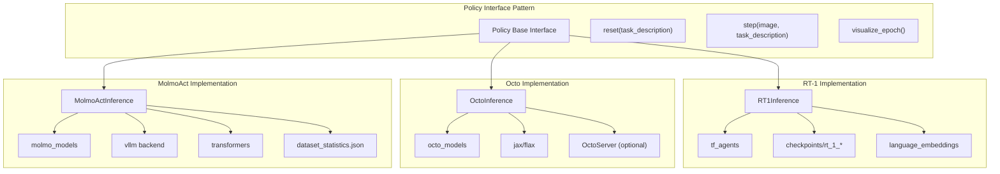
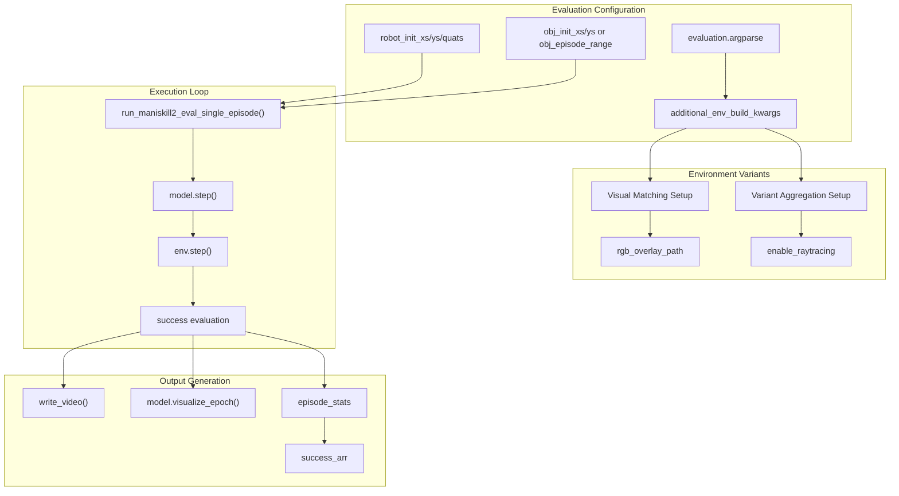
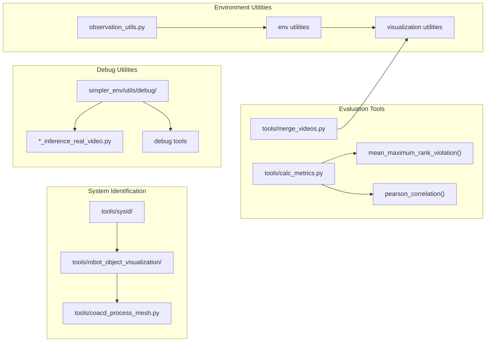
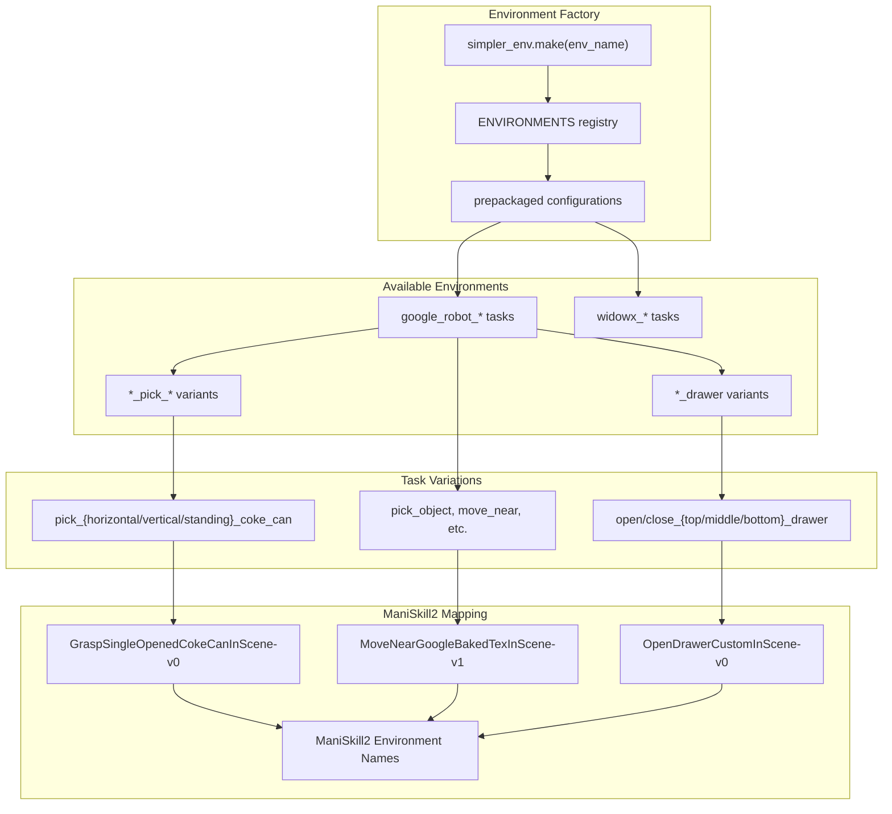

<!-- source: DeepWiki mcp.deepwiki.com · repo allenai/SimplerEnv · page 1.2 System Architecture · fetched 2026-10-26 -->

# System Architecture

Relevant source files

The following files were used as context for generating this wiki page:

- [README.md](README.md)
- [requirements_full_install.txt](requirements_full_install.txt)
- [simpler_env/evaluation/maniskill2_evaluator.py](simpler_env/evaluation/maniskill2_evaluator.py)
- [simpler_env/policies/molmoact/dataset_statistics.json](simpler_env/policies/molmoact/dataset_statistics.json)

This document provides a comprehensive overview of SimplerEnv's system architecture, detailing how the core components interact to enable simulated evaluation of robotic manipulation policies. This covers the relationship between SimplerEnv, ManiSkill2_real2sim, SAPIEN, and the evaluation framework, along with policy integration and supporting infrastructure.

For information about specific policy implementations, see [Policy Models](#3). For detailed evaluation methodologies, see [Evaluation Framework](#4). For installation and setup instructions, see [Getting Started](#2).

## Overview

SimplerEnv is a comprehensive system for evaluating robotic manipulation policies in simulation environments that closely match real-world setups. The architecture consists of several interconnected layers: the core SimplerEnv package, the ManiSkill2_real2sim simulation backend, policy integration modules, and evaluation infrastructure.

### Core System Architecture

**Sources:** [README.md:182-221](), [simpler_env/main_inference.py](), [simpler_env/evaluation/maniskill2_evaluator.py:1-223]()

## Component Relationships and Data Flow

The following diagram illustrates the specific code entities and their interactions during policy evaluation:

**Sources:** [simpler_env/evaluation/maniskill2_evaluator.py:15-223](), [simpler_env/utils/env/env_builder.py](), [simpler_env/utils/env/observation_utils.py]()

## Policy Integration Architecture

SimplerEnv supports multiple policy architectures through a common interface pattern. Each policy implementation provides standardized methods for initialization, action prediction, and visualization:

**Sources:** [simpler_env/policies/rt1/](), [simpler_env/policies/octo/](), [simpler_env/policies/molmoact/](), [simpler_env/policies/molmoact/dataset_statistics.json:1-3126]()

## Evaluation Pipeline Architecture

The evaluation system implements two main approaches: Visual Matching and Variant Aggregation. The pipeline coordinates environment creation, policy execution, and result collection:

**Sources:** [simpler_env/evaluation/maniskill2_evaluator.py:15-176](), [simpler_env/evaluation/argparse.py](), [simpler_env/utils/visualization.py]()

## Backend Simulation Infrastructure

The simulation layer consists of ManiSkill2_real2sim environments built on SAPIEN physics engine, with specialized assets and configurations for real-to-sim evaluation:

### Environment and Asset Structure

| Component | Location | Purpose |
|-----------|----------|---------|
| Custom Objects | `ManiSkill2_real2sim/data/custom/` | Coke cans, cabinets, and other task objects |
| Scene Assets | `ManiSkill2_real2sim/data/hab2_bench_assets/` | Background scenes and environments |
| Real Inpainting | `ManiSkill2_real2sim/data/real_inpainting/` | Real-world images for visual matching |
| Robot Agents | `ManiSkill2_real2sim/mani_skill2_real2sim/agents/` | Robot configurations and controllers |
| Robot Assets | `ManiSkill2_real2sim/mani_skill2_real2sim/assets/` | URDF files and meshes |
| Environments | `ManiSkill2_real2sim/mani_skill2_real2sim/envs/` | Task environment implementations |

```mermaid
graph TD
    subgraph "ManiSkill2_real2sim Structure"
        DATA_DIR["data/"]
        AGENTS_DIR["mani_skill2_real2sim/agents/"]
        ASSETS_DIR["mani_skill2_real2sim/assets/"]
        ENVS_DIR["mani_skill2_real2sim/envs/"]
    end
    
    subgraph "Asset Categories"
        CUSTOM_OBJ["custom/ (objects)"]
        HAB_ASSETS["hab2_bench_assets/ (scenes)"]
        REAL_IMGS["real_inpainting/ (backgrounds)"]
        DEBUG_ASSETS["debug/ (testing)"]
    end
    
    subgraph "Robot Components"
        ROBOT_CONFIGS["robot configs"]
        ROBOT_URDF["URDF files"]
        ROBOT_MESH["mesh files"]
        CONTROLLERS["controller implementations"]
    end
    
    subgraph "Environment Types"
        GOOGLE_ENVS["Google Robot environments"]
        WIDOWX_ENVS["WidowX environments"]
        GRASP_ENVS["GraspSingle* tasks"]
        DRAWER_ENVS["*Drawer* tasks"]
    end
    
    DATA_DIR --> CUSTOM_OBJ
    DATA_DIR --> HAB_ASSETS
    DATA_DIR --> REAL_IMGS
    DATA_DIR --> DEBUG_ASSETS
    
    AGENTS_DIR --> ROBOT_CONFIGS
    AGENTS_DIR --> CONTROLLERS
    ASSETS_DIR --> ROBOT_URDF
    ASSETS_DIR --> ROBOT_MESH
    
    ENVS_DIR --> GOOGLE_ENVS
    ENVS_DIR --> WIDOWX_ENVS
    ENVS_DIR --> GRASP_ENVS
    ENVS_DIR --> DRAWER_ENVS
```

**Sources:** [README.md:185-197](), [ManiSkill2_real2sim/data/](), [ManiSkill2_real2sim/mani_skill2_real2sim/]()

## Supporting Tools and Utilities

SimplerEnv includes comprehensive tooling for system identification, visualization, debugging, and metrics calculation:

**Sources:** [tools/](), [simpler_env/utils/debug/](), [simpler_env/utils/env/](), [tools/calc_metrics.py]()

## Environment Registration and Factory Pattern

SimplerEnv uses a factory pattern for environment creation, with prepackaged configurations for visual matching and variant aggregation setups:

**Sources:** [README.md:130-154](), [simpler_env/__init__.py](), [README.md:38-63]()

---

