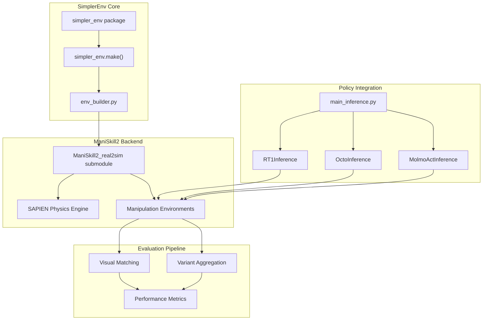
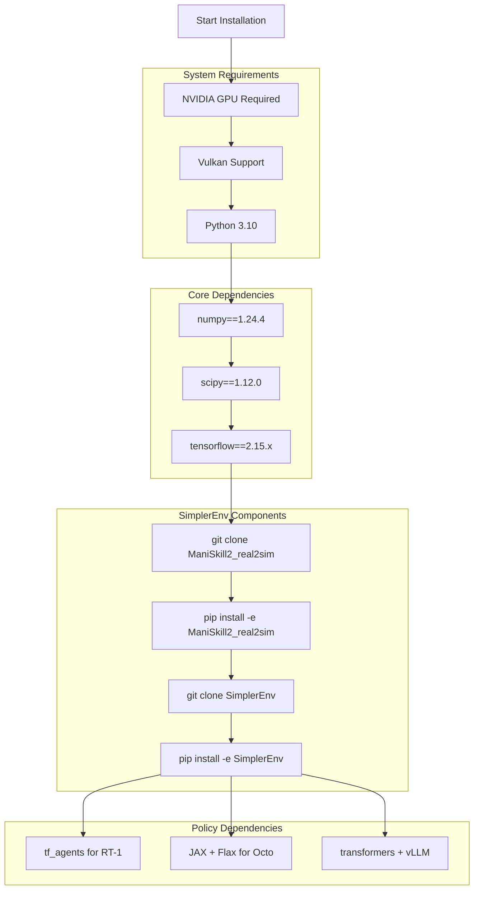
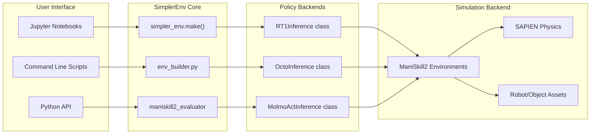

<!-- source: DeepWiki mcp.deepwiki.com · repo allenai/SimplerEnv · page 2 Getting Started · fetched 2026-10-26 -->

# Getting Started

<details>
<summary>Relevant source files</summary>

The following files were used as context for generating this wiki page:

- [.gitmodules](.gitmodules)
- [docker/10_nvidia.json](docker/10_nvidia.json)
- [docker/Dockerfile](docker/Dockerfile)
- [docker/nvidia_icd.json](docker/nvidia_icd.json)
- [docker/nvidia_layers.json](docker/nvidia_layers.json)
- [example.ipynb](example.ipynb)

</details>


This document provides an overview of SimplerEnv installation, initial setup, and basic usage patterns. It introduces the core concepts and system components needed to begin evaluating robotic manipulation policies in simulation.

For detailed installation instructions including Docker setup and dependency management, see [Installation](#2.1). For step-by-step examples of creating environments and running evaluations, see [Basic Usage](#2.2).

## Overview

SimplerEnv is a simulation-based evaluation framework for robotic manipulation policies that bridges the gap between simulated and real-world performance. The system consists of several key components that work together to provide accurate policy evaluation.

### Core System Architecture



Sources: [example.ipynb:19-23](), [.gitmodules:1-4]()

### Installation Approaches

SimplerEnv supports three primary installation methods, each suited for different use cases:

| Installation Method | Use Case | Requirements | Policy Support |
|-------------------|----------|--------------|----------------|
| **Docker** | Reproducible environments, CI/CD | NVIDIA GPU, Docker | Full policy support |
| **Conda** | Development, customization | Python 3.10, CUDA | Configurable |
| **Colab** | Quick experimentation, demos | Google Colab GPU runtime | Limited to available packages |

### Installation Flow Diagram



Sources: [example.ipynb:85-299](), [docker/Dockerfile:51-66]()

## Quick Start

### 1. Environment Setup

The fastest way to get started is using the provided example notebook or following the basic installation steps:

```python
# Core installation commands from example notebook
pip install numpy==1.24.4
git clone https://github.com/simpler-env/ManiSkill2_real2sim.git
pip install -e ./ManiSkill2_real2sim
git clone https://github.com/simpler-env/SimplerEnv.git  
pip install -e ./SimplerEnv
```

### 2. Creating Your First Environment

Once installed, you can create a simulation environment using the `simpler_env.make()` function:

```python
import simpler_env

# Create environment with visual matching approach
env = simpler_env.make(
    env_id="google_robot_pick_coke_can",
    robot="google_robot",
    policy_model="rt1"
)

# Reset environment and get initial observation
obs, info = env.reset()
```

### 3. Running Basic Evaluations

The primary evaluation interface is through `main_inference.py`, which handles policy loading, environment interaction, and results collection:

```bash
python main_inference.py \
    --policy_model=rt1 \
    --robot_name=google_robot \
    --env_name=google_robot_pick_coke_can \
    --visual_matching
```

Sources: [example.ipynb:423-451]()

## System Components

### Core Components Mapping



Sources: [example.ipynb:424-451](), [.gitmodules:1-4]()

### Dependencies and Requirements

| Component | Version Requirement | Purpose |
|-----------|-------------------|---------|
| `numpy` | `==1.24.4` | Core numerical operations |
| `scipy` | `==1.12.0` | Scientific computing |
| `tensorflow` | `==2.15.x` | RT-1 policy support |
| `sapien` | `==2.2.2` | Physics simulation |
| `gymnasium` | `>=0.28.1` | Environment interface |
| `vulkan` | System dependency | GPU rendering |

## Docker Installation

For the most reliable setup, use the provided Docker environment:

```dockerfile
# Key Docker setup from Dockerfile
FROM nvidia/cudagl:11.3.1-devel-ubuntu20.04
ENV NVIDIA_DRIVER_CAPABILITIES=all

# Install SimplerEnv
RUN cd ~ && git clone https://github.com/allenai/SimplerEnv --recurse-submodules && \
    pip install numpy==1.24.4 && \
    cd SimplerEnv/ManiSkill2_real2sim && \
    pip install -e . && \
    cd .. && \
    pip install -e .
```

The Docker approach automatically handles:
- NVIDIA GPU driver setup
- Vulkan rendering configuration  
- All dependency version management
- Submodule initialization

Sources: [docker/Dockerfile:1-71](), [docker/nvidia_icd.json:1-7](), [docker/10_nvidia.json:1-6]()

## Next Steps

After completing the basic setup:

1. **Detailed Installation**: Follow the comprehensive installation guide at [Installation](#2.1) for your specific environment
2. **Basic Usage Examples**: Work through step-by-step examples at [Basic Usage](#2.2) 
3. **Policy Integration**: Learn about supported policy models at [Policy Models](#3)
4. **Running Evaluations**: Understand the evaluation framework at [Evaluation Framework](#4)

The getting started process establishes the foundation for policy evaluation, but the full system capabilities require understanding the evaluation approaches, metrics calculation, and policy-specific configurations covered in subsequent sections.

---

