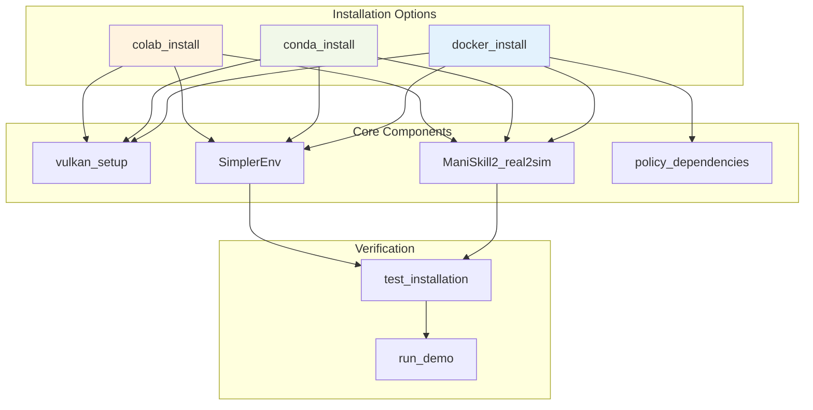
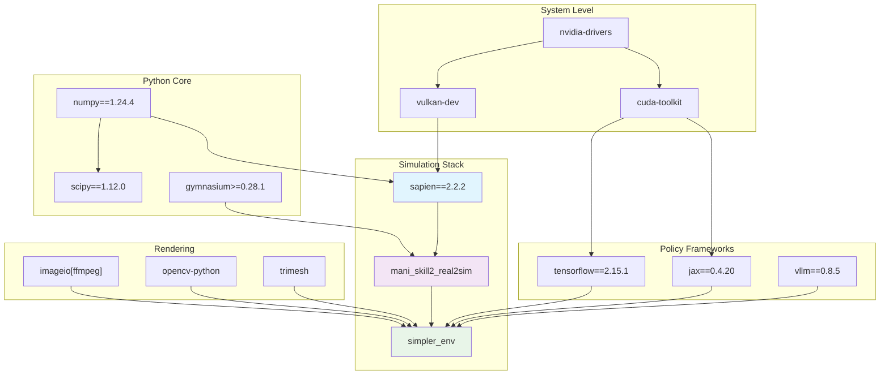

<!-- source: DeepWiki mcp.deepwiki.com · repo allenai/SimplerEnv · page 2.1 Installation · fetched 2026-10-26 -->

# Installation

<details>
<summary>Relevant source files</summary>

The following files were used as context for generating this wiki page:

- [.gitmodules](.gitmodules)
- [docker/10_nvidia.json](docker/10_nvidia.json)
- [docker/Dockerfile](docker/Dockerfile)
- [docker/nvidia_icd.json](docker/nvidia_icd.json)
- [docker/nvidia_layers.json](docker/nvidia_layers.json)
- [example.ipynb](example.ipynb)
- [tools/coacd_process_mesh.py](tools/coacd_process_mesh.py)

</details>


This page provides comprehensive installation instructions for SimplerEnv, a robotic policy evaluation framework. SimplerEnv requires specific dependencies for simulation rendering, policy model support, and real-to-sim evaluation capabilities.

For basic usage examples after installation, see [Basic Usage](#2.2). For information about supported policy models that require additional dependencies, see [Policy Models](#3).

## Prerequisites

SimplerEnv requires a system with:
- NVIDIA GPU with CUDA support
- Linux operating system (Ubuntu 18.04+ recommended)
- Python 3.8 or higher
- At least 8GB of available disk space

### GPU and Rendering Requirements

The system depends on Vulkan for hardware-accelerated rendering through the SAPIEN physics engine. This requires:
- NVIDIA drivers (version 470+ recommended)
- Vulkan SDK and development libraries
- CUDA toolkit (version 11.3+ for TensorFlow compatibility)

## Installation Methods

SimplerEnv can be installed through three primary methods, each suited for different use cases:

### Installation Method Overview



Sources: [example.ipynb:1-411](), [docker/Dockerfile:1-71]()

### Method 1: Docker Installation (Recommended)

Docker provides the most reliable installation with pre-configured dependencies and rendering support.

#### Docker Setup

```bash
# Clone the repository with submodules
git clone --recurse-submodules https://github.com/allenai/SimplerEnv
cd SimplerEnv

# Build the Docker image
docker build -t simpler_env -f docker/Dockerfile .

# Run the container with GPU support
docker run --gpus all -it --rm \
    -v $(pwd):/workspace \
    simpler_env bash
```

The Docker image includes:
- Ubuntu 20.04 base with CUDA 11.3.1
- Pre-installed Vulkan rendering stack
- ManiSkill2 and SimplerEnv in editable mode
- TensorFlow 2.15.0 with CUDA support
- Full dependency requirements

#### Docker Environment Configuration

The Dockerfile configures several critical components:

| Component | Configuration | Purpose |
|-----------|---------------|---------|
| Base Image | `nvidia/cudagl:11.3.1-devel-ubuntu20.04` | CUDA and OpenGL support |
| Vulkan ICD | `/usr/share/vulkan/icd.d/nvidia_icd.json` | NVIDIA Vulkan driver |
| EGL Vendor | `/usr/share/glvnd/egl_vendor.d/10_nvidia.json` | NVIDIA EGL implementation |
| Python | Miniforge with Python 3.10 | Conda environment |

Sources: [docker/Dockerfile:1-71](), [docker/nvidia_icd.json:1-7](), [docker/10_nvidia.json:1-6]()

### Method 2: Conda Installation

For local development or when Docker is not available:

#### Environment Setup

```bash
# Create and activate conda environment
conda create -n simpler_env python=3.10
conda activate simpler_env

# Install system-level Vulkan support (Ubuntu/Debian)
sudo apt-get update
sudo apt-get install -y libvulkan-dev vulkan-tools

# Clone repository with submodules
git clone --recurse-submodules https://github.com/allenai/SimplerEnv
cd SimplerEnv
```

#### Core Dependencies Installation

```bash
# Install specific numpy version (required for compatibility)
pip install numpy==1.24.4

# Install ManiSkill2_real2sim submodule
cd ManiSkill2_real2sim
pip install -e .
cd ..

# Install SimplerEnv
pip install -e .
```

#### Policy Dependencies (Optional)

Different policy models require specific dependency sets:

**RT-1 Policies:**
```bash
pip install tensorflow==2.15.1
pip install tf_agents
```

**Octo Policies:**
```bash
pip install "jax[cuda12_pip]==0.4.20" -f https://storage.googleapis.com/jax-releases/jax_cuda_releases.html
pip install distrax==0.1.5 "einops>=0.6.1"
```

**MolmoAct Policies:**
```bash
pip install vllm==0.8.5
pip install transformers==4.52.3
```

Sources: [example.ipynb:288-383]()

### Method 3: Google Colab Installation

For experimentation without local setup:

#### Colab Environment Preparation

The Colab installation requires GPU runtime and specific setup steps:

```python
# Verify GPU availability
!nvidia-smi

# Install Vulkan for rendering
!apt-get install -yqq --no-install-recommends libvulkan-dev vulkan-tools

# Configure Vulkan ICD files
!mkdir -p /usr/share/vulkan/icd.d
!wget -q -P /usr/share/vulkan/icd.d https://raw.githubusercontent.com/haosulab/ManiSkill/main/docker/nvidia_icd.json
!wget -q -O /usr/share/glvnd/egl_vendor.d/10_nvidia.json https://raw.githubusercontent.com/haosulab/ManiSkill/main/docker/10_nvidia.json
```

#### Package Installation

The Colab installation follows a specific sequence to avoid dependency conflicts:

```python
# Install core dependencies with pinned versions
!pip install numpy==1.24.4 orbax-checkpoint==0.4.4 scipy==1.12.0
!pip install keras==2.15.0 tensorflow==2.15.1

# Clone and install repositories
!git clone https://github.com/simpler-env/ManiSkill2_real2sim.git
!pip install -e ./ManiSkill2_real2sim
!git clone https://github.com/simpler-env/SimplerEnv.git
!pip install -e ./SimplerEnv

# Refresh Python import system
import site
site.main()
```

Sources: [example.ipynb:72-411]()

## Dependency Architecture

The SimplerEnv installation creates a complex dependency tree with specific version requirements:

### Core Dependency Graph



Sources: [docker/Dockerfile:52-65](), [example.ipynb:215-283]()

## Installation Verification

### Environment Test

Verify the installation by creating a test environment:

```python
import simpler_env
import numpy as np

# Test environment creation
env = simpler_env.make(
    "google_robot_pick_coke_can_1_v4",
    render_mode="cameras",
    sim_freq=513,
    control_freq=3
)

# Verify environment functionality
obs = env.reset()
print(f"Observation keys: {obs.keys()}")
print(f"Environment ready: {env.unwrapped.robot_uid}")
```

### Rendering Verification

Test Vulkan rendering functionality:

```bash
# Verify Vulkan installation
vulkaninfo | head -n 10

# Test SAPIEN rendering
python -c "import sapien.core as sapien; print('SAPIEN import successful')"
```

## Troubleshooting Common Issues

### Vulkan Setup Issues

If encountering Vulkan-related errors:

1. **Missing ICD Files**: Ensure NVIDIA ICD configuration exists at `/usr/share/vulkan/icd.d/nvidia_icd.json`
2. **Driver Compatibility**: Update NVIDIA drivers to version 470 or higher
3. **Permission Issues**: Verify read access to Vulkan configuration files

### Memory and Performance

For systems with limited resources:

| Issue | Solution | Configuration |
|-------|----------|---------------|
| Out of Memory | Reduce simulation frequency | `sim_freq=256` instead of 513 |
| Slow Rendering | Disable ray tracing | Set `SAPIEN_DISABLE_RAYTRACING=1` |
| Large Downloads | Use checkpoint directory | Create `./checkpoints/` directory |

### Dependency Conflicts

Common version conflicts and solutions:

- **TensorFlow/JAX**: Use separate conda environments for different policy types
- **NumPy**: Pin to version 1.24.4 to avoid compatibility issues
- **Scipy**: Version 1.12.0 required for specific mathematical operations

Sources: [example.ipynb:406-411](), [docker/Dockerfile:47-50]()

---

