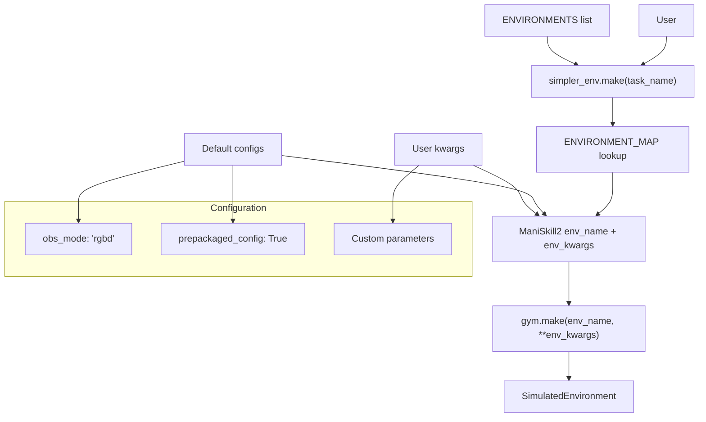
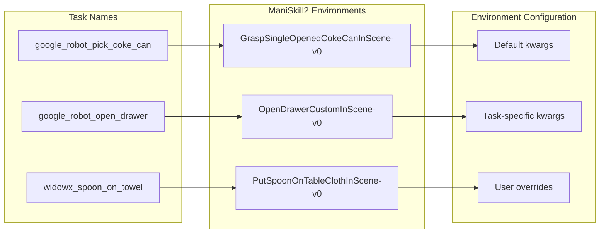
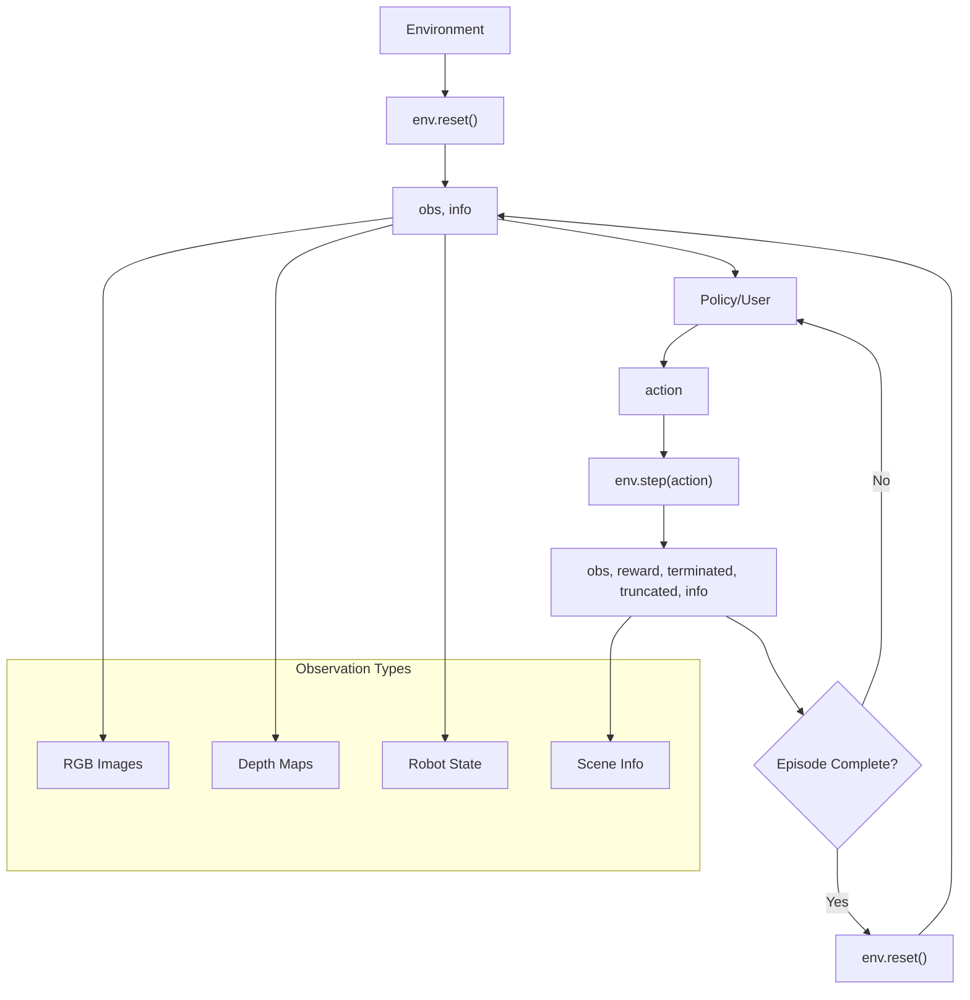

<!-- source: DeepWiki mcp.deepwiki.com · repo allenai/SimplerEnv · page 2.2 Basic Usage · fetched 2026-10-26 -->

# Basic Usage

<details>
<summary>Relevant source files</summary>

The following files were used as context for generating this wiki page:

- [.gitmodules](.gitmodules)
- [example.ipynb](example.ipynb)
- [images/example_visualization/google_robot_pick_random_object.png](images/example_visualization/google_robot_pick_random_object.png)
- [images/example_visualization/google_robot_put_apple_in_closed_top_drawer.png](images/example_visualization/google_robot_put_apple_in_closed_top_drawer.png)
- [simpler_env/__init__.py](simpler_env/__init__.py)

</details>


This section covers the fundamental operations for creating and interacting with SimplerEnv simulation environments. It provides practical examples of environment instantiation, basic policy evaluation loops, and understanding the core API. For comprehensive evaluation workflows, see [Running Evaluations](#4.2). For advanced environment configuration and customization, see [Adding New Environments and Robots](#6.1).

## Environment Creation

SimplerEnv environments are created using the `simpler_env.make()` function, which serves as the primary entry point to the system. This function abstracts the underlying ManiSkill2 environment creation and applies SimplerEnv-specific configurations.

### Basic Environment Instantiation

```python
import simpler_env

# Create a basic picking task environment
env = simpler_env.make("google_robot_pick_coke_can")

# Create an environment with custom parameters
env = simpler_env.make(
    "google_robot_pick_object",
    camera_cfgs={"add_segmentation": True},
    render_mode="rgb_array"
)
```

The `make()` function automatically configures several default parameters:
- `obs_mode`: Set to `"rgbd"` for RGB-D observations
- `prepackaged_config`: Set to `True` to use SimplerEnv's optimized configurations

### Environment Creation Flow



**Environment Creation Process**
- User provides task name from supported environments
- SimplerEnv maps task name to ManiSkill2 environment and configuration
- Default parameters are applied with user overrides
- Gymnasium creates the final environment instance

Sources: [simpler_env/__init__.py:74-88]()

## Available Environments

SimplerEnv supports 31 predefined manipulation tasks across two robot platforms: Google Robot and WidowX. Each task represents a specific manipulation scenario with configured objects, scenes, and success criteria.

### Supported Task Categories

| Robot Platform | Task Category | Example Tasks |
|-----------------|---------------|---------------|
| Google Robot | Object Manipulation | `google_robot_pick_coke_can`, `google_robot_pick_object` |
| Google Robot | Drawer Operations | `google_robot_open_drawer`, `google_robot_close_drawer` |
| Google Robot | Placement Tasks | `google_robot_place_in_closed_drawer` |
| Google Robot | Navigation | `google_robot_move_near` |
| WidowX | Tabletop Manipulation | `widowx_spoon_on_towel`, `widowx_carrot_on_plate` |
| WidowX | Stacking Tasks | `widowx_stack_cube` |
| WidowX | Container Tasks | `widowx_put_eggplant_in_basket` |

### Task Name to Environment Mapping



**Environment Resolution Process**
- SimplerEnv task names map to specific ManiSkill2 environment IDs
- Each mapping includes task-specific configuration parameters
- User-provided kwargs override default configurations

Sources: [simpler_env/__init__.py:5-31](), [simpler_env/__init__.py:33-71]()

## Basic Environment Interaction

### Standard Gymnasium Interface

SimplerEnv environments follow the standard Gymnasium API, providing familiar methods for environment interaction:

```python
# Environment lifecycle
obs, info = env.reset()
action = env.action_space.sample()  # Random action
obs, reward, terminated, truncated, info = env.step(action)
env.close()
```

### Complete Interaction Example

The following demonstrates a complete environment interaction loop with observation handling and episode management:

```python
import simpler_env
import numpy as np

# Create environment
env = simpler_env.make("google_robot_pick_coke_can")

# Reset and get initial state
obs, info = env.reset()
print(f"Task instruction: {env.get_language_instruction()}")
print(f"Scene info: {info}")

# Run episode with random actions
for step in range(100):
    # Sample random action
    action = env.action_space.sample()
    
    # Execute action
    obs, reward, terminated, truncated, info = env.step(action)
    
    # Check episode completion
    if terminated or truncated:
        print(f"Episode completed at step {step}")
        print(f"Final stats: {info}")
        break

env.close()
```

Sources: [example.ipynb:424-450]()

## Understanding Observations and Actions

### Observation Structure

SimplerEnv environments provide RGB-D observations by default, containing visual information from multiple camera viewpoints:

```python
# Observation components
obs_keys = obs.keys()  # Typically includes camera views and robot state
rgb_obs = obs['base_camera']['rgb']  # RGB image array
depth_obs = obs['base_camera']['depth']  # Depth image array
robot_state = obs['agent']  # Robot joint positions and velocities
```

### Action Space

Actions in SimplerEnv follow the robot's native action space:

- **Google Robot**: 7-DOF arm actions plus gripper control
- **WidowX**: 6-DOF arm actions plus gripper control

Actions are typically normalized to `[-1, 1]` ranges for each degree of freedom.

### Episode Information

Each environment step returns information about the current episode state:

```python
# Episode information structure
info = {
    'scene_name': str,           # Current scene configuration
    'model_id': str,             # Object model identifier
    'success': bool,             # Task completion status
    'episode_stats': dict,       # Task-specific metrics
}
```

### Environment Interaction Flow



**Interaction Loop Components**
- `env.reset()` initializes episode with scene randomization
- Observations contain multi-modal sensory data
- Actions control robot motion in task space
- Episode info tracks task progress and scene configuration

Sources: [example.ipynb:424-450](), [simpler_env/__init__.py:74-88]()

---

