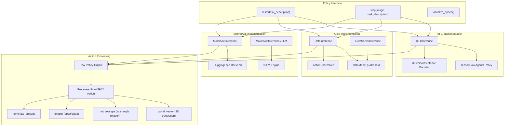
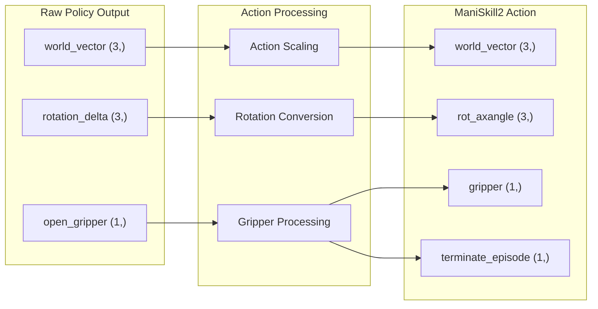
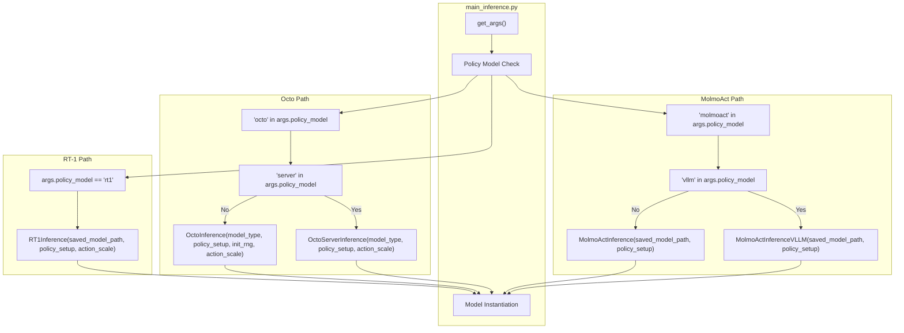
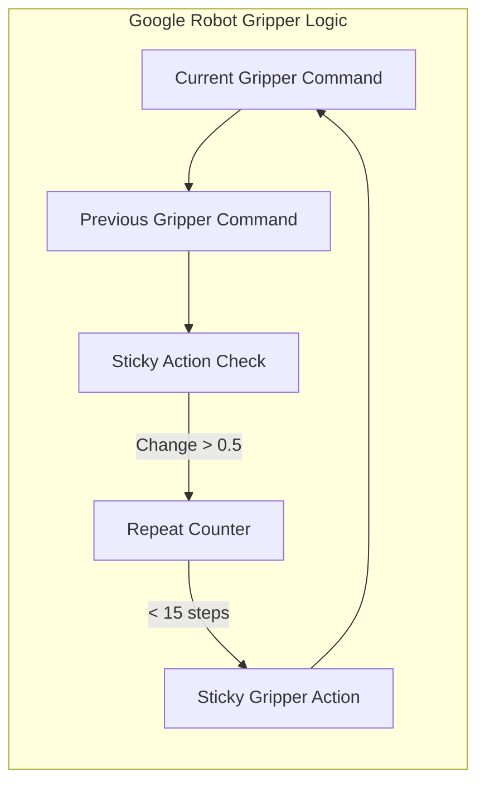
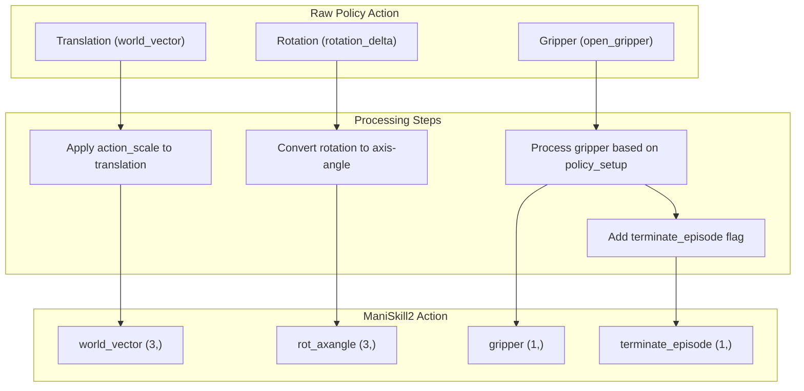

<!-- source: DeepWiki mcp.deepwiki.com · repo allenai/SimplerEnv · page 3 Policy Models · fetched 2026-10-26 -->

# Policy Models

Relevant source files

The following files were used as context for generating this wiki page:

- [simpler_env/main_inference.py](simpler_env/main_inference.py)
- [simpler_env/policies/octo/octo_model.py](simpler_env/policies/octo/octo_model.py)
- [simpler_env/policies/octo/octo_server_model.py](simpler_env/policies/octo/octo_server_model.py)
- [simpler_env/policies/rt1/rt1_model.py](simpler_env/policies/rt1/rt1_model.py)
- [simpler_env/simple_inference_visual_matching_prepackaged_envs.py](simpler_env/simple_inference_visual_matching_prepackaged_envs.py)
- [simpler_env/utils/env/env_builder.py](simpler_env/utils/env/env_builder.py)

This document covers the policy model implementations supported by SimplerEnv for robotic manipulation evaluation. Policy models are the core components that process visual observations and language instructions to generate robot actions. SimplerEnv supports three main policy architectures: RT-1, Octo, and MolmoAct, each with different inference backends and configurations.

For information about running evaluations with these policies, see [Evaluation Framework](#4). For setup and installation of policy dependencies, see [Installation](#2.1).

## Policy Architecture Overview

SimplerEnv implements a unified interface for different policy models, allowing seamless evaluation across various architectures. All policies follow a common pattern for initialization, reset, and action generation.

Sources: [simpler_env/policies/rt1/rt1_model.py:14-282](), [simpler_env/policies/octo/octo_model.py:16-273](), [simpler_env/main_inference.py:52-89]()

## Common Policy Interface

All policy implementations follow a standardized interface for integration with the evaluation framework. The interface consists of three main methods and consistent action output formats.

### Core Methods

| Method | Purpose | Input | Output |
|--------|---------|--------|--------|
| `reset(task_description)` | Initialize policy state for new episode | Task description string | None |
| `step(image, task_description)` | Generate action from observation | RGB image array, optional task description | Raw action dict, processed action dict |
| `visualize_epoch(actions, images, save_path)` | Generate visualization of policy predictions | Action sequence, image sequence, output path | None |

### Action Output Format

All policies output actions in a consistent format for ManiSkill2 environment integration:

Sources: [simpler_env/policies/rt1/rt1_model.py:150-230](), [simpler_env/policies/octo/octo_model.py:130-242]()

## Policy Model Instantiation

The `main_inference.py` entry point handles policy model selection and instantiation based on command-line arguments. The system supports different inference modes and configurations for each policy type.

Sources: [simpler_env/main_inference.py:52-89]()

## Policy Setup Configurations

Each policy model supports different robot configurations through the `policy_setup` parameter. The two main setups are `google_robot` and `widowx_bridge`, which define robot-specific action processing and gripper control strategies.

| Policy Setup | Robot Type | Gripper Control | Action Normalization |
|--------------|------------|-----------------|---------------------|
| `google_robot` | Google Robot (static base) | Continuous with sticky gripper | Native policy output |
| `widowx_bridge` | WidowX Bridge | Binary open/close | Action rescaling applied |

### Google Robot Configuration

For Google Robot setups, policies implement sticky gripper behavior where gripper commands are repeated for multiple timesteps to ensure reliable execution.

Sources: [simpler_env/policies/octo/octo_model.py:187-232](), [simpler_env/policies/rt1/rt1_model.py:214-224]()

### WidowX Bridge Configuration

WidowX Bridge setups use binary gripper control and may apply action normalization depending on the policy type.

Sources: [simpler_env/policies/octo/octo_model.py:234-238](), [simpler_env/policies/rt1/rt1_model.py:46-52]()

## Action Processing Pipeline

All policies follow a consistent action processing pipeline that converts raw policy outputs into ManiSkill2-compatible actions. The pipeline handles coordinate transformations, action scaling, and robot-specific adaptations.

### Rotation Conversion

Rotation actions are converted from Euler angles to axis-angle representation using the `transforms3d` library. This ensures compatibility with ManiSkill2's expected rotation format.

Sources: [simpler_env/policies/rt1/rt1_model.py:185-207](), [simpler_env/policies/octo/octo_model.py:178-185]()

## Image Processing

All policies implement consistent image preprocessing to ensure proper input formatting. Images are resized to policy-specific dimensions and converted to the appropriate data types.

| Policy Type | Input Size | Resize Method | Data Type |
|-------------|------------|---------------|-----------|
| RT-1 | 320x256 | `resize_with_pad` | uint8 |
| Octo | 256x256 | `lanczos3` with antialiasing | uint8 |
| MolmoAct | Variable | Policy-dependent | uint8 |

Sources: [simpler_env/policies/rt1/rt1_model.py:101-104](), [simpler_env/policies/octo/octo_model.py:88-96]()

---

