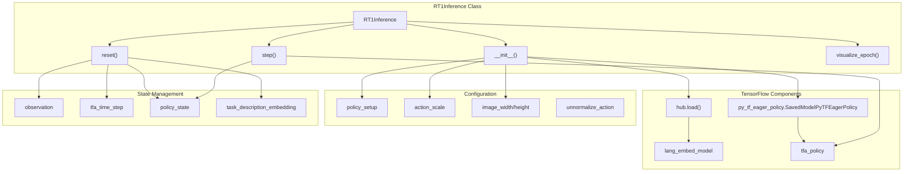
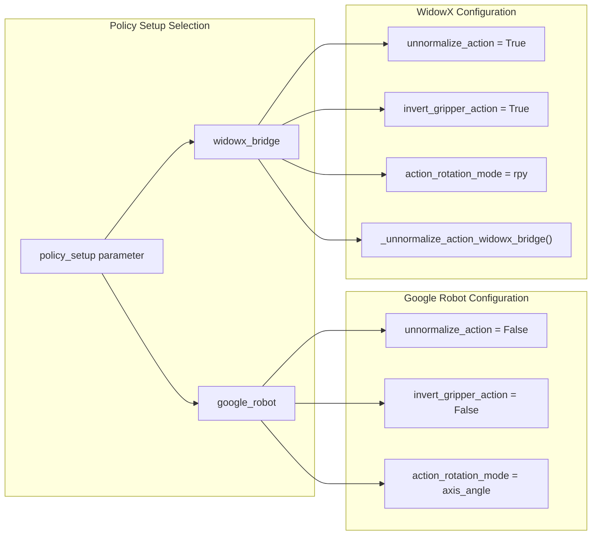
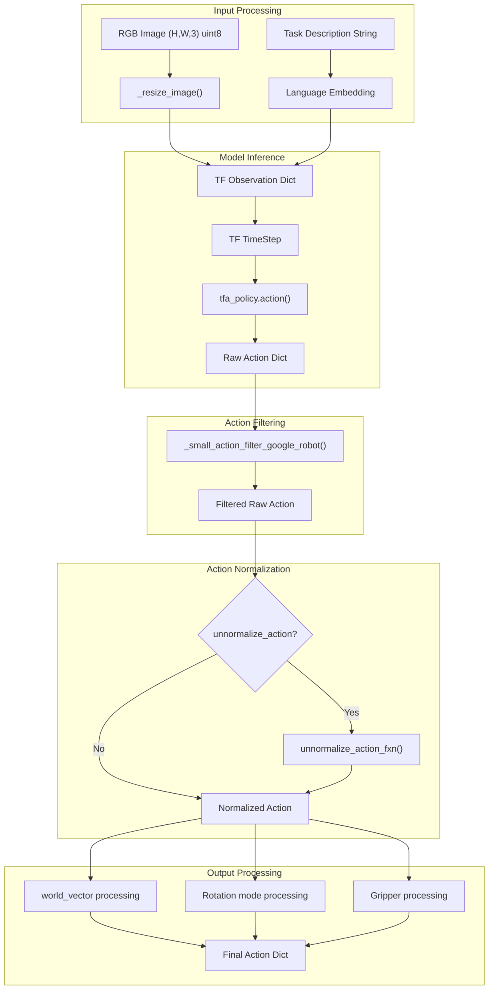
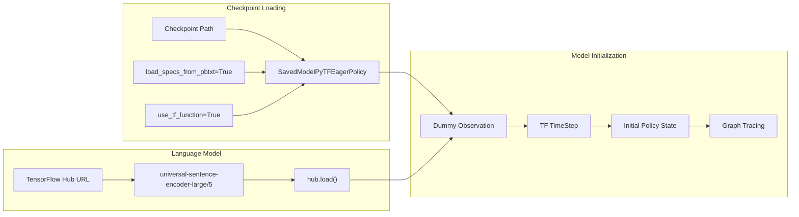
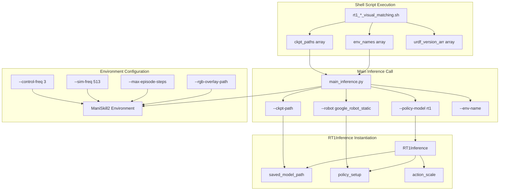
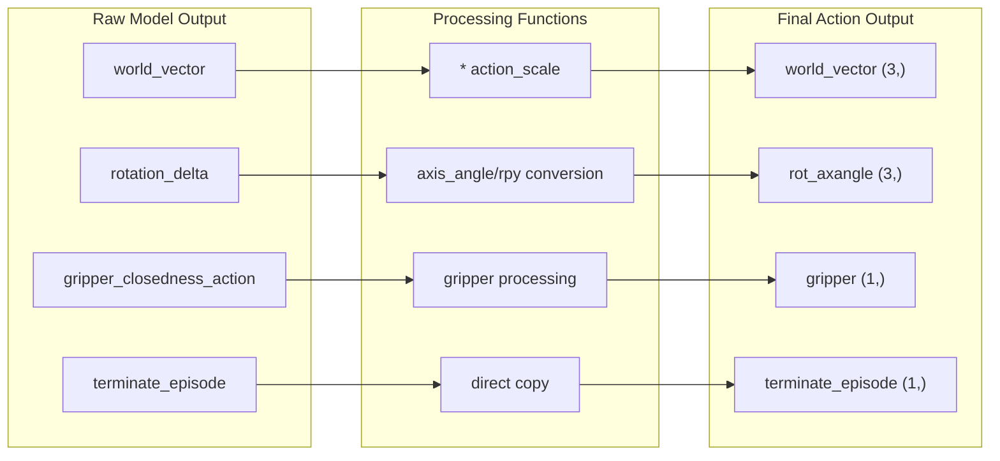

<!-- source: DeepWiki mcp.deepwiki.com · repo allenai/SimplerEnv · page 3.1 RT-1 Policies · fetched 2026-10-26 -->

# RT-1 Policies

<details>
<summary>Relevant source files</summary>

The following files were used as context for generating this wiki page:

- [scripts/octo_drawer_visual_matching.sh](scripts/octo_drawer_visual_matching.sh)
- [scripts/octo_move_near_visual_matching.sh](scripts/octo_move_near_visual_matching.sh)
- [scripts/octo_pick_coke_can_visual_matching.sh](scripts/octo_pick_coke_can_visual_matching.sh)
- [scripts/rt1_drawer_visual_matching.sh](scripts/rt1_drawer_visual_matching.sh)
- [scripts/rt1_move_near_visual_matching.sh](scripts/rt1_move_near_visual_matching.sh)
- [scripts/rt1_pick_coke_can_visual_matching.sh](scripts/rt1_pick_coke_can_visual_matching.sh)
- [simpler_env/policies/octo/octo_model.py](simpler_env/policies/octo/octo_model.py)
- [simpler_env/policies/octo/octo_server_model.py](simpler_env/policies/octo/octo_server_model.py)
- [simpler_env/policies/rt1/rt1_model.py](simpler_env/policies/rt1/rt1_model.py)
- [simpler_env/simple_inference_visual_matching_prepackaged_envs.py](simpler_env/simple_inference_visual_matching_prepackaged_envs.py)
- [simpler_env/utils/env/env_builder.py](simpler_env/utils/env/env_builder.py)

</details>


This document covers the RT-1 (Robotics Transformer 1) policy implementation in SimplerEnv, including model initialization, action processing, and integration with the evaluation framework. RT-1 policies are vision-language robotic manipulation models that process RGB images and natural language instructions to generate robot actions.

For information about other policy models, see [Octo Policies](#3.2) and [MolmoAct Policies](#3.3). For general evaluation procedures, see [Running Evaluations](#4.2).

## RT1Inference Class Architecture

The core RT-1 implementation is provided by the `RT1Inference` class, which serves as the primary interface for RT-1 model inference within SimplerEnv.



Sources: [simpler_env/policies/rt1/rt1_model.py:14-53]()

## Policy Configuration and Setup

RT-1 policies support two main robot configurations, each with distinct action processing and normalization schemes:

| Configuration | Robot Type | Action Normalization | Gripper Inversion | Rotation Mode |
|---------------|------------|---------------------|-------------------|---------------|
| `google_robot` | Google Robot | Disabled | Disabled | `axis_angle` |
| `widowx_bridge` | WidowX | Enabled | Enabled | `rpy` |



Sources: [simpler_env/policies/rt1/rt1_model.py:40-52](), [simpler_env/policies/rt1/rt1_model.py:71-86]()

## Action Processing Pipeline

The RT-1 action processing pipeline transforms raw model outputs into standardized actions for ManiSkill2 environments:



Sources: [simpler_env/policies/rt1/rt1_model.py:150-230](), [simpler_env/policies/rt1/rt1_model.py:119-148]()

## Available Models and Checkpoints

RT-1 models are loaded from saved TensorFlow model checkpoints. The evaluation scripts reference several pre-trained checkpoints:

| Checkpoint Path | Training Steps | Usage Context |
|----------------|----------------|---------------|
| `rt_1_tf_trained_for_000400120/` | 400,120 | Standard evaluation |
| `rt_1_tf_trained_for_000058240/` | 58,240 | Early checkpoint |
| `rt_1_x_tf_trained_for_002272480_step/` | 2,272,480 | Extended training |
| `rt_1_tf_trained_for_000001120/` | 1,120 | Minimal training |



Sources: [simpler_env/policies/rt1/rt1_model.py:24-29](), [scripts/rt1_drawer_visual_matching.sh:5-10](), [scripts/rt1_pick_coke_can_visual_matching.sh:5-8]()

## Integration with Evaluation Framework

RT-1 policies integrate with SimplerEnv's evaluation framework through the `main_inference.py` script and are commonly used in visual matching evaluations:



Sources: [scripts/rt1_drawer_visual_matching.sh:28-38](), [scripts/rt1_pick_coke_can_visual_matching.sh:30-37](), [simpler_env/simple_inference_visual_matching_prepackaged_envs.py:70-73]()

## Action Output Format

RT-1 policies output actions in a standardized format compatible with ManiSkill2 environments:

| Action Component | Data Type | Shape | Description |
|------------------|-----------|-------|-------------|
| `world_vector` | `np.ndarray` | `(3,)` | XYZ translation of end-effector |
| `rot_axangle` | `np.ndarray` | `(3,)` | Axis-angle rotation representation |
| `gripper` | `np.ndarray` | `(1,)` | Gripper action (-1 to 1) |
| `terminate_episode` | `np.ndarray` | `(1,)` | Episode termination signal |

The `step()` method returns both raw model output and processed actions:



Sources: [simpler_env/policies/rt1/rt1_model.py:186-225]()

## Usage Examples

### Basic RT-1 Inference

```python
from simpler_env.policies.rt1.rt1_model import RT1Inference

# Initialize RT-1 model
model = RT1Inference(
    saved_model_path="./checkpoints/rt_1_tf_trained_for_000400120/",
    policy_setup="google_robot",
    action_scale=1.0
)

# Reset with task description
model.reset("pick up the coke can")

# Step with image observation
raw_action, action = model.step(image)
```

### Evaluation Script Usage

The shell scripts demonstrate typical evaluation patterns:

```bash
python simpler_env/main_inference.py --policy-model rt1 \
  --ckpt-path ./checkpoints/rt_1_tf_trained_for_000400120/ \
  --robot google_robot_static \
  --control-freq 3 --sim-freq 513 --max-episode-steps 113 \
  --env-name OpenTopDrawerCustomInScene-v0 \
  --scene-name dummy_drawer \
  --rgb-overlay-path ./ManiSkill2_real2sim/data/real_inpainting/open_drawer_a0.png
```

Sources: [simpler_env/simple_inference_visual_matching_prepackaged_envs.py:70-79](), [scripts/rt1_drawer_visual_matching.sh:30-38]()

---

