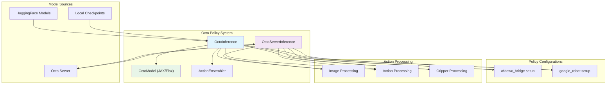
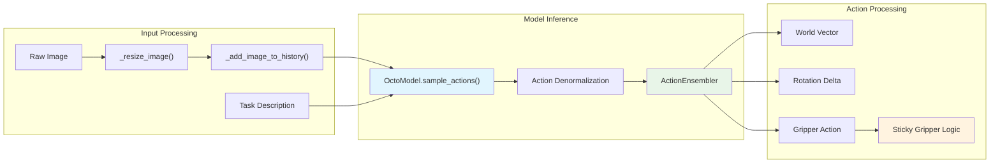
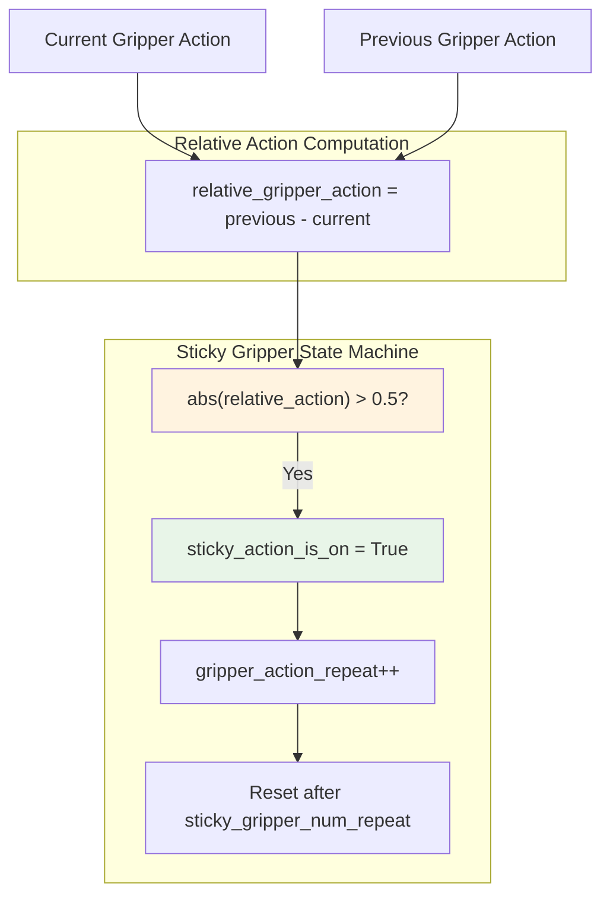

<!-- source: DeepWiki mcp.deepwiki.com · repo allenai/SimplerEnv · page 3.2 Octo Policies · fetched 2026-10-26 -->

# Octo Policies

<details>
<summary>Relevant source files</summary>

The following files were used as context for generating this wiki page:

- [scripts/octo_drawer_visual_matching.sh](scripts/octo_drawer_visual_matching.sh)
- [scripts/octo_move_near_visual_matching.sh](scripts/octo_move_near_visual_matching.sh)
- [scripts/octo_pick_coke_can_visual_matching.sh](scripts/octo_pick_coke_can_visual_matching.sh)
- [scripts/rt1_drawer_visual_matching.sh](scripts/rt1_drawer_visual_matching.sh)
- [scripts/rt1_move_near_visual_matching.sh](scripts/rt1_move_near_visual_matching.sh)
- [scripts/rt1_pick_coke_can_visual_matching.sh](scripts/rt1_pick_coke_can_visual_matching.sh)
- [simpler_env/policies/octo/octo_model.py](simpler_env/policies/octo/octo_model.py)
- [simpler_env/policies/octo/octo_server_model.py](simpler_env/policies/octo/octo_server_model.py)
- [simpler_env/policies/rt1/rt1_model.py](simpler_env/policies/rt1/rt1_model.py)
- [simpler_env/simple_inference_visual_matching_prepackaged_envs.py](simpler_env/simple_inference_visual_matching_prepackaged_envs.py)
- [simpler_env/utils/env/env_builder.py](simpler_env/utils/env/env_builder.py)

</details>


This document covers the Octo policy implementation in SimplerEnv, including local and server-based inference modes, policy configurations, and integration with the evaluation framework. Octo policies are transformer-based robotic manipulation models that can be used for visual manipulation tasks in the SimplerEnv evaluation system.

For information about RT-1 policies, see [RT-1 Policies](#3.1). For information about MolmoAct policies, see [MolmoAct Policies](#3.3).

## Architecture Overview

The Octo policy system in SimplerEnv supports two primary inference modes: local inference using JAX/Flax models and server-based inference through HTTP requests. Both modes implement the same interface for seamless integration with the evaluation framework.

**Octo Policy Architecture**


Sources: [simpler_env/policies/octo/octo_model.py:1-273](), [simpler_env/policies/octo/octo_server_model.py:1-271]()

## Local Inference (OctoInference)

The `OctoInference` class provides local JAX-based inference for Octo models. It supports loading models from HuggingFace or local checkpoints and includes sophisticated action processing logic.

### Core Implementation

The `OctoInference` class handles model initialization, image history management, and action prediction:

| Component | Purpose | Key Methods |
|-----------|---------|-------------|
| Model Loading | Load Octo models from various sources | `__init__()` |
| Image Processing | Resize and manage image history | `_resize_image()`, `_add_image_to_history()` |
| Action Prediction | Generate and process actions | `step()` |
| State Management | Reset policy state | `reset()` |

**Octo Inference Pipeline**


Sources: [simpler_env/policies/octo/octo_model.py:16-242]()

### Policy Configurations

The `OctoInference` class supports two main policy setups with different parameters:

```python
# From OctoInference.__init__()
if policy_setup == "widowx_bridge":
    dataset_id = "bridge_dataset"
    action_ensemble = True
    self.sticky_gripper_num_repeat = 1
elif policy_setup == "google_robot":
    dataset_id = "fractal20220817_data" 
    action_ensemble = True
    self.sticky_gripper_num_repeat = 15
```

The key differences between configurations are documented in [simpler_env/policies/octo/octo_model.py:31-42]().

### Image History Management

Octo models use a sliding window of historical images. The implementation maintains an image deque and attention masks:

- Image history deque: [simpler_env/policies/octo/octo_model.py:81-86]()
- History management: [simpler_env/policies/octo/octo_model.py:98-114]()
- Attention mask computation: [simpler_env/policies/octo/octo_model.py:107-114]()

## Server-based Inference (OctoServerInference)

The `OctoServerInference` class provides an alternative inference mode that communicates with a remote Octo server via HTTP requests. This is useful for distributed evaluation or when local compute resources are limited.

### Server Communication

The server inference uses JSON serialization with numpy array encoding for communication:

- JSON encoding/decoding: [simpler_env/policies/octo/octo_server_model.py:15-68]()
- Server requests: [simpler_env/policies/octo/octo_server_model.py:136-146]()
- Payload construction: [simpler_env/policies/octo/octo_server_model.py:123-134]()

### Server vs Local Differences

| Aspect | Local Inference | Server Inference |
|--------|----------------|------------------|
| Model Loading | Direct JAX model loading | HTTP requests to server |
| State Management | Local state tracking | Server-side state |
| Action Ensembling | Local `ActionEnsembler` | Server-side ensembling |
| Latency | Low | Network-dependent |

Sources: [simpler_env/policies/octo/octo_server_model.py:71-240]()

## Action Processing Pipeline

Both inference modes implement sophisticated action processing to convert raw model outputs into robot-compatible actions.

### Gripper Action Processing

The gripper action processing differs significantly between robot setups:

**Google Robot Gripper Logic**


Sources: [simpler_env/policies/octo/octo_model.py:187-232]()

### Rotation Processing

Rotation actions are converted from Euler angles to axis-angle representation:

- Euler to axis-angle conversion: [simpler_env/policies/octo/octo_model.py:181-185]()
- Scaling application: [simpler_env/policies/octo/octo_model.py:180-185]()

## Integration with Evaluation Framework

Octo policies integrate seamlessly with the SimplerEnv evaluation system through standardized interfaces.

### Script Integration

The evaluation scripts demonstrate how Octo policies are configured for different tasks:

- Drawer tasks: [scripts/octo_drawer_visual_matching.sh:5-8]()
- Coke can picking: [scripts/octo_pick_coke_can_visual_matching.sh:5-9]()
- Move near tasks: [scripts/octo_move_near_visual_matching.sh:5-8]()

### Policy Model Selection

Scripts typically define policy model arrays for batch evaluation:

```bash
declare -a policy_models=(
"octo-base"
# "octo-server"
)
```

Sources: [scripts/octo_drawer_visual_matching.sh:5-8](), [scripts/octo_pick_coke_can_visual_matching.sh:5-9]()

### Environment Configuration

Octo policies work with specific environment configurations:

- Ray-tracing for depth perception: [scripts/octo_drawer_visual_matching.sh:24]()
- Robot initialization parameters: [scripts/octo_drawer_visual_matching.sh:28-36]()
- Scene and overlay configuration: [scripts/octo_pick_coke_can_visual_matching.sh:17-19]()

## Usage Examples

### Basic Local Inference

The `simple_inference_visual_matching_prepackaged_envs.py` script demonstrates basic Octo usage:

```python
from simpler_env.policies.octo.octo_model import OctoInference

model = OctoInference(model_type=args.ckpt_path, policy_setup=policy_setup, init_rng=0)
```

Sources: [simpler_env/simple_inference_visual_matching_prepackaged_envs.py:74-77]()

### Evaluation Loop Integration

The standard evaluation loop follows this pattern:

1. Environment reset and instruction retrieval
2. Model reset with task description
3. Step-by-step action prediction and environment interaction
4. Action processing and robot command execution

Sources: [simpler_env/simple_inference_visual_matching_prepackaged_envs.py:82-124]()

### Visualization and Analysis

Octo policies support visualization of action predictions over time through the `visualize_epoch()` method:

- Action plotting: [simpler_env/policies/octo/octo_model.py:244-272]()
- Image strip generation: [simpler_env/policies/octo/octo_model.py:248]()
- Multi-dimensional action visualization: [simpler_env/policies/octo/octo_model.py:263-266]()

Sources: [simpler_env/policies/octo/octo_model.py:244-272]()

---

