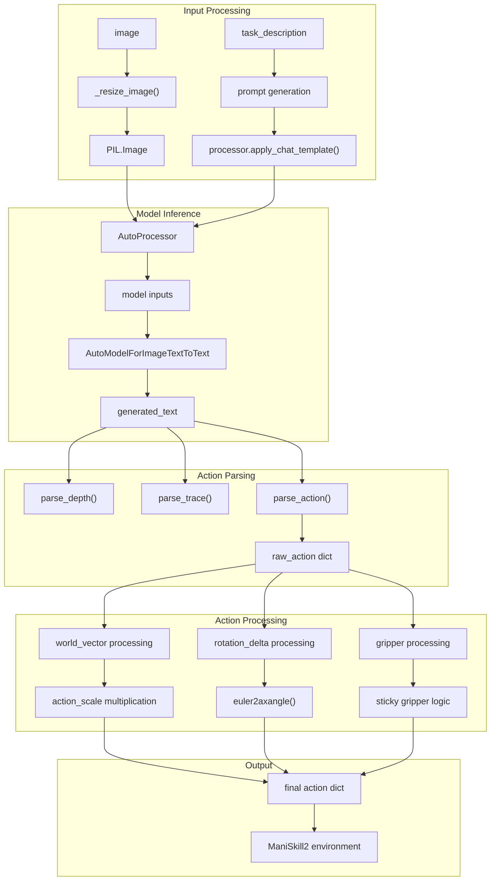
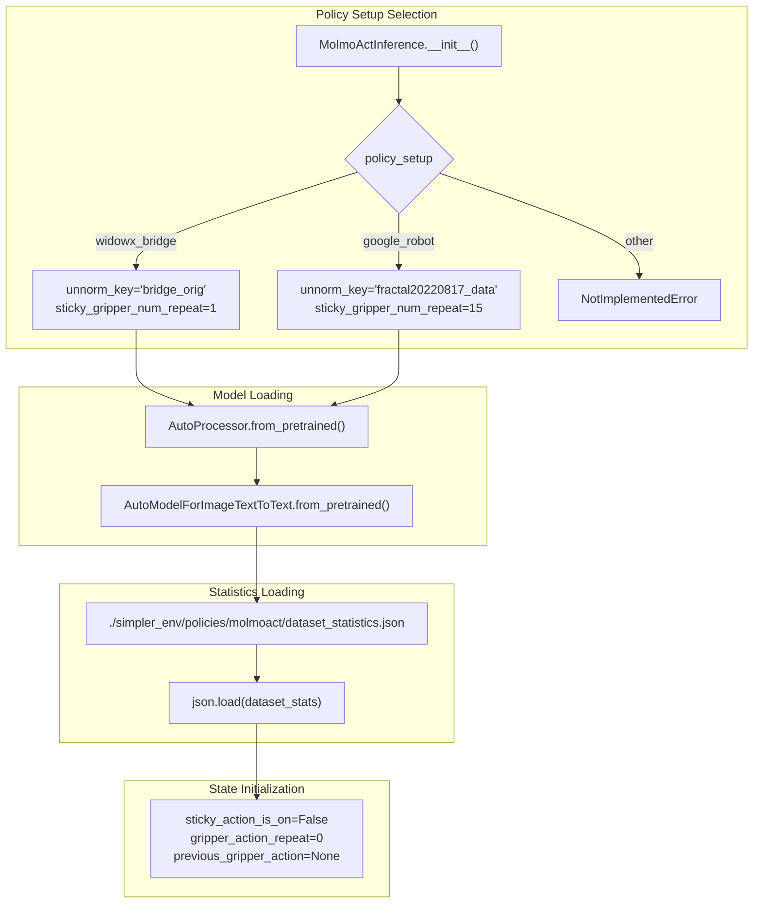
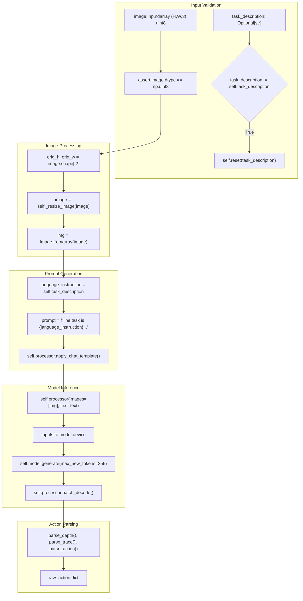
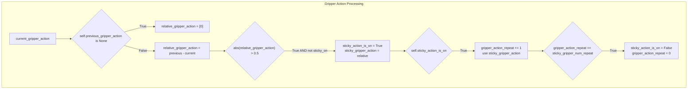

<!-- source: DeepWiki mcp.deepwiki.com · repo allenai/SimplerEnv · page 3.3 MolmoAct Policies · fetched 2026-10-26 -->

# MolmoAct Policies

<details>
<summary>Relevant source files</summary>

The following files were used as context for generating this wiki page:

- [scripts/molmoact_drawer_variant_agg.sh](scripts/molmoact_drawer_variant_agg.sh)
- [scripts/molmoact_drawer_visual_matching.sh](scripts/molmoact_drawer_visual_matching.sh)
- [simpler_env/policies/molmoact/molmoact_model.py](simpler_env/policies/molmoact/molmoact_model.py)
- [simpler_env/policies/molmoact/molmoact_model_vllm.py](simpler_env/policies/molmoact/molmoact_model_vllm.py)

</details>


MolmoAct is a multimodal vision-language model designed for robotic action generation. This document covers the implementation of MolmoAct policies within SimplerEnv, including the two inference backends, action processing pipeline, and integration with the evaluation framework.

For RT-1 policy implementation, see [RT-1 Policies](#3.1). For Octo policy models, see [Octo Policies](#3.2). For general evaluation framework usage, see [Evaluation Framework](#4).

## Architecture Overview

MolmoAct policies use a vision-language model to process RGB images and natural language task descriptions, generating robot actions through structured text generation and parsing.

### MolmoAct Policy Architecture



Sources: [simpler_env/policies/molmoact/molmoact_model.py:16-292](), [simpler_env/policies/molmoact/molmoact_model_vllm.py:22-302]()

## Implementation Variants

SimplerEnv provides two MolmoAct inference implementations optimized for different use cases:

| Implementation | Class | Backend | Use Case |
|----------------|-------|---------|-----------|
| Standard | `MolmoActInference` | HuggingFace Transformers | Development, debugging |
| Optimized | `MolmoActInferenceVLLM` | vLLM | Production, high-throughput |

### MolmoActInference (HuggingFace Backend)

The standard implementation uses HuggingFace transformers for model loading and inference:

```python
# Model initialization
self.processor = AutoProcessor.from_pretrained(saved_model_path, ...)
self.model = AutoModelForImageTextToText.from_pretrained(saved_model_path, ...)

# Inference
generated_ids = self.model.generate(**inputs, max_new_tokens=256)
```

Sources: [simpler_env/policies/molmoact/molmoact_model.py:40-54](), [simpler_env/policies/molmoact/molmoact_model.py:149-154]()

### MolmoActInferenceVLLM (vLLM Backend)

The vLLM implementation provides optimized inference with tensor parallelism:

```python
# Model initialization with vLLM
self.model = LLM(
    model=saved_model_path,
    tensor_parallel_size=torch.cuda.device_count(),
    gpu_memory_utilization=0.95,
    dtype="bfloat16"
)

# Inference with sampling parameters
outputs = self.model.generate(inputs, sampling_params=self.sampling_params)
```

Sources: [simpler_env/policies/molmoact/molmoact_model_vllm.py:54-65](), [simpler_env/policies/molmoact/molmoact_model_vllm.py:163-164]()

## Policy Configuration and Setup

### MolmoAct Policy Configuration Flow



Sources: [simpler_env/policies/molmoact/molmoact_model.py:27-42](), [simpler_env/policies/molmoact/molmoact_model.py:69-76]()

Both policy setups support different robot configurations:

| Setup | Unnorm Key | Sticky Gripper Repeats | Target Robot |
|-------|------------|-------------------------|--------------|
| `google_robot` | `fractal20220817_data` | 15 | Google Robot Static |
| `widowx_bridge` | `bridge_orig` | 1 | WidowX Bridge |

Sources: [simpler_env/policies/molmoact/molmoact_model.py:27-36]()

## Action Processing Pipeline

### Step Method Workflow

The `step()` method processes images and task descriptions through a multi-stage pipeline:



Sources: [simpler_env/policies/molmoact/molmoact_model.py:94-165]()

### Action Transformation and Output

The parsed actions undergo transformation before being sent to the environment:

```python
# Raw action structure
raw_action = {
    "world_vector": unnormalized_action[:3],      # xyz translation
    "rotation_delta": unnormalized_action[3:6],   # roll, pitch, yaw
    "open_gripper": unnormalized_action[6:7],     # gripper state
}

# Processed action structure
action = {
    "world_vector": raw_action["world_vector"] * self.action_scale,
    "rot_axangle": action_rotation_axangle * self.action_scale,
    "gripper": relative_gripper_action,
    "terminate_episode": np.array([0.0])
}
```

Sources: [simpler_env/policies/molmoact/molmoact_model.py:200-241]()

### Sticky Gripper Logic

MolmoAct implements sticky gripper behavior to ensure reliable gripper actuation:



Sources: [simpler_env/policies/molmoact/molmoact_model.py:214-235]()

## Model Checkpoints and Usage

### Available Checkpoints

MolmoAct policies support several pre-trained checkpoints from AI2:

| Checkpoint | Purpose | Path |
|------------|---------|------|
| Base Pretrain | General manipulation | `allenai/MolmoAct-7B-D-Pretrain-0812` |
| RT-1 Finetuned | RT-1 style tasks | `allenai/MolmoAct-7B-D-Pretrain-RT-1-0812` |

Sources: [scripts/molmoact_drawer_variant_agg.sh:30-33](), [scripts/molmoact_drawer_visual_matching.sh:30-33]()

### Shell Script Integration

MolmoAct policies integrate with SimplerEnv's evaluation scripts, supporting both standard and vLLM backends:

```bash
# Standard usage
POLICY_MODEL="molmoact"

# vLLM usage (with --vllm flag)
POLICY_MODEL="molmoact-vllm"

# Evaluation call
python simpler_env/main_inference.py --policy-model ${POLICY_MODEL} --ckpt-path ${ckpt_path} \
  --robot google_robot_static \
  --control-freq 3 --sim-freq 513 --max-episode-steps 113 \
  --env-name ${env_name} --scene-name ${scene_name}
```

Sources: [scripts/molmoact_drawer_variant_agg.sh:6-28](), [scripts/molmoact_drawer_variant_agg.sh:53-61]()

## Trajectory Visualization and Debugging

MolmoAct provides built-in trajectory visualization capabilities:

### Trajectory Parsing and Annotation

```python
# Extract trajectory from generated text
if "The trajectory of the end effector is" in generated_text:
    traj_part = generated_text.split("The trajectory of the end effector is")[-1]
    trajectory = ast.literal_eval(traj_str)
    
    # Draw trajectory on image
    for i in range(len(trajectory) - 1):
        pt1 = self.scale_pt(trajectory[i], new_w, new_h)
        pt2 = self.scale_pt(trajectory[i + 1], new_w, new_h)
        cv.line(annotated_image, pt1, pt2, (0, 255, 255), thickness=2)
```

Sources: [simpler_env/policies/molmoact/molmoact_model.py:175-191]()

### Epoch Visualization

The `visualize_epoch()` method creates comprehensive action plots:

```python
ACTION_DIM_LABELS = ["x", "y", "z", "roll", "pitch", "yaw", "grasp"]

# Create subplot layout
figure_layout = [["image"] * len(ACTION_DIM_LABELS), ACTION_DIM_LABELS]
fig, axs = plt.subplot_mosaic(figure_layout)

# Plot predicted actions for each dimension
for action_dim, action_label in enumerate(ACTION_DIM_LABELS):
    axs[action_label].plot(pred_actions[:, action_dim], label="predicted action")
```

Sources: [simpler_env/policies/molmoact/molmoact_model.py:250-279]()

## Integration with Evaluation Framework

MolmoAct policies support both visual matching and variant aggregation evaluation approaches through specialized shell scripts. For detailed evaluation procedures, see [Evaluation Approaches](#4.1) and [Running Evaluations](#4.2).

The policies are configured for drawer manipulation tasks with ray-tracing rendering enabled for accurate depth perception:

```bash
# Ray-tracing for depth inference
EXTRA_ARGS="--enable-raytracing"

# Visual matching with RGB overlay
--rgb-overlay-path ./ManiSkill2_real2sim/data/real_inpainting/open_drawer_a0.png
```

Sources: [scripts/molmoact_drawer_variant_agg.sh:44](), [scripts/molmoact_drawer_visual_matching.sh:60]()

---

