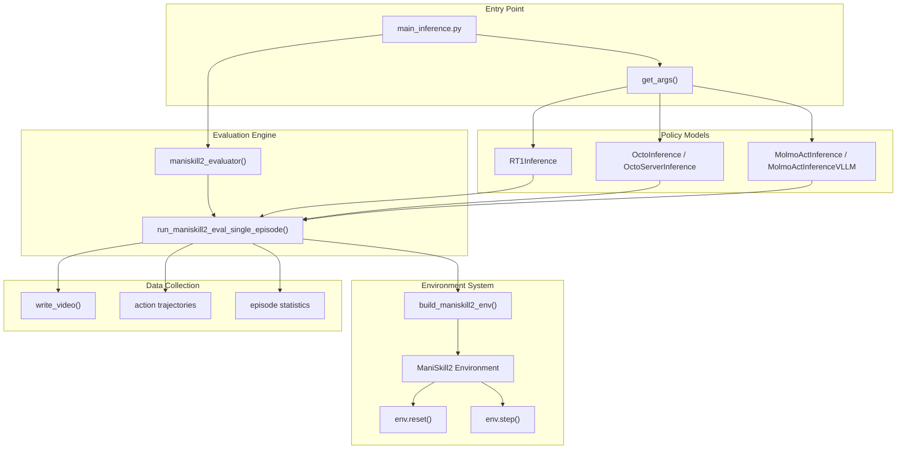
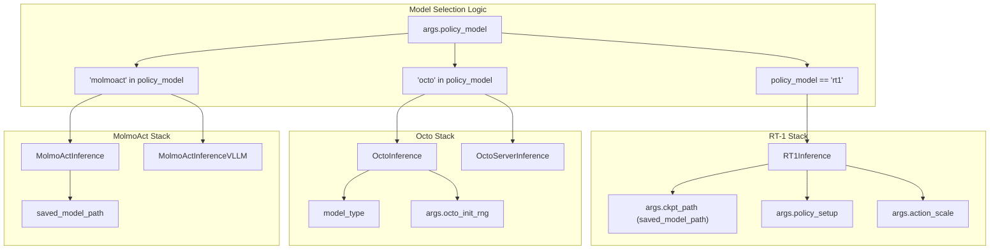
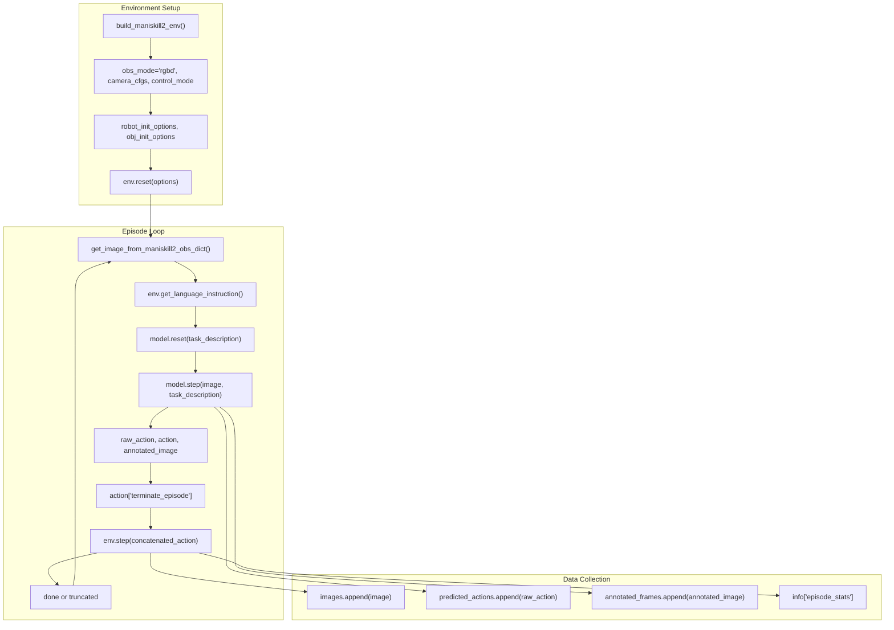
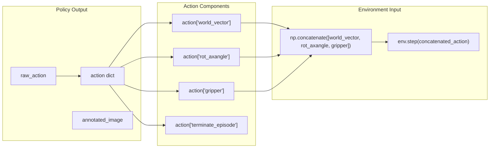
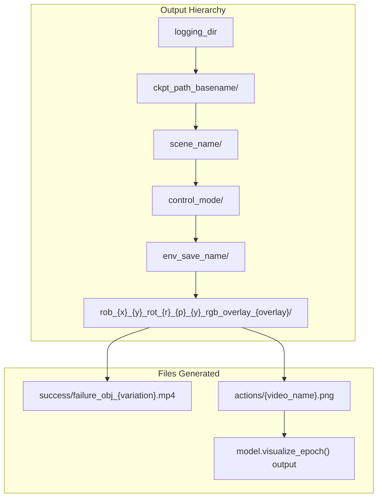

<!-- source: DeepWiki mcp.deepwiki.com · repo allenai/SimplerEnv · page 4 Evaluation Framework · fetched 2026-10-26 -->

# Evaluation Framework

Relevant source files

The following files were used as context for generating this wiki page:

- [simpler_env/evaluation/maniskill2_evaluator.py](simpler_env/evaluation/maniskill2_evaluator.py)
- [simpler_env/main_inference.py](simpler_env/main_inference.py)
- [simpler_env/policies/molmoact/dataset_statistics.json](simpler_env/policies/molmoact/dataset_statistics.json)

The Evaluation Framework is the core system for running comprehensive policy evaluations in SimplerEnv. It orchestrates the execution of trained robotic policies in ManiSkill2 simulation environments, collects performance metrics, and generates evaluation artifacts including videos and action trajectories.

For information about the specific evaluation methodologies (visual matching vs variant aggregation), see [Evaluation Approaches](#4.1). For details on analyzing the collected metrics, see [Metrics and Analysis](#4.3).

## Core Architecture

The evaluation framework consists of a main orchestration layer that coordinates policy models, environment management, and data collection systems.

### System Components

**Sources:** [simpler_env/main_inference.py:1-95](), [simpler_env/evaluation/maniskill2_evaluator.py:1-223]()

### Evaluation Pipeline Flow

```mermaid
graph LR
    subgraph "Initialization"
        PARSE["argparse configuration"]
        GPU["GPU memory setup"]
        MODEL["policy model creation"]
    end
    
    subgraph "Evaluation Loop"
        ROBOT_INIT["robot_init_xs/ys/quats"]
        OBJ_INIT["obj_init_xs/ys or obj_episode_range"]
        EP_RUN["run_maniskill2_eval_single_episode()"]
    end
    
    subgraph "Episode Execution"
        ENV_RESET["env.reset(options)"]
        LANG["get_language_instruction()"]
        MODEL_STEP["model.step(image, task_description)"]
        ENV_STEP["env.step(action)"]
        CHECK["done or truncated?"]
    end
    
    subgraph "Output Generation"
        SUCCESS["success_arr collection"]
        VID_SAVE["video saving"]
        ACTION_SAVE["action trajectory saving"]
        MEAN_SUCCESS["average success calculation"]
    end
    
    PARSE --> GPU
    GPU --> MODEL
    MODEL --> ROBOT_INIT
    ROBOT_INIT --> OBJ_INIT
    OBJ_INIT --> EP_RUN
    EP_RUN --> ENV_RESET
    ENV_RESET --> LANG
    LANG --> MODEL_STEP
    MODEL_STEP --> ENV_STEP
    ENV_STEP --> CHECK
    CHECK --> MODEL_STEP
    CHECK --> SUCCESS
    SUCCESS --> VID_SAVE
    VID_SAVE --> ACTION_SAVE
    ACTION_SAVE --> MEAN_SUCCESS
```

**Sources:** [simpler_env/main_inference.py:25-95](), [simpler_env/evaluation/maniskill2_evaluator.py:178-222](), [simpler_env/evaluation/maniskill2_evaluator.py:15-176]()

## Policy Integration

The framework supports three main policy architectures through a unified interface that handles model initialization, action inference, and episode termination.

### Policy Model Architecture

**Sources:** [simpler_env/main_inference.py:52-89]()

| Policy Type | Class | Key Parameters | Backend |
|-------------|-------|----------------|---------|
| RT-1 | `RT1Inference` | `saved_model_path`, `policy_setup`, `action_scale` | TensorFlow Agents |
| Octo (Local) | `OctoInference` | `model_type`, `init_rng`, `action_scale` | JAX/Flax |
| Octo (Server) | `OctoServerInference` | `model_type`, `policy_setup` | Remote Server |
| MolmoAct (HF) | `MolmoActInference` | `saved_model_path`, `policy_setup` | HuggingFace |
| MolmoAct (vLLM) | `MolmoActInferenceVLLM` | `saved_model_path`, `policy_setup` | vLLM Engine |

**Sources:** [simpler_env/main_inference.py:52-89]()

## Episode Execution

Each evaluation episode follows a standardized execution pattern that handles environment initialization, policy inference, and data collection.

### Episode Execution Flow

**Sources:** [simpler_env/evaluation/maniskill2_evaluator.py:40-142]()

### Action Processing

The framework processes policy outputs into ManiSkill2-compatible actions through a standardized interface:

**Sources:** [simpler_env/evaluation/maniskill2_evaluator.py:113-126]()

## Configuration Parameters

The evaluation framework accepts extensive configuration through command-line arguments that control environment setup, robot positioning, object variation, and output generation.

### Key Configuration Categories

| Category | Key Parameters | Purpose |
|----------|----------------|---------|
| **Robot Setup** | `robot`, `robot_init_xs`, `robot_init_ys`, `robot_init_quats` | Robot model and initial positioning |
| **Environment** | `env_name`, `scene_name`, `control_freq`, `sim_freq` | Environment configuration |
| **Object Variation** | `obj_variation_mode`, `obj_init_xs/ys`, `obj_episode_range` | Object placement strategies |
| **Policy** | `policy_model`, `ckpt_path`, `policy_setup`, `action_scale` | Policy model configuration |
| **Output** | `logging_dir`, `max_episode_steps`, `enable_raytracing` | Data collection settings |

**Sources:** [simpler_env/evaluation/argparse.py](), [simpler_env/evaluation/maniskill2_evaluator.py:15-38]()

### Environment Build Parameters

```mermaid
graph TB
    subgraph "Core Environment Args"
        OBS_MODE["obs_mode='rgbd'"]
        ROBOT["robot=args.robot"]
        CONTROL_MODE["control_mode=get_robot_control_mode()"]
        SCENE["scene_name=args.scene_name"]
    end
    
    subgraph "Frequency Settings"
        SIM_FREQ["sim_freq=args.sim_freq"]
        CONTROL_FREQ["control_freq=args.control_freq"]
        MAX_STEPS["max_episode_steps=args.max_episode_steps"]
    end
    
    subgraph "Visual Settings"
        CAMERA_CFGS["camera_cfgs={'add_segmentation': True}"]
        RGB_OVERLAY["rgb_overlay_path=args.rgb_overlay_path"]
        RAYTRACING["enable_raytracing=args.enable_raytracing"]
    end
    
    subgraph "Additional Build Kwargs"
        ADD_KWARGS["additional_env_build_kwargs"]
        SHADER_DIR["shader_dir='rt' (if raytracing)"]
    end
    
    OBS_MODE --> ROBOT
    ROBOT --> CONTROL_MODE
    CONTROL_MODE --> SCENE
    
    SIM_FREQ --> CONTROL_FREQ
    CONTROL_FREQ --> MAX_STEPS
    
    CAMERA_CFGS --> RGB_OVERLAY
    RGB_OVERLAY --> RAYTRACING
    
    ADD_KWARGS --> SHADER_DIR
```

**Sources:** [simpler_env/evaluation/maniskill2_evaluator.py:44-64]()

## Data Collection and Output

The framework generates comprehensive evaluation artifacts including videos, action trajectories, and performance statistics organized in a structured directory hierarchy.

### Output Structure

**Sources:** [simpler_env/evaluation/maniskill2_evaluator.py:143-174]()

### Video and Action Saving

The framework saves two types of visual outputs: raw environment observations and annotated policy visualizations.

| Output Type | Content | Location | FPS |
|-------------|---------|----------|-----|
| **Annotated Video** | `annotated_frames` from `model.step()` | `{video_path}.mp4` | 5 |
| **Action Trajectory** | `model.visualize_epoch()` output | `actions/{basename}.png` | N/A |
| **Raw Images** | `images` from environment | Used for trajectory visualization | N/A |

**Sources:** [simpler_env/evaluation/maniskill2_evaluator.py:165-174]()

The evaluation framework provides a complete pipeline from policy model loading through episode execution to comprehensive data collection, enabling researchers to systematically evaluate robotic manipulation policies across diverse simulation scenarios.

---

