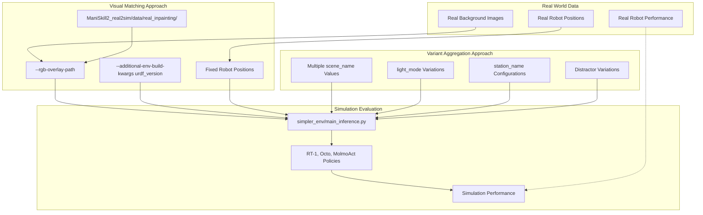
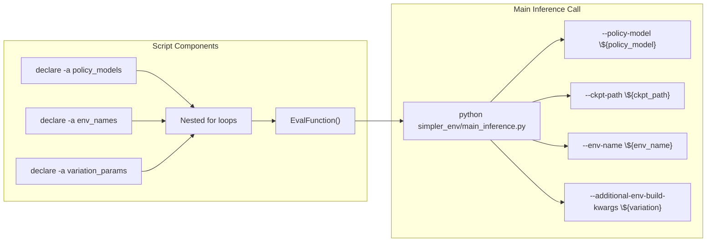

<!-- source: DeepWiki mcp.deepwiki.com · repo allenai/SimplerEnv · page 4.1 Evaluation Approaches · fetched 2026-10-26 -->

# Evaluation Approaches

Relevant source files

The following files were used as context for generating this wiki page:

- [scripts/octo_drawer_variant_agg.sh](scripts/octo_drawer_variant_agg.sh)
- [scripts/octo_drawer_visual_matching.sh](scripts/octo_drawer_visual_matching.sh)
- [scripts/octo_move_near_visual_matching.sh](scripts/octo_move_near_visual_matching.sh)
- [scripts/octo_pick_coke_can_visual_matching.sh](scripts/octo_pick_coke_can_visual_matching.sh)
- [scripts/rt1_drawer_variant_agg.sh](scripts/rt1_drawer_variant_agg.sh)
- [scripts/rt1_drawer_visual_matching.sh](scripts/rt1_drawer_visual_matching.sh)
- [scripts/rt1_move_near_variant_agg.sh](scripts/rt1_move_near_variant_agg.sh)
- [scripts/rt1_move_near_visual_matching.sh](scripts/rt1_move_near_visual_matching.sh)
- [scripts/rt1_pick_coke_can_variant_agg.sh](scripts/rt1_pick_coke_can_variant_agg.sh)
- [scripts/rt1_pick_coke_can_visual_matching.sh](scripts/rt1_pick_coke_can_visual_matching.sh)

This document covers the two primary evaluation methodologies used in SimplerEnv: **Visual Matching** and **Variant Aggregation**. These approaches enable systematic evaluation of robotic manipulation policies by bridging the sim-to-real gap through different strategies for environment configuration and data collection.

For information about running evaluations using these approaches, see [Running Evaluations](#4.2). For understanding how to analyze the results from these evaluations, see [Metrics and Analysis](#4.3).

## Overview of Evaluation Methodologies

SimplerEnv provides two distinct approaches for evaluating robotic policies in simulation environments that correspond to real-world scenarios:

**Evaluation Methodology Comparison**

| Aspect | Visual Matching | Variant Aggregation |
|--------|----------------|-------------------|
| **Goal** | Match specific real-world scenarios | Test robustness across variations |
| **Environment Setup** | Fixed positions, real backgrounds | Multiple configurations |
| **Key Parameters** | `--rgb-overlay-path`, `urdf_version` | `scene_name`, `light_mode`, `station_name` |
| **Use Case** | Validate sim-to-real transfer | Measure policy generalization |

Sources: [scripts/rt1_drawer_visual_matching.sh:1-139](), [scripts/octo_drawer_visual_matching.sh:1-136](), [scripts/rt1_drawer_variant_agg.sh:1-89](), [scripts/octo_drawer_variant_agg.sh:1-86]()

## Visual Matching Approach

The Visual Matching approach creates simulation environments that closely replicate specific real-world evaluation scenarios. This method uses real background images and carefully calibrated robot positions to match the visual appearance and geometric setup of real-world evaluations.

### Visual Matching Implementation

```mermaid
graph TB
    subgraph "Real World Reference"
        RealEval["Real Robot Evaluation"]
        BackgroundImage["Background Image Capture"]
        RobotPositions["Robot Position Measurement"]
    end
    
    subgraph "Visual Matching Parameters"
        RGBOverlay["--rgb-overlay-path ./ManiSkill2_real2sim/data/real_inpainting/"]
        RobotInitX["--robot-init-x 0.644 0.644 1"]
        RobotInitY["--robot-init-y -0.179 -0.179 1"]
        RobotInitRot["--robot-init-rot-rpy-range"]
        URDFVersions["--additional-env-build-kwargs urdf_version=recolor_cabinet_visual_matching_1"]
    end
    
    subgraph "Environment Variations"
        CabinetVariant1["recolor_cabinet_visual_matching_1"]
        TabletopVariant1["recolor_tabletop_visual_matching_1"] 
        TabletopVariant2["recolor_tabletop_visual_matching_2"]
        DefaultVariant["None"]
    end
    
    subgraph "Real Inpainting Data"
        DrawerA0["open_drawer_a0.png"]
        DrawerB1["open_drawer_b1.png"]
        CokeCanReal["google_coke_can_real_eval_1.png"]
        MoveNearReal["google_move_near_real_eval_1.png"]
    end
    
    BackgroundImage --> RGBOverlay
    RobotPositions --> RobotInitX
    RobotPositions --> RobotInitY
    RobotPositions --> RobotInitRot
    
    RGBOverlay --> CabinetVariant1
    RGBOverlay --> TabletopVariant1
    RGBOverlay --> TabletopVariant2
    RGBOverlay --> DefaultVariant
    
    DrawerA0 --> RGBOverlay
    DrawerB1 --> RGBOverlay
    CokeCanReal --> RGBOverlay
    MoveNearReal --> RGBOverlay
```

### Key Visual Matching Parameters

**RGB Overlay Configuration:**
- `--rgb-overlay-path`: Specifies real background image file
- Path format: `./ManiSkill2_real2sim/data/real_inpainting/{task_scenario}.png`
- Examples: `open_drawer_a0.png`, `google_coke_can_real_eval_1.png`

**Robot Position Matching:**
- `--robot-init-x`, `--robot-init-y`: Fixed positions matching real setup
- `--robot-init-rot-quat-center`, `--robot-init-rot-rpy-range`: Orientation parameters
- Position coordinates are precisely calibrated to real-world measurements

**URDF Variations:**
- `urdf_version=recolor_cabinet_visual_matching_1`: Cabinet color matching
- `urdf_version=recolor_tabletop_visual_matching_1`: Primary tabletop variant
- `urdf_version=recolor_tabletop_visual_matching_2`: Secondary tabletop variant
- `urdf_version=None`: Default appearance

Sources: [scripts/rt1_drawer_visual_matching.sh:20-139](), [scripts/octo_pick_coke_can_visual_matching.sh:12-44](), [scripts/rt1_move_near_visual_matching.sh:9-37]()

## Variant Aggregation Approach

The Variant Aggregation approach evaluates policy robustness by testing across multiple environmental variations. Instead of matching specific real scenarios, this method systematically varies environmental factors to measure how well policies generalize across different conditions.

### Variant Aggregation Implementation

```mermaid
graph TB
    subgraph "Base Configuration"
        BaseScene["scene_name=frl_apartment_stage_simple"]
        BasePolicy["Policy Model"]
        BaseParams["Standard Parameters"]
    end
    
    subgraph "Background Variations"
        ModernBedroom["scene_name=modern_bedroom_no_roof"]
        ModernOffice["scene_name=modern_office_no_roof"]
        AltBackground1["google_pick_coke_can_1_v4_alt_background"]
        AltBackground2["google_pick_coke_can_1_v4_alt_background_2"]
    end
    
    subgraph "Lighting Variations"
        BrighterLight["light_mode=brighter"]
        DarkerLight["light_mode=darker"]
        SlightlyBrighter["slightly_brighter_lighting=True"]
        SlightlyDarker["slightly_darker_lighting=True"]
    end
    
    subgraph "Station Configurations"
        Station2["station_name=mk_station2"]
        Station3["station_name=mk_station3"]
        StationRecolor["station_name=mk_station_recolor"]
    end
    
    subgraph "Object Variations"
        NoDistractor["no_distractor=True"]
        MoreDistractors["distractor_config=more"]
        CokeCanLR["lr_switch=True"]
        CokeCanUpright["upright=True"]
        CokeCanVertical["laid_vertically=True"]
    end
    
    subgraph "Camera Variations"
        AltCamera1["MoveNearAltGoogleCameraInScene-v0"]
        AltCamera2["MoveNearAltGoogleCamera2InScene-v0"]
        AltGraspCamera1["GraspSingleOpenedCokeCanAltGoogleCameraInScene-v0"]
    end
    
    BaseScene --> ModernBedroom
    BaseScene --> ModernOffice
    BaseScene --> AltBackground1
    
    BaseParams --> BrighterLight
    BaseParams --> DarkerLight
    BaseParams --> SlightlyBrighter
    
    BaseParams --> Station2
    BaseParams --> Station3
    
    BaseParams --> NoDistractor
    BaseParams --> MoreDistractors
    BaseParams --> CokeCanLR
    
    BasePolicy --> AltCamera1
    BasePolicy --> AltCamera2
```

### Variant Categories and Parameters

**Scene Background Variations:**
- `scene_name=modern_bedroom_no_roof`: Bedroom environment
- `scene_name=modern_office_no_roof`: Office environment  
- `scene_name=google_pick_coke_can_1_v4_alt_background`: Alternative backgrounds
- Table texture variations: `Baked_sc1_staging_objaverse_cabinet1_h870`

**Lighting Condition Variations:**
- `light_mode=brighter`: Increased lighting intensity
- `light_mode=darker`: Reduced lighting intensity
- `slightly_brighter_lighting=True`: Subtle brightness increase
- `slightly_darker_lighting=True`: Subtle brightness decrease

**Station and Cabinet Variations:**
- `station_name=mk_station2`: Alternative cabinet configuration
- `station_name=mk_station3`: Third cabinet variant
- `station_name=mk_station_recolor`: Recolored station setup

**Object and Distractor Variations:**
- `no_distractor=True`: Remove distractor objects
- `distractor_config=more`: Add additional distractor objects
- Object orientation: `lr_switch=True`, `upright=True`, `laid_vertically=True`

Sources: [scripts/rt1_drawer_variant_agg.sh:20-89](), [scripts/rt1_move_near_variant_agg.sh:12-143](), [scripts/rt1_pick_coke_can_variant_agg.sh:10-186]()

## Implementation Details and Usage

Both evaluation approaches are implemented through shell scripts that call `simpler_env/main_inference.py` with different parameter configurations. The scripts iterate through policy models, environment variations, and task configurations.

### Common Script Structure

### Key Script Parameters

**Policy Configuration:**
- `--policy-model`: Specifies policy type (`rt1`, `octo-base`, `octo-server`)
- `--ckpt-path`: Path to policy checkpoint files or `None` for default models
- `--robot`: Robot model specification (`google_robot_static`)

**Environment Configuration:**
- `--env-name`: Task environment (`OpenTopDrawerCustomInScene-v0`, `GraspSingleOpenedCokeCanInScene-v0`)
- `--scene-name`: Scene background (`dummy_drawer`, `google_pick_coke_can_1_v4`)
- `--control-freq`, `--sim-freq`: Simulation timing parameters
- `--max-episode-steps`: Episode length limitation

**Rendering Configuration:**
- `--enable-raytracing`: Enable ray-tracing for shadow rendering (crucial for drawer tasks)
- `--additional-env-build-kwargs`: Environment-specific parameter overrides

Sources: [scripts/rt1_drawer_visual_matching.sh:28-127](), [scripts/octo_drawer_variant_agg.sh:24-85](), [scripts/rt1_pick_coke_can_visual_matching.sh:30-37]()

## Choosing the Right Approach

**Use Visual Matching when:**
- Validating specific sim-to-real transfer scenarios
- Comparing simulation results directly with real-world performance
- Testing policy performance on precisely matched conditions
- Reproducing real-world evaluation setups

**Use Variant Aggregation when:**
- Measuring policy robustness and generalization
- Testing sensitivity to environmental variations
- Evaluating policy performance across diverse conditions
- Assessing the reliability of policy behavior

Both approaches can be combined in a comprehensive evaluation protocol to assess both sim-to-real accuracy and policy robustness across environmental variations.

Sources: [scripts/rt1_drawer_visual_matching.sh:1-139](), [scripts/rt1_drawer_variant_agg.sh:1-89](), [scripts/octo_drawer_visual_matching.sh:1-136](), [scripts/octo_drawer_variant_agg.sh:1-86]()

---

