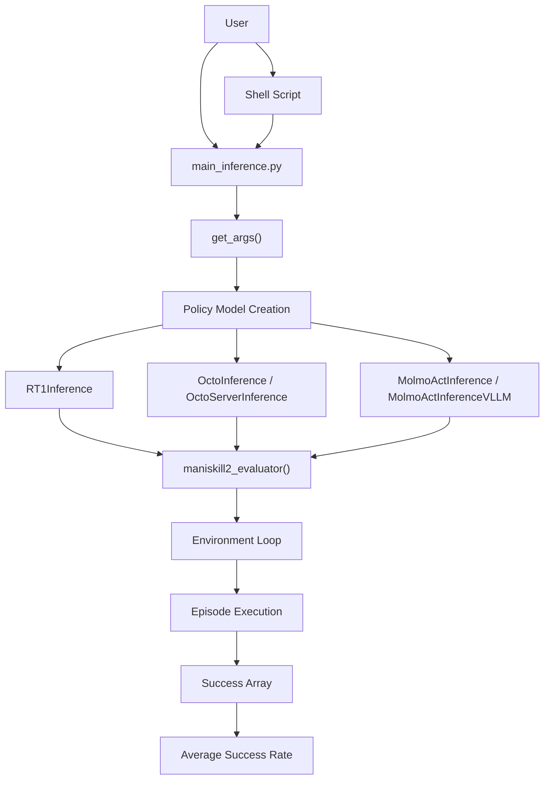
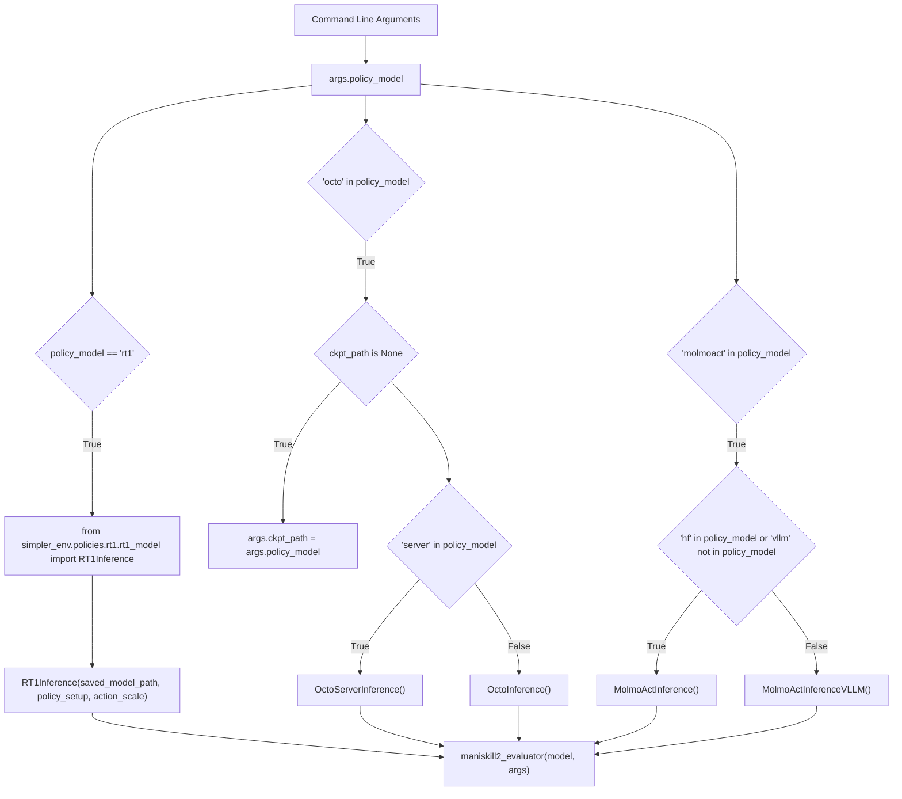
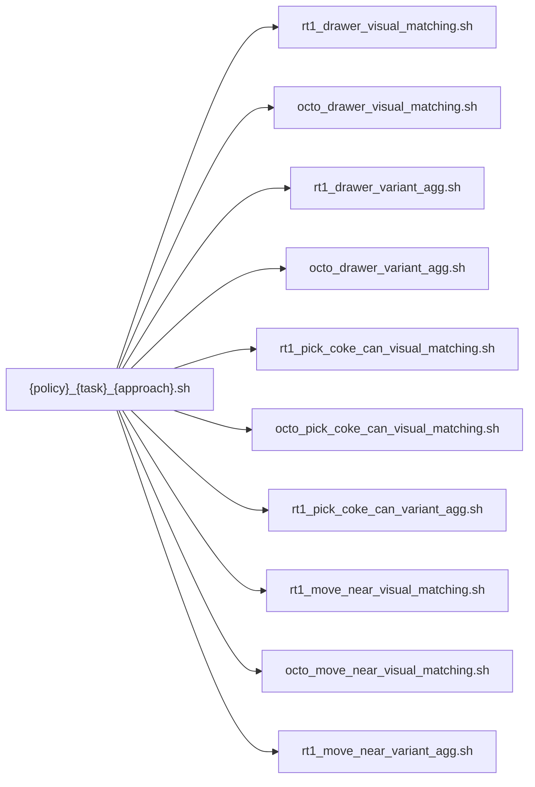
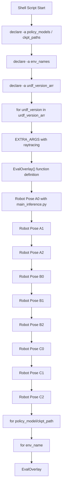
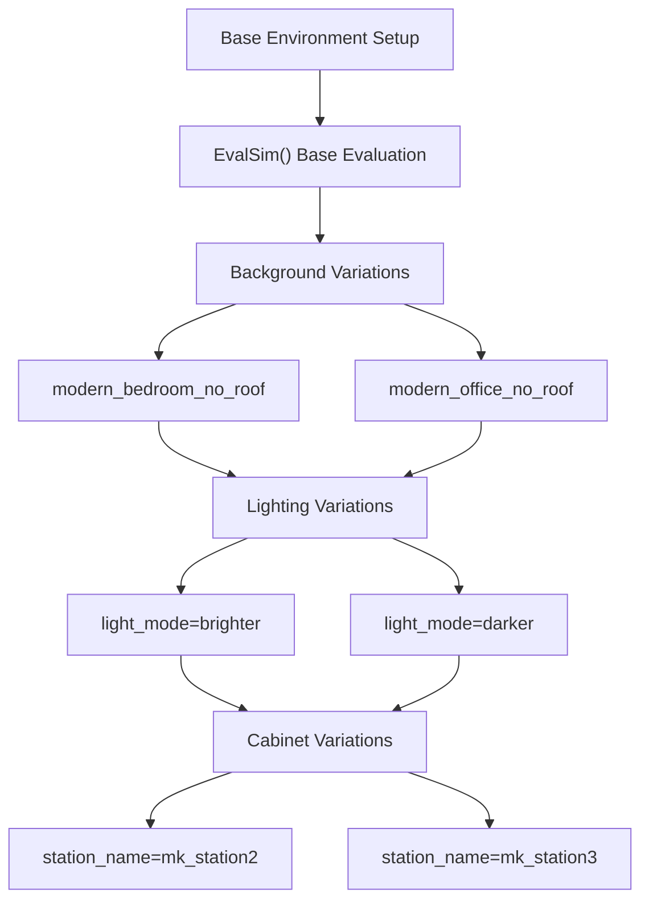

<!-- source: DeepWiki mcp.deepwiki.com · repo allenai/SimplerEnv · page 4.2 Running Evaluations · fetched 2026-10-26 -->

# Running Evaluations

<details>
<summary>Relevant source files</summary>

The following files were used as context for generating this wiki page:

- [scripts/octo_drawer_variant_agg.sh](scripts/octo_drawer_variant_agg.sh)
- [scripts/octo_drawer_visual_matching.sh](scripts/octo_drawer_visual_matching.sh)
- [scripts/octo_move_near_visual_matching.sh](scripts/octo_move_near_visual_matching.sh)
- [scripts/octo_pick_coke_can_visual_matching.sh](scripts/octo_pick_coke_can_visual_matching.sh)
- [scripts/rt1_drawer_variant_agg.sh](scripts/rt1_drawer_variant_agg.sh)
- [scripts/rt1_drawer_visual_matching.sh](scripts/rt1_drawer_visual_matching.sh)
- [scripts/rt1_move_near_variant_agg.sh](scripts/rt1_move_near_variant_agg.sh)
- [scripts/rt1_move_near_visual_matching.sh](scripts/rt1_move_near_visual_matching.sh)
- [scripts/rt1_pick_coke_can_variant_agg.sh](scripts/rt1_pick_coke_can_variant_agg.sh)
- [scripts/rt1_pick_coke_can_visual_matching.sh](scripts/rt1_pick_coke_can_visual_matching.sh)
- [simpler_env/main_inference.py](simpler_env/main_inference.py)

</details>


This document explains how to execute policy evaluations using SimplerEnv's evaluation framework. It covers the primary evaluation script, shell script workflows, and key configuration parameters. For details about evaluation methodologies (visual matching vs variant aggregation), see [Evaluation Approaches](#4.1). For understanding and analyzing evaluation results, see [Metrics and Analysis](#4.3).

## Evaluation Execution Pipeline

SimplerEnv provides two main approaches for running evaluations: direct execution using `main_inference.py` and automated execution using shell scripts that implement specific evaluation protocols.

### High-Level Evaluation Flow



**Sources:** [simpler_env/main_inference.py:1-95](), [scripts/rt1_drawer_visual_matching.sh:1-139](), [scripts/octo_drawer_visual_matching.sh:1-136]()

## Using main_inference.py

The core evaluation script `main_inference.py` serves as the primary entry point for all policy evaluations. It handles policy model instantiation, GPU memory management, and evaluation execution.

### Policy Model Instantiation



**Sources:** [simpler_env/main_inference.py:52-89]()

### GPU Memory Management

The script includes critical GPU memory management for multi-policy support:

| Configuration | Purpose | Code Location |
|---------------|---------|---------------|
| `XLA_PYTHON_CLIENT_PREALLOCATE=false` | Prevents JAX from taking all GPU memory | [simpler_env/main_inference.py:30]() |
| PyTorch CUDA initialization | Required before TensorFlow for vLLM models | [simpler_env/main_inference.py:34-39]() |
| TensorFlow memory limits | Prevents TF from taking all GPU memory | [simpler_env/main_inference.py:46-49]() |

**Sources:** [simpler_env/main_inference.py:28-49]()

## Shell Script Evaluation Workflows

The `scripts/` directory contains pre-configured shell scripts that implement standard evaluation protocols for different tasks and policy models.

### Script Organization Pattern



**Sources:** [scripts/rt1_drawer_visual_matching.sh:1](), [scripts/octo_drawer_visual_matching.sh:1](), [scripts/rt1_drawer_variant_agg.sh:1](), [scripts/octo_drawer_variant_agg.sh:1]()

### Visual Matching Script Structure

Visual matching scripts test policies against multiple real robot poses using background image overlays:



Each pose includes specific parameters:
- `--robot-init-x`, `--robot-init-y`: Robot position
- `--robot-init-rot-rpy-range`: Robot orientation variations  
- `--rgb-overlay-path`: Real robot background image
- `--additional-env-build-kwargs`: Environment configuration

**Sources:** [scripts/rt1_drawer_visual_matching.sh:22-134](), [scripts/octo_drawer_visual_matching.sh:22-132]()

### Variant Aggregation Script Structure

Variant aggregation scripts test policies across environmental variations:



**Sources:** [scripts/rt1_drawer_variant_agg.sh:24-88](), [scripts/octo_drawer_variant_agg.sh:24-85]()

## Key Evaluation Parameters

### Essential Command Line Arguments

| Parameter Category | Arguments | Description |
|-------------------|-----------|-------------|
| Policy Configuration | `--policy-model`, `--ckpt-path` | Model type and checkpoint path |
| Robot Configuration | `--robot`, `--policy-setup` | Robot model and policy setup |
| Simulation Parameters | `--control-freq`, `--sim-freq`, `--max-episode-steps` | Control timing and episode length |
| Environment Setup | `--env-name`, `--scene-name` | Environment and scene selection |
| Initialization | `--robot-init-*`, `--obj-init-*` | Robot and object placement |
| Visual Matching | `--rgb-overlay-path` | Real robot background image |
| Environment Variants | `--additional-env-build-kwargs` | Scene modifications |

### Initialization Parameter Syntax

Robot and object initialization uses a min/max/count format:
- `--robot-init-x 0.644 0.644 1`: Fixed x position at 0.644
- `--robot-init-x 0.65 0.85 3`: Sample 3 x positions between 0.65 and 0.85
- `--obj-init-x-range 0 0 1`: Fixed object x offset
- `--obj-variation-mode episode --obj-episode-range 0 60`: Object variation across episodes

**Sources:** [scripts/rt1_drawer_visual_matching.sh:34-36](), [scripts/octo_move_near_visual_matching.sh:31]()

### Environment Build Arguments

The `--additional-env-build-kwargs` parameter passes key-value pairs to environment construction:

| Argument | Purpose | Example Values |
|----------|---------|----------------|
| `urdf_version` | Robot appearance variant | `recolor_cabinet_visual_matching_1` |
| `station_name` | Cabinet/workspace variant | `mk_station_recolor`, `mk_station2` |
| `light_mode` | Lighting configuration | `simple`, `brighter`, `darker` |
| `shader_dir` | Rendering mode | `rt` (ray tracing) |
| `disable_bad_material` | Material fixes | `True`/`False` |

**Sources:** [scripts/rt1_drawer_visual_matching.sh:24](), [scripts/rt1_drawer_variant_agg.sh:58-86]()

### Ray Tracing Configuration

Critical for drawer tasks where policies rely on shadows for depth perception:
```bash
EXTRA_ARGS="--enable-raytracing --additional-env-build-kwargs station_name=mk_station_recolor light_mode=simple disable_bad_material=True urdf_version=${urdf_version}"
```

**Sources:** [scripts/rt1_drawer_visual_matching.sh:1-2](), [scripts/rt1_drawer_visual_matching.sh:24]()

---

